# 密歇根大学《深度学习用于计算机视觉｜Deep Learning for Computer Vision UMich EECS 498-007 2019》中英字幕 p03 -03-3_LinearClassifiers.zh_en -BV1jA4m1P7GN_p3-

唱号。

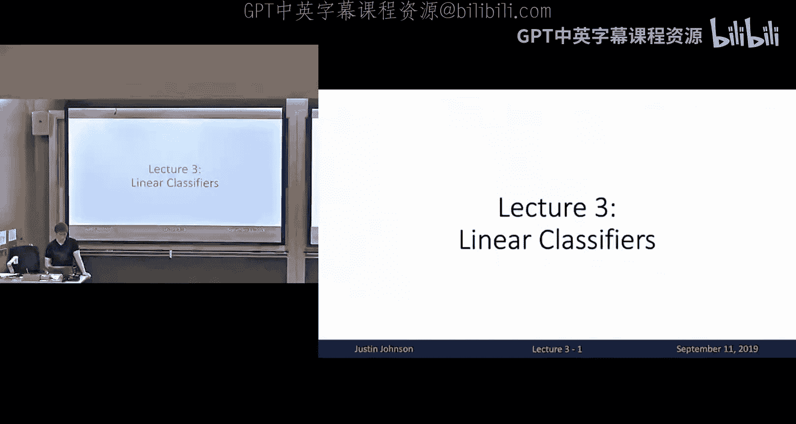

Okay， it's now 431， so let's get started。So welcome back to lecture3 today we're going to talk about linear classifiers。

 but before we get into the technical content for today， as usual。

 we need to cover sort of any administrative details So the big reminder is about assignment1 so reminder that assignment1 is released and we'll be due this Sunday hass anyone started working on it yet。

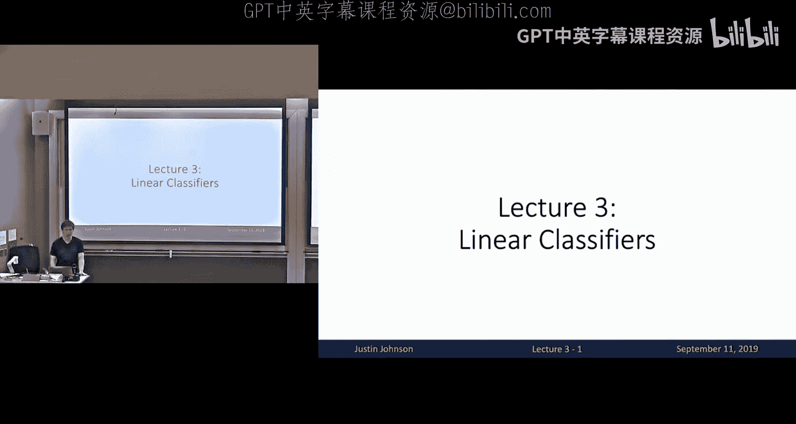

No， okay， has anyone finished it yet？Okay， okay good。 I'm impressed。 Very good。

 So one bit a couple pieces of notes about assignment1。

 So one is that we had to change the Google Drive file and reupload the file last night sometime。

 So I got a couple requests for collaboration to the the old file that we made private。

 So if you're in the situation where you think you don't have access to the homework you actually do just go back to the course website。

 clear the cache in your browser and refresh and you'll get the new updated Google Drive file。

 so don't worry about that。A second piece of new stuff about homework1 is that we've written a validation script for you to help validate the structure of your submission file before you upload onto canvas so as you know。

 we asked you to do the homework assignments on Google coab and then once you finish the homework assignment you're supposed to download the dot and B file and then zip the file and upload to Can but to make grading easier on our end and on your ends to make sure you didn't miss any bits of code that we asked you to write we wrote this validation script that will check that your files or have the proper names that there are the right number of files and that you haven't modified any of those parts of those notebooks that you weren't supposed to Yeah question。

Professor， there are some parts which work。啊，我这。こずに。It part。

So the question was about some parts being covered up。 So if you're not familiar with on Google coab。

 the cells can collapse and then uncollapse。 So if's so by default。

 the notebooks have many of the sections collapsed。

 especially on the Ptorrch 101 notebook So those should all be available right now。

 you just need to click the little plus button to sort of uncollapse the sections that may have been collapsed by default and some of the sections can collapse recursively So some sections can be collapsed that when expanded have other sections that are then collapsed。

 you need to make sure you expand recursively All the sections to make sure you've done all the pieces of the homework。

 Now that's sort of why we wanted to write this validation script for you because it might be kind of tricky。

 you might accidentally forget to uncoapse all the cells。

 we wanted to make sure that you didn't forget to answer any bits of the assignment that you were supposed to So make sure that you run the validation script on your submission file before you upload to canvas and it's your responsibility to make sure that you do that and that your submitted file is properly formatted。

 Yeah question。No， nothing changed。 We just had a little bit of technical issues on our end that forced us to re upload。

 So sorry for any inconvenience that caused anyone last night。

So any more questions on assignment1 before we move on？Great。😊。

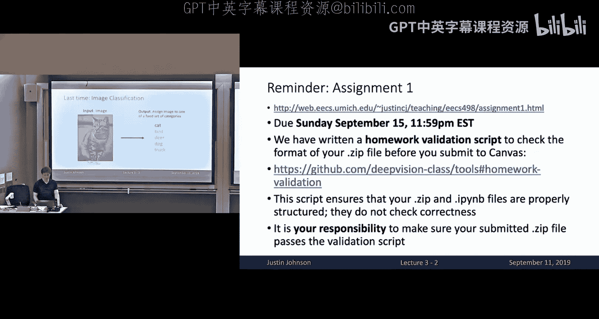

So a quick recap in the last lecture we talked about this image classification problem and you'll recall that this was a foundational problem in computer vision where we had to take this input image。

 and then our network or system had to predict category label from one of a fixed set of categories for the input image and remember last time we talked about in various challenges of this image recognition or image classification problem that we somehow need to build classifiers that can be robust。

 all these different sorts of variation that can appear in our input data。

 things like viewpoint viewpoint changes， illumination changes， deformation， etc cea。

 that somehow the challenge in building high performance recognition systems is building systems that are robust。

 all these different changes in the visual input that they need to process。

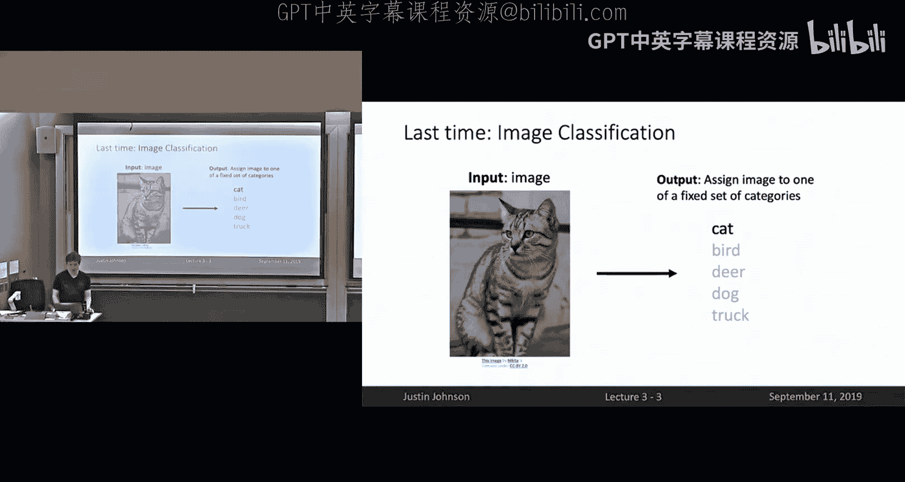

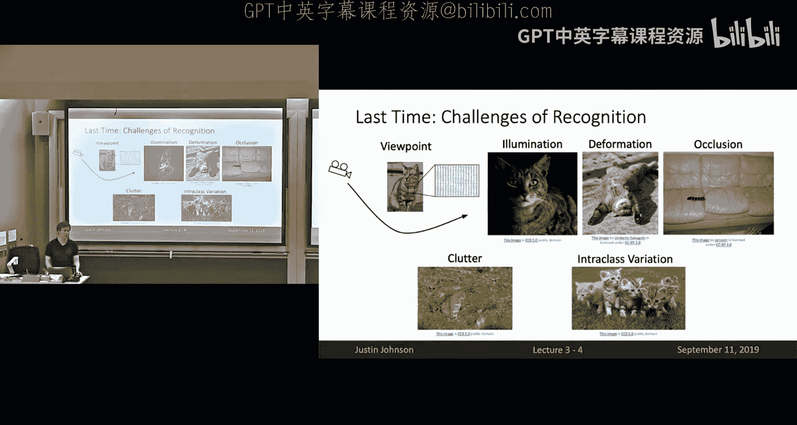

So you'll remember also last time we talked about the data-driven approach to overcoming some of these challenges that rather than trying to write down an explicit function that deals with all of those hairy bits of visual recognition instead our approach is to collect a big data that hopefully covers all of the types of visual things that we want to recognize and then to use some kind of learning algorithm to learn from the data how to recognize various types of images and as a concrete example of this pipeline in the last lecture。

 we talked about the can nearest neighbor classifier that was fairly simple that memorized the training data and then output the label at test time that of the image most similar to in the training set to the test data and we saw how this led to ideas of hyperparas and cross validation and and we went through this entire pipeline of an image classification system in the last lecture。

But remember when we left off， we said that the Can nearest neighbor algorithm was actually not very useful in practice for a couple reasons。

 one was that it inverted this idea of what is slow and fast。

 that it was very fast at training but very slow to evaluate and the other problem was that it wasn't very perceptually meaningful that sort of L2 Euclidean or L1 distances on raw pixel values was not a very perceptually meaningful thing to measure。

So today we're going to talk about a different sort of classifier that is very different in flavor from the can nearest neighbor classifier that we talked about before so today we're going to talk about various types of linear classifiers that we can use to solve this image classification problem。

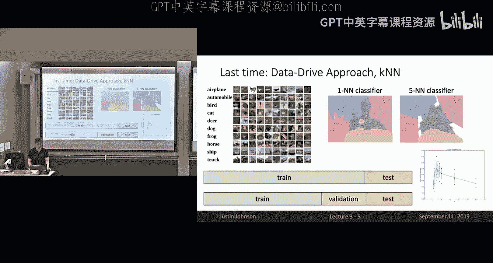

So linear classifiers might sound kind of simple， but they're actually very important when you're studying neural networks。

 because sometimes when you build neural networks， it's kind of like you want to stack all together your layers as a set of LeGgo blocks and one of the most basic blocks that you're going to have in your toolbox when you build these large complicated big neural networks is a linear classifier so sort of speaking coarsely once we move beyond linear classifiers and move to these big complicated neural models then we'll see that the individual components of those neural network models will look very similar to these linear classifiers that we'll talk about today and indeed much of the intuition and technical bits that we'll cover today will carry over completely as we start to move to neural network systems in the next couple of lectures。

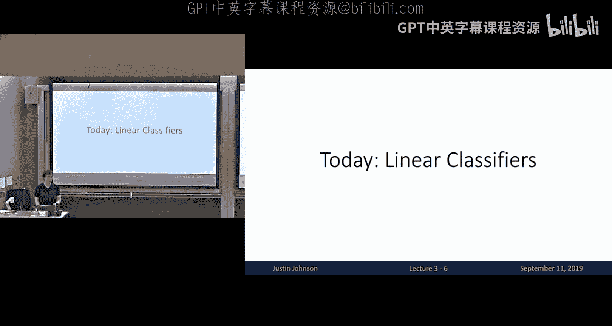

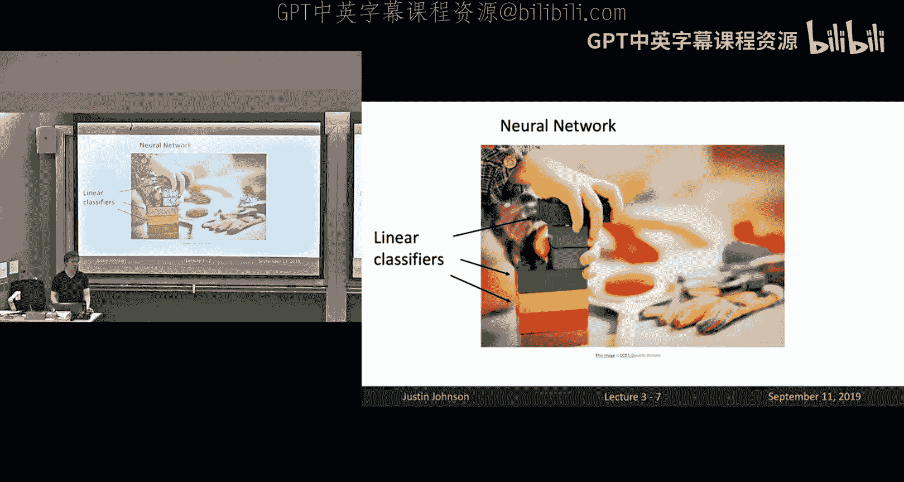

So as a quick recap， remember that we've been working with this CfR 10 data set and that the CfR 10 data is one of these standard benchmark data sets for image classification that contains 50000 training images and 10000 test images where each of these images is little little tiny。

 So it's 32 pixels by 32 pixels。 And within each pixel we have three scalar values for the red。

 blue and green color channels of the pixel。So so the idea of a linear classifier is part of a much broader set of approaches toward building machine learning models。

 So that's the idea of a parametric approach。 So the idea of a parametric approach。

 is that we're going to take our input image much as we've seen in the previous lecture。

 but now there's a new component in our system。 and that's these learnable weights W down in red at the bottom of the slide。

 So then're going so we're then going to write this function F which is going to somehow input the image。

 the pixels of the image X， as well as well as these learnable weights W and the functional form will somehow end up spitting out 10 numbers giving some classification scores for each of the categories that we want the system to be able to recognize。

 So this is a fairly general framework and a fairly general setup and this idea of a parametric classifier will carry over completely to the neural network systems that we'll talk about。

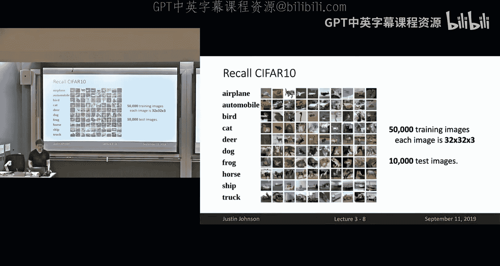

But today we're going to talk about possibly simple the simplest possible instantiation of this parametric classifier pipeline。

 and that's the linear classifier where it has the simplest possible functional form where this f of image X and weights W is just going to be a matrix vector multiply between the learnable weights W and the pixels of the image X。

So put to make this a little bit more concrete in remember that the input image for something like Cf 10 is a 32 by 32 by3。

 which means that if we count the total number of scalar values that are inside each of those images and kind of multiply it out。

 you end up with with 3072 individual scalar numbers that make up the pixels of that input image。

 so then we will have a weight matrix。 So then well take the pixels of the image and stretch them out into a long vector。

 So this will completely destroy all of the spatial structure in the image and we'll just reorganize all of the data in the input image into a long vector that has 3072 elements。

And of course， do we'll need to do this vector vectorification of our image in a consistent way that every time we take an image。

 we always need to convert it into a vector in the consistent same way every time。

And once we have chosen some way to flatten our image data into a vector。

 then our learnable weight matrix will be a two dimensional matrix of shape 10 by 3072， where 10。

 remember， is the number of categories that we want to recognize and 3072 is the number of pixels in the image。

 And this， and when you perform this， this matrix vector multiplication， the output will be again。

 a vector of size 10， where 10 giving one score for each of the 10 categories that we want our classifier to recognize。

So sometimes you'll also see linear classifiers with a bias term that will be a matrix vector multiply。

 plus an additional bias term B， where B is this vector with 10 elements。

 giving offsets for one of each of the 10 categories that we wish to learn。

So this this is a fairly straightforward way to think about linear classifiers。

 but over the next couple slides， I want to dive into what this means in the context of image classification。

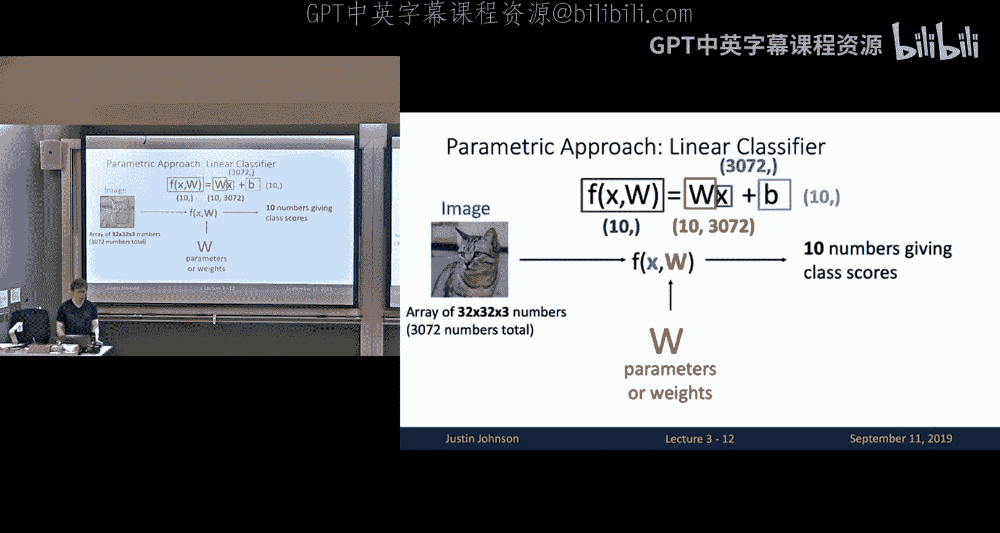

So first， as a concrete example， suppose that we just want to make this super concrete。

 Suppose that our input image is a two by two grayscale image。

 So then it has only four pixel values that give the full state of the image。

 Then we want to stretch the pixels out into a vector form into a column vector with four entries。

 So here I've just written out the exact values of each of the pixels in this in this image。

And then our weight matrix is and then in this simple example。

 we'll consider classifying only three categories rather than 10 maybe cat。

 dog and ship shown in with these three corresponding colors。 Now， in this simple example。

 the weight matrix W will have shape 3 by 4 where three is the number of categories we want to recognize and4 is the total number of pixels in our input image。

 And then our bias will again have shape 3 because this is the number of categories that we want to recognize。

 So then we'll perform this vector matrix multiplication and we'll output this vector of scores giving one score for each category we want to recognize。

So when you look at the problem in this way， you can start to recognize a little bit of structure in how we're breaking up this image classification problem。

 So if you remember the way that matrix vector multiplication works。

 you know you take the vector and you kind of take inner products along each row of the matrix。

 you recognize that you realize that each row of this matrix corresponds to one of the categories that our classifier wants to recognize。

So I think it's useful to think about linear class fires in a couple couple of different equivalent ways。

 And when you think and by using different viewpoints to think about linear class fires。

 it can make certain properties of them very very obvious in or non-ob。

 So having different ways to think about a linear classifier can help you understand it more intuitively。

So the first idea that the first way I like to think of linear classifiers is what I call the algebraic viewpoint。

 which is exactly this this idea of a linear class fire as a matrix vector multiply plus a vector offset。

 And if you think about the algebraic viewpoint of a linear class fire。

 there's a couple features or facts about linear class fires that immediately become obvious。

One is that we can equivalently we can do what sometimes is referred to as the bias trick that eliminates the bias as a separate learnable parameter and instead incorporates the bias directly into the weight matrix W。

 the way that we do this is that we can augment our input image the vector representation of our input image with an additional constant one at the end of the vector and then augment our weight matrix with an additional column corresponding that will now perform the exact same computation as the Wx plus B formulation that we saw before。

 So that's kind of a nice feature and this bias trick is quite is pretty common to use when your input data has a native vector form。

 So it's nice to be aware of as you think about building different types of machine learning systems。

 but in fact， in computer vision， this bias trick is less common to use in practice because it doesn't carry over so nicely as we move from linear class buys to convolutions later on。

 and furthermore， it's nice sometimes to separate the weight in the bias into separate parameters。

We can treat them differently in how they're initialized or regularized or other things like that。

 But nevertheless， this bias trick is a fairly nice thing to be aware of for linear classifiers。

 And it's totally obvious when you think about it， when you think about linear classifiers through this lens of the algebraic viewpoint。

😊。

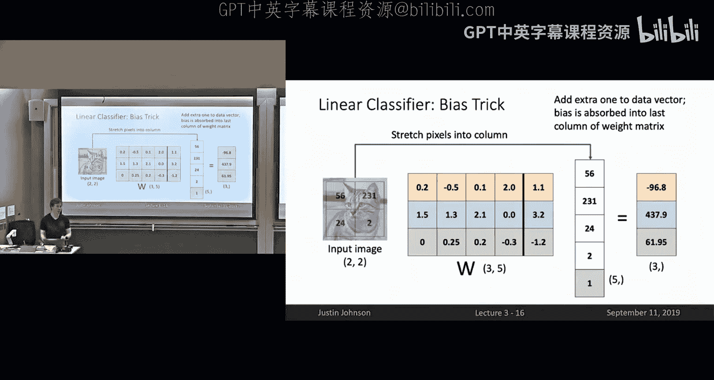

AnotherAnother thing that's very obvious when you think about linear classifiers in this algebraic way is that the predictions are linear。

 So what this means is that so is a simple example， if we ignore the bias。

 and we imagine scaling our whole input image by some constant C。

 then we could just pull that constant out of the linear classifier。

 and that means that the predictions of the model will also be scaled by by that scalar value C。

 So if you think about images， that means that if we have some input some original image on the left with some with some predicted classifier scores from a linear classifier。

 then if we were to modify the image by sort of desaturating it by multiplying all the pixels by some constant one half。

 then then all of the predicted category scores from the classifier would all be cut in half as well。

 So this is maybe a bug， maybe a feature， but it feels kind of weird for linear classifiers to behave in this way on image data because you might think that just by scaling down all the。

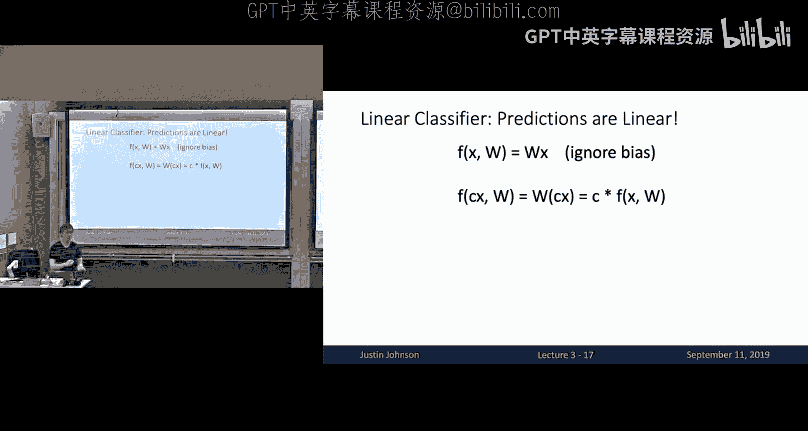

Pixels by a constant value。 We， as humans have can still recognize this as a cat just as easily。

 But somehow it's a bit unintuitive that just scaling down all the pixels can change the predicted scores from the classifier。

 So that's that's a kind of a weird feature of linear classifiers may or may not be important。

 depending on exactly what loss function use to train these。 So we'll talk about that a bit later。

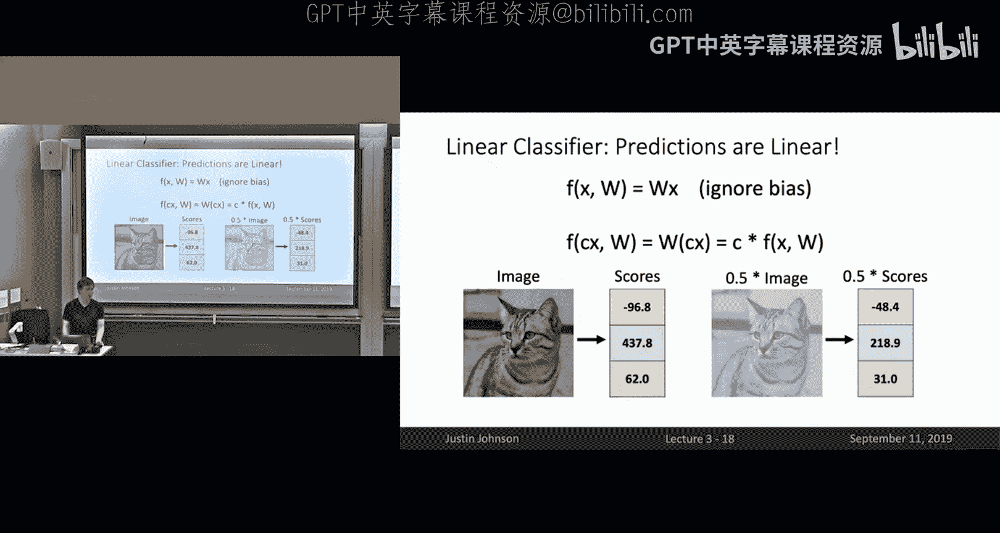

So that's the algebraic viewpoint that I like to think about for linear class fires。

 but there's a very， a we can reformulate this computation in an equivalent but slightly different way that will give us a slightly different way to think about exactly what image linear class fires are doing in the context of image data。

So remember from this algebraic viewpoint of a matrix vector multiply。

 we saw that the classification score that's predicted for each category is the result of an inner product between the vector representation of the image and one of the rows of the matrix right Well in this algebraic viewpoint recall that we had taken the pixel values of our input image and stretched them out into a column vector and then when we took this inner product。

 we ended up with an inner product of these these rows and the matrix and the column of the stretched out version of the image Well。

 rather than stretching out the image into a column vector。

 we can instead think about reshaping the rows of that matrix into the same shape as the input image。

Then we get a system that looks something like this on the right。

 So here we've taken each of the rows of the matrix and reshaped them to have this same two by two shape as the image that we're trying to classify。

 And now then we've broken up these rows of the matrix into these four different sort of columns in the diagram here。

 And now weight and now the biospec has then been broken up into these three separate elements that we split that we split along the columns。

So then when we think about linear classifiers in this way。

 it lets us interpret interpret their behavior in a slightly different and perhaps more。

 more intuitive way。 So that's what I like to call the visual viewpoint of linear classifiers because if you think because now that we've taken each of these rows of the weight matrix and stretch them out to have the same shape as the image what we can then do is try to visualize each of the rows of that matrix as an image itself and this interpretation of a linear classifier looks kind of like template matching because now the classifier is learning one image template per category that we want to recognize and each of these templates is then and then to produce the category score for the template we simply match up the template for the class with the pixels of the image by computing an inner product between them。

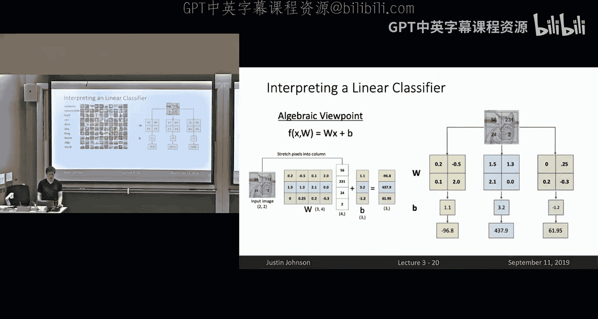

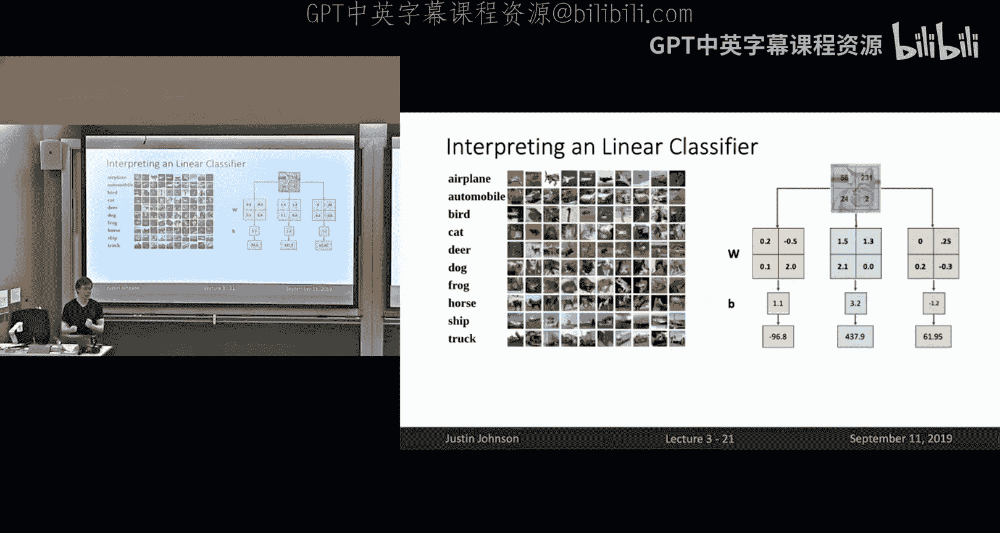

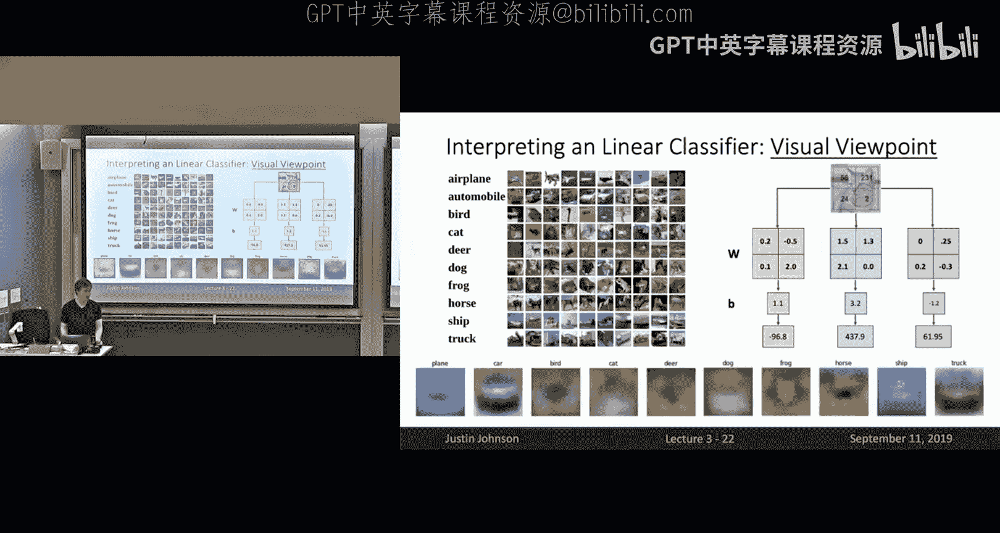

And you might remember that if you have two vectors that are maybe of unit norm。

 and you take the inner product of two vectors， then they achieve their maximum when they're all lined up。

 which sort of fits with this idea of template matching。

And now it's really interesting if you then you by visualizing these these learned templates from the classifier as images themselves。

 you get a bit more intuition about exactly what this linear classifier is looking for in images when it tries to recognize the different categories。

 So， for example， on the bottom left， you can see that this plain category。

 It's maybe looking for some kind of a blob in the middle。

 and it's generally looking for blue images。 So any images that have a lot of blue in them are going to be very highly receive very high scores for the plane class using these particular weight matrix for a linear classifier。

😊，Similarly， the deer class is kind of this green blobby background with kind of a brown blob in the middle that is maybe the deer So that's again。

 gives us some more intuition about what the linear classifier is looking at and one thing that's kind of interesting from this viewpoint is that it it becomes clear that even though we told the class fire that we wanted to recognize object categories like planes and dogs and deer In fact。

 it's using a lot more evidence from the input image than just the object itself and it's in fact relying very strongly on the context cues from the image if so for example。

 if you imagined putting in an image that that had maybe a car in a forest that would be kind of confusing for a linear classifier because the forest background might be very green and then would achieve very high scores according to the deer classifier where the car in the middle might match up more to the car template so in some kind of image with objects in unusual contexts it would be very likely that that a linear class。

F would completely fail to properly recognize those objects。

 And that becomes very obvious when you think about the visual viewpoint of these linear classifiers。

So another sort of another potential failure mode of linear class fires that becomes clear when you think about this visual viewpoint is that of mode splitting。

 So our linear class fire is only able to learn one template per category。 But there's a problem。

 What happens if we have categories that might appear in different types of ways So as a concrete example。

 think about horses。 So if you go and look at the Cf 10 data set。

 which maybe you might have done if you started working on the first homework assignment。

 then you'll see that horses on Cf 10 are sometimes looking to the left and they're sometimes looking to the right and they're sometimes looking dead on Now。

 if we have horses that are looking in different directions。

 then the visual appearance of the images of horses looking in different directions will be very different。

 But unfortunately， the linear class fire has no way to disentangle its representation and no way to separately learn templates for horses that are looking in different directions。

 So in fact， if you look at this example of if you look at this learned template。

Hse from this one particular linear class fire。 you can kind of see that it actually has two heads。

 So if you look at the horse here， he has kind of a brown blob in the middle and green on the bottom。

 which you might expect。 But now there's a blackb black blob on the left and a black blob on the right。

 which might So then this is the linear class fire trying to do the best that it can to match horses looking in different directions。

 using only a single template that it has the ability to learn。

So this is also somewhat visible in the car example。

 You can see that the car template doesn't actually look anything like a car。

 It just kind of looks like a red blob and a windshield。 And again。

 the car template might have this funny shape because it's trying to use a single template to cover all possible appearances of cars that you might see in the data。

This also gives us a sense that maybe CFFR 10 has a lot of red cars because the car template that it's learned is red。

 and maybe if we try to recognize green cars or blue cars， then the classifier might fail。

 and all of these type of failure modes become very obvious when you think about the linear classifier from this visual viewpoint。

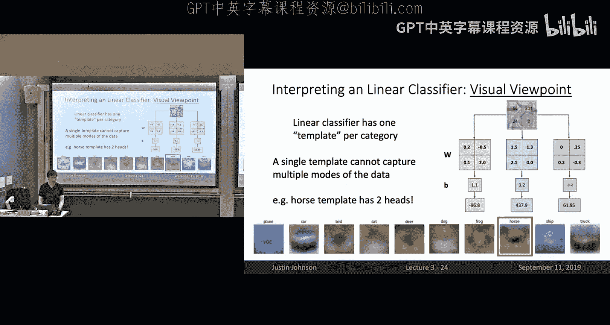

So another a third way that we can think about linear classifiers is what I like to call the geometric viewpoint。

 So here we can imagine drawing a plot where on the X axis。 So here we pick up。

 we pick out a single pixel in the image。 and now we draw a plot where the x axis is the value of the pixel and the y axis is the value of the classifier as that pixel changes。

 maybe as we keep all the other pixels in the image fixed。

 And now because this linear classifier is a linear function。

 then clearly the classifier score must vary linearly as we change any of the individual values in the any of the individual pixel values in the image。

So this is not very interesting when you think about this example with only a single pixel。

 so we can instead try to broaden this viewpoint and incorporate multiple pixels simultaneously。

 So then we can imagine drawing a plot where the X axis is maybe one pixel in the image and the y axiss is a second pixel in the image。

 And then now because I can't really draw three dimensionsal plots on PowerPoint。

 you have to live with some kind of a contour plot。

 So here then we could draw a line where the car score is equal to one half。

 And you can see that this level set of the car score forms a line in in this pixel space。

 and then because this is linear， the score there is a direction in this pixel space along which the car score will increase linearly。

 which is orthogonal to this line。And kind of tying this back to the template view。

 the car template will lie the learned card template will lie somewhere along this line。

 which is orthogonal to the level set of the of the car score。And then similarly， similarly。

 for all the scores， for all the different categories that we're trying to recognize。

 we'll end up having different lines with different level sets and different and the cart and the template。

 the learned templates for those categories， orthogonal to the level sets in this pixel space。Now。

 of course， looking at only two pixel images like we're doing in this example is not very intuitive。

 but you can imagine that this viewpoint would extend to higher dimensions as well。 So here。

 the idea is that we imagine a very， very， we imagine this linear classifier as taking the whole space of images as this very。

 very high dimensionional Euclidean space。 And now within that Euclidean space we have different hyperplanes that are trying to one hyperplane per category that we want to recognize and each of those hyperplanes we try to each of the hyperplanes for each of the categories we want to recognize are now cutting this high dimensionional Euclidean space into two half spaces along this level set。

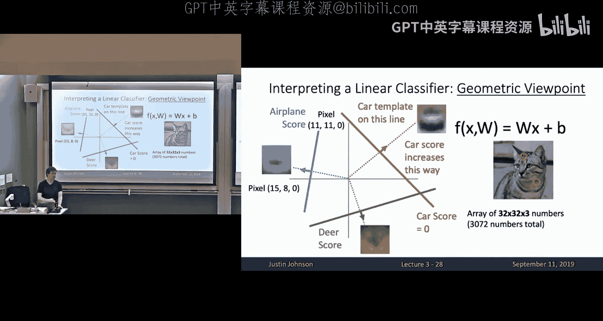

So that's this third viewpoint on linear classifiers。

 which is of one hyperplane per class cutting up this high dimensional Euclidean space of pixels。

So when this geometric viewpoint is is a very useful way to think about linear classifiers。

 But again， I would caution you that geometry gets really weird in high dimensions。 So we。

 unfortunately， are cursed to live in a low dimensional three dimensional universe。

 So all of our physical intuition about how geometry behaves is really shaped by these very low number of dimensions。

 and that's kind of unfortunate because the way that geometry Euclidean geometry behaves in very high dimensions can be very non-intuitive to to this two low dimensions to our low dimensional experience。

 So while I think that this this geometrymetric viewpoint is kind of useful sometimes it's very easy to be led astray by geometric intuition because we happen to have all our intuition built on low dimensional spaces。

But nevertheless， the geometric viewpoint does let us get some other ideas about what kinds of things a linear classifier can and cannot recognize so then based on this geometric viewpoint we can try to write out different types of cases different kinds of classification settings that would be difficult or impossible for a linear classifier to properly recognize。

 So here the idea is that we've colored this twodimensal pixel space with red and blue corresponding to different categories that we want the classifier to try to recognize and these are all three cases that are completely impossible for a linear classifier to recognize so on the left we have this case red and blue in the first and and the third quadrants having in one category and the second and fourth quadrants being of a different category and then if you think about it there's no way that we can draw a single hyperplane that can divide that can divide the red and the blue here So that's a case that is just impossible for a linear classifier。

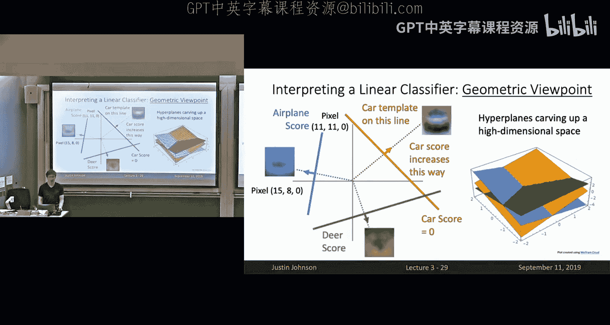

Recognize。Another case that's completely impossible for linear class fires is this case on the right。

 which is very interesting of three modes。 So here here we've got the blue in the blue category。

 there's maybe three distinct patches and parts in regions in pixel space that correspond to possibly different visual appearances of the category where we we want to recognize and then if we have these different disjoint regions in pixel space corresponding to a single category again。

 you can see there's no way for a single line to perfectly carve up the red and the red and the blue regions So this right example of these three modes is I think similar to what we saw in the visual example of maybe the horses looking in different directions that you can imagine maybe in this high dimensionional pixel space there's some region of space corresponding to horses looking right and a completely separate region of space corresponding to horses looking different direction and again with a single and now with this geometric viewpoint of hyperplanes cutting up high dimension。

SpIt again becomes clear that it's very difficult for a linear classifier to carve up classes that have completely separate modes of appearance。

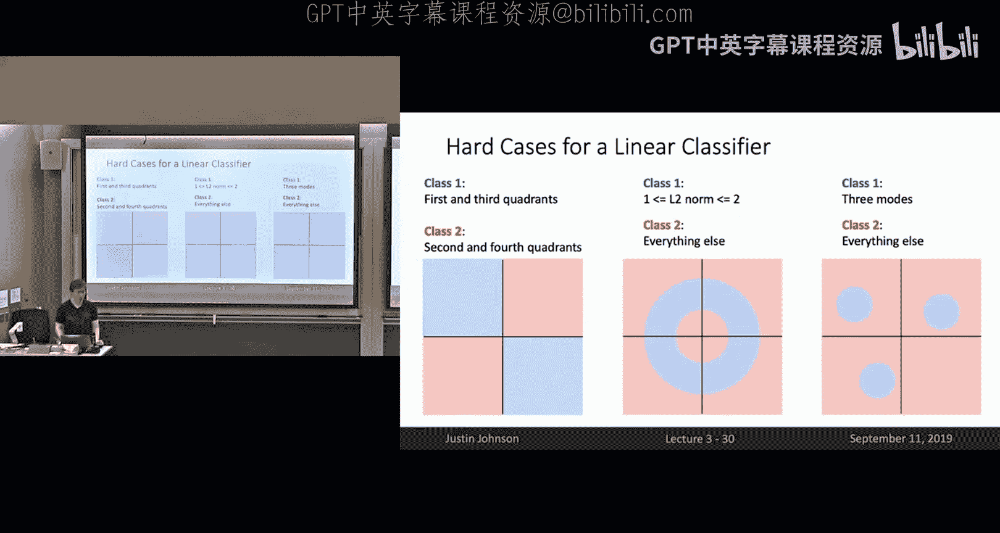

And this also ties back to the historical context that we saw in the first lecture。

 If you remember in the first lecture last week， we talked about this historical context of different types of machine machine learning algorithms people had built over the years and one of these very first machine learning algorithms that got people very excited was the perceptron that all of a sudden there was this machine that could learn for data it could learn to recognize digits and characters and got people really excited but it had but now were if you were to look back at the exact math of the perceptron now。

 we would recognize that as a linear classifier and because the perceptron was a linear classifier。

 there's a lot of things that it was just fundamentally unable to recognize the most famous example was the Xor function which is shown here which where we have the green is one category and the blue is a different category so because because the perceptron was a linear model。

 there was no way that it could carve up these these input these red and green regions sorry green and blue regions。

A single line。 And therefore， there was no way that the perceptron could learn the Xor function。

 So that's kind of a nice bit of historical context about why the geometric viewpoint was historically useful for having people think about how machine learning algorithms could operate。

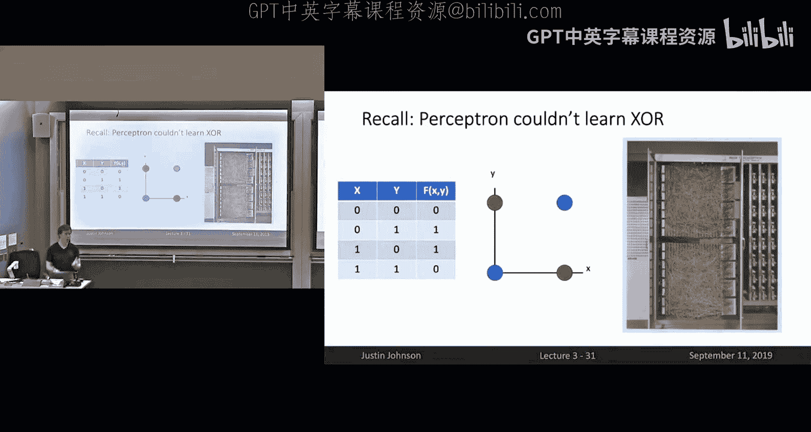

So then we' so now to this point， we've talked about linear classifiers as this fairly simple model of a matrix vector multiply。

 And we've seen how even though there this is a fairly simple equation to write down。

 if you unpack it and think about it in different ways。

 some of the shortcomings of its representational abilities become clear as we think about it from these different viewpoints。

 So is there any questions about these different viewpoints of linear classifiers so far。

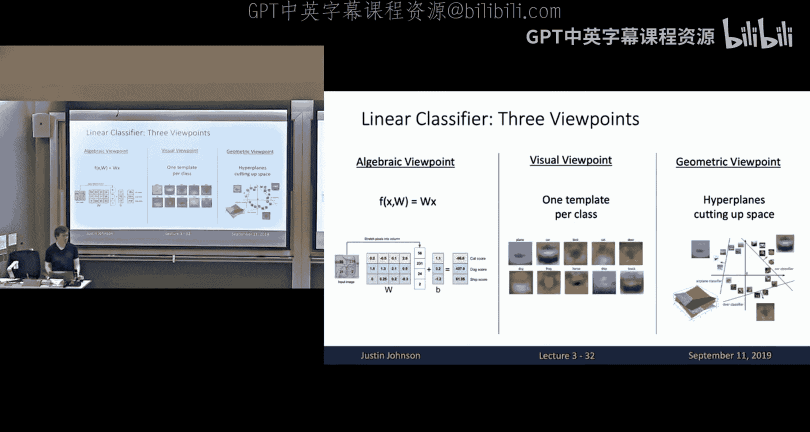

Okay， so then basically where we are now is that once we have a linear classifier。

 we're able to predict scores， right？ given any value of the weight matrix W。

 we can perform this matrix vector multiply on an input image to now spit out a vector of scores for the classes that we want to that we want to recognize。

 So as an example here， we've got three images and 10 categories for Cf 10。

 So for any particular value of the weight matrix W。

 we can run the classifier and get these vectors of scores。

 But this has told us nothing about how we actually select the weight matrix W and we've not said anything about the learning process by which this matrix W is selected or learn from data。

So that now in order to actually write down in order to actually implement linear classifiers。

 we need to talk about two more things。One is we need to use the idea of a loss function to quantify how good any particular value of W is。

 and that's what we'll talk about for the rest of this lecture。 And then in the next lecture。

 we'll talk about optimization， which is the process by which we try to search using our training use our training data to search over all possible values of W and arrive at one that works quite well for our data。

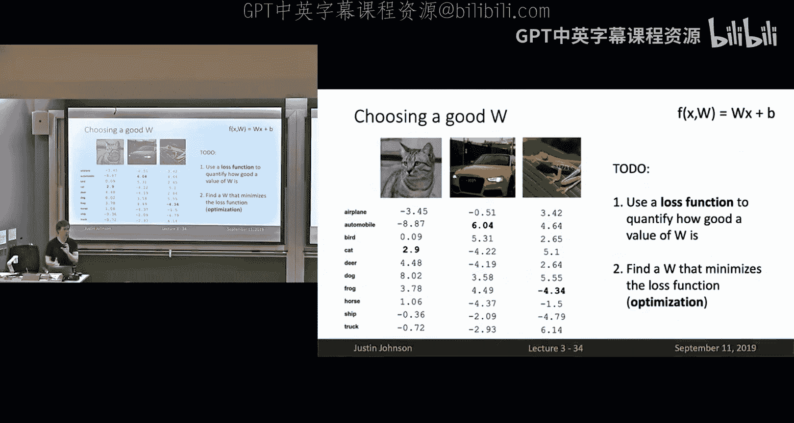

So a little bit more formally， a loss function is some way to tell how good our classifier is doing on our data with the interpretation that a high loss means we're doing bad and a low loss means that we're doing good。

 and goal the whole goal of machine learning is to write down loss well that's a little bit reductive。

 but one way one way that we can think about a lot of neural network systems is writing down loss functions that try to capture intuitive ideas about what types of models are good when models are working well and when models are not working well。

 and then finding and then once we have this quantitative way to evaluate models。

 then to try to find models that do good。 and it' a bit of terminology。

 this term of a loss function also sometimes be called an objective function or a cost function in other bits of literature and because people can never agree on names sometimes people will talk about the negative of a loss function instead。

 then loss function is something you want to minimize sometimes people want to maximize something instead and if the thing we care to if we。

Want to write down in our model by maximizing a function then it'll typically be called something like a reward function or profit function。

 utility function， fitness function。 Each subfield has their own names and bits of terminology。

 but they're all the same idea。 It's just a way to quantify when your model is doing well and when your model is not doing well。

SoThen a bit more formally， the way that we'll usually think about this is we have some data set of examples where each input is a vector X and each output is a label Y in the image classification case。

 X will be these images of fixed size and y will be an integer， giving the label will be an integer。

 indexing into the categories that we care to recognize。Now， the loss for a single example。

 will often write as LI， and it will take in。 so then F of X I and W will be the predictions of our model on a data point X I。

 and the loss function will then assign a score of badness between the prediction and the ground truth or true label Yi。

And then the loss over the entire data set will simply be the average of all the losses of the individual examples in the data。

嗯。So then this is kind of the idea of a loss function in the abstract。

 and the first concrete loss function。 And then you can imagine that as we try to tackle different tasks in machine learning。

 we can we need to write down different types of loss functions for each different task that we want to try to solve。

 And even when we're focused on a single task， we can often write down different types of loss functions that encapsulate different types of preferences over when models are going to be good and when models are going to be bad。

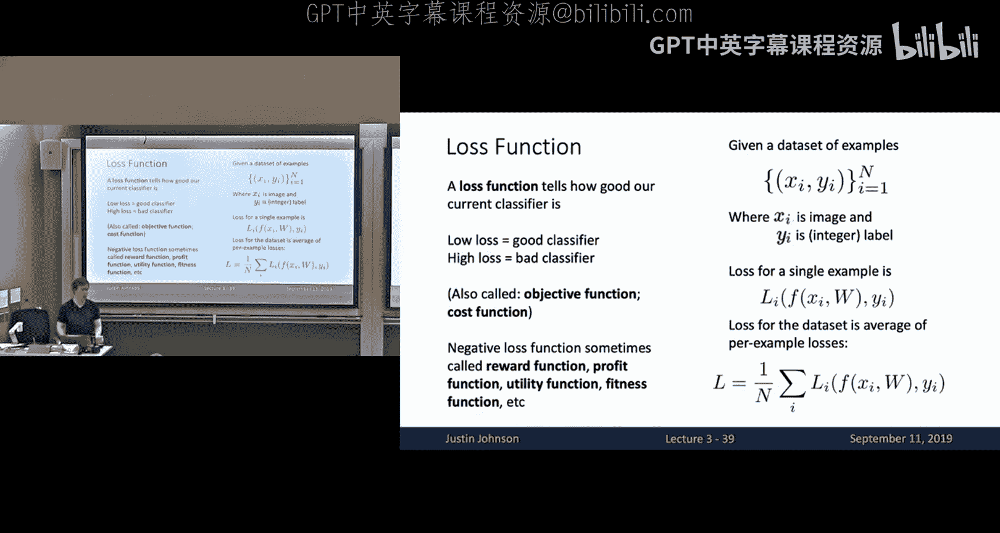

So as a first example of a loss function， I want to talk about the multiclass SVM loss for image classification or really for classification more generally So here the idea of the multi-class SVM loss is quite intuitive what it basically says is that the score of the correct class should be a lot higher than all of the scores assigns to all of the incorrect classes right that's kind of an intuitive statement that if we want to use this classifier to actually predict to recognize images。

 then at the end of the day， we don't care about the predicted scores。

 we want to assign a single label to each image that we want to classify and in order to do that。

 it seems reasonable that we want our classifier to assign high scores to the right category and low scores to all the other categories and now the multi-class SVM loss is one particular way to make the intuition concrete。

So what exactly the multiclass SVM loss computes？Is that we can draw a plot here where the X axis is going to be the score for the correct class for the example we're considering。

 and the y axis will be the loss for that individual data point that we're trying to classify。

Then in addition to keeping track of the score of the correct class。

 we also want to keep track of the highest score among assign to all other categories that we care to recognize。

 so maybe if we were classifying an image whose correct class is cat。

 then the X axis would be the cat score， and then this particular dot would be the highest score assigned to all of the other categories in the classifier。

And then the multiclass SVM loss looks like the following。

 It's going to decrease it's going to decrease linearly and once the score of the correct class is more than some margin over the second highest score among all the incorrect classes。

 well that will give us zero loss and are called it low loss means a good classifier and then moving to the left。

 you can see that as the score for the correct class becomes close or even higher than the score to the highest incorrect class。

 then the loss we assign to that example will increase linearly and this type of loss function that has a general shape of kind of a linear region and then a zero region this type of a shape of loss function comes up a lot in different contexts in machine learning and this is often called a hinge loss because it looks kind of like a door hinge that can open and close。

So we can write down the same intuition mathematically like the following。

 given a single data example， X Xi image and Yi label。

 then the SVM loss has has the form has the form where we sum over each of the category labels not including the correct label Yi。

 So you see the sum here goes over all category labels but excludes the correct class。

 And now it's going to take the max of0 and the class we're looping over minus the correct class plus one And if you kind of think about the different cases about what can be higher and what can be lower。

 you can see that this correspond this formula on on the right corresponds to two cases。

 One is that if the correct class is more than one greater than the incorrect class。

 we then we achieve a loss of0 for that class。 So basically what this is saying is that we're summing over all the classes that we want to recognize。

 and we're going to assign sort of a mini loss per class per。Her incorrect category。

And now if the incorrect category is less than is greater than one less than the correct class then we invoke then we take some loss whereas if if the correct class is more than one greater than the incorrect class。

 then we get zero loss for that class example pair and then we loop over all all the classes that we care to recognize So because that's a little bit hard to wrap your head around。

 we can kind of look at a more concrete example， so here we're imagining a data set of three images hopefully you can recognize as expert human visualizers that these are cats。

 cars and frogs， and now we're imagining some particular setting of the weight matrix W that causes our class fire to spit out these scores for these images So given these scores and these images。

 we can compute the SVM loss as follows So first we in order to compute the loss for the cat example。

 then we need to loop over all the incorrect classes。

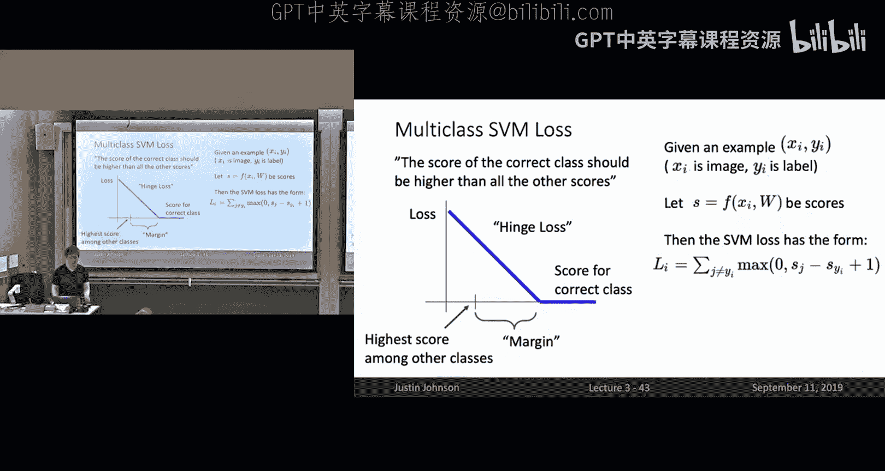

Of the all the incorrect categories。 So we skip the cat category。 And now for the car category。

 we compute max of 0，5。1 is the car score。 -3。2 is the cat score plus1 is the margin。

 And that gives us a score for that thing of 2。9。 And now for the car category， we see that。

Then we see that cat is more than one greater than frog than the frog score。

 so then we achieve zero loss for the category of frog。

 and the overall loss for the cat example is for this cat image is 2。9。

We we can do something similar for the car image and here because the correct category the correct category of this image is car and the score we're currently assigning to it is 4。

9 and 4。9 is more than one greater than all of the scores assigned to the incorrect categories so we achieve a loss of zero for this example。

 and you can imagine computing doing the same computation for the frog example here we get a lot of loss because we've assigned a very low score to the frog category。

And then to compute the loss over the full data， we just take an average over the loss over the examples。

So now a couple questions。 First， think about what happens if the loss， what happens to the。

 to this loss if， if some of the predicted scores for the car image were to change a little bit。Well。

 in this case， because the car image is achieving zero loss overall。

 if we and the predicted first score is a lot greater than any of the other scores assigned to the incorrect classes。

 you can see that if we were to change the predicted scores of this example by a little bit。

 then we would still achieve zero loss。 that's kind of that's one interesting property of the multi-class SVM loss is that once an example is correctly classified。

 then changing the predicted scores of that example just a little bit。

 don't really affect the loss anymore。So another question is。

 what's the maximum and minimum possible values for this loss on a single example。Yeah。

 so the minimum loss is zero， so we achieve the minimum loss when the correct category lot is has a score much higher than all the incorrect categories and the maximum loss is infinite。

 and that happens when the correct category has a very。

 very low loss that's much smaller than all the other predicted losses。So then another question。

 if all of the score， if we had a linear classifier that was randomly initialized。

 the weight matrix had not been learned at all， then and if the values of the weight matrix were all maybe small random values。

 then maybe then we would probably expect at initialization when we first start the learning process that all of the predicted scores for the linear classifier would also be small random values for each of the categories So in this case。

 if all of the predicted scores or small random values。

 then approximately what loss would we expect to see from the SVM classifier。I heard zero。

 that's actually not correct。Small。So when I say， okay， maybe this was not very precise。

 but maybe that was my fault for asking an imprecise question。

 but if all of this so maybe if we're going to draw each of the scores from some Gaussian distribution with maybe a standard deviation of like 0。

001， something very， very small。 then in that case。

 if all of the predicted scores would then be small random values。

 So then the expected difference between the correct and any of the incorrect categories would be approximately0。

 So then if you imagine turning through this loss computation， we would get like small value。

 minus small value is approximately0。 and then this overall and then plus one would give max of 0 and1。

 So then we would achieve a loss of 1 per incorrect category which and again。

 because this sum is looping over all the incorrect categories， then in this case。

 we would expect to see a loss of approximately c minus-1 where C is the number of categories that we're trying to recognize。

Now， this might seem like kind of a stupid question to ask。

 but it's actually a really useful debugging technique。

 When you're implementing a neural network or other kind of learning-based system。

 and you should think about what type of loss you expect to see if all of the scores are approximately random。

 And then when you start training your system if you actually see a loss。

 which is very different from what you expect， then probably you have a bug somewhere。

 So this might have seemed like a contrived question。

 But it's actually a very useful debugging technique to go through this exercise of thinking about what kind of loss would you expect to see a small random values。

 whenever you go and implement a new loss function or start training with a new loss function。

So then another question is that we saw in this formulation of the SBM loss that were summing over all of the incorrect categories only。

 so what would happen if we were to sum over all the correct over all of the categories including the correct category。

 would this represent the same preference over classifiers。

 or would this represent some other type of class fire。

 some other type of preference over weight matrices？Well， in this case， all。

 we would just expect all of the scores to be inflated by one， right。

 because this would be adding an extra term to the sum。sorryrry。Okay， yeah， yeah。

 So then we would then we would expect all the we would expect all the predicted losses to just go up by a constant one because we'd add an extra value to the sum。

 which was S Y I minus S Y I， which would be 0 plus1 max 011 is1。

 So we just add one to all the losses。 So this would express the same preference over classifiers。

 because all the losses would be inflated by a value of one， but the relative assignment。

 but we would not change our order about whether we would prefer one one weight matrix all over another because all the losses would just be inflated by one。

So then another question， what would happen if if we， rather than using a sum。

 we used a mean over categories instead of a sum。唔。

So here then of all of the computed losses would just be multiplied by a factor of 1 over c -1。

 And again， because that's a monotonic transform， this would express the exact same preference over weight matrices。

 So the values of loss would change that we see when we're training。

 but exactly the preference over weight matrices would be the same。So another question。

 what if we used some other type of formulation， What if we took a square。

 What if we put a square over this max value。So this would now express quite a different。

 This would actually be quite different。 So this would change all of the scores in a nonlinear way。

 and this would cause our the preference over weight matrices that we're expressing with our loss function to change in a nontrivial way。

 So this would no longer be called you could no longer call this a multi-class SVM loss。

 because this would now be expressing a different set of preferences over our possible weight matrices。

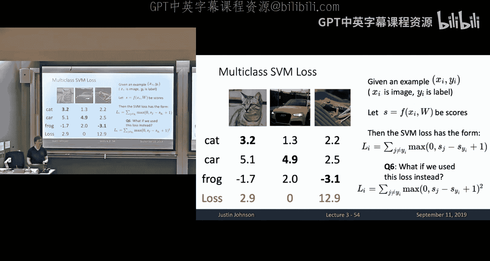

So then now another question， what happened if we found some if we happens to get lucky and find some weight matrix W that caused the overall SVM loss to be 0。

If we， if we happen to find such such an example with zero loss， would it be unique。

So here it would not be right because if we would take our weight matrix and multiply at all by two。

 then we would still get overall loss of0 and we can see that by working through one of these examples that if the loss was0。

 that meant that that the score for the correct category was more than one greater than all the scores for the incorrect categories so then if we multiply the weight matrix by  two。

 then all of the predicted scores will also go up by a factor of two because the classifier is linear。

 which will mean that now all of our predicted all of the predicted scores for the correct categories will be more than two greater then all of the scores for the incorrect categories。

 so we'll still be over the margin and we'll still get zero loss。

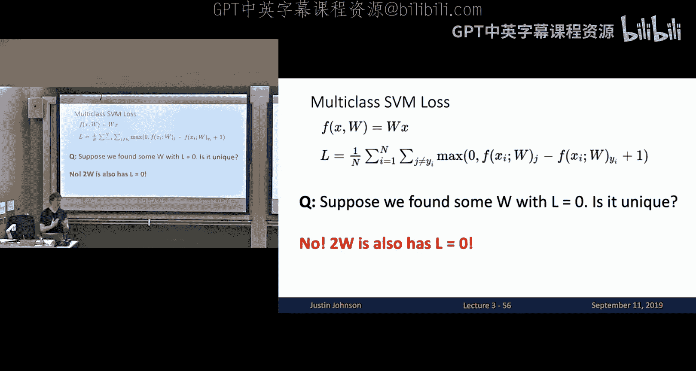

So now that leads to kind of an interesting question now now then it's possible that we can have two different weight matrices that achieve the exact same loss。

 than how can we possibly express preferences over these weight matrices right because in this case we found two different weight matrices that achieve the same loss on the training data so in order to distinguish them。

 we need some other we need some additional mechanism beyond the training set loss in order to express our preferences over classifiers。

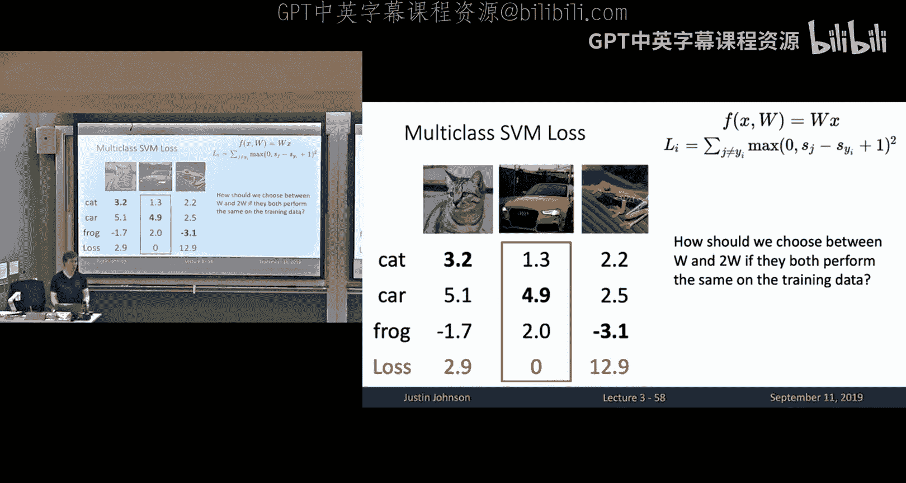

So this is an idea， this is one idea called regularization。 So regularization is something thing。

 some piece that you add to the objective function or the overall learning objective that is fighting against the training what is performing well on the training data。

 So so far， we've seen this overall loss as the average loss of all the examples on the training set。

 So this is usually called the data loss， which is somehow measuring how good are the models's predictions on the training data。

And it's very common to add an additional term to our overall loss function that does something else that might not depend on the data called this is called a regularization term that that serves a couple different purposes。

 one is to prevent the model one is to express right So here the second term is called the regularization term。

 and you'll see that it does not involve the training data。

 This is meant to prevent the model from doing too well on a training data。

 basically it's to give the model something else to do other than just try to fit the training data。

 And here these different types of regularization will often come with some kind of hyperparameter usually called lambmbda in terms of regular for regularizers that will be some hyperparameter controlling the tradeoff between how well the model is supposed to fit the data versus how well is the model supposed to achieve this regularization loss。

So a couple very common examples of regularization that are typically used for linear models are L2 regularization。

 which is the overall norm of the weight matrix W the L1 regular we can sometimes use an L1 regularizer。

 which is the sum of the absolute values of all the elements in this weight matrix W。

 Sometimes you'll see what's called an elastic net in statistics literature。

 which is a combination of the L1 L2 regular regularizers。

 So all of these types of regularizers will also be used in neural networks。

 but as we move to neural network models will also see other types of regularizers。

 such as dropout batchization and more recent things like cut out and mix up stochastic depth。

 There's a lot of interesting regularizers that people use for neural networks。

But the basic idea of why we might want to use regularizers is somehow threefold in my thinking。

 One is that adding some additional term to the loss beyond the data loss allows us to express our preferences over different types of models when those different types of models are not distinguished by their training accuracy。

 and can this can be a way that we can inject some of our own human prior knowledge into the types of classifiers that we would like to learn。

A second is to avoid what we call overfitting。 So overfitting is a bad problem in machine learning。

 This happens when you build a model that works really， really well on your training data。

 but it actually performs very poorly on unseen data。

 And this is here this is a point where where machine learning is quite distinct from something like optimization right in optimization。

 we typically have an objective function and our whole goal is just to find the bottom of the objective function。

 But in machine learning， we often don't really want to do that at all。 because the end of the day。

 we want to build a system that performs well on unseen data。

 So finding a model that best gets the best possible performance on the training data might be working actually against us in some ways and might result in models that do not work well on unseen data。

And then there's another kind of technical bit is that if we're using gradient- based optimizers。

 then an extra term adding this extra regularization term can sort of add extra curvature to the overall objective landscape。

 and that can maybe sometimes help the optimization process。

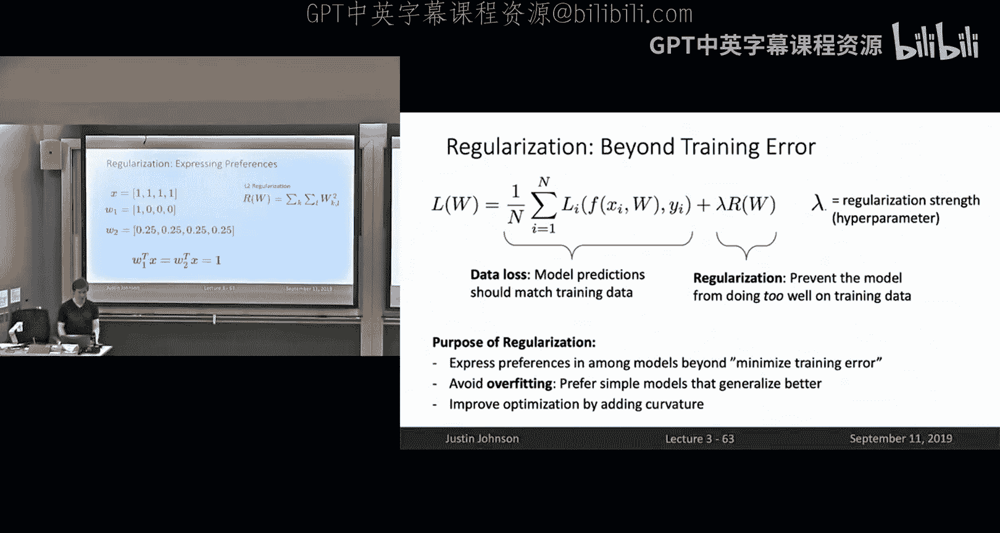

So the one idea of so I said that one idea of regularization is that we can express preferences over different types of classifiers that we want the model to learn。

 So here's an example where we have an input vector X that has all ones。

 and now we consider two different weight matrices， W1 and W2。

 And now imagine that we're in some kind of linear classification or linear regression setting。

Then the prediction of a linear model with this input X and either of these two weight matrices will be one because the inner product of of the vector x and either of these two matrices is one。

 which means that if we were solely going by something like a data loss。

 then the loss would have no way to distinguish these different these two different values of the weight matrix。

 and they would be preferred equally， But if we were to use if we were to add an L to regularization term to this model and and to our loss function。

 then this allows us to inex an additional preference to tell the model which of these two we would prefer。

So here， if we add this L2 regularization term， then we see that if you imagine computing the L2 norm of the W1 vector。

 then it's L2 norm is 1， whereas the L2 norm of the second vector is what one quarter squared is 116。

 then we got four of those so the overall L2 norm is one quarter so the weight matrix W2 would be preferred if we add in this L2 regularization。

And and here， this is very interesting right because this is one way to think about what an L2 regularizer is doing that when you have two different options that compute the same value on the input vector。

 you could either sort of choose to spread out your weight matrix to use all of the available input features or you could concentrate all of your weight on exactly one input feature and when you're using an L2 regularizer。

 you're kind of giving the model this extra hint that you would prefer that it use all available features where possible。

 even if using a single feature would have achieved the same result。 So this could be useful。

 maybe if you believe that individual features might be noisy and that you have maybe a lot of features that all could be correlated and you want to tell the model to use all of the available features something like L1 regularization tends to express the opposite preference where in L1 regularization。

 it tells the model to prefer to put all of your weight on a single feature if possible。

 So it's kind。Inesting that these different regularizers allow us to give the model extra hints about what types of classifiers we'd like them to learn that is completely separate from their performance on the training data。

So I said the second really interesting piece of regularization is to prefer simpler models in order to avoid overfitting。

 So here we can imagine we're building some model that is receiving a scalar input X and is predicting a scalar output Y。

 and we suppose we've got some noisy training data specified by these blue points。 Well。

 we can imagine fitting two different model to this training data。

 maybe the model F1 is this blue curve that goes in perfectly fits all of the training points。

 whereas the model F2 is this green curve that does not perfectly fit all the training points。

 But somehow the model the F2 curve is somehow simpler because it's a line and not a big wiggily polynomial。

 So it might be that given our human intuition about the problem。

 we we might have reason to believe that a line might be a more generalizable solution to the task at hand。

And indeed， if we were to imagine collecting a couple more data points that are also kind of noisy data points that fall roughly along a line。

 then you can see that this blue curve F1 might achieve very bad predictions on unseen data while the simpler green curve F2 might achieve better predictions on unseen data。

 Of course， I need to point out that we've been talking about linear models and people always complain that this slide has a model that's definitely not linear on it。

 So it's just a cartoon to express the idea of preferring simpler models with regularization。

So so the kind of the takeaway here is that regularization is really important when you're building machine learning systems and that you should basically always incorporate some form of regularization into whatever machine learning system you're trying to build。

So here now we've seen this idea of a linear class fire。 We've seen the notion of a loss function。

 we saw a concrete example of the loss function being the multiclass SVM loss。

 and now we've talked about regularization as a way to prefer one type of class fire over another。

 Well， another way that you can tell the model how you can give the model or preferences about the types of functions you'd like it to learn is by using different types of loss functions to train the model So we've so far seen the multi-class SVM loss but another very commonly used loss。

 perhaps the most commonly used loss when training neural networks is the so-called cross- entropy loss or multinoial logistic regression and this comes in a lot of names So you'll see a lot of names for this。

 but it all means the same thing。

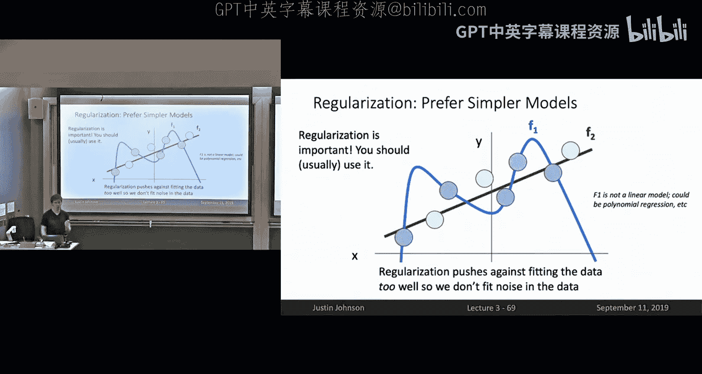

So here， the intuition is that wed like， so remember we so far。

 we've not really given much interpretation to the scores that are being spit out by our linear model。

 We just said that we had an input X， we had a weight matrix W。

 it was somehow spitting out some collection of scores。

 but we didn't really but the multiclass SVM loss did not really give any interpretation to those scores。

 other than telling that that the score of the correct class should be higher than the score of all the other classes。

 Well， now as we move to the cross entropy loss， we're motivated by a different we want to give some interpretation to the scores that the model is predicting。

 So with the multi with the cross entropy loss， what we want to do is to try to find a way is to have some probabilistic interpretation of the scores that are being predicted by the model。

And we'd like to find a way to take this this arbitrary vector of scores and interpret it as a probability distribution。

 a distribution over all of the categories that we're trying to recognize。

So the way that we do that is with this this particular function called Somax that has this functional form here。

 But basically what what we want to do is we're going to take the raw scores predicted by the classifier。

 and these raw scores are sometimes called unormalized log probabilities or logs。

 You'll see these terms is thrown around。 And we'll take these these raw scores and run them through an exponential function。

 So we'll take e to the power of each individual score and apply this elementwise over the score vector。

 So here we do this， the interpretation is that we know that probability distributions are supposed to be non- negative in all their slots。

 And the output of exponentials also non negativegs。

 This is a way to force our outputs to now be non negative。

And these are sometimes called unormalized probabilities。

And that name unormalized probabilities is very suggestive。

 It should tell you that the next thing we want to do is to normalize。 So indeed。

 then we then what we want to do is divide is take the sum over all the unormalized probabilities and divide each of the unormalized probabilities by the sum。

 And then after this operation now we have a vector。

 each element of which is non-zero and which sums to one。

 So now this vector we can just we can interpret as a probability distribution over all of the classes that we're trying to recognize。

And this combination of taking exponential and then dividing by the sum of the exponentials is called the softm function。

 and this gets used in a lot of different places in machine learning。

 The reason it's is kind of a side。 The reason it's called soft max is because it's a differentiable approximation to the max function。

 So if you were to look at this raw score vector， the max would be this middle slot 5。1。

 So you could imagine a version of the max function which output the vector 010 that had a0 in all the none in all the nonm slots and a1 in the slot of the max element。

 but that would be a non-diable function， which rather would have0 derivative almost everywhere。

 So we would not like to use that when training neural networks。

 whereas this softm function is now a soft differentiable approximation to that hard max function。

 where you can see that now the maximum value of the unorized log probabilities was 5。1。

 So then that ended up as the largest element of the。OfThe final probability distribution of the 0。

87。And this softmax function gets used in a lot of places in different types of neural network models。

 whenever you want to whenever you think you want to compute the max of something。

 but you also want it to be differentiable。 So that's a very useful function and a very useful tool to have in your toolbox when you're building different types of differentiable neural network systems。

But that with that long aside， basically what we've done is we've taken this。

 this raw set of score vectors， and we've now converted it into a probability distribution。

 And given that probability distribution， we now need to compute a loss for this element。

And the way that we do that is by taking the opposite of the log of the probability assigned to the correct category。

 So in this case， the correct category should be cat。

 The probability assigned to the correct category is 0。13。 and then the minus log of that would be 2。

04。 So the loss that we assign to this example when training with a cross entropy loss would be 2。04。

So then this operation of taking the minus log of the correct class maybe seems a bit arbitrary。

 And but the reason that we take this particular form is because it's an instance of maximum likelihood estimation that I don't want to go into the details of here。

 but if you've taken something likeECS 4，4，4，5 or 5，4，5， you would have talked about that in detail。

 maybe excruciating detail。But one basic intuition behind why this is maybe a reasonable loss to talk about is because we can imagine you can basically say that our model has now predicted some probability distribution over the categories and there exists some ground truth or correct probability distribution that we would have liked it to predict now the correct probability distribution would have had a one would have assigned all the probability mass onto the correct class so the target probability distribution in this case would have had a one in the first slot0 and all the others and now we want to have some function that compares probability distributions so if you take information theory。

 then there's a lot of nice mathematical reasons why this particular functional form called the Col Lblar divergence is often used as a way to measure differences between probability distributions and now if you imagine using this Colc libblar divergence to compute the difference between this predicted probability distribution in the green box and this target probability distribution in the purple box then。

Work out the math， you'll see that it comes out to be the net minus log of the probability assigned to the correct class。

And this is called and this is there's another， I mean。

 information theory has all these nice little ways to manipulate probabilities that are all related to each other。

 right there's another thing called a cross entropy。

 which is a slightly different way of measuring differences between probability distributions that is the entropy of one plus the Kl divergence of the two and the reason that this loss function is often called the cross entropy loss is because it's monotonically is because it's monotonomically related to the cross entropy between the two probability distributions。

So then if we kind of sum this up， then the cross entropy loss。

 what it's doing is maximizing the probability of the correct class using this particular log formulation。

So then we can ask a couple questions about this loss as well。

 just like we did for the multiclass SVM loss。 So first。

 what's the the minimum and maximum possible loss， for an example。

 when we're using the cross entropy loss。Yeah， so the minimum loss would be 0。

 and the maximum loss would be infinity。 But what's interesting here is that with the SVM loss。

 it was actually possible to achieve the minimum because remember with the SVM loss。

 we could achieve a loss of0 by just having the correct class be a lot higher than all the other classes。

 But with the cross entropy loss， the only possible way that we could actually achieve a loss of0 would be if our target if our predicted probably distribution was actually one hot。

 and if the only way we'd actually get0 is if are predicted and target probably distributions or actually the same。

 But because our predicted probably distribution is being is being predicted through this softm function。

 there's no actual practical way we can ever actually achieve zero loss。So another question。

 remember， we we've got the same debugging trick that we use for S BMs that if all of our scores are going to be small random values。

 then what loss would we expect to see。Well， in this case。

 if all of our scores were small random values that were about the same。

 then we would expect to predict a uniform distribution as we run our predicted scores through the softmax function so then our predicted probability distribution would be uniform over C categories。

 which means it would have probability of one over C in each of the C slots。

 which means that when we produce when we predict the minus log of the correct class。

 it would be minus log of one over， it would be。mininus log 1 over C。

 and that's a typo or log of the number of categories。

 And this is a number you should again be very familiar with。

 So if we're training on the Cf 10 data set then you should know that natural log of 10 is about 2。

3 because that's the loss you should expect to see at the beginning of training So when you implement a linear classifier with a cross entrypy loss on Cf 10 and you don't see something about near 2。

3 at the beginning， that means that you've done something very long very wrong and you have a bug this is also a useful number to know because if during the training process you ever see losses that are much。

 much higher than 2。3 with a 10 category problem that means something has gone very。

 very wrong during the optimization because now your classifier is doing worse than random。

 So sort of practically speaking whenever you're training a model with a cross entropy loss。

 it's always useful to have in the back of your mind what is this what is log of the number of categories and then kind of use that as a way to benchmark whether you've implemented things properly or whether the model has totally blown up and is now predicting。

Something weren't much worse than random。

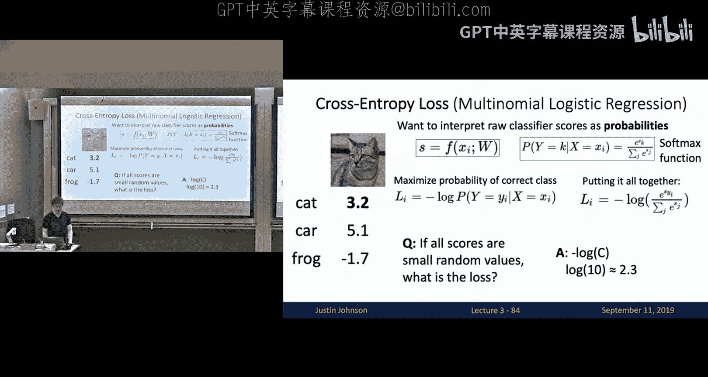

Okay， so then now we've talked about two different types of losses。

 one being cross entropy and one being the multiclass SVM。

 and it's interesting to think about what happens in how to compare these two different losses and how these two different losses would behave on the same data So let's assume that we've got some data set of three examples and three categories like we've been thinking about so far and assume our predicted categories the ground truth category is category0 for each of these examples and our classifier has predicted these set of scores on the left。

So then what would be the cross entrypy loss in this situation and what would be the SVM loss in this situation。

Well， in this case， the SVM loss is easy because we can see that the ground truth category scores of 10 are are one are at least one greater than all the incorrect scores。

 So the SVM loss would get zero here in this situation。

 and the cross entropy loss would be some value that's greater than zero that I definitely can't compute those logs in my head。

 But the difference is that this is kind of pointing to the same point we saw before。

 whereas with the SVM loss， it's very easy and very possible to actually achieve zero loss。

 whereas for the cross entropy， you'll never get zero loss。

So then what what happens to each loss if I slightly change the scores of of the last data point？

Right so this last data point has a predicted score of 10 for the correct category and a predicted score of -100 for the two incorrect categories。

So in this case， the SBM loss won't care。 The SBM is already giving zero loss to this example。

 And if we change it just a little bit， then it it doesn't really care。 But the cross entropy loss。

 on the other hand， is never satisfied。 For this particular example。

 it's already doing a really good job at classifying the example。

 because the correct score is like way， way， way higher than all the incorrect scores。

 But the cross entropy loss doesn't care。 The cross entropy loss always wants to continue pushing these farther and farther apart and continue pushing the predicted score of the correct class up to positive infinity and keep pushing all the scores of all the incorrect classes down down to negative infinity。

 So with cross entropy， you just keep training forever。

 and it'll just continue trying to separate those scores more and more and more。

And then we get a similar intuition if you think about doubling the score of the correct class from 10 to 20。

 then again， the cross entropy loss will decrease， or the SVM loss will still be zero。

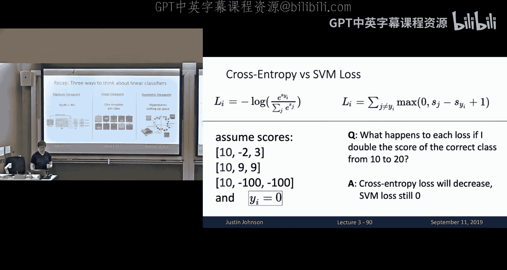

So then kind of to recap what we talked about today。

 we introduced this notion of linear classifiers as this matrix multiply and a vector。

 we talked about these three different viewpoints to think about what linear classifiers are doing and saw how these different viewpoints can have different implications for what we're thinking about and we saw the idea of a loss function to quantify our unhappiness with the present performance of our classifier But now the next question of course。

 is how will we actually go about finding the best W once we've written down our preferences。

 And for that， we can come back next time and we'll talk about optimization。

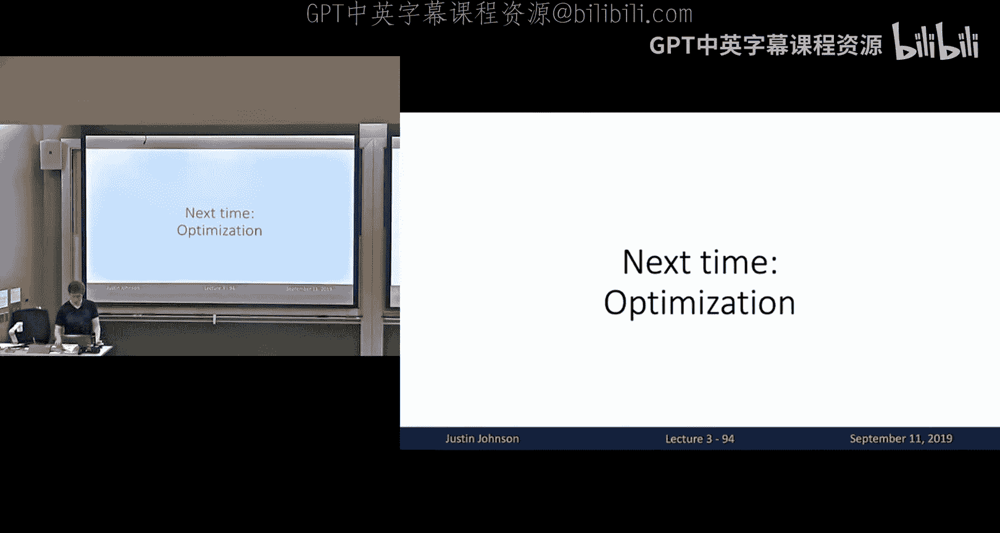