# 密歇根大学《深度学习用于计算机视觉｜Deep Learning for Computer Vision UMich EECS 498-007 2019》中英字幕 p04 -04-4_Optimization.zh_en -BV1jA4m1P7GN_p4-

Okay。

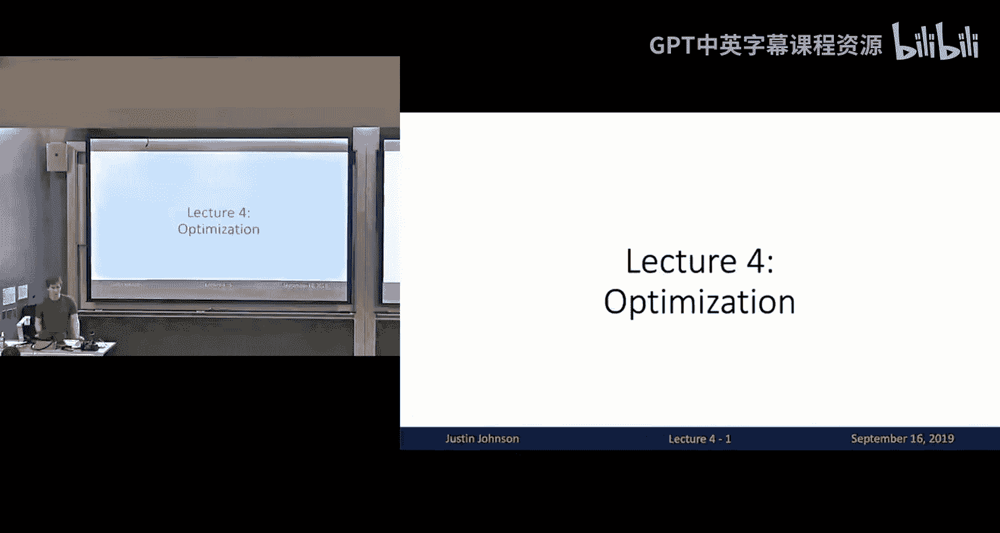

So welcome back to Le4 today we're going to talk about optimization and it seems like the mic in the room doesn't have to pull a clip so I'm just gonna to talk out loud hopefully everyone can hear me yes in the back okay good so as usual before we get into the content let's talk about a couple administrative things so first is waitlist update so there's still there's still about 20 our current enrollments at about 100 which means we have about 20 open slots so instead of trying to mediate myself exactly who's going to get the slots I thought the best thing to do is just open up to enrollment starting tomorrow sometime so if you're in the room and you and you are not enrolled and you want to be enrolled then check on on access starting this afternoon starting tomorrows I don't know exactly what time is going to open but then you should be able to enroll yourselves and hopefully most of you will be able to get in。

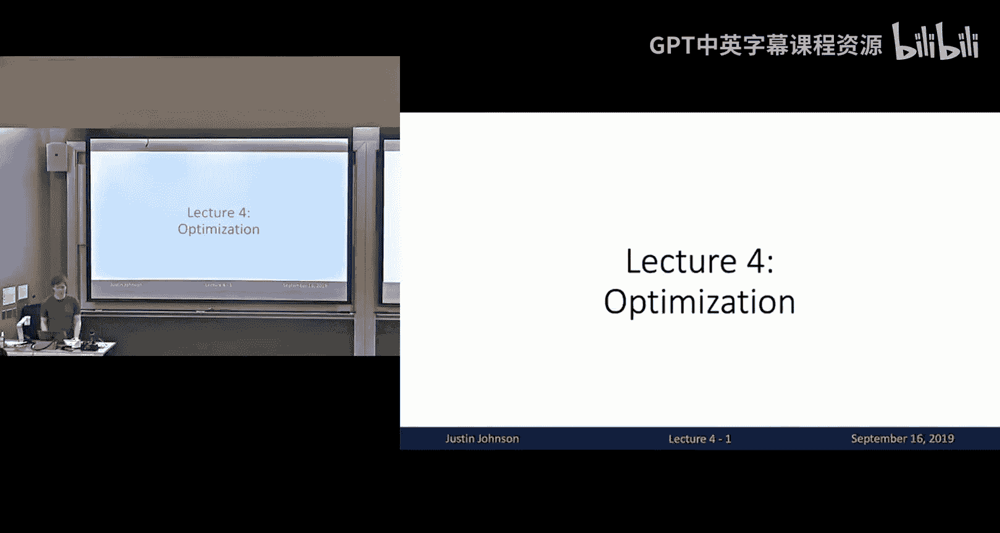

Okay， exciting， that's exciting announcement number one。

So then exciting announcement number two is a reminder that assignment one was due yesterday。

 so hopefully most of you have completed this assignment by now， and if not。

 then you have late days so you can then turn it in。

 remember you have a couple date days to use for free on assignments you want during the semester and you can use those late days on the assignment one。

So you can do that if you want to。So that after assignment one。

 of course we have come assignment two， so assignment two will be released or later this afternoon this evening in assignment two we're going to talk about we're going to use stochastic gradient asscent to train linear classifiers on linear network we're going to use stochastic gradient descent to train linear classifiers and fully connected neural networks so you'll be able to do the linear classifiers part of this assignment after today's lecture where we talk about optimization and you'll be able to do the fully connected parts after Wednesday's lecture when we talk about fully connected networks。

 but if you run into troubles computing gradients on these assignments it might be useful to also wait until we do the back propag lecture a week from today。

So that and then because we want to make sure you have at least two weeks to do the assignment before it comes out。

 so assuming we do indeed get it out released today as planned。

 then it will be due two weeks from today on Monday， September the 30th。

So any questions about assignments one or two？对。Okay， now here's exciting announcement number two。

So here's what we're doing in the class right now， we have six homework assignments。

 the midterm and the final， but after thinking about it a little bit。

 we decided that we want to not have a final head。よ？Okay， so I'm guess that's okay with you guys。

So what we're going to do is we're going to keep assignment one at 10% because it's a little bit shorter and then add 3% to all of the other homework assignments because you should expect that all of the other homework assignments will be quite a lot longer than the first homework assignment and especially on assignments five and six that will happen after the midterm you should expect that those will be significantly larger and significantly longer than the other assignments to make up of the lack of a final。

 so then we also increase the midterms 25%， so hopefully this is okay with you guys。

And then a note on the midterm， we did set a final date for the midterm that you can find on the website。

Yeah for this assignment a while because the earlier part was a lot of review will there be less review and more like really hardcore math in later assignments The question is will there be more hardcore math on a later assignments so I think you should expect the later assignments to have much heavier implementation the first assignment was really meant as a way for you to warm up and get used to coab and get used to pietor so the first assignment was really meant to be somewhat trivial someone to just like let you get your toes wet a little bit so you should expect of the later assignments will have more in-epth implementation I don't know about hardcore math I think everyone has totally different ideas about what that means but you should expect more in-depth implementation for the later assignment。

Okay， so that's yeah， question。So the question was why don't we redistribute to have higher slightly higher weight on the other assignments。

 I think that's reasonable but the numbers don't work out very quickly that way。

 so I think we're just going to leave it in this way for sympathy and maybe we could revisit in future years。

But right but that's to give you a bit， I know some people get kind of worried after midterm。

 they want to know like what can I do after the midterm to make my grade okay。

 so then you should just expect to have the later assignment get that blogger to help compensate for that。

Okay， so then let's， oh yeah， question， what's the format of the midterm does it look at？Yeah。

 so I think we'll give more detail about the exact format of the midterm as we get there because we need to write the midterm still。

 but you should expect it to be some amount of true false。

 multiple choice and short answer where you do math on paper it's mostly testing the basic conceptual stuff of're covering in the first half of the class and we should I hope we should be able to release some kind of sample midterm before that if not comparable in length should at least give you a sense of the types of questions you might expect to see on the exam。

 but again， because this is the first time we're teaching this here。

 a lot of things are kind of up in the air， so hopefully you'll bear with us on that。Okay， cool。

 hopefully， but hopefully those were some exciting announcement。Now onto their content for today。

So as you recall recall， the last couple of lectures we've been developing this idea of linear classifiers。

 so first we talked about how we can use linear classifiers to solve this image classification problem and that we can view in linear classifiers from these three different perspectives。

 algebra， visual and geometric。And in the last lecture we then also talked about how we can use loss functions to quantify our preferences over different values of the weights when we're using linear classifiers。

 so in particular we talked about the stock mapps and the SEM loss functions which impose different preferences over the sets of weights that we're going to use in our linear classifiers。

 and we also also talked about the use of regularization can also express some preference out over which values of weights we prefer and not prefer。

 where we had this intuition that regularization helps us maybe generalize beyond the training set and build classifiers that are simpler and thus generalize better to the test set。

But at the end of the last lecture， we were left with this open question of given some linear classification setup and given a loss function。

 how do we actually go about finding a value for this weight matrix W that satisfies this loss。

 how do we actually fit our linear classifier to the data that we have in our training set？

Well that's going to be the topic of today's lecture so broadly this question of finding weight matrices that minimize a loss function is this topic of optimization。

 so the general framework here is that we have some loss function L of W that's going to input our weight matrix and output our scalar loss and in the last lecture we talked about the internal components of that loss。

 but for the purpose of today we're mostly going to abstract all those away and just think about the loss function as an abstract function that inputs the weight matrix and outputs this scalar value of the loss。

And now during the process of optimization， what we want to do is find this value of the weight matrix W star that minimizes the loss function and this is this topic of general optimization is indeed very general。

 it's a very broad topic across all of mathematics and applied computational mathematics and things like that so there's no way we can cover all possible part pieces of optimization in one lecture so instead we're going to focus on the bits that are most salient for training that will become more salient for training large neural network models as we move forward in this。

So this is kind of the formal way that we write down an optimization problem。

 but we often think about it intuitively as traversing a very large high dimensional landscape。

So we I often think about this process of optimization as trying to walk towards the bottom of some beautiful landscape。

Where here the intuition is that each point， each Xy points on the ground is a different value of our weight matrix W。

 and the height of that point on the ground is the value of the loss function LOW。

And now during the process of optimization， we're going to be some little blindfolded person with no eyes。

 he has no eyes if you you zoom in on the slide， then you can see that no he doesn't actually know which direction where is exactly the bottom of this valley and somehow what we need to do is despite having no eyes we need to somehow explore around through this high dimensional landscape and find this point at the very bottom of this optimization landscape and that looks like a nice place to visit so maybe we'd like to get to the bottom somehow。

So then the question is， how do we actually get to the bottom Well。

 one thing you might hope so one kind of。Hope thing we might be able to do in some special situations is to just write down the answer right so for certain types of optimization problems like might arise in linear classification if you're familiar linear regression。

 we might be able to just write down an explicit equation for the bottom for the bottom of this objective landscape。

 but in general that's not going to work， so we need to find more so we're going to use iterative methods instead that try to iteratively improve our solutions and go towards the bottom of this objective landscape。

So the first iterative algorithm that you might imagine to optimize an objective landscape which by the way is a terrible idea but it's instructive to think about is random search so here what we might try to do is simply generate many。

 many random values of the weight matrix and then evaluate their loss value of these different random matrices on the training set and just keep track of the overall lowest value of loss that we find over this random search procedure and if we've abstracted away our loss function into a single function like we've been talking about。

 then such a procedure can be implemented in just a couple lines of Python so here we're using random search to train some linear model on CFFR 10 data set。

😡，And after running this for some amount of time， we actually may be are able to get something like 15。

5% accuracy， which is not bad because this is a pretty stupid optimization algorithm。

 but even random search is actually able to make some kind of non-trivial progress on this optimization problem。

😡，But of course， on this data set， state of the art is something like 95%。

 so we've got a little bit of gap to close on the rest of this lecture。

So then this idea of random search is really a stupid algorithm that we probably don't want to use in practice。

 but it maybe doesn't work quite as bad as you might think。

 so that kind of motivates the use of slightly smarter algorithms than random search。😡。

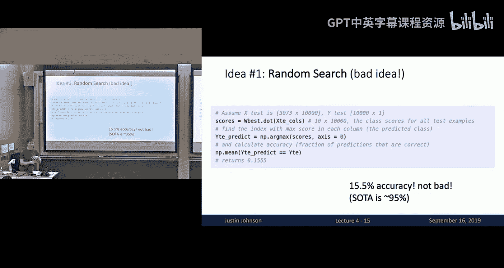

So idea number two is actually what we will do in practice so here we're going to try to follow the slope of this landscape downhill so here we believe that even though this little man walking around the objective landscape doesn't have eyeballs。

 he can somehow feel with his feet around on the ground and feel which direction is sloping which direction the ground is sloping in a local region around where he's currently standing so given only this local information about how the objective landscape is changing in a local neighborhood of our current point。

 then our strategy is to simply step a little bit in the direction of greatest decrease and then we can repeat this over and over and hopefully this will lead us towards some lower point in the objective landscape。

So this is a fairly simple straightforward algorithm。

 but it actually works quite well so here to make this a little bit more formal。

 we recall that we need to talk about derivatives because if you recall for a single for a scalar value function that inputs a single scalar and outputs a single scalar。

 we can the derivative which tells us the slope at any point on the domain of this function。

 where the slope tells us for any point in the for any point for any point。

 if we change x by a little bit， then how much is y one can change a little bit in correspondence。

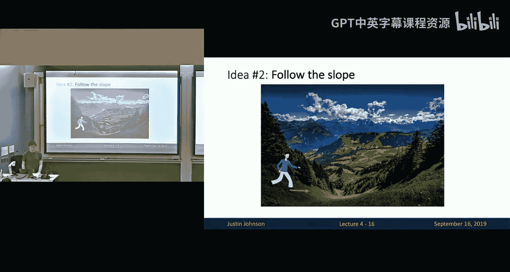

So that's the gradient， that's the familiar derivative that we have from single variable calculus。

And of course， this extends very naturally to multiple dimensions as well。

 so if you'll recall for a vector valued function that inputs a vector and outputs a scalar。

 which is what we're talking about in this optimization setup。

 then we can define the gradient where the gradient at a point is now a vector telling us the direction of greatest increase in the function。

So now the gradient tells us the direction of greatest increase。

 and if you'll recall your vector calculus， you'll know that the magnitude of the gradient tells us the slope in the direction of greatest increase。

So， and it's also kind of a nice fact that the direction we actually care about the direction of greatest decrease because we want to walk downhill this objective landscape。

 and it turns out that direction of greatest decrease is opposite the direction of greatest increase which is maybe not obvious but it happens to be true and then so we can simply step in the direction of the negative gradient and this will lead us downhill down our objective landscape。

So then the question is， how might we actually go about computing these gradients for arbitrary input for arbitrary functions that input a vector and output a scalar？

Well， we can actually implement this limit definition of the gradient directly in software。

 so you could imagine that we have some value of some current value of the weight matrix W here on the left shown as a big vector and now on the right we want to compute this gradient and the gradient of the loss with respect to the weight matrix and recall that the loss is a single scalar value。

 so the gradient of the loss with respect to the weight matrix will be a vector that has the same shape as the weight matrix itself。

 where each element each slot in that gradient vector will tell us the slope if we change one element of that corresponding part。

 the weight matrix by just a little bit。So we could just implement this limit definition of a gradient numerically。

 so given our function that computes the loss what we could do is compute the loss at our current w then we could perturb the value of w by increasing the first slot of the weight matrix by a small step H and now run that pertuurbed value of w through our loss function to compute a new loss and then apply the limit definition of the derivative to compute some approximation to the gradient in the to some approximation to the first slot of the gradient and here remember that it's maybe rise over run so we look at the difference in loss value divided by the difference in amount in which we change that slot of the input weight matrix W so that gives us some approximation to the slope of that function along the coordinate axis of the first slot of the weight matrix and of course we can repeat this procedure for then second dimension。

 perturb the second dimension， recompute a new value of the loss and then again apply limit definition of the derivative to get this numeric approximation to the second slot。

You can repeat for the third slot， et cetera， et cetera。

So this is called the numeric gradient and it's a reasonable thing to think about but the problem is that it's very slow so in this particular example our weight matrix W has maybe 10 or 12 slots that I don't remember exactly how many I wrote down so this would actually not be super expensive to compute but as we move to larger neural network based systems our weight matrixes will become very very large that might have thousands or millions or tens of millions or in the biggest cases perhaps even billions of learnable parameters and now in order to compute a gradient using this numeric approximation this limit definition。

 we need to compute a separate forward path of our loss function once for each slot in our gradient in our weight matrix so this will become very impractical as we move to very high dimensionmensional optimization problems and it's also approximate because we were relying upon a finite differences approximation to this gradient to this full true to this full true。

So this demeric gradient， not only is it slow， but it's also not even computing the correct thing at all。

 but it's still useful to think about in terms of what is actually going on when we try to compute gradients in these large scale systems。

So okay， so now at this point you might have thought that this was kind of a stupid thing to have done right。

 we all hope we all should have taken some vector valued calculus because I think I put that down as a prere for the class and now you know that you could just write down the loss function as some equation and now what we want to do is derive the gradient and as the gradient of this loss function with respect to the weight matrix W。

And if you're familiar with all the proper rules of manipulating these vector or matrix equations。

 then we can get some help from these guys and just write down an equation that that directly defines the value of this loss function。

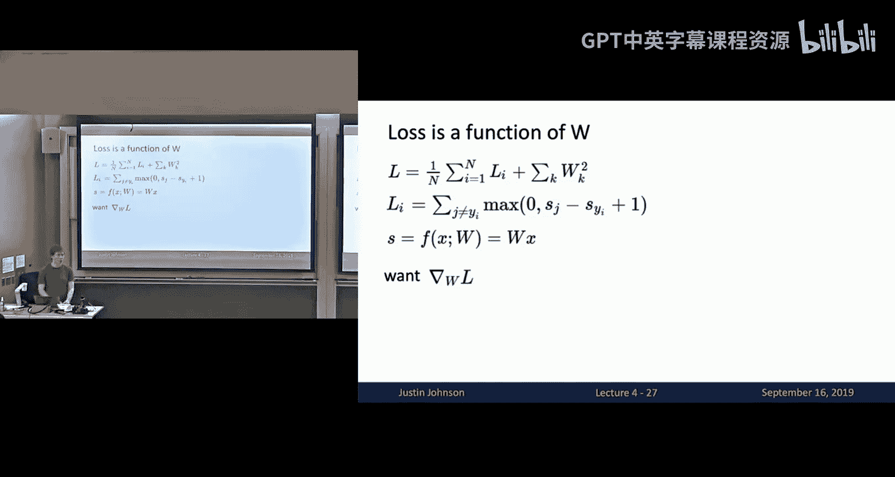

Do you know who these guys are？Newton and Liveibn， you know which one is which？Yeah。Okay， yeah。

 I think they all people look kind of funny back in those days。

But now what we want to do is then hopefully we can then just use our knowledge of vector calculus to write down an expression that tells us directly what is an algebraic or analytic expression for the exact gradient as a function of the weight matrix W。

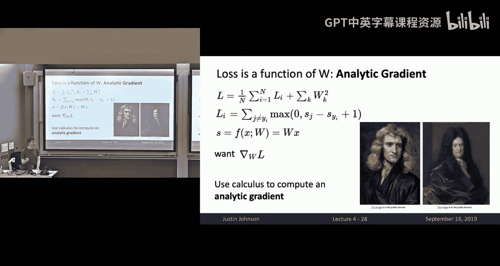

So then what this looks like is back to our current picture。

 we will have our current weight matrix W that will then somehow derive this expression for the derivative of the loss with respect to the weight matrix。

 and that will allow us to compute this gradient the LDW in a single operation or a single pass that hopefully now it will no longer require a number of four passes linear in the number of dimensions of the weight matrix。

And the details of exactly how we will derive these gradient expressions in practice will often rely on back propagation。

 which we'll talk about in much more detail than I think a week from today's lecture6 so for the time being you can just hope to fall back on your knowledge of calculus。

 but moving forward we'll use back propagation as a more structured algorithm to derive gradients for arbitrarily large and arbitrarily complex expression。

But for the linear classification， for the linear classifiers we've considered so far。

 hopefully you should be able to work it out on paper or if not。

 then you can use back propagation even for those as we'll talk about that。

So now the summary up to this point is that now we've decided upon this strategy of minimizing the loss function by using gradient information that is we're going to take。

 we're going to compute gradients at every point and then use that gradient to iteratively improve our estimate of where exactly we want to fall in the landscape。

And now we've talked about two different methods of computing gradients that can be applicable to any sort of function that you might imagine in general。

 we talked about this numeric gradient that is very very simple to understand very intuitive。

 very easy to implement， but it's approximate and it slow。

 so in practice we'll typically use the analytic gradient which will be exact and fast。

 but because it requires you because deriving analytic gradients requires you to actually maybe do some calculus on paper sometimes。

 it can sometimes be error Chrome because you might just make a mistake and make a mistake in your computation。

 make a mistake in your derivation， which definitely happens when you're trying to think about how to compute gradients in these large complicated expressions。

So in practice what we'll often do is actually use both so in practice what we'll typically do is use the numeric gradient as a debugging tool to make sure that we properly implemented the analytic gradient。

 so here we would typically then write our code in a way that's agnostic to the number of dimensions in the weight matrix trick and then we can test the analytic version of our gradient computation on a very lowdial version of the problem where computing a numeric gradient might be feasible and then we can check that we're computing the same approximately the same value between this numeric approximation and between this analytic gradient that will derive on paper。

So this is always a really good idea that you should always do this whenever you're implementing your own gradient code。

 and this is just a really good way to make sure that you don't have any stupid mistakes when you've implemented gradients。

嗯。So we will use this strategy on the home of assignments and you'll see starting on assignment two that again will be released later today。

 you will be implementing your own gradient computations for linear classifiers and now to debug those linear classifiers。

 we've written this gra check function that will internally compute the numeric gradient and then compare to the analytic gradient that you guys will derive。

This is a very useful strategy and it's applicable beyond homework science as well if you look in the PyTtorch documentation you'll also find that PyTtorch provides a function called GrD check that does something very similar。

 so if you ever find yourself writing your own gradient computations for code out there in the wild。

 I would strongly encourage you to use this grad check function provided by Pytorch to make sure that you properly implemented your greatness。

And if you look all further in the documentation， you'll also find a grad grad check that helps you properly implement second derivatives。

 which is also a thing that you sometimes need to do in PyTtorch and I think we'll see a couple of examples of that later in the course。

 but surprisingly there's no grad grad grad check。Because it turns out that because of the way high towards implements gradients。

 once you've got Grd check to pass and Grd Grd check to pass。

 then grad star check will definitely work for any number of grads that you want to take so again。

 if you ever find yourself implementing gradient code out there in the while。

 you should probably use these tools to make sure that they're implemented properly。

So now that we have some sense of how to compute gradients。

 it finally brings us to this algorithm of gradient descent。

 so recall that we had talked about this way this strategy for optimizing the loss function。

 we're going to start somewhere and then feel with our beat to see what is the local gradient direction and then step in that direction and then repeat。

It turns out that this algorithm actually is。very simple implement right it fit's on four lines of code here。

 so this very simple algorithm of gradient decent， we're going to initialize the weight somewhere。

 we're going to loop for some fixed number of iterations。

 then we will compute the gradient at our current point and then step in the negative gradient direction after we compute our gradient somewhere way。

This algorithm you'll notice has a couple hyperparameters and unlike the KNN hyperparameters that you probably in fact won't play around with too much in practice。

 these hyperparameters involve in gradient descent will become some of your best friends or maybe worst enemies as you're trying to build neural networkbased systems so here when we're talking about gradient descent。

 the hyperparameters that come to mind， one would be your method of initializing the weights。

It turns out that intuitively we want to initialize the weights to be some random values。

 but it turns out that for various applications， the exact mechanism。

 the exact distribution from which you draw those random values。

 turns out to matter quite a lot in downstream application。

So we will talk in a little bit later lectures about the proper way to initialize weights when we're training neural network systems。

The second hyperparameter is the number of steps We will need to we need to run this algorithm in finite time because we actually want homework we want our models to conge before the homework is due so we need to run this algorithm for some finite number of steps there's many different stopping criteriaiterion you might imagine using ingredient descent but the most common one in deep learning is simply to run for some fixed number of iterations and this hyperparameter is usually running more iterations tends to work better for most deep learning applications so this hyperparameter is usually constrained by your computational budget and how long you're willing to wait for your models to train and the third hyperparameter here is the learning rate so when we take the step in the negative gradient we actually need to say how much do we actually trust this gradient how big of a step we want to take the local gradient tells us the direction of greatest decrease for our function but we need to actually decide。

How much we want to step in that direction of rates decrease。

The hyperparameter controlling this step size is usually called the learning rate because it controls how fast your network learns。

 where higher learning rates means we're taking larger steps and maybe you might hope that your algorithm would converge faster。

 lower learning rates are maybe less prone to numeric explosion but will take longer to converge will take longer to learn so these three hyperparameters will be some of your friends throughout the rest of the semester。

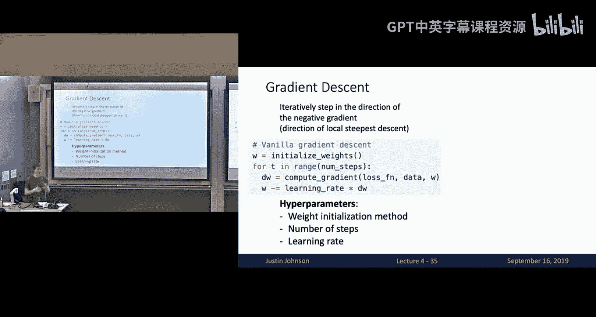

And you can again look at this sort of pictorially。

 we can imagine this algorithm of gradient descent by looking at one of these heat maps。

 so here the x and y axis maybe help show us the values of two dimensions of the weight matrix。

 and the color at each point represents the height of the objective function and we can imagine starting at some white point here we compute our negative gradient。

 which is now the direction of greatest decrease in the loss function。

 then we'll take some small step size along this gradient direction and iteratively repeat as we step downhill。

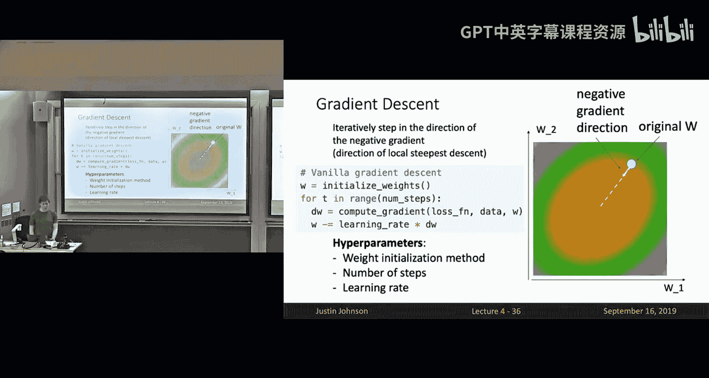

So as we actually run this algorithm， it might look something like this where we will start at some point in the blue region。

 where blue is this is kind of a maybe taco is shell shaped or bowl shaped objective landscape。

 and we'll start at some high point in the blue region。

 and then by iteratively following the gradient direction。

 you can see that this algorithm very quickly converges to this red region of low loss at the middle of the taco。

And what's kind of just by looking at at this animation。

 you can recognize a couple interesting features of the gradient descent algorithm。

 one is that it does not go straight to the bottom because this is sort of a taco bowl shaped landscape。

 the gradient direction is actually at an angle to going straight to the bottom。

 so it does not go straight to the bottom instead it kind of arcs and curves around to the side before coming back into the bottom of the objective landscape。

You can also notice that it starts out going very fast。

Oh no maybe I didn't set up the PowerPoint to loop properly oh well。

 well because of the way that we formulated this gradient descent by having a multiplicative learning rate top of steps on top of the gradient。

 what this means is that when the gradient has a large magnitude will end up taking larger steps and as we approach this bottom of the bowl。

 the objective landscape will flatten out and the magnitudes of our gradients will become small and now our step sizes will also naturally become smaller。

 it's this is a kind of nice way to parameterize gradient descent because it lets the algorithm somehow naturally slow down as we approach flat regions or maybe approach minima of the objective function。

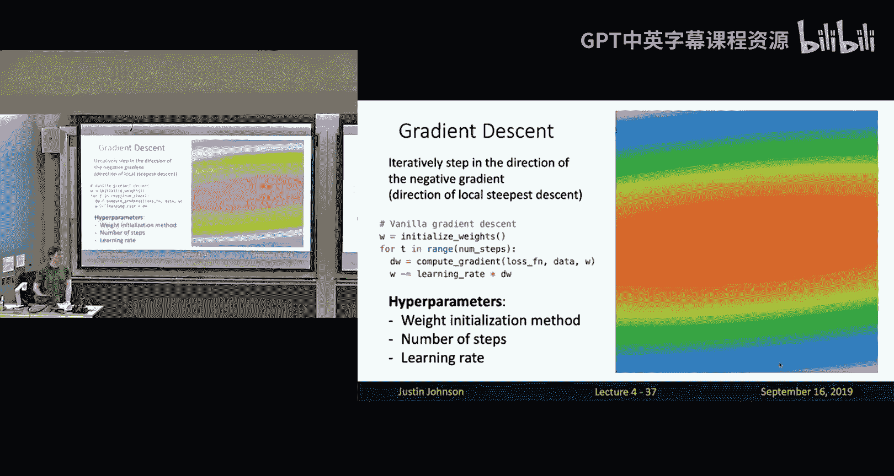

This version of gradient descent that we've so far been talking about is sometimes called batch gradient descent or full batch gradient descent because as you recall。

 our loss function is this giant sum over the individual loss functions for all the examples in our training data setI is whereYI is one of the training pairs in our data。

 andI is the loss function， how well our classifier is doing on that one individual example。

 and now our full loss function on the training set， as you'll recall。

 is a sum over all parts over all the individual elements or training examples in our data。😡，But and。

Correspondingly， because the gradient is a linear operation， you can see that the gradient is， again。

 a sum of the gradients over all of the individual examples in our training set。

The problem here is that this can become very this sum can become very。

 very expensive as your data set becomes large。If n is something like a million or 10 million or a billion。

 if you're lucky enough to have a very， very large data set。

 then simply computing the value of this loss function will involve a loop over tens of thousands or millions or billions of training samples。

 so in order to compute just a single step of gradient descent， you'd be waiting a very。

 very long time to loop through your entire data。😡，In practice。

 this will therefore not be very feasible running for training on the large data sets that we want to in order to get good performance。

😡，In practice then we often use a variant of of gradient descent called stochastic gradient descent or SGD here the idea is that rather than computing a sum over the full training data set。

 instead we will approximate this loss function and approximate the gradient by drawing small subsamples of our full training data set。

 the typical sizes here in these small subamples are called mini batches and the typical sizes of these will often be something like 32 or 64 or 128 elements at a time。

then what we will basically do is modify our algorithm so that in each iteration。

 rather than computing the loss on the full data set。

 instead we'll sample a small mini batch of items from the data set and then compute our gradient and our loss using only this small sample set of elements。

😡，This version and this is a very common version， this type of stochastic gradient descent is in practice what we'll almost always use。

Once we move from full batch to stochastic gradient descent。

 we introduce a couple more hyperparameters into the system。

 We still have our old friends of weight initialization， number of steps and learning grade。

 we've also introduced batch size as a new hyperparameter。

That is when we're computing these mini batches， how many elements should be in each mini batch？

Thankfully it turns out empirically that this one tends not to be too sensitive of a hyperparameter and the general heuristic here is just make the bit the mini batch size as large as you can until you run out of GPU memory or if you happen to have access to multiple GPUs or multiple machines it turns out that you can distribute this and have very。

 very large batches that are distributed over multiple GPUs or multiple machines and it turns out sort this is all empirically speaking that for many neural network systems。

 the exact batch size you use doesn't matter too much long as you properly account for other things in the system so we'll talk more about those details later in the class but the general rule of thumb here is don't worry too much about the batch size as a hyperparameter instead just try to make it as big as you can fit。

And then we've introduced another hypercraameter here。

 which is the method by which we're going to sample our training data at every iteration。

For classification problems like we've been talking about so far。

 this tends not to matter too much on the homework assignments what we'll do is just draw the data at random for each iteration。

 another common strategy would be to shuffle the data set at the beginning of we're going to shuffle the data and then march through that shuffle data in order and then shuffle the data again and then march through it again in order for classification problems like we've been considering the latter is more common。

 but I think it tends not to matter too much for your final results。

 but if you think about other types of problems then things like structured prediction problems or maybe triplet matching problems or ranking problems than the way in which you iterate over your data can sometimes be an important type of parameter。

 but thankfully that's not the case for many image classification problems。

So you might be wondering why this is calledtochastic gradientcent，s kind of a funny name。

The reason for that is that we now think of our loss function probabilistically。

 so we then sometimes think of a data of an underlying joint probability distribution over the data X and the labels Y from which our training set was sampled when we think about our data as having been sampled from some underlying probability probability distribution。

 then we can write down our loss function as this expectation as we take an expectation over all possible samples from some true underlying data distribution。

And then the form of the loss function that we've seen thus far。

 which is an average over the independent loss functions on all of the samples from our data。

 is then a Monte Carlo estimation to this full expectation over the full probability distribution。

And then clearly， when you think about loss functions in this way。

 then we have a choice in how many samples we want to take in order to approximate this full expectation for computing loss function。

😡，And that this notion of thinking probilistically is therefore where this nametochastic where this termtochastic comes from in the nametochastic gradient descent。

😡，And of course， the gradient is much the same so then we can approximate the gradient as well by taking a small Monte Carlo estimateplant of samples over this whole distribution。

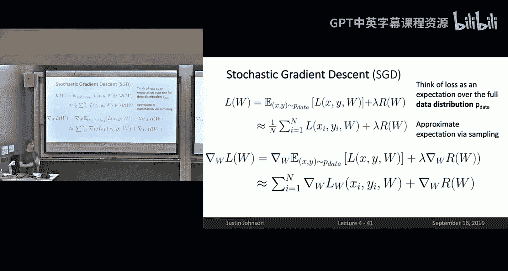

We have an interactive web demo demo up here that you can， if it's still on Stanford that EDu。

 I guess I need to fix that， that you can play around with that will let you play with linear classifiers and using gradient descent to train different types of linear classifiers interactively in a web browser。

 and I would encourage you to check this out to gain some intuition about how you can change the loss function。

 change the values of the weight to change the step size and sort of see interactively how changing all these hyperpilis will affect the ways in which decision boundaries shift around and affect the training of linear classifiers。

So it turns out that is actually this actually works now at this point you know enough to go and implement a linear classifier portion on assignmentitude。

 but it turns out that this simple algorithm of stochastic gradient descent。

 even though it's actually quite effective， there are some potential problems with stochastic gradient descent。

And let's about so let's think about a couple situations where this basic version of stochastic gradient descent might run us into trouble。

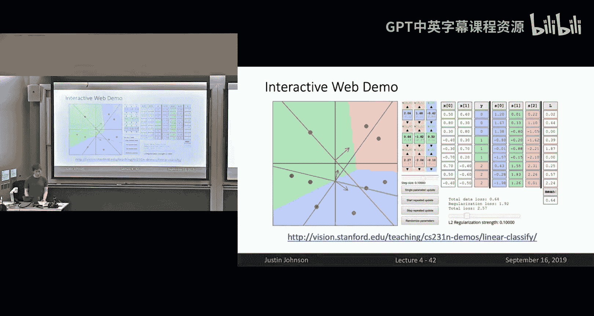

Well， one problem is what might happen if our lost landscape looks something like this。

 so here we're showing a contraour plotot of a lost landscape。

 this lost landscape is therefore a kind of very exaggerated taco shell type landscape where it's changing very quickly in one direction and then changing very slowly in another direction。

And the question is， what might happen if we apply a stochastic gradient descent or full batch gradient descent on an objective landscape that has this shape？

Well， one problem is that our steps might oscillate around if our step size is too large。

 then we kind of have a trade off， we need to set our step， if our step size is too large。

 then when we compute the gradient， we might overshoot in the fast moving dimension and then have to correct our overshoot and come back in the other direction。

And now this can cause a kind of a zigzagging pattern as we then zigzag towards the minimum。

 that can cause us to take many more steps than we might otherwise have needed to take if we were somehow have been able to use the smarter optimization algorithm。

And we kind of have a tradeoff here because we could have maybe avoided this by setting the step size very。

 very small， but if we set the step size very， very small。

 that might prevent this overshoot zigzagging pattern。

 but it would then cause the algorithm to just converge very。

 very slowly and now you're kind of in a tough spot in this situation。

 if you've got an objective landscape that's very fast moving in one direction and very slow moving in the other direction。

 then。😡，You're kind of screwed no matter how you set weight the step size。

 right if you set it too big， you're going to overshoot the fast moving convention。

 if you set it too small， then you'll make no progress towards the goal。

And this problem is called this is technically sometimes referred to as the problem having a high condition number。

 which you can estimate numerically by looking at the ratio between the singular values of the Hessian matrix at any point。

That we don't need to go into detail here about that。

But this is one potential problem for using this vanilla stochastic gradient descent problem or the vanilla stochastic gradient descent problem。

Another potential problem with stochastic gradient of the set is functions that exhibit local minima or saddle points。

A local minima is a point on the function where the function has zero gradient。

 but it's not actually the bottom of the function。😡。

And here we show a one dimensional example where we kind of go down and then there's a local minimum and then in order to escape that local minimum。

 we would need to go over some hill or some mountain。

So you can imagine that if we were using this basic stochastic gradient descent algorithm on some function and have a local minimum of this form。

 then we would get stuck in this local minimum because the gradient is zero there。

 so our step size would converge to zero and we might end up stuck in this local minimum and be unable to escape since the gradient there is zero as well。

We can have a similar problem in there's another problem that I think is much more common in high dimensionional optimization。

 which is the notion of a saddle point， so here a saddle point is a point where in one direction the function is increasing and in another direction the function is decreasing。

And it's called a saddle point， it looks kind of like a saddle on a horse。

And the problem here is that at the tip of this saddle， the gradient is also zero。

 so if we were to imagine trying to optimize a function that had a saddle point。

 you can imagine we might get stuck in the saddle point。

 similarly as we might get stuck in a local minimum because the gradient at the saddle point is identically zero。

😡，So the problem in both these situations is that because they have zero gradient。

 we might get stuck。And just to point out， this notion of a saddle point actually I think becomes much more common in high dimensions because if our optimization landscape is very a saddle point is basically a point where in one direction the objective function is increasing and in another direction。

 the objective function is decreasing if we have an objective if we're have an objective landscape with something like 10。

000 dimensions or a million dimensions， then it seems very plausible。

 then actually very frequent that at many points in the objective landscape。

 we might be increasing in some of those dimensions and decreasing in other of those dimensions。

So the intuition is that somehow perhaps saddle points are maybe a big problem in high dimensional optimization。

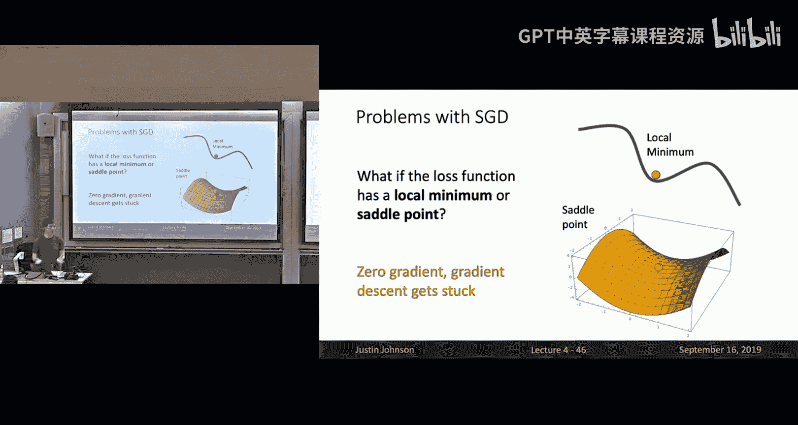

Another potential problem withtochastic gradient descent is that S， that stochastic part。

Because we are computing our gradients， using only a small estimate of our full data set。

 those gradients are noisy， and the gradients that we're using to make our updates at any step at the algorithm may not correlate very well with the true direction that we want to go to in order to go to the bottom。

😡，On the right here on the right we're showing an animation here that simulates this problem where we're running gradient descent on this same bull shaped objective landscape as before。

 but now we're adding some amount of noise to the gradients that we're computing when running the algorithm and you can see that in contrast to the version of stochastic gradient descent previously that was kind of marching down towards the bottom instead we see that once our gradients are noisy then our algorithm is somehow kind of meandering around this objective landscape and kind of taking its time towards getting towards to the bottom and you might maybe maybe you might hope that if you wait long enough。

 this will kind of average out and get us towards the bottom but it's still not exactly obvious what the trade-offs there are so I think it's a bit of a problem potentially that our gradients in stochastic gradient descent are not exact that they are stochastic approximation to the true gradient that we want to descend upon。

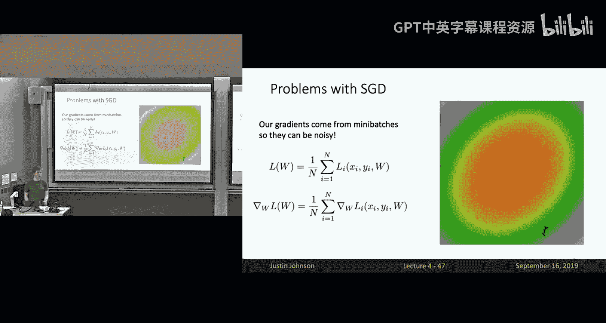

To overcome all of these problems， therefore， it's actually not so common to use this very vanilla form of stochastic gradient descent。

😡，We'll often use slightly smarter versions of stochastic gradient descent when training neural networks in practice。

 the most common of these is called SGD plus momentum。So here on the left。

 we're showing our old friend the stochastic gradient descent algorithm。

 and now I for the remainder of the slides I've cut out the weight initialization step because that's going to be common to all algorithms。

And on the left with our familiar friend stochastic gradient descent。

 you see that at every iteration， we're simply stepping in the direction of the gradient as has been computed with our mini batch of examples。

Now with SGD plus momentum on the right， we imagine a kind of physical intuition here of actually a ball rolling down this high-dimenal surface。

 so now at every point we imagine integrating the gradients over time to compute some kind of a velocity vector for this ball rolling downhill and now at every point in time we will then update this velocity vector taking by taking some weighted combination of the current value of the gradient and this historical velocity。

 this historical moving average of gradients and then when we take our gradient step。

 we will not use exact we will not use the true gradient direction。

 instead we will step in this direction of this computed velocity vector that we've computed over the whole course of training and you should imagine this as like a marble rolling downhill that now as it kind of speeds downhill it picks up some velocity and now it continues moving in that direction。

 even if the local gradient is not directly aligned with its direction of motion。

And concretely we implement this on the right by introducing a new scalar hyperparameter called rh。

 which is some things like you can think of as like a friction or a decay rate at every point in time。

 so now we're going to keep track of two things we're going to keep track of our positions xt and as well as our velocity vector BT and now at every point in time we're going to update our velocity vector by first we will first decay it by multiplying by this scalar friction value and then we'll add back in the value of the gradient compute it at the current point and when we make step we'll step according to this velocity vector。

And as kind of a technical note， depending on which papers or which textbooks you you read。

 you'll sometimes see to these two different formulations of SGD plus momentum that have slightly different looking equations。

 but as an exercise to the reader， you can go back and work at this out at home and show to yourself that these two formulations are actually equivalent。

And in the sense that they'll actually visit the same sequence of weight values。

 no matter which formulation you're using， so it's something of the implementation detail as to which of these two formulations you choose。

 but I wanted you to be aware that you might see different formulations depending on which source you're reading。

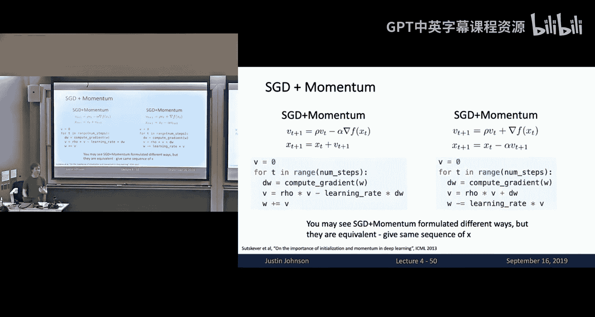

Now， once we have this notion of SGD plus momentum。

 we can think about how it helps to solve all three of these problems that we pointed out with the basic SGD algorithm。

Recall that we talked about one potential problem with SGD as local minima。

 where because the gradient was zero at the bottom of a local minima， then there's zero gradient。

 so if we stuck according to the true gradient， we'd be stuck forever。

But now once we augment the stochastic reading to set algorithm with momentum。

 now you should imagine this as like a ball rolling down the hill that as we kind of descend from the top and come down to the local minimum。

 then even as we pass that local minimum， our point might still have some velocity that can help carry us off the other other side。

 and to hopefully escape from that local minimum， by using our velocity to kind of power through it in some way。

And a similar intuition applies for saddle points， again。

 once we start building a velocity by rolling downhill。

 then we can hopefully roll right over those saddle points and continue to send it down along a different direction。

Momentum can also help us overcome a little bit this problem of poor conditioning because you can imagine this velocity vector as kind of like weighted an exponentially weighted moving average while the gradients that we see during training so now if we see gradients。

 so now if we start off in this osll if we see this oscillatory behavior during training。

 then you can imagine that our velocity of vector would help smooth that out and the quick oscillations along the y axis here would then be average out give us maybe hopefully relatively low velocity a relatively low velocity of that direction and then maybe we might even accelerate our velocity along a horizontal direction to help us smooth out or deal better with these objective landscape with high condition number。

gradientient descent with momentum can also help us with this problem of stochasticity so here on the right we're showing again this same animation of adding using gradient descent so the black line is showing gradient descent where we're adding some amount of stochasticity。

 some amount of random noise to the gradients at every point and as we saw before the black line is kind of meandering all over the objective landscape due to the effect of the noise on the gradients。

In the blue， we're instead showing the same sequence of gradient updates。

 but instead using stochastic gradient descent with momentum。

 and here we can see that by adding momentum to the algorithm。

 it's somehow able to smooth out the noise and take a more direct path towards the bottom of the objective landscape。

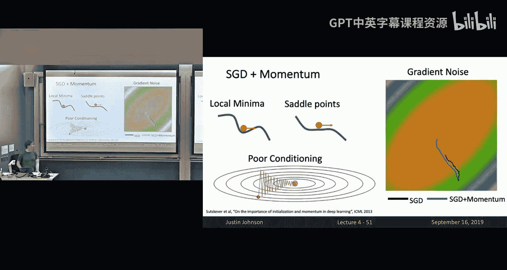

Another way to think about what the momentum update is doing is somehow with this little diagram here。

 where we imagine that at every point in time we're sitting at this red dot。

 and then at this red dot we we have this green vector。

 which is some direction giving us our velocity， which is something like our historical averages of the gradients we've seen during training。

 and now we will also then compute this red vector。

 which tells us the instantaneous gradient at this point。

 and then we will average them to get this new velocity in blue。

 which is the actual step direction that we'll use to update our weight matrix。

So the intuition here is that we're combining the gradient at the current point with this historical average of gradients and this helps us smooth out our optimization procedure。

There's another version of momentum that you'll sometimes see called Nesterov momentum that has something of a similar intuition。

 but it kind of interleaves these steps in a slightly different order with neststerov momentum what we do is its we kind of imagine a bit of a look ahead so now we're still starting at this red point at every iteration still have this historical green vector of velocities that is our moving average somehow of all the directions we've seen during training。

But now the difference between Nessterov and traditional stochastic gradient descent plus momentum is that with Nesterov momentum。

 we imagine looking ahead into the future and computing what would the gradient direction have been if I would have stepped according to the velocity vector。

 so we kind of look ahead in the direction of the velocity vector and compute the new value of the gradient in that look ahead。

And then when we take the actual step， our actual step is then a linear combination of this velocity direction。

 as well as this direction that was computed via this look ahead step。

And this next draw momentum then somehow has a similar effect as gradient descent with momentum。

 it just integrates the past and the present versions of the gradient in a slightly different way。

 so you'll sometimes see people use these two different formulations for optimizing things。

So if we want to write we can write this down mathematically and and look at nest momentum in the following way。

 so here we see that we still keep a run in tally of our velocity vector as well as our position vector。

 but now when we update our velocity vector， we compute the gradient at this look at head point。

So this look ahead point is now xt plus row VT， which is now what the gradient would have been at we step in the direction of the velocity vector。

 then we compute the gradient there， and then our velocity is an combination of our o velocity plus the velocity of the overhead point。

 and then we update X the position X using this velocity vector。

This is kind of an awkward formulation unfortunately for optimization algorithm。

 usually it's more convenient to implement optimization algorithms when they take when they only depend upon the current point and the gradient of the current point。

 which this nest function doesn't seem to be right because it has this funny structure of forcing us to compute gradients have a look ahead。

 it doesn't fit nicely into this EP objective of optimization functions that we expect。Yes， so this。

 right， I warn you about this， this is this difference。

RightSo it's the difference between these two slightly different correlations of SGD so the question is is our velocity vector in the direction of the gradient or is our velocity vector in the direction of the negative gradient and the other choice is whether your velocity vector incorporates the learning rate or incorporate the learning rate after you do the velocity vector so these are all kind of equivalent they you can imagine pulling these different factors out so they're all kind of equivalent and it doesn't really matter which one you use but I think that's what's going on here so in this version of nest what we're doing is we're having the velocity actually the negative direction of the gradient and we're rolling and we're rolling the learning rate alpha into the velocity vector as well。

So then when we take this step in the direction of velocity vector。

 it's actually stepping in the negative direction of the gradient， but thanks for pointing that out。

So then said we saw that this NA update has a slightly offer formulation。

 and doesn't quite fit into the API of functions that we might want to write。

So it turns out there's a simple change of variables we can use that I don't want to work through here。

 but just for you to be aware， it's kind of fun to work through this on paper and see with this change of variables。

 actually nestnstruural momentum can be rewritten in terms of only the current gradient and the current position。

 which is kind of cool given that it actually has this intuition of a look ahead。

 and there's some so this is a trick that you'll sometimes see。

Now we can our friend we could return to this simple example and they'll compare our SGD algorithm in black with SGD plus momentum in blue and nesttro momentum in green and we can see that they both accelerate the training process quite a lot because we're building up this velocity vector over time。

 they're somehow able to accelerate in quickly moving regions of the objective landscape and then slow down and sort of converge towards the end。

 you can see another feature here that's very common with momentum methods is that they tend to overshoot at the bottom so because we're building up this velocity over time either with traditional or netro momentum then we've actually got some non-trivial velocity by the time that we get to the bottom of the bowl。

Yeah， question Why is the Ntro line black and with the green overlay as a certain point The question is why is the N of line green with a black overlay。

 I think it's because I'm bad at JavaScript and I didn't implement this in a good way。But yeah。

 that's not significant， it should just be a nice clean green line。So。

 but then you can see that both they had both Nesterov and traditional memo momentummentum kind of have a slightly similar character in that they build up the velocity over time and then overshoot at the bottom and kind kind of come back。

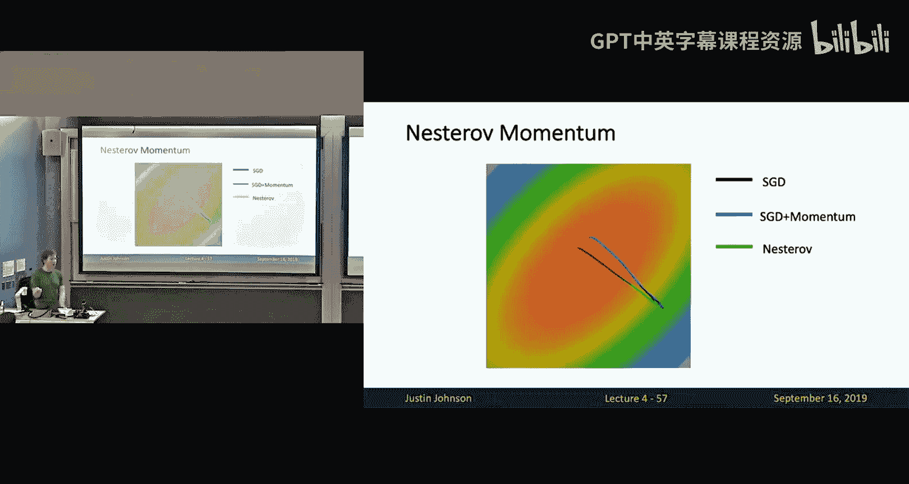

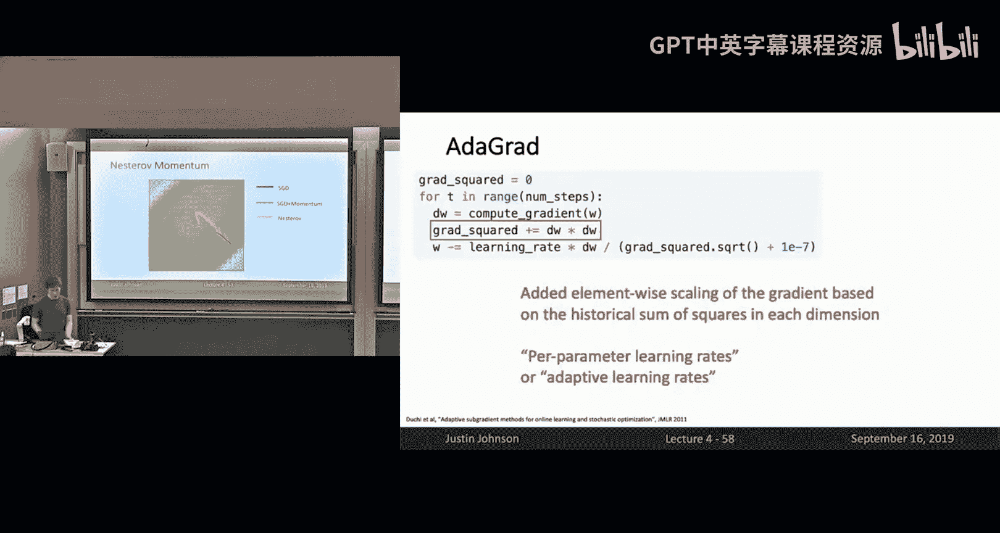

Sony， any questions about these momentum based methods？Well， are okay。

 so then these are actually very commonly used in practice to train not only linear models。

 but also a lot of deep learning models as well。

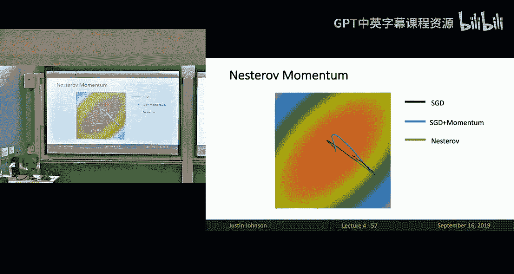

So then moving ahead， there's another kind of category of optimization functions that we sometimes see。

 which is this notion of sometimes called adaptive learning reads。

 and a classic example here is the addedgrad algorithm。

Here we similarly want to find some way to overcome some of these problems that we talked about with SGD。

 but now with A agra， we're going to overcome it in a slightly different way。

 so rather than tracking this historical average of gradient values。

 instead we're going to keep track of a historical average of squares of gradient values。😡。

And now when we make so you can see up here in this algorithm， we're keeping a running average。

 a running sum of all the element wide squared values of the gradients that we see during over time。

 and now when we make our step， then we end up dividing by the square root of this historical sum。

So this seems like kind of a funny thing to do and it's not exactly clear what's going on here。

 so to motivate this atgrad optimization algorithm。

 we can think back to this taco shell shaped landscape and you can think about what。

 what does the addeddigrad algorithm do when we have this objective landscape？

Well what's going on is remember the problem here was that we had in this objective landscape。

 we had one direction where the gradient was changing very fast so that if the gradient was changing very fast then this atgrad will then end up dividing by a large value so it will help damp down progress in directions where the gradient is changing very fast and now in the other direction where the gradient is changing very slowly。

 then atgrad will end up dividing by a large value oh right no itll end up dividing by a small value you see the stuff is confusing right you ought to work it through for yourself video you end up dividing by a small value so it has the effect of accelerating motion along directions where the gradient is very small。

So then we can hope that this can help us overcome these kind of ill conditioned types of objective landscapes。

But now there's maybe a problem with autodigrad， so what might happen if we run this adigrad algorithm for a very long time？

😔，Well， if we run out of grad for a very long time。

 you can see that our grad squared will just continue accumulating。

 continue accumulating because squares are always positive so then this grad squared will just grow and grow and grow over the course an optimization。

 which means that we're going to be dividing by a larger and larger and a larger thing。

 which means that that has this effect of sort of effectively decaying the step size or decaying the learning rate continually over the course of learning。

 and it's possible that this grad squared might end up getting too big and might cause us to stop making progress in the direction we want to make progress and so we could end up stopping somewhere that's before we get to the bottom of the objective landscape。

So to overcome this problem， people sometimes use a variant or sometimes people don't use Agrad directly。

 a way to fix this problem is another optimization algorithm called RMS Pro that you can kind of think of as a leaky version of Agrad so just as you recall that in stochastic gradient decent plus momentum we had some kind of friction coefficient that was decaying the velocities at every iteration before before we compute them and now with RMS Pro。

 it looks very much like adding like adddigrad with this extra friction term that's going to decay our running average of square gradients and here the hope is that by adding some kind of friction to our Adigrad algorithm。

 then it will cause it to make better progress and not slow down all the time over the course of training。

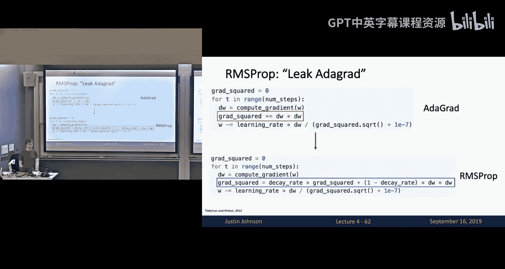

And then it's kind of instructive to then look back at this same example of this optimization problem now comparing SGD and black SGD plus momentum in blue and RMS crop in red。

 and here we can see that they have fairly sorry about the red on orange colored choice maybe that was not so great。

 but what hopefully you might be able to make out if you've got really good color vision is that the blue and the red of sort of qualitatively different behavior in how they navigate this landscape。

 so when we use this momentum based method in blue。

 you can see that it tends to overshoot and then come back， whereas when we use this second order。

 this adaptive learning rates idea from at ofgra or RMS crop。

 you can see that it sort of arrests progress along the fast moving direction while simultaneously accelerating progress along slow moving direction which helps it kind of bend directly towards the problem。

Okay， so that's cool now basically we've got two different ways that we can augment this basic SGD algorithm to hopefully improve its convergence and improve its stability in these weird situations。

So now that we've got these two good ideas， why not put them together so there's another very common optimization algorithm that you'll see used in deep learningar a lot called atom and atom is basically RMS RMS plus momentum。

 so it's basically combining these two good ideas that we've seen into one optimization algorithm that uses both momentum as well as this adaptive learning rates idea from Hagrad。

 so the exact formulation here is that we keep track of two things two running quantities during optimization。

 one is the first moment which is somewhat analogous to the velocity that we saw in SGD plus momentum and the other is the second moment which is the same as this leaky exponential average of square gradients that we saw in RMS plot。

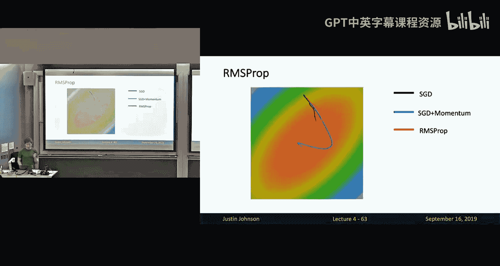

And then when we make our final learning step， then we end up doing both so then you can see here this part in red is kind of the momentum idea from SGD momentum。

 the blue part here is kind of this adaptive learning rates idea from RMS Pro and we basically put it together and hopefully that gives us a really good optimization algorithm since we put two good ideas together。

But there's a bit of， sorry， was there a question？O。

But there's maybe a slightly subtle problem that could happen with Adamom， that also by the way。

 applies to RMSS。That's this question of what might happen at the very beginning of optimization。

 especially thinking that what happens in our beta2 concept。

 which is our friction on the second moment， what if that value is some very large value like 0。999？

Well， now something very bad could happen at the very beginning of optimization。

 because if you look at the algorithm again， we're initializing the second moment with zero。😡。

And then when we make this first gradient step， if our beta 2 is some value very close to1。

 then our second moment will still be very， very close to zero at the very first step。

 so then when we take our very first gradient step。

 we'll be dividing by the square root of something very， very close to zero。

 so that means that we could end up taking a very， very large gradient step。

 the very beginning of optimization， and that could sometimes lead to a very bad results。

So the full form of atom actually has a third good idea。

 which is to add a bit of bias correction to overcome this problem that might happen at the very beginning of optimization。

 so here the basic idea is that we want to make smaller steps at the very beginning of optimization as we try to build up robust estimates of those first and second moments so you can look at the paper for a full derivation of exactly why this form of bias correction is correct。

 but the idea is just to overcome this problem of your moment estimates are bias towards zero at the beginning of optimization。

So by the way， this atom algorithm actually works really well in practice for a lot of deep learning systems so this is definitely my go to optimizer when I'm trying to build a new deep learning system and as a bit of a pro tip if use atom with beta 1 is 0。

9 beta 2。999 and learning rate is somewhere in the regime of 1 10 to the minus3 or kind of the minus4 that actually that surprisingly tends to work kind of out of the box on a very wide variety of different deep learning problems and to kind of drive that point home I took some excerpts from some of my own recent papers where we showed like these five different papers that using deep learning systems for very different types of systems。

 but they're all using atom one this one we did a bad job of middlepro learning that was bad this one we were using atom 1 minus4 atom 1 minus4 atom kind of the minus 3 atom 10 to minus3。

 so these papers were all doing very different tasks but it turns out that atom is a very robust optimization algorithm that tends to work across a y。

Vty of tasks with fairly minimal hyperparmeter tu， so when you're designing your own network from scratch。

 it's usually a pretty good go to optimizer when you're first trying to get things off the ground。😡。

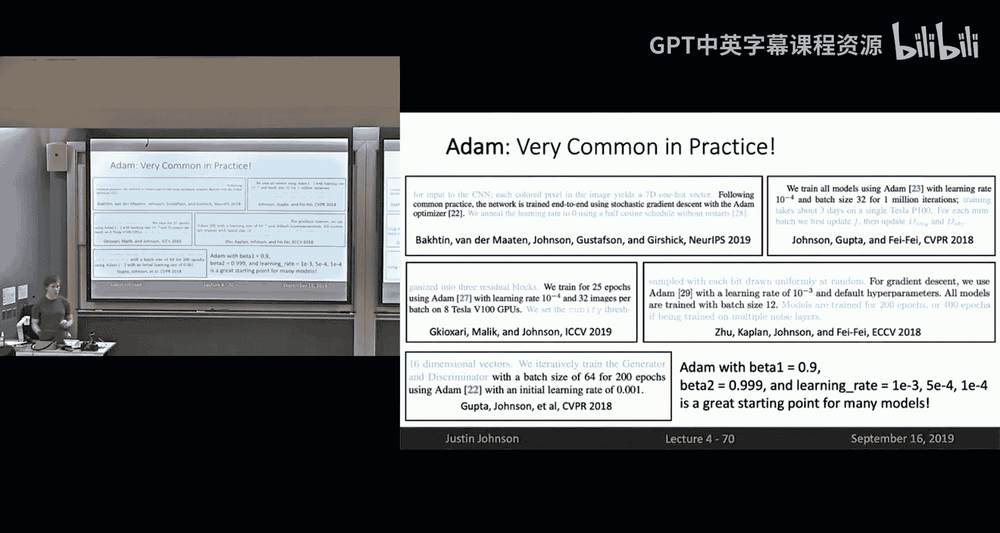

And now after hypping up atom we gotta look at this diagram to see actually what it does and now because we remember we had this notion of atom is trying to combine the good parts of momentum as well as these adaptive learning rates to atgrad and when we look at at this picture here。

 we can somehow see that it has properties of both of those optimization algorithms so we can see that somehow like the momentum based method。

 it tends to build up some velocity and overshoot and come back but it overshoots are maybe less drastic than the full than using this normal SGD false momentum and like RMS crop or agrad。

 it tends to kind of bend in the right way towards the minimum and it tends to work well for a lot of problems for that reason。

So again， I kind of need to caution you again against making intuitions about highdial spaces based on lowdiional problems。

 so even when I'm putting all these pictures like this about how these optimization algorithms behave。

 you really should take this with a huge shaker of salt。

 because remember at the end of the day we're really're going to be training on very highdial spaces so the behavior in those very high dimensional spaces could look quite different than in these lowdial projections that I'm showing you。

 but I think it's still useful to look at these kinds of things to at least get a very coarse sense of intuition about what these algorithms are doing。

 but trying not to put too much faith in exactly what you see in these animations。

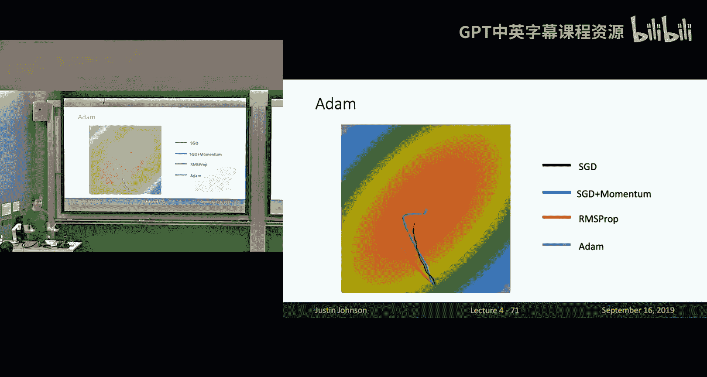

Okay， so then as a bit of summary， then we've seen this I put together this little comparison table of these different optimization algorithms that we've talked about。

 and we can see that they kind of build up and iteratively add more features as we go along。

 but this has maybe meant as a bit more review for you guys。

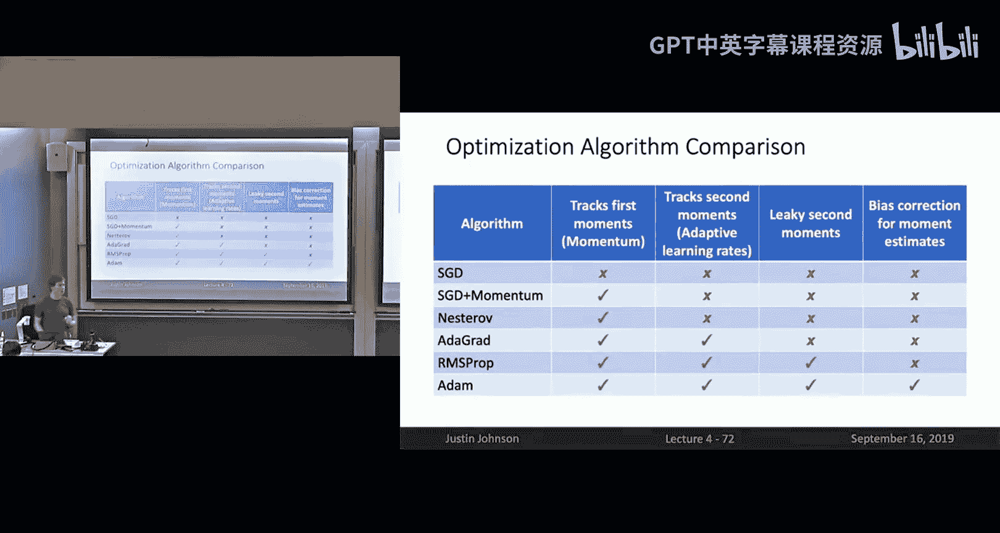

So so far all these algorithms are what we call first orderder optimization algorithms because basically what they're doing is they're using information about the gradient and only the first derivative to make their gradient steps。

 so what we can think about them as doing is basically they're forming a linear approximation to the function and then they form this linear approximation to the objective function we're trying to minimize which we using the gradient。

 it's then in a high dimensionmenional situation， you might imagine that we have this tangent hyperplane which is computed using the value of the gradient at the current point。

 and then they step down on this tangent hyperplane in order to try to minimize our objective function。

Well， of course we can naturally extend this thinking to use higher order gradient information。

 so in addition using the gradient， which is the first derivative。

 we might also form we then could form a quadratic approximation to our objective function using both the gradient as well as the hesian。

 which is the second derivative at every point。And then the idea here is that now we could form some quadratic surface。

 which locally approximates our objective functioning question and then step towards minimizing this quadratic approximation。

And this idea is nice because it lets the algorithm more adaptively choose how big it could dish step because maybe at a point like this where the gradient is rather high and the curvature is rather high。

 maybe we should take a fairly small step but at a point over here by looking at the second order curvature information we can see that maybe it might be safer to take a larger step so this idea of second order optimization is maybe more robust in setting learning rates or in setting step sizes for itself and indeed you can see algorithms like addgrad and SGD momentum as some kind of diagonal approximation to these second order algorithms because they're trying to use by integrating first order information over time as somehow forming some type of approximation to the second order curvature information which again gives us a bit more intuition but why these momentum based methods or adaptive learning rate by based methods might be a good idea。

So then forative math， we could write down second order optimization by writing down this pratic tailor approximation to our function and then solving to write this W star value that was step to the minimum of the drag optimizer。

But there's a problem is that this is actually not used so much in practice for a lot of deep learning systems。

And the problem here， can anyone find it？し。给多给。Well。

 the problem is that we want to work in high dimensional spaces。

 so we want to be able to optimize models with tens of thousands or millions of parameters。

And now the hesian matrix， the gradient is fine， the gradient has the same number of elements as the weight matrix itself。

 so if we can store and manipulate the weight matrix， we can also store and manipulate the gradient。

 but the problem is now the hessian matrix is a matrix。

 so if our objective if our weight matrix has n values。

 then this second order hesian matrix has n squared value。

And now if we have like 100 million parameters that 100 million square is like way too big。

 you're not going to have enough memory and now even worse is if you look at this at this equation。

 we actually need to invert the hessian and nowing inverting a general matrix is nowqubic in the size of the matrix so now inverting this thing is going to be like 100 million cube its like heat depth of the universe situation like we don't want to go there so in practice the second order optimizes are sometimes used for low dimensional optimization problems but they're not used so much in practice for very high dimensional。

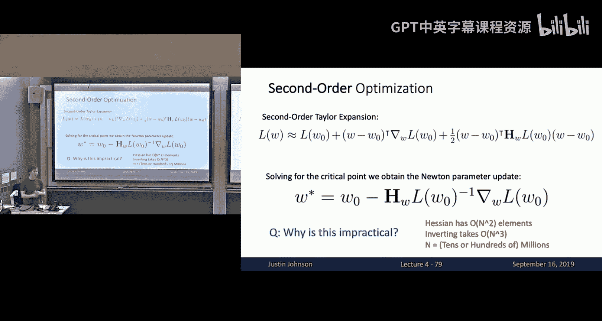

自己。let's get back so then in practice kind of when you're training your own models。

 then atom is a very nice default choice in a lot of situations and so that's kind of a good goto algorithm when you're trying to build a new def learning system although I should also point out that SGD plus momentum is also use in practice quite a lot as well in practice you'll typically see most def learning papers use one of these two optimization algorithms so my general rule of thumb is to go with at at the very beginning because it's fairly easy to get to work and it tends not to require too much tuning of those hyperparameters those default values that I gave you some pro about tend to work out of the box for a lot of different problems whereas SGD plus momentum can sometimes actually give better results but might require a bit more tuning of the hyperparameters and in future lectures will talk more about some of the strategies you might employ for using for tuning the hypercraameter。

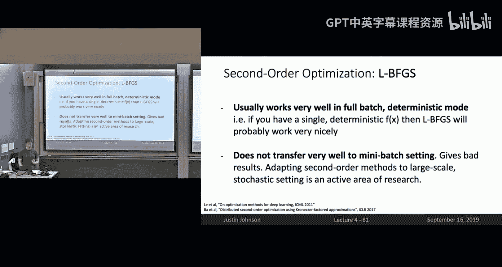

You have something like SG and if reason for some reason you can afford some kind of second order optimization。

 that maybe your problem is low dimensional， maybe your problem is not stochastic because second order optimizes tend not to do well with sasticity。

 then you might consider using some kind of second order optimize LBFGS is a good one for that。

But in practice， the ones you'll usually see are atom and SG2matoone。

So we're getting a bit towards the end here so I think I'll delay this towards a later time。

 so basically where our summary now is is that by this point now we've talked about how we can use linear models to solve image classification problems then in the last lecture we talked about how we can use loss functions to quantify how much we care about different values of the weight matrix in our linear models and now in today's lecture we've seen how we can use stochastic gradient descent and its cousins to efficiently optimize these highdimensional loss surfaces next so now we've kind of equipped ourselves with a lot of different tools working up towards solving this deep learning problem so now in the next lecture will finally start talking about neural networks and we'll see that we can just simply replace this linear classifier with more powerful neural network classifiers and the rest of what we've been talking about will allow us to train much more powerful models。

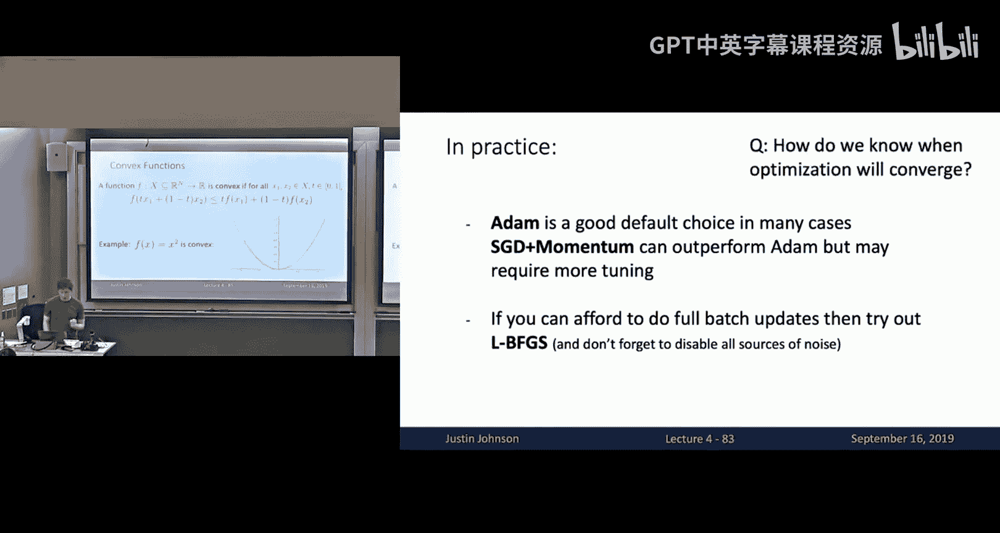

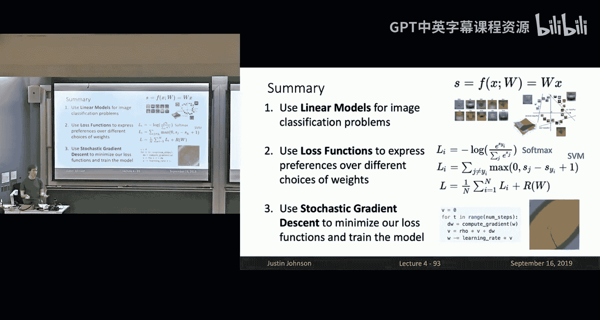

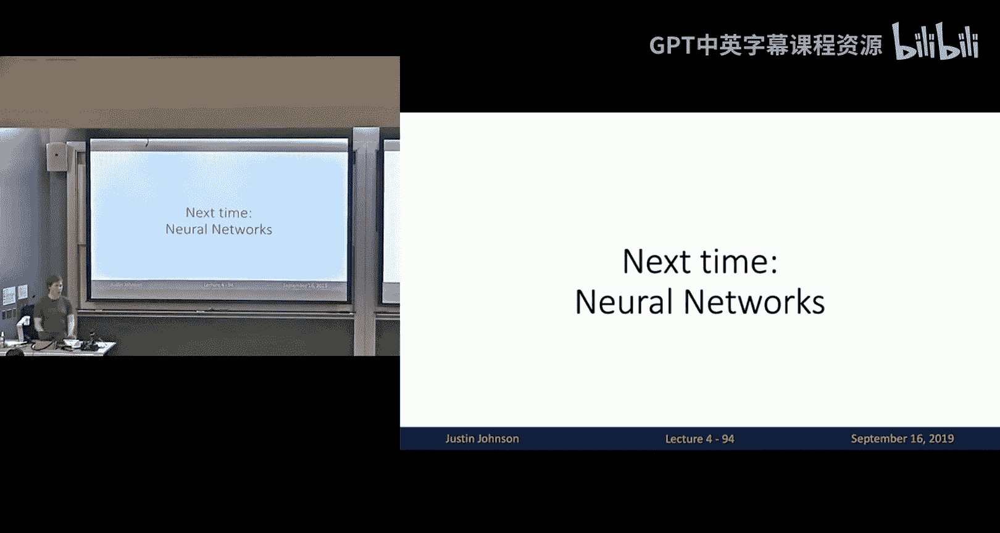