# 深度学习用于计算机视觉：04：优化 🎯

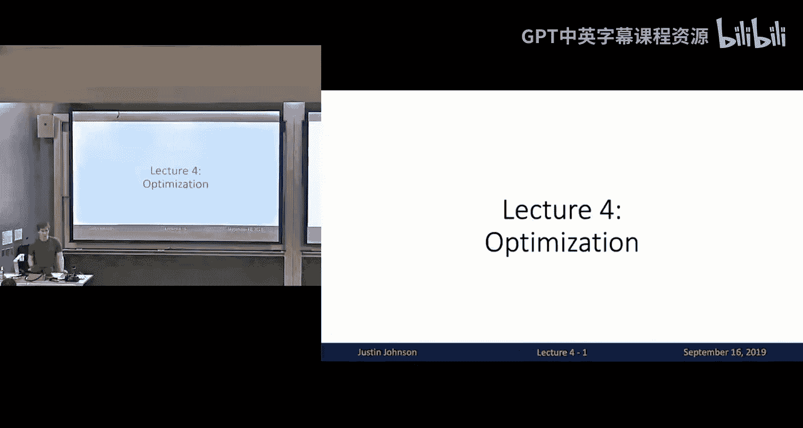

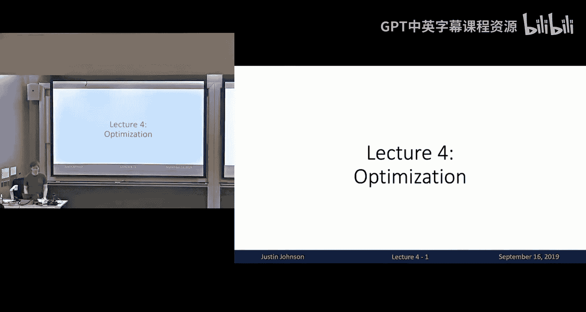

在本节课中，我们将要学习如何为线性分类器找到最优的权重矩阵。具体来说，我们将探讨优化这一核心主题，即如何最小化损失函数。我们将从最简单的随机搜索开始，逐步深入到梯度下降及其更高效的变体，如带动量的随机梯度下降和Adam优化器。

---

## 优化概述 🌄

上一节我们介绍了如何使用损失函数来量化对权重矩阵的偏好。本节中，我们来看看如何实际找到能最小化该损失函数的权重矩阵W。这个过程被称为优化。

我们可以将优化问题形式化地写为：寻找权重矩阵W*，使得损失函数L(W)最小。直观上，这就像在一个高维地形中，蒙着眼睛寻找最低点。

---

## 迭代优化方法 🔄

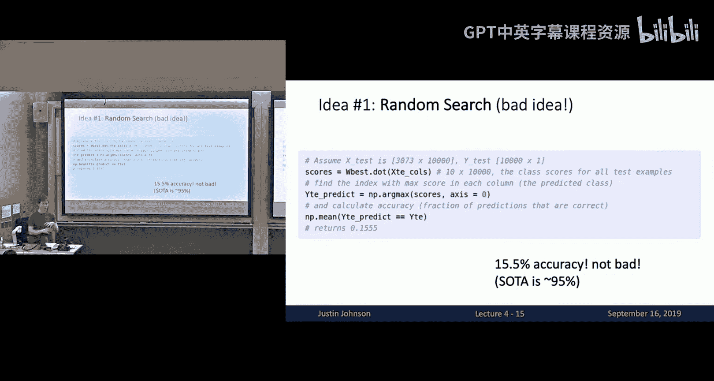

由于通常无法直接写出损失函数最小值的解析解，我们需要使用迭代方法来逐步改进解。

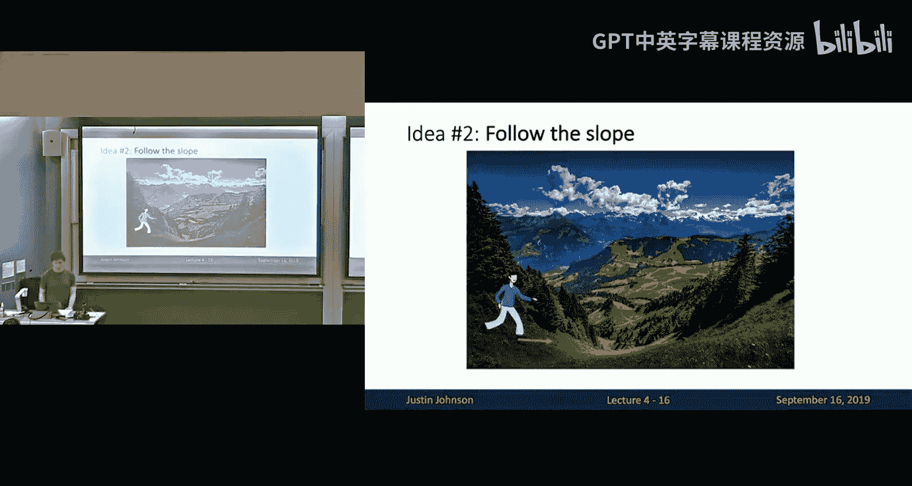

### 随机搜索

以下是随机搜索的基本思路：
*   生成大量随机的权重矩阵。
*   在训练集上评估每个权重矩阵对应的损失值。
*   记录找到的最低损失值。

虽然这是一个非常低效的算法，但它能让我们对优化问题有一个初步的认识。

### 梯度下降

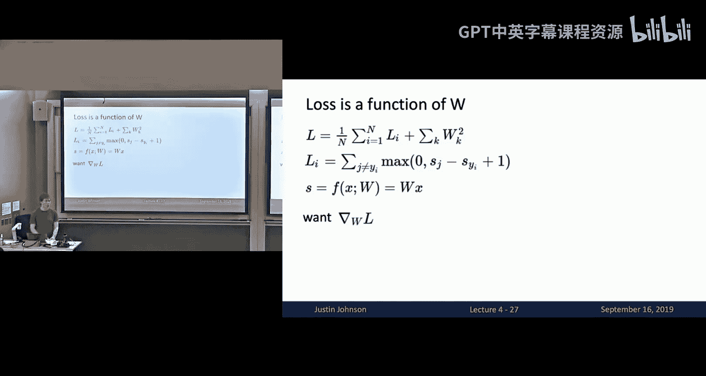

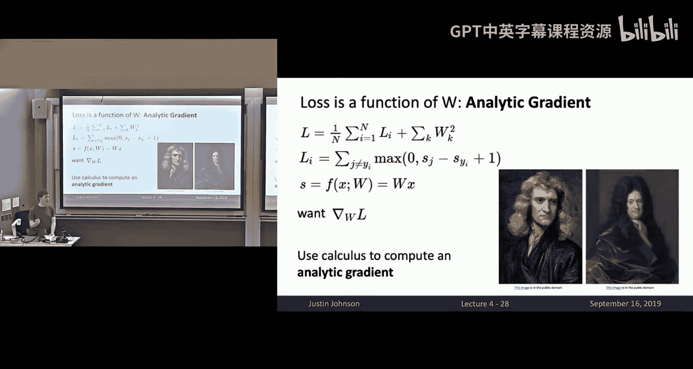

一个更聪明的策略是沿着地形的坡度向下走。这需要计算梯度。

对于标量函数，梯度（导数）告诉我们函数在某点的斜率。对于向量输入、标量输出的函数（如我们的损失函数），梯度是一个向量，指向函数值增长最快的方向。因此，负梯度方向就是函数值下降最快的方向。

计算梯度有两种主要方法：

1.  **数值梯度**：通过极限定义直接计算近似值。对于权重矩阵W的每个元素，进行微小扰动，计算损失的变化率。
    ```python
    # 数值梯度近似计算示例（伪代码）
    grad_approx = (L(W + h) - L(W)) / h
    ```
    这种方法简单直观，但计算缓慢（需要前向传播的次数与参数数量成正比）且是近似值。

2.  **解析梯度**：利用微积分知识，直接推导出梯度关于W的精确数学表达式。
    ```python
    # 解析梯度计算示例（伪代码）
    grad_exact = dL/dW  # 通过推导得到的梯度公式
    ```
    这种方法精确且快速，但推导过程容易出错。

在实践中，我们通常使用解析梯度进行训练，但会使用数值梯度作为调试工具来验证解析梯度的正确性。

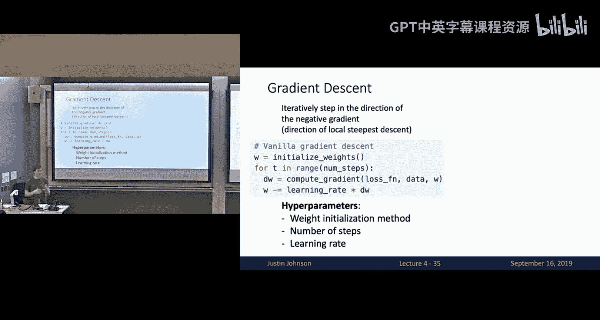

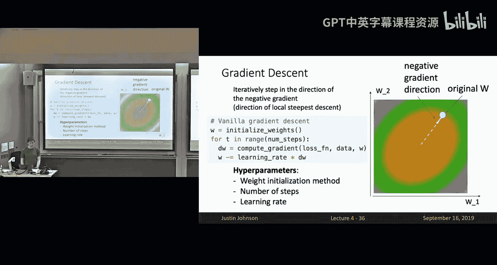

---

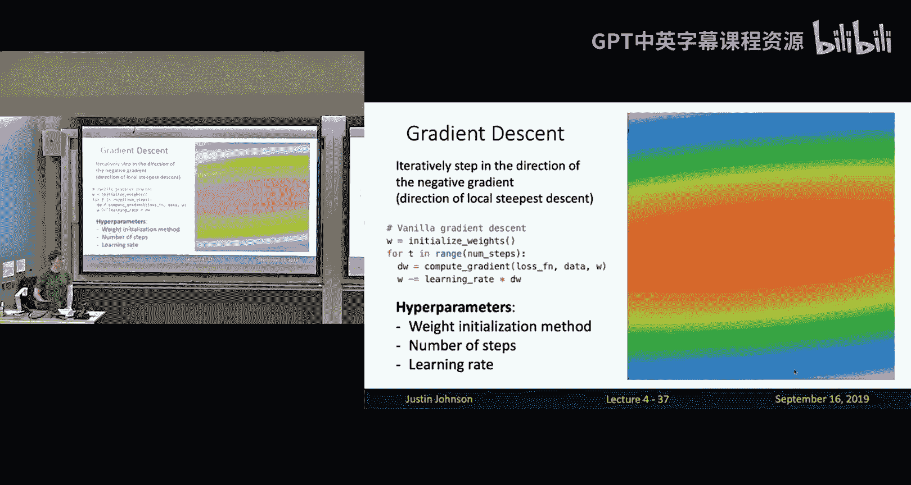

## 梯度下降算法 📉

掌握了梯度计算后，我们可以正式介绍梯度下降算法。

梯度下降算法的核心步骤如下：
1.  初始化权重W。
2.  循环迭代一定次数：
    *   计算当前W处的梯度 `dL/dW`。
    *   沿负梯度方向更新权重：`W = W - learning_rate * dL/dW`。

这个算法引入了几个重要的超参数：
*   **权重初始化**：如何设置W的初始值。
*   **迭代步数**：运行算法的轮数。
*   **学习率**：控制沿梯度方向更新步长的大小。

从直观上看，梯度下降算法就像沿着最陡的下坡方向小步前进。在接近谷底（最小值）时，梯度变小，步长也会自然减小。

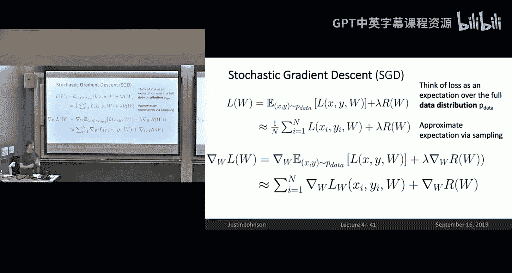

---

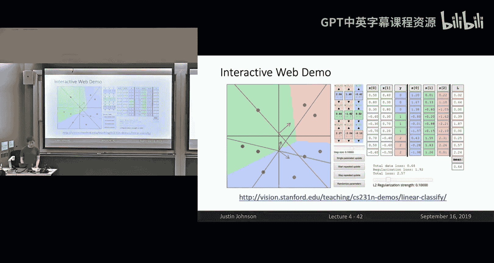

## 随机梯度下降 ⚡

标准的（全批量）梯度下降需要在整个训练集上计算损失和梯度，当数据集很大时，这非常耗时。

随机梯度下降通过使用小批量数据来近似整个数据集的梯度，从而大幅提高效率。其更新公式为：
`W = W - learning_rate * dL/dW_minibatch`

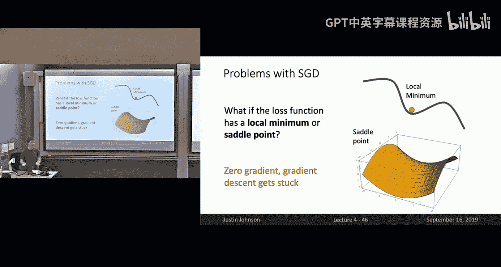

这引入了新的超参数：
*   **批量大小**：每个小批量中的样本数量。通常设置为32、64、128等，在GPU内存允许的情况下尽可能大。
*   **数据采样方法**：如何从数据集中抽取小批量。通常随机打乱后顺序遍历。

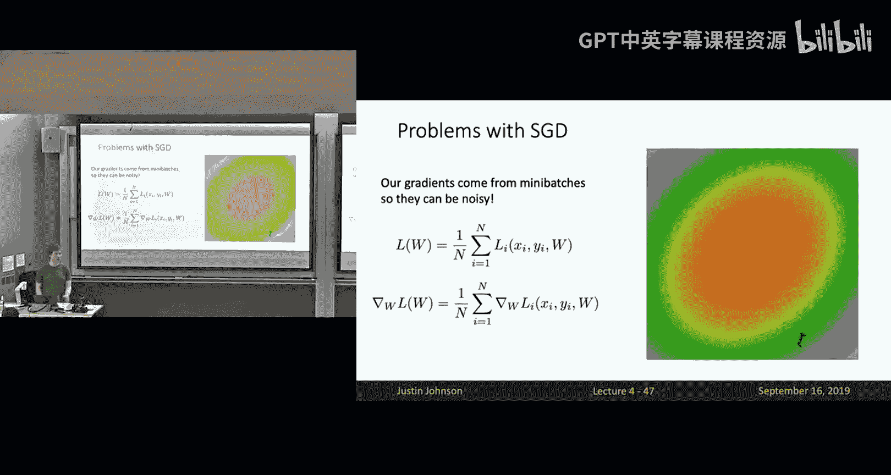

“随机”一词来源于我们将训练数据视为从某个真实数据分布中采样得到的。小批量损失是对该分布期望的蒙特卡洛估计。

---

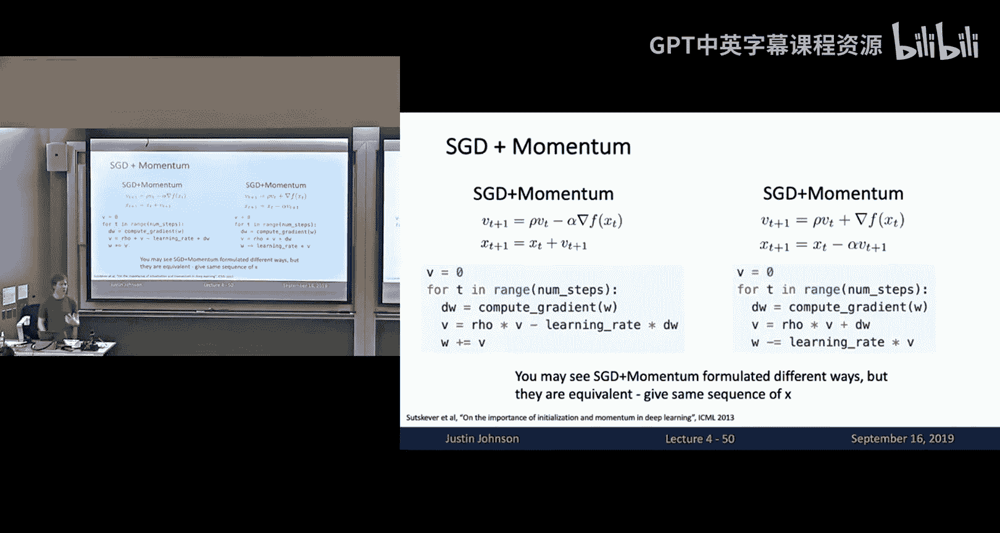

## 梯度下降的挑战与改进 🚧

基本的随机梯度下降在面对某些损失函数地形时可能遇到问题。

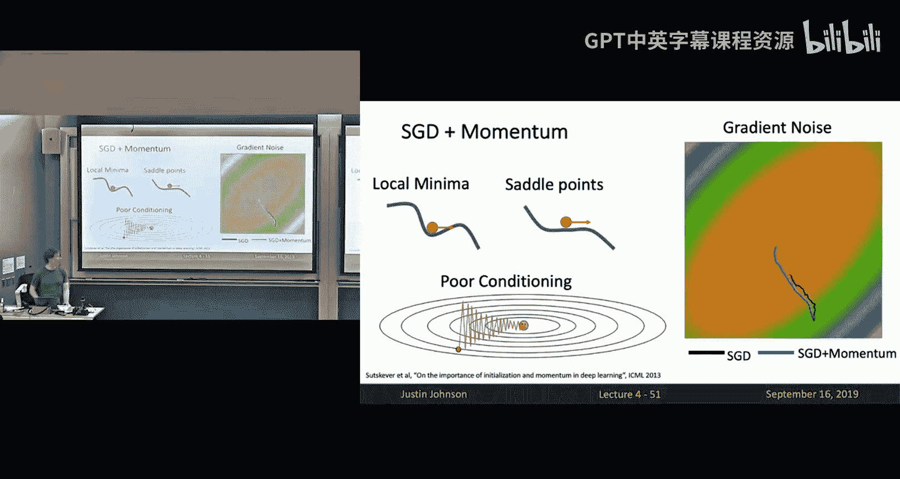

### 常见问题
1.  **高条件数问题**：损失函数在不同方向上的曲率差异很大，导致优化路径曲折，收敛缓慢。
2.  **局部极小值与鞍点**：在这些点上梯度为零，算法可能停滞。在高维空间中，鞍点比局部极小值更为常见。
3.  **梯度噪声**：由于使用小批量估计梯度，更新方向存在噪声，可能导致优化路径不稳定。

### 带动量的随机梯度下降

动量法模拟了物理中球滚下山坡的惯性。它引入一个速度变量v，用于累积历史梯度信息。
更新规则如下：
`v = rho * v + dL/dW`
`W = W - learning_rate * v`
其中，`rho`是摩擦系数或衰减率（通常接近1，如0.9）。

动量法有助于：
*   平滑高条件数问题中的振荡。
*   凭借积累的速度冲过平坦的鞍点区域。
*   抑制梯度噪声的影响。


### 自适应学习率算法：AdaGrad / RMSProp

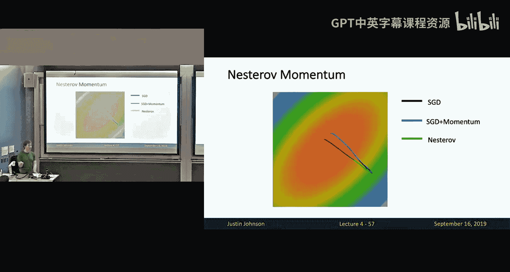

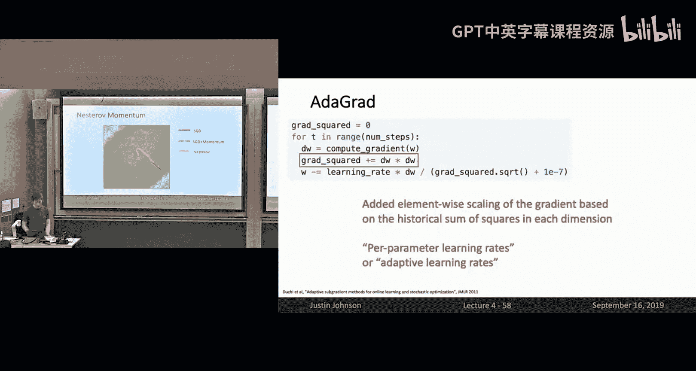

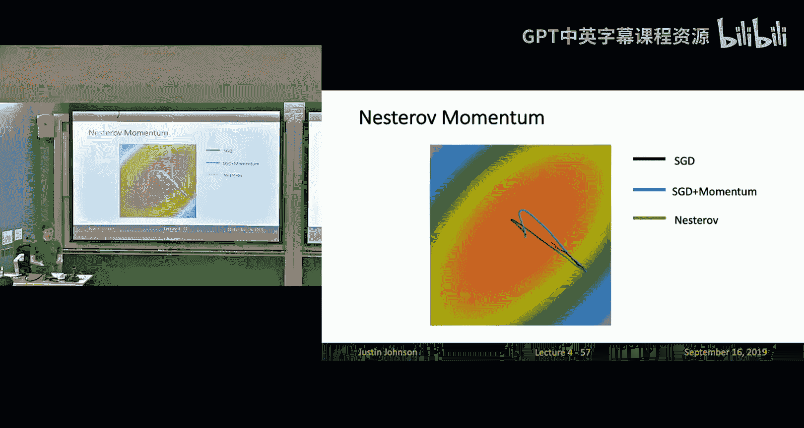

这类算法通过调整每个参数的学习率来应对高条件数问题。

*   **AdaGrad**：累积历史梯度平方和，更新时除以该平方和的平方根。这使得在梯度大的方向步长变小，在梯度小的方向步长相对变大。但累积和会持续增长，可能导致学习率过早衰减至零。
*   **RMSProp**：是AdaGrad的改进，使用指数衰减移动平均来累积梯度平方和，解决了学习率持续衰减的问题。
    ```python
    # RMSProp 核心更新（简化示意）
    cache = decay_rate * cache + (1 - decay_rate) * (dL/dW)**2
    W = W - learning_rate * dL/dW / (sqrt(cache) + eps)
    ```

### Adam 优化器 🏆

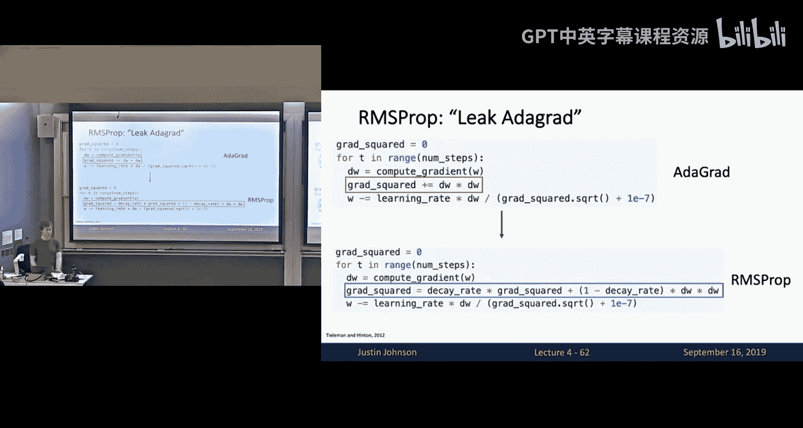

Adam结合了动量法和RMSProp的思想，同时跟踪梯度的一阶矩（均值，类似动量）和二阶矩（未中心化的方差，类似RMSProp），并进行偏差校正。
其超参数通常设置为：`beta1=0.9`, `beta2=0.999`, `learning_rate=1e-3` 或 `1e-4`。

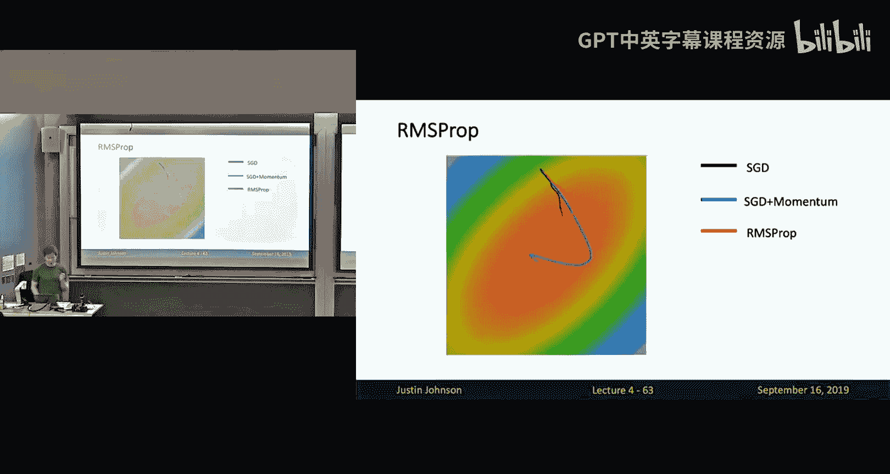

Adam因其鲁棒性和较少的超参数调优需求，成为深度学习实践中常用的默认优化器。

---

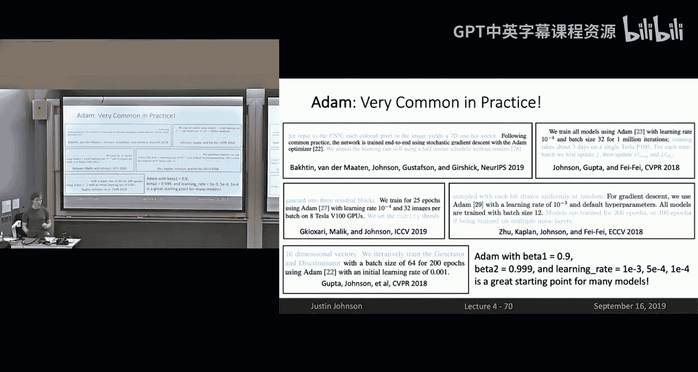

## 二阶优化方法 📐

上述方法均为一阶优化算法，仅使用梯度信息。理论上，使用海森矩阵（二阶导数）的二阶优化方法可以构建更精确的局部二次近似，从而更智能地选择步长。

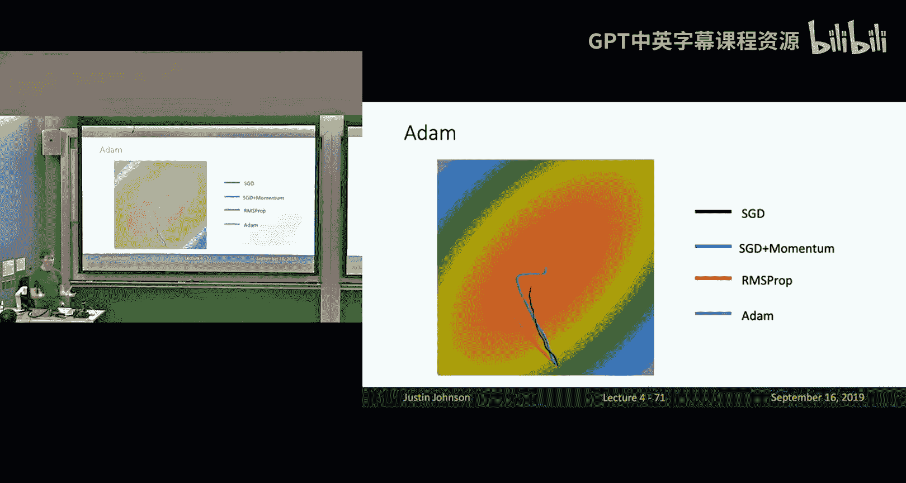

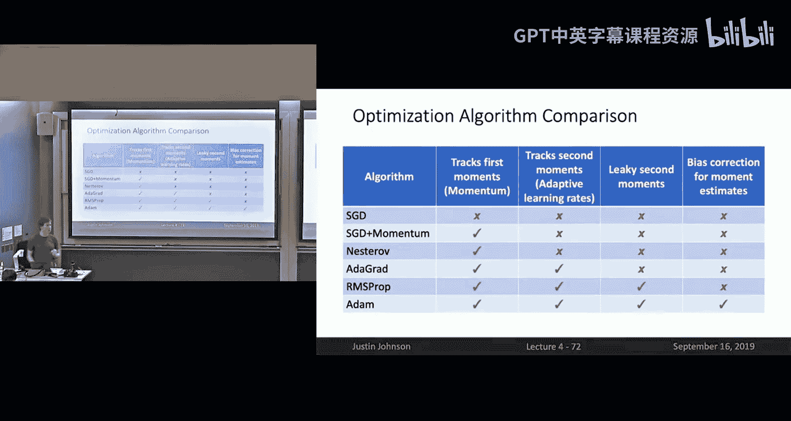

然而，对于参数数量为N的模型，海森矩阵是N×N的，存储和求逆的计算复杂度（O(N²)和O(N³)）对于大规模深度学习模型来说是不可行的。因此，二阶优化方法在实践中较少用于训练大型神经网络。

---

## 总结 📚

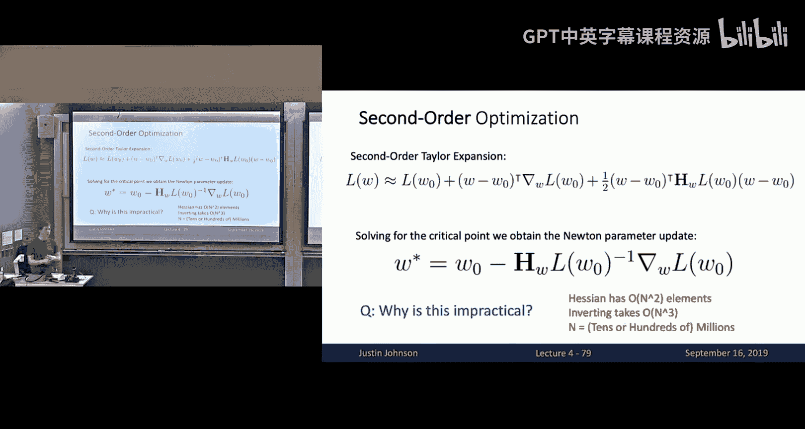

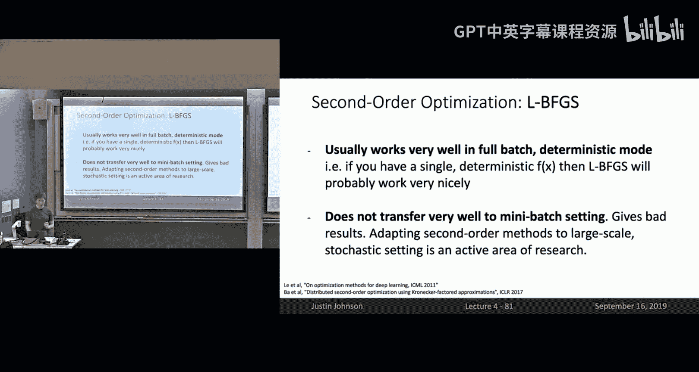

本节课中我们一起学习了优化的核心概念与方法：
1.  我们明确了优化的目标：找到最小化损失函数的权重矩阵。
2.  我们介绍了梯度下降的基本原理，以及计算梯度的数值法和解析法。
3.  我们探讨了全批量梯度下降的局限性，并引入了更高效的随机梯度下降。
4.  我们分析了SGD可能遇到的问题（高条件数、鞍点、噪声），并学习了两种主要的改进策略：
    *   **动量法**：通过累积历史梯度来加速收敛并逃离平坦区域。
    *   **自适应学习率法**：如AdaGrad/RMSProp，为每个参数调整学习率。
5.  我们重点介绍了结合两者优点的Adam优化器，它通常是实践中的首选。
6.  我们简要讨论了一阶优化与二阶优化的区别，以及后者在大规模应用中的局限性。

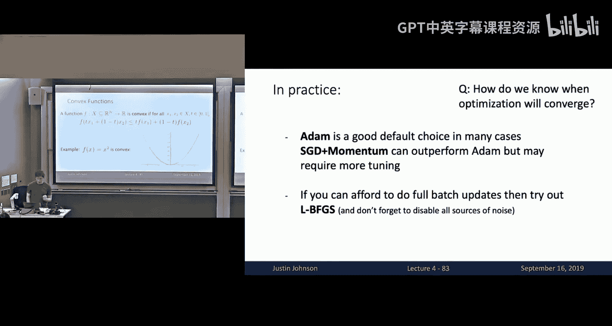

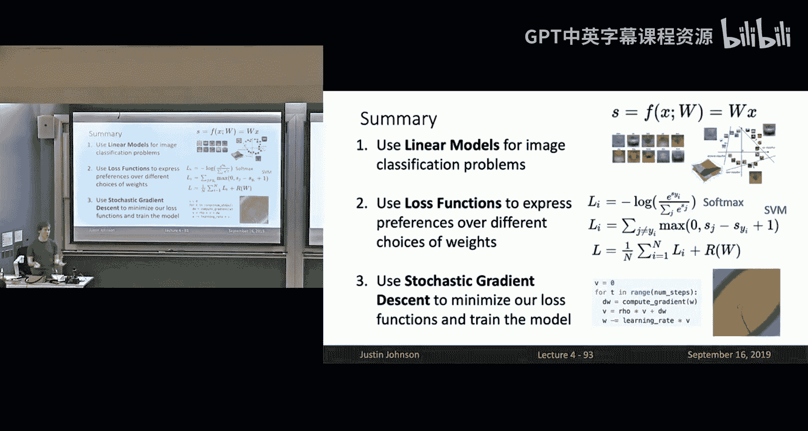

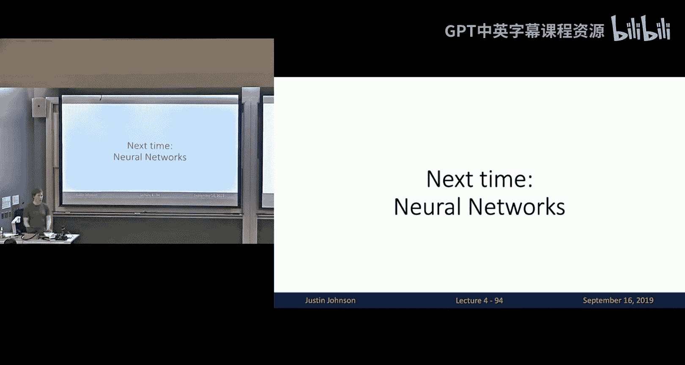

现在，我们已经掌握了使用线性模型、损失函数和优化算法来解决图像分类问题的完整流程。在接下来的课程中，我们将把简单的线性分类器替换为更强大的神经网络分类器，并应用这些优化技术来训练它们。