# 密歇根大学《深度学习用于计算机视觉｜Deep Learning for Computer Vision UMich EECS 498-007 2019》中英字幕 p05 -05-5_NeuralNetworks.zh_en -BV1jA4m1P7GN_p5-

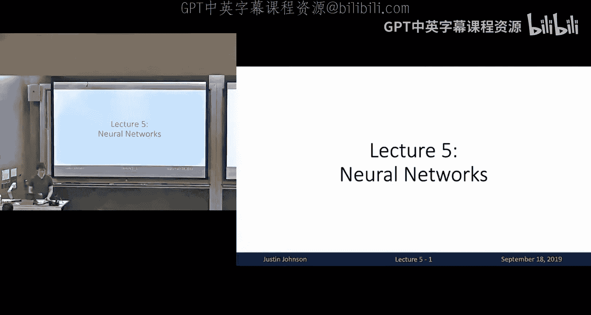

So welcome back to lecture five， today the microphone is actually working。

 so hopefully that will give you a little bit better audio this time and I don't want to have to shout quite as loud。

Today today's topic is neural networks。 we're finally getting to the meat of the course and we're finally talking about our first deep learning models。

 but before we do that， of course we always need to talk about whatever administrative notes for the day so the waitlist update update I know this is a hot topic I apologize I think I was a little bit confused last time about how exactly the waitlist works here I deeply apologize for that since it's my first time teaching at Michigan so the way it actually works as I've confirmed with the people who actually set it up is that we set a capacity of 35 and 85 for 498 and 598 and then it's set up to automatically send out overriidedes in waitlist order for the two different sections and then if you get an override through this automatic process you should get an email I don't know what that email looks like but I assume this you should get one and if you get that email then you should be able to register and if you don't register within one day of getting the override then it will expire you'll drop off the waitlist and you'll be sad and then the next day you'll get new overriidedes will be sent to new people on the waitlist。

Hopefully this will allow things to get sorted out relatively good with enrollment in the next couple of days。

Then the next bit is of course， assignment1， hopefully you have all completed this already because it was due on Sunday。

 but you have three late days for the semester so if were for if you were choosing to use all three of your late days on the very first assignment。

 then you could still turn it in today with no penalty although I don't know if that would be the best strategy but that would be up to you and another note is that because I know we had a lot of burs with enrollment on this class so we've decided that anyone who enrolled late not the beginning of the semester then we will take their a1 without penalty and there a1 due date if you enrolled late will be one week from the time that you enrolled one week from the day that you enrolled in the class and we can look that up automatically online for you so no need to contact us about that。

Also， of course， we have assignment2 following assignment1， which has been released。

 I saw some questions about on Piazza。 so clearly some people have have not downloaded。

 opened it on coab and started working， which is very exciting。

 and this is quite a bit longer than the first assignment。

 So I really recommend you get started that you should not use the first assignment to judge the length of the assignments for the rest of the semester。

 The first assignment will be significantly shorter than the rest of the assignments。

 which hopefully is hopefully is good hopefully is a good thing。

 So I I encourage you to start assignment to a little bit earlier than you may have started assignment1。

😊，And another important note on submissions， remember that we've created this validation script for you to make sure that your homework submissions are properly formatted on homework1。

 we'll give you maybe a little bit of leeway if your homeworks did not pass the validation script。

 but starting on homework2， it's your responsibility to make sure that your submitted zip file passes the validation script and we reserve the right to not grade your assignment if it does not pass the validation script so please make sure you run this on your assignment to when you submit。

Any questions on administrative stuff before we go on to neural networks？Excellent。

So at the end of last lecture this is kind of where we are in the class as we summarize at the end of last lecture。

 so so far we've talked about using linear models as a way to build parametric classifiers we've talked about using different kinds of loss functions to quantify how happy or unhappy we are with different settings of the weights in our linear classifiers and in the last lecture we've talked about using stochastic gradient descent or some of its slightly fancier relatives like momentum and atom and RMS prop for actually minimizing these objective functions and finding values of the weights that satisfy our preferences as specified by the objective function。

And today we're going to iterate on 01， and we'll step away from linear models for the first time and start to explore neural network based models that will be much more powerful and allow us to classify images with much higher accuracy。

But before we talk about neural network based models。

 we need to I think we we should step back and motivate them a little bit。

So as we've talked about several times already across across the semester so far。

 we've seen that linear class fires， although they're very simple and easy to understand。

 are really quite limited in the types of functions that they can represent and their functional power is somehow not as good as we would like them to be。

 We saw this from the geometric viewpoint。 recall that from this geometric viewpoint of a linear class fire。

 we saw a linear class fire as kind of drawing high dimensional hyperplanes to carve up this high- dimensional Euclidean space into two chunks and with situations like that on the left。

 it's just impossible for a linear class fire to possibly carve up the space in a way that separates the green points from the blue points。

When we thought about linear classifiers from the visual viewpoint。

 we had this notion of linear classifiers learning just a single template per class and that therefore they were unable to represent multiple modes of the same object category for example we saw that in the horse template it kind of blends the horse looking to the left and the horse written looking to the right and this is somewhat of a representational shortcoming in the linear classification model Well before moving to neural networks。

 I think we should discuss a different way to overcome this limitation of linear classifiers and that's the notion of feature transforms so here the idea with feature transforms is that we will take our original data which is given to us in some native input original space on the left and then we will apply some cleverly chosen mathematical transformation to the input data to now transform it in a way that will hopefully be more amenable to classification。

So as an example here on the left， maybe with our human intuition。

 we think that maybe transforming this data from Cartesian into polar coordinates would be a better representation of this data for the purpose of classification。

So we can imagine writing down this feature transform。

 which simply converts the Cartesian representation of our data into this polar representation of our data。

And after we apply this feature transformation to this input data。

 it now lives in some new space that we call a feature space that is defined by the mathematical form of the feature transform that we've chosen。

 but what's particularly useful about this feature transform for this problem is that now after transforming this input data from Cartesian to Pol。

 we can see that in polar coordinates， this data actually becomes linearly separable。

 so now we could imagine training a linear classifier， not on the original input data space。

 but instead training a linear classifier on the feature space representation of our data。

And then if we imagine what， if we imagine porting this linear decision boundary in the feature space back into the original space on the left。

 we can see that a linear classifier or a linear decision boundary in the feature space corresponds to some kind of nonlinear decision boundary or nonlinear classifier in the original space。

And so by cleverly choosing a feature transform that suits the properties of your data。

 it may be possible to overcome some of the limitations that we've seen with linear classifiers so far。

And for this particular example of transforming from Cartesian to polar seems kind of trivial。

 but in general， when you think about applying feature transforms more broadly。

 you have to think very carefully about the structure of the data that you're working with and think about what types of functional transformations you might consider applying to your input data that might make it more amenable to linear classification downstream。

And this is not just a hypothetical thing。 This actually is this notion of feature transforms was very broadly used in computer vision and even still is some in some subdomains。

 One example of a feature transform that we might use in computer vision is a notion of a color histogram。

 So here we can imagine taking each dividing the color space。

 the RGB spectrum of color space into some number of discrete bins and then for each pixel and our input image we could assign where it is in the bin in the bin representation of our color space and now the feature representation could be some kind of normalized histogram over what colors happen to appear in the image and type of color histogram representation of an input image somehow throws away all of the spatial information about images and only cares about what types of colors are present in the image。

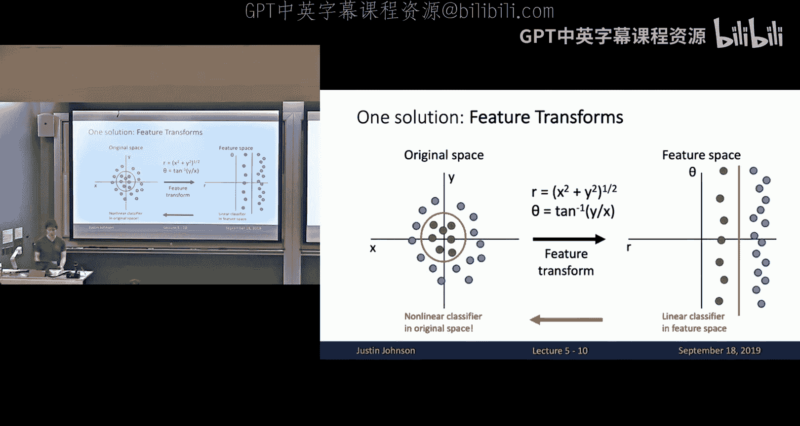

So you might imagine that a color histogram representation might， for example。

 be more spatially invariant。 so suppose that we we had maybe a car image like a red car on a brown background。

 and all of our car images were of this nature， but the car might appear in different locations in the image。

 then a linear classifier might have a hard time dealing with that kind of representation。

 but a color histogram representation would always represent it as a bunch of red and a bunch of brown。

 no matter where in exactly in the image the car might be located or the frog in this case。

So this was， this is one fairly simple feature representation that you might imagine applying to input images。

Another feature representation in images that was very。

 very widely used is the so-called histogram of oriented gradient approach。

 This I don't want to talk about in too much detail。

 The basic idea is that it it's somewhat dual to the color histogram approach。

 So in the color histogram approach we saw that it threw away all the spatial we throw away all the spatial information。

 and it didn't care about textures or locations and it only cared about what colors were present in the image。

 The histogram of oriented gradients representation does something of the opposite。

 it throws away all of the color information because it only cares about local edge orientations and strengths。

 and instead tells us something about the local orientations of edges and the local strengths of edges at every position in the input image。

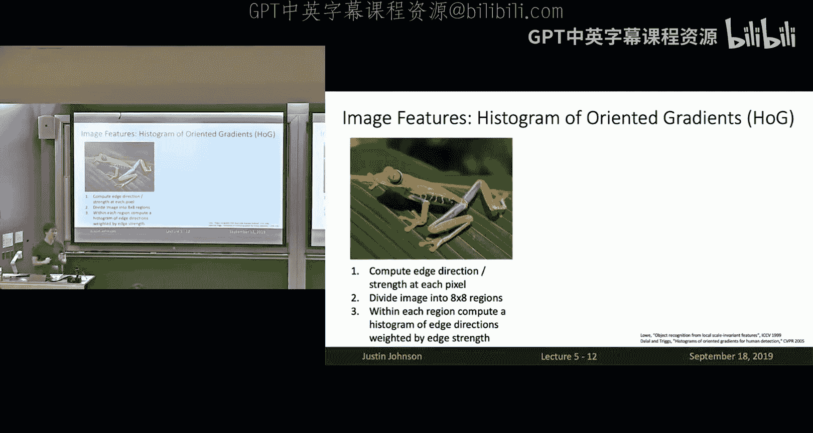

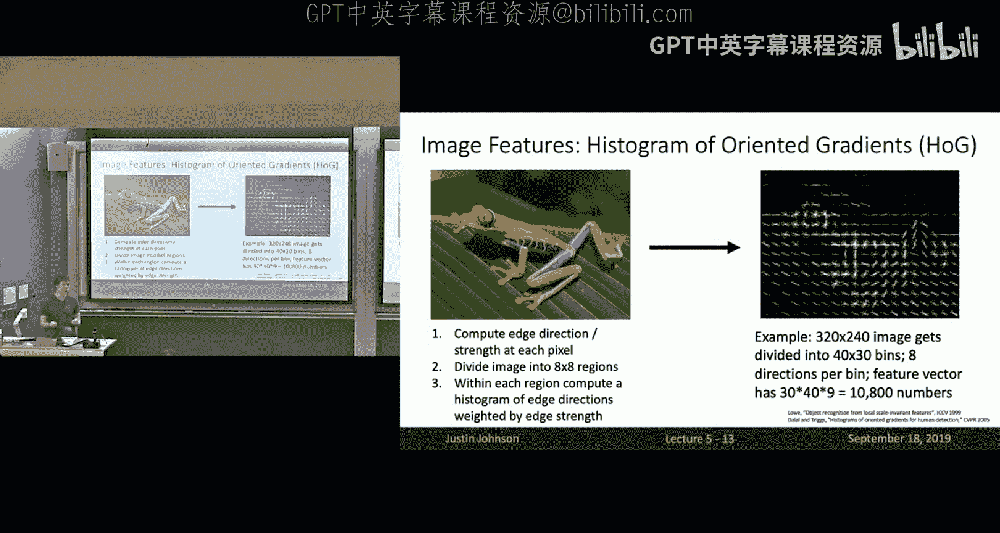

So the histogram of oriented gradients representation could tell us that， for example。

 in the red region， there is a fairly strong diagonal edges in that region。

 in the blue region around the frog's eyes， there are edges in all different kinds of directions and in the yellow region in the upper right corner of the image。

 there's very little edge information at all because it's a blurry background。

 very photographic and beautiful。So this histogram of oriented gradient representation is somehow dualled to the notion of the color histogram representation that we saw before。

And this was very widely used in computer vision for tasks like object detection and many other tasks in in the mid to late 200s。

But one interesting feature of feature of both of these feature representations is that they sort of require the practitioner to just think about what is the right qualities of their data that they want to capture with the feature representation and requires the practitioner to think ahead of time about how to design the right types of feature transforms。

 Well， there are there exist other types of feature transform methods that are somehow data driven that are actually driven by the data that we see in our training set。

That drive and one one canonical example of a data-driven feature transform is the so-called bag of visual words representation Here。

 the idea is that we have some large training set of images and then from our training set of images。

 we're going to extract a large set of random patches of various scales and sizes and perhaps aspect ratios cropping out random bits of all of our training images。

And then we will cluster all of those random patches of our training images to get what is called a codebook or a set of visual words that can represent what types of features tend to appear in our images。

 the idea here being that if there are common types of structures in your images that appear in many。

 many images in your training set， then you will hopefully learn some kind of visual word representation that can capture or recognize each of many of those common features that appear in your training set。

So then after this step one of building your codebook of visual words。

 there is some step two that encodes your image using the learned codebook of visual words here we will take this codebook of visual words that is cluster centers of all the local image patches and and and compute some kind of histogram representation for each input image to say how much does each of those visual words appear in that input image representation and this you can imagine is quite a powerful type of feature representation because it it does not require the practitioner to fully specify the functional form of the feature representation it instead somehow allows the features to be that are used in the feature representation。

 the visual codebook words in this case somehow they're able to be learned from the training data to better fit the problem at hand so this is maybe a bit more flexible than some of the other feature representations that we saw previously。

But another common trick with image features is that you don't have to settle for one。

 you can imagine having a bunch of different feature representations of your input image and then concatenating them all together into one long feature vector。

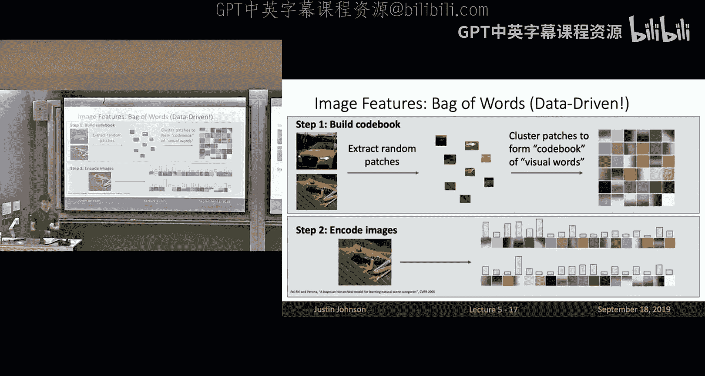

You might concatenate a color histogram representation at the top with some bag of words representation in the middle。

 with some histogram of oriented gradients representation at the bottom to get some kind of long。

 high dimensional feature vector that describes your image in various or different parts of the feature representation now capture maybe different types of information from the input image like color or edges or whatnot。

And this， this， this idea of combining multiple types of feature representations was very。

 very widely used in computer vision in the late late ， in the 2000s and early 2010s。

As a canonical example of that， actually the winner of the 2011 ImageNet Challenge used some kind of complicated feature representation to actually。

 this was the state of the art in large scale image classification as of 2011。Which was of course。

 the year right before the Alexnet architecture made deep learning kind of very popular across all parts of computer vision。

 but if we look back at this 2011 imagenet winner， we can see that they had some they first took some low-level feature extraction or they extracted a bunch of patches from the image images。

 they extracted sift and color representation， they reduced the dimensionality of those to PCA using PCA。

 they applied something called Fser fiser vector encoding to compress and get another layer of features on top of those original features。

 they did some compression step， and after that they end up with some kind of feature representation upon which they can learn linear SVMs to finally learn a linear classifier on top of this complicated feature representation。

So this pipeline of coming up with feature representations for your images actually can perform reasonably well in some contexts。

But one way I like one way I like to think about feature extraction is something like the following diagram here here on the top here。

 we imagine if we have some kind of machine learning image classification pipeline that's built with feature extraction。

 basically what we've done is we've decomposed our system into two parts。

 one is the feature extractor that may and one and the second is the learnable model that will actually operate on top of that feature representation or that feature space。

And typically this feature extraction stage is not even even if this feature extraction stage has some kind of data-driven component like we saw in the bag of visual words example。

 this feature extraction stage is not necessarily going to automatically tune itself in order to directly maximize the classification performance of the overall system。

 instead somehow when we learn a linear classifier on top of a fixed feature representation。

 we have this， we end up with this very large complicated system that goes from raw image pixels all the way to our final classification scores。

 but only a small part of that system at the very end is actuallyning its tuning itself or tuning its weights in response to trying to maximize the classification accuracy of our system。

In contrast， as so then in contrast， well clearly here， we might want to do something better。

 which is to somehow automatically tune all parts of the system to maximize the performance on image classification tasks。

And that's one motivation to think about what a neural network is doing When we build a deep neural network system for image classification。

 what we're doing is building a single end to end pipeline that on the left hand side takes in raw the raw pixels of the image and on the right- hand side is predicting these classification scores or classification probabilities or whatever else you actually want to want to predict。

 And then during the process of training， we will tune not only that final layer that's using some linear classifier。

 we will tune the entire system， all parts of the system jointly in order to maximize the performance of classification or whatever other end task we're considering。

And then from this point of view， it seems that a neural network based system is really not so different from these large deep feature representation systems。

 basically the change is that a neural network is somehow jointly learning both a feature representation and a linear classifier on top of that feature representation in such a way to maximize the classification performance of our system。

With this introduction， we can finally talk about a concrete example of what exactly a neural network might look like。

So far in this class， of course， we're very familiar with this linear classifier right given our input data。

 which is stored in a giant column vector X， then our linear class fire is going to have a learnable weight matrix W of size number of input dimensions by number of categories and the linear classifier is this matrix vector multiply between the input data and the learnable weight matrix Well now our simplest neural network model is not much more complex than the linear classifier Now we've generalize the system rather than have we still represent our input data with a single long column vector where we stretched out the raw pixel values of all of the parts of the image into one big vector but now we have two learnable weight matrix matrices。

 one of these learnable weight matrices is W1 which is now shape number of input dimensions by H H is called the hidden size of the neural network and then we first do a matrix vector multiply between our input data X and our first。

nable weight matrix W to produce some new vector of dimension H。

 then we apply this elementwise maximum function upon this vector of size H。

 and finally we perform a second matrix vector multiply between this H dimensional vector and our second learnnable weight matrix W2。

 which is of size H or C by H C is the number of output channels。

And this functional form of a neural and of course， I should also point out then in practice。

 each of these matrix vector multiplies will typically also have an associated bias term that will also add a learnable bias whenever we do a matrix vector multiply but writing down the bias clutterters the notation quite a lot so in practice you'll see people often omit bias terms and equations。

 when they actually do indeed use them when trading their system so I wanted to indoctrinate you to this confusing bit of notation even from our first slide on neural networks。

And of course， this idea of general we can generalize this notion of neural networks beyond two weight matrices。

 we canly generalize to any number of weight matrices where at each stage what we're going to do is take our current input。

 our current input vector， apply a matrix multiply， and add a hidden bias。

 apply this elementwise maximum function， and then repeat， repeat。

 repeat until we've applied all of our learnable weight matrices in the system。

We'll often see this type of system drawn pictorially with a diagram kind of like the following where on the left so here we imagine data flowing through this neural network based system from left to right and on the left is our input data。

 which is this column vector containing all of our pixels of our input image X in the middle we have this hidden vector H which is maybe of size 00 elements in this hidden vector in this example。

 and then on the right are our final score vectors。

 maybe S giving 10 classification score as for 10 categories here。

And we imagine these weight matrices as living in between each of these multiple layers of our neural network。

Where we can interpret these weight matrices as somehow telling us how much each element of the previous layer influences each element of the next layer。

 where， for example， if we look at element I comma J of the first learnable weight matrix W1。

 then this is a scalar value of the weight matrix that tells us how much how much is the element H in the hidden layer influenced by the input element Xj in the input。

 and you can look at a similar representation， a similar interpretation of the second weight matrix W2。

 showing how much does each element of the hidden vector affect each element of the output scores。

And because these are dense general matrices， we can recognize that in this particular structure here。

 we see that each element of the input X affects each element the of the hidden vector H。

 and similarly， each element of the hidden vector H affects each and every element our final score vector S。

So because of this dense connectivity pattern， this type of neural network is typically called a fully connected network because the units in each layer of the network are all connected to one another。

 so it's fully connected， and this type of structure is also sometimes called a multilayer perceptron or MLP。

 This is in reference way back to the perceptron learning algorithm that we talked about in the first lecture。

 I think it's maybe a strange bit of terminology， but you'll definitely see people referred to neural networks of this type as MLPs。

 so you should be aware of that bit of notation。Now we can think we can add a little bit of extra interpretation to what exactly these neural networks are computing。

 So if you'll recall in the linear classification create case， Oh， sorry， was there a question。哦，不是。

Partic of the。That's a great question。 The question you asked what was the purpose of the max。

 I'll get back to that in about four slides， so hold on and then ask again。

So one way that we can think about this neural networkbased classifier is in contrast to a linear classifier。

 So if， as we'll recall， the linear classifier， we interpreted as learning this set of one templates per class。

 and then the scores were then the inner products between each of our learned templates and the input image that somehow said how much does each of those templates how much does our input image match each of the templates Well。

 now we can interpret the weight matrix， the first weight matrix of the neural network in a very similar way where somehow now the first layer of the neural network。

 the weight matrix in that first layer W1 also learns a set of templates and one way that we can interpret the values in the hidden layer is as much does each how much does each of our learned templates respond to the input image X。

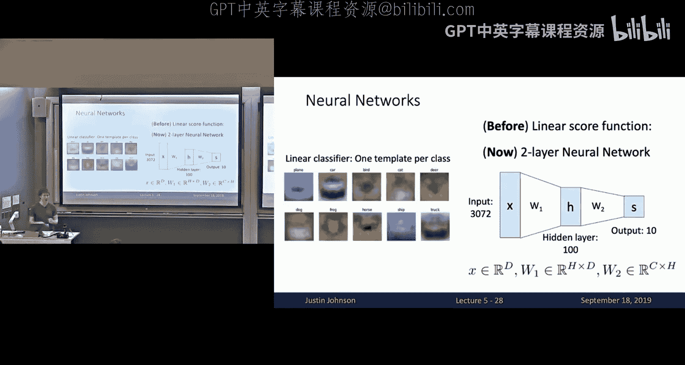

And here we can see that most of these images are not most of these templates are not very interpretable。

 you can't really always tell what's going on with these templates。

 but there is definitely some kind of discernible spatial structure that these first layer features or first layer templates have learned in this two layer neural network system。

But sometimes you get lucky and sometimes you do get some beautiful layers in this first layer。

 So I don't know if you noticed。 but maybe I've looked at these too long。

 but for these two examples here， they actually look to me like one is a horse facing one way and the other is a horse facing the other way。

 So now this this is like finally overcoming this two- headed horse problem that's been plaguing us for the past couple of weeks。

 as we with linear class fires。And then， of course。

 the second layer of the neural network is then somehow predicting its classification scores recombining by having another weighted recombination of the responses of the input image to these templates。

 so what that means is that the neural network could then hopefully somehow finally recognize multiple types or multiple subsets of a category where it could recognize both the left- facing horse using one template and the right- facing horse using another template and then use the weights in the second layer to recombine the information from both of those two templates。

This is sometimes called a distributed representation because really this two faces two- facing horses example is really quite rare。

 the more common case is that most of the time the features and the features or the image templates that we learn in the first layer of the neural network are not very human interpretable Instead they have maybe some kind of spatial structure and there's this notion of the neural network using a so-called distributed representation to represent the images where somehow by having some kind of linear combination of each of these templates。

 the network represents something about the image， but it's not super interpretable to us what exactly those different templates are' trying to capture。

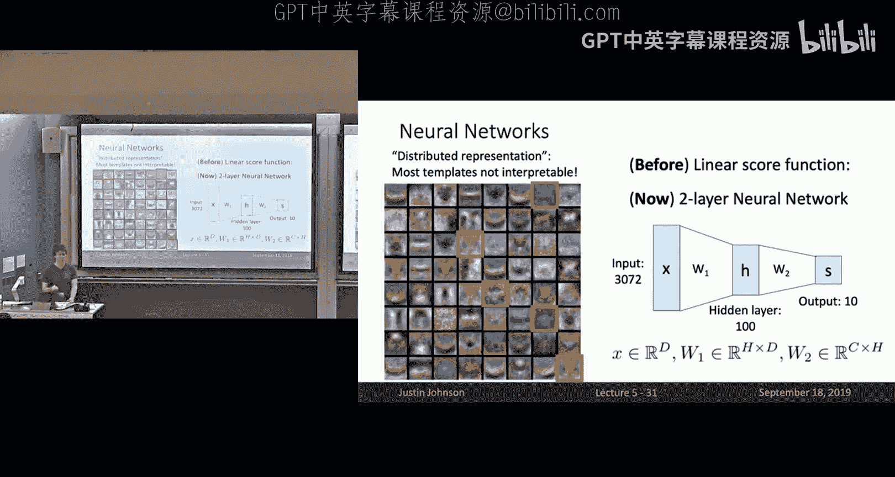

And of course， once we have the， oh yeah， was that a question？

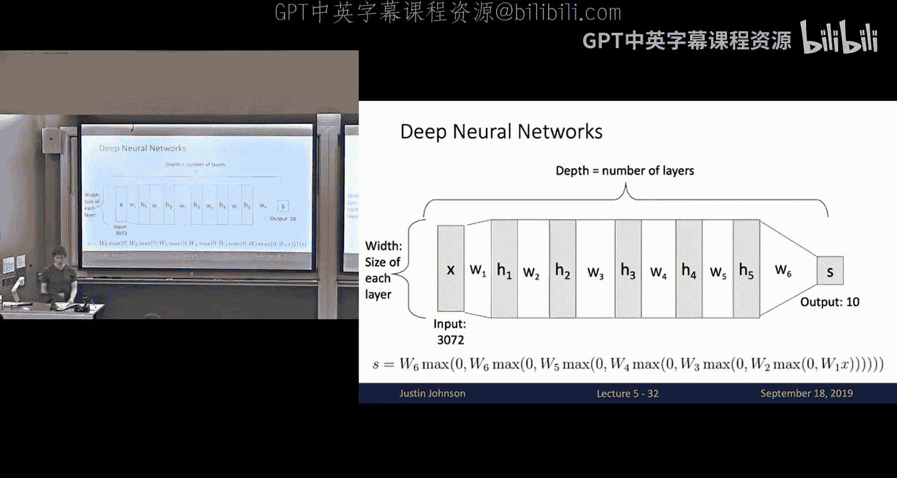

For a lot of them， it seems there's a bottom layer， then there's a red layer。

 and there's a blue layer above it， then there's something else。

Is there a reason for that what it looks like？Really large portion like that like first row I see Yeah so the question is there seems to be some repeated structures in these templates。

 A lot of them have this structure of like a red blob and then a blue blob I dont know。

 that's what it decided to learn。 That's kind of the mystery and the magic of neural networks。

 You don't always know what exactly type of features they're going to learn but they're going to learn something that that's going to maximize the classification accuracy my intuition here is that those are representing some kind of car because I think there's a lot of cars in the CR10 data set。

 Another really common pattern that you'll often see in the learned first layer features of neural networks is that they often represent oriented edges just as we saw in the Hu and weasel example when they were investigating the human or mammalian visual system by presenting different visual stimuli and see how human neurons or cat neurons activate then we know that many of our own neurons in our visual system end up being sensitive to oriented edges。

 And with these neural network systems you often get。

tend to learn similar types of features in many cases where you learn either oriented edges or opposing colors。

 so in this case， the blue and the red is maybe some kind of opposing color scheme。

 and you can imagine that by recombining many of these features。

 it can represent something about the structure of the image。Yeah。呃，的确是指。

con neuralt certain amount wouldn't it be of redund where you basically get two filters Yeah。

 so the question is is there some risk of redundancy that maybe learn multiple filters that represent the same thing and that's definitely a possibility but there exists some networks some techniques actually for network pruning that I think we'll talk about later in this semester whereby you can first train a neural network that's maybe big and represents a lot of stuff and then as a second post-procesing step you can try to prune out the redundant representations that have been learned by the network so that's something that people sometimes do in practice but we're not going to cover in this lecture。

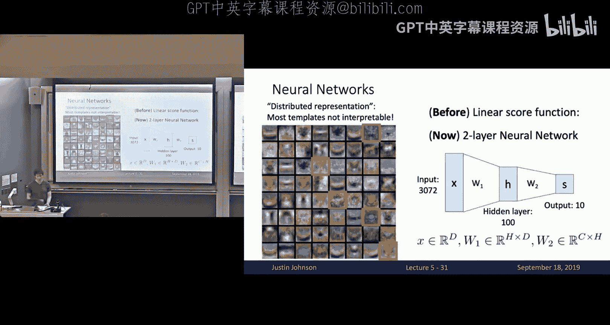

Now， with this notion of neural networks， you can definitely imagine generalizing this to many。

 many layers as we've already seen。 And for a bit of notation here。

 the depth of the neural network is usually is the number of layers that it contains And when we count layers will usually count the number of weight matrices。

 So our two layer network would have two learnable weight matrices This would be a six layer network because it has six learnable weight matrices。

 and then the width of the network would be the number of units or the dimension of each of those hidden representations。

 in practice， you could imagine that each layer might in principle。

 have a different feature dimension at each of those hidden layers。

 but in practice what's it's more common to set the same width throughout every part of the network just as a bit of convention。

Then we had this very astute question a couple a couple minutes ago about like what is this funny max doing hanging out in this neural network equation。

 Well， this turns out to be quite an important feature or quite an important component of the neural network this function max of0 and the input takes an element-wise maximum between 0 and the input which means that we input a vector and then anything negative。

 we throw away and set it to zero instead。 This function of has seems simple。

 but it's so important and so widely used， that it's given the special name relu for rectified linear unit。

 and we have a plot of this beautiful function here on the left。

 you can see that if if the argument is positive， It does nothing。

 if the argument argument is negative， we return 0 instead。

And this function we imagine as being sandwiched in between our two learnable weight matrices in the neural network。

 and this function is called the activation function of the neural network。

 and it' super it's actually completely critical to the functioning of the neural network。So as。

 as a thought exercise， you should think to yourself。

 what if we built a neural network system with the following structure that had no activation function in between the two weight matrices。

 What if we took our input vector multiplied by one by our first weight matrix W1 and then multiplied by our second weight matrix W2。

What would be wrong with this type of neural network based approach？同意。Yeah， exactly。

 it's still a linear classifier because then you can know that matrix multiplication is associative。

 so you could imagine grouping those two matrix multiplies together。

 and this just devolves back into a linear classifier。

So without some kind of a nonlinear function between our two matrix multiplies。

 we have no additional representational power beyond a linear classifier。

 so this choice of activation function and the presence of an activation function is absolutely critical to the functioning of the neural network。

I could point out that sometimes these networks with no activation function are called deep linear networks。

 and they're sometimes studied in the optimization community。

 because even if their representational power is the same as a linear classifier。

 the optimization dynamics are actually much more complex than that of a linear classifier。

 So sometimes people do actually study these in the theoretical context in the context of optimization。

ThereSo in this first example of a neural network， we've chosen this activation function to be this relu function。

 but there's a whole menagerie of different activation functions that people out there work with sometimes one very common that was used maybe before the mid-2000s was this sigmoid activation function that starts off at zero and then ramps up to one and theres a there's a whole zoo of these things that people work with sometimes that I think we'll talk about the choices behind these for different reasons for why you might choose one over another in a later lecture。

But the T LDR is that Ralu is a pretty good default choice。 And for most applications。

 sticking with Ralu， you probably can't go wrong。 So this is definitely the most widely used activation function in deep learning today。

 And you should probably consider using this for most of your deep learning applications。

Now I also want to point out that this neural network system is actually super simple to implement。

 We can actually train a full neural network system in just 20 lines of code here I'm doing nuy instead of pytorch because I can't give away your homework right and here what we're doing is that these first couple lines are setting up a bit of setting up some random data and some random weights this second bit of lines is doing this forward pass that we call where we compute the score function as a function of the input we've also used a sigmoid nonlinearity here as well which is that first line up top here we compute the gradients with respect to our weight matrix and here we take our gradient descent step So you can see that this neural network system is actually quite simple to implement and if you actually copy paste this code and run it in your terminal you'll be training your own neural network in 20 lines of Python that's pretty exciting。

Now， when we talk about neural networks， there's one word that people often get hung up on。

 and that's this word neural。 So I think we could not have a course on deep learning without at least acknowledging the presence of the word neural in our neural network models。

So we have to talk about that a little bit。But I'm not a neuroscientist by any stretch of the imagination。

 So please， I expect that I could say something slightly wrong with respect to neuroscience。

 but I'll do my best。 and please don't ask me too many hard questions about neuroscience。

 I'm not a neuroscientist。 But I've gotta talk about this somehow。

 But the basic idea here is that our brains are our amazing biological organisms。

 And the basic building block of our brain I this little cell called the neuron。 and neurons。

 I guess， looks something like this。 If you search them on Google。 and。😊。

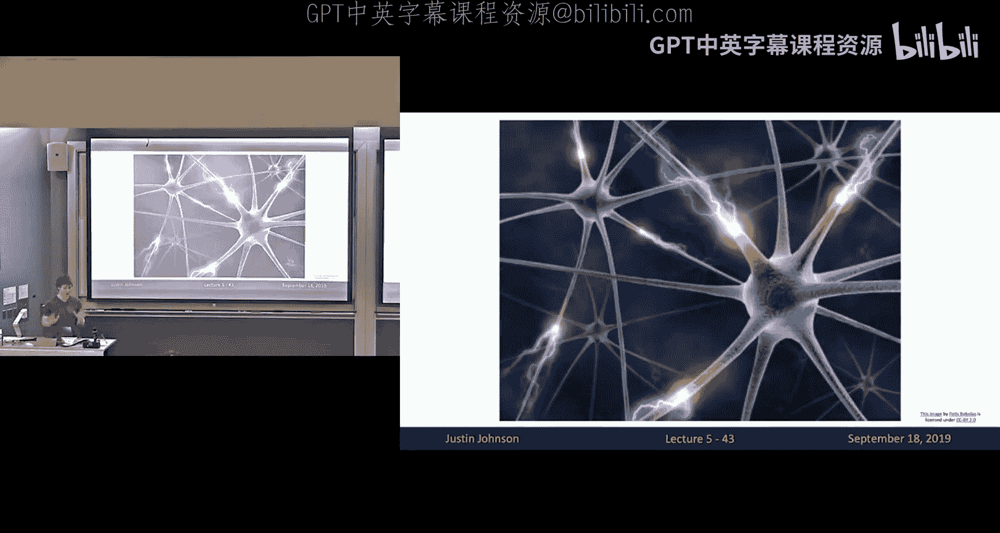

I think they actually look like this。 and they have a couple important components in these cells。

 One is they have a cell body in the middle where kind all of the juice is happening。

 then they've got this long terminal out to the right called the axon where where this neuron will be sending electrical impulses out from the cell body down the axon。

 and now these neurons are all connected in these giant networks where these axons are then rescindending electrical signals to other neurons the electrical signals from axons are received by these other little protrusions from the cell body called dendrites and the gap between the dendrite of one neuron and the axon of the other neuron is called the synapse and what basically happens here is that this neuron in the middle is going to collect electrical impulses that are coming down the axons of all of the incoming neurons on the left。

 those electrical impulses will be somehow modulated or modified by these synaptic connections between the dendrites and the axons。

And then at some point， based on the， based on the the rate and transformation of the electrical signals that are happening。

 then eventually this neuron will send down some other electrical signal downstream to the other neurons that are connected downstream。

And one way that we can one kind of abstraction that we can think about these neurons is by representing them using a firing rate。

 that these neurons are maybe firing electrical impulses at some rate and the rate at which our electrical impulses fire is maybe some kind of nonlinear function of the rate of all of the input the input connections that we get from all of the input neurons on the left。

 so then we can imagine having this very very simple。

 very crude mathematical model of a neuron where the cell body then collect so then the cell body then collects all of these incoming signals from all of the neurons on the left and then sums up all of the firing rates of all of the incoming neurons on the left and then based on sum of all the firing rates coming in on the left。

 then we apply some kind of nonlinearar function， maybe a sigmoid， maybe a relu。

 maybe some other kind of nonlinear function that now computes the firing rate of this neuron as a function of the firing rates of all the input neurons and then this is now the firing rate that this neuron will send off to other neurons。

Downstream in other parts of the network。And this is basically where the similarities end。

 I think this is a very this is on the right here。 This is basically what we're doing in our neural network systems that we use today。

 And as you can see， there is some crude approximation to biological neurons。 But there are many。

 many， many differences between biological neurons and artificial neurons and our artificial neural networks。

 So you shouldn't get too hung up on these similarities。

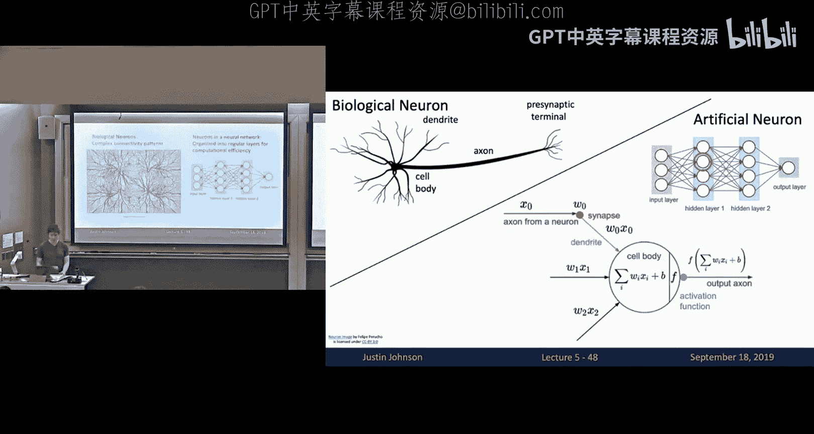

One bit of similar，1 bit of dissimilarity is that biological neurons tend to be organized into very。

 very complex networks where that could be highly irregular。

 they could even loop back around and have one part one neuron kind of loop back and send signals back to itself running around in time。

 so there can be very complex topological structures of neurons in real mammalian brains。

 In contrast， when we work with artificial neural networkbased systems we typically organize our neurons into layers。

 and these layers are something of an artificial construct that allows us to perform all of these multiplications and sums all jointly all at the same time using efficient matrix and vector operations。

 So this notion of a layer is something of an abstraction to represent this big soup of neurons that might exist in a real mammalian brain。

But people are getting creative and people are starting to explore artificial neural networkbased systems with very crazy or even random connectivity patterns as well。

 and that can actually sometimes work in some case。

 So one of some of my colleagues at Facebook AI research had this paper last year where they trained neural networks with these connectivity patterns on the right that looked totally nuts。

 but they actually train to get nearstate of the art performance。

 So I guess random connections can if you're careful can sometimes work in these artificial systems as well。

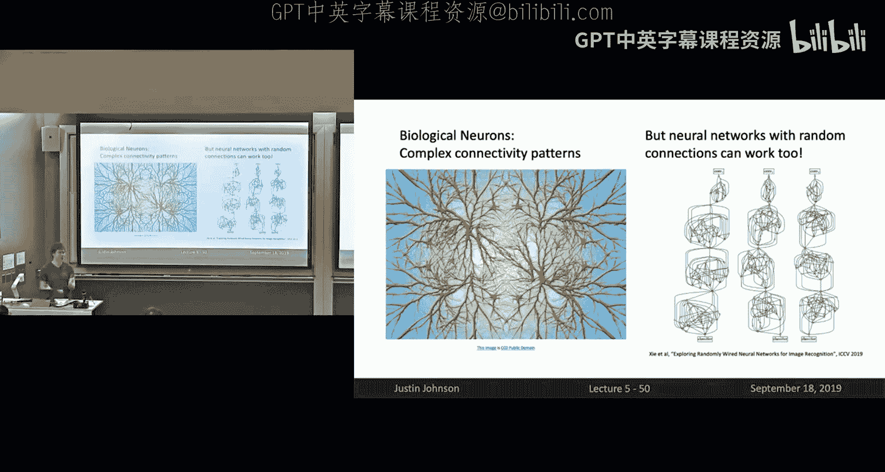

But the general story here is that you should be extremely careful with your brain analogies。

 even though that word neural is hanging out in the term in the name of neural networks。

 I think that it's really something of a historical term at this point。

 and you should not take too much significance between analogies between our artificial systems and actual biological neurons So in particular there's maybe a couple caveats here in our artificial systems。

 our neurons are kind of all the same kind of in a real brain。

 you might imagine there's different types of neurons that have different specialized function you can imagine that our neurons could have very could perform inside an individual neuron。

 it could perform very complex non- nonlinear computations that are not well modeled by our simple activation functions。

 you also remember that we modeled these neurons in terms of a single scale or firing rate and that was our main abstraction that we used to represent the activity level of a neuron in the brain。

 and that was a very very coarse abstraction of what might actually be going on inside and between neurons。

 So this simple idea。Firring rate， it might be too coarse to represent what's truly going on。

So that's pretty much all I want to say about brains for this semester。

 So with that back let's go back to math and let's go back to engineering that I actually do know a little bit about。

 hopefully。So then one question is if we're not going to take these brain analogies with too much seriousness。

 then why actually should we choose neural networks as a powerful image classification system or as a powerful function approximation system more broadly Well one we've already seen sort of coarsely how neural networks can represent multiple templates in their first layer and then recombine them in the second layer but I think another interesting way to think about and see why neural networks are such a powerful system is through this notion of space warping so so here we want to think about this geometric viewpoint of a linear classifier remember with a linear classifier when we thought about about them geometrically we thought about our data points as all living in this high dimensional space and then each row of our linear class fire then gave rise to some plane in features in our input space and now then we could imagine that maybe these lines are the values at which that you have。

Pro of0 with your weight matrix。 So each of these lines would be score of0 for that class。

 And then they would increase linearly as we go perpendicular to the plane or line。Previously。

 we had always thought about this in terms of predicting classification scores。

 but another way that we can think about what's going on here is as warping the input space here。

 what we can imagine doing is that were taking our input space which has features x1 and X2 and transforming it into another into another feature space that has coordinates H1 and H2 for the two dimensions of our two dimensional hidden unit here。

And now if we have a linear transform， you can imagine that all of these all of these regions of space are somehow deforming in a linear way that with these two linear class with these twodial linear transform weve got these two rows we've got these two lines in our input space and those two lines in our input space divided up into four regions and each of those four regions get transformed into the four quadrants in this transformed output space where now the a space is going to get kind of rotated and transformed like this and all four of these quadrants will get transformed in this linear way when we think about linear transform acting geometrically on the space。

So now we can then think about what happens when we want to try to what happens when we try to train a linear classifier。

 Well， one one way， if we try to train a linear classifier on top of a linear transform。

 then we can imagine we've got this cloud of data points here on the left where blue are maybe images of one category and orange our images of another category and then once we apply this linear transform that linearly warps the space。

 now we transform our input data into some new representation。

 But now because this feature transform was only modifying the input space linearly。

 now we can see that even though we've transform the space。

 the points are still not linearly separable in this new transform output space。

 So somehow applying a linear classifier on top of a linear feature transformation is not going to increase the representational power of our model。

 we will still be unable to separate this particular data linearly if we use a linear feature transform。

Well， now let's think about what happens once we apply this raylu function。

 Well now what happens is that our input space， we still have these four lines corresponding to the two rows of the weight matrix that they still carve up our input space into these four quadrants。

 but now because of this nonlinearar relu function the way in which these four quadrants get transformed will all be different So in this first region A where that corresponds to the positive quadrant in the input because you can see it corresponds to both of the directions of increase for the red and the green lines。

 that will transform just as it did in the previous linear linearly transformed case and this quadrant A in the input space will be linearly warped into the quadrant A in the transformed feature space。

But things get very interesting when we imagine quadrant B。

 So quadrant B in the input space corresponds to a positive value for the red feature。

 but corresponds to a negative value for the green feature。 And if you'll recall。

 based on based on the structure of the relu when the feature is positive。

 it will be left alone and when the input is negative， it will be set to0。

 So what this means is that because all of the points in this quadrant have a negative value for their green feature。

 that means that their green feature will be set to0。 So what geometrically happens in this case。

 is that the entire B quadrant in the input space is now collapsed onto the positive the positive H2 axis in our transform feature space。

 which now is very dramatically different from what's going on in the linear classification set up。

And a similar thing happens with quadrant D。 It's now collapsed onto the positive H1 axis because of the the raylu function。

 And now quadrant C is really tight for space because all of quadrant C is now packed into the origin in our transform feature space。

NowNow that we've seen what happens with quadrants， let's go back to this example of the data cloud。

 so we saw that transforming this data cloud linearly resulted in this linearly transformed data space。

 but now when we imagine applying this raylude non- nonlineararity to this feature representation now we can see something very interesting has happened in the transform feature space and what has happened is that now our yellow and blue points have become linearly separable in this transform feature space in particular now if we were to train a linear model on top of this feature space H we would be able to properly separate the blue and the yellow points and now if we imagined porting this decision boundary from from the output feature space back into the input space we would see that that decision boundary now corresponds to some non nonlinear decision boundary in the input feature in the input feature space。

So we kind of had have this interpretation of these relu-based neural networks as kind of being like multiple linear classifiers。

 all kind of folding the space onto itself linearly and then applying linear classifiers on top of that folded。

 transformed collapsed version of the space。 In this example。

 we've seen a fully connected network with two dimensions in the hidden unit and that allowed us to kind of fold the space over twice or collapse two of the dimensions in the output space if and if we are to increase and use neural network and train neural networkbased systems with more and more and more dimensions in in the hidden layer。

 you can imagine that now in the feature space we're we're drawing more and more and more lines in the original input space to divide it into two regions and then folding them back on itself which leads to an ever more complicated collapsed representation in the feature space。

 such that linear boundaries， linear decision boundaries in that complicated feature space。

 now correspond to a very complex。

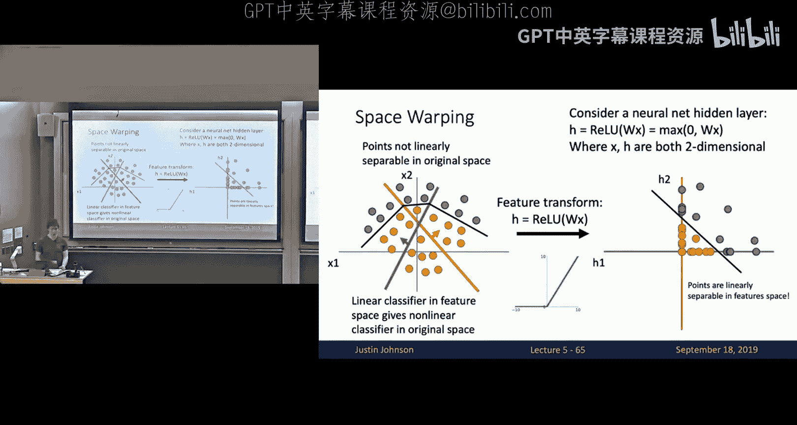

nonlinearar decision boundaries in the original input space。And in general， from this example here。

 we can see that by using more and more units in the hidden layer。

 we end up with decision boundaries that are more and more complex。Well。

 remember we talked last time about regularization and how regularization is a way of controlling the complexity of your model。

 And when you see an image like this， you might think that， oh。

 this model on the right is way too complex。 It's got a much too wigggly decision boundary。

 it's very likely to overfit my training data So you might be tempted to try to regularize your neural network based model by reducing the number of dimensions in the hidden layer but in general。

 that's actually not a great idea in general， what we want to do is to regularize your neural network model using some kind of tuable regularization parameter rather than rather than using the size of the network itself as a regularizer In this example。

 we can see that using the same number of hidden units by increasing this strength of L to regularization just by increasing the strength of L two regularization we've been able to smooth out the decision boundary that the network has learned between the categories and all of these examples on the last two slides we generated by this online web demo where you can go and train neural networks in real time。

In your browser and see these decision boundaries fly around in real time。

 So I would really encourage you to check out and play with that to gain some intuition about this notion of neural networks as transforming feature spaces。

😊，Now with this notion of now with this idea of neural networks as transforming feature spaces and now that we've seen these very。

 very complex decision boundaries that can be learned by neural network systems。

 we might have an intuition that these neural network systems are very powerful and can represent very。

 very large categories of functions much more so than the linear classifiers we've previously considered and we can actually formalize this a little bit So there's a property called universal approximation。

 which is that a neural network system with one hidden layer can approximate any function from ourN to RM。

 Of course， because when you say any and function， people who have taken real analysis will get on your back so there's a lot of technical caveats to the statement。

 something like oh maybe it's only a complex subset of the input space。

 maybe it's a continuous function what do we mean by arbitrary precision but like this isn't a real analysis class So we'lls ignore all those details and just say that neural networks can learn to approximate any continuous function on a bounded input space。

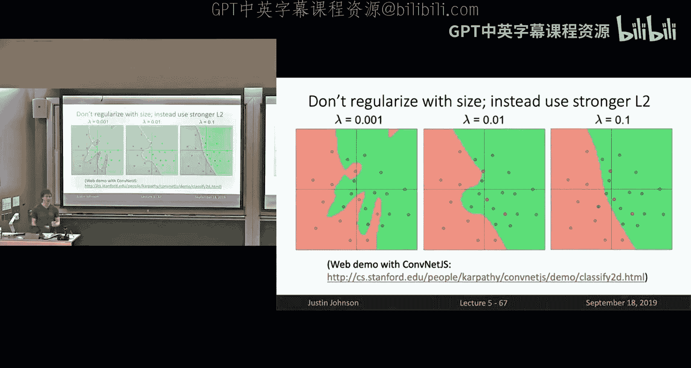

And to kind of get an intuition for how a relu based system can learn to approximate any function。

 we can think about algebraically how a Relu based neural network is computing its outputs。

So let's consider a simple example of a relu base fully connected two layer neural network that takes as input。

 a single real number and produces as output， a single real number。

And now the hidden layer in this neural network has maybe three units here。

 and we've got our weight matrix at the first layer， we've got a weight matrix at the first layer。

 which is just a vector in this case， because our input is one。

 and our weight matrix at the second layer is also a vector because our output is only a single dimension。

Then we can write down how what is the functional form of each of these hidden layer activations。

 We can see that the first hidden unit is equal to the max of0 and w1 times x minus the bias B1 here I'm putting the bias in because actually important for this example and then it's a similar structure for all three of the units in the hidden layer and then the output value y is then a linear combination of these hidden layer values in this case I've written the second weight matrix as u so the final output value y is u1 times h1 plus u2 times h2 and you get the idea but now we can actually reorganize this output a little bit。

 and we can write down output this output value y as U a scalar value u in the in the second from the second weight matrix times this maximum of of0 and the element in the first weight matrix times the input minus a bias and then the final output y。

hen decomposes into the sum of these three different terms and what each of these three different terms looks like is some kind of shifted or scaled or translated version of the raylu function where now here we can then flip this raylu function to the left or the right。

 depending on the s of this W1 element in the first weight matrix we can determine the point between the flat region and the linear region is that point where it changes between flat to linear is given by bias by the bias terms B and the slope of the non-flat part is given by the ratio of the terms in the second weight matrix and the terms in the first weight matrix。

So now we have this notion of this type of neural network system as computing its output as some kind of sum of all of these kind of shifted raylu functions and if we're clever with the way we do the shifting。

 we can actually build up approximations to any function you can imagine and our strategy here is to build something called a bump function So this bump function will be flat over all of the input and then once we get to some chosen value S1。

 it will increase linearly up to some second chosen value T it will remain flat at T until we get to a second value S3。

 and then once we hit S3， it it will decrease linearly back down to0 at S4。

 and then it will be 0 again for the rest of forever and you can kind of imagine that because we've written down our neural network system。

 we've seen that the output is now a linear combination of these kind of shifted and scaled raylu functions you can imagine building up this bump function by having a weighted sum of four different hidden hidden units。

In particular， we can imagine that we can imagine writing down the slope of these two regimes by using a simple slope calculation。

 and once we have computed the slope of these two parts of the bump。

 then we can approximate this first part of the bump with one linear unit that's doing one raylu like this。

 and now we can then deal with the second kink in the bump function by adding in a second unit that has the following form。

 then we can deal with a third bit in the bump with a fourth ship scaled and shifted in flipped relu。

 and we can complete out our bump with a fourth scaled and shifted relu。

 So now with this formulation， you can see that with a combination of four raylu functions that is using a neural network with four hidden layers。

 we can represent exactly this bump function where the exact location of the bump。

 the slopes of the lines and the height of the bump are all controllable by the weights in the first and the second layer。

And now if we have not just a neural network with four hidden units。

 but instead have a neural network with like eight or 12 or 16 hidden units。

 then we can imagine using each group of four hidden units to compute a separate bump and can then the overall function that would be computed by this neural network。

 we could set it up in a way so that it's a composition of that it's a sum of different bumps located arbitrary positions and arbitrary heights over the input。

And once we have this freedom to position bumps wherever we want。

 then we can position the bumps in such a way that they perfectly approximate any type of continuous function that we want over this domain。

 and now you can imagine that to increase the fidelity of our representation。

 we need to make the bumps narrower and maybe reduce the gap between the bumps and things like that so then you can imagine that we can add more and more bumps to get better and better approximation to any underlying function by using wider and wider and wider neural networks。

So with this interpretation， you kind of get the sense that a two layer neural network is actually good enough for arbitrarily compute for computing any kind of continuous function with the big caveat that if in order to approximate those functions within ever increasing fidelity。

 we need to use networks that have more and more and more units in in that middle hidden layer。

And then there's many questions you might ask about this universal approximation setup because this was not really a formal proof。

 This was something of a sketch of proof。 You might ask about what's going on with the gaps between the bumps。

 you might ask about how would you deal with non nonlineararies other than Raylu。

 you might also wonder how you could extend this analysis to higher dimensional functions and not just one variable in and one variable out I think we don't have time to talk about that in this lecture。

 but if you're interested in those questions I suggest you look at this chapter by Michael Nielsen's book on deep learning that talks about universal approximation in a bit more detail。

So this is really cool right basically we've shown that with a neural network。

 we can learn any kind of function， no matter what that function might look like。

 as long as it's continuous andla bla bla but this is then much more clearly a much more powerful type of representation。

 then we could do with linear classifiers， but we need a bit of reality check here。

 So you need to realize that this universal approximation construction is really a mathematical construction to show that in principle neural networks could potentially have the capacity to represent any function。

 if you happen to set up the weights in exactly this right way。

 but in practice if we try to train neural networks to do this single variable regression type problem。

 they don't actually learn these bump representations at all。 If we actually try to， for example。

 here I used a neural network with something like I think it was 16 hidden units to try to learn a s function and you can see that it learned to fit the s function pretty well。

 but it didn't actually use bumps at all， it kind of used its linear raylu units and scaled and shifted them around。

In some kind of way that ends up fitting the sine function very well。

 but doesn't actually use this bump construction that we use in the proof of universal approximation。

So think sometimes you see I think this result of universal approximation is really cool and really interesting and it gives us hope that neural networks are indeed a very powerful class of models that can flexibly represent a lot of different functions but you should not put too much stock or too much faith in this universal approximation result because as we've seen universal approximation just tells us that there exists some setting of the weights that lets neural networks compute very complicated functions。

 but it leaves a lot of questions unanswered， For example。

 it does not tell us how easy it is to actually learn those values of the weights to learn arbitrary functions。

 It tells us nothing about the learning procedure that we need to go through to set those weights。

 nor does it tell us anything about how much data we actually need in order to properly approximate any function so this result of universal approximation is really interesting。

 but you should not take it as the end all proof that neural networks are the best type of model ever because if you'll remember back to k nearest neighbors back in lecture2。

We saw also that Can nearestest neighbor also had this universal approximation property。

 so just having universal approximation is not a strong enough property that that's not really where the magic is in neural networks because even something like KNN is is universal。

So now we've talked about a lot of good reasons about why and how neural networks can be more powerful and more flexibly represent functions compared to linear models。

 but we have not really talked about the optimization process。

 right universal approximation tells us that there exists values of the weights that can represent lots of functions。

 but it doesn't tell us how to find them， Well， there is so one question you might ask is how can we know whether whether neural networks or other types of machine learning models will actually converge to solutions that are useful or to globally optimal solutions or other things like that。

Well， one type of mathematical tool that we often use in optimization to talk about notions of optimality and and and convergence of optimization problems is the notion of a convex function。

Well， a function is convex so a convex function is one that's going to take an input vector and return a single scalar。

 you can imagine this is something like the loss function or our neural network based system where the input is going to be the setting of the weight matrix and the output is going to be the scalar loss that tells us how well that weight matrix is doing and now a function is said to be convex。

 if it set aside this particular inequality constraint， which I think is better understood visually。

 So if we imagine what this inequality constraint is doing is saying or asking about in this concrete example of f of x equals x squared。

 what it says is that when we take two points in the input x1 and x2。

 and we look at linear combinations of those points and then feed linear combinations of those points back to the function itself。

 then that should be less than something on the right hand side。

 Well the thing on the right- hand side is basically referring to this chunk of the curve。

 which is this chunk of the function F between the two points， x1 and x2。Yeah。

And now the thing on the right is saying that is a sequenceant line。

 where if we compute the value of the function at x1 and the value of the function at x2。

 then the right hand side of this equation is going to look at all linear combinations of those two values of the functions computed at the endpoints。

 x1 and x2。So what what this property of convexity is saying is that whenever you take two points in the input domain。

 then the second line between the two points always lies above the function itself。

And so then with that， with that kind of geometric interpretation of convexity。

 you can clearly see that this quadratic function is indeed convex because if we imagine taking any two points in the input and imagine drawing any and drawing a second point between any two of those lines and the input。

 then that second line will always lie above the function itself。 you can prove this formally。

 but I think it it's quite intuitive when you look at it visually， at least。In contrast。

 something like f of x equals cosine of x is not convex， because we can draw these two。

 We can find a second line where the curve lies above the second line of the function itself。

 So something like cosine is not convex。And your intuition about convexity more generally for higher dimensional functions is that a convex function is somehow a high dimensionional analog or high dimensionional generalization of a bowl shaped function where because if it's kind of a bowl。

 because if you take now a second line between any two points。

 it's always the second is always going to lie above the function itself。

 And if that always kind of gives us some kind of general bowl shaped function。

And now convex functions have a lot of beautiful and elegant and amazing mathematical properties so that if you want to know more about you can take an entire course about it is IE661 or math 663。

 so clearly you should not expect to learn everything about convex functions or convex optimization in this one little chunk of a lecture。

 but for the purposes of this class， the course intuition that you should know is that convex functions are roughly bowl shapeped and amazingly convex functions can actually be optimized efficiently So if you take this class and work through an entire semester of math。

 then you will be able to write down formal theorems about when that you can actually have optimization algorithms that provevably converge to the global minimum and you can prove that convex functions have global minimum and that local minima are global minima and that things actually converge and it actually works。

 So that's amazing， but it takes actually quite a lot of mathematical machinery to work up to those results。

😊，But the takeaway is that also in practice， convex optimization problems are quite easy to solve in practice。

 and they also tend not to depend on initialization。

 because the convex these convex functions are nicely bull shapeped so you can get convergence guarantees of the form。

 like no matter where you start， you're always going to find the bottom somehow。

 So the course into the very course intuition that you should take away is that convex functions are easy and robust to optimize。

 and we have theoretical guarantees about optimizing convex functions。Now。

 one reason that we've spent so much time talking about linear classifiers and linear models is that the optimization problems that we end up optimizing when we try to fit linear models to our data。

 whether we're doing a softmax or an SBM or other things like linear regression。

 then these optimization problems that arise from training linear models。

 our convex optimization problems， which means that when we try to train linear models。

 we can actually write down formal theoretical guarantees about the convergence of those training runs in the context of linear models。

So this is actually a reason why people sometimes prefer linear models over neural network based models is if you actually want some kind of formal guarantee about the convergence of the system。

Now， no such guarantees exist for neural networkbased systems， unfortunately。

 empirically what we can do is kind of slice through different slices of the loss surface of a neural networkbased model to kind of get some intuitive picture of what these loss surfaces of neural networks might look like So here what I've done is I've built this is a five layer what the details on the slide。

 buts some kind of multi-layer relu network and then I've picked a single element of the weight matrix in the first layer of the raylu network and then I'm computing on the x axis are different values of that one element of the weight matrix and the y axis are the values of the loss function as we change one element of the weight matrix inside this deep raylubased neural network system So what you should think about this as being is that our loss surface when we optimize these high-dimensional neural networks are these very。

 very high- dimensionmensional loss surfaces that we can't visualize because we live only in three-dimens。

 But what this is visualizing is now a one-dimensional slice through this very highdimensional loss surface。

What we can see here is that sometimes we get slices of lost surfaces of neural networks that actually do look sort of convex or bowllike。

 but other times we get this very nonconvex slices of our lost surfaces in neural network systems So this is another lost surface through a different part of the same relu-based architecture。

 and this looks very， very much nonconvex or you can get even wilder than that。

 We can get chunks of a lost surface that have this is like adversarial to gradient- based learning right if you imagine trying to optimize this type of a lost surface with gradient descent。

 You have to like climb up up this thing。 they know get stuck in this very deep ill。

 that need to climb out somehow like this is like bad news for a gradient based optimization。

And you could get these very， very wild types slices of lost surfaces when we try to train deep neural networks。

So the takeaway here is that neural networks rely on nonconvex optimization that in general。

 the optimization problems that we are trying to solve when we optimize neural network systems and fit them to our data。

 we're trying to solve a nonconvex optimization problems。

 and this is like terrible news theoretically。 We basically have no theoretical guarantees about convergence。

 we basically have no theoretical guarantees about anything。 But empirically。

 it seems to work anyway， which is somewhat surprising。

 So this is an extremely active area of research of trying to characterize the theoretical properties of the optimization problems that arise from training neural network systems。

 and I think there's maybe some promising results or promising progress on this。

 but the story is far from complete。 And I think we still as a community do not fully understand the theoretical properties of these optimization problems。

But it seems to work anyway， so I guess we'll do it right， That's kind of the takeaway here。

 and hopefully the theory will catch up eventually at some point。

So the summary then of what we talked about today is that we saw this notion of feature transforms and how by combining a feature transform with a linear model。

 we could end up with much more complicated decision boundaries and we saw a neural network system as kind of jointly learning a feature transform and this linear model We talked about these two layer neural network systems and saw how they use these distributed representations to reshuffle different template values to more powerfully represent visual features compared to linear models。

 We talked a little bit about brains， but I don't want to talk about that too much。

 And then we talked about these kind of nice， interesting properties of these fully connected networks。

 The notion of space warping of universal approximation and this bad property of nonconvexity。Then。

 of course， there's a big open problem for us to consider， which is。

 how do we actually compute gradients in these big neural network based systems。

 I think it's not just working it out on paper is not going to scale as we move to very complicated systems and very big and complicated models。

 So to learn how to do that， we'll cover the back propagation algorithm in the next lecture。

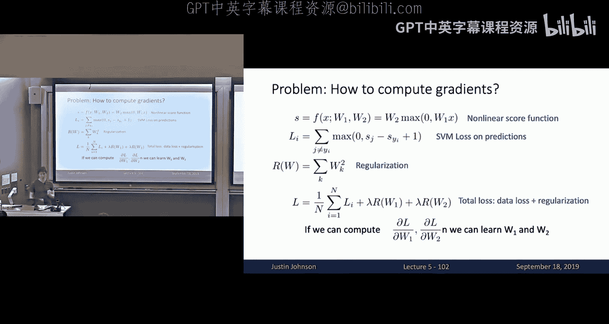