# 密歇根大学《深度学习用于计算机视觉｜Deep Learning for Computer Vision UMich EECS 498-007 2019》中英字幕 p06 -06-6Backpropagation.zh_en -BV1jA4m1P7GN_p6-

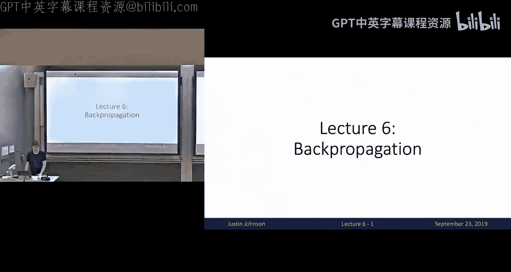

So welcome welcome back to the class。 We're up to lecture6 and today we're going to talk about back propagation of course as usual we have to talk about administrative things so hopefully this is the final waitlist update so when I looked back I just looked at the waitlist right before I came here and I saw that over the past couple of days everyone on the wait list has gotten an override which means that hopefully now everyone who wanted to enroll in the course was hopefully able to so we've conquered this together good job guys。

And the next part is reminder about assignment 2。 Sorry， that's a typo。 Yeah。

 assignment 2 is due a week from today on Monday to September 30 at a minute before midnight。

 So reminder that you should have started assignment 2 by now。

 hopefully and recall that it is a bit longer than assignment 1。

 And assignment 3 will be yet longer still。 So the expectation is you should be starting these things earlier and earlier as we go through the semester。

Any questions on this administrative stuff before we move on to the content？すす。Yeah。Oh。

 the question is about lecture slides not appearing on the website。

 I posted those just maybe about 45 minutes ago。 So maybe you try to control Shi to refresh while clearing your cache and they should show up。

非是保。Then then what you should try to do is I'd probably mess up the link then。

 So then what you can probably try to do is look at the way the link was patterned for the previous lecture and then replace the five of the six because I did upload the file。

 but maybe I mistyped the link when updating the link。 Did that work。Okay， well， if not。

 I'll make sure that I I fix the slides right after this lecture。 Sorry about that。

So where we are in this class is that now last time we talked about neural networks and we saw that neural networks with this very powerful category of classifiers that let us do a lot more powerful computation than had been possible with the linear classifiers that we had been considering so far you'll recall that neural networks had this fairly simple functional form of a matrix multiply。

 this element-wise nonlineararity that we called an activation function together with another matrix multiply and that we could chain these things together to get really deep neural networks and we saw this notion of space warping recall that to demonstrate one way in which neural networks were much more powerful linear classifiers where neural networks are now able to have these nonlinear decision boundaries through the input space and we also talked about neural networks as a universal proximator to give another notion in which neural networks are a very powerful class of functions we also saw this notion of nonconvexity。

 that neural networks， despite their very powerful abilities represent many functions resulted in non-convex optimization problems that have very few。

Theoretical guarantees。

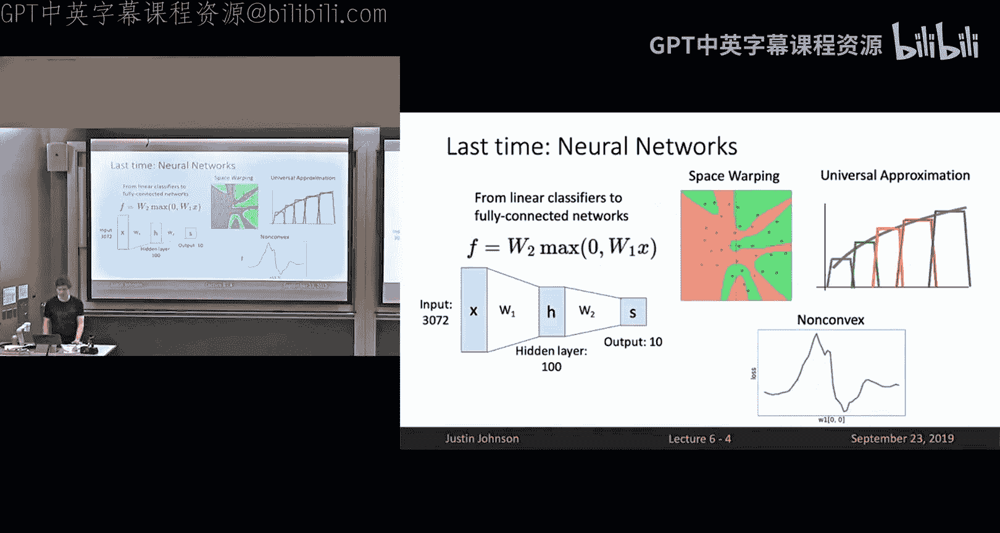

And now then we were kind of left with a bit of a problem here at the end of the last lecture。

 which is that now we have the ability to write down these very complicated expressions that describe loss functions that we want to minimize using stochastic gradient descent in order to train our classifiers。

 be they neural networks or linear classifiers or other types of deep learning models。

The problem here is how do we actually go about computing gradients in these models？

We know that we can write down arbitrary loss functions。

 and if we can find some way to compute the gradient of the loss with respect to all the weight matrices of the model。

 then we know that we can use the optimization algorithms we talked about a few lectures ago in order to actually minimize the loss and find good models that fit our training data。

And the topic of today's lecture is， how do we actually go about computing these gradients。

 these derivatives for arbitrarily complex types of neural networks or other types of functions。

The first strategy that you might be familiar with that you might try to try to adopt if you just attack this problem naively is to just derive the gradients on paper right you know that we can write down these functions。

 these loss functions and expand out the loss function on paper as an equation with many terms and here I've expanded out I think this is an SVM loss function with a linear classifier and one strategy you might go about doing this is you just write it all down on paper。

 you expand out all the terms and you end up with the giant equation that represent the loss as a function of your data and the weights of your model and then if you're very familiar with the rules of matrix calculus。

 you could imagine trying to churn through this and just compute expressions on paper for all of the learnable weight matrices that appear in the model This turns out to not be a very scalable solution So I apologize if anyone actually attempted this for the second assignment if you did go this route and try to compute these weight mates。

On paper for the second assignment， you will have noticed some of the potential shortcomings of this approach。

One is that it's extremely tedious， you likely you probably needed quite a lot of paper to get this thing right as you were working with loss functions like the crossenttropy loss function or the SDM loss。

Another problem is that it's not very feasible for complex models for something like a linear model。

 I think you can probably get by with this approach， but as we scale to much more complex models。

 it really this approach of writing down gradients and deriving them on paper will just not scale to more complex models and a final somewhat subtle problem with deriving everything on paper is that it does not lead to a modular design Now suppose that once you've derived your loss function for a linear classifier with an SVM loss and now tomorrow you want to derive the gradients for linear classifier with a soft softmax loss or a two layer neural network with a softmax loss or a five layer neural network with an SVM loss or any other kind of combination of losses and architectures and regularizers that you might imagine if you were deriving these things on scratch on paper for every combination of loss function and architecture you would have to rederive everything from scratch every time and in practical situations it's much nicer to have some modular approach where you can。

Swap in and slot out different types of models and architectures and loss functions that will allow you to iterate much more quickly as you try to find models that work well for your data。

The approach that we tends to take in deep learning is is actually， you may have guessed。

 not deriving gradients on paper。And since we're computer scientists。

 we like to try to find data structures and algorithms that can help us solve tedious problems。

 and the data structure that we use to help us solve this problem of computing gradients is called a computational graph。

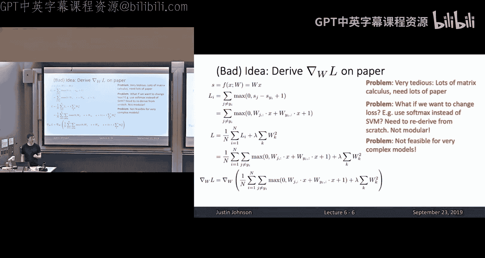

Now， a computational graph is a directed graph that represents the computation were performing inside our model and here on the left。

 we can see the inputs to the model， the data X and the labels y。

 maybe not in this graph but maybe here we have the data X and the learnable weights W coming in as nodes on the left of the graph。

 and now as we proceed through the right as we proceed from left to right in this graph。

 we see nodes that represents bits of fundamental computation that we want to perform in the process of computing this function。

 So we see that there's this blue node that represents the matrix multiplication between the input X and the weight matrix W we have this red node that represents our hinge loss if we're using SBM classifier。

 we have this green node that represents the regularization term in our model we have a sum that represents the sum of the data loss and the regularization loss and then finally on the right we have the output of the computational graph which is the scalar loss L that we want to compute when training our。

あら？Now this computational graph formalism when applied to something like a linear model might seem a little bit silly and a little bit trivial because in a linear model。

 as we said， there's only a couple operations that we need to perform in order to compute the loss and the formalism of writing them bound as a graph might seem a little bit like a little bit of overkill but this will become critical as we move to more complex and larger models。

 For example， something like AlexNe is a deep convolutional neural network with seven convolutional layers and a nonlinearity and regularizers at every layers and a loss function at the end where now the images are coming in at the top and it's going through many。

 many layers of processing and our final scalar loss is coming out at the bottom and something like this you probably do not want to derive the gradients on paper instead you really want to use this computational graph formalism to track the data structure to build up a data structure that represents all of the computation that the model will perform in order to compute the loss。

And these things can get arbitrarily crazy。 So here's an example of a model called a neural turing machine。

 If you remember yourtro theory to computation class。

 you remember that a turing machine is this formalized model of computation well it turns a couple years ago some folks wrote a neural network that is kind of like a soft differentiable approximation to the Tring machines that you learn in this intro computational class。

 here on the screen we're showing the computational graph that arises from this differentiable neural turing machine and you can see that it's very big and complex and you definitely don't want to compute gradients in this model by hand。

 you really want to rely on the computational graph formalism to compute gradients for you but actually it gets even worse than this because for the neural turing machine。

 this is showing only one time step of the model and in practice this model gets unrolled over many time stepss as a kind of recurrent network so you can see that once you get into these very complex models you very quickly get computational graphs that are much。

 much too large even fit on a slide so you definitely want to use。

Some kind of graph traversal algorithms to help us automatically compute gradients for us on top of this computational graph structure。

Hopefully this has properly motivated why it's really going to be really critical for us to use computational graphs in order to compute gradients in our big complex neural network models。

 now that we've got this motivation， let's actually see a concrete example of how we can use a computational graph to help us compute gradients in a little tiny neural network model。

Here， in order to actually fit an example on a slide， we're having to use a very trivial computation。

 but as you've seen， we in real models， we'll be doing much more complicated processing。

Here we're showing a very simple function of three scalar variables， X。

 Y and Z that simply the output is now we're going to add X and y and then multiply by z to compute the loss。

 This is maybe a weird loss function， a weird learning problem that doesn't make sense。

 but hopefully this simple example will help us walk through exactly what it means to compute gradients in a computational graph。

Well， when we're using and by the way， this back propagation is this algorithm that we use for computing gradients in a computational graph。

Now suppose that we want to evaluate this function at a set of a particular point in the input space。

 say x is minus2 y is 5 and z is minus-4。 now the first step in using this computational graph is called the forward pass in the forward pass we proceed in computation from left to right and we will perform all of the operations specified by the nodes of the graph in order to compute the output values from the input values so in this example we'll simply add x and Y and we'll get this intermediate that we're going to give the name of Q and then to compute the final output value F。

 we're going to multiply Q by the input value Z and by running the forward pass of this graph we'll end up computing our final output value of minus-12 in this case。

Now in the backward pass， our goal is to compute all of the gradients of the derivatives of all sorry the derivative of the output with respect to each of the inputs。

 so in this case our output was F， so we want to compute the derivatives DFDX， DFDY and D FDZ。

 which are the three inputs that appear on the left side of the graph。

 and we'll proceed from left to right because this is back propagation。

 so it needs to proceed backward compared to the forward pass。We always start with a base case。

 So in the base case on the right， we want to compute the derivative of F with respect to F。

 Anyone got an idea what that ought to be。Yeah， that's trivial。

 That's one because if we change one a little bit， if we change F a little bit。

 then F is going to change by the same amount， the derivative is1 and when we're computing。

 by the way， when we're computing back derivatives or using back propagation in a graph。

 we'll often write a little diagram like this where we show the values that are computed at each node above the corresponding line and then we'll write down the gradients or the derivatives below the corresponding line during the backward pass。

So now the second step is we want to compute the derivative of F with respect to Z and in order to do this。

 we know we can look at this little intermediate computation， we know that f wasq times z。

 so we know that the derivative of f with respect to Z should just be Q and then we can go back and look into the computational graph and look up what the value of Q was in this case it was 3 so now the derivative of F with respect to z in this little piece of the graph is now going to be 3。

And now we've got one of our three gradients that we needed to compute。The next piece。

 we need to compute the derivative of f with respect to Q。

 you can see that we're kind of marching backward in opposite topologically sorted version of the graph and in order to compute the gradient derivative of f with respect to Q we again know that f is Qz so this local derivative should be z。

 we can look up the value of z from the four pass of the graph and compute the derivative as minus4 continue proceeding to the left now we want to compute the derivative of f with respect to y and here things get a little bit interesting because now we need to remember the chain rule from calculus because here the value y is not directly connected to the output value F so in order to compute the derivative F with respect to y we we need to take into account the influence of y on the intermediate variable Q so then the single variable chain rule from calculus tells us that the FDY is equal to theqDY times the fDq。

And this is very intuitive the idea is that if y it changes by a little bit。

 then  Q is going to change by some little bit DqDY。

 and then if  Q changes then F is going to change some little bit which is the other derivative。

 so then to take into account these two effects we need to multiply them and now here in this case know now in the context of neural networks。

 these three different terms in this equation have particular names that we'll use over and over again。

So this left-hand term， d FDY， we'll often call the downstream gradient。

 because this is the value of the derivative that we're computing at this step in the process this value Dq dY is going to be called the local gradient because this is the local effect of how much this value of y affect this next intermediate output Q and this value DFDY is going to be called the upstream gradient because this is the effect where because now' we're kind of imagining zooming in on this little piece of the graph around y and the upstream gradient tells us how much does the output of this piece of the graph affect the final output at the very end of the graph so that piece is going to be called the upstream gradient and then of course the chain rule tells us that we to get the downstream gradient we just need to multiply this local and upstream derivatives。

And then of course here we know that the local gradient in this case。

 we know that Q is equal to x plus y， so the local gradient or local derivative in this case is just one。

 so when we multiply these two together， we know that the derivative of app with respect to y is the same as the derivative of F with respect to Q。

 so we get our downstream gradient of minus4。Was that clear to everyone？Okay， good。

 And now it's very similar when we want to compute this other thing。

 We again need to multiply the upstream and local gradients。 Again。

 the local gradient is one because this was a simple addition。 and we compute our final output value。

 So here you can see in this relatively simple example how we can use computational graphs to help us mechanize the process of computing derivatives in very complex functions during the forward pass。

 we're going to compute all everything from left to right。 And then in the backwards pass。

 we're going to step backwards throughout the step backwards backwards through the graph and then compute these little derivatives at every point in the graph。

Now this way of thinking about computing gradients is very useful because it's modular。

 and now one way to think about it is we can zoom in on one little node inside its computational graph。

 and what's really great about this mechanism for using back propagation to compute gradients is that each little piece of the graph does not need to know or care about the rest of the graph。

 we can just perform local processing within each node and then by aggregating all this local processing。

 we can end up computing these global derivatives throughout the entire graph。

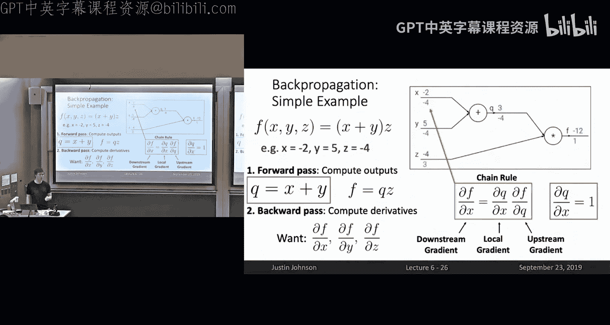

Now， if we kind of step through this exact same process that we talked about in the previous slide。

 but in the context of a single local node， it looks something like this for each node in the graph。

 we're computing some little local function F， this local function F takes two inputs X and Y。

 and now during the forward pass will apply the local function to compute the local output Z。

Now this now that's the forward operation of this little independent node after the forward operation of this node runs。

 this output Z will be passed off to some other part of the graph and that might be reused by other nodes and arbitrary complex ways we don't know we don't care from the perspective of this one node we just know that we computed an output and we pass it on to someone else at the end of the process eventually somehow at the end of the graph someone will compute someone far away from us。

 will compute some final loss L and then back propagation will start and somewhere outside of us will just pass these gradients back to us outside of the purview of this little node and eventually this back propagation process will hit this one node that we care about and this one node will receive a message from upstream in the graph which tells us the derivative of the loss with respect to Z that is how much this loss which may be very far away from this node somehow we're going to be told how much will this very far away。

Loss change if we change the local output of our node by a little bit。

 and that's exactly what this upstream gradient DlDZ tells us。Now at this point。

 we can compute the local gradients that are internal to this node which tell us for each output of the node how much is each output of the node affected by each input of the node because these local gradients and now this node can simply compute the downstream gradients by multiplying the local gradients and the upstream gradients and now these downstream gradients then get passed along to other nodes backwards in the graph that are somehow again。

 this node doesn't need to know or care exactly how those downstream gradients will be used elsewhere in the graph there's simply used somewhere and by the end when this final that propagation process terminates。

 we be left with having computed the gradients of the loss with respect to all of the original inputs of the graph and we were able to compute this global property without really reasoning at all about the global structure of the function we were trying to compute it only required us to think about locally what's going on inside each node of the graph and then have some data structure to track how all those nodes are connected together。

So hopefully this is going to be a big improvement over trying to derive those big gradient expressions on paper。

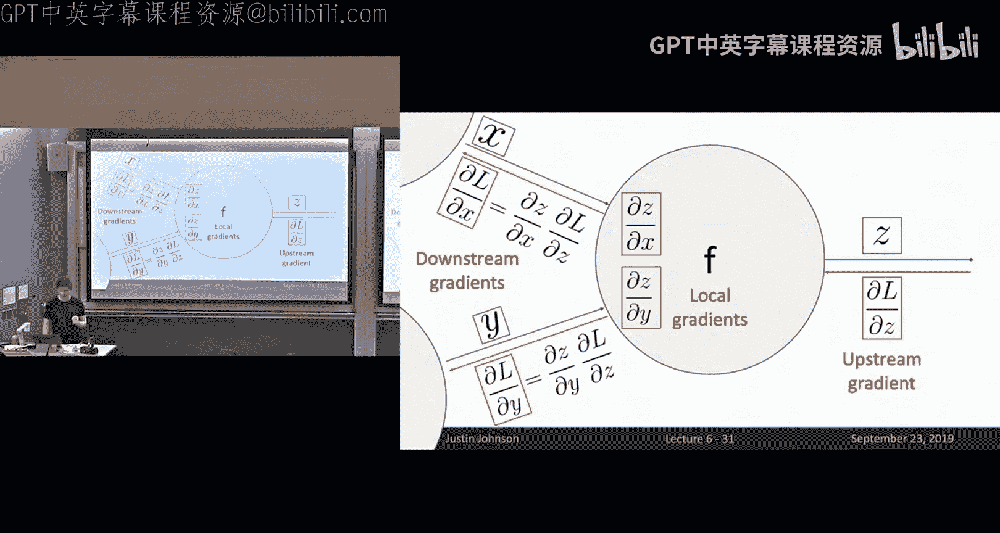

Here's another example of running in a computational graph that here this should look something like a logistic classifier if you kind of care about these equations。

 but the details of exactly what the functions are computing for the purpose of this lecture are somewhat irrelevant we just care about computing gradients and arbitrarily complex functions but here on the left we're showing we've got a function that takes12。

34，5 inputs our five inputs are w0 x0 w1 x1 W2 and now in the forward pass we're going to compute this inner product between these first two elements of the weight and the first two elements of the x and then we're going to compute this bias term to add W2 and then we're going to compute some kind of E to the minus something in this computational graph and here the computation will proceed much as we saw in the previous example in the forward pass will compute the outputs of the graph by evaluating the forward function for each of these nodes and this will end up computing this final scalar output value on the right。

And then during the backward pass we'll iteratively think about how we'll iter multiply the upstream gradient by the local gradient at each node in the graph to compute the downstream gradients。

 so we'll always start with this base case， base case of derivative of output with respect to itself is always one next we'll look at this one over x we know that the local gradient of1 over x is minus1 over x squared which gives us the local gradient we can multiply these to get the downstream gradient we can step through again we know that adding a constant has local gradient of one so that we can easily pass those gradients backward we can compute the local gradient this exponential function which is trivial so that just lets us easily compute downstream gradient and this kind of like process sort of steps backward backward backward one node at a time where at each point we're just computing these local gradients and then multiplying the upstream and local gradients。

But what's really interesting about this particular computational graph is that there's multiple ways in which we could have fought to structure this computation in this graph。

 as I've written it， I've written it out in terms of very basic， very primitive。

 very fundamental arithmetic operators of addition and multiplication， exponentiation， division。

 adding a constant， I've kind of broken down this computation into its barest fundamental pieces of arithmetic primitives。

 and as you kind of notice by looking at this graph。

 breaking everything down into the barest arithmetic primitives at every graph ends up a little bit tedious and sometimes we actually have our freedom to define for ourselves what the types of primitive operations we want to use in our graph so in this so here we've kind of broken everything down into the basic primitives。

 but we also have the freedom to define arbitrary new types of nodes that that can internally compute more complicated functions。

 an example of why this might be useful。that this little chunk of the graph that I've outlined in blue independently computes this so-called sigmoid function that is one over1 plus e to the minus its argument。

 this sigmoid function shows up all the time in machine learning。

 we've seen it in the context this shows up for a binary cross entropy when you're doing two-class logistic regression。

 this also shows up in many other contexts， and what's kind of nice is that we have the freedom as the designers of this little graph language to pick elements to pick primitive graph elements that will be useful or easy to compute in the back propagation process。

And in particular， we can choose primitive functions to assign to nodes in the graph。

 such that the local gradients become easy to compute and this turns out to be the case for the sigmoid function so the sigmoid function if you kind of work through some math on paper you can see that I don't want to work through the details of this expression here。

 but if you work through on paper computing the derivative of the sigmoid function with respect to its input you can see that the local gradient of the sigmoid function actually has a very simple functional form that the local gradient of the sigmoid function is simply equal to the output of the sigmoid function multiplied by one minus the output of the sigmoid function what this means is that we can very easily compute the local gradient of this entire blue chunk of the graph without without storing this whole intermediate chunk of the graph and this is an example of ourselves as the graph designers cleverly choosing the primitives that we want to use in our graph。

Language in such a way that will make it easy or more efficient to compute the derivatives during the backwards pass。

 So this is definitely something you should consider doing。

And now if we were to imagine kind of an aggregate so you could imagine an equivalent version of this graph。

 which collapsed this whole blue box onto a single node that would then receive the upstream gradient on the right and now compute the local gradient using this expression we've derived at the bottom of the slide and then immediately return the downstream gradient on the left kind of skipping over all of that intermediate computation inside the box so this idea of defining more complex primitives to use in our graphs is something that we'll use quite a lot in general in order to make our computational graphs either be more efficient or have more semantic meaning。

Another thing we can start to notice when we look at these computational graphs is that there's some patterns that become apparent。

 when you look at the patterns of how information propagates forward during the forward pass and then during the backward pass where you can kind of think of what I sometimes think about this is like a little circuit that during the forward pass were kind of flowing information forward from the input to the output。

 and then during the backward pass or kind of flowing information backward from the loss through each of these intermediate nodes backwards to the original parameters of the model for which we wanted to compute gradients。

And when you've had this kind of circuit interpretation of these computational graphs。

 you start to notice some patterns about how gradient flow。

 how some dualities between how information flows during the forward and backward passes。

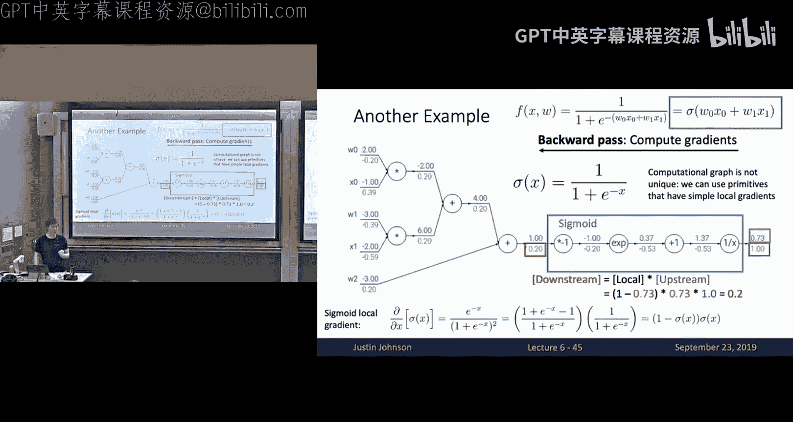

So the simplest example of this is that this add gate or add function acts as a gradient distributor during the backward pass。

 so if we have a little function which locally computes the output as the sum of its two inputs。

 maybe here7 is3 plus4 then during the backward pass we know that as we saw in the first example of our very first computational graph recall that the derivative of x plus y with respect to x is1 and derivative of x plus y to y is also one so the local gradients of both the inputs are one。

 so that means the downstream gradients for both of the inputs are both equal to the upstream gradient and this would generalize to a sum with an arbitrary number of terms what this means is that during the backward pass when you have a sum node during the backward pass that sum node is going to distribute and copy those gradients from the upstream into the downstream which is kind of a nice intuition about what's happening when you have addition inside of your model。

Now kind of do to the sum node is the copy node this is kind of a trivial node that during its input maybe receives some input and then has two output values that are both equal to identical copies of the input This seems like maybe a stupid operation at first glance。

 why would you ever introduce such an operation in your graph well you might want to do this。

 if you want to use one term of your model in multiple places downstream in the graph for example。

 you might imagine in a regularization setting we actually want to use each of our weight matrices in two ways in our model we want to use the weight matrix one to compute scores in kind of the main branch of the model and second we need to use the weight matrix to compute our regularization term like L2 or L1 regularization So in order to use our weight matrix in two downstream parts in the graph we might imagine inserting a copy node somewhere in the graph that now makes two identical copies of the weight matrix that now can be used in different parts of the graph and the important bit is that。

When we've produced these two copies because they may have been used in different ways。

 we might end up computing different gradients with respect to the two copies。

 and now then during the backward pass， the upstream gradients that the copy node receives might be different for the two outputs that it's produced。

 but now during the backward pass we simply need to sum those two gradients。

 which shows that kind of the the a gate on a copygate are somehow dual that the addgate forward operation is kind of the same as the copygate backward operation and vice versa。

 so these two operations are somehow dual to each other。

Another kind of funny thing that's going on is is a multiplication gate。

 you can think of this as a kind of swap multiplier because you know that the derivative of xy with respect to x is y and derivative of Xy with respect to y's x。

 which means that the local gradient is for one of the inputs is the other input and the local gradient for the second input is the first input。

 which means that when we compute the downstream gradient。

 the downstream gradient is equal to the upstream gradient times the other input and this has kind of a funny implication if you think about now if you have a multiplication inside your model it's going to mix the gradient all up in some kind of a funny way。

 and because during the backward pass， the backward pass of a multiplication gate also involves multiplication。

 you can see that you're going to end up with some very large products in the backward pass you can imagine might be a problem in certain types of models。

Another one that you might see a lot is a max gate so here the max gate is going to take two scalar inputs and return the maximum of the two inputs and here what does that function look like that looks kind of like a relu function a little bit。

 so you can imagine that for the input that was indeed the maximum the local gradient was one and for the input which was not the max the local gradient was0 so then this has the interpretation that during the backward pass。

 a max gate acts as a gradient router that it's going to take the upstream gradient and route that upstream gradient towards the one input that that happened to be the max and the downstream gradients of all the other inputs that were not the max are all going to be set to zero。

So then you can imagine that if we had a model that was taking a max of like many， many， many things。

 then during a backward pass we'll end up with a gradient that is mostly zero so you can imagine maybe that's a problem for getting good gradient flow throughout the entire model。

 so maybe we might not prefer to use MA for that reason。

So these are all going to be obviously sort of trivial mathematical expressions。

 but it's sort of interesting to think about how these trivial derivatives of scalar functions actually can have nontrivial consequences for the way in which gradients tend to flow through these giant neural network models。

So now that we've hopefully gotten a bit of intuition about what is back propagation and how can it help us automate the process of computing gradients in big models。

 I think it's helpful for you guys to talk about how you actually might implement this stuff in code。

 because that's something you have to do in your homework so hopefully you will get good at that。

 Well I think there's I think about at least two major ways in which people tend in which I tend to think about implementing back propagation。

 The first is what I call a flat implementation of back propagation So here the idea is we're going to write a single python function that computes the entire computational graph。

 maybe this python function is computing a linear classifier and it inputs a mini batch of data and your weights and then it computes the loss on that mini batch of data sound familiar from homework to。

 hopefully those of you who have looked at it and now you're asked to compute have a single function that is going to both compute the loss and compute the derivative of the loss with respect to each of those weight matrices。

Well， the way the way that I mean one thing you can do is kind of go to town on paper and kind of like do your derivatives and it's a mass and hopefully you'll eventually pass the gradient check。

 but you can try to structure this computation in a much simpler way that I think makes writing this different backward passcode actually very simple in this case So here we were going to as an example we're going to have this little computational graph on the left which is this sigmoid example from a couple slides ago。

 So we're going to input our two weights W0 W1 to inputs x0 x1 and our bias term W2 the forward pass of our code is simply going to apply add and multiply these things and compute our loss L。

 and now the backward pass code is going to be right after the forward passcode And the trick is that the backward passcode is going to look like a reversed version of the forward passcode。

 what do I mean by that。 Well you can see that the very first thing we do。

A backward pass is compute this trivial base case of gra of output respect to itself as one might you probably should actually omit this line in your actual implementation。

 but I want it to be super pedagogical here， but here you can see that this first line in the backward pass code corresponds to this really rightmost thing in the computational graph。

Now， this second line in the backward pass code corresponds to back propagating through this sigmoid function。

 and you can see that the back propagation line to the sigmoid function corresponds to the last line of the forward pass。

And here what we notice is that in the forward pass。

 the sigmoid function was taking as input S3 and returning as output L。

 and now the corresponding line in the bit of backward implementation kind of inverts that around a little bit here the backward pass takes as input grad L and produces as output grad S3 so you can see that there's a one to1 correspondence between this line in the forward pass and this line in the backward pass and now the inputs in the outputs are somehow swapped between these two corresponding lines。

Then this correspondence continues that in the second to last line in our forward。

 we wanted to add these two things as2 and W2 and now because this was an operation with two inputs。

 it gives rise to two lines in the output in the corresponding backward code and again we can see that we have this intuition of the add gate as a gradient distributor so you can see that we're simply distributing or copying the gradient to the two inputs in these two lines a similar thing happens with this third to last line in the forward and now very similar things happen in in this fourth to last line in the forward but again now we've got a multiplication gates。

 we've got this interpretation of this local gradient multiply swapper and then finally we've got this this final output that does the same thing it's also a multiplication。

And now this is kind of amazing right we actually wrote a correct implementation of back propagation without writing down any math。

 We didn't write down any equations on paper。 All we had to do was think about we wrote the code for our forward pass and then we just transformed in our mind the code that we wrote in the forward pass。

 we just transformed it to generate the code for the backward pass。

 This is the way that you should actually go about doing homework2 if you have not completed those assignments yet and this will make your life much。

 much easier when it comes to computing gradients it turns out that if once you get enough practice with this。

 you almost never need to do math on paper in order to write gradient code。

 you simply look at the code that you wrote for the forward pass and you just invert it using all these little local rules that you pick up over time。

So this idea of flat back by back propagation that you implement by inverting the code from your forward pass is something that you should do in assignment2。

 so for example， for the SVM， you could imagine that we might compute the scores might compute the margins might compute the data loss and now in the backward pass。

 you'll just do all of those things in reverse except the exact operation that occurs during each line in backward pass。

 will be this local computation which is the multi location of the upstream gradient and the local gradient in order to compute the downstream gradient。

And you can see that you can do this for an SVM， you can do this for a two layer neural network。

 interesting that I chose these examples， so I would highly recommend that you become familiar with this way of sort of transforming your forward pass code in order to compute the backward pass。

But of course， this kind of mechanism of transforming this way of doing flatback propagation is really useful when you just need to write a gradient function and to end。

 but it kind of fails this modularity test， because here with this version of flatop back propagation。

 you know if we change the model or we change the activation function。

 we change the loss function to change the regularizer， we're gonna to have to rewrite our code。

 And that's going to be a little bit painful and a little bit annoying。

 So there's a second way which is like the more industrial strength way to implement back propagation。

 which is to use a more modular API。 And this fits very much with this idea that we saw a local computation around nodes。

 So here with this modular implementation of back propagation。

 we will typically define some kind of computational graph object and this computational graph object。

 we'll be able to do forward and backward passes throughout the entire graph by doing some topological sort operation on all of the nodes of the graph。

 and then calling these little forward operation。On each node during a forward pass。

 and then calling the corresponding backwards operations on each node during the backward pass。

Now this piece of code that I'm showing you here is just pseudocode like this is not actually real code。

 it could have typos， I don't know， but this one this one actually is real code， so in Pytorrch。

 you can actually define your own functions using this API so by subclassing torch。

 autograd dot function Now you are defining your own little computational node a little object which represents a node in a computational graph。

And now you can see that this object defines two functions forward and backward forward takes three inputs the interesting ones are X and y which correspond to the input values that this node will receive during the forward pass and these will be specified as torch tensors in this case we're just working with scalarrs so this would be torch scalarrs in this case we also receive this context object that we can use to stash arbitrary bits of information that we want to remember for the backward pass so you can see that in the forward pass。

 we're simply defining this output z equals x plus y and returning z these are all operations on torch tensors that you got familiar with in the first two assignments and now in the backward pass rewrite this function called backward that receives that same context object from the forward pass so we can use that context object to pop off any stuff that we needed to remember from the forward pass in order to compute our derivatives in this case we need to remember x and y and now we also receive grad Z。

 which is this upstream gradients also stored in a torch tensor now。

Internally we locally compute this product of the local gradient and the upstream gradient to compute our downstream gradients which are the derivatives of the two inputs and we simply return those and now this is like real torch code that you could use to implement your own scalar sum of two of two scalars so that's actually already implement in torch。

 so I don't recommend you actually use this implementation。

 but if for some reason you did want to define your own arbitrary function in torch and define the forward and backward passes of your new operation。

 this is how you can actually do it in pytorrch。And then if you look into deep in the guts of the pytorch code base。

 basically what is pytorrch is this autograd opera this autograd engine and an a ton of these these little functions that define paired forward and backward functions So here I'm showing you is just like there's a lot of files in here and if this is somewhere on the pytorrch Gitthub repo and if we zoom into one of these files。

 this is actually one of many implementations of sigmoid that's actually deep inside the guts of pytorrch somewhere so you can see that here we're actually defining the forward pass of sigmoid I mean using like deep in C plus plus or C or something deep in the guts of pytorrch that's computing the forward pass of the sigmoid layer。

 unfortunately it calls into this other function which is defined somewhere else gets's a bit of spaghetti code if you actually ever looked at the back end of Pytorrch。

But we can ignore that and now there's this second paired function。

 which is THNN sigmoid update grad input， which computes the backward pass and it does some boilerplate you know unpack tensors and do some checking of input。

 this is a real industrial strength code base， but now there's this critical line where you can see that it actually is like right here is where ptorrch is actually computing the backward pass of the sigmoid layer like deep inside C like nested inside some macros and like some crazy stuff going on。

 but basically what is pytorrch is these paired forward and backward functions that can then be changed together into these big computational graphs。

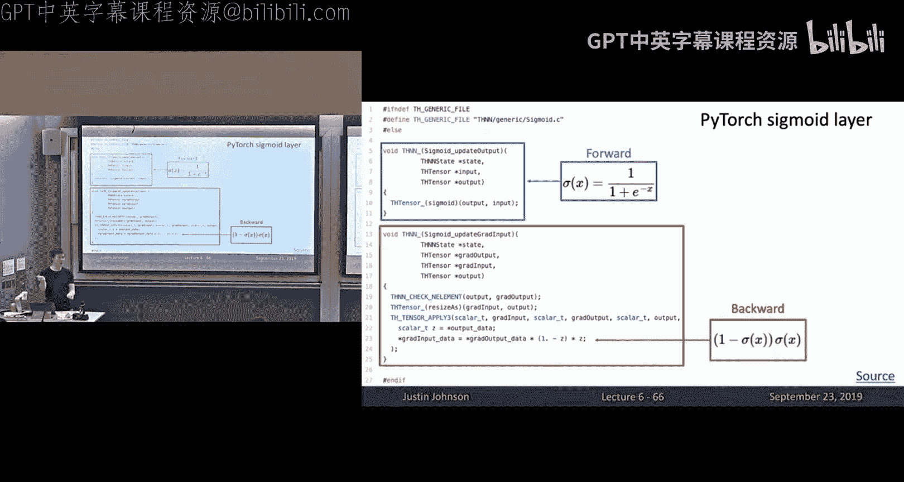

So basically up to this point， we've really only talked about the notion of using back propagation and computational graphs using scalrs。

 which is really easy and intuitive if you kind of remember everything from single variable calculus。

 but in practice we often want to work with vector valued functions or functions that operate on vectors or matrices or tensors of arbitrary dimension。

 so we also need to think about what does it mean to do back propagation in computational graphs with vector or tensor valued with vector or tensor values as well。

Well， here we need to recap a little bit some of these different flavors of multivaririable derivatives。

 Well， you remember the normal single variable derivative。

 given a function that given a single a scalar input and a scalar output。

 the derivative of the output with respect to the input tells us this local linear approximation。

 If we change the input by a little bit， then how much does the output change。

We've got this familiar gradient operation and a gradient is the type of derivative that is appropriate where our function takes a vector as an input and produces a scalar as an output and then this gradient dydx in this case is then a vector of the same size as the input where each element of the vector the gradient vector says how much does the output change if the corresponding spendingending element of the input changes by a little bit so it's a vector of these sort of classical singlevalued derivatives and now the generalization is a function that inputs a vector and outputs a vector possibly of a different dimension and here I mean these things all have different names。

 but they're all basically the same idea they're all derivatives and this one is called a Jacobbian and now the Jacobian is a matrix where it has a number of elements。

 which is n times m if those are the if those are the dimensions of our input and our output and the idea of the Jacobian is that it says for each element of the input and for each element of the output how much does changing one of the elements of the input affects that element of the output and now。

Because we've got n input elements and output elements。

 we need n times M scalar values in order to represent all those possible effects of inputs on all the outputs。

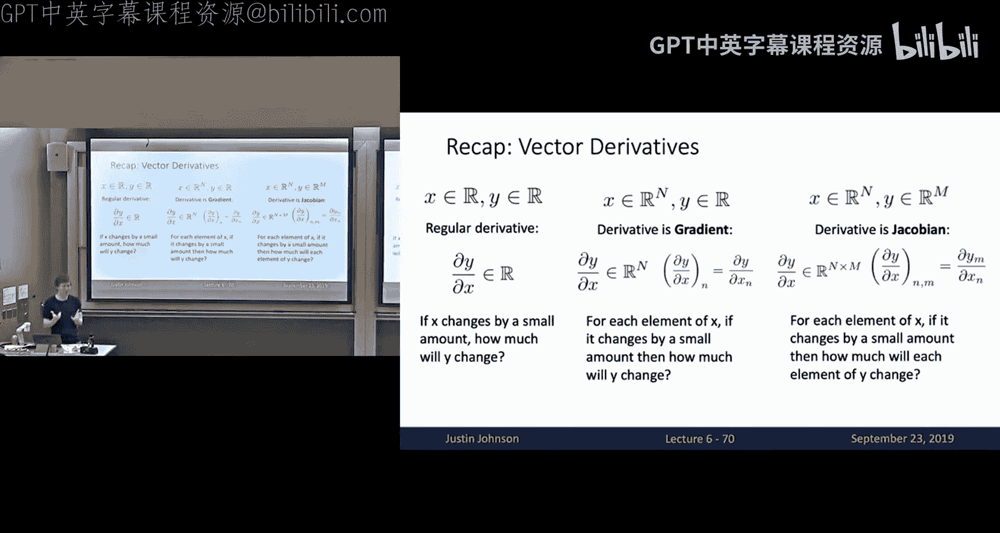

Okay， so then now suppose we've got the same picture that's kind of we know that we don't really need to think about graphs as a whole。

 We only need to think about how does back propagation work for one node as a time。

 So then what does it mean to do back propagation in this vector valued case kind of zooming in on one node again。

 Well here we've got now our little function f is inputting two vector values X is now a vector of dimension dx Y is now a vector with dy elements and we're producing a vector output Z with dz elements。

 and now this is our forward pass， it's very easy things are happening eventually we' receive this gradient from upstream Now this upstream gradient Now in this vector valued case。

 it's important to remember that the loss we compute is always a scalar no matter whether we're working with vectors or tensors or whatever this final loss we compute at the end of the graph is always going to be a scalar and now this upstream gradient that we receive is going to be the gradient the derivative of the loss with respect to our outputs。

 So that's going to tell us for each of the outputs from this node。

If we were to change those each of our outputs by a little bit。

 how much would they affect the loss weigh down to the right of the graph at the very end of our computation？

😡，And now the local gradients in this case become these Jacobbian matrices。

 because in this case now our function is a vector valued function that takes two vectors as input。

 produces one vector as output， so now our local derivatives become these Jacobbian matrices that again tell us for each output element from this node。

 how much is it affected by changing each input element of this node。

And now during the back now the downstream gradients that we want to produce are always going to be the derivative of the loss with respect to the inputs and now derivative of loss with respect to a vector input is now again going to be a vector of the same size as the inputs So the downstream gradient that we produce for x is going to be DlDx。

 which will be a vector of the same size as X。 the downstream gradient we produce for y will be DlDY。

 which is a vector of the same size as y and now to actually produce these downstream gradients we know we need to multiply the local and upstream gradients but now that we're working with vectors we're not it's not a scalar multiplication anymore Now this becomes a vector a matrix vector product where the local gradient is now this Jacobbian matrix and the upstream gradient is this gradient vector that downstream gradient the downstream gradient is a gradient vector and the way that we produce this downstream gradient is doing is a matrix vector multiply between the upstream gradient vector and the local Jacobbian matrix in such a way that the shapes work out So if you're ever confused about this。

 I always just recommend writing out the shapes of all your。

And hopefully that will help you clarify what's going on。

Now as a concrete example of doing back propagation with vectors。

 we can imagine what this looks like for the raylu function。 so for the raylu function。

 remember that it's an elementwise max of where we clip everything below0 So given an example input vector x of1 minus-2。

3 minus-1 applying the raylu function to this vector would sort of replace all the negative values by0 so our output y would be the vector 1030 and now this raylu function。

 this kind of vector valued raylu function is one little computational node embedded somewhere in our graph and now eventually will be returned。

 this upstream gradient which tells us how much would that final loss change if any of our little outputs from our raylu function changed and these can be arbitrary values positive or negative we don't know or care how they're computed they're just handed to us by the the differentiation engine。

And now this Jacobbian matrix tells us for each input of our local function。

 how does each output of our local function change？

And what we can start to notice here is that the Jacobbian matrix of this elementwise raylu function has some special structure。

 So because this is an elementwise function， we know that the first output of the function depends only on the first input and the second output depends only on the second input in particular。

 the first input does not affect the the second output or the third output or the fourth output each input only affects its corresponding output in the same position in the vector what does that structure look like in the Jacobbian matrix。

 that means that the Jacobbian matrix is diagonal that all of the because the off diagonal elements of the Jacobian tell us maybe how does element I of the input affect element J of the output where I and J are not equal So for this elementwise function。

 all those off diagonal elements of the Jacobcoian are0 and now for the on diagonal elements that becomes this scalar value derivative。

 which tells us how much does the relu change as a function of changing the input。

 So then for the positive。valued inputs， they'll have a gradient of one on the diagonal and for value for the negative inputs。

 they'll have a local gradient or local derivative of0 on the diagonal and then by working through this。

 it lets us form this full Jacobbian matrix for the input。And now。

 remember to compute the downstream gradient， we need to compute this matrix vector multiply between the upstream gradient vector and the local Jacobian matrix。

 so you can compute that thing offline and then we can produce this downstream gradient vector that will be passed to the other nodes that were' feeding into us as input。

And now we start to realize something interesting is that this is actually in this case for this relu function。

 we saw that the input that the Jacobbian matrix was sparse。

 that the Jacobbian matrix had a lot of zeroes in it。

 and this is actually the common case for most of the functions that we use in deep learning in general。

 most of the local Jacobbian matrices that we use are going to be very， very， very sparse。

 So in practice we will almost never explicitly form this Jacobbian matrix。

 and we will almost never explicitly perform this matrix vector multiply between the Jacobian and the upstream gradient。

 So you can imagine that for this relu example， it's maybe fine to form the Jacobian for for a vector of four inputs。

 But what if our inputs was like a mini- batch of like128 elements and each of all those elements was a vector of like 4096 dimensions Now this Jacobbian matrix would be like super。

 super gigantic and super， super sparse like only。Dagonal would be nonzero。 So in general， actually。

 explicitly forming those matrices would be super wasteful and explicitly performing that multiplication with a general matrix multiply function would be super inefficient。

 So really， the big trick in backpro is figuring out a way to express these Jacobian vector multiplies in an efficient implicit way。

😊，And for the example of Raylu， this is trivial because we know that Raylu has this structure where the output where the diagonal entries are either one or0。

 so this means that for the Raylu， we can compute we can compute this downstream gradient by either passing on the upstream gradient or killing the upstream gradient and clipping it to zero depending on the sign of the corresponding value of the input and what the way that you should think about this expression is that this is a very efficient implementation of an implicit multiplication between this large sparse local Jacobian and this upstream gradient vector。

Is this clear？So then now this has been talking about vectors， but of course。

 we need to work with tensors of rank greater than one。

 we need to work with matrices and three dimensional tensors and four dimensional tensors and light arbitrary things now the picture is very much the same。

 so to understand how to work with back propagation with tensors of arbitrary with matrices or tensors of arbitrary dimensions we have very much the same picture that now we have our local function deleted the f accidentally that inputs to values x and Y in this case there are going to be matrices x will be a matrix of size dx by Mx Y will be a matrix of size dy by M and the output will also be a matrix。

 Now remember the loss is still a scalar and all of the gradients of the loss with respect to something will always be a tensor of the same shape as something which will tell us how does the final downstream loss change as we vary each of the independent elements of input of that tensor。

So then when we finally receive this upstream gradient， it will be a matrix now of size Dz by Mz。

 which will tell us again， how if we change any of the elements of our output。

 how much will that loss change？And now these local Jacobbian matrices get very interesting in this sort of tensor case because recall these Jacobbian matrices need to be able to tell us for each scalar element of the input how much does each scalar element of the output change which means that this Jacobbian matrix is now a kind of like generalized matrix type of thing。

 So the number of elements of these local Jacobbian matrices is maybe like dx times Mx times Dz times Mz for this local Jacobbian matrix between X and Z and I often think about in this case。

 grouping the dimensions of the Jacobbian matrix where we have one group of dimensions corresponding to the shape of the input and one group of dimensions corresponding to the shape of the output and in that way we get this Jacobbian matrix is this very high rank tensor that has's kind of the product of the sizes of the input and the output。

And now the downstream gradient proceeds in much the same way that the downstream gradients are then going to be again tensors of the same shape as the inputs。

 giving us these downstream gradients and in order to compute them。

 we still need to do a kind of matrix vector multiply between these local Jacobbians and these upstream gradients。

 the problem is that now we need to they're not quite vectors and they're not quite matrices so we need to think of these as a kind of generalized form of a matrix product or right where now the local Jacobbian matrix you can imagine kind of flattening these two groups of dimensions corresponding to the input in the output they would actually give us a literal matrix and you can imagine flattening the output to be a high- dimensional vector and flattening the input to be high dimensional vector and then that kind of results that then you can after flattening actually literally perform a matrix vector multiply and get these downstream gradients。

But I don't know about you， but whenever I think about these like higherdial implicit Jacobian matrix vector multiplies between like super high-dimensional tensors like my brain ends up exploding and it becomes very difficult to actually think about how to write down an expression for implicitly computing this like giant sparse matrix vector multiply thing like it's a mess so to help you out。

 I'm going to work through a strategy that you can use to help you implement these types of operations without actually thinking about really high dimensionmenional high rank tensors So for that we're going to work through a concrete example of deriving the back propagation expression for the case of matrix multiplication and this is going to be super pedagogical but this will be a general strategy that you can apply trying for deriving these back propagation operations for kind of arbitrary arbitrary functions of tensors in crazy crazy shapes。

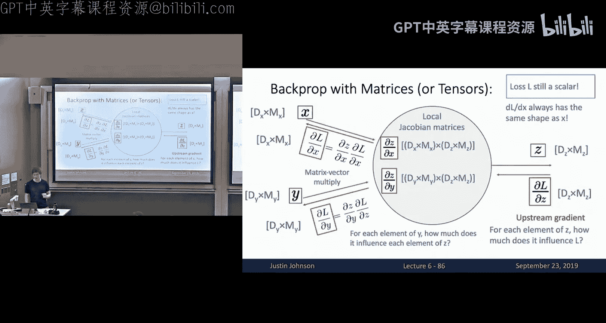

So here we're doing a matrix vector multiplication between an input X。

 which is a matrix of size n by D， and I've written out a concrete example of a matrix of size 2 by 3。

 we have a weight matrix of size D by M， and again we have a 3 by four concrete example。Now。

 our little computational node is going to do matrix multiplication and produce this output y that hopefully I did the math。

 right。And then then during during the backward pass。

 we're going to receive this upstream gradient from somewhere out in the graph that's going to tell us how much do each element of y affect that final loss L and again these can be arbitrary values and our goal is to compute this downstream gradient which is how much does each of our inputs affect a lot I think you got that by this point hopefully And now if you imagine actually what are the sizes of these Jacobbians they're going to be pretty big So like n by D times n by M。

 And here on the slide I've shown you these simple small examples， but for a real neural network。

 we might have like n is like 64 and D is nm might be like 4096 So if you multiply those out each of those Jacobians is going to be like 256 gigtes of memory in Fp32 and the biggest GPU you can buy on the market today I think has like 48 gig of memory Sos like this is clearly not going to work to explicitly form these Jacobbians and that's like pretty small neural network anyway but so basically the whole trick here is to find a way。

To express this computation without explicitly forming the Jacobian and without explicitly doing that matrix vector multiply。

 So you need to find a way to do that implicitly。And the way that you can think about doing this is kind of element wise on the input So what you can think about doing is think about one element of the input。

 think about x11， and now we want to think about how what is going to happen just thinking about x11 and now we can compute a slice of the local gradient。

 this local gradient was this like really big thing of the full shape of the input times the full shape of the output but this slice of the local gradient what I mean by that is the derivative of the output。

 the matrix output y with respect to the single scalar input element x11。

 and now because this is the derivative of a matrix by a scalar。

 it's going to be an object of the same shape as that matrix telling us how much does each element of the output Y get affected by that one scalar element of the input X。

And now make matters further， then we can think， how what is this。

 what is this first element of this local gradient slice。

 This first element of this local gradient slice tells us how much does， how much is y 1。

1 affected by x1，1。Well， we know that matrix multiplication in order to compute that value y11。

 what we computed during matrix multiplication was an inner product between the first row of x and the first column of w so then we can write out this expression on the bottom here for how we actually computed y11 and then we can imagine computing the derivative of y11 with respect to x11 and we can see that all of these other terms fall away and the only part that matters is this first term of x11 times w11 and we know how to take derivatives of product of two scals so we know that that local gradient that piece of the slice of the local gradient is now just equal to w11 so in this case is going to be 3。

Now， we can repeat this process for the second element of this local gradient slice。

 And now the story is very much the same。 This second piece of the local gradient slice says。

Oh man yeah， yeah， then this says， how much does this blue element of the input affect this purple element in the output。

 And again， this purple element in the output was an inner product between the first row of x。

 And now the second column of y So then again， it looks like this inner product And again。

 all but one term vanishes and it see and we see that the gradient we just pick out this value of w11 So the second element of the slice is two。

 So it's just going to copy over one of those elements of the weight matrix。

 And I'm not gonna bore you with the next two。 but basically at this point you should see the pattern that this first row of the local gradient slice is just copying over this first row of the weight matrix W。

 And now what about the second row of the local gradient slice。 Well。

 the second row of the local gradient slice is going to ask the question how much does this again we're working remember we're still working on one element of the input。

 How much does the blue element of the input affect the purple element of the output。 Well。

 remember now the purple element of the output is computed by an inner product between the second row of x and first column。

of Y but what you'll notice is that it doesn't involve that x11 term at all。

 So here the local gradient is zero for this little chunk of the local gradient slice and now you can expect that this pattern will repeat for all of the other elements in the second row of the local gradient slice so then now through that like excessively verbo explanation we've finally computed this local gradient slice and now we're ready to compute one element of the downstream gradient so we can finally now compute this blue element of the downstream gradient by computing an inner product between this local gradient slice and the full upstream gradient and now this will tell us how much does this one element of the input get affect the final loss at the very end end of the thing。

So then you can see that this local gradient slice it now ends up being this inner product between this local gradient slice and the full upstream gradient。

 but because the local gradient slice was copying one row of the weight matrix and the rest of it was zeros。

 what this means is that this element of the input of the downstream gradient is really an inner product between the first row of the weight matrix W and the first row of the upstream gradient DLDY。

So now at this point， we can kind of like throw away this local gradient slice and forget about it。

 and we can realize that we only needed to look at that one row of the weight matrix and the one row of the upstream gradient to compute the downstream gradient。

And now we could imagine doing the same thing for another element of another element of the input。

 and we could go through this whole same song and dance to compute the same to compute this local gradient slice by kind of reasoning one element at a time。

And now you can see that if we were to pick now the local gradient slice for x23。

 that is this like bottom right element of the input X Now our local gradient slice has this same kind of structure that this local gradient slice is now copying one of one of the rows from the weight matrix and it is zero everywhere else so then when we take this inner product。

 we see that this other element of the downstream gradient is again an inner product between one of the rows of the weight matrix and one of the rows of the upstream gradient and now you can kind of work through this with some complicated indexing expressions on paper but it ends up that you kind of get this general expression that now you can kind of jump and see that for any individual element of the downstream gradient it ends up being an inner product between one of the rows of the weight matrix and one of the rows of the upstream gradient and once you realize this relationship you don't actually have to form that upstream gradient that。

Local gradient slice at all， and we can compute all of these inner products between the rows of the weight matrix and the rows of the upstream gradient。

 compute them all at once using the single matrix product between DLDY。

 the upstream gradient and W transpose， the transpose of the weight matrix。

And should be what you should be people get confused about this sometimes and people look at this expression and think that we are somehow forming the Jacobian here and we are not forming the Jacobian here。

 what this expression is doing is that by taking this matrix product between the upstream gradient and the weight matrix。

 this is actually an implicit matrix vector multiplication between this very large high- dimensionmenional sparse Jacobian and the upstream gradient。

 even though it looks like a matrix product， this is actually not this is not explicitly the Jacobian times the upstream gradient。

 this is somehow an efficient way to compute thatrs that sparse product。And by the way。

 a really easy mnemonic to remember this expression is that it's the only way the shapes can work out so you know that when you compute a product of two things。

 then the derivative should involve the upstream gradient and because product is a gradient swapper。

 it should involve the other input value so then in order to compute the downstream gradient for x we know it has to involve the upstream gradient and we know it has to involve W and then there's only one way to multiply them that results in shapes of the same shape as x so that's the pro tip is like this is a actual trick to remember a matrix multiplication。

 just match up the shapes and it turns out that the exact same heuristic also works for the other input so if we want to compute now the LDw again we know it has to involve the upstream gradient。

 you know it has to involve the other input and there's only one way to match up this product in a way that makes the shapes work out so this is a super easy way to remember how to compute these things。

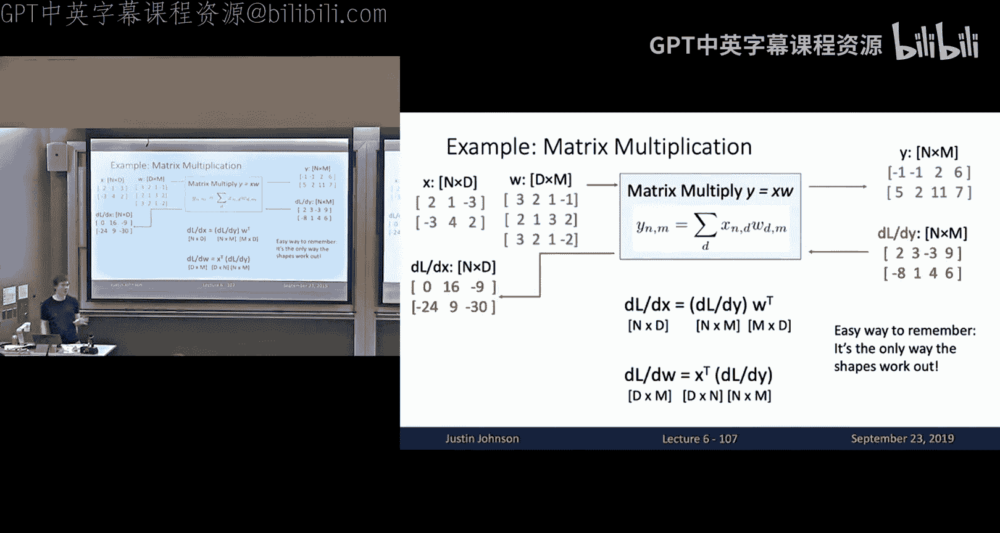

So another view of back propagation is that we have this long chain of functions and we've got like F1 and F2 and F3 and F4 and we eventually produce this scalar loss L。

 and now by the multivariate chain rule， we know we can expand out this gradient expression and right DL Dx0 as this product of all of these Jacobbian matrices which are the intermediate Jacobbian matrices and this final gradient matrix gradient vector on the very far right and we also know that matrix vector products are all associative so we in principle could choose to perform this multiplication of all these Jacobian matrices and this final vector in any grouping or in any grouping that makes sense and what's happening in back propagation is that we've chosen the particular grouping of computing these products right to left。

And what's really nice about computing these products right to left is that we never have to do any matrix matrix multiplication。

 because if we compute these products right to left。

 then we only ever end up having to do matrix vector multiplication， which is much more efficient。

But this whole thing hinges this is a very nice algorithm， but for that to work out。

 it means that we always need to be computing a final scalar loss at the very end。

 and this algorithm only works for computing the derivatives that final scalar loss with respect to everything else in the graph and there might be other situations where you might want to do something else。

 What if， for instance， you want to compute the derivative of a scalar input and get the derivatives of everything in the graph with respect to a single scalar input。

Now that might that corresponds to a different version and by the way。

 this back propagation algorithm because of this method of multiplying because of this interpretation of multiplying the Jacobbian matrices in this right to left way。

 this is sometimes referred to as reverse mode automatic differentiation so fancy a fancy sounding name and from the name。

 you know there if were explicitly calling it out reverse mode。

 then there should be a forward mode as well。 and it turns out there is So the forward mode automatic differentiation is for this slightly of other case where we have a scalar input value。

 and now we want to compute the derivative of that scalar input value with respect to everything else in a graph。

 and then you can see that if we kind of it would think about it in this viewpoint of vectors and Jacobcobians。

 then again， we can multiply these things in any way。

 but if we perform the multiplication left to right。

 then we again get kind of only matrix vector multiplies。

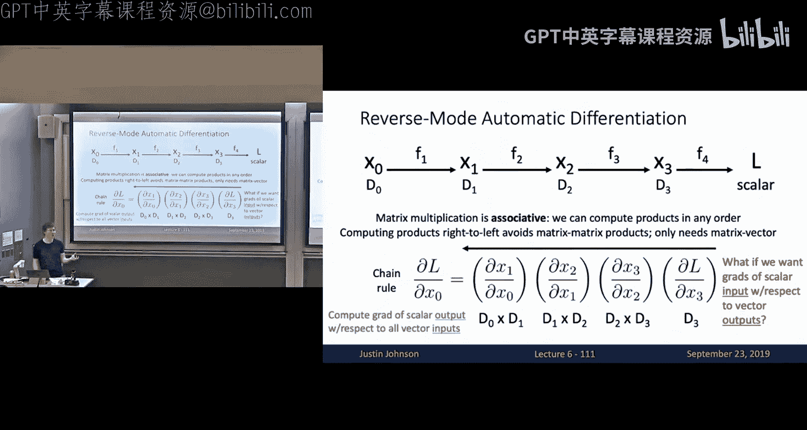

And by the way， you might ask why would want to do this in machine learning。

 we always want to compute we always have a loss at the end we want to compute derivatives with respect to that loss in order to do gradient descent。

 Well， I know it's hard to believe， but there's actually more to the world than machine learning and sometimes it's useful to have computer systems that can automatically compute gradients for us when we're doing things that are not minimizing a loss function So an example here might be we have some physical simulation and this input a is maybe like a scalar parameter giving the gravity or the friction or something of that physical simulation and now we want to compute how much would all of the outputs of the simulation change had one of those scalar inputs of controlling the gravity or the friction or something changed So because this is this kind of idea of automatic differentiation is generally useful far beyond machine learning it's really useful any time you want to compute derivatives for any kind of scientific computing application。

But the downside is that forward mode differentiation is not implemented by pytorch and Tensorflowlow and all the other big frameworks。

 so unfortunately， even though it has these really cool applications and maybe scientific computing and whatnot。

 it's not super easy to use because they don't implement forward mode versus an automatic differentiation and they've had issues about this open up on Gitthub like the day Tensorflow released but it still hasn't been merged in but thankfully there's a clever algebraic trick you can actually do to compute forward mode gradients actually using two back propagation operations there's a link to that here。

 it's a super clever piece of algebra that I'd really encourage you to check out if you ever happen to find yourself wanting to compute forward mode gradients in a deep learning framework。

😊，Now another kind of really useful trick that we can use。

 once we have this viewpoint of back propagation is kind of multiplying tensors and Jacobians and vectors and whatnot。

 is we can actually use this same back propagation algorithm to compute not only gradients。

 but also higher order derivatives as well。So as an example here we're showing a very amended computational graph where we have an input x of this vector of size d1 that goes through f1 to produce another intermediate vector of size d d1。

 then we go through f2 to produce a scalar loss and now what if so far we've always talked about first derivatives。

 we always talked about gradients and Jacobians and normal derivatives but in this case the second derivative of the loss with respect to the input x0 is now a matrix that tells us all of these second derivatives if we were to kind of like if we were to change x0 by a little bit like change one element of x1 by a little bit and change another element of x1 by a little bit simultaneously then kind of how much is a loss changing or equivalently if we were to change one of the elements of x1 then how fast would the gradient change is another way to think about this Jacobbian matrix or sorry this hessian matrix see these things are easy to get mixed up very careful Hessian matrix a second derivative Jacobbian matrix is first derivative Jacobbian matrix is vector and vector。

hass and matrix is vector and scalealr out， simple。Yeah。

But it turns out sometimes you might want to compute elements in your computational graph that are a function of this hessian matrix so an example would be a hessian vector multiply。

 say we have this hessian matrix so we want to compute the hessian is a matrix we have a vector that we want to compute this hessian vector product why would youever want to do this it turns out there's reasons for instance there's an iterative there's an iterative algorithm to approximate the singular values of a matrix using these matrix vector products so for example if you wanted to compute some kind of second order information about the singular values of the optimization landscape then you might want to compute Hes and vector products to approximate those singular values。

And it turns out through a of through a bit of clever algebraic transform， you know。

 derivatives are linear and gradients are linear and linear functions are amazing。

 so we can actually rewrite this second derivative of this matrix vector product as the derivative of the inner product between the gradient and the vector。

😊，And I'm pretty sure this works out。Right， but of course。

 this is only true if the vector is a constant and doesn't depend on x0 if it does。

 then you get another cross term。 But now we can do something very clever in our computational graph。

 so we can extend our computational graph with these back propagation functions。

 So now what we can use what we can think about is extending our computational graph。

 So after we compute the loss。 Then we use this function F2 prime to compute the gradient of the loss with respect respect to x1。

 We can use F1 prime to compute the gradient of the loss with respect respect to x0。

 These are these little backward functions that were implemented by the backward path of the little f gates。

 And then we can implement this do this dot product with F and think about that as another node in the computational graph。

 And then this final output is going to be the inner product between the gradient the L the X0 and the vector and this vector we've chosen V。

 And now in order to compute the derivative of of that thing with respect to x0， we just need to。😊。

Back propagate through this graph。So what this is like kind of magical the first time I saw it。

 but basically what this means is that if all of your backward pass operations。

 when you implement your little gradient nodes， if the backward pass is itself implemented using differentiable primitive operations。

 then you get all these higheror gradients for free。

 and you can use back propagation through these computational graphs to compute functions of second derivatives。

 and by the way， you can similarly do higher order derivative things as well。

 you can imagine computing a third derivative is now going to be a three- dimensionmensal tensor。

 then you can compute bilinear forms on top of this third derivative which is like kind of hard to think about but you could imagine extending this type of operation in order to compute derivatives of arbitrarily high values using the same simple back propagation algorithm。

And unlike forward mode automatic differentiation， this actually is implemented in all of the major deep learning frameworks like TensorFlow and Pytorch。

 so you can do some crazy shenanigans and write down loss functions that involve gradients why would you ever want to do that。

 it turns out people actually do want to do that sometimes so an example here that from this paper called improved training of Weersteingans。

 they actually write a regularization term that depends on the gradient of the loss with respect to the weight matrix so here that has the interpretation that we want to write down a regularization term that penalizes the magnitude of the gradient which means that we kind of want to find weight matrices that result in well-conditioned optimization landscapes which is a pretty cool idea and then you can actually implement this kind of crazy regularizer by using this idea of higher order differentiation through these computational graphs。

So then kind of the summary of what we saw today is that we could represent these very complex functions using this computational graph abstraction that is hopefully going to be a lot nicer than working out things on paper where then it's going to have this forward pass that computes gradients and sorry forward pass that computes values。

 backwardpa that computes gradients and then you don't even really need to think about the full graph most of the time you only need to kind of zoom in and think about this local picture of little computational graph nodes that compute outputs and then multiply the local gradients to compute downstream gradients and then hopefully the really important part for your homework that's due in a week will be this idea of implementing back propagation using this kind of flat backpro way where your backpro code looks like an inverted version of your forward passs code and then we also talked about this more modularized API which where that lets you be more modular and swap things out in a better way and actually an assignment3 will implement a more modular API for other types of neural networks。

So now kind of at this point in the class， we've seen linear class fires， we've seen neural networks。

 we've seen how to compute gradients in these things， but we've had a big problem。

 which is that both of these networks had this operation where we kind of stretch out the pixels of the input image and take our input image and stretch it out into a vector which basically destroys this spatial information of the image that seems like a bad thing and we'll fix that in next lecture when we talk about convolutional neural networks。

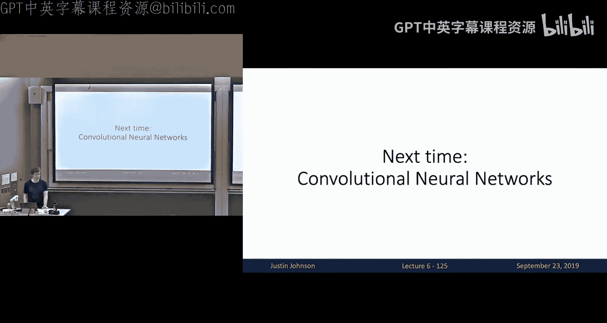