# 深度学习用于计算机视觉：06：反向传播

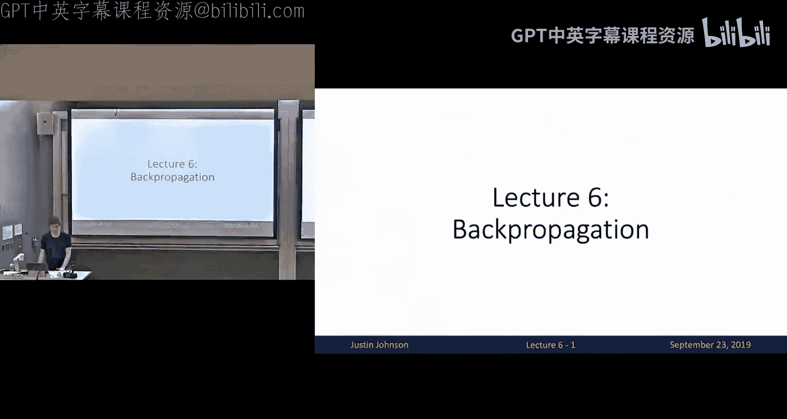

欢迎回到课堂。这是第六讲，今天我们将讨论反向传播。和往常一样，我们首先需要处理一些课程管理事务。希望这是最后一次关于候补名单的更新。在我来这里之前，我查看了候补名单，发现过去几天里，名单上的每个人都已获得选课许可。这意味着，所有希望选修本课程的同学现在应该都能成功选课了。我们一起解决了这个问题，大家做得很好。

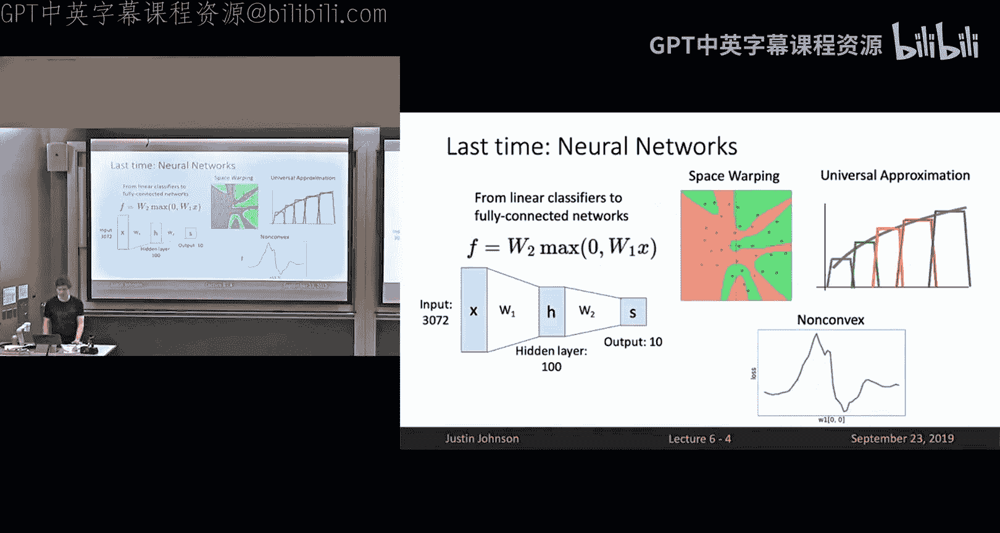

接下来是关于作业2的提醒。抱歉，这里有个笔误。作业2的截止日期是今天起一周后的周一，即9月30日晚上11点59分。

提醒大家，现在应该已经开始做作业2了。请注意，作业2比作业1要长一些，而作业3会更长。随着学期的推进，大家应该越来越早地开始这些作业。

在进入课程内容之前，关于这些管理事务还有什么问题吗？

好的。问题是关于课程幻灯片没有出现在网站上。我大约45分钟前刚刚上传了幻灯片。你可以尝试按Ctrl+Shift+R刷新并清除缓存，它们应该会显示出来。

如果不是这个问题，那可能是我把链接弄错了。你可以尝试查看之前课程的链接格式，然后把链接中的“5”改成“6”，因为我确实上传了文件，但可能在更新链接时打错了。这样行了吗？好的，如果不行，我会在这次讲座后确保修复幻灯片链接。

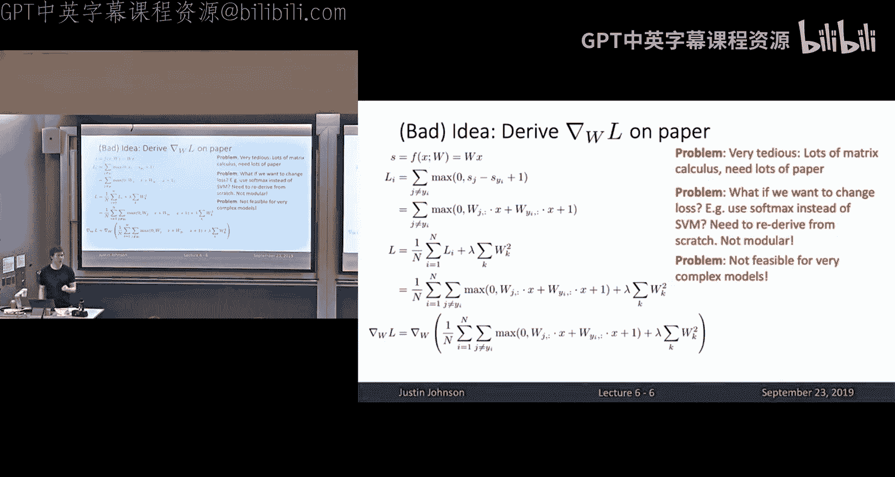

---

上节课我们讨论了神经网络。我们看到，神经网络是一类非常强大的分类器，它让我们能够进行比之前讨论的线性分类器更强大的计算。大家应该记得，神经网络具有相当简单的函数形式：一个矩阵乘法，加上一个我们称为激活函数的逐元素非线性运算，然后是另一个矩阵乘法。我们可以将这些操作链接起来，得到非常深的神经网络。我们还看到了“空间扭曲”的概念，它展示了神经网络如何能够通过输入空间中的非线性决策边界，从而比线性分类器强大得多。我们还讨论了神经网络作为通用逼近器，这从另一个角度说明了神经网络是一类非常强大的函数。我们也看到了非凸性的概念，即尽管神经网络能力强大，能表示许多函数，但也导致了非凸优化问题，这类问题在理论上很少有保证。

上节课结束时，我们留下了一个问题：现在我们可以写出这些非常复杂的表达式来描述损失函数，我们希望使用随机梯度下降来最小化这些损失函数，以训练我们的分类器（无论是神经网络、线性分类器还是其他类型的深度学习模型）。这里的问题是，我们如何实际计算这些模型中的梯度？

我们知道可以写出任意的损失函数。如果我们能找到某种方法计算损失相对于模型所有权重矩阵的梯度，那么我们就可以使用几节课前讨论的优化算法来实际最小化损失，并找到适合我们训练数据的好模型。

今天讲座的主题就是，我们如何实际计算这些梯度，即如何为任意复杂类型的神经网络或其他函数计算导数。

如果你只是天真地处理这个问题，可能会尝试的第一个策略是在纸上推导梯度。我们知道可以写出这些函数，这些损失函数，并在纸上将损失函数展开成一个包含许多项的方程。这里我展开了一个我认为是带有线性分类器的SVM损失函数。你可能采取的一种策略是，把所有东西都写在纸上，展开所有项，最终得到一个巨大的方程，该方程将损失表示为数据和模型权重的函数。然后，如果你非常熟悉矩阵微积分的规则，你可以想象尝试通过计算，在纸上为模型中出现的所有可学习权重矩阵计算出表达式。

事实证明，这不是一个非常可扩展的解决方案。如果有人真的在作业2中尝试了这种方法，如果你确实走了这条路并尝试在纸上计算这些权重矩阵，你会注意到这种方法的一些潜在缺点。

一是它极其繁琐。在处理像交叉熵损失函数或SVM损失这样的损失函数时，你可能需要很多纸才能算对。另一个问题是，对于复杂模型来说，这种方法不太可行。对于像线性模型这样的东西，你或许还能应付，但随着我们扩展到更复杂的模型，这种在纸上写下并推导梯度的方法将根本无法扩展到更复杂的模型。在纸上推导所有东西的最后一个有点微妙的问题是，它不会导致模块化的设计。假设你已经为带有SVM损失的线性分类器推导出了损失函数，明天你又想为带有Softmax损失的线性分类器、或带有Softmax损失的两层神经网络、或带有SVM损失的五层神经网络，或者你能想象到的任何其他损失函数、架构和正则化器的组合推导梯度。如果你为每一种损失函数和架构的组合都从头开始在纸上推导，那么每次你都必须从头开始重新推导所有东西。在实际情况下，拥有某种模块化的方法要好得多，这样你可以交换和插入不同类型的模型、架构和损失函数，从而在尝试为数据找到有效模型时能够更快地迭代。

我们在深度学习中通常采用的方法，你可能已经猜到了，不是在纸上推导梯度。既然我们是计算机科学家，我们喜欢尝试寻找数据结构和算法来帮助我们解决繁琐的问题。我们用来帮助解决计算梯度这个问题的数据结构被称为**计算图**。

计算图是一种有向图，它表示我们在模型内部执行的计算。在左边，我们可以看到模型的输入：数据X和标签y（可能在这个图中没有标签y，但也许这里有数据X和可学习权重W作为图左侧的节点）。现在，当我们从图的左侧向右进行时，我们看到节点代表了在计算这个函数过程中我们想要执行的基本计算片段。我们看到有一个蓝色节点，表示输入X和权重矩阵W之间的矩阵乘法；有一个红色节点，表示如果我们使用SVM分类器时的铰链损失；有一个绿色节点，表示模型中的正则化项；有一个求和节点，表示数据损失和正则化损失的和；最后在右边，我们有计算图的输出，即标量损失L，这是我们在训练模型时想要计算的。

现在，将这种计算图形式应用于像线性模型这样的东西可能看起来有点傻，甚至有点微不足道，因为在线性模型中，正如我们所说，为了计算损失只需要执行几个操作，将它们写成图的形式可能看起来有点小题大做。但当我们转向更复杂、更大的模型时，这将变得至关重要。例如，像AlexNet这样的深度卷积神经网络，它有七个卷积层，每层都有非线性激活和正则化，最后还有一个损失函数。图像从顶部输入，经过许多层的处理，最终的标量损失从底部输出。对于这样的模型，你肯定不想在纸上推导梯度，而是真的想使用这种计算图形式来跟踪数据结构，构建一个表示模型为计算损失而执行的所有计算的数据结构。

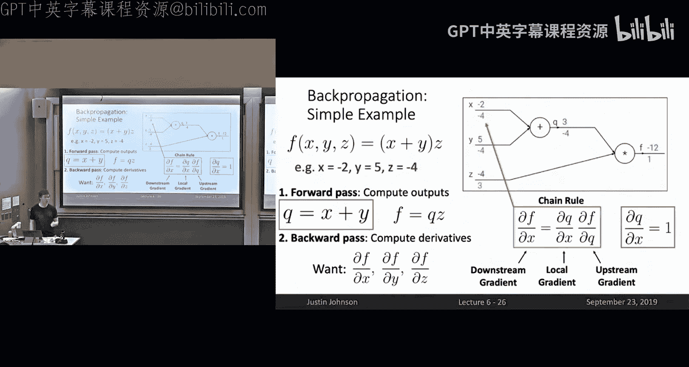

这些图可以变得极其复杂。这里有一个叫做神经图灵机的模型示例。如果你还记得计算理论导论课，你会记得图灵机是一种形式化的计算模型。几年前，一些人写了一个神经网络，它有点像你在计算导论课上学到的图灵机的软可微分近似。屏幕上显示的是这个可微分神经图灵机产生的计算图，你可以看到它非常大且复杂。你绝对不想手动计算这个模型的梯度，你真的需要依赖计算图形式来为你计算梯度。但实际上，情况甚至比这更糟，因为对于神经图灵机，这里只显示了模型的一个时间步。在实践中，这种模型会像一种循环网络一样在许多时间步上展开。所以你可以看到，一旦进入这些非常复杂的模型，你很快就会得到计算图，它们大到甚至无法放在一张幻灯片上。因此，你肯定希望使用某种图遍历算法，来帮助我们在这种计算图结构上自动计算梯度。

希望这已经充分说明了为什么使用计算图来计算我们大型复杂神经网络模型中的梯度对我们来说至关重要。既然我们已经有了这个动机，现在让我们看一个具体的例子，看看如何使用计算图来帮助我们在一个非常小的神经网络模型中计算梯度。

为了将示例放在一张幻灯片上，我们不得不使用一个非常简单的计算。但正如你所见，在实际模型中，我们会进行更复杂的处理。这里我们展示了一个三个标量变量X、Y和Z的非常简单的函数，其输出是`(X + Y) * Z`。这可能是一个奇怪的损失函数，一个没有意义的学习问题，但希望这个简单的例子能帮助我们逐步理解在计算图中计算梯度的确切含义。

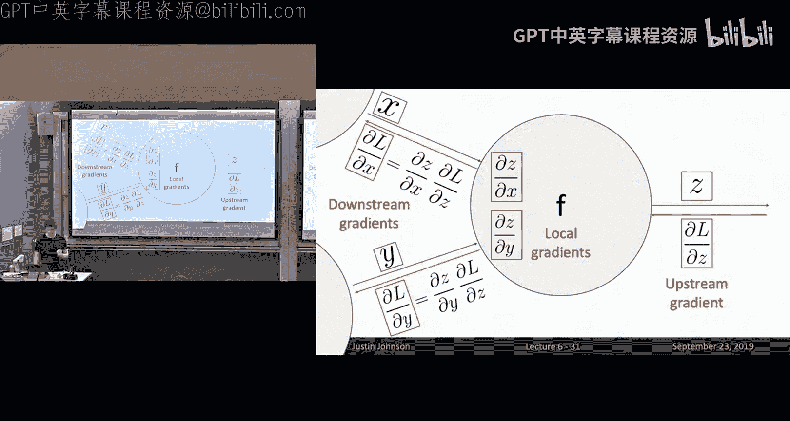

顺便说一下，反向传播就是我们用来在计算图中计算梯度的算法。

现在假设我们想在输入空间中的一个特定点评估这个函数，比如`x = -2`，`y = 5`，`z = -4`。使用这个计算图的第一步称为**前向传播**。在前向传播中，我们从左到右进行计算，执行图中节点指定的所有操作，以便从输入值计算输出值。在这个例子中，我们简单地将x和y相加，得到一个我们命名为q的中间值。然后，为了计算最终输出值f，我们将q乘以输入值z。通过运行图的前向传播，我们最终计算出本例中的最终输出值为`-12`。

现在在**反向传播**中，我们的目标是计算所有梯度，即输出相对于每个输入的导数。所以在这个例子中，我们的输出是f，所以我们想计算导数`df/dx`、`df/dy`和`df/dz`，它们是图左侧出现的三个输入。我们将从右向左进行，因为这是反向传播，所以它需要与前向传播相反的方向进行。

我们总是从一个基本情况开始。在右侧的基本情况下，我们想计算f相对于f的导数。有人知道这应该是什么吗？是的，这很简单，是1。因为如果我们稍微改变f一点，那么f也会改变相同的量，导数是1。顺便说一下，当我们在图中计算反向导数或使用反向传播时，我们经常会写一个像这样的小图，我们在每条对应线的上方写下每个节点计算出的值，然后在反向传播期间，在对应线的下方写下梯度或导数。

第二步，我们想计算f相对于z的导数。为了做到这一点，我们知道可以看看这个小的中间计算，我们知道`f = q * z`，所以f相对于z的导数应该就是q。然后我们可以回顾计算图，查找q的值，在本例中是3。所以现在，图中这一小部分的`df/dz`将是3。

现在我们已经计算出了我们需要计算的三个梯度中的一个。下一部分，我们需要计算f相对于q的导数。你可以看到我们正在以图的一种反向拓扑排序的方式向后推进。为了计算f相对于q的梯度导数，我们再次知道`f = q * z`，所以这个局部导数应该是z。我们可以从前向传播的图中查找z的值，并计算出导数为`-4`。

继续向左推进，现在我们想计算f相对于y的导数。这里事情变得有点有趣，因为现在我们需要记住微积分中的链式法则，因为值y并不直接连接到输出值f。为了计算f相对于y的导数，我们需要考虑y对中间变量q的影响。那么，微积分中的单变量链式法则告诉我们：`df/dy = (dq/dy) * (df/dq)`。

这非常直观：如果y改变一点点，那么q将改变一点点`dq/dy`；然后如果q改变，f将改变一点点，即另一个导数。为了考虑这两种效应，我们需要将它们相乘。现在，在神经网络的背景下，这个方程中的这三个不同项有我们将会反复使用的特定名称。

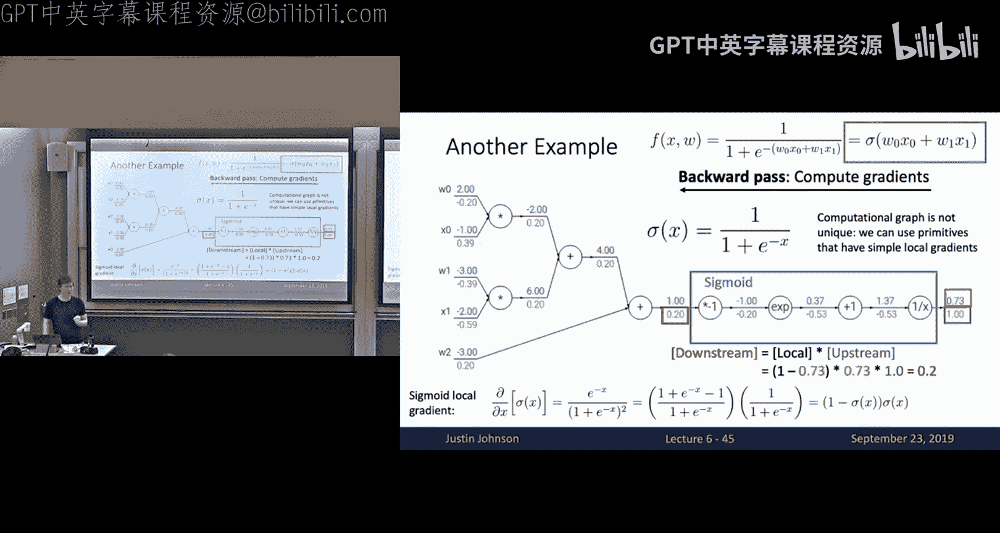

左边的项`df/dy`，我们通常称之为**下游梯度**，因为这是我们在过程这一步计算的导数值。值`dq/dy`将被称为**局部梯度**，因为这是y的值影响下一个中间输出q的局部效应。值`df/dq`将被称为**上游梯度**，因为这是上游的效应。现在我们可以想象放大图中y周围的这一小部分，上游梯度告诉我们这部分图的输出在多大程度上影响了图最末端的最终输出。所以这部分被称为上游梯度。当然，链式法则告诉我们，要得到下游梯度，我们只需要将局部导数和上游导数相乘。

当然，这里我们知道局部梯度，我们知道`q = x + y`，所以局部梯度或局部导数在这种情况下就是1。所以当我们将这两者相乘时，我们知道f相对于y的导数与f相对于q的导数相同，所以我们得到下游梯度为`-4`。大家都清楚了吗？好的。

现在计算另一个导数时非常相似。我们再次需要将上游梯度和局部梯度相乘。同样，局部梯度是1，因为这是一个简单的加法。我们计算出最终的输出值。

所以，在这个相对简单的例子中，你可以看到我们如何使用计算图来帮助我们机械化地计算非常复杂函数中的导数。在前向传播中，我们将从左到右计算所有内容。然后在反向传播中，我们将逐步向后遍历图，并在图中的每个点计算这些小的导数。

这种思考计算梯度的方式非常有用，因为它是模块化的。现在，一种思考方式是，我们可以放大计算图中的一个节点。使用反向传播计算梯度的这种机制的真正优点在于，图的每一小部分都不需要知道或关心图的其余部分。我们只需在每个节点内执行局部处理，然后通过聚合所有这些局部处理，我们最终可以计算出整个图中的这些全局导数。

如果我们逐步完成上一张幻灯片中讨论的完全相同的过程，但放在单个局部节点的上下文中，它看起来是这样的：对于图中的每个节点，我们计算某个小的局部函数f。这个局部函数f接受两个输入x和y，在前向传播期间，我们将应用局部函数来计算局部输出z。

现在，这是这个小独立节点的前向操作。在这个节点的前向操作运行之后，这个输出z将被传递给图的其他部分，并且可能被其他节点以任意复杂的方式重用。我们不知道，也不关心。从这个节点的角度来看，我们只知道我们计算了一个输出并将其传递给了别人。在过程结束时，最终在图末端的某个地方，有人会计算最终的损失L，然后反向传播开始。在我们之外的某个地方，梯度会传回给我们，超出了这个小节点的范围。最终，这个反向传播过程会到达我们关心的这个节点，这个节点将从图的上游接收一条消息，告诉我们损失相对于z的导数，即如果我们稍微改变节点的局部输出，这个可能离节点很远的损失会改变多少。这正是上游梯度`dL/dz`告诉我们的。

此时，我们可以计算节点内部的局部梯度，这些局部梯度告诉我们，对于节点的每个输出，节点的每个输入如何影响每个输出。然后，这个节点可以简单地通过将局部梯度和上游梯度相乘来计算下游梯度。然后，这些下游梯度被传递给图中更靠后的其他节点。同样，这个节点不需要知道或关心这些下游梯度将如何在图的其他地方被使用，它们只是被用在某个地方。当最终的反向传播过程终止时，我们将得到计算出的损失相对于图所有原始输入的梯度。我们能够计算这个全局属性，而无需真正推理我们试图计算的函数的全局结构。它只要求我们思考每个节点内部局部发生了什么，然后使用某种数据结构来跟踪所有这些节点是如何连接在一起的。

所以，希望这将比试图在纸上推导那些大的梯度表达式有巨大的改进。

这是另一个在计算图中运行的例子，这里看起来有点像逻辑分类器，如果你关心这些方程的话。但对于本讲座的目的来说，函数具体计算什么的细节有些无关紧要，我们只关心计算任意复杂函数的梯度。在左边，我们展示了一个接受五个输入的函数，我们的五个输入是`w0`、`x0`、`w1`、`x1`、`w2`。在前向传播中，我们将计算权重的前两个元素和x的前两个元素之间的内积，然后我们将计算这个偏置项加上`w2`，然后我们将计算某种`e`的负某次方。在这个计算图中，计算将像我们在上一个例子中看到的那样进行。在前向传播中，我们将通过评估每个节点的前向函数来计算图的输出，最终在右侧计算出这个最终的标量输出值。

然后在反向传播期间，我们将迭代地思考如何将上游梯度乘以图中每个节点的局部梯度来计算下游梯度。所以我们总是从这个基本情况开始：输出相对于自身的导数总是1。接下来，我们将看这个`1/x`，我们知道`1/x`的局部梯度是`-1/x^2`，这给了我们局部梯度，我们可以将它们相乘得到下游梯度。我们可以再次逐步进行，我们知道加上一个常数的局部梯度是1，所以我们可以轻松地将这些梯度向后传递。我们可以计算这个指数函数的局部梯度，这很简单，这让我们可以轻松地计算下游梯度。这种过程一步一步向后、向后、向后，每一步我们只是计算这些局部梯度，然后将上游和局部梯度相乘。

但这个特定计算图真正有趣的地方在于，我们本可以用多种方式来构建这个图中的计算结构。正如我所写的，我将其写成了非常基本、非常原始、非常基础的算术运算符：加法、乘法、指数、除法、加上常数。我已经将这种计算分解成了其最基础的算术原语片段。正如你通过观察这个图所注意到的，将所有东西分解成最基础的算术原语在每一层上最终会有点繁琐。有时，我们实际上有自由来定义我们希望在图中使用的原始操作类型。所以在这里，我们已经将所有东西分解成了基本原语，但我们也有自由定义任意新的节点类型，这些节点可以在内部计算更复杂的函数。

为什么这可能有用呢？举个例子，我用蓝色框出的这一小块图独立计算了这个所谓的sigmoid函数，即`1 / (1 + e^{-参数})`。这个sigmoid函数在机器学习中经常出现。我们在二元交叉熵的上下文中见过它，当你在做二类逻辑回归时。它也出现在许多其他上下文中。有点好处的是，作为这个小图语言的设计者，我们有自由选择对反向传播过程有用或易于计算的原始图元素。

特别是，我们可以选择分配给图中节点的原始函数，使得局部梯度易于计算。对于sigmoid函数来说就是这种情况。如果你在纸上进行一些数学运算，你可以看到（我不想在这里详细说明这个表达式），但如果你在纸上计算sigmoid函数相对于其输入的导数，你会发现sigmoid函数的局部梯度有一个非常简单的函数形式：sigmoid函数的局部梯度简单地等于sigmoid函数的输出乘以`1`减去sigmoid函数的输出。这意味着我们可以非常容易地计算整个蓝色图块的局部梯度，而无需存储这个中间的整个图块。这是我们作为图设计者，巧妙地选择我们希望在图中使用的原语，以便在反向传播期间更容易或更高效地计算导数的一个例子。这绝对是你应该考虑做的事情。

现在，如果我们想象一个聚合版本，你可以想象这个图的一个等效版本，它将整个蓝色框折叠成一个节点。然后，这个节点将在右侧接收上游梯度，然后使用我们在幻灯片底部推导出的表达式立即计算局部梯度，然后立即在左侧返回下游梯度，从而跳过框内的所有中间计算。所以，定义更复杂的原语用于我们的图中这个想法，我们通常会大量使用，以使我们的计算图更高效或具有更多的语义意义。

当我们看这些计算图时，我们可以开始注意到的另一件事是，存在一些模式变得明显。当你观察信息在前向传播期间如何向前传播，以及在反向传播期间如何向后传播的模式时，我有时会这样想：这就像一个小电路，在前向传播期间，信息从输入流向输出；然后在反向传播期间，信息从损失通过每个中间节点向后流向模型的原始参数，我们想为这些参数计算梯度。

当你有了这种计算图的电路解释时，你会开始注意到一些关于梯度流动的模式，以及前向和反向传播期间信息流动之间的一些对偶性。

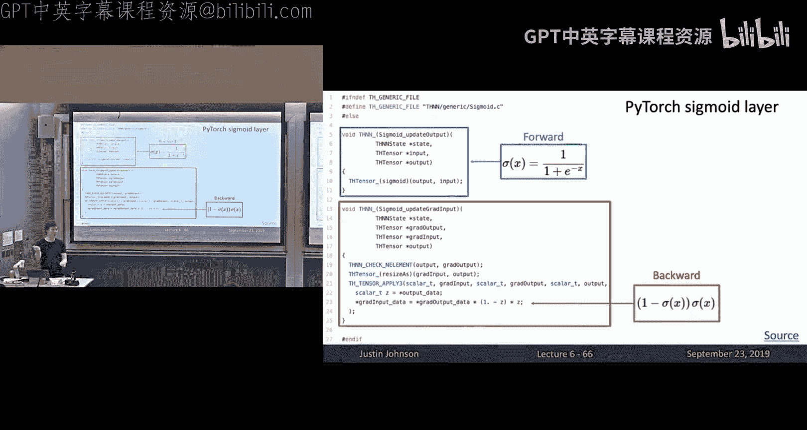

最简单的例子是，这个加法门或加法函数在反向传播期间充当梯度分配器。如果我们有一个局部计算输出为其两个输入之和的小函数，也许这里的`7`是`3+4`，那么在反向传播期间，我们知道，正如我们在第一个计算图示例中看到的，`x+y`相对于`x`的导数是1，`x+y`相对于`y`的导数也是1。所以两个输入的局部梯度都是1。这意味着两个输入的下游梯度都等于上游梯度。这将推广到具有任意多项的和。这意味着在反向传播期间，当你有一个求和节点时，该节点将分配并复制上游梯度到下游梯度。这是关于模型中存在加法时会发生什么的一个很好的直觉。

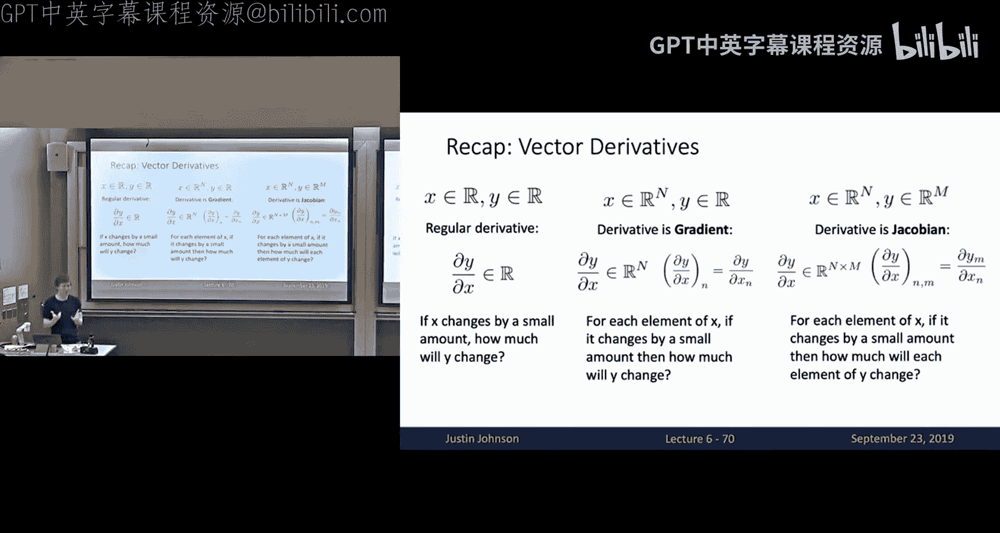

与求和节点对偶的是复制节点。这是一个有点微不足道的节点，在其输入时，也许接收某个输入，然后有两个输出值，它们都是输入的相同副本。乍一看，这似乎是一个愚蠢的操作。为什么你会在图中引入这样的操作呢？如果你想在图中下游的多个地方使用模型的一个项，你可能想这样做。例如，你可能想象在正则化设置中，我们实际上希望以两种方式在模型中使用我们的每个权重矩阵：我们想使用权重矩阵一来计算模型主分支中的分数；其次，我们需要使用权重矩阵来计算我们的正则化项，如L2或L1正则化。为了在图中两个下游部分使用我们的权重矩阵，我们可能想象在图中某处插入一个复制节点，该节点现在生成权重矩阵的两个相同副本，现在可以在图的不同部分使用。重要的一点是，当我们产生这些副本时，因为它们可能以不同的方式被使用，我们最终可能会得到关于这两个副本的不同梯度。现在在反向传播期间，复制节点接收的上游梯度对于它产生的两个输出可能不同。但在反向传播期间，我们只需要将这两个梯度相加。这表明加法门的前向操作在某种程度上与复制门的反向操作相同，反之亦然。所以这两个操作在某种程度上是对偶的。

另一个有趣的事情是乘法门。你可以把它看作一种交换乘法器，因为你知道`xy`相对于`x`的导数是`y`，`xy`相对于`y`的导数是`x`。这意味着一个输入的局部梯度是另一个输入，第二个输入的局部梯度是第一个输入。这意味着当我们计算下游梯度时，下游梯度等于上游梯度乘以另一个输入。如果你现在思考一下，如果你的模型中有一个乘法，它会以一种有趣的方式混合梯度，这有一个有趣的隐含意义。因为在反向传播期间，乘法门的反向传播也涉及乘法，你可以看到你最终会在反向传播中得到一些非常大的乘积，你可以想象在某些类型的模型中这可能是一个问题。

另一个你可能会经常看到的是最大值门。这里最大值门将接受两个标量输入并返回两个输入的最大值。这个函数看起来有点像ReLU函数。你可以想象，对于确实是最大值的输入，局部梯度是1；对于不是最大值的输入，局部梯度是0。那么这可以解释为：在反向传播期间，最大值门充当梯度路由器，它将获取上游梯度并将其路由到恰好是最大值的那个输入，而所有其他不是最大值的输入的下游梯度都将被设置为零。

那么你可以想象，如果我们有一个模型取很多很多事物的最大值，那么在反向传播期间，我们最终会得到一个大部分为零的梯度。所以你可以想象，也许这对于在整个模型中获得良好的梯度流动来说是一个问题，因此我们可能出于这个原因而不喜欢使用最大值。

所以这些显然都是微不足道的数学表达式，但思考这些标量函数的微不足道的导数如何对这些巨型神经网络模型中梯度流动的方式产生非平凡的影响，是很有趣的。

现在，希望我们已经对什么是反向传播以及它如何帮助我们自动化计算大型模型中的梯度过程有了一些直觉。我认为对你们来说，讨论如何在代码中实际实现这些东西是有帮助的，因为这是你们在作业中必须做的事情，希望你们能熟练掌握。

我认为至少有两种主要的方式来实现反向传播。第一种是我称之为**扁平化实现**的反向传播。这里的想法是，我们将编写一个单一的Python函数来计算整个计算图。也许这个Python函数正在计算一个线性分类器，它输入一个小批量数据和你的权重，然后计算该小批量数据上的损失。这听起来像作业2，希望看过作业的同学熟悉。现在要求你编写一个单一函数，既要计算损失，又要计算损失相对于每个权重矩阵的导数。

那么，你可以做的一件事是在纸上大干一场，做你的导数推导，希望最终能通过梯度检查。但你可以尝试以一种更简单的方式来构建这个计算，我认为这使得编写这个反向传播代码实际上非常简单。这里我们将以左边这个小计算图为例，这是几页幻灯片前的sigmoid例子。我们将输入两个权重`w0`、`w1`，两个输入`x0`、`x1`和我们的偏置项`w2`。我们代码的前向传播将简单地应用加法和乘法这些操作，并计算我们的损失`L`。然后，反向传播代码将紧接在前向传播代码之后。诀窍在于，反向传播代码看起来像是前向传播代码的**反转版本**。

我这么说是什么意思呢？你可以看到，我们在反向传播中做的第一件事是计算这个微不足道的基本情况：输出相对于自身的梯度为1。在实际实现中，你可能应该省略这一行，但我想在这里让它超级具有教学意义。你可以看到，反向传播代码的第一行对应于计算图中最右边的东西。

反向传播代码的第二行对应于通过sigmoid函数反向传播。你可以看到，sigmoid函数的反向传播行对应于前向传播的最后一行。

我们注意到，在前向传播中，sigmoid函数以`s3`作为输入，并返回`L`作为输出。现在，反向实现中对应的行有点反转了：反向传播以`grad_L`作为输入，并产生`grad_s3`作为输出。所以你可以看到，前向传播中的这一行和反向传播中的这一行之间存在一一对应关系，并且这两行对应的输入和输出在某种程度上是互换的。

这种对应关系继续：在我们前向传播的倒数第二行，我们想将`s2`和`w2`相加。因为这是一个有两个输入的操作，它在对应的反向代码中产生两行。再次，我们可以看到加法门作为梯度分配器的直觉，所以你可以看到我们只是将梯度分配或复制到这两个输入中。类似的事情发生在前向传播的倒数第三行。前向传播的倒数第四行也发生类似的事情，但这次我们有一个乘法门，我们有这个局部梯度乘法交换器的解释。最后，我们有这个最终输出，它做同样的事情，也是一个乘法。

现在这有点神奇，对吧？我们实际上在没有写下任何数学的情况下，写出了一个正确的反向传播实现。我们没有在纸上写下任何方程。我们所需要做的就是思考：我们编写了前向传播的代码，然后我们只是在脑海中转换我们为前向传播编写的代码，以生成反向传播的代码。如果你还没有完成作业2，这应该是你实际完成作业2的方式。当涉及到计算梯度时，这将使你的生活轻松得多。事实证明，一旦你在这方面有足够的练习，你几乎永远不需要在纸上做数学来编写梯度代码。你只需查看为前向传播编写的代码，然后使用你随着时间的推移积累的所有这些小局部规则来反转它。

这种通过反转前向传播代码来实现扁平化反向传播的想法，你应该在作业2中实践。例如，对于SVM，你可以想象我们可能会计算分数、计算边界、计算数据损失，然后在反向传播中，你只需以相反的顺序做所有这些事情，只是反向传播中每一行的确切操作将是这个局部计算，即上游梯度和局部梯度的乘法，以计算下游梯度。

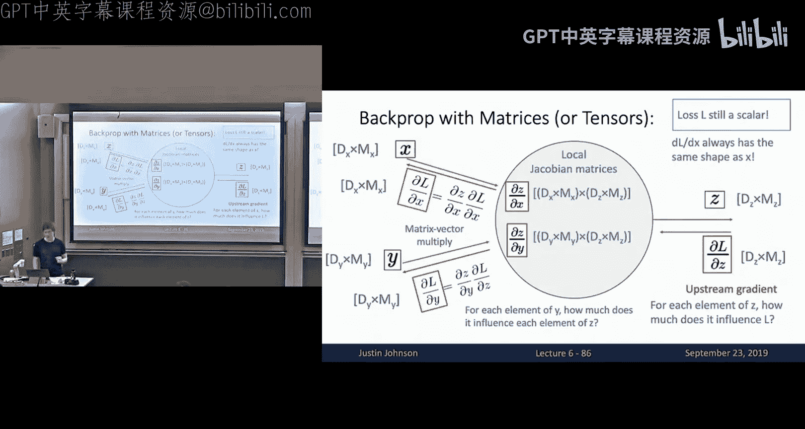

你可以看到，你可以为SVM这样做，也可以为两层神经网络这样做。有趣的是我选择了这些例子。所以我强烈建议你熟悉这种通过转换前向传播代码来计算反向传播的方式。

当然，这种进行扁平化反向传播的机制在你只需要编写一个梯度函数时非常有用，但它有点不符合模块化测试。因为在这种扁平化反向传播的版本中，如果我们改变模型、改变激活函数、改变损失函数或改变正则化器，我们都必须重写代码。这将会有点痛苦和烦人。

所以有第二种方式，即更工业化的实现反向传播的方式，那就是使用更模块化的API。这与我们在节点周围看到的局部计算的想法非常吻合。在这种模块化的反向传播实现中，我们通常会定义某种计算图对象。这个计算图对象将能够通过对图的所有节点进行某种拓扑排序操作，然后在前向传播期间调用每个节点的前向操作，在反向传播期间调用每个节点对应的反向操作，从而在整个图中进行前向和反向传播。

我这里展示的这段代码只是伪代码，不是真正的代码，可能有拼写错误。但这个实际上是真实代码。在PyTorch中，你可以使用这个API定义你自己的函数。通过子类化`torch.autograd.Function`，你正在定义你自己的小计算节点，一个代表计算图中节点的小对象。

你可以看到，这个对象定义了两个函数：`forward`和`backward`。`forward`接受三个输入，有趣的是`x`和`y`，它们对应于该节点在前向传播期间将接收的输入值，这些将指定为torch张量。在这个例子中，我们只处理标量，所以这将是torch标量。我们还接收这个上下文对象，我们可以用它来存储我们想在反向传播中记住的任意信息。你可以看到，在前向传播中，我们只是定义输出`z = x + y`并返回`z`。这些都是你在前两个作业中熟悉的torch张量操作。现在在反向传播中，我们编写这个名为`backward`的函数，它接收来自前向传播的相同上下文对象，这样我们就可以使用该上下文对象弹出我们需要从前向传播中记住的任何东西，以便计算我们的导数。在这种情况下，我们需要记住`x`和`y`。现在我们还接收`grad_z`，这也是存储在torch张量中的上游梯度。

在内部，我们局部计算局部梯度和上游梯度的乘积，以计算我们的下游梯度，即两个输入的导数，然后我们简单地返回它们。这就像真实的torch代码，你可以用它来实现你自己的两个标量的标量和。这实际上已经在torch中实现了，所以我不建议你实际使用这个实现。但如果出于某种原因，你想在torch中定义自己的任意函数，并定义新操作的前向和反向传播，这实际上是你在PyTorch中如何做到这一点。

然后，如果你深入研究PyTorch代码库的内部，基本上PyTorch就是这个autograd引擎和一大堆定义配对的前向和反向函数的这些小函数。我这里向你展示的只是像PyTorch GitHub仓库中的许多文件之一。如果我们放大其中一个文件，这实际上是sigmoid的众多实现之一，它实际上在PyTorch内部的某个深处。你可以看到，这里我们实际上定义了sigmoid的前向传播，使用像C++或C这样的语言，在PyTorch的深处。不幸的是，它调用了另一个在其他地方定义的函数，如果你真的看过PyTorch的后端，会有点意大利面条代码。

但我们可以忽略这一点，现在有第二个配对函数，即`THNN_sigmoid_updateGradInput`，它计算反向传播，并做一些样板代码，比如解包张量并检查输入。这是一个真正的工业化代码库，但现在有一行关键的代码，你可以看到，就是在这里，PyTorch实际上正在计算sigmoid层的反向传播，就像在C语言深处，嵌套在一些宏里面，有一些疯狂的事情发生。但基本上，PyTorch就是这些配对的前向和反向函数，然后可以将它们链接成这些大的计算图。

基本上，到目前为止，我们只讨论了使用标量进行反向传播和计算图的概念，如果你还记得单变量微积分的一切，这真的很容易和直观。但在实践中，我们经常需要处理向量值函数，或者操作向量、矩阵或任意维度张量的函数。所以我们也需要思考，在具有向量或张量值的计算图中进行反向传播意味着什么。

这里我们需要稍微回顾一下这些不同类型的多变量导数。你记得普通的单变量导数：给定一个标量输入和标量输出的函数，输出相对于输入的导数告诉我们这个局部线性近似：如果我们稍微改变输入，那么输出会改变多少。

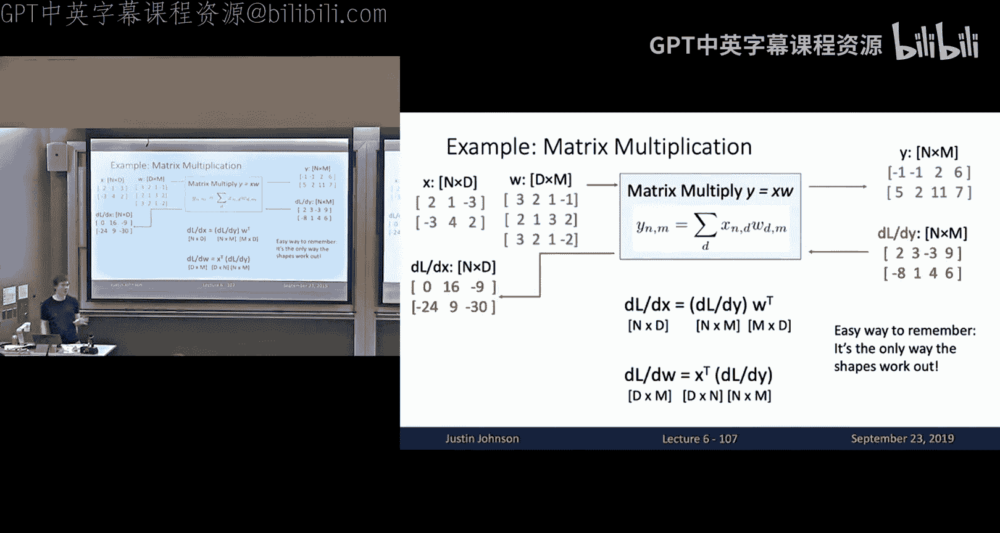

我们有这个熟悉的梯度操作。梯度是一种导数类型，适用于我们的函数以向量作为输入并产生标量作为输出的情况。那么在这种情况下，梯度`dy/dx`是一个与输入大小相同的向量，其中梯度向量的每个元素表示，如果输入的相应元素改变一点点，输出会改变多少。所以它是这些经典单值导数的向量。现在推广到输入向量并输出可能不同维度的向量的函数。这些东西都有不同的名字，但它们基本上都是相同的概念，它们都是导数。这个被称为**雅可比矩阵**。雅可比矩阵是一个矩阵，它有`n * m`个元素，如果这些是我们的输入和输出的维度。雅可比矩阵的思想是，它对于输入的每个元素和输出的每个元素，说明改变输入的一个元素如何影响输出的那个元素。因为我们有n个输入元素和m个输出元素，我们需要`n * m`个标量值来表示输入对所有输出的所有可能影响。

好的，那么现在假设我们有相同的图景，我们知道我们真的不需要整体思考图。我们只需要一次思考一个节点的反向传播如何工作。那么在向量值的情况下进行反向传播意味着什么呢？再次放大一个节点。

现在我们的函数f输入两个向量值：X现在是维度为`dx`的向量，Y现在是具有`dy`个元素的向量，我们产生一个具有`dz`个元素的向量输出Z。这是我们的前向传播，事情很容易。最终我们将从上游接收这个梯度。现在这个上游梯度。在向量值的情况下，重要的是要记住，我们计算的损失始终是一个标量，无论我们处理的是向量、张量还是其他什么，我们在图末端计算的最终损失始终是一个标量。现在我们接收的这个上游梯度将是损失相对于我们输出的梯度。所以这将告诉我们，对于来自该节点的每个输出，如果我们稍微改变这些输出中的每一个，它们将如何影响图右侧、我们计算最末端的损失？

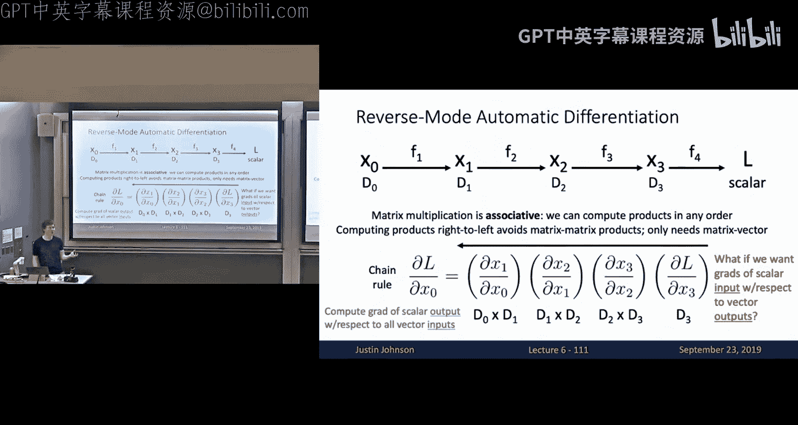

现在，这种情况下的局部梯度变成了这些雅可比矩阵，因为现在我们的函数是一个向量值函数，它接受两个向量作为输入，产生一个向量作为输出。所以现在我们的局部导数变成了这些雅可比矩阵，它们再次告诉我们，对于该节点的每个输出元素，改变该节点的每个输入元素会如何影响它。

现在在反向传播期间，我们想要产生的下游梯度始终是损失相对于输入的导数。现在损失相对于向量输入的导数现在将再次是一个与输入大小相同的向量。所以我们为x产生的下游梯度将是`dL/dx`，这是一个与X大小相同的向量。我们为y产生的下游梯度将是`dL/dy`，这是一个与y大小相同的向量。现在为了实际产生这些下游梯度，我们知道我们需要将局部梯度和上游梯度相乘。但现在我们处理的是向量，不再是标量乘法了。现在这变成了一个矩阵向量乘积，其中局部梯度现在是这个雅可比矩阵，上游梯度是这个梯度向量。下游梯度是梯度向量，我们产生这个下游梯度的方式是在上游梯度向量和局部雅可比矩阵之间进行矩阵向量乘法，使得形状匹配。如果你对此感到困惑，我总是建议写出所有东西的形状，希望这能帮助你澄清发生了什么。

现在，作为使用向量进行反向传播的具体例子，我们可以想象一下ReLU函数的情况。对于ReLU函数，请记住它是逐元素的最大值，我们将所有低于0的值裁剪为0。给定一个示例输入向量`x = [1, -2, 3, -1]`，对这个向量应用ReLU函数会将所有负值替换为0，所以我们的输出`y`将是向量`[1, 0, 3, 0]`。现在这个向量值ReLU函数是我们图中某处嵌入的一个小计算节点。最终，我们将收到这个上游梯度，它告诉我们如果我们稍微改变来自ReLU函数的任何小输出，最终损失会改变多少。这些可以是任意值，正或负，我们不知道也不关心它们是如何计算的，它们只是由微分引擎传递给我们。

现在这个雅可比矩阵告诉我们，对于我们局部函数的每个输入，我们局部函数的每个输出如何变化？

我们可以开始注意到，这个逐元素ReLU函数的雅可比矩阵具有一些特殊的结构。因为这是一个逐元素函数，我们知道函数的第一个输出仅取决于第一个输入，第二个输出仅取决于第二个输入。特别是，第一个输入不影响第二个输出或第三个输出或第四个输出。每个输入只影响向量中相同位置的对应输出。这种结构在雅可比矩阵中看起来像什么？这意味着雅可比矩阵是对角矩阵。因为雅可比矩阵的非对角线元素告诉我们，也许输入的第i个元素如何影响输出的第j个元素，其中i和j不相等。所以对于这个逐元素函数，雅可比矩阵的所有非对角线元素都是0。现在对于对角线上的元素，这变成了这个标量值导数，它告诉我们ReLU作为输入变化的函数如何变化。那么对于正值输入，它们在对角线上有梯度1；对于负值输入，它们在对角线上有局部梯度或局部导数0。然后通过计算，它让我们为输入形成这个完整的雅可比矩阵。

现在，请记住，为了计算下游梯度，我们需要计算上游梯度向量和局部雅可比矩阵之间的这个矩阵向量乘法。你可以在线下计算这个东西，然后我们可以产生这个下游梯度向量，它将传递给向我们提供输入的其他节点。

现在我们开始意识到一些有趣的事情：在这种情况下，对于这个ReLU函数，我们看到雅可比矩阵是稀疏的，雅可比矩阵有很多零。这实际上是我们在深度学习中使用的绝大多数函数的常见情况。一般来说，我们使用的大多数局部雅可比矩阵都将非常、非常、非常稀疏。所以在实践中，我们几乎永远不会显式地形成这个雅可比矩阵，也几乎永远不会显式地执行雅可比矩阵和上游梯度之间的这个矩阵向量乘法。你可以想象，对于这个ReLU例子，为四个输入的向量形成雅可比矩阵可能没问题。但如果我们的输入是一个128个元素的小批量，每个元素都是一个4096维的向量呢？那么这个雅可比矩阵将超级、超级巨大，并且超级、超级稀疏，只有对角线非零。所以一般来说，显式地形成这些矩阵将是超级浪费的，并且显式地使用通用矩阵乘法函数执行该乘法将是超级低效的。所以实际上，反向传播中的大技巧是找到一种方法，以高效隐式的方式表达这些雅可比向量乘法。

对于ReLU的例子，这很简单，因为我们知道ReLU具有这种结构，其中对角线元素要么是1要么是0。所以这意味着对于ReLU，我们可以通过传递上游梯度或根据输入对应值的符号将上游梯度置零来裁剪它，从而计算下游梯度。你应该这样思考这个表达式：这是对这个大型稀疏局部雅可比矩阵和这个上游梯度向量进行隐式乘法的一种非常高效的实现。

清楚了吗？那么现在，这已经讨论了向量，但当然，我们需要处理秩大于1的张量，我们需要处理矩阵、三维张量、四维张量以及任意维度的东西。现在情况非常相似。要理解如何使用任意维度的矩阵或张量进行反向传播，我们有非常相似的图景：现在我们的局部函数（不小心删掉了f）输入两个值x和y，在这种情况下它们将是矩阵。x将是大小为`dx * Mx`的矩阵，y将是大小为`dy * My`的矩阵，输出也将是一个矩阵。

现在记住损失仍然是一个标量，并且损失相对于某物的所有梯度将始终是一个与该物形状相同的张量，它将告诉我们，当我们改变该张量的每个独立元素时，最终的下游损失如何变化。

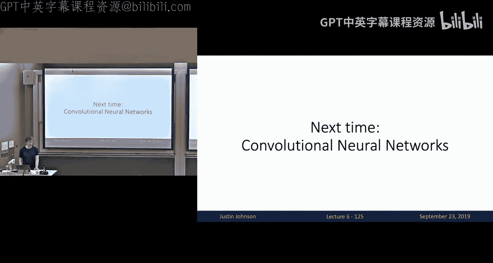

那么当我们最终收到这个