# 密歇根大学《深度学习用于计算机视觉｜Deep Learning for Computer Vision UMich EECS 498-007 2019》中英字幕 p07 -07-7_ConvolutionalNetworks.zh_en -BV1jA4m1P7GN_p7-

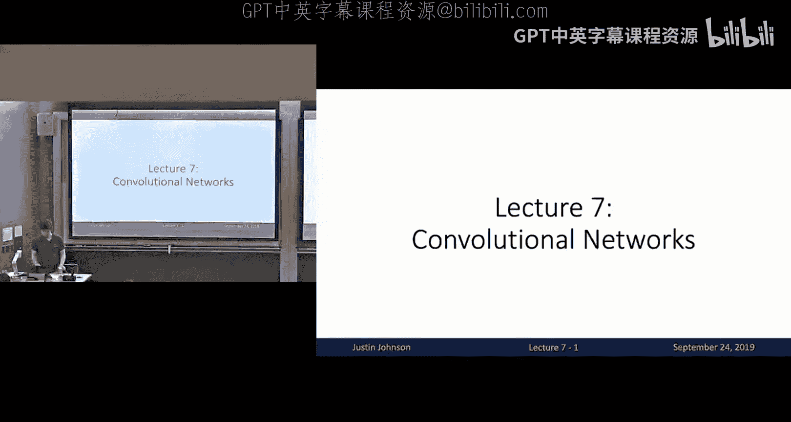

All right， welcome back to lecture7， today we're going to talk about convolutional neural networks。

 which is finally the major class of models that we'll use to process images going forward。

As usual a couple administrative notes， a reminder about assignment2 which is due Monday。

 September 30th， which is next Monday at midnight and hopefully you guys have gotten a start at that and as another reminder for those of you who enrolled late we're just going to ask you that you submit assignment to on time I think that that is reasonable given the times that everyone was able to enroll and the other reminder is that we have this validation script for you and you need to run this validation script on your homework to make sure that you have the right files and they're in the right format and it's your responsibility to make sure your assignment passes the validation script we've told you this many times already so we reserve the right to not grade your assignments if they don't pass the validation script so make sure you run that and make sure that your assignments pass。

Another announcement is a slight schedule change for the rest of the quarter semester while I was working on today's lecture。

 I realized that what I had originally planned to fit in one lecture was better split into two lectures so that kind of pushed everything backwards a little bit throughout the rest of the semester and in particular that pushes the due dates for assignments four and five backwards by a week hopefully that's all right with you guys and I've already updated the schedule on the website to reflect those changes。

Now on today's content， so if you'll recall at the last lecture we were talking about the back propagation algorithm which we could use to compute gradients in arbitrarily complex computational graphs in particular。

 we saw that the use of this computational graph data structure made it very easy to compute gradients without having to use tons and tons of paper or lots of whiteboard space or something to derive these complex expressions instead we were able to compute gradients in expressions of arbitrary complexity by using the back propagation algorithm to walk forward over the graph the forward pass to compute the outputs and then walk backward over the graph in the backward pass to compute the gradients and we had this local viewpoint of the backproagation algorithm where now in order in order to add a function or use a function inside of a computational graph we needed to implement this little tiny local operator that would know how to compute its outputs during the forward pass given the inputs and then in the backward pass would know how to compute the gradients with。

to its inputs， given the upstream gradient of the loss with respect to its outputs。

So now all we need to do in order to plug in new types of functions into our computational graphs is just have them conform to this little modular gate API that we talked about last time。

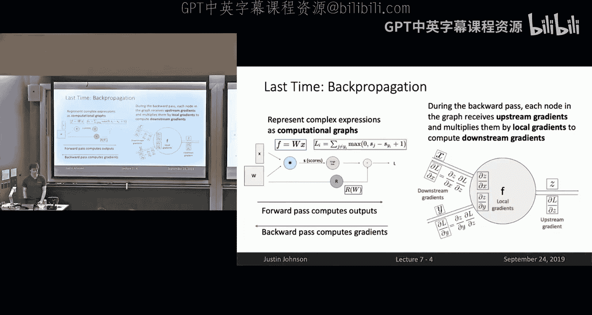

And then at the end of last time we ran into a bit of problem so so far in this class we've talked many times about the linear classifier and now we've hopefully gotten some familiarity with these fully connected neural network classifiers。

 we saw that especially the fully connected neural network classifier was a very very powerful model that could flexibly represent many different functions but both of these classifiers had a problem so far and that problem is that neither of these two classifiers respect the 2D spatial structure of our input images if you'll recall both of these classifiers required us to take our input image that has some spatial structure and has color some RGB color values at every point in space and now destroy all of that spatial structure by flattening our images into this long vector that we could feed into our linear classifiers or our fully connected networks。

And this seems like a problem if we're going to work with image data that somehow whenever you build a machine learning model。

 it's very useful to build models that somehow take advantage of the structure of the input data and now in order to take advantage of this spatial image structure of our input image data。

 the solution is relatively simple now that we've built up all this machinery around computational graphs and backproagation。

 in order to build neural networks that respect the spatial structure of our input data。

 all we need to do is define a couple new operators that know how to operate on images or on spatially structured data。

So that's what we're going to talk about today is a couple of new operators that we can introduce into our neural networks that will operate on this two dimensional spatial data。

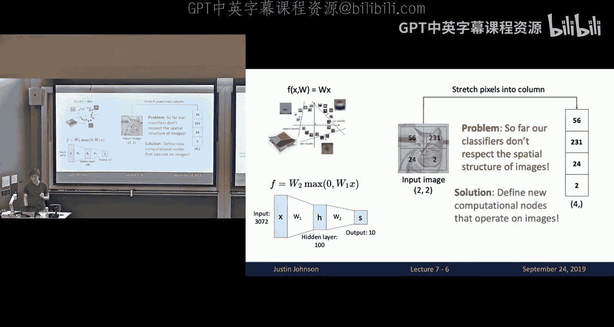

In particular， so far， when we talk about fully connected networks。

 we're very familiar with these two basic components of fully connected networks。

 we have the fully connected layer that gives the fully connected network its name。

 which is a matrix multiply between an input vector that now produces an output vector and recall the other critical component of these fully connected neural networks。

 was this nonlinearar activation function I'm showing the Raylu activation function here on the slide。

Now when we move from fully connected neural networks to convolutional neural networks。

 we need to introduce a couple extra basic operations that we can use inside the computational graphs of our models particular so then today we'll talk about three of these operations that let us move from fully connected to convolutional networks in particular we'll talk about convolution layers。

 pooling layers and normalization layers。So first， let's see how we can extend the idea of the fully connected layer。

 which as you'll recall， destroyed all of the spatial information and input and move on to the convolution layer。

 which will serve a similar role in that it will have learnable weights that will now respect the 2D spatial structure of our inputs。

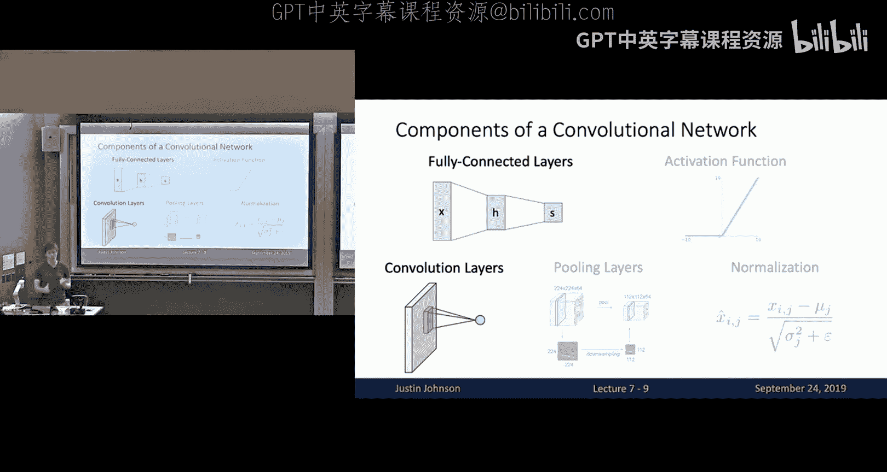

So if you'll recall for the fully connected layer， the one way to look at what it's doing is that during the forward in today's lecture and going forward。

 we're only talking about forward passes and it's sort of up to you to use the machinery from last lecture to know how to figure out how to derive gradients for all of these expressions。

 so we'll be talking exclusively about forward passes from this point on。

And now so then to recap a little bit， one way to look at the fully connected layer is that during the forward pass。

 it receives some vector。 if that vector is perhaps a flattened Cf 10 image。

 then it would be a vector of 3072 scal M elements being 32 by 32 by3 And now during the forward propagation operation of the fully connected layer。

 we just simply multiply that vector with a weight matrix to produce an output vector。

Now the convolutional layer is still going to have this flavor of operating on an input。

 operating on it with a weight matrix in some way， and then producing an output of the same general type。

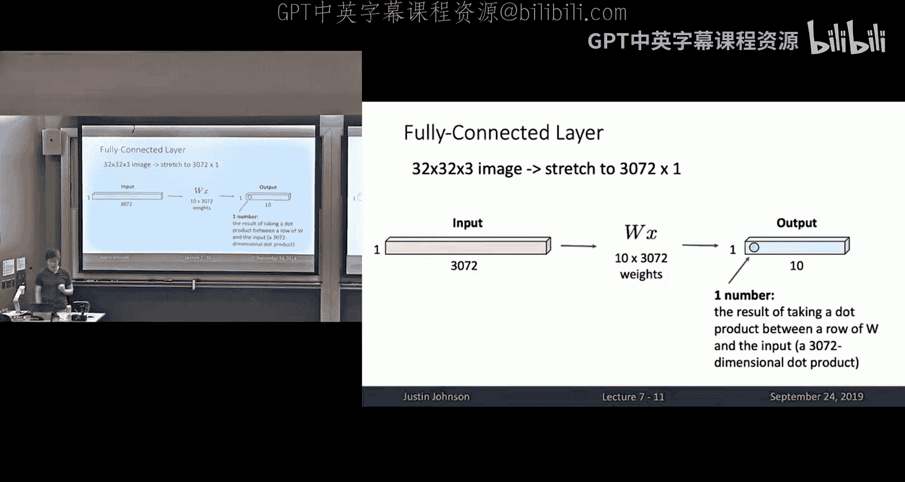

In particular， the convolution layer now will input a three dimensional tensor that is a three dimensional volume that is no longer a flattened vector so for something like a CfR 10 image。

 at the very first layer of a convolutional network that's operating on a CF 10 image that input volume would now be a three dimensional tensor of3 by 32 by 32 where that number three refer is called the channel or depth dimension of the input tensor in the case of a CfR 10 image it has three channels。

 the red blue and green color channels for the raw input image and then the 32 and the other 232s are the height and the width of this three dimensionmensal tensor。

And now just as input our input tensor has some three dimensional spatial structure where a convolution layer。

 our weight matrix will also have some kind of three dimensional spatial structure in particular。

 the weight matrix also called sometimes a filter in the terminology of a convolutional layer will be a little three dimensional chunk in one example it would be that we might have a convolutional filter of size3 by5 by5。

And here， the idea is that we're going to take this little convolutional filter。

 and we're going to slide it over all spatial positions in the input image to compute another three dimensional output。

But here first notice that there's a constraint here between the shape of the input tensor and the shape of one of these convolutional filters in particular the depth dimension the number of depth channels in the input tensor always has to match the number of depth channels in one of our convolutional filters。

 that is to say that this convolution operation always extends over the full depth of the input tensor。

 we'll see some examples of convolution operations that relax this in I think next lecture。

 but for the purpose of today you should always consider the convolution as extending over the full depth of the input tensor。

And now in order to compute our output， what we're going to do is take that little 5 by5 by3 filter and stick it somewhere inside the input image。

 and now that3 by5 by chunk of filter will then align itself to some little3 by5 by5 chunk of that input tensor。

And then once we've aligned the filter to some spatial position in the input tensor。

 then we can compute a dot product between the filter and the corresponding elements of the input tensor。

 and this is just dot product just as we've seen in fully connected networks before where but now rather than taking an inner product between a row of a matrix and the entire vector now it's an inner product between one filter and a little tiny locally local spatial chunk of the input tensor。

And so in this example， our three by five by five chunk of the input image would result in a dot product of 75 elements。

 and it would also be common to add a bias as with most machine learning models。

 it's very common to have a bias whenever you have a weight。

 but for purposes of clarity on the slides will often omit biases。

 but you should remember that they're usually there。

So then by positioning this filter at one position in the input and computing this inner product。

 we end up computing a single scalar number that tells us effectively how much does this position in the input tensor match up with this one filter that we've computed。

So that will give us one element of the output tensor and now we will repeat this process and take this input filter and slide it around at one of every possible position in the input tensor。

 and each one of those positions will result in a single number giving the dot product between the tensor the weight tensor and the local chunk of the input at that position。

So in this example， if we had a 32 by 32 input and a 5 by5 filter。

 if you kind of imagine how that's going to work in your head。

 it's going to result in a 28 by 28 grid of possible positions at which we could stick that filter and for each of those positions it results in a single number resulting from that dot product。

 so the result of convolving this one convolutional filter or kernel with our input tensor will be an output tensor of shape1 by 28 by 28。

But of course， it's never enough to just have one convolutional filter。 So in fact。

 a convolutional layer will always involve convolving the input image with a set or a bank of a different filters with different weight values。

So we can consider convolving now our image with a second convolutional filter shown here in green to represent that it has maybe different values of the weights。

 and by when we convolve with this second green convolutional filter。

 we perform the exact same operation， we take this3 by5 by5 convolutional filter and we slide it over all positions in the input and compute an inner product at each position and this produces a second one by 28 by 28 output plane giving all the responses of the input image to that second convolutional filter。

And of course， and these 28 by 28 output planes， we sometimes refer to as activation maps of the neural network。

 because these are somehow now two dimensional maps showing how much does each position in the input respond to each one of our convolutional filters in the layer。

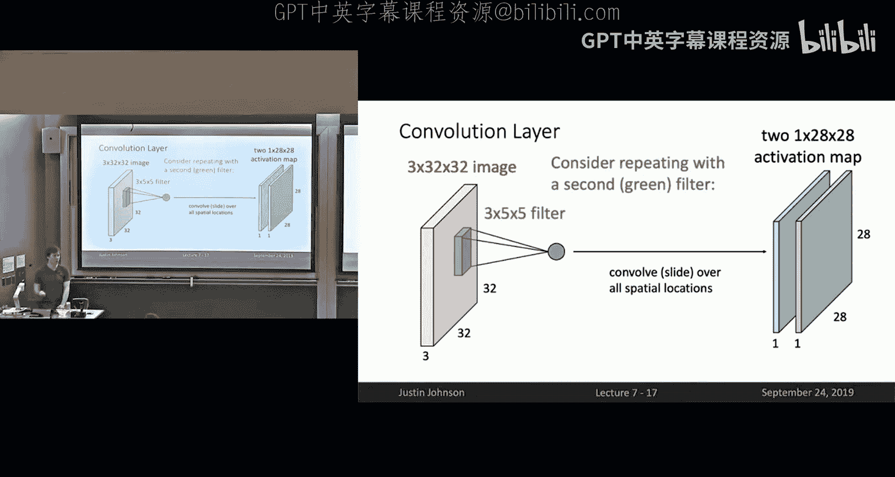

And of course we don't have to stop at two filters in general。

 we will a convolutional layer will involve convolving with some arbitrary number of filters that is a hyperparameter that you can set So in this example we're showing convolving our input tensor with six convolutional filters and now at the bottom you can see our six convolutional we have six convolutional filters。

 each of those convolutional filters has size three by5 by53 being the number of input channels from the input tensor5 by5 being the spatial size of the filter and now we can collect all six of our convolutional filters into a single four dimensionmenal tensor that now has shaped 6 by3 by 5 by5 and now but this four dimensional tensor has this particular structure this particular interpretation as being a set of a set of six threedimensal filters and then when we convolve each of those filters with the input image we get one activation map for each filter so now we can。

concatenating all of those activation maps， which are the responses of the input image to each of our six convolutional filters。

 and we can concatenate all of those activation maps into a single three dimensional tensor。

 which in this example has size 6 by 28 by 28。So now this looks just like another input image because this convolutional layer has then taken a three dimensional tensor with some depth dimension 3 and some height and width 32 by 32。

 and it's converted it into another three dimensional tensor where now maybe the height and the width have changed but the spatial structure has been preserved。

 and all of the computation inside the computational layer always now respects the local structure of the input image。

And of course I mentioned that these convolutional layers always have a bias。

 so for completeness here we're showing it explicitly now the bias。

 we always have one bias term per convolutional filter。

 so in this example with six convolutional filters。

 the bias is simply a vector of six elements that gives us a constant offset that we offset each of the feature maps in the output by each of the corresponding bias values。

And of course this can right so then the output is then a 28 by 28 grid and so far we've been there's kind of two useful equivalent ways to think about the output of a convolutional layer。

 one is this notion of activation maps that we can think of these different 2 by 28 maps or slices of the output where each of those activation maps represents the degree to which the entire input image had responded to one of those filters。

 and that's one useful way to think about the spatial structure of the output of a convolutional layer。

But a second way to think about the output of a convolutional layer is that it gives us a 28 by 28 grid which is a spatial grid that corresponds roughly to the same spatial grid of the input tensor。

 and now at each position in that spatial grid， the convolution layer computes a feature vector in this example。

 six-dimenional feature vector， which tells us something about the structure or the appearance of that input tensor at each position in the spatial grid this maybe seems kind of trivial about whether you're slicing it this way or slicing it this way。

 but depending on how you're thinking about convolution in different contexts。

 it's sometimes useful to think of it either as a collection of feature maps or as a grid of feature vectors so it's useful to have both of those concepts in mind when you think about the output of a convolutional layer。

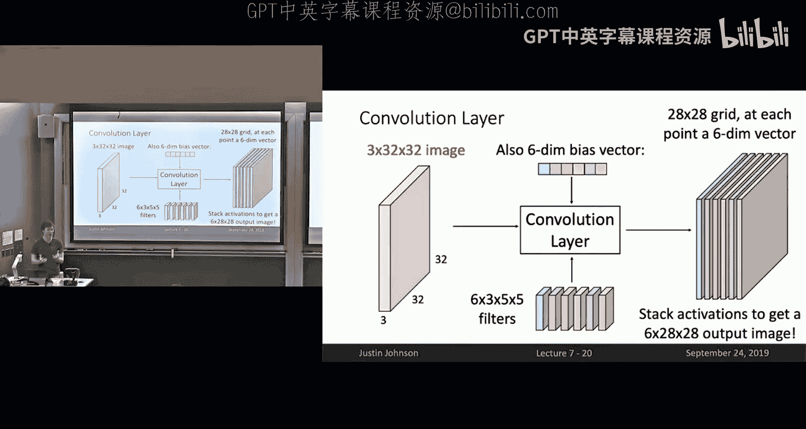

And of course we will almost it's very common when actually performing convolution in practice to perform it on batches of images so then rather than having rather than operating on just a single three dimensionmenal tensor giving us a single input image instead itll be common to operate on a batch of three- dimensional tensors and of course given a collection of three dimensional tensors。

 we can group them into a single four dimensionmenal tensor where the batch dimension at the beginning。

 it corresponds to independent images that we're processing in this convolution layer so the general form of a convolution layer looks something like this it will receive a four- dimensionmenal input a four- dimensionmenal tensor as input and that four dimensionmenal tensor as input will have shape n for the batch dimension。

 the number of elements in our mini batch by C is the number of channels in each of those input images in the batch then by it will have two spatial。

Dimenssions H and W that will give us the spatial size of each of the input elements in the batch。

And then the output will always have the same batch dimension because this convolution layer processes each element in the batch independently。

 and now the output will have a channel dimension C out and the C out channel dimension might be different than the C in channel dimension。

 and the output will of course also have some new spatial extent， H prime and W prime。

 which might be different from the spatial extent of the input image。

Is this operation of what's happening inside the convolutional layer clear？

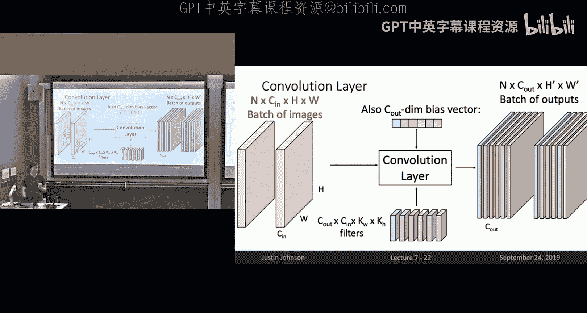

Very good。So now because this convolutional layer， it takes as input。

 a three dimensional or four- dimensional tensor and then produces a four dimensional tensor as output。

 so we can imagine stacking a whole sequence of these convolutional layers all ends to end and by doing so build up a neural network whose basic elements are now no longer fully connected layers。

 but our instead convolutional layers。So here's an example of what that might look like for a little cartoon convolutional network with three convolutional layers here we're imagining working on CfR 10 so the input image has three channel dimensions for red green and blue and 32 height and width spatial dimensions。

 then we will operate on it with our first convolutional layer that will have now the weight matrix here is six by three by5 by5。

 you should interpret that recall as a set of six convolutional filters。

 each of which has an input channel dimension of three to match the input image and each of which has a local spatial size of 5 by5 so then we will convolve each of those five by5 filters with the input to get our 28 by 28 spatially sized output and the depth channel of that output will now be six for those six filters in that first convolutional layer。

And then we can repeat the process so now we've just got another threedimensal tensor。

 we can pass it on to another convolution operation and now for this second convolution operation。

 we can see the weight matrix has shaped 10 by6 by three by three which again means that we have 10 convolutional filters each of those convolutional filters has a depth dimension of6 to match that input tensor and the spatial size of these filters is now three by three and that would produce another output and then we can imagine stacking more and more convolutions on top of each other and there's of course many and just as we use this terminology of hidden layers when we were talking about fully connected networks。

 we can use the exact same terminology with respect to these convolutional networks So here this would be a three layer convolutional network with our input in red our first hidden layer in blue and our second hidden layer in green。

But theres actually a problem with this convolutional network that I've written down on this slide。

 Can anyone spot what might be a bad thing about this particular design。Yeah。

 so what happens if we stack multiple convolution layers directly on top of each other while each convolution operation is itself a linear operator。

 So when we stack one convolution directly with another convolution。

 it actually is another convolution。 So just as you might recall from the example of a linear classifier when sorry of a fully connected network。

 if we had tried to build a fully connected network by stacking two fully connected layers directly on top of each other。

 then it had the same representational power as just a single fully connected layer and the same thing happens with convolution layers because they are also linear operators。

 So if we stack two convolutional layers directly on top of each other。

 the result is still has the same representational capacity as another convolutional layer。

 although perhaps with a different filter size or a different number of channel dimensions。

 but it's still a convolutional layer。 So then to overcome this problem。

 we use the exact same solution that we saw with a fully connected networks。

Which is that in between each of our linear convolution operations。

 we need to insert some kind of nonlinear activation function。

 So we will very commonly use the raylu activation function that operates element wise on each element of this three dimensional tensor。

 just as we did in the exact same way for our fully connected networks。Yeah， a question。

The question was， why are there five bias terms for the first convolutional layer。

 and the answer is because I have a typo on the slide。So thank you for pointing that out。Right。

 so very astute maybe I was testing you that was supposed to have six bias terms for each of the six filters in that first convolutional layer。

 Good， that hopefully means that it's been very clear what these layers are supposed to do。

So then another question you might ask is that as you recall from our study of linear class fires and fully connected neural networks。

 we always were able to somehow visually inspect the weights that were learned at the first layer of the network so we might ask the same question for a convolutional network is there some way that we can visually inspect or visually interpret what the weights at that first layer of the convolutional neural network are。

 so I think you've seen this many times now the linear class fire we had this interpretation of learning a bank of templates。

 one template per class， and then this was expanded with our fully connected neural networks that now learned set a set of templates in the first layer which were not tied to any particular class but each of the templates in the fully connected network expanded extended over the full size of the input image。

 so the fully connected network in the first layer learned this bank of templates each having the same size as the input image。

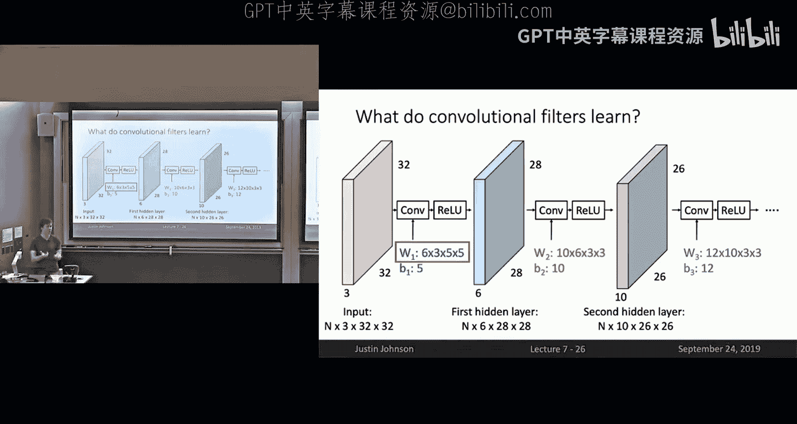

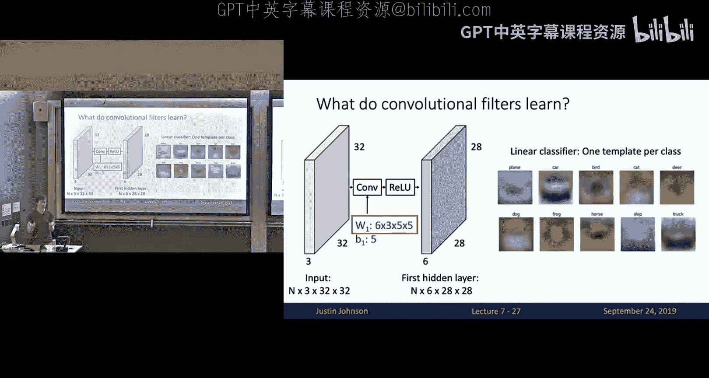

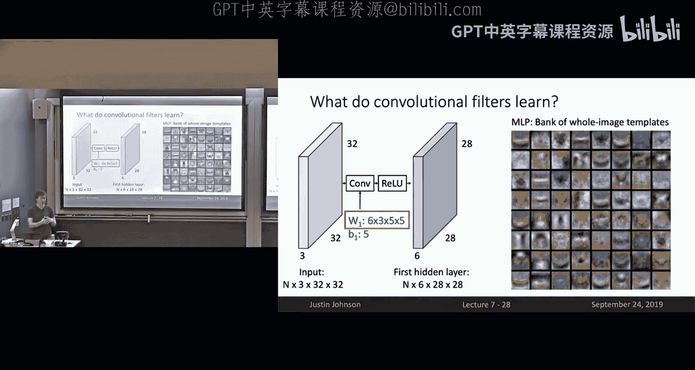

Well， the convolutional network has a very similar interpretation except that now rather than learning a set of templates that are the same size as the full input image。

 instead now it's learning a set of templates that are small and local in size so here I'm showing some learned templates from Alexnet trained on imagenet and in the first layer of Alexnet it actually has an 11 by 11 convolution that outputs with a 64 filters so then we can visualize each of those 64 filters as a little 11 by 11 RGB image and then we can get some sense for what these filters are learning and these filters from Alexnet are very typical of what you tend to expect to learn in the first layer of a convolutional network we can see that many of these filters learn something like an oriented edge detector that they learn maybe edges that detect maybe horizontal edges or vertical edges in different orientations。

And with different frequencies， so they look sort of like local edge detectors or local wavelets。

 Another thing that's very common to see in convolutional network filters is these opposing colors so we can see that some of these filters have like a green blob next to a red blob and thats somehow looking for opposing colors in a particular orientation in the image So then the interpretation of what is the feature map second after we apply this first convolution operation。

 each of the maps in each of the activation maps in that 3D output tensor gives the degree to which each position in the input image responds to each of these 64 by 64 filters or equivalently when we had this viewpoint of the output of the convolution as a grid of feature vectors then that tells us that maybe for Alexnet。

 it gives us a 64 dimensional feature vector at every position in the input image and and the elements of that。

vector corresponds to the degree to which the corresponding chunk of the input matches up with each of these templates that's learned in the first layer。

And if you'll recall back to Hube and weasel experimenting on the cat。

 they found that the cat visual system tended to respond to these local regions of edges。

 local patterns in the visual field of the cat's eyes。

 and that's kind of a similar effect that's going on with these learned convolutional filters in the first layer of a convolutional network。

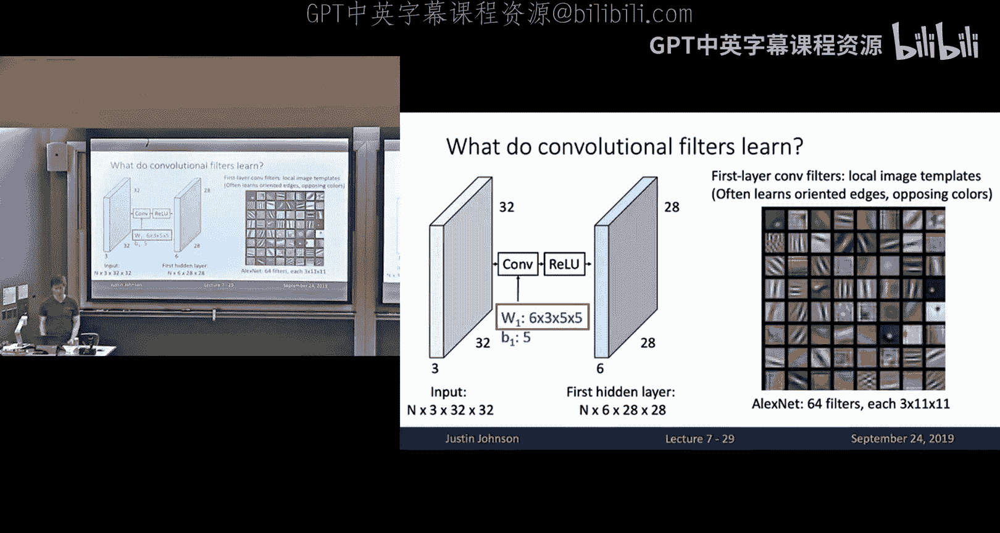

So then we can dive in and look a little bit in a little bit more detail at the exact spatial dimensions of a convolution operation。

 so here we have an input image that so now I've kind of transposed it and dropped the depth dimension so now the depth dimension is going into into the screen and I'm hiding it because that's kind of it's not relevant when you're thinking about the spatial dimensions so here we have an input image of spatial size 7 by7 and we imagine convolving with a convolutional filter of size 3 by3 so then to see what spatial size the output should be。

 we just need to count the number of spots that we can drop down that filter in this input image so we've got one。

2，345 so that means that there were five positions that we could have dropped a 3 by3 filter into a 7 by7 image which means that the spatial size of our output should will be5 by5。

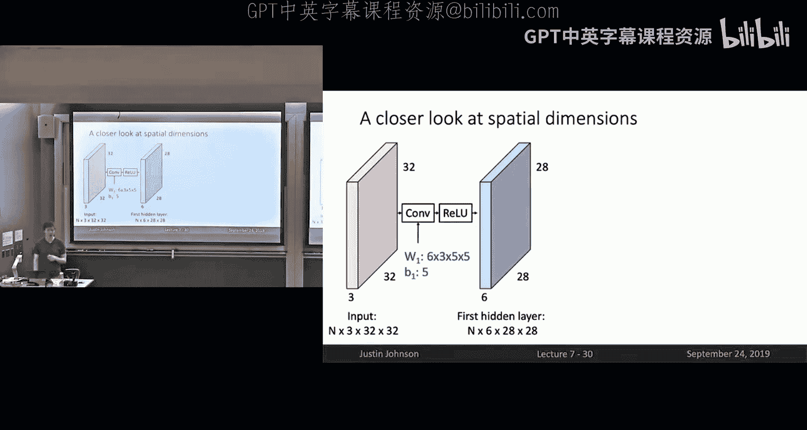

And in general， if our input has some size W and the filter has a kernel size of k。

 then the size of the output will be w minus k plus 1 the idea is that the number of positions we can drop the filter is actually less than the number of positions in the input because we bump up against the edge of the input along the edges and corners of the input image。

Now this seems like potentially a problem。 This means that every time we perform a convolution operation in this way。

 every convolution operation is going to reduce the spatial dimensions of our input tensor。

 so then that puts some constraints on the depth of the networks that we might be able to train that。

 for example， if we use of three by three convolution。

 we're going to lose two pixels of resolution every time we do a convolution which puts an upper bound on the number of layers that we could potentially put in our network because eventually the spatial the spatial size of our image。

 we just evaporate away to nothing if we use enough convolutional layers。

 and that seems like a problem we don't want the number of layers in our model to be constrained by this evaporative nature of the convolution operation。

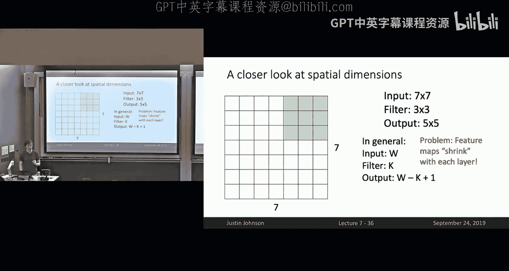

So to fix that， we often introduce padding around the borders of the image before we apply the convolution operation。

So here's an example where we're applying a padding of a padding of one。

 which means that we do before we perform the convolution operation。

 we add extra pixels around around the border of the image and fill them all with zeros this is called zero padding you might imagine there's different strategies you might use for how you might pad out the input。

 for example， you might think to maybe pull the nearest neighbor value from the border of the image or you might imagine a circular padding value or now you take as you go off the right- hand side of the image。

 maybe you start copying values over from the left or other schemes like that。

 but it turns out in practice the most common thing that we do when training convolutional neural networks for padding is simply to add zeros it's simple。

 it's easy and it seems to work quite well。So this now introduces an additional hyperparameter into a convolution layer so now when we're building a convolution layer。

 we need to choose the number of both a filter size and the number of filters in the layer and also the amount of padding that we're going to apply inside the convolutional layer and now once we've generalized our convolution layer in this way to accept padding then the output size now becomes a w minus k plus1 plus2p where p is the padding value and a very common way to set that hyperparameter P is to set it equal to the kernel size minus1 over2 that means that suppose we're doing a three by3 convolution then we pad with one if we do a 5 by5 convolution you pad with two on each side and that is called same padding because it means that when we apply the convolution。

 the output will now have the exact same spatial size as the input so even though padding is an extra hyperparameter technically that you can play around with the most common thing。

To do for padding is actually same padding。 So this just makes it easier to reason about the spatial sizes。

 because it means that the spatial size tends not to change when we perform our convolution operation。

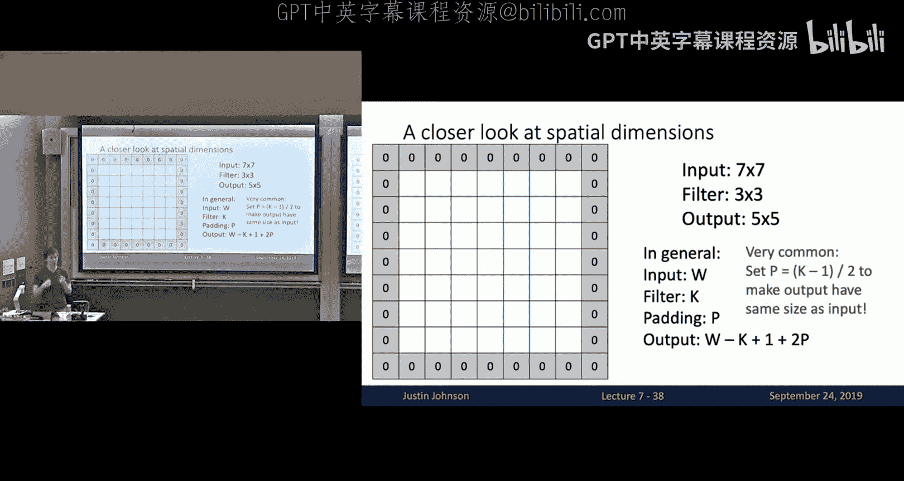

Now another thing another useful way to think about what the convolution is doing is this notion of a receptive field。

 so here we're showing an input grid showing our input image and then the output grid。

 the spatial grid of the output after performing a convolution operation and recall that we have this interpretation of the convolution as taking our convolutional filter matrix and slid and taking inner product sliding it around every position of the input what this means is that each spatial position in the output image now depends only on a local region of the input image in particular for a  three by three convolution here。

 one element of that output tensor now only depends on a three by three region in the input tensor and this three by three region is often called the receptive field of the convolution the receptive field of the value in the output tensor。

This is a relatively straightforward and easy thing to think about in the context of one convolution layer。

 but it's also interesting to think about what happens to these receptive fields as we start stacking convolution layers together so what we can see is that here we're showing a stack of three convolution layers and now on the very right- hand side we see that one element in the very rightmost output tensor depends on a three by three region in the second to last activation map。

 but and each of those elements in that second to last activation map in turn depends on a three by three region in the input in in the second activation map which in turn depends on a three by three region in the beginning activation map so that means that transitly this green region in the final output actually depends on a fairly large spatial region in the input in this input tensor on the far left。

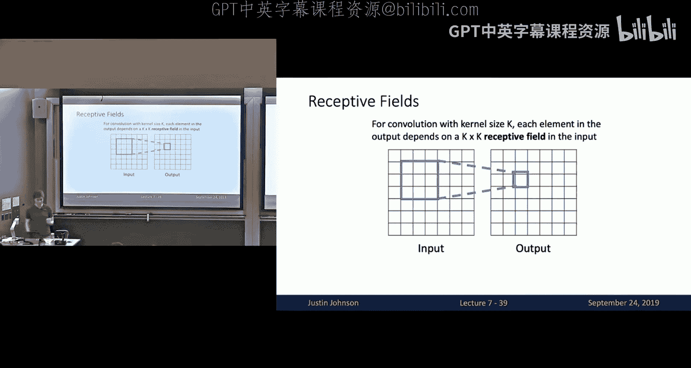

So in this example with three by three convolutions。

 you can sort of visually see that when we stack two， three by three convolutions one after another。

 then the output of those two3 by three convolutions now depends on a five by five spatial region in the original input and if we stack three convol three by three convolutions it now depends on a7 by7 region in the input featureature map。

 so then this is another then the term receptive field is sometimes overloaded a little bit to mean maybe two different things so then the receptive field of a neuron in the previous layer would be equal to the kernel size of the convolution and sometimes you'll also talk about the receptive field of an activation all the way in the original image which is the spatial size in the input image that has the potential to affect the value of that neuron after however many convolution layers and what we can see from this diagram is that as we。

Stack convolution layers on top of each other， the effective receptive fields in the input is going to grow linearly with the number of convolution layers that we add。

But now this is maybe a slight problem because suppose we want to work with very。

 very high resolution images， maybe we want to work with 1024 by 1024 images。

 now that means that in order for our the values in that output tensor to actually have the ability to see a large region in that high resolutionution input image the only way that we can do that is by stacking up a very。

 very， very large number of convolution convolutional layers so then if maybe we have a1024 by 1024 image。

 then every three by three convolution only adds two pixels to the receptive field。

 so we would need something like 500 convolutions in order to allow those final output features to depend on the full input image and having these large receptive fields in the input image maybe seems like a good idea because the neural network needs to be able to get some global context about what is the full image that it's looking at。

So then a solution to this problem is to add another hyperparameter to our convolution operation。

 Yeah， was there a question。Sure， go ahead。It doesn't seem like you're really adding any information if you zero。

好的。A layer。Studies on it and how zero had affect things？Yeah。

 the question is the zero padding doesn't seem like it's adding any information to the network。 Well。

 it's actually not meant to add any information。 it's more of a notational convenience to prevent the features from shrinking inside the network although there is actually a type of implicit way the zero padding does actually add some information to the network and that it actually breaks translation and variance So with a convolution it should be translation and variant if you imagine shifting the whole image translation equivari to be more technical that if we shift the entire image then the output should shift correspondingly but once you add a convolution layer。

 it actually gives the network the ability to kind of count out from the border that you could imagine it learns a convolutional filter that looks for that row of zeros to know where it is in the input image So actually I think that adding zero padding in this way somehow breaks the translational equivari of the convolution operation and gives。

A network， some latent or implicit ability to know exactly where it is in the input image。

 I don't know if that's a bug or feature， but I have a hunch that that's something that the zero padding actually is adding to the representational power of the network。

But but then back back to this problem。 we had this problem that in order to achieve these very large receptive fields。

 we need to stack many， many convolution layers and now we we can overcome that by adding another hyperparameter to our convolution called stride So now now we go back to our example of a 7 by7 input with a three by three convolutional filter but now we want it to have a stride of two。

 that means that rather than placing the convolutional filter at every possible position in the input image instead we're going to place it every two possible positions in the input image。

 So then the output now then our first place we can stick it is in stillill in the upper left hand corner and now we actually skip over one one potential position to place the filter because our stride is two and now we place it again So then with a stride of two we can see that there are only three position in the input where we can place the convolutional filter。

 which means that when we use a stride of two our output is now。

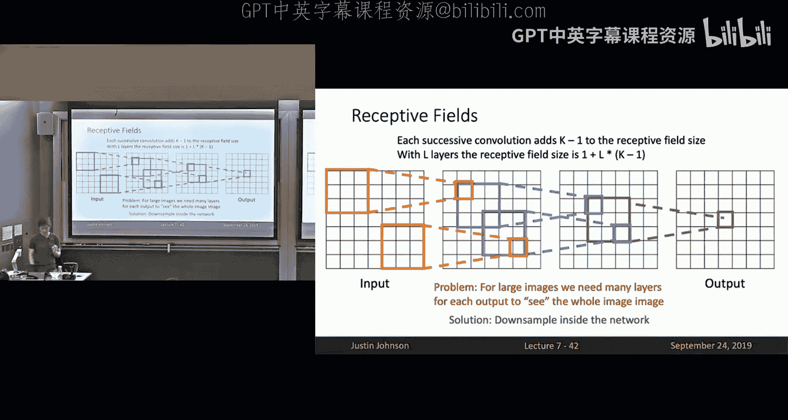

Quite a lot spatially downsampled。 And once we add stride to the network。

 that means it can build up receptive fields much more quickly because that that effectively effectively adding a layer with a stride of2 effectively doubles that receptive field at every layer in the network。

Well， rather at the layer in which we have a str of 2。

So now for a little bit of this more general formulation of how to compute the output shape or size of a convolution。

 if our input has size W， our filter has size K， our padding is P and we have a stride of s。

 then we have this expression for computing the size of the output。

 and you might ask here where you can see that the size is dividing by the stride。

 and you might wonder what happens if that integer that's not an integer that's actually divisible by the stride。

 Well that's kind of implementation dependent， but usually you just like usually you'll trunccate it or round down or round up。

 I don't know it depends on the implementation。But usually we don't do that and usually we set up our convolutional layers in such a way that the stride always divides that expression that we're dividing W minus k+2p。

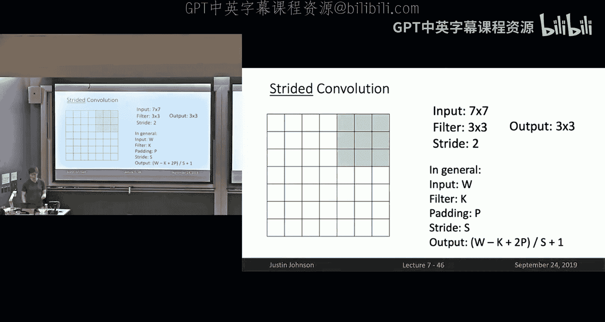

So now here' here's kind of recap all of that。 here's an example of a convolution that you might use in a Cpar 10 network with our input volume of size  three channels。

 32 by 32 spatial size， and now we might imagine a convolutional filter with 10 filters of5 by5 with stride1 and pad 2 So what given these settings for the convolutional layer。

 what should the output size of this tensor be after the convolution。Well。

 here we can apply the formula on the previous slide and it turns out that in this case。

 the spatial size is the same because we're using stride of one and same padding and the number of channel dimensions is equal to the number of filters。

 so now the output size is 10 by 32 by 32。And now as a recap。

 what would be the number of learnable parameters in this layer？Well。

 we have our we have our we have now 10 convolutional filters。

 Each of those filters has size 3 by 5 by5， and each of those filters has an associated bias。

 So that means each of the filters has 76 learnable parameters。 since we've got 10 filters。

 we've got 760 learnable parameters。And now another question。

 how many multiply ads does this convolution operation take to compute？Well， to compute this。

 you can think that the network， the output Tensor has shaped 10 by 32 by 32。

 and in order to compute each of those elements of the output。

 we need to compute an inner product between two tensors， each of shape 3 by5 by5。

 so then if you multiply all that together， you can see that this convolution operation takes quite a lot of multiply ad operations in order to compute its output。

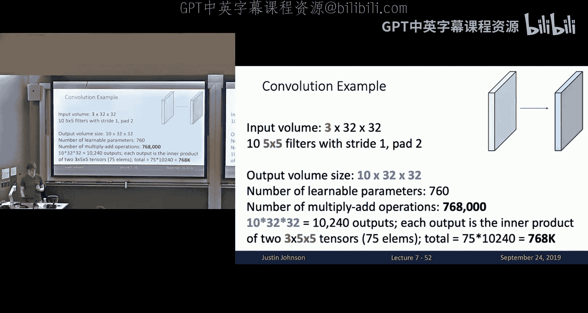

And also， by the way， this is something that sometimes trips people up。

 but one thing that's actually used sometimes is a one by one convolution where the kernel size is just one by one。

 and this seems kind of weird， but it actually makes perfect sense。

 So for a one by one convolution we might have in this case a spatial input tensor with 32 channels and 56 by 56 in the spatial dimension and now a one by one convolutional layer would have a convolutional kernel where each with 32 filters。

 each of those filters would be one by one in spatial size and6 an extent over the full 64 channels of the input depth。

And what this basically means is that we're doing independent dot。

 then remember we had this interpretation of this these three dimensional tensors as being a grid of feature vectors。

 well when you apply a one by one convolution that basically looks like a linear layer that operates independently on each of the feature vectors in our one by one grid in our in our three dimensional grid。

And because of that interpretation， sometimes you might see neural network structures where we have a one by one convolution and then a relu and another one by one convolution and another relu。

 some sequence of one by one convolutions and relus。

 and that's sometimes called a network in network structure because it's effectively a fully connected neural network that operates independently on each of the feature vectors that appear at every position in space。

 So this seems like kind of a weird thing to do， but actually you'll see it in practice used sometimes。

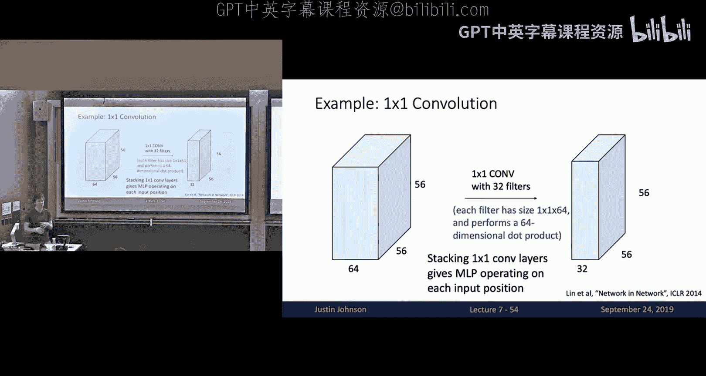

So then the recap of a convolution is that it takes this threedial input it has hyperparameters the kernel size in general you might imagine actually nons squarequare kernels that they do show up sometimes。

 but the overwhelming majority is for kernels to be square a number of filters。

 a padding and a stride we have a four dimensional weight matrix and a single bias vector and then it produces an output of three dimensional output according to this particular formula and then a couple very common settings to see with convolutions because a lot of hyperparameters here would be to set it's very common to use square filters。

 there's some applications where you might see non-s filters it's very common to use same padding to of course the output have the same size as the input and a couple very common patterns in convolution would be it'd be very common to use like a three by three stride1 convolution or or5 by5 or one by one stride one convolution you'll see these types of configurations very commonly and it's also very common to see a convolution layer with three by three kernels padding of one and a strideide of two。

That then is sort of a spatial downsampling by a factor of two using a convolution layer。

 So these are all settings that you'll see very commonly in convolution。第二。

It is better to use a one person combination than using a fully connection。What doesn。在吃饭。

The adjustment with。The question is， would it be preferable to use a one by one convolution instead of a fully connected layer And I think those have slightly different interpretations？

 A one by one convolution has the interpretation of changing the number of channel dimensions in our three dimensionmenal tensor whereas a fully connected layer has the interpretation of flattening that whole tensor into one and then producing a vector output So that fully connected layer is for cases where you where you want to destroy the spatial structure in the input So it would be common to see that at the end of the network when you need to produce category scores whereas the one by one convolutions are very common when you need to like when you need they're often used as a kind of adapter inside of a neural network when you need to have a convolutional a three- dimensionmenal chunk of activation kind of match up with something else that expects a different input number of input channels。

 then it's very common to use a one by one convolution to kind of adapt or change the number of input channels in the tensor So they're not often used in the same way。

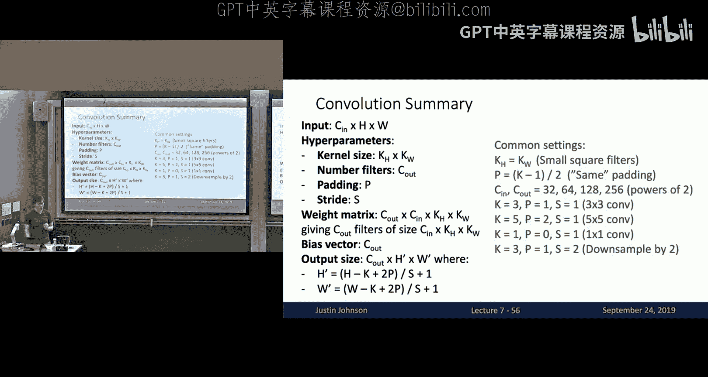

So also I should point out that so far we've talked about twodimensional convolution because we had the notion of this convolutional kernel we had a three dimensional input and we had a convolutional kernel that we moved around at every position in that 2D space but there are other types of convolutions that you'll see used out there sometimes so you might imagine a one- dimensionsal convolution with a one dimensional convolution。

 our input would be two dimensional the input would then be a number of channel a channel dimension and one spatial dimension and now the weight matrix would be the weight matrix would then be three dimensional so we would have again a bank of filters so we might have C out filters and the independent each of the individual filters would be C in so extend the full depth dimension and then K would be the kernel size again so then it has the interpretation of plopping down this filter and positioning it at every position in 1D space and moving it sliding over the input and these 1D convolutions are sometimes used。

to process textual data that might occur as a sequence。

 or they also will used sometimes to process audio data。

 like if you have an audio waveform that you want to process with a convolutional network。

 you might use a one- dimensional convolution。And we can go the other way and it sometimes you'll sometimes see a three dimensional convolution so with a three dimensional convolution each element of the batch will be a four dimensional tensor so now I can't really draw four dimensional tensor on a two dimensional whiteboard but then we have this interpretation of the three dimensional tensor as a three dimensional grid where at every point in the grid we have a feature vector of size C and then the three dimensional convolution。

 the filter is then a four dimension is then a three dimensional thing that's sorry a five dimensional thing where the kernel has three spatial dimensions it extends over the full number of feature dimensions of the input vector and then we have a collection of those things so it's then a five- dimensional weight matrix and then each of those three dimensional filters gets slid at every position in 3D space over that 3D input tensor and these 3D convolutions are sometimes used in maybe to process point cloud data or other types。

3D data where your data actually lives in some native 3D space。

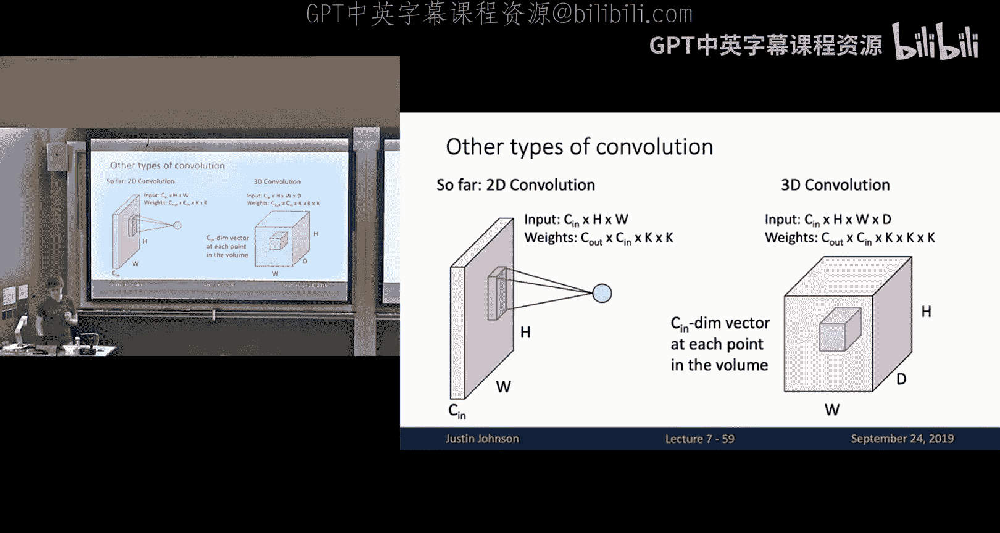

And so then we've seen that these convolution layers come with quite a lot of hyperpara to set their inputs and their outputs and their padding and their strides and whatnot。

 so if you look up， for example， thech in ptorrch， if you look up the convolution operation there。

 you'll see that you can have all these settings to change all these different settings in the convolutional layer and of course you'll find 1D and 2D convolutions as well。

So that brings us， so then we can see that convolution is this layer that has these learnable weight matrices that are somehow transforming as we go along。

 which brings us to our next layer that's a key ingredient of a convolutional network。

 which is a pooling layer。

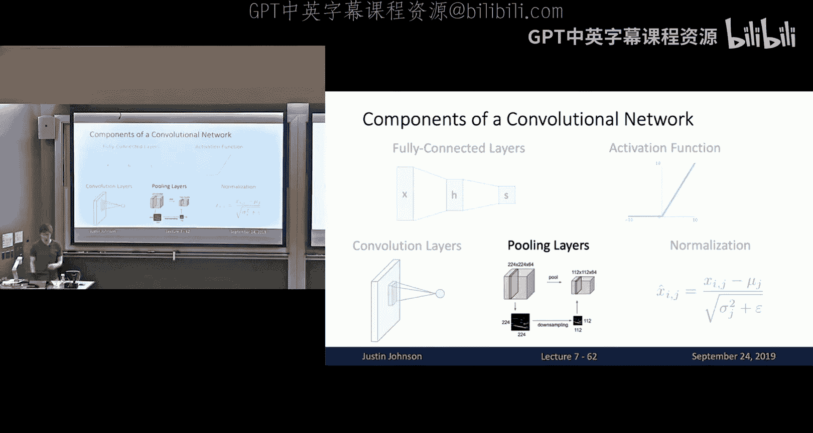

And the way that you should think about pooling layers is that they are a way to downs sampleample inside your neural network in a way that does not involve any learnable parameters。

 We have already seen that we can spatially downsample our inputs in a convolutional network by using a convolution layer with a stride greater than one Well another way to downs sampleample our data the spatial dimensions of our tensor would be instead to use a pooling a pooling layer so here it involves no learnable parameters。

 we just have hyperparameters which would be the kernel size so the way that this pooling layer is going to function is very similar to a convolutional layer where we're going to operate on we're going to imagine local receptive fields in the input tensor of some local spatial size given by the kernel size and then within each of those local regions。

 we will have some pooling function which is some way to collapse those set of input values into one output value and then we will apply this operation。

At every slice of our input tensor， that will then result in some spatially downsampled output。

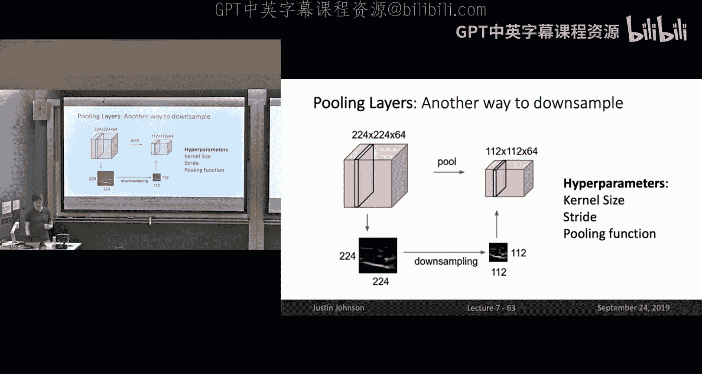

And so one very common way to set up pooling that maybe makes this more concrete would be an example of two by two max pooling with a stride of two。

 which means that which means now the stride and the kernel size mean the exact same thing as they did in convolution it means that we're going to consider carving up our input tensor into spatial regions each of size2 by two and we will those spatial regions with they'll move by two pixels each unit and when the stride and the kernel size are equal to each other。

 that means that the pooling regions will be non overlapping it's very common to use this setting of stride to kernel size2 pooling and now we use the max so then now we have this interpretation of if we have a four by four spatial input then it gets carved up into two by two regions given by the different colors here and then within each of those two by two regions。

antTo compute a single output number that summarizes the values within that two by two spatial region。

 And when we use max pooling， we use the max function to compute that one number。

 So then within that4 by four spatial region， we pick the biggest one。

 and that ends up as the corresponding bin in the output。

 So then what that means is that this red region in the input gets collapsed into this single number 6。

 because it's the largest， the green region gets collapsed into the 8 and so on so on and so forth。

And one reason why we might prefer pooling over a strideed convolution。

 one is that it's very it doesn't involve any learnable parameters。

 and a second is that it introduces some amount of invariance to translation。

 especially in the case of max pooling， so then you can imagine that because the max operation selects the largest value within each of these regions。

 that if somehow the input image would have been some of the stuff in the input image would have moved around a little bit then it's conceivable that the max value might not have changed within the region。

 even if the exact position of something in the image would have changed a little bit。

 what that means is that when we use max pooling， it introduces some amount a small amount of translational invariance to the model。

 which might be useful for different types of problems。

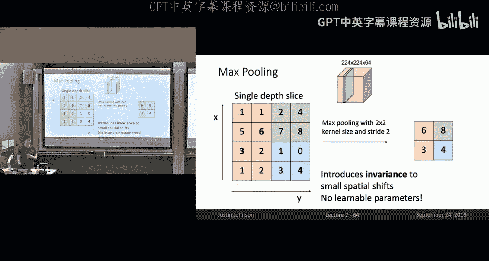

So then pooling has a very similar summary， Oh and by the way， this is max pooling。

 another thing that's very common to see would be average pooling。

 So here we're computing that output by taking the max within the region。

 it would also be common to take the average within the region。

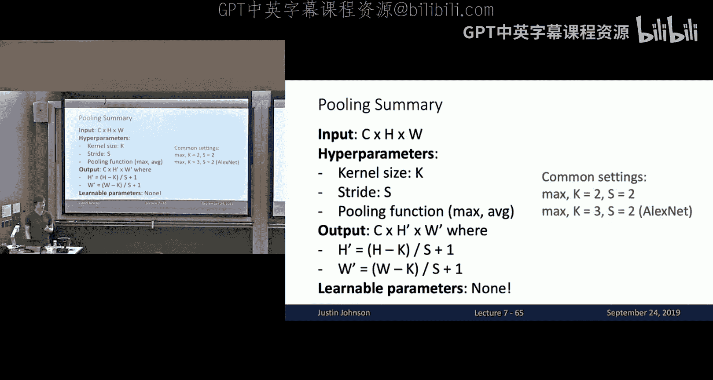

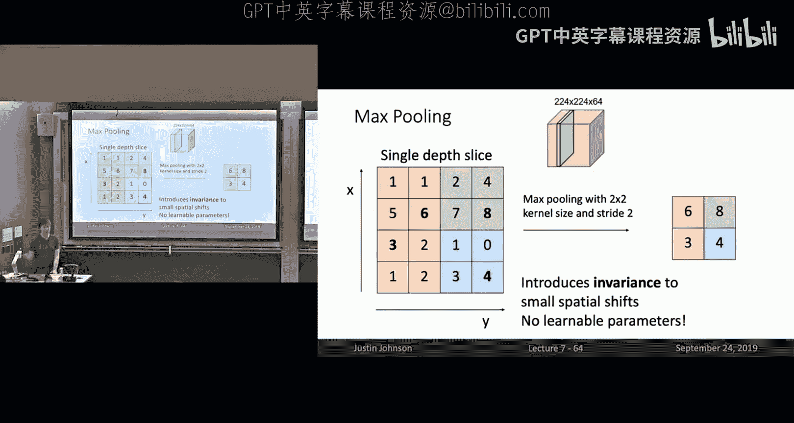

So then the summary for pooling is that it ends up looking quite similar to convolution that we have these stride and kernel size parameters。

 but now rather than taking inner products， instead we apply some kind of fixed pooling function within each of those receptive fields to compute our output values。

So now we've got fully connected layers， we've got activation functions。

 we've got convolutional layers and we've got pooling layers， and given all of these。

 we can now build a classical Comnet。 So given its now a convolutional network is some kind of neural network that is a composition or combination of all these different operations but you've got a lot of freedom in how you might choose to hook these things up right because a lot of hyperparameter。

 there's a lot of different types of layers， but now a very classical design that you'll see in a convolutional network is that we'll have some amount of conrelu pool。

 convelu pool convelu pool followed by some number of fully connected layers and that's a very。

 very classical design that you'll see in convolutional networks and it's a concrete example of that classical commnet design we can look at the Lt 5 network from that Jan Lacoun used for character recognition back in 1998。

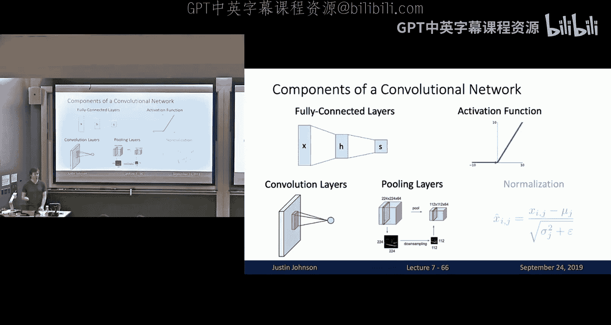

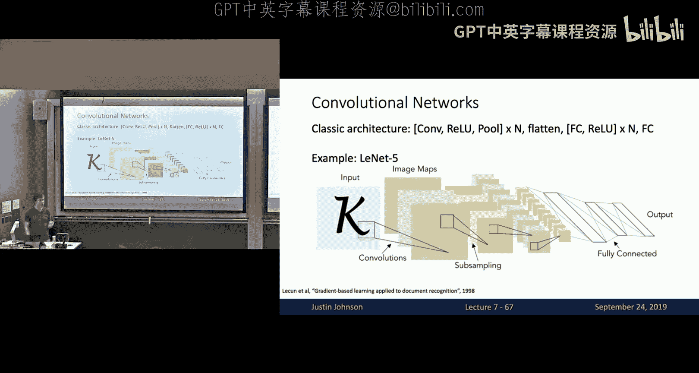

So here with the Lineette 5， it takes as input a single grayscale image that is 28 by 28 in spatial size and because it's grayscale。

 there's only one input channel which is the intensity of each pixel the first thing is a convolutional layer with 20 convolutional filters each of5 by5 spatial size and here they are not using with same padding and so then our output after the convolutional layer is then 20 by 28 by 28 and after the convolution we put a raylu it's very common to put that non nonlineararity right after a convolution layer and then the next thing would be to apply this2 by two stride to a max pooling that hals the spatial size of that tensor moving it from 2 28 by 28 down to 20 by 14 by 14。

 it then we apply another convolutional layer that now has 50 filters so now our output after that second convolutional layer and it corresponding raylu would be  filter 50。

ionsAnd 14 by 14 spatial dimensions。Then we have another max pooling that again haveals the spatial dimensions putting us down to 50 by 7 by7 and then then before we go into these fully connected layers。

 we have this flatten operation that takes this threedimensal tensor and then flattens it out into a vector like we've done in CF4R 10 for fully connected networks so that this flattens out this 50 by 7 by 7 tensor into a single vector of size 2450 then we have a fully connected layer with 500 output channels followed by another relu that converts us to a vector of size 500 yeah was there a question？

I guess I was just saying in terms of them back school。In an area。Ray。

 what pixel does it take if every single value is ever zero？Just like， cute the。yeah。

 so the question is what happens with a max pooling if max is not unique is。

 I think the question then it's kind of implementation dependent so often you'll just pick one and which one you pick will kind of depend on the implementation but it's also I think it's also not very common for that to happen in practice because I guess that's happen it might be like the entire region is zero from all relus being zero Is I think that's quite rare to actually happen in practice so even if it happens once in a while it probably shouldn't be a problem。

Yeah。我诉人。Yeah， that's a good question。 The question is max pooling introduces some kind of nonlineararity So why do we need the raylu here and I think you're right that you actually don't need the raylu here And if you actually I kind of put it in here because I think it's common to use Raylu in modern convolutional networks and everywhere。

 but if you actually look at Jan Laquun's paper， they actually didn't use any nonlinearity in those layers。

 they just use the max pooling as the nonlinearity So I think you're right。

 but in more modern networks， it's common to put the Raylu even when you do have a max pooling even if it might not be strictly necessary。

Which kind of gives you just more regularity in in your network design。And then of course。

 at the end， we have another fully connected network to produce 10 class scores because we want to do digit classification and recognize them digits zero to nine。

And one thing you can notice about this classical comenet design is that as we go through the network。

 we tend to have the spatial size decreasing either through pooling layers or through strto convolution layers and depth the depth channel。

 the number of filters is increasing， which means that as the spatial size decreases the depth increases。

 So somehow the total volume is sometimes preserved exactly。

 we're just like squeezing it down this way and stretching it out this way。

 and that's a very common paradigm to see in convolutional networks yeah。就是啊不是。

So it's classical right。we should have inspired this particular design。

 it was just a lot of trial and error。Yeah， the question is how the hell you come up with one of these things right I think is that basically the question Well。

 I think it's a lot of trial and error， but actually I think next lecture to save you that pain I'm going to talk about in detail the history of many convolutional architectures and how they've evolved over time。

So but for the purpose of today's lecture that you should just think of this as magic that Ya McCon handed to you in 1998。

 it happens to work pretty well。

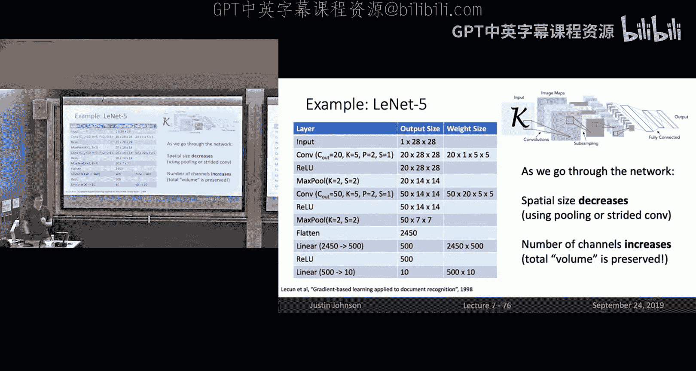

But now there's a problem with this classical design。

 we've seen that it's very common to stack up like Comm pool Relu， Kul Relu Kampul Relu。

 and you can imagine writing down networks that are arbitrarily deep and arbitrarily big and you'll be excited about your training。

 deep networks on big data and it's awesome but you'll run into a problem that if you use this very classical design of a Comnet。

 you'll find that it's very difficult to get networks to converge once they become very deep so to overcome that then this is actually a more common a more recent innovation is that we add some kind of normalization layer inside the network that makes it easier for us to train very deep networks。

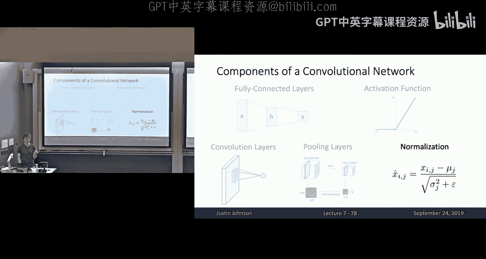

And the very most common of these is called batch normalization。

 so the idea is that we want to receive the outputs from some previous layer and we want to normalize those outputs in some way so that they have a zero mean and unit variance distribution。

😡，Why， that's a great question。If you read the original paper。

 they say that it reduces something called internal covariate shift。

 which is not well understood exactly what that is or exactly what they were trying to say。

 but the rough idea is that when you're training a deep neural network。

 each layer is looking at the outputs of the previous layer and because all these different weight matrices are training simultaneously that means that as as the weight matrix from the previous layer changes over the course of optimization。

 the distribution of outputs that the next layer will see is also going to change over the process of optimization and somehow the fact that this second layer sees a changing distribution of inputs over the process of training might be bad for optimization in some way is the very co non-rigo idea of what they mean by in internal covariate shift so then to overcome this potential problem of internal covariate shift the idea is that we want to standardize all of the layers to all fit some target distribution in particular we want to。

Force all of the outputs from every layer to have some to be distributed with zero mean and unit variance。

 as that means that the next layer consuming those activations is then hopefully seeing inputs that are from a more stationary distribution over the process of training。

 and this can hopefully stabilize or accelerate the optimization process of these deep networks in some way。

So then how exactly can we do this Well we know that we can we can given a set of samples Xk from some distribution X。

 we can normalize them by we can empirically normalize them by subtracting off the mean and dividing by the standard deviation and it turns out that computing and subtracting the mean and dividing by the standard deviation is itself a differentiable function and we know from the idea of computational graphs that when you have a differential function you can just slot it as a layer into your neural network。

 so what we will do with batch normalization is just insert a layer into the network whose purpose is to convert the inputs to have this more standardized distribution。

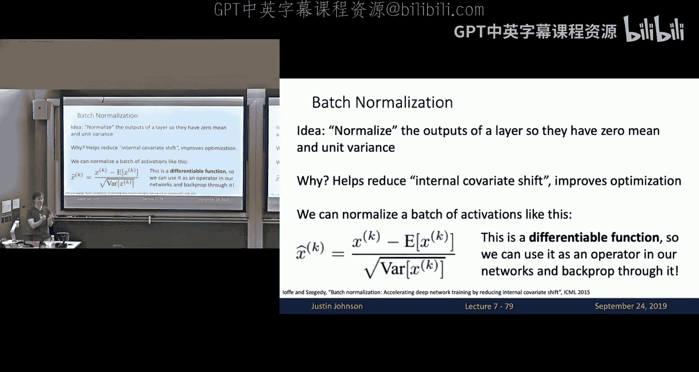

More concretely， you can imagine a fully connected version of batch normalization that will receive an input of size n for the batch dimension and size D for vector for the number of dimensions in each vector。

 so it's a batch of n vectors each of size D and now what we're going to do is along each element of the vector dimension。

 we want to compute an empirical mean over the batch dimension。

 so then we use the different samples in the batch to compute what is the average value for each slot in that vector so then we simply compute the empirical mean over the batch dimension to get this vector mu of size D。

Then given that， we can then look and remember the expression for computing the standard deviation of the variance。

 and then we know that we can compute the standard deviation in this way that will then give us the standard deviation or variance per channel for each of those D slots in our input。

 again， averaging over the batch dimension And then finally。

 we can normalize to give us zero mean unit variance by subtracting the empirical mean and dividing by the empirical standard deviation。

 Of course you'll notice that in the denominator， we have this plus epsilon term that's to avoid dividing by zero and that's a small constant that's a hyperparameter。

 but people don't usually play with too much。So now there's a slight problem that， you know。

 we said we wanted to make our inputs unit mean zero variance。

 and maybe that would be a good thing for optimization。

 but that's actually quite a stiff constraint to place on the network to force all of these layers to always have exactly fit this unit normal fit this zero mean unit variance constraint。

 So so in practice， it's common to add an additional operation after this normalization where we add learnable scale and shift parameters。

 gamma and beta into the network where each of these will now be vectors of dimension D that we will take our normalized outputs in X hat that now the X hat I have zero mean unit variance Then we'll add back in this learnable bias and multiply by this learnable。

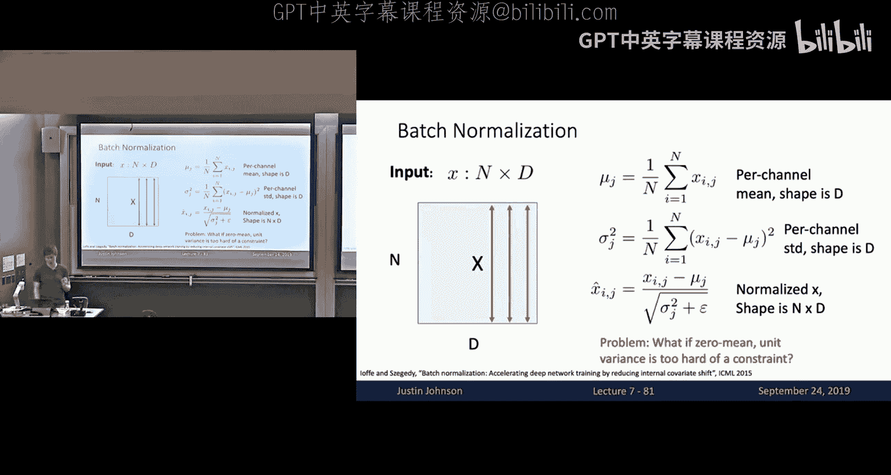

Learnable shift learnable scale parameter。 And those are basically allowing the network to learn for itself。

 What are the means and variances that it wants to see in each of those elements of the vector。

And in particular， the network now has the capacity to learn gamma equals sigma and beta equals mu。

 which will then cause the batch normalization layer to recover the identity function in expectation。

 so that's one intuition about why we want to add these learnable scale and shift parameters back into the network。

But now there is a problem here with batch normalization。

 which is the batch part right So then this mu and this sigma。

 we were computing by averaging over the batch dimension of our input tensors。 And that's a very。

 very weird thing to do。 That's something we have not seen so far in any operation that we've talked about in neural networks thus far。

 So far， whenever we've had a batch of inputs， all of our operations always were acting independently on every element of the batch。

 What that meant is that we could stuff， whatever we wanted into a batch and it wouldn't like having a picture of a cat in the same batch as a picture of a dog would not cause them to have different classification scores。

 And now once we have batch normalization， that's no longer the case。

 that now the outputs that you produce for each element in the in the batch。

 Now depend on every other element in the batch。And that is a very bad property to have at test time。

 because suppose maybe you're running a web service and you want to like compute like what users are uploading at every point in time。

 then it would be really bad if you had a network whose predictions now depended on what different users happen to be uploading at the same time。

 that would be a very bad property to have in a machine learning model that you're building。

So any kind of test time setting， it's always preferable to have your models again become independent over the elements in the batch。

 so we need to find some so in batch normalization we do that by having the layer actually operate differently during training and during testing so during training the batch normalization layer is going to take these empirical means and standard deviations over the batch of the data that it sees。

 but during testing it will not compute it will not compute empirically over the batch instead over the course of training we will keep track of some running exponential mean of all of those new vectors and sigma vectors that we had seen during training and then that will become now a fixed scalar that is kind of like the average mu and the average sigma that had been seen over the course of training and those are now constants。

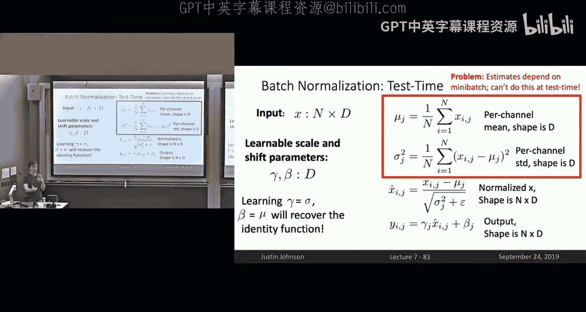

So then at test time， rather than using the empirical means over the batch。

 instead we will use those constant new ensigmas， which are the average means and standard deviations over the course of training。

 and in doing that， it will allow us to again recover this independence among elements in the batch at test time。

 which is a very good property。And there's actually another a really nice property of these using these empirical rather using these running means and variances at test time。

 and that's that if now mu and sigma are actually constants then this batch normalization operation becomes a linear operation if you look that now we have our excise we're subtracting a constant and we're dividing by a constant and then for the normalization step and then for the scale and shift step。

 we're multiplying by a learned weight and we're shifting by a learned weight so then a test time。

 the batch normalization operator becomes a linear operator which means that if we put if if in our convolutional network。

 we had a design that had convolution followed by batch normalization。

 then we know that two linear operator can be fused into one linear operator。

 so then actually what's very common to do in practice is to actually perform that fusion at inference time and then。

fuse these， these empirical these running means， running standard deviations and learned scale and shift parameters and actually fuse them into the previous convolution operator in the network。

 What that means is that now batch normalization becomes free at test time。

 It then has zero computational overhead at test time。

 because we can just fuse it at test time into the previous linear operator。

 So it's a very nice thing about batch normalization that makes it very nice in practice。😊。

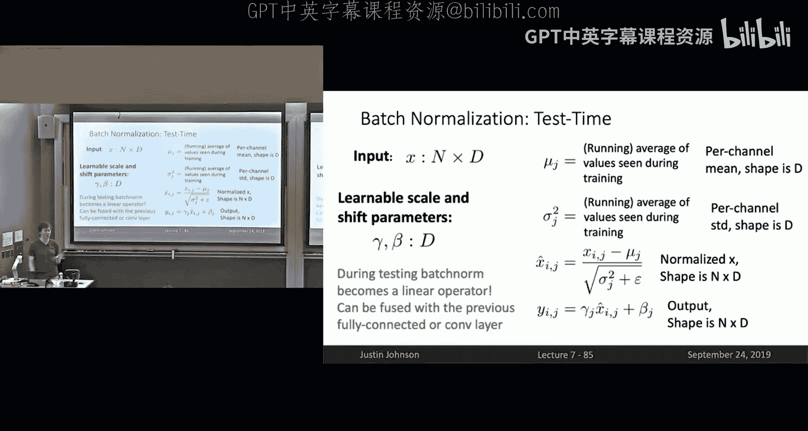

So then we've seen batch normalization in the context of fully connected networks。

 it's also very common to use batch normalization in convolutional networks to see how that works in the context of convolutional networks。

 in the context of fully connected networks， were aaging we have this input X of size n by D。

 and then we were averaging over the batch dimension to produce these empirical means of size 1 by D and then we scale and shift to produce the output now for convolutional networks。

 it looks very much the same except now rather than averaging only over the batch dimension。

 we will average over the batch dimension as well as over both the spatial dimensions of the input。

 which means that now mean and standard deviation will be vectors of size C。

 our scale and shift learned scale and shifts will also be vectors of size C。

 and then we can compute these outputs using this broadcast functionality that you're familiar with in ptorch by now。

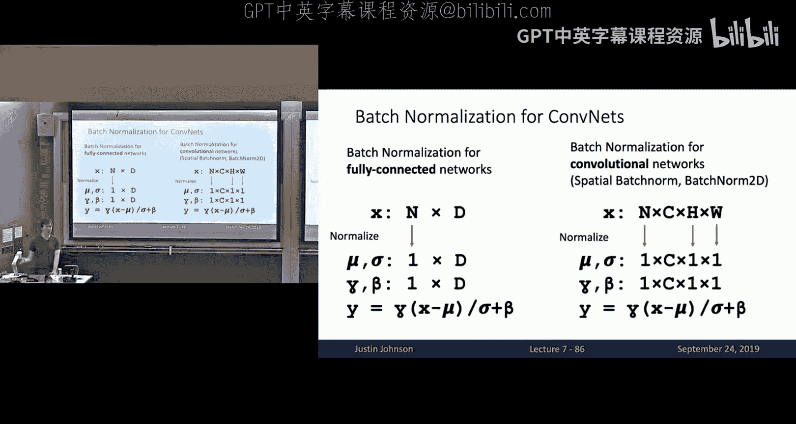

So then it's very common to add batch normalization in your networks directly after a convolutional or a fully connected layer。

And what's very nice， empirically about batch normalization is that it makes your networks train a lot faster。

 So here's a plot from the paper that introduced batch normalization。

 So here the black dashed line is this baseline network that ising only convolution and pooling and these other operations with no batch normalization。

 And now the red dashed line is simply adding batch normalization after all the convolution layers and making no other changes to the training or the architecture of the network。

 And you can see that simply by throwing batch normalization into this model。

 it trains much much faster。 But another property， another nice property about batch normalization is that empirically when you are training networks that have batch normalization。

 then you can tends to increase the learning rates much。

 much higher without diverging during during training。 So then here the。this other。

 this blue solid line is then the same network with the higher learning rates during training and batch normalization。

 and you can see that by combining batchche normalization in the model and higher learning rates。

 we're able to train this deep network much， much， much faster。

 and this is actually a very robust finding that occurs across many。

 many different convolutional network architectures。

But there are some big downsides in batch normalization One is that it's really not very well understood theoretically。

 there's this kind of handwaving around internal covariate shift。

 but I think there's not really a clear understanding of exactly why it helps optimization in the way that it seems to and another problem with batch normalization is that it actually does something different between training time and test time and that seems like a problem that actually is a source of bugs in like many。

 many applications and myself personally on like multiple different research projects I've gotten bitten by this fact that batch normalization does different things during training and test time sometimes it's just like a bug in your code and you forget to flip the mode between training and test and then you're very sad or sometimes if your data is somehow imbalanced in a way that it might actually be inappropriate for your model to be forcing this normalization constraint on your data so then for maybe problems versus something like image classification with balanced image classes maybe。

it maybe or this zeromian unit variance， normalization is appropriate。

 but for other types of models where you expect very imbalanced inputs or very imbalanced data sets。

 that can actually be a big problem and I've been bitten by batch normalization multiple times。

 but for code of feed forward convolutional networks， it tend to work really， really well。

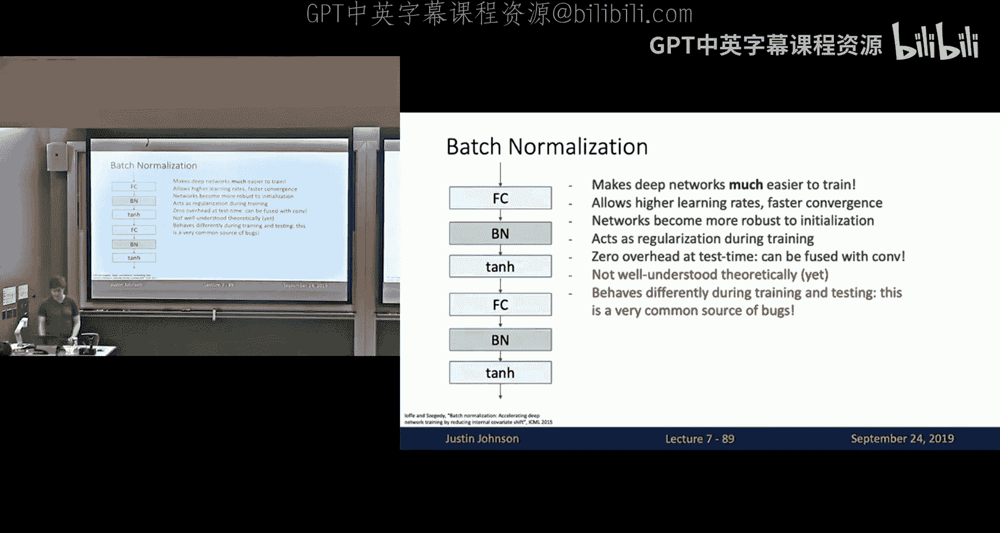

Now， one variant on batch normalization that you'll sometimes see So we said that one of the problems with batch normalization is that it behaves differently during training time and test time。

 and that's maybe bad for a lot of reasons because you want your network to do the same thing at training and testing during training。

 it was trained to do this thing And now at test time。

 if you swap out the way one of the layers functions then the rest of the model wasn't trained to operate productively with that layer in another mode。

 So in general we generally prefer layers that operate the same way at training and test time。

 So one variant of batch normalization that's been proposed that operates the same at training and test time is called layer normalization And here the idea is very similar that we're still going to compute some means and standard deviations and do this empirical normalization。

 but the difference is that rather than computing the average over the batch dimension instead we compute the average over the feature dimension D And now。

Now this normalization no longer depends on the other elements in the batch。

 so we can use the same operation at training and test time。

 and this layer normalization operator is actually used fairly commonly in recurrent neural networks and transformers that we'll talk about in later lectures。

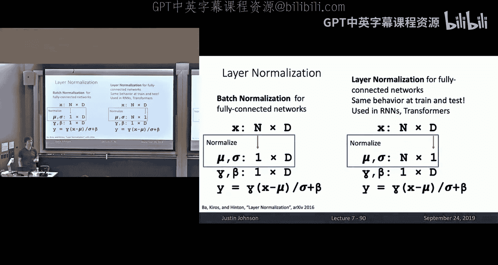

Another kind of a kind of equivalent one version of layer a kind of equivalent ish thing to layer normalization that you'll see in images is called instance normalization here。

 rather than averaging over the batch and spatial dimensions。

 we average only over the spatial dimensions and then again。

 because our means and standard deviations don't depend on the batch dimension。

 we could do the same thing at training and test time。

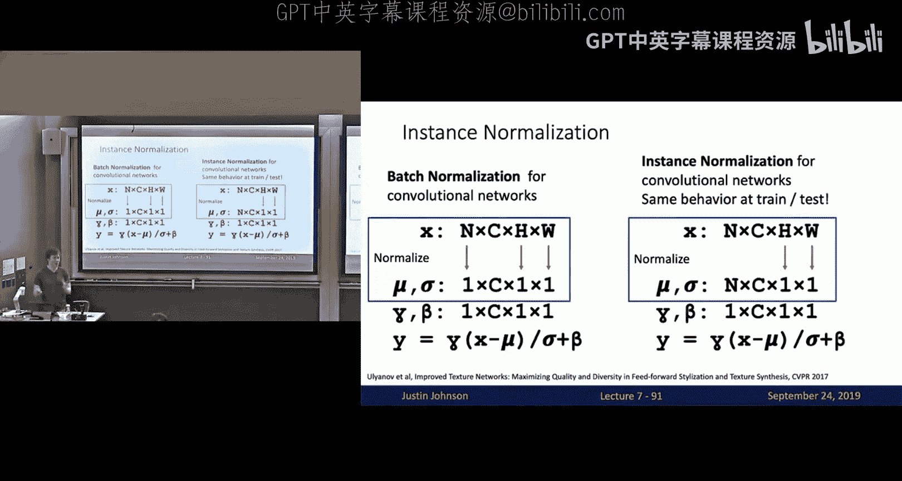

There's this beautiful figure that kind of gives us some intuition of the relationship between these different types of normalizations that if we have a tensor with a batch dimension。

 a channel dimension and some spatial dimensions， then you can see that batch normalization averages only over the batch and spatial dimensions。

 layer normalization is averaging over the spatial and channel dimensions。

 and instance normalization is averaging only over the channel dimension。

 and because there's an empty slot on the slide， you should expect that there's another type of normalization that was proposed that this paper called group normalization a couple years a year or so ago。

 and here the idea is that you split the channel dimension into some number of groups and you normalize over different subsets of the channel dimension and that actually tends to work quite well in some applications like object detection。

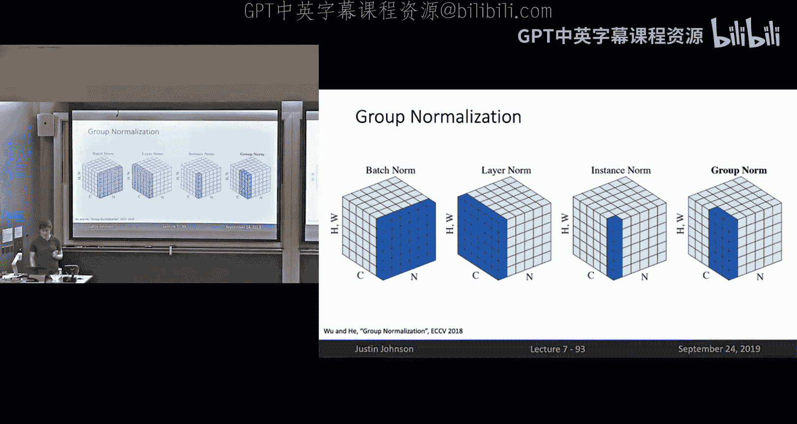

So now we've seen these different components of a convolutional network and you might be wondering。

 do you have a lot of freedom here and how you can recombine these things。

 I've kind of given you a set of ingredients that you can use to build neural network models that are aware of the 2D structure of images。

 but I haven't really told you any best principles about how actually to combine them and go about building neural networks that actually work well。

 So that will be the topic of next week's lecture。 So come back and actually learn how to build neural networks。

 I had a lot of other stuff here that we're not going be able to get to。

 maybe that'll come some other time。 So let's skip to here。

 And the problem is how do we actually build these things in a way that makes sense。

 and then we'll talk about that in next week's lecture。

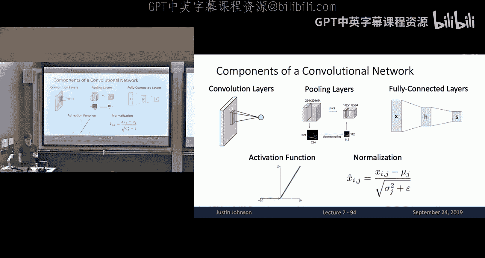

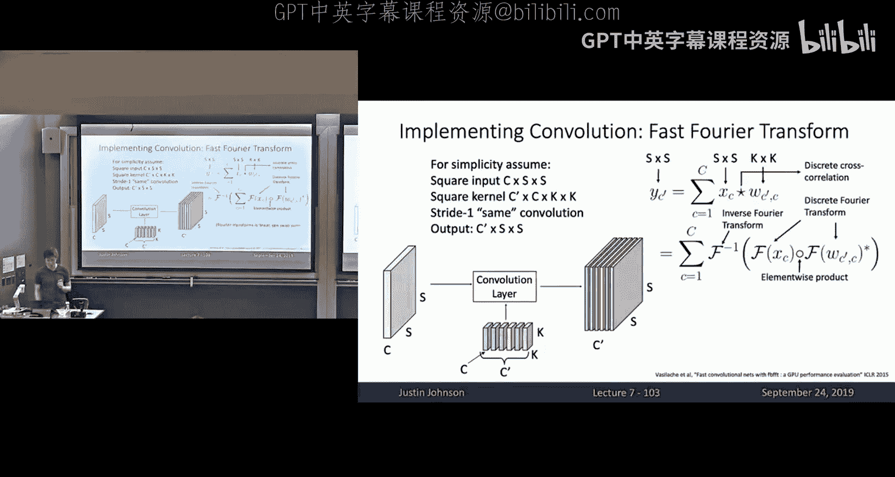

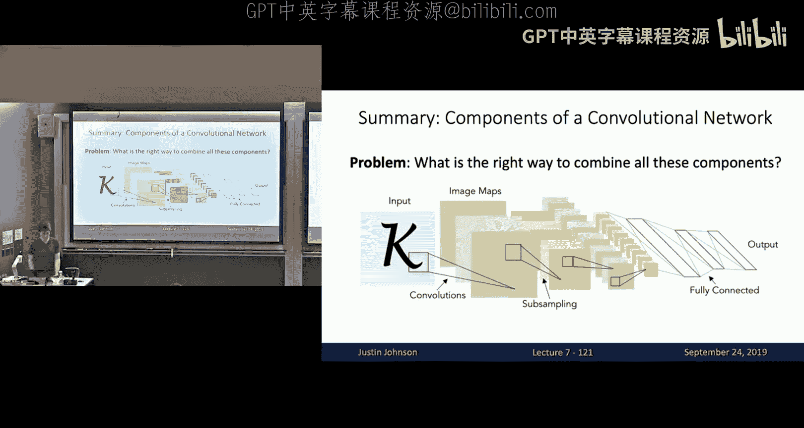