# 密歇根大学《深度学习用于计算机视觉｜Deep Learning for Computer Vision UMich EECS 498-007 2019》中英字幕 p08 -08-8_CNNArchitectures.zh_en -BV1jA4m1P7GN_p8-

Okay， welcome back to Le 8， today we're going to talk about CNN architectures。

And this is really getting into the details of convolutional neural networks。

 hopefully this will be pretty interesting。

But as usual before we get to the technical content， we have administrative notes。

 recall that assignment2 is due today， so hopefully anyone who's not done will finish that pretty soon。

 if not， I guess you have a couple late days that you can use on your assignments。

Of course now that we have assignment two do we have to have assignment3。

 we're in the putting the finishing touches on assignment3 right now that should be released probably either sometime this evening or sometime tomorrow and whenever it's released you'll have two weeks from the day of release to actually finish it assignment three will cover the modular a modular API for back propagation that we've talked about now it'll also cover fully connected networks。

 dropout， it'll cover different update rules， SGE momentum and atom， etc ce。

 it will cover convolutional networks and batch normalization and once you implement all of these things together on assignment3。

 you'll basically implement your own deep convolutional neural network from scratch and Pytorrch and train it up on CR and that should be pretty exciting。

And again， that should be released sometime today or tomorrow。

 and it will be due two weeks from the time it's released。

Any questions before we move on to the material for today？

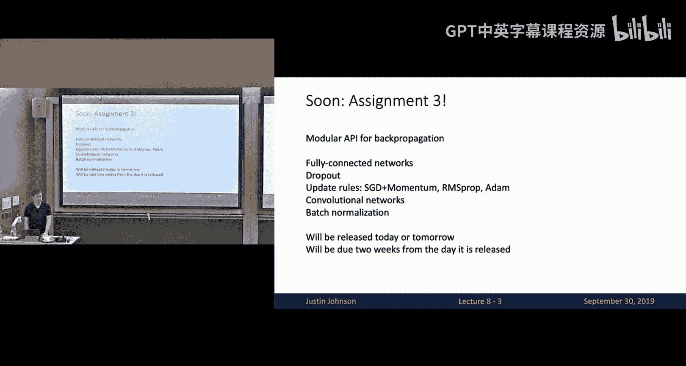

Okay， so in the last lecture we left off talking about convolutional networks in particular in the last lecture。

 we talked about these different building blocks that we can use to build up convolutional networks。

 and we saw that convolutional neural networks are just neural networks that are built up of convolution layers。

 pooling layers， fully connected layers， some activation function。

 probably relu and some normalization layer， often batch normalization。

 but we were left with a big question of how do we actually combine these basic ingredients to actually hook up and make big high- performing convolutional neural networks。

even once you've defined these operations， you have a lot of freedom in how you might choose to stick them together。

 what the hyperparameters are going to be， and just knowing these basic ingredients is far from enough to know how to actually get good performance out of convolutional neural networks。

So rather than leaving you totally in the dark， today we're going to cover a historical overview of many different types of deep convolutional neural network architectures that people have used over the past few years or so。

And a good way to ground this discussion is in the Imnet classification challenge。

 remember we talked about the Inet data set in the first two lectures that it was this very large scale data set for imageclass classification that had about 1。

2 million training images andifiers classification networks had to recognize about 1000 different categories in this 1。

2 million image data for training and IageNe was a huge benchmark for image classification because they held a yearly challenge from 2010 to 2017 where different teams would enter their best performing image classification system and everyone around the world would compete against each other to try to build the best classification system and the imageNe classification challenge really drove a lot of research and a lot of intense progress in convolutional neural network design over the past several years so I thought it would be useful to ground this discussion by stepping through and talking about some of the highest。

Performing winners in the different years of the ImageNet competition。

As we've already seen in 2010 and 2011， the first two years the competition was run。

 the winning systems were not neural network based at all。

 they were these compositions multiple layers of hand design features together with some linear classifier on top。

But in 2012， as you should probably remember by now。

 was the year that convolutional neural networks first became a huge mainstream topic in computer vision research when the AlexNe architecture just crushed all the other competition on the ImNe Chaen in 2012。

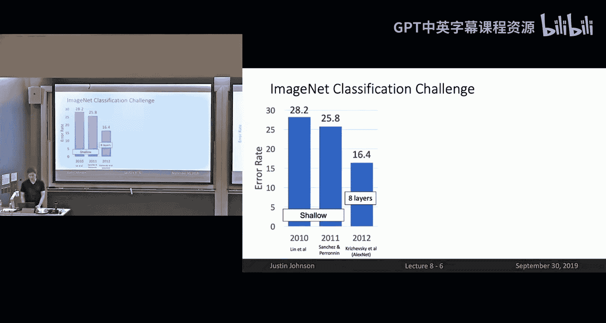

So what actually did Alex Net look like？Well， AlexNet was a deep convolutional neural network。

 by today's standards， I think it actually wouldn't be considered that deep as we'll see as we go on through the lecture。

 but AlexNet accepted 227 by 227 pixel inputs， it had five convolutional layers。

 it used max pooling throughout， and it had three fully connected layers that followed the convolutional layers and it used Raylu nonlinearities throughout。

 and in fact AlexNet was one of the first major convolutional neural networks that used Raylu nonlineararities。

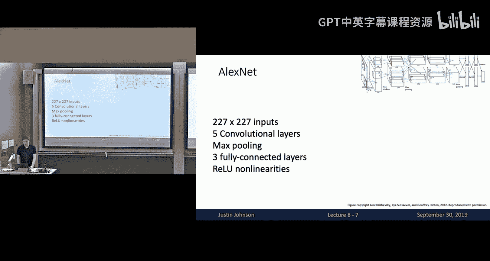

There's a couple other kind of quirks and features of the Alex set architecture that are not so much used anymore。

 one is that it had this funny layer called local response normalization。

 which has not really been used to date anymore， so we won't talk about it in detail。

 but it was a different type of normalization maybe as a very early precursor to something like batch norm。

 but nowadays we prefer use batch normalization instead。

Another pieceAnother kind of quirky bit about Alexnet is that when Alex Kchsky and his collaborators were working on this network back in 2011 and so it was trained on graphics cards。

 GPUs and the biggest GPU that they had at the time was a Gtx 580 which had only3 gigabys of memory if you look at maybe the GPUs you guys are using on coabab today。

 they have something like 12 or 16 gigs of memory So back in 2011。

 the GPUs available just didn't have very much GPU memory So in order to get this neural network to fit into GPU memory。

 it was actually distributed across two different physical Gtx 580 cards in kind of a complicated scheme where some of the network ran on one card and some of the network ran on another card and this was kind of an implementation detail that was required in order to fit this network onto the GPU hardware that was available at that time。

 this idea of splitting neural networks across GPUus is still。some used today， but in general。

 it's not a very common thing to see with most of the networks that we'll see in this lecture。

And and of course， at the top of the slide here is this very。

 very famous figure from the Alexnett paper that shows this convolutional neural network design of AlexNet。

 and you can see that it has these five convolutional layers and it's split into two chunks at the top and the bottom to fit onto the two GPUs that it was distributed against。

But one kind of funny thing about this figure is that it looks it's actually kind of clipped at the top。

 and if you look at the paper itself， even in the Alex paper itself。

 this figure was actually clipped at the top。 So even though this is one of the most even though this is a very important paper now where everyone is stuck looking at this clipped figure because that's the version of the figure that actually was published in the paper。

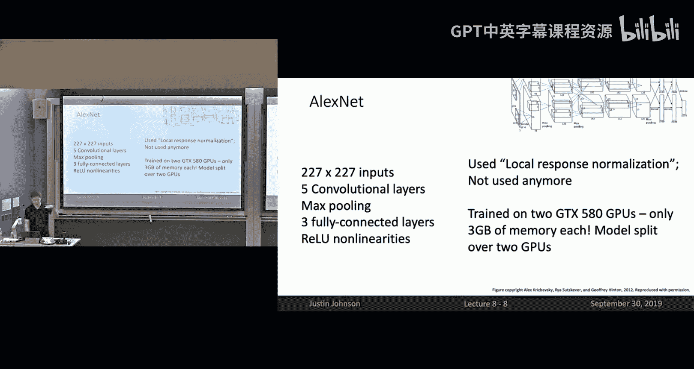

And I'd also like to point out just as a historic note。

 Alex Net I think is it's hard to overstate just how influential this paper has been if you look at the number of citations that this paper has gotten per year since it was published in 2012。

 it's already gotten something like 46，000 citations since 2012。

 and if you look at this citation trend， it seems to be still growing exponentially so this is certainly one of the most highly cited papers not just in computer science。

 but I think across all disciplines in all areas of science in the last few years。

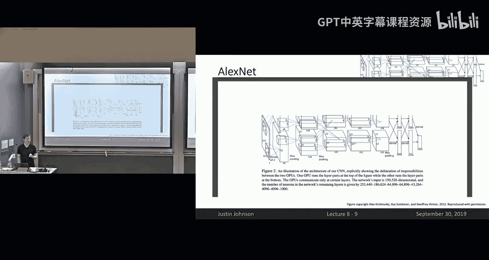

And to put this into context， I think it's also interesting to compare these citations with famous with some other famous scientific papers throughout history。

 For example， if we look at Darwin's origin of species back in 1859。

 has something like a similar number of citations as Alex Stet does today。

 or Claude Shannon's a mathematical theory of communication which invented the field of information theory had something like  has something like 69。

000 citations and it was published in 1948。

If we look at contemporary research， there was another extremely important piece of scientific research published in 2012。

 which was the experimental discovery of the Higgs boson particle at the largerge Hadron Collider。

 This was published the same year as the Alexnett paper and this is a fundamental this is a fundamentally important advance in basic science that we observe a new fundamental particle in the universe。

 and this has only 14，000 citations compared to Alex Nets 46000。

So I need to caveat here that ci looking at citation counts for papers is really kind of a very coarse measure of their impact。

 and it's really unfair to compare citation counts across time and across different disciplines。

 but that said， I I think it's pretty clear to many people that this Alexnett paper and this Alexnet architecture represents an important advance。

 not just within computer vision or computer or computer science。

 but really across all of human knowledge as a whole， hopefully that's not overstating too much。

But with that， with that historical context in mind， what actually is。

 what does the Alexnett architecture actually look like。

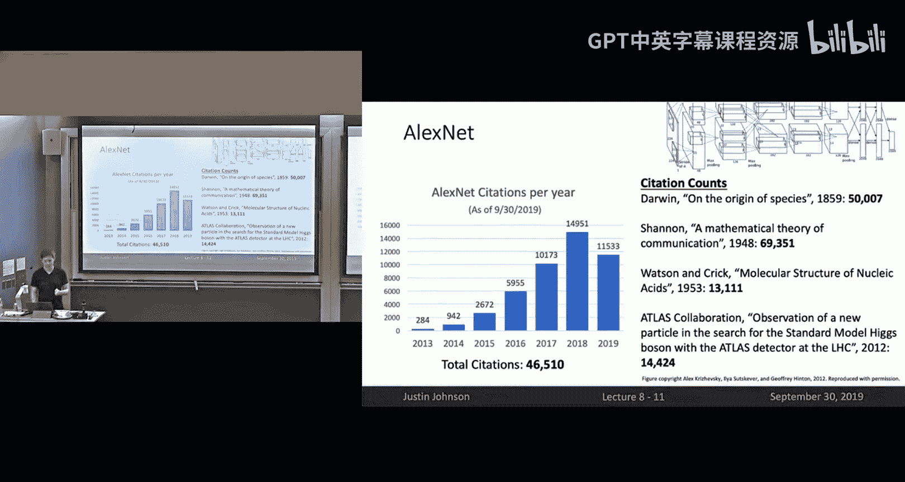

Well， this， so Alexnet starts off with an input image of 2，27 by 2。

27 pixels and it works on RGB images。 So it has three input channels。

 The first convolutional layer has， so this is by the way。

 should be a bit of recap from the convolution layer that we talked about in the previous lecture。

 But the first convolution layer in Alexnet has 64 filters， a kernel size of 11 by 11。

 a stride of 4 and a pad of 4。 So given those settings for this first convolutional layer。

 what is the number of channels in the output of that first convolutional layer。Yeah。

 it should be 64 because recall that for a convolution layer。

 the number of channels is always equal to the number of filters。

 Now the next question is what is the what is the output size here in this table I've collapsed height and width into one column because everything is square throughout this architecture。

Anyone， anyone want to take a guess at the output spatial size of this first convolution layer。Yeah。

 56。 So if you remember this formula from the slide on the last lecture。

 we know that the output size is equal to the input size。

 minus the kernel size plus two times the padding divided by the stride plus one。

 if you plug in those numbers， you see that we get 56 for the output of this first layer。Now。

 another question， how much memory would this output feature map to consume in kilobytes？

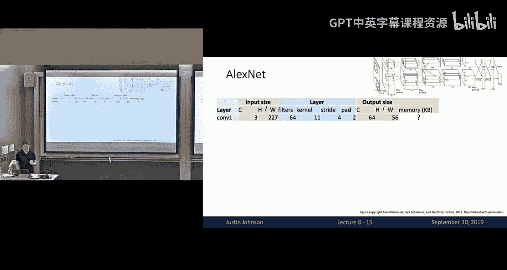

Well， I I don't know if it's reasonable to do this multiplication in your head。

 but the number of elements in that output tensor is going to be C by output size by output size。

 so the number of elements in that output tensor is something like 200000 and we typically store these elements in 32 bit floating points so each element takes four bytes of memory so multiply that by4 and divide out and you see that this layer takes about  takes about 784 kilobytes of memory to store the output of this layer。

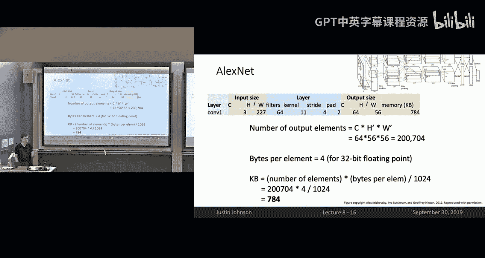

Now， the next question， many parameters how many learnable parameters are in this layer of the network？

Well for this one， we remember what is the shape of a weight for a convolutional layer and we remember that the shape of the weight for a convolutional layer is a four dimensional tensor of size output channels by input channels by kernel size by kernel size。

 so output channels is 64 input channels is  three kernel size is 11 plus there's this learnable bias which is a vector of the same number the number of output channels。

 so the total number of learnable weights here is about 23000。Next。

 how many floating point operations does it take to compute this， this convolution layer。Well， again。

 I think it's maybe tricky to this multiplication in your head。 But in order to compute this。

 so by the way， this idea of floating point operations and counting floating point operations for layers in a neural network will be in a very important topic throughout today's lecture。

 So first off， when we talk about floating point operations in a neural network。

 We usually count the number of multiply ads where a multiply together with an ad counts as one floating point operation for the purpose of counting operations in a neural network。

 This is because many， many actual bits of computing hardware can perform a floating point multiplication and an accumulation in a single clock cycle。

 So we tend to count multiply and an ad as a single operation。 Now。

 to count the number of operations that it costs to perform this convolution layer。

 We think how many output elements are there in the tensor。

 and that's see out by output size by output size。 And how many operations does it take to compute each element of that output tensor。

 Well， recall that each element of that output tensor is computed by taking the convolutional filter and。

😊。

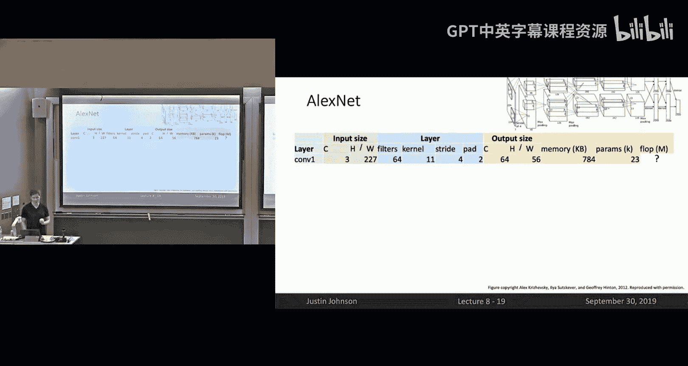

apping it inside the input dimension somewhere。 so each element of the output tensor is the result of computing an inner product between a convolutional filter。

 which has size C by K by K and another chunk of the input which has size C by K by K and a dot product taking a dot product of two vectors with n elements takes n multiplies an n adds once you count bias term So when you multiply all that out。

 you see that this first convolutional layer takes something like 73 megaflps in order to compute the convolution of this first layer。

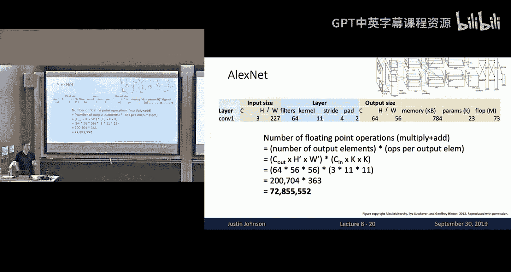

So now the second layer in AlexNenet is a pooling layer immediately following oh I mean actually there's a raylu。

 So I'm sort of omitting the raylus from many of the many of the architectures in this lecture because it's always assumed will be some raylu or some nonlinearity immediately following the convolution layer So immediately after the raylu and the first convolution。

 Alexnet has its first pooling layer。 and the pooling layer here for Alex the first pooling layer has a kernel size of three。

 a stride of two and a pad of one So given those parameters。

 what should the output shape of this first layer in Alexnet be。Well。

 the number of channel dimensions is the same because recall that pooling layers operate independently on each input channel。

 so pooling layers don't change the number of channels。

 And here this pooling layer has the effect of downsampling the input spatially by a size by a factor of two Alexnet's kind of a funny architecture and all the numbers don't actually divide evenly in Alexnet。

 which is a little bit annoying。 So here we have to actually after we divide by the stride。

 we also have to round down to get the output spatial size of 27 by 27。Then again。

 we can ask how much memory does the output of the pooling layer take。

 and we see that we have this same procedure of four bys per element multiplied by the number elements in the tensor gives us the amount of memory usage at this layer。

 Next， how many learnable parameters are in this， this pooling layer。

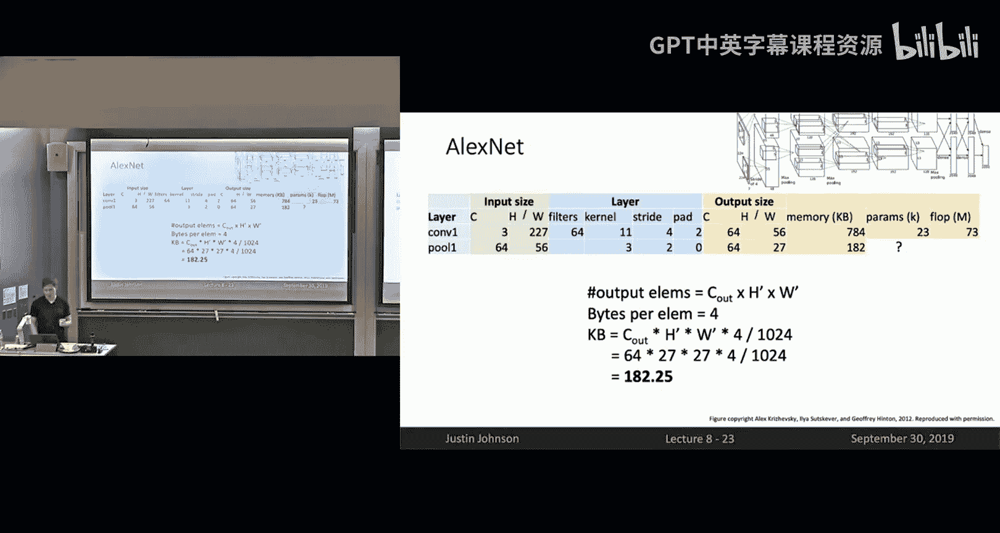

Is 0 because recall pooling layers have no learnable parameters。

 They simply take a max over their receptive field。

 Then how many floating point operations does it take to compute this pooling layer。

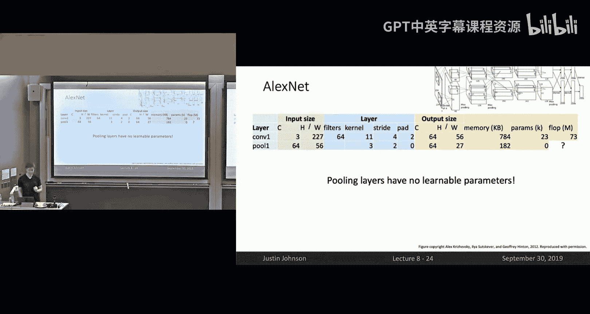

Well， here it's maybe again difficult to do the multiplication in your head。 But again。

 we have this similar way of thinking about how how many elements are in the output tensor。

 which is number of output channels by output size by output size。

 and how many floating point operations does it take to compute one element in the output tensor。

 Well， recall that each element in the output tensor is the result of taking a max over the receptive field within one channel。

 So we have to take the max of three by 3 by3 grid of elements。

 So we need to find the maximum of9 elements。 You could imagine that taking approximately 9 floating point operations。

 maybe 8， but for simplicity， we'll just say that it's equal to the kernel size squared。

 So if you multiply this out， we see that that this max pooling layer takes only about only about 0。

5 only about 0。4 megaflps which you should notice is very。

 very small compared to the convolution layer。 So this is a fairly general trend in convolutional neural networks that。

The convolution layers tends to have a lot of tends to cost a lot of compute。

 tend to take a lot of floating point operations， where the max pooling layers or other types of pooling layers generally cost very little floating point operations。

 so much so that when sometimes people write papers and count the number of operations in a neural network。

 they'll even not even count the max pooling layers just because the number of operations there is so small compared to the number of convolution layers。

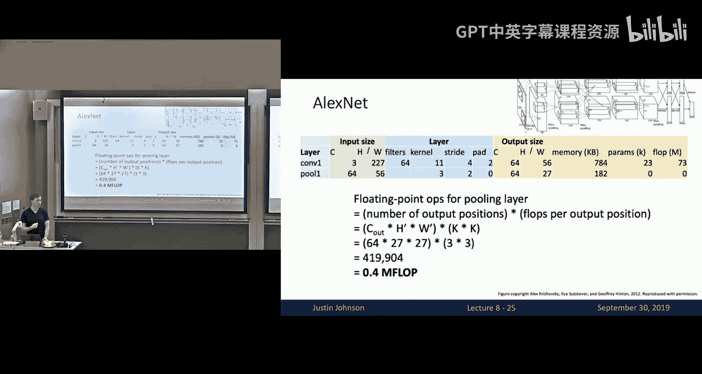

Now Alexnett has five more convolution layers， I'm not going to walk through this exact procedure for each one of those layers。

 but we can similarly compute the output size and the number of memory and parameters and flops for each one of these five convolution layers in AlexNet and interspersed with these convolution layers are several more pooling layers。

And by the time we finish with all of the convolution layers and all of the pooling layers。

 Alexnet is left with an output tensor with 256 channels and a six by six spatial size and after all of these convolution layers terminate then we have this flattening operation that flattens out all of that destroys all the spatial structure in that input tensor and just flattens it out into a vector so then this flatten layer flattens everything into a vector and it has no parameters and no flops now after this flattening operation we have our first fully connected layer with 496 hidden units。

 again we can compute the memory， the parameters and the flops for this fully connected for this first fully connected layer after the first fully connected layer。

 we've got two more fully connected layers， one more with 496 hidden units and the final FC8 layer with 1000 units to produce the 1000 scores for our 1000 categories。

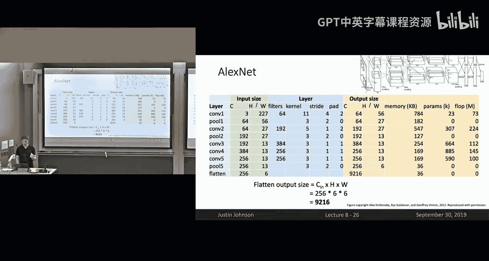

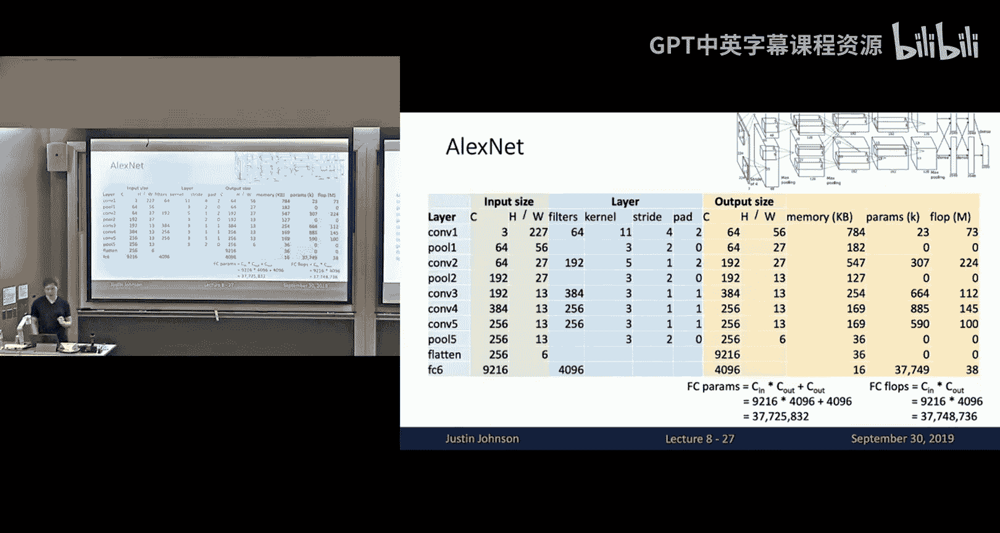

So this is the Alexnett architectureect。And the question is， like， how was this designed。

 The unfortunate reality， I think， behind Alexnett is that the exact configuration of these convolution layers was really a lot of trial and error。

 So the exact settings of these are somewhat mysterious。 But it seems to work well in practice。

 as we'll see moving forward， people wanted to try to find principles for designing neural networks that let them scale up and scale down and didn't rely so much on extensive trial and error of explicitly tuning the filter sizes and strides and everything for every individual layer。

 But for Alexnett， I think the best answer is that these settings are really trial and error。

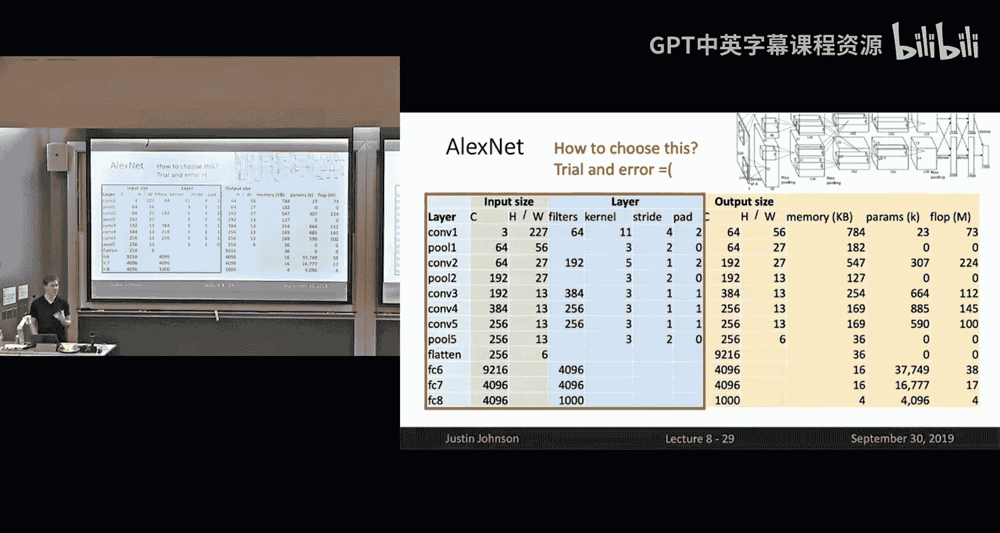

But if we look over at this at these last three columns and look at the memory。

 the parameters and the flops marching down through the network。

 then we start to see some very interesting trends that hold true not just an Alexnet。

 but also across a lot of different convolutional neural network architectures here。

 we've already pointed out one trend that see as we mentioned。

 all of the pooling layers take such little floating point operations that they all round down to zero。

 so so we can effectively discount the the pooling layers when trying to count the number of operations in a neural network。

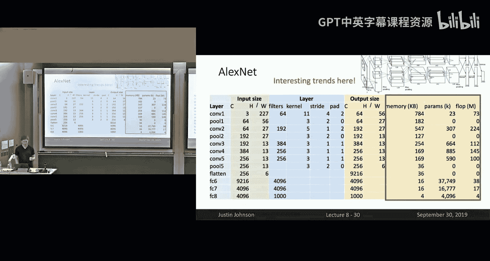

And here we we can redraw that exact same data of the amount of memory。

 the number of parameters and the number of flops for each layer of this network and convert it into some bar charts。

 So here we see a couple of very interesting trends。

 So here if we look at the chart on the left this shows the amount of memory that is used but at the outputs of the first first the five convolutional layers and at the outputs of the three fully connected layers。

 and here we see this very clear trend that the vast majority of the memory usage in Alexnet actually comes from storing the activations at the early convolutional layers。

 This happens because at those early convolutional layers the outputs are have a relatively high spatial resolution and relatively high number of filters。

 So when you multiply that out it happens that most of the memory usage happens in the very first couple of layers of the network。

Now， if we look at the middle plot， this shows the number of parameters in each layer。

 and this shows the opposite trend from compute。 This shows that for the convolutional layers have very。

 very few parameters whereas the fully connected layers actually take a very。

 very large number of parameters。 and the layer with the single largest number of parameters is that very first fully connected layer that happens after the flattening operation because if look if you think about what happens in an F C6 layer。

 we had this spatial tensor of6 by6 by what was it 6 by 6 by 256 and that gets fully connected into 4096 hidden dimensions。

 So the weight matrix is now 6 times6 times 256 times 4096。

 So that one weight matrix of F C6 has something like 37 million as almost 38 million parameters in just that one fully connected layer of the neural network。

 And in fact， basically all of the learnable parameters and。

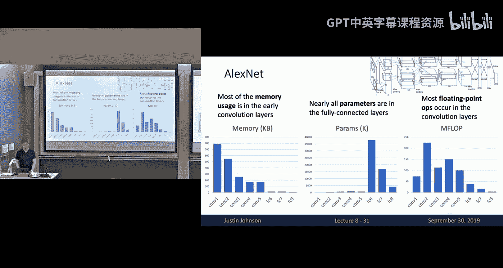

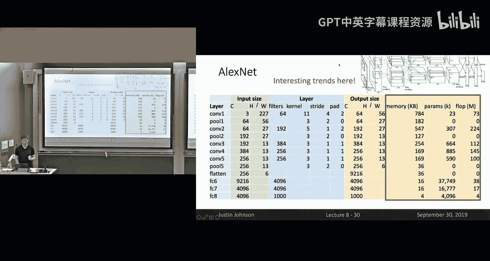

Net come from these fully connected layers。Whereas if you look at the own of computation that each layer costs。

 then you see yet another trend， which is that the fully connected layers take very little computation because they're just multiplying a very large matrix。

 whereas the vast majority of the computation in this neural network comes from all of the convolutional layers and especially layers that take a lot of computation are layers that have convolutions with large numbers of filters at high spatialial resolutions。

 and this is quite a general trend across many different neural network designs， not just alnet。

 that you'll have most of the memory usage in the early convolutional layers。

 most of the parameters in the fully connected layers and most of the computation in the convolutional layers。

So these trends are kind of interesting to keep in mind as we move on to later architectures that try to address more efficient architectures that try to fix some of these trends。

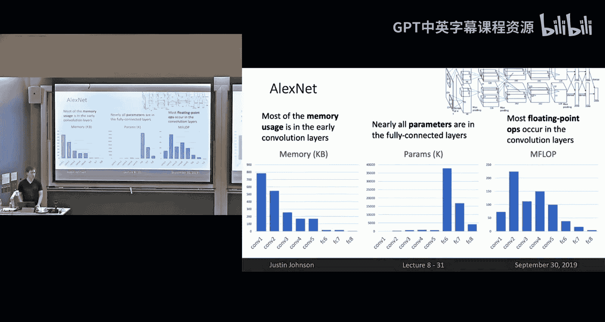

So that that's our brief overview of the Alexad architecture。 So that's what happened in 2012。

 What happened in 2013。Well， in 2013， pretty much all of the entrancetrants to this competition now switched over to using neural networks and the winner of the competition was also an eight layer network called ZFnet after the author's Matt Zler and Rob Fergus。

 Z Fnet is basically a bigger Alexnet。 I told you that Alexnet was essentially produced via trial and error。

 Well， Z Fnet is more trial and less error。 So basically in Z Fnet，s the same basic idea as Alexnet。

 except they've tweaked some of the layer configurations。 In particular。

 in the first convolutional layer。 Alexnet had 11 by 11 strideide 4。

 turns out it works better if you use 7 by 7 stride 2。 who to thunk。😊。

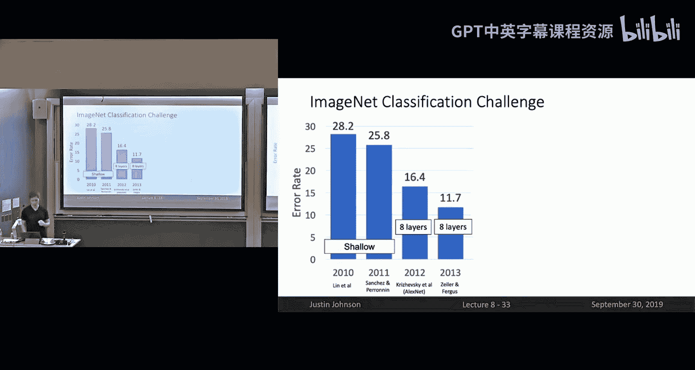

And for those later convolutional layers in convolutional layers 3，4 and 5， instead of using 384。

 384， 256 filters like an AlexNe， instead we increase the number of filters and use 5，12，10，24，5，12。

 And who knows this also tends to work better。So to be a little bit less facetious。

 I think the takeaway from ZFnett is that it makes it's just a bigger version of Alexnett。

So if you look at the first convolutional layer， when we change from stride 4 to stride2。

 that means that we are less aggressively downsampling the input in space at the very first layer。

 so that this 11 by 11 stride 4 in Alexnet will immediately spatial spatially downsampled by a factor of four whereas for Zfnet that first convolutional layer will only downsample by a factor of two。

 which means that all the other feature maps moving throughout the Zfnet will now have a higher spatial resolution and higher spatial resolution means more receptive fields means more compute so the Zfnet actually is going to cost a lot more computation than Alexnet。

 and for the later convolutional layers by increasing the number of filters this also just makes the network bigger it has more learnable parameters。

 it takes more memory， it takes more compute So I think the takeaway from Alexnet to Zfnet is that bigger networks tend to work better but at this point in time there was not really a principled mechanism for making the networks bigger or smaller at will。

 instead。They kind of had to reach into the individual layers and tune some of the individual parameters one at a time in order to make the networks bigger。

 but in doing so， they were able to achieve a fairly large increase in performance over AlexNe。

 and we saw the error rate on this imagenet challenge drop from 16。4 down to 11。7 with ZFnet。

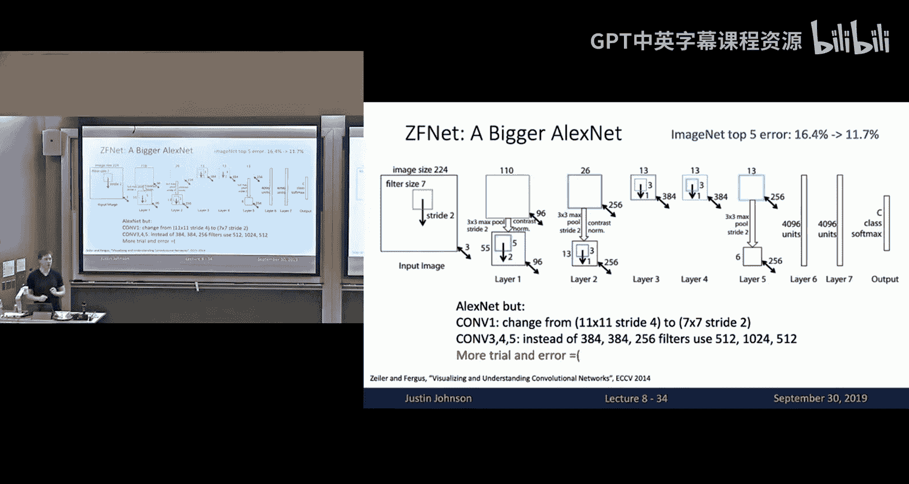

Now， 2014 was when things started to get very， very interesting。

 and 2014 brought around the so called VGG architecture from Karen Simonmonian and Andrew Zerman。

Now， VGG was really one of the first architectures to have a principled design throughout。

 So we saw that Alexnett and ZFnet were designed in somewhat of an ad hoc way that there was some number of convolution layers。

 there was some number of pooling layers。 but the exact configurations of each layer were set independently by hand through trial and error。

 And this makes it very hard to scale networks up or down。 So instead。

 as we moved into now starting in 2014， people started to move away from these handdesign bespoke convolutional architectures。

 And instead wanted to move architectures that had some design principles that were used to guide the overall configuration of the network。

And the VGG networks were particularly just followed a couple very。

 very clean and simple design principles。 The design principles of VGG were that all convolution layers are going to be three by three stride2。

 all pooling layers are going to be max pooling layers， two by two stride2。

 and every time after a max pooling layer， we're going to double the number of channels。

 and then we're going to have some number of convolution layers and eventually some fully connected layers and the number of hidden units and the fully connected layers were the same as Alexnet。

So with these simple design rules， it design it lets you not have to think so hard about the exact configuration of each layer in your neural network。

But let's think about so and also this network had five convolutional stages。

 remember that AlexNet had five convolutional layers。

 Now DGG pushed that forward and moved to deeper networks。

 where now rather than five individual convolutional layers。

 we have five stages where each stage consists of a couple convolution layers and a pooling layer。

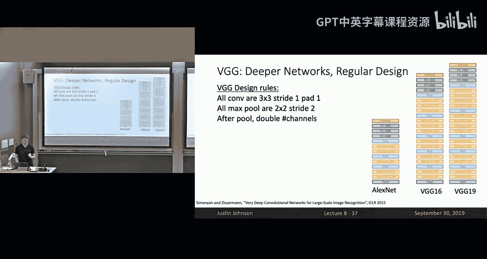

So the VGG architecture is like comecom pool， comecom pool， comecom Po。

 and for however many stages you're going to have， there were several different VGG architectures that were tested。

 but the ones that were most popular were the 16 layer and the 19 layer of VGG architectures which had always two convolutional layers in the first three stages and either three or four convolutional layers in the last two stages。

So that's pretty much all you need to know in order to know how to build a VGG network。

 but it's useful to think about why people chose these particular design principles for designing the network in this way。

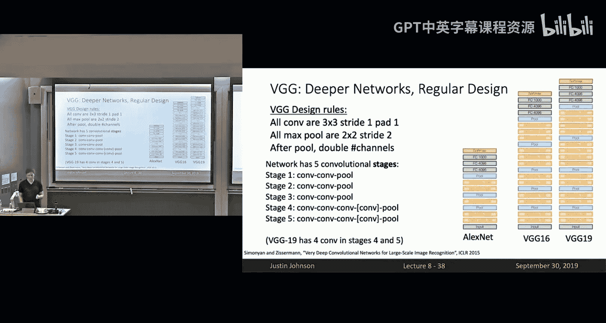

Well， first， let's think about why it makes sense to have only three by three convolutions in your network。

 So you saw in AlexNe and NZFnet that the number of the size of the convolutional kernel in each layer was a hyperparameter。

 and people played around with different convolutional kernel sizes at different layers。Well。

 let's think about two different options that we could have as alternatives for as one alternative。

 we could imagine a convolutional layer with5 by5 kernels that takes C channels of input and produces C channels of output that operates on an input of size H by W and here we can assume that we have padding of2 and stride of1 so that the output size is the same spatial size as the input。

 Well this convolutional layer would have a number the number of parameters is 25 c squared because we each we've got C convolutional filters。

 each one has5 by5 by c so it's 25 c squared learnable parameters in this layer ignoring the bias and the number of floating point operations that it costs to compute this convolutional layer is now 25 c squared Hw because the number of outputs from the layer is going to be H by W by c and the cost of computing every one of those outputs will be 5 by5。

So the overall cost of the layer is 25 C squared HW。

Now let's contrast this with a stack of two convolutional layers that each have kernel size3 by3 that also produce input that take C channels as input and produce C channels as output。

 Well， as we remember from our discussion of receptive fields in the previous lecture。

 we know that if we stack up two，3 by three convolutions。

 then it has an effective receptive field size of5 by5 So in terms of how much of the input can we see after these number of layers in terms of receptive fields。

 this5 by5 convolutional layer and this pair of three by three convolutional layers is somehow equivalent in terms of the amount of the input that they're able to see。

But but if we compute the number of parameters for these things。

 we see that each of these two convolutional layers， the number of parameters is 9 c squared。

 so the total number of parameters for the stack of 3 by3 co is 18 c squared and similarly the number of floating point operations for this stack of two convolutional layers is only 18 c squared Hw because again。

 the output is Cw and the cost of computing any one of those outputs is3 by 3 by c so each output costs 9 c and they multiply it all out。

 we've got two layers so the overall cost of the stack of 2q by3 comm is 18 c squared HW。

And now we see something interesting is that even though these two layers have the same receptive field size。

 the stack of two，3 by three convolutions has fewer learnable parameters and costs less computation。

 So the insight from the VGG network is that， well。

 maybe there's no reason to have larger filter sizes at all。

 because any time you wanted to have a5 by5 filter。

 you could have instead replace with two33 filters。

 And by a similar argument rather than a single 7 by7 filter。

 you could have replaced with a stack of of33 by3 convolution layers。 So with that in mind。

 it lets us sort of throw away the kernel size as a hyperparameter。

 And the only thing we need to worry about is how many of these 3 by three convolval layersers are were going to stack within each stage。

And。呃。

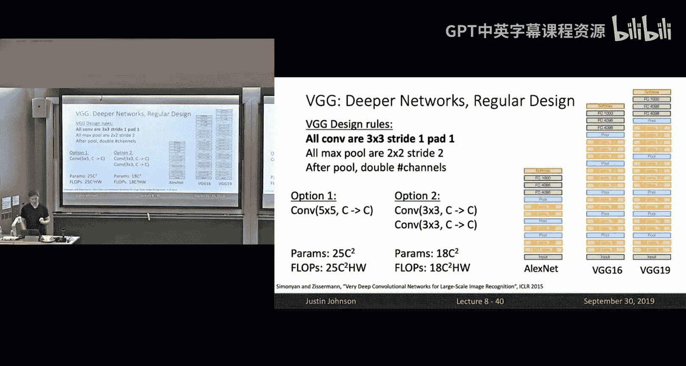

Right。So then the turning to the second design。 Oh， right。

 the other piece about this is that if we stack  two。

3 by three convolutional layers after one another， we can actually insert relus in between those two convolutional layers。

 which actually provides us more depth and more nonlinear computation compared to a single 5 by5 convolution。

 So not only is the is the stack of two3 by three convolutions has fewer parameters。

 It has fewer flops， and it allows more nonlinear computation。

 So it just seems like a clear win over a single 5 by5 convolutional layer。

 So that's the idea behind this first design rule in BG G。

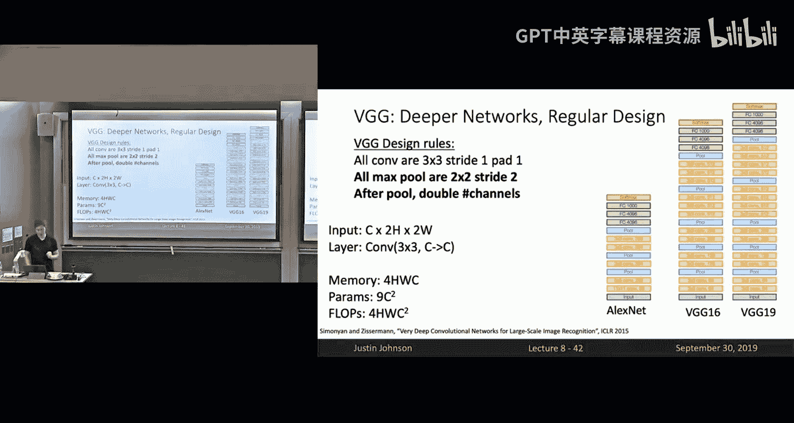

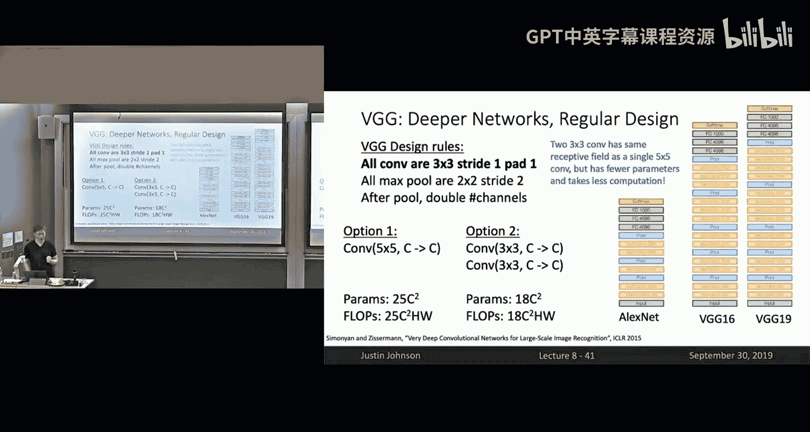

So then let's think about the second design rule in VGG。

 it says that all all of our pooling layers are going to be  two by2 max pooling stride 2 pad0。

 which means that every pooling layer is going to have the spatial resolution of the input feature map。

 and the other rule here is that every time after we pool we will double the number of channels。

 So then let's think about what happens between two stages when we follow these rules。

 So let's think about the computation at stage1， for instance。

 then one of our layers inside stage1 would have an input of size C by2 H by2 H。

 and the layer would be a3 by3 convolution with C input channels and C output channels。

 If you multiply all this out， we see that the amount of memory consumed by this output tensor is going to be4 HwC。

 the number of elements in the output tensor after this convolution。

 The number of learnable parameters is9C squared excluding the bias。

 and the number of floating point operations is 4 HwC squared using。Right。Actually。

 that's that doesn't seem right。 I think that's an error。But it's O okay。

 The the same error is propagated over here。 So the argument still holds。

So if they're both off by the same constant。 I'll fix this after after the lecture。 Now。

 after we go to the second after we move to the next stage。

 then the number of channels would be doubled and the number of spatial resolution would be halved。

 Well， when this happens， we can see that the memory is reduced by a factor of2。

 and the number of parameters increases by a factor of four。

 but the number of floating point operations stays the same。

 Now here's the error is that these two number of floating point operations。

 I think are both off by a factor of 9。 But since they're both off by a factor of9。

 it's still true that they both these these two layers in two subsequent stages still costs the same number of floating point operations。

So this design principle has actually followed along it been followed by many， many。

 many convolutional architectures following VGG。 The basic idea is that want to preserve this we want each convolutional layer to cost the same amount of floating point operations and we can do that by having the spatial size and doubling number of channels at the end of each convolutional stage。

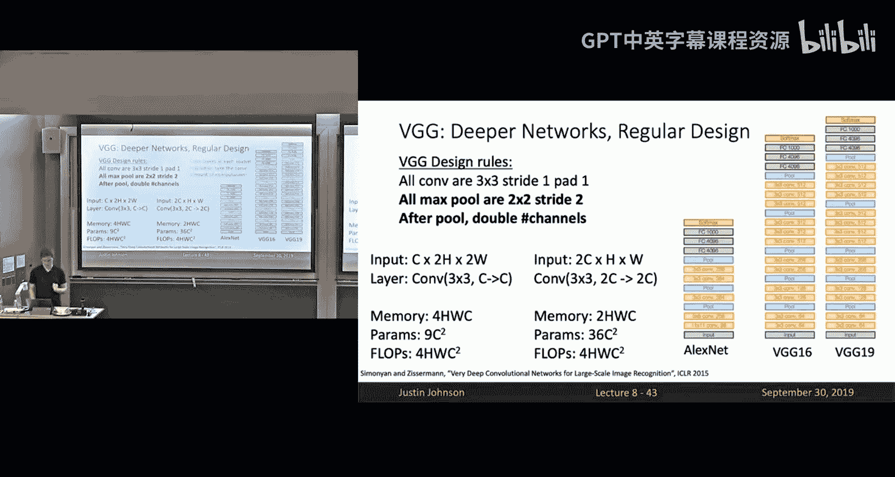

So then another thing to point out is that we can compare Alexnet and VGG 16 head by side to side。

 remember that AlexNet had five convolutional layers and three fully connected layers and now all of the the VGG networks also have five convolutional stages and three fully connected layers。

 and now we can draw the same plot of memory parameters and floating point operations to compare at a stage by stage basis between Alexnett and VGG。

And here， the overwhelming result from these graphs is that VgG is just a gigantic network compared to Alexnett。

 if we look at the number of like can you even see these blue bars on these graphs。

 like Vgg is just dwarfing Alexnet on all of these different axes of computation。

 It takes dramatically more memory if you look at the total amount of memory consumed by storing the activations for all these outputs。

 then Vg is something like 25 times greater， if you look at the total number of learnable parameters。

 Alexnet had about 61 million Vgg16 has 138 million so more than twice as many learnnable parameters and the real killer is the amount of computation at these two things cost if you add up the total number of floating point operations that cost that it takes to compute a single4 pass Alexnet versus a single four pass in Vg。

 we see that Vgg is more than 19 times more expensive in terms of floating point operations So Vgg16 is just this absolutely massive network。

 and again。Still get this story that we saw moving from Alexnet to Z F is that bigger networks tends to achieve better results on these large scale imagenet challenge。

 But now with V G G， it gives us a guiding principle。

 a couple of guiding design principles that let us easily scale up or scale down the network。

 And we no longer have to go in and fiddle with the individual hyperpar of every layer。

Now，2014 was such an interesting， such an interesting year that there's actually two convolutional neural network architectures that came out of that year's challenge that we need to talk about。

 One was VG G。 Oh， I should point out another very amazing thing about this VGG architecture is that it was done in academia by one grad student and one faculty member。

 So that was quite a heroic effort on their part。😊。

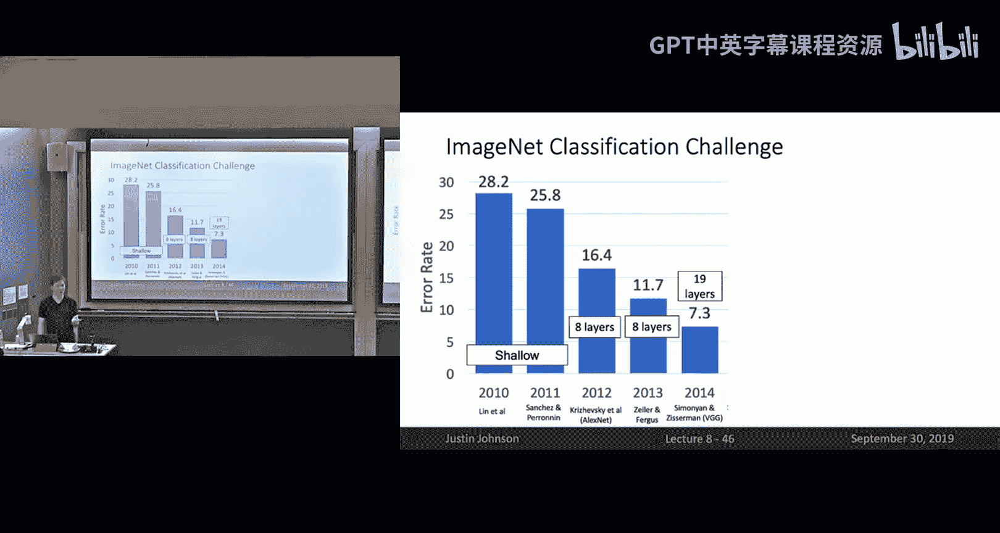

The other network that we need to talk about from 2015 from 2014 was from Google。

 This was a very large team with access to a very large amount of computation。

 So I think it was quite a testament to the VGG team in 2014 that even though they didn't win the Inet classification challenge that year。

 they really held their own against this this corporate team with access to many more resources。

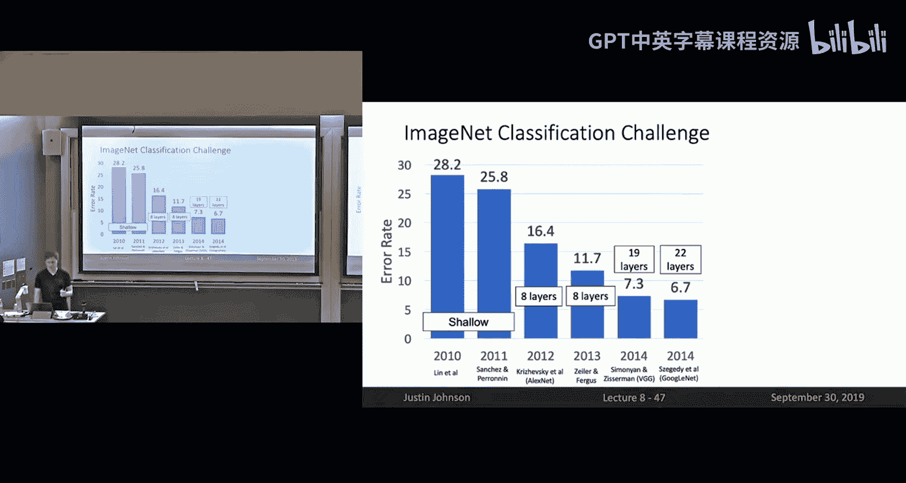

Now， the main takeaway of GoogleNe is that so because they wanted to be cute， remember。

 there was this， oh sorry， was there a question。

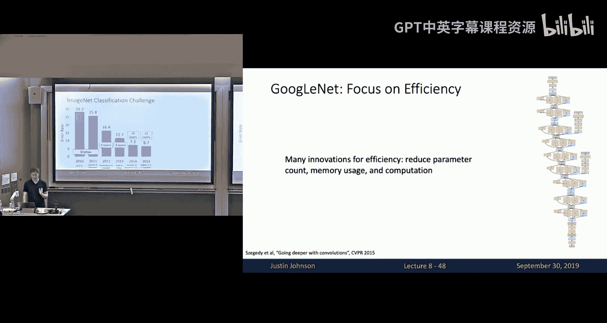

一分。我说你。Also。Yeah， the question was was VGG also split across multiple GPUs Well from starting around that time。

 I think we'll talk about this more later， but there it was split across multiple GPUs。

 but it was data parallelism so you basically take the batch of data you split the batch and compute different elements of the batch on different GPUs each so you no longer split the model across GPUs instead you split your mini batch across GPUs。

So that that's much simpler to implement compared to the model parallelism that was used in Alex Matt。

 Yeah， a question。That's a great question。 So V G， so V G G stands for the visual geometry group。

 which is the name of the academic lab that this network came out of。 So it's， I guess the。

 the name of the lab is now intrinsically linked to this particular convolutional neural network design。

 I'm not sure if that's good or bad。 But that's what， that's what it stands for。😊。

So the other architecture we need to talk about from 2014 is GoogleNe。 It's a cute name。

 Remember that there was one of the earliest convolutional neural network architectures was Lette that was created by Jan Lacoon。

 and now in Omage to Lyette and Janon Lacoon， this Google team decided to name their network。

 GoogleNe。

It's very cute。 And the idea， the overwhelming idea behind Googlenet was to focus on efficiency。

 If you look at the trend from Alexnet to Z F to VG G。

 the trend that we can see is that bigger networks perform better。 But with Googlenet。

 the team was really focused on trying to design efficient convolutional neural network。

 because Google actually wants to run these things for real in data centers than on mobile phones。

 So they save a lot of money if they can get the same performance with a cheaper convolutional network design。

 So they were really focused on trying to build a network that worked really。

 really well while also minimizing the overall complexity of the network。😊。

So they had a couple innovations that were really started out were made popular by the Google network architecture that were carried forward to a lot of other following neural network architectures。

 One is the use of a stem network at the very first couple of convolutional layers which very aggressively downsamples the input image and in order to aggressively downsample the spatial resolution of the input very quickly。

 because as you'll recall， with VGg or Alexnet， the very expensive layers were those big convolutions on feature maps of very large spatial sizes so to avoid those expensive convolutions on large spatial feature maps they use a lightweight stem that quickly downsamples the input So I'm not going to walk through the stem design in detail。

 but you can see that it very quickly downsles from the input resolution spatial resolution of 224 by 224 all the way down to 28 by 28 using only a couple layers that really。

So that you can spend the bulk of computation now operating at this lower spatial resolution。

 and you no longer have to do expensive convolutions at a high spatial resolution。好。

So here we can actually compare to VGG16。 So if you look at the component of Googlenet that downs samplesles from 2 to 4 down to 28 in spatial resolution。

 that entire part of the network costs about 418 meaplops for GoogleNe if you look at the equivalent spatial downsampling in VGG16 that goes from 2 to 4 down to 228。

 you can see that that same amount of spatial downsling in VGG16 costs more than 7 gigaplops so that same amount of spatial downs was nearly 18 times as expensive if you look at Googlenet against VGG。

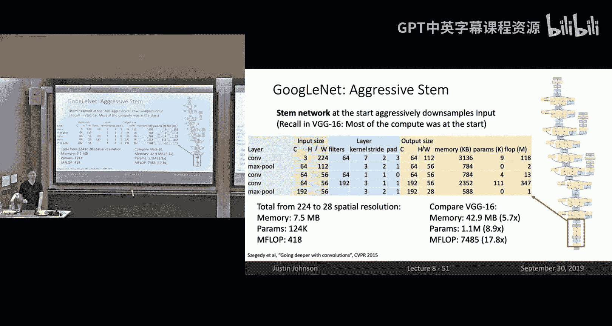

The other innovation in Google Me is this so called inception module。

 They were very clever because they got to go deeper。 So they called it inception。Yeah， I don't know。

 But the idea is that they had this little module that they called inception that had that was this local structure that was repeated throughout the entire network。

 We saw just as V G G use this simple repeated structure of Comm Comm Po。 Now。

 Googlenet used this little inception module design that was repeated throughout the entire throughout the entire network many times。

The inception architecture this inception module is kind of funny。

 it also introduced this idea of parallel branches of computation。

 So in remember that the kernel size， the convolutional kernel size is always a hyperparameter that we want to try to avoid in VGG。

 they took the approach of you know it turns out that we can replace kernels of any convolutional size with a stack of three by three and it's kind of equivalent Well Googlenet took a different approach and they said that in order to eliminate the kernel size is a hyperparameter。

 we're just going to do all the kernel sizes all the time。 So inside this inception module。

 they had four parallel branches， one that does a one by one convolution。

 one that does a three by three convolution， one that does a five by five convolution and one that does a max pooling with a stride of one So within every one of these layers。

 it does all the things。 So there's no need to two in hyper kernel size is a hyperparameter because you've got all the kernel sizes in all the places。

And the other bit of innovation in the inception module was the use of one by one convolutions before expensive spatial convolutions that was used to reduce the number of channels before doing these these expensive spatial convolutions。

 and we'll revisit this idea of convolution one by one convolutional bottlenecks。

 when we talk about residual networks in a few minutes。

 So I don't wantan to talk about that in detail here。

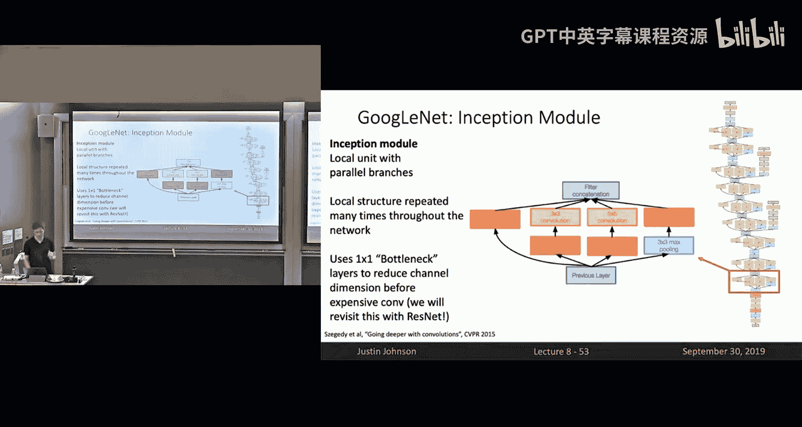

The other innovation in Googlenet is the use of global average pooling at the very end of the network。

 If you remember back to VGg and Alexnet， we saw that the vast majority of the parameters in Vgg and Alexnet were coming from these giant fully connected layers at the very end of the network。

 Well， because one of the ways that we might focus on efficiency is by reducing the number parameters in the network。

 So in order to do that， Googlenet simply eliminates those large fully connected layers。

 So remember in Alexnet and Vgg at the end of the network at the end of the convolution layers we had this flatten operation that destroyed spatial information by flattening the convolutional tensor into a giant vector。

 Well， Googlenet uses a different strategy for destroying spatial information。

 rather than flattening the tensor instead they use an average pooling with a kernel size equal to the final spatial size of the last convolutional layer。

 So in particular， the last convol at the end of this last inception module in Googlenet。

 the output tensor。I hass a spatial size of 7 by 7 with 1024 convolutional with 1024 feature maps。

 Now， then they apply an average pooling with kernel size equal to 7 by 7 and destroy doesn't matter because it only fits in one place。

 So what that means is within every of those 1024 channels average they take the average of the the values of those channels across all the spatial positions in the input tensor。

 This now reduce so this now also destroys spatial information。

 but rather than flattening into a giant tensor instead。

 it actually reduces the total number of elements。 So it ends up with this compact vector with only 1024 elements。

 So then there's only one fully connected layer in Googlenet。

 which then goes from this 1024 output from global average pooling that then converts to the 100 that goes from 1024 into 1000 where again。

1000 is the number of categories in the imagenet data set。

So GoogleNe is able to eliminate a huge number of learnable parameters by simply eliminating this fully connected layers and instead replacing them with idea of global average pooling。

 and this is something that got picked up by a lot of different convolutional neural networks following GoogleNe。

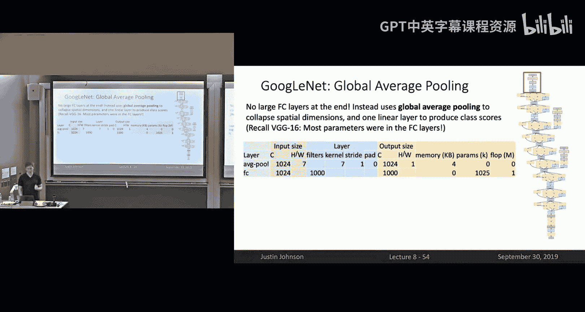

We can also compare this side by side with VG G and just see how profoundly this affects the number of parameters in the last couple of layers。

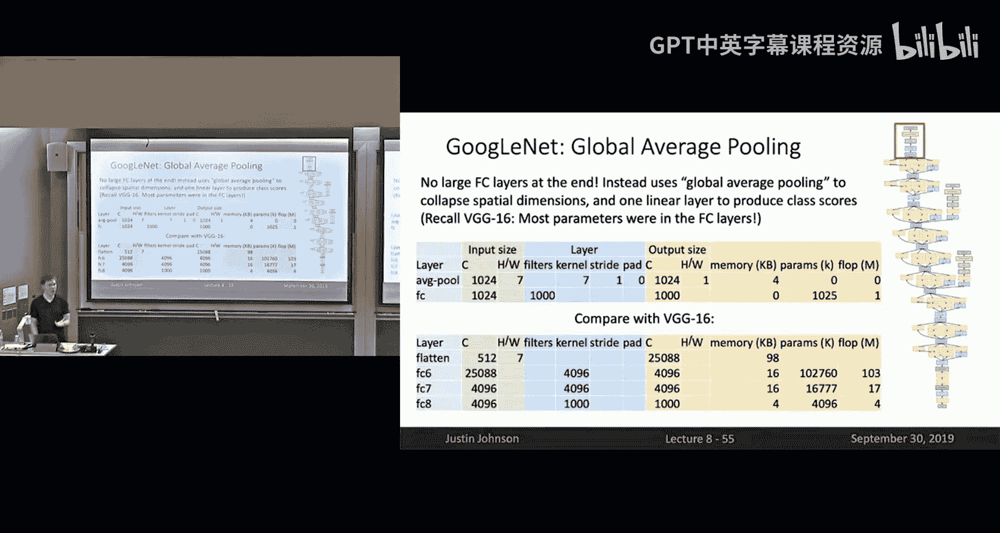

Another piece of awkwardness in Googlenet is that they had to rely on this idea of auxiliary classifiers。

 So one should point I need to point out that in Googlenet actually occurred before batch normalization。

 So before the discovery of batch normalization， it was very。

 very difficult to train networks that had more than about 10 layers or so。

 And whenever people tried wanted to train deeper networks than about 10 layers without batch normalization。

 they had to resort to some ugly hacks。 and one of the ugly hacks that was used in Google net is this idea of auxiliary classifiers。

 So here what they did is they know at the end of the Google net。

 they had a global average pooling and a fully connected layer that produced class scores。 Well。

 they had auxiliary global average pooling and fully connected layers several at several internal points in the network。

 So this thing was actually outputting three different sets of class scores。

 one from the end of the network and two from these intermediate parts of the network。

 And then for these intermediate classifiers。Also computeute loss and propagate gradients coming back through all three of these classifiers and this had the effect of making gradients propagate more easily through the network because now they're if you think about what happens in the backwards pass。

 they inject gradient at the very top of the network at the final classifier and they also inject gradient directly in these according to these two auxiliary classifiers and this was a trick that they used in order to get things to converge in order to get deep networks to converge at that time。

Yeah。嗯。😊，Yeah， so yeah， that was very astute。 The question is that I said that network before batch normalization。

 training networks of more than 10 layers was very tricky and people had to hack it。 And。

 you're right。 VG G also hacked it in some way。 What they did is that they trained a shallow VG G network。

 something like the 11 layer variant of V G G。 And then they first trained that to convergence。

 And then they inserted new layers in between the already trained layers of the 11 layer V G G。

 and then continued training from that point。😊，Although you can imagine that theres some definite tricks in optimization that are needed in order to get things to converge after you stick in new layers in the middle of an already trained network。

 so that was a bit of hairiness in VGG that they had to use in order to get their networks to converge。

 so you can see that 2014 was kind of a dark time for neural network practitioners。

 you had to resort to all these crazy hacks to get your networks to converge once they got beyond a certain depth。

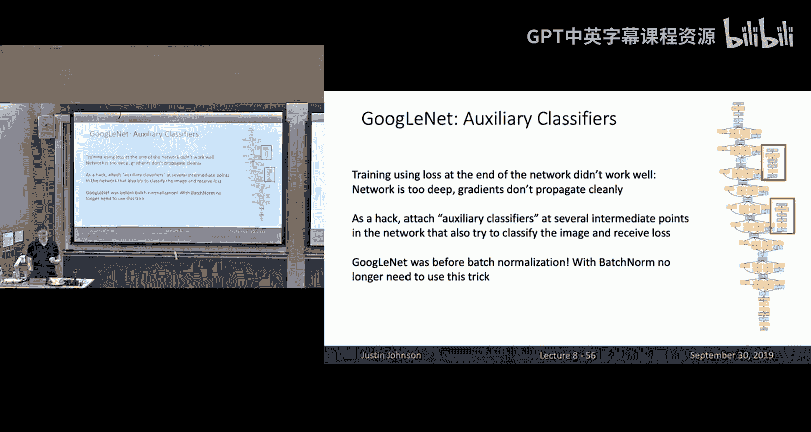

Thankfully， things changed in 2015。 So by so actually one of the important things that between 2014 and 2015 is when batch normalization was discovered。

 So once batch normalization was discovered， people found that they were able to train VG G and train Googlenet from scratch without any of these tricks by just using batch normalization instead。

😊，But then there was an extremely important innovation in neural network architecture design that happened in the 2015 iteration of the imagenet Cha。

 And those were called residual networks or Resnets。 And here you can see something amazing happened。

 The number of layers jumped in one year from 22 all the way up to 152。

 So people So this was a very important innovation in the history of neural network architecture design。

 You can also see that the error dropped dramatically again from 6。7 and almost halved down to 3。6。

 So Resnets were were kind of a very important moment in neural network architecture design。😊。

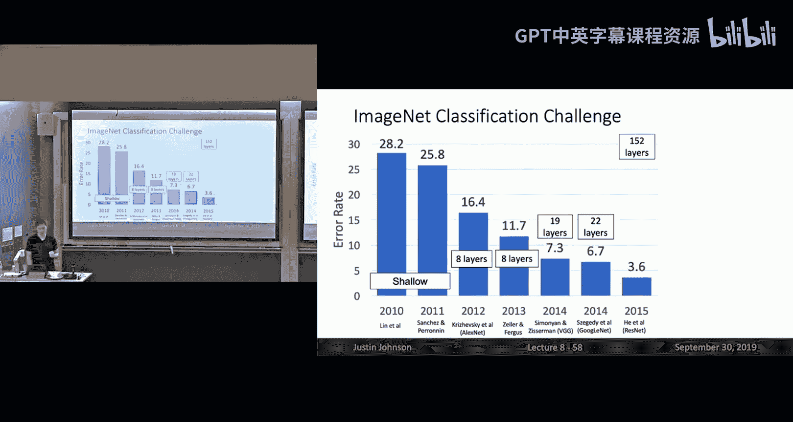

So as we mentioned， once batch normalization had been discovered。

 people realized that they were able to train networks that were fairly deep even with dozens of layers。

 So then the question is what happens if we just keep stacking layers and stacking layers and try to train very。

 very deep networks？

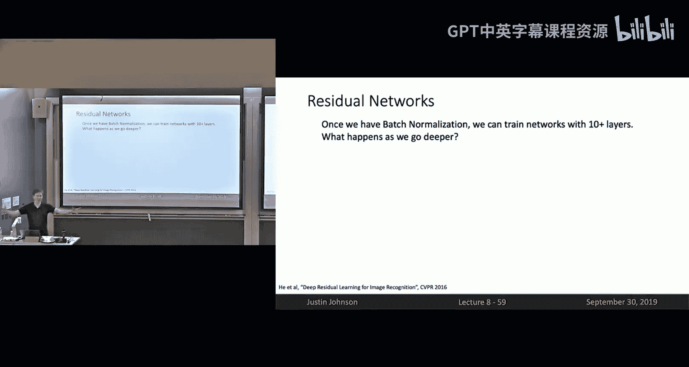

Well， here is kind of a cartoon picture of the types of plots people saw at that time。

 Here is the training curve where the x axis is the number of training iterations and the y axis is the test error。

 and we're comparing a 56 layer model and a 20 layer model and here something very strange happens。

 We see that the 56 layer model actually performs worse than the 20 layer model and this is surprising because the previous trend that we had talked about was that bigger neural networks tended to work better up to this point in time。

 So it was very surprising to all of a sudden see the bigger。

 deeper networks now performing worse once you got past a certain point。

So the initial guess of what was going on is that maybe these networks had started overfitting that you can imagine maybe once you got to a 56 layer network and you had batch normalization。

 maybe this was just such a large network that it was now overfitting this imagenet training set。

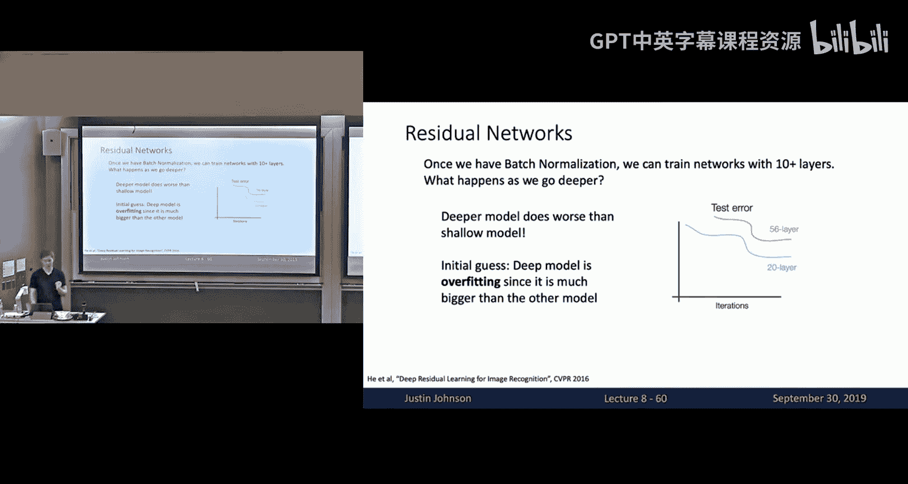

But in order to test this hypothesis， we can look at the training performance of these same networks。

 And if you look at the training， the performance on the training set of the same 20 layer and 56 layer networks。

 you see that the network was not overfitting that， in fact。

 this 56 layer network was somehow underfitting the training set。

 that somehow there is a problem in optimization that somehow this deeper model。

 even once we have batch normalization， once you get to a certain depth。

 we're no longer able to efficiently optimize very deep networks。

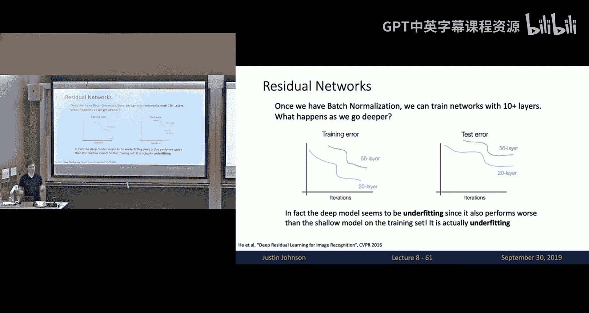

This is a problem。And this is also surprising because we should expect that a deeper model should have the capacity to emulate a shallower model。

 What do I mean by that？ So you could imagine that a 56 layer network could emulate a 20 layer network because we could imagine taking the 20 layer network copying all of its layers into the 56 layer network and have all of the other remaining layers just learn the identity function。

 So in principle， if our optimizers were working properly， then the deeper the network goes。

 the deeper network should always have the capacity to represent the same functions as the shallower network。

 So if we are actually underfitting， then it means that we have an optimization problem that somehow these deeper networks are not able to efficiently learn these identity functions in order to in order to emulate shallower networks。

So the solution is to change the design of the network to make it easier for it to learn identity functions on unused layers。

 and this should make it easier for deeper networks to learn to emulate shallower networks in case they had too many layers and more layers than they actually needed。

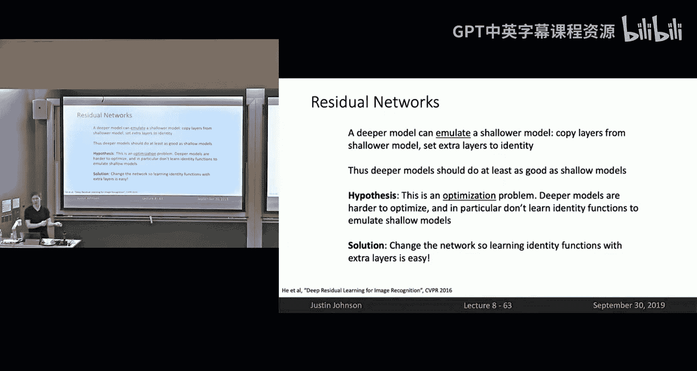

So here is the design chain that was proposed by residual networks。

 So previously on the left here we have the kind of plain convolutional block that we had seen in VGG that is a stack of two consecutive convolutional layers maybe with a relu in between。

 maybe some batch normalization in between as well。

 Now residual networks proposed this residual block design on the right。

 which still has a stack of two convolutional layers， but rather now at the end。

 we take our input X and actually add it to the output of the second convolutional layer。

 This means that the overall block computes this function F of x plus x where f of x is the output from this basic block inside of the residual additive shortcut。

And what this means is that the idea behind this is that this layer can now very easily learn the identity function if we set the weights of those two convolutional layers to zero。

 then this block should compute the identity and now this should make it easier for deep networks to emulate shallower networks this should also help improve the gradient flow of very deep networks because you remember that if you remember in what happens in the backward pass of an ad gate as we back propagate through an ad。

 it copies the gradients to both of the inputs so you can imagine that now when we backproagate through this residual block。

 it actually copies the gradients and shortcuts the gradients through those convolutions and this again helps to improve the propagation of gradient information throughout these very very deep networks。

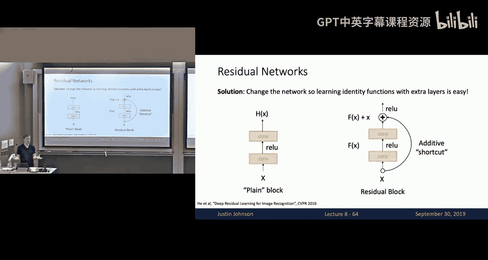

So then a residual network is a stack of residual blocks。

 residual networks were sort of inspired by the best parts of VGG and GoogleNe in my opinion。

 so they combined this idea of simple design principles from VGG with a couple of these innovations from Google Nets。

 so this network much like VGG， this network was divided into stages within between each stage we are going to have the spatial resolution and double the number of channels just like VGG and all of our convolutions inside these stages will be three by three convolutions just like in VGG but each of these blocks will now be these residual shortcut blocks。

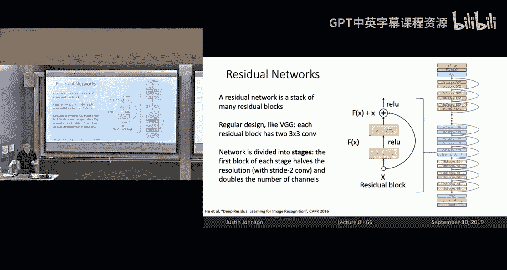

Residual networks also take some innovations from Googlenet。 They use like Googlenet。

 They also use this aggressive stem in the first couple layers that aggressively downsamples the input。

 and residual networks also took this idea of global average pooling from from Googlenet that again。

 eliminates the fully connected layers and reduces the total number of parameters in the network。

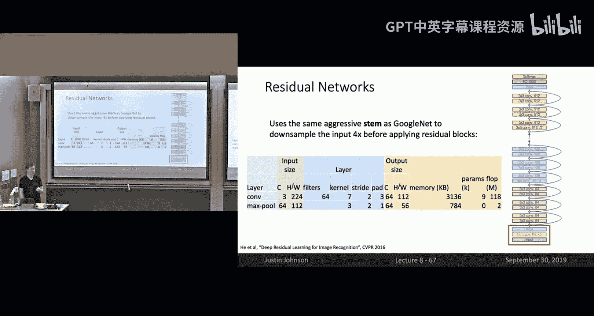

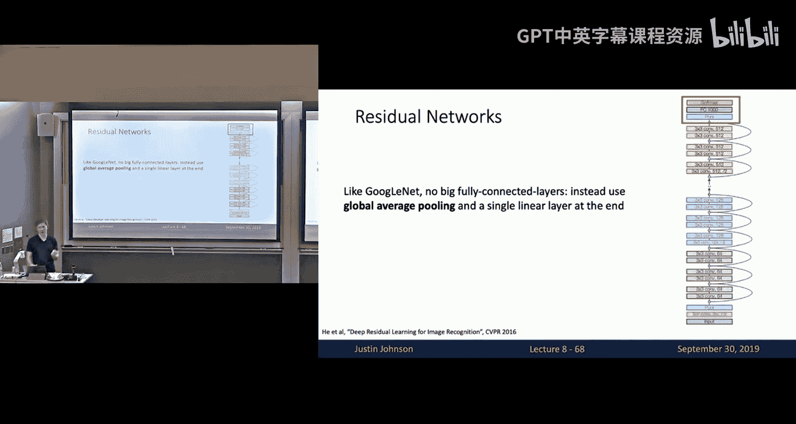

So so then with these simple patterns， the only thing you need to choose is the initial width of the network which was 64 in all their experiments and the number of blocks per stage。

 so this gives us the resnet 18 which has two residual blocks per stage which means four convolutions per stage。

 four times four is 16 convolutions， there's a convolution in the stem there's linear at the end。

 so if you add that together that's 18 layers with learnable weights yeah。Profesor。

 you keep mentioning。Whi I take a few signal processing courses。

 so just to clarify by that you mean using conal layers。

 not literally boundtanling to image by taking every other。The question is。

 what do we mean by downsling in this context， we mean any operation that reduces the spatial extent of the image so that could be strideed convolution。

 that could be max pooling， that could be average pooling， taking every other pixel is not used。

 I don't think that's I've ever seen that used in an inter network context， but it's differentiable。

 You could try it。 I don't recommend it yeah。That's what it mean。Yeah， yeah， so in this context。

 it means any operation that reduces the spatial size of the input。

So what's interesting about this Resnet is that now they become very efficient。

 So now we're able to achieve very low errors on Imnet with very few amounts of floating point operations。

 There's also a 34 layer version of of Resnet， which just adds more blocks to some of the stages。

 But otherwise， the design is exactly the same。

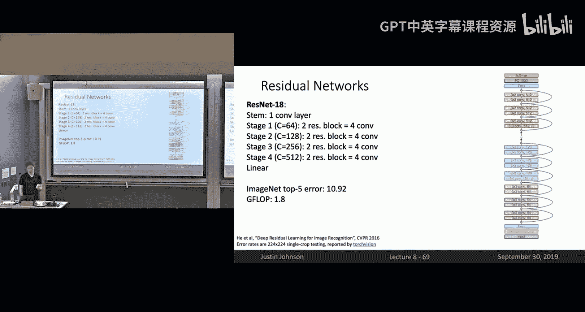

And again， we can compare this to VGG， which had now something like 13 gigapopps for the whole network and got errors of about 9。

6， whereas the Resnet 34 got was only 3。6。 go for gigapops and actually had lower errors on Inet。

 and a lot of these gains in efficiency were due to these this aggressive downsampling at the beginning。

 and this global average pooling at the end。

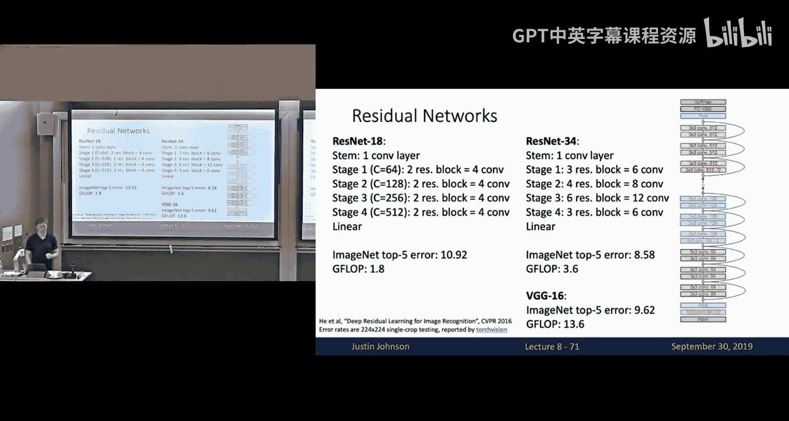

So as we go to deeper residual networks， they actually modified the block design。

 so here on the left is the socalled basic block that is used in residual networks。

 has this basic block has a three by three convolution and then another three by three convolution and rayluuse and batch norms in between them and this residual shortcut around the three by three convolutions。

Well， then we can compute the amount of total floating point operations for this block， again。

 only counting the convolutional layers。 And we see that each of these convolutional layers has costs 9 HWC squared。

 So the total computational cost of this thing is 18 HWC squared。

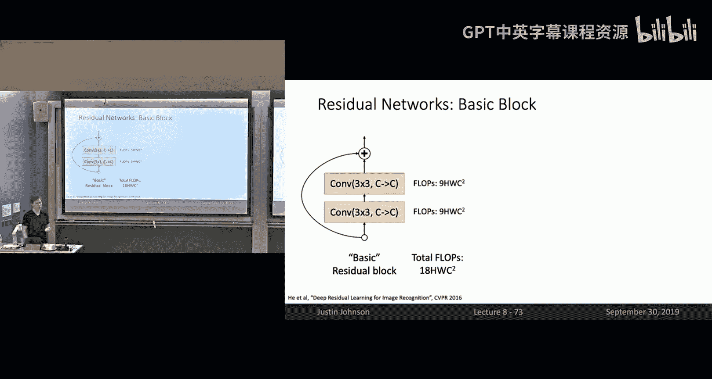

Now， for deeper residual networks， they introduce an alternative block design called a bottleneck block。

 So here in the the bottleneck block now consists of three convolutional layers。

 The first is so it accepts an input tensor with four times as many spatial channels as the basic block。

 The first layer is a one by one convolution that acts to reduce the number of channels that are contained in the tensor。

 So the first one by one convolution reduces the number of channels from 4 C down to C。

 and then once we reduce the number of channels， then we perform this 3 by3 convolution。

 and then we have another one by one convolution that expands the number of channels again。

 increasing the number of channels from C up to4 C again。

So if now we can use the same procedure to compute the computational cost of the bottleneck design block design。

 and we can see that each of these these one by one bottleneck and unbottleneck convolutions。

 each cost for hwC squared and this middle convolutional layer has the same cost of 9 hwC squared。

 So actually the overall cost of this bottleneck design is 17 hwC squared。

 which is slightly less than the computational cost of this bottleneck residual block。

 but so this means that we get less computation， but again。

 more nonlineity and more sequential computation， and somehow the intuition is that deeper layers should be able to deeper layers with more non nonlinearity should be able to perform more complex types of computation So by switching from this basic block to this bottleneck block。

 it lets us build networks that are deeper while not increasing the computational cost。

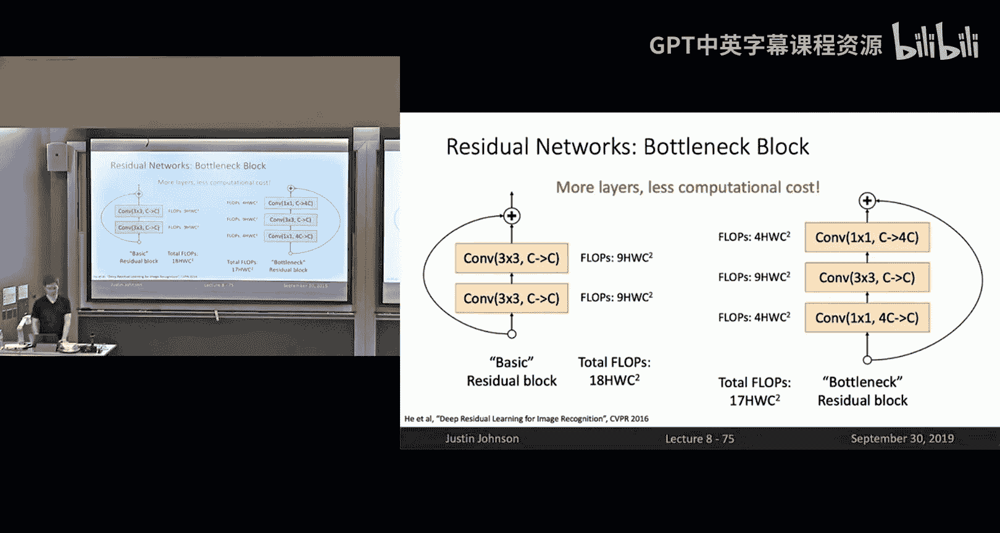

So then so far we've seen the 18 layer in the 34 layer residual networks that use this basic block。

 then if we simply take the 34 layer resnet and replace all the basic blocks with residual with bottlene blocks。

 now this increases the total number of layers in the network from 34 to 50。

 but does not really change the overall computational cost of the network and now by making this change that increases the number of layers without increasing computation。

 you can see that the error on imageNe actually decreases so that by simply making it deeper without increasing computation we're able to decrease the error on imageNe from 5。

85 down to 7。13， which is actually a fairly large reduction in error。

 given that these two networks actually have similar computational cost。

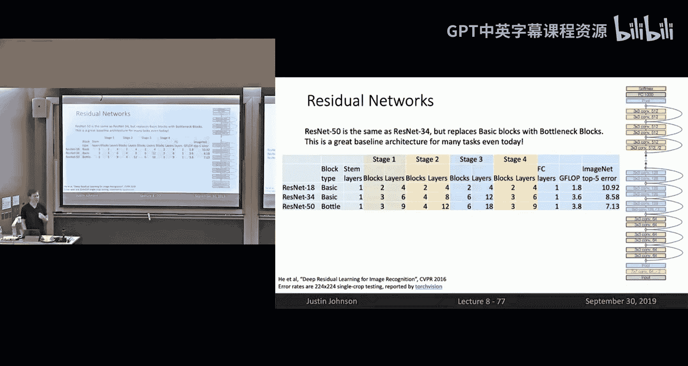

Now， this residual networks， we can actually go deeper than that。

 and we can define 101 layer and 152 layer versions of residual networks that have the same basic design。

 They use bottleneck blocks。 They just use more bottleneck blocks per stage。

 And you can see the clear trend with residual networks is that as you stack these layers to go deeper and deeper。

 the networks tend to work better and better。

So this was a big deal in 2015。 So in previous competitions。

 there's always a bunch of computer vision competitions every year and usually one team will win one competition。

 another team will win another competition， but in 2015， Resnets crushed everything。

 They won every track in the imagenet competition that's the classification challenge。

 The localization challenge， which we have not talked about。 and the detection challenge。

 which we have not talked about。 There was also a concurrent set of challenge run by around a different data called Microsoft Coco the same team that built residual networks also swept every challenge in Coco winning the detection challenge and the semantic segmentation challenge in the coco data as well。

 and the main thing that they did is took existing methods for all these different tasks and just swap in their 152 layer residual network。

 And in doing so， they just crushed everyone that year。 So this was a very big deal。

 they got everyone to wake up and pay attention。 And from that time forward。

 residual networks became a baseline that is。😊，Really widely used even still to this day for a wide variety of different tasks in computer vision。

So there was a follow-up paper in residual networks that played a little bit with the exact organization of the exact order of convolution。

 batch normm and Relu， and they found that by shuffling the orders of these things。

 you could get it to work a little bit better， which was kind of interesting to see that I think is maybe useful if you're trying to squeeze out that little last percentage of performance of your residual networks。

Now， it is kind of a summary of where we've gotten to today。

 You can see this comparison of computational complexity。

 So here on the right is this very nice plot where on the x axis。

 So each dot here is a different neural network architecture。

 The X axis is the number of floating point operations that it takes to compute a forward path of that architecture。

 The Y axis is the accuracy on the imagenet challenge。

 And the size of the dot is the number of learnable parameters。

 So this is a really nice visualization that packs a lot of lessons that we've seen into one nice diagram。

😊，So here you can see that Google has been going on。 They have inception versions 2。

3 and 4 and inception version 4 plus Resnet。 we haven't talked about I don't want to talk about the details of those。

 but here you can see from this plot is that VGG has very high memory。

 takes a ton of computations and is just kind of inefficient network design overall。

 Googlenet is this very small， very efficient， but not quite as high performing as some of the later later networks。

 AlexNe down here in the corner is is very low in compute lower than any of the other variants that we see here。

 but it still has quite a lot of parameters due to the largefully connected layers。

 And we can see that residual networks give us this fairly simple design， moderate efficiency。

 but able to give us high accuracy as we scale to deeper and deeper residual networks。

So then moving forward， what happened in 2016， nothing much that was very exciting。

 The winner in 2016 was model enssembling。 I don't know if you've ever done like kgel challenges or whatever。

 But basically， they took all the winning neural network architectures the last couple of years。

 ensemble them together and did slightly better。 So that was not very exciting。😊。

But there were a couple attempts to moving forward to improve residual networks。

 So recall that we've seen this bottleneck residual block that was the building block of the 152 layer residual networks。

 Well， if one bottleneck branch is good， then why not have multiple bottleneck branches in parallel。

 And that was the idea behind Res next， which was supposed to be the next generation of residual networks。

So here， the idea is that we will have our basic building block for the Res next network well have G parallel pathways。

 and each parallel pathway will itself be a little bottleneck block。

 But now the inner channel dimension of that these parallel bottleneck blocks will be a new constant called little C。

So now we can compute the total flops of this And then at the end。

 after we compute the output from these different parallel pathways， these parallel battlem blocks。

 the outputs will all be added together。And now we can compute the total computational cost of this strange multi pathway design。

 and you can see that each of these individual bottleneck。

 each of these individual branches has a computational cost of8 big C little C plus 9 little C squared。

 which you can kind of multiply out and see the pattern here。

And now what's interesting is that we can actually set up a quadratic equation and once we set the channel dimension C and the number of parallel pathways G。

 then we can set up a quadratic equation and solve for little C。

 such that parallel this multipath architecture with G parallel branches will have the same computational cost as this original bottleneck design。

So then it turns out that if you kind of solve these thingsteger they don't work out exactly。

 but if you kind of round to the nearest integer， then if we have， for example。

 64 channels and four parallel pathways， then we can set little C to be 24 channels on each of those parallel pathways and it's the same computational cost。

 or if we have maybe 32 parallel pathways， then we can have each of those pathways little C equals4 channels So this basically gives us another mechanism that lets us modify the design of our network Now in addition to setting the number of channels we can also set the number of parallel pathways and by solving the equation in this way。

 we can set the number of parallel pathways in a way that also preserves the amount of computation that's being done。

And it turns out that there's an operation in a convolution called grouped convolution that lets us implement this equivalent。

 this idea of parallel pathways using this idea of grouped convolution that I don't have time to talk about the specifics here。

But the idea is that now we've modified our design to effectively have these multiple parallel pathways that gives us another axis on which we can modify our network。

So then in this Resn design， this Resn architecture。

 you see that we can as we keep the same computational cost。

 but increase the number of parallel pathways within each block actually that leads to an increase in performance even though so then we can have we can start with a baseline 50 layer resnet model and then increase the number of parallel pathways and as we do so。

 the accuracy actually increases and the same trend holds for the 101 layer resnet that we can increase the number of pathways and get improved performance。

 even while maintaining the same computational complexity for the network。

So then what happened in 2017， people built on top of this idea of Resn and added another little bell and whistle called Sque and excitation that made things work a little bit better。

And 2017 was the end of the road。 After 2017， people decided that the juice had been squeezed out of the imagenet data and the challenge was shutting down。

 So it will live on on kgel as a kgel challenge。 But it's note that there was kind of an end of the end of an era when the imagenet challenge ended in 2017。

But design but even though the imagenet challenge ended。

 people will still been going nuts trying to design ever bigger and more interesting neural network architectures。

 So a couple you might want to be aware of。 One is this so-called and by the way。

 a lot of these lessons sort have carried on to further neural network architectures。

 this idea of aggressive downsampling of trading of trying to maintain computation of trying to build networks that were efficient and performing well while maintaining or reducing computation。

 this idea of having repeated block structures throughout the network that could be repeated in order to design your networks without having to tune every layer。

 All of these design parameters and design ideals were carried forward into later neural network designs。

One that you might see floating out there in the wild sometimes is this densely connected neural network。

 The idea here is that just it's its sort of a different way of doing shortcut connections or skip connections。

 So as we saw in residual networks， we were able to propagate gradients better by having this additive shortcut connection。

 Well dense these densely connected neural networks instead use a concatenation shortcut。

 So rather than adding previous features to later features， instead。

 they concatenate previous features with later features in order to reuse the same features of different parts in the network。

 And again， they repeat this little dense block at multiple stages throughout the network。😊。

Then another trend that became very important in the last couple of years has been that so far。

 we've kind of been operating in this high parameter regime of people trying to just get trying to max out the accuracy on imagenet while also minimizing the flops。

 But the overarching design was always to get high accuracy。 Now。

 kind of happening in parallel was this idea of maybe it's okay to trade off some accuracy in some contexts。

 And maybe what we want to do is try to get the absolute tiniest network possible that still performs okay but has very。

 very minimal computation such that you can run it on mobile devices or run it embedded applications。

 So there's been a whole sequence of works around designing very efficient。

 very convolutional neural networks that have very， very low computational cost。

 but maybe our willing to sacrifice some accuracy and no longer beat these big residual networks。

 one very famous example is this so-called mobilenet。 And again， it has this。

Idea of repeated blocks。 So we can look at this basic 3 by3 convolution on the left that has convolution batch Relu。

 As you should know by now， the computational cost of this layer is 9 c squared H W。Now。

 on the right， we replace this convolution with two different convolutions。

 One is a so called depthwise convolution that you can look at the details， I think， offline。

 we don't have time to go through that。

And there's been a whole sequence of papers that have been trying to design very efficient neural networks that can run on mobile devices。

So now at this point， it kind of seems that there's been a lot of activity around designing different neural network architectures。

 but it still takes a lot of work and a lot of human effort and a lot of human activity to design neural network architectures。

 So as another hint of something that has been very popular the last few years。

 has been automating this process of designing architectures and actually training one neural network that outputs the architecture of another neural network。

 and we don't have time to go through the full details of this idea in in this lecture。

 But the basic idea is that we'll have one neural network called the controller and this controller will output the architecture for another neural network。

 So then the training process here is that we'll take the controller network we'll sample a bunch of architectures from the controller we'll train all of those architectures on our data。

 And then after we train all of those child networks we'll see how well they did and use that to compute a gradient for the controller network。

 and the exact mechanism of computing that gradient requires。

Po gradient approach that we'll talk about a little bit later。

 But what that means is that after training a batch of child networks。

 then we can make a single gradient step on the controller。

 So then in order to perform gradient descent on that controller， it's going to be very， very。

 very computational expensive。 But over time， this controller should learn to produce good neural network architectures。

The this was a really cool idea， but the initial version of this was just unbelievably computationally expensive because now each gradient step on the controller takes so the initial version of this trained on 800 GPUs for 28 days and that is just an amount of computational resources that I'm sorry I cannot give you for your homework but if you're at Google and you've got free GPUs laying around。

 then this is the kind of experiments that people are trying。😊。

But and and followup research has actually this， this paper has become kind of a joke in the community just because the unbelievable scale of resources that were used in this paper。

 but actually followup papers on neural architecture search have significantly reduced this search time。

 So but people always love to compare to this paper to say， like oh， look。

 we're 1000 times more efficient than this previous one。

 that's a good way to get your papers accepted。😊。

But the takeaway is that if you have the resources to burn。

 then neural architecture search actually has been used to find neural network architectures which are themselves very efficient So this is kind of another plot that is nice to summarize a lot of the architectures that we've seen so far in this lecture So here on the X axis we're showing the computational cost of running running the neural network that is the number of multiply ads and the y axis now is the accuracy on INe and you can see that all these dots correspond to different neural network architectures that we've talked about in this lecture and all these red lines corresponds to different neural network architectures that were learned using a neural architecture search method and what you can see is that this neural architecture search method was able to learn a set of different architectures that achieved higher accuracy at lower computational cost compared to other architectures。

So that's kind of a next frontier in neural network architecture design。

And the kind of summary from what we've seen today is that in the kind of early days of convolutional neural networks as we moved from AlexNe to ZFnet to VGG。

 people were just focused on training ever bigger and ever bigger neural networks in order to get higher and higher acuracies GoogleNe was one of the first to focus on efficiency and in doing so they wanted to get high accuracy while also being aware of the computational cost residual networks gave us a way to scale networks to become very。

 very big and we were able to train networks with hundreds of layers once we had these ingredients of batch normalization and residual networks and after ResNe。

 people started to focus on efficiency more and more and more and somehow that became the guiding principle of a lot of neural network architecture design after residual networks。

So then we saw this huge proliferation of different architectures that we're trying to achieve higher or same accuracy at lower computational cost。

 this includes these tiny networks like mobile Nes and shuffle nets。

 and neural architecture search promises to maybe one day design all of our networks for us。

But now the final question is， you know， this is all great。

 But what architectures should I actually use in practice？ Well， my advice is don't be a hero。

 So for most applications， don't try to design your own neural network architecture。

 you're going to cause yourself sadness and you don't have 800 GPUs to burn for a month。

 I think So what you should probably do in most situations is take an existing neural network architecture and adapt it for your problem。

 And that that's what I do in my research。 and that's what I recommend you guys do for any projects that you undertake。

 in particular， despite the number of things that have come after I think renet Resnet 50 and Resnet 101 are still really。

 really great solid choices that work。 if you want something to just work and not have to fiddle with it too much。

 Those are the choices that I usually grab for。 if you are concerned about computational cost for some reason。

 then look to some kind of mobile net or shuffle net。 but in general。

 you really shouldn't be trying to design your own neural network architectures。

So that kind of is all the stuff we wanted to cover today。

 and next time we'll talk about some of the actual software and hardware that we use to actually train these different networks。

