# 密歇根大学《深度学习用于计算机视觉｜Deep Learning for Computer Vision UMich EECS 498-007 2019》中英字幕 p09 -09-9_HardwareandSoftware.zh_en -BV1jA4m1P7GN_p9-

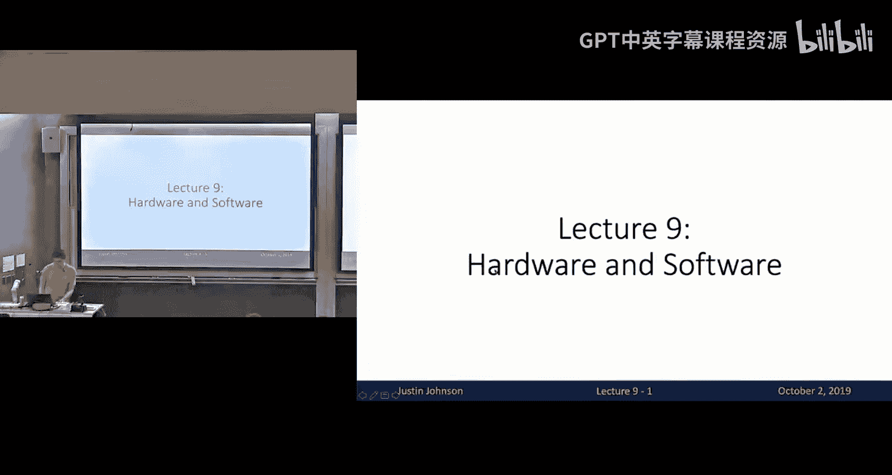

All right， welcome back to lecture9。Today we're going to talk about。

 or today is lecture 9 of the class。 And today， we're going to talk about deep learning。

 hardware and software。 So this will be hopefully a very applied practical lecture。

 We'll be seeing lots of code on the screen and walking through that。 So hopefully that'll be fun。😊。

As usual， we have some reminders， reminder that assignment two was due on Monday。

 so hopefully everybody turned that in and if not reminder that you have a couple of late days that you can use throughout the semester so you might you can still perhaps turn that in with no penalty。

And because the assignment  two due date has now passed。

 that means that assignment3 has now been released。

 assignment 3 was released last night about I think within about 10 minutes of the midnight due date for assignment2 assignment 3 is going to focus on this modular back propagation API that we've been talking about in previous lectures and you'll use that to implement fully connected networks and dropout itll also cover convolutional networks。

 you'll implement your own convolution and pooling layers and use that to train deepconvolutional networks and you'll also implement your own batchization layers and see how that improves the training process and this will be due two weeks from this will be two weeks from the day it was released and remember the validate your submission before you submit it。

 Also we had a couple since we released the assignment。

 we had a couple minor hot fixes on the wording nothing major。

 but if you happen to start the assignment the instant that we released it then you might want to go and double check on piazza to make sure that you've received these hot fixes in case you already copied so these are already been applied to the notebook that's in Google Drive。

From the website， but in case you already made a copy of that in your own Google Drive。

 then you might need to go and fix those things manually。

Any administrative questions before we move on？Great。So as you'll recall last lecture。

 we talked about CNN architectures and we saw how the field has progressed from architectures like AlexNe to VGG to Resnet。

 and this huge proliferation of different convolutional neural network architectures that people have used throughout the years and we talked about the tradeoffs of computation and memory。

 and saw how future advancements like VGG and especially Resnet gave us very regular designs for CNNs that that made it very easy for us to scale up and scale down their sizes。

But now that we have some understanding of the types of architectures that people implement with CNNNs。

 it's useful to think about the actual hardware and software systems on which those architectures will ultimately run。

 So that will be the topic of today's lecture。 We're going to talk about first hardware and then software。

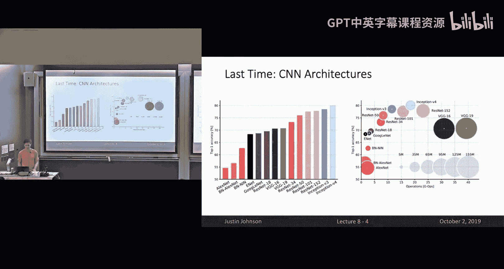

So first is deep learning hardware。So here's a picture of a computer。

 This is actually my computer from grad school。 And you can see that there's a couple interesting components inside this computer。

😊，One is the central processing unit or CPU at the top。

 it's stuck under this giant heat sink and fan， but underneath that you see these two giant other things that say G4 GTX on them。

 and those are graphics processing units or GPUs and just by looking at the size of these things and the space they take up in the case。

 you can see that the GPUs actually take a lot more physical space than the CPU in the machine。

 so that should maybe give you some hint that these are very important components。Now。

 if you're perhaps an avid computer gamer， you're probably very familiar with GPUs and different models of GPUs。

 and if that's the case， you know that there's a big a long bit of tension in in the gaming community around GPUus and that's the question of NviDdia versus AmD So I'm guessing people are familiar with this debate and maybe you have fanboys on one side of the other when it comes to gaming but when it comes to deep learning。

 there's a clear winner in in this fight and that's NviIDdia。

 that whenever people are running GPU whenever people are using GPs to accelerate their computation for neural networks。

 it's almost exclusively on NviDdia GPUs I think an AMD actually has really great hardware but the software stack for utilizing that hardware for general purpose computing and especially for deep learning is really just not as advanced as the software stack on NviDdia's side So for that reason whenever you here is GPUus and deep learning it really just means NviDdia GPUs and any other type of GPU be it integrated Intel or。

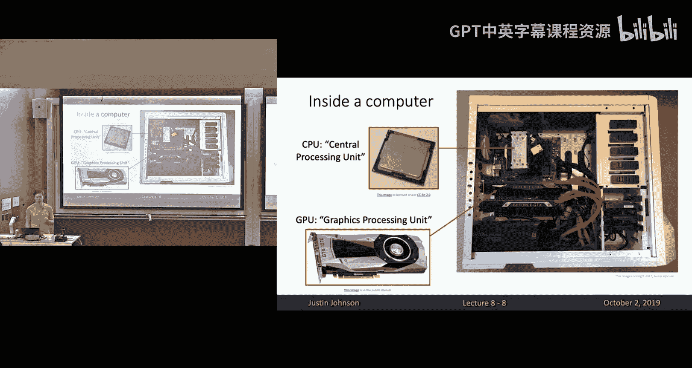

is just really not a mainstream thing at all when it comes to deep learning。

Now it's also interesting to think about we saw in this case how we had both CPU and a GPU。

 Now it's interesting to look historically at the trends of the computational power of both CPUus and GPUus。

 So I made this plot a couple years ago， it's a little bit out of date now because you can see the xx ends at 2017。

 but here the metric we want to look at is gigaplops per dollar。

 So each point on this graph is either a CPU model or a GP model at the time it was released and then for each of these models we compute the total computing power in gigapps per gigaplops。

 which is what is gig kilo000 me is billion so giga is billion。

 So this is the number of billions of floating point operations that these things can do per second。

 so then we take that peak computing capability of the device and then divide it by the number of dollars that it costs at the time the time the device was released and this gives you a sense for what is the cost of computing over time also with respect to different types of computing devices。

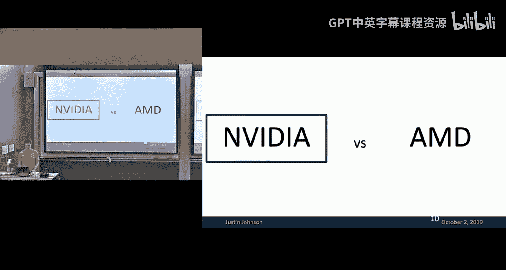

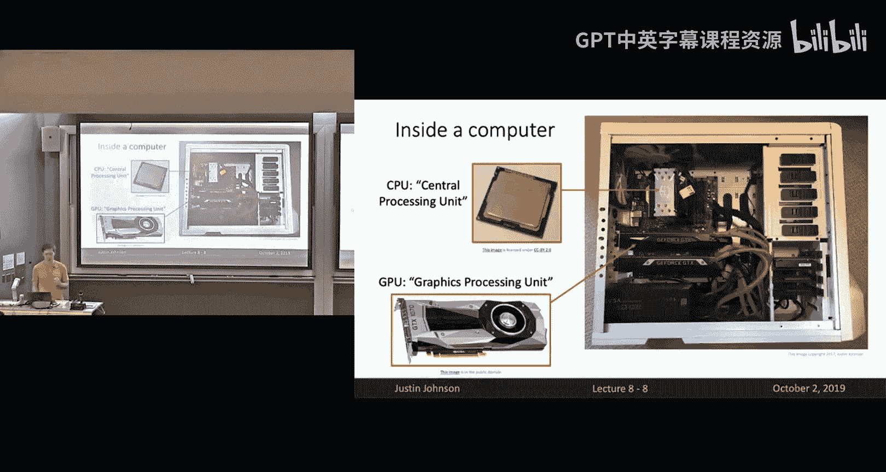

And you can see some clear trends here。 One is that both flops for dollar has been increasing over time for both cus and GPus。

 but when it comes when it comes to Gus， there's been a dramatic explosion a dramatic reduction in the cost of computing since around 2012 So if we rewind back to about 2006。

 was this Gforest Gtx 8800 GPu from Nvidia that was an amazing graphics card for gaming。

 but it was also notable for being one of I think the first Nvi graphics card that supported Kuda。

 which is their general purpose programming framework。 So about that time， this was 2006。

 this was well before Alexnet became mainstream。 But even at that time。

 NviDdia was investing heavily in this idea of using GPUs not just for gaming。

 but for really general purpose scientific computing。

 the whole software stack that we use now was really started to develop around that time in 2006。

 And then you can see that as we move from 2006 to 2012。

A huge divergence in the cost of computing between CPUs and GPus。 And here I pointed out the G T X 5。

80 GP that Alex Kchevsky used for training Alexnett。

Which as we saw at last lecture was this absolutely breakthrough result in deep learning。

 And you can see that by the time we got to 2012 and the GTX  by 80。

 there was performing large scale computation on GPU was much。

 much cheaper than performing computation on CPU， which gives us some sense for why AlexNe was able to be so much larger than any of the other convolutional neural network models that had come before。

And now if we fast forward from 2012 up to 2017， you can see that GP even though CPUs have somewhat flattened in their cost per cost of computing。

 GPUs have been continually accelerating。 and you may have heard that Moore's law is dead。

 that is really not not seems not to be the case with GPUs。

 that continue to get faster and better and cheaper every year。

 and I think my personal opinion is that this period from 2012 up until now has been this massive explosion in deep learning。

 people have been training ever bigger models on bigger data sets and I think a big reason for that has just been the rising availability of very cheap compute due to these advancements in GPU computing between 2012 and now。

So this gives you a sense of the general trends。 but let's also drill down into a couple specifics。

 So that this previous chart was we said a little bit out of date。

 but I went and pulled some numbers for some actually current CPUus and GPus。

 if we look at a top of the line consumer CPU today actually not today this thing will be released a month from now in November。

 but this is the rise in 9 3950x CPU that seems pretty cool again will be released a month from now。

 and this thing has 16 cores it runs at a base clock of 3。

5 gigHz it relies on the system RA in the memory of of the overall computer doesn't have its own iterated memory and runs it will retail I guess for about $750 And now if and then so actually I said this chart is a little bit out of date。

 I think actually there's been a pretty dramatic increase in the capability of CPUs in the last couple of year in the last couple。

ear， I think especially as the Ron line has really shaken up the CPU field and previously Intel was kind of the winner on CPUs and that was kind they were kind of the undisputed champions of CPUus。

 which I think explains maybe this flattening of progress for several years in CPUs。

 but since I made this chart there's been a lot of CPUs produced by it's not AMd anymore。

 what is it called anyway now there's a competitor to Intel， they produce really good CPUs。

 and they've actually become very very cost efficientff as well。 So if we multiply all this out。

 we see that this top of the line consumer CPU hits about 4。8terof flops per second。

 which is fairly fast， that's a lot of computation。

 but if we compare that to the current top of the line consumer GP， which is the Nvidia Titan Rtx。

 which is a bit more expensive， but you'll see that it is significantly more powerful computationally and can achieve。

More than three times the total number of floating point operations per second。

Now kind of the kind of cartoon picture that you should have in your head of what a CPU can do versus what a GPU can do is that CPUs tend to have fewer cores。

 but those cores tend to be much faster and those cores tend to be much more powerful。

 they have maybe better branch prediction， they have maybe better caching strategies for memory and the individual cores in a CPU tend to be able to do a lot more GPUs。

 on the other hand， have cores that run are relatively stupid cores compared to the innovations you see in CPU cores and they run at lower clock speeds So you can see that in this consumer CPU they run at maybe 3。

5 gigHz and a GPU runs at like 1。35 gigHz So the individual cores are running something like 2 to3 times slower on a GPU but there's just a lot of these cores。

 So if we compare these 16 cores on the CPU versus 4608 cores on a GPU you can see that the GPU just has a lot more individual compute elements in it that let it do more computation overall I should also point out that。

This head by sometimes you'll see these side by side comparisons of core count between CPUs and GPUs。

 and it's actually a little bit unfair because the CPUs actually have these vector athmetic units now as well that can do multiple operate on multiple instructions in a single clock cycle。

 So it's not really fair， I think， to compare the core count on a CPU to these coupa cores that you'll see advertised by NviIDdia。

 but still it is true that GPUs tend to have a lot more computing elements overall。

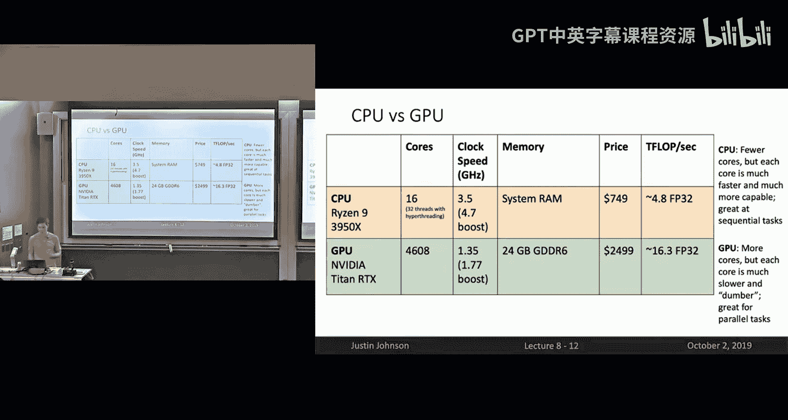

To make that a little bit concrete， we can dive inside this Rtxttan GPU。

 So if are if if you have one of these GPUs and you crack it open， you'll see something like this。

 You see that this GPU is basically like a little minicomp unto itself。

 that inside the GPU it has its own fans because it gets really hot So it needs to cool itself and those are integrated into the unit。

 And then it has its own memory modules So if you look at these blue boxes these are each of these is a two gigabyte memory module and there's six of them in here for 24 gigytes of memory inside the GPU device itself。

 And if you look inside this red box。 This is the actual heart of the GPU that is the actual processor。

 So these GPs are really like like little tiny minicomps that that have everything they need to do computation inside one little compact device。

 And if we zoom into this processor we see this giant grid of compute elements。

 and you can see that it's very heterogeneous。 there's a lot of these repeated compute elements stacked side by side in a grid。

 And in particular， the core。

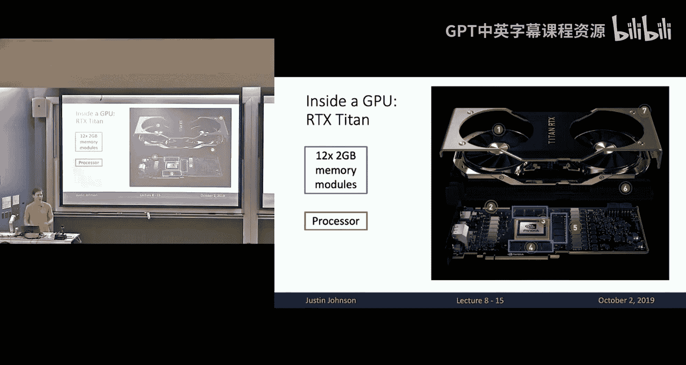

element of an NviDdia GPU are these so calledled streaming multiprocessors or Ss。

 And you can see that in this RTx Titan GPU， it has 72 of these identical streaming multiprocessors inside of it。

And now these streaming multi processorcess are maybe somewhat more akin to a CPU core on a traditional CPU。

 So if we zoom inside of one of these streaming multiprocessors。

 we see that there is even yet still more heterogeneous rather homogeneous compute elements inside each of these little streaming multiprocess inside the GPU。

So in particular， here is actually finally， after zooming in multiple levels of Zoom。

 we finally found the actual computingut elements inside the GPU。

 so this little red box is one of the 32 bit floating point cores that actually performs floating point arithmetic deep inside the GPU and you can see that this inside each of these streaming multiprocessors。

 they have 64 of these 32 but floating point units per streaming multiprocessor。

So then when you multiply all this out， we know that there's what 72 streaming multiprocessors in the GPU。

 each of those multiprocessors has 64 floating 32 cores and each of those little individual cores can do two floating point operations per clock cycle because they can do a multiply and an accumulate in a single clock cycle so that counts as to there' a multiply and an ad So when you multiply all that together。

 you get this number of 16。3 terlops per second that NVIDdia advertises。

But if we look at this streaming multiprocessor， you can see that theres a lot。

 there's more going on inside of this thing beyond just these F P 32 cores。

 I'm not sure if the text is big enough for you to read， maybe in the back。

 but next to the F P 32 cores is something with a very suggestive name called a tensor core。

So this is a new bit of architectural element that NviIDdia has introduced into its GPUs in the last several years。

 and this is basically a specialized bit of hardware deep inside the GPU that' specifically meant for deep learning。

 So deep learning has been so important to NviIDdia that they've actually changed the underlying architecture of their hardware to be better suited to deep learning。

 So in particular， these tensor cores are specialized hardware that do little chunks of matrix multiply。

 So in particular， if we have a four by three4 by four matrixrices， A B and C。

 then this tensor core can compute a times b plus C。 where each of them is a four by four matrix。

 It does that matrix multiply plus an addition in a single clock cycle。

 So it's a special little purpose bit of hardware that's only point in life is to do4 by4 matrix multiply plus a bias term。

 And you can imagine that we've seen in deep learning。 we use a lot of matrix multiplication。

 and we use convolution， which is basically matrix multiplication。pl a bias。

 so you can imagine how you could break up the implementation of a matrix multiply or a convolution to do it all in terms of little4 by four matrix multiplies that could then be mapped onto the tensor core elements deep in these SNs。

So if you count the number of operations that it takes to multiply two 4 by4 matrices， plus an add。

 plus adding another 4 by4 matrix for the bias， you can see that it takes 128 floating point operations to do that matrix multiplication plus a bias so then that can do a lot of computation per clock cycle。

So you might imagine so you can imagine that these seem like they can do a lot more computation than the FP32 elements in the GPU。

 so we actually there's got to be some catch。 we've got to give up something and it turns out that what we give up is the precision of the arithmetic that we use for computing these things so normally when we do deep learning we do our arithmetic in 32 bit floating point which means that each number is represented by four bytes but when inside the tensor cores。

 they actually use multiple levels of precision for computing this matrix multiply and that allows them to build more compact hardware that is faster and more energy efficient。

 so in particular these little tensor core units actually perform all multiplication steps using 16 bit floating point and then they perform addition steps using 32 bit floating point and using this idea of mixed precision it lets them pack a lot more compute into a very tiny and efficient space。

So then if we multiply all these things out， see then we want to ask how much computation does this device have when we consider the tensor core units。

 So we still have 72 streaming multiprocessors within each of those streaming multiprocessors。

 there are 8 tensor cores， each of those tensor cores can do 128 floating point operations per cycle。

 So if you multiply by the boost clock speed of 1。77 gigHz。

 then you get a total throughput for this device of 130 teroflops per second。

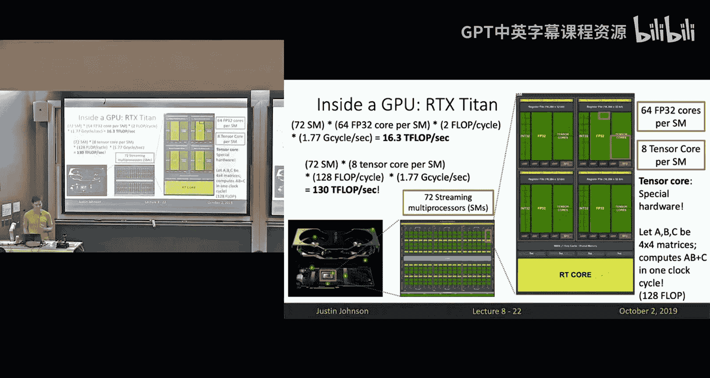

Which is a lot of computation。So now if we return to this table of CPU versus GPU。

 you can see that we were actually quite underestimating the true power of these GPUs in this previous table。

 so it's true that when you consider only 32bit floating point arithmetic。

 then I think some of these modern CPUs with a lot of clocks and a lot of vector arithmetic are actually maybe catching up to some extent to GPUs。

 but when you consider this special purpose tensor core hardware that is now shipping inside NviIdia GPUs。

 then you can see that GPUs are still dramatically more efficient and have dramatically more computational ability than CPUUs。

So then if we revise our chart， we can add， we can actually add a new green dot on the upper right here showing the first NviIdia GPU that consumer NviIdia GPU that ship with these tensor cores。

Yeah。We just initialized。6。坚持。Yeah， the question is how do you utilize these Tensors and Pytororch and all you have to do is flip your input data type to 16 bit and then if you've got the right hardware installed and the right NVIDA drivers installed。

 then it will automatically accelerate any computation that can be accelerated。

 it will automatically go on the Tensor cores so it's actually very easy to utilize these Tensor cores from the user perspective。

Although I should point out that optimizing these models now when you're doing arithmetic and mixed precision actually optimization becomes a little bit more finicky。

 so there are some tricks that people play around like which parts of the model do you want to compute in full precision。

 which parts do you want to compute in mixed precision and sometimes people play some tricks with the optimization techniques in order to make the optimization more numerically stable as you move to lower precision。

But that said， I think it's worthwhile because， as you can see。

 the Tensor cores give nearly a 10x speed up over the FP 32 cores in the GPU。

So as kind of an example of why matrix like the prototypical example of an operation that is much。

 much faster on a GPU compared to a CPUU is matrix multiplication and you can recall that matrix multiplication if we have two matrices then each element in the output matrix is an inner product between two big vectors and this is a trivially paralyizable problem because each element in the output matrix can be computed independently because it's just an inner product of different rows and columns of the input matrices so you can imagine that this type of problem maps very perfectly onto a GPU that what you can do is take each of these output elements in the output matrix and assign them to different streaming multiprocessors or different sets of F32 cores within the streaming multiprocesor processors of the GPU and in doing so it's kind of a perfectly parallelizzable problem that is extremely well suited to the hardware that is present in GPUs if you contrast this with kind of a single traditional single core CPU model。

It has to iteratively compute each of these outputs one by one and it doesn't have as much ability to paralyze over many。

 many computing elements and you can also see how matrix multiplication is a perfect example of an operation that can be accelerated by these tensor cores because now if we have a little computing element inside our GPU that can compute four by four matrix matrix multiplies plus a bias in a single clock cycle then you can imagine breaking up this output matrix into a four by four matrix chunks and then assigning those little chunks into different tensor core elements and again perfectly distributing this matrix multiplication over all of the available computing elements Yeah question。

啥证。Yeah， the question was， is。Yeah， the question is is4 by four the limit for what we can do in a single round and that's true these for the current generation of tensor cores because basically this thing is like a specialized piece of hardware that like takes in takes in literally a 4 by4 matrix and another  four4 by4 matrix and then produces an output 4 by4 matrix So it's kind of that size is hardwired into the hardware Of course you can emulate different matrix multiplies and software So say if you wanted to do5 by5 matrix multiply。

 then you could simulate that with four4 by4 matrix multiplies where you pad them out with zeros。

 And I think if you， for example， actually compute large matrix multiplies and pytorch with funny sizes then the underlying matrix multiplication routines will do this padding and splitting up automatically for you。

 but that's actually a good point that you'll sometimes see that powers of two。

 especially large powers of two are the most efficient GPUus and that's because。

You don't end up wasting compute in the way that you split things up across the device。

 so you'll often see neural networks that have their sizes of everything in power as a2。

 and that's really a result of this underlying GPU hardware that they're running on。

So GPUus can be programmed and in order to program GPUus in order to program NviDdia GPUus。

 we write in a programming language called Kuda and KUa is kind of like an extension sort of like an extension of C or C+ plus that lets you write code that runs directly on the GPU I think it's actually pretty fun to writeuda code it's sort of a different method of programming and it kind of is a very different way of thinking about decomposing problems but Kuda programming is unfortunately beyond the scope of this class however。

 there is another EECS 598 running this semester applied GPU programming that the whole thing is about couda programming so I think that could be a good resource for learning how to program in coUa if you're so inclined but in practice it's actually relatively rare for deep learning practitioners to need to program in coUa because NviIDdia provides very heavily optimized routines for matrix multiplication and convolution and batch normalization and all these other operations that we want to use in neural networks So in practice most people will just stick with pytorch and then even。

In Pytorch， they don't implement everything in Kuta， they often even inside Pytorrch。

 they'll rely on these heavily optimized matrix multiply or convolution routines that are written by NVIDdia。

 So I think it's kind of a fun exercise to learn how to program in Kuta。

 but it's not always a necessary skill for being productive in deep learning。

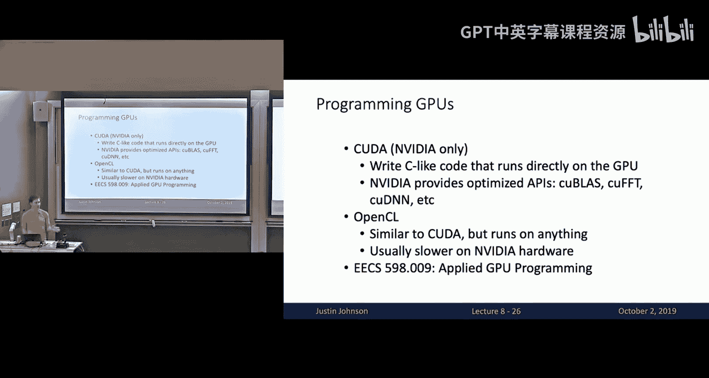

Now so far we've talked about only single GPU devices and how great they are。

 but that's not really the end of the story people more and more these days are interested in scaling up their compute beyond single GPU devices。

 so in practice it's very common to buy servers that actually have eight GPUs per server and then distribute your computation across all of the GPUs in a server or even stack multiple8 GPU servers in a data center and then distribute your training across multiple GPUs across multiple servers across an entire data center it's interesting to think so then you kind of get this hierarchical decomposition of like servers into GPUs intoor into stream multiprocessors into tensor cores and it's just like lots of levels of hierarchy in parallel computing。

So for the longest time， for many， many years， NviDdia had sort of been the only game in town when it comes to hardware that people use for deep learning。

 but in the last couple of years， another competitor came onto the scene。 that was actually Google。

 So the last several years， Google has been producing their own specialized pieces。

 their own specialized hardware devices for performing deep learning computation。

 the the first such piece of hardware that they talked about publicly was the cloud TPU V2 that has about has 180 teroflops of compute for one of these boards。

 So that's sort of on a similar order of magnitude as the Tensor course inside the latest NviDdia cards。

 and it also has quite a lot of memory inside inside the card itself。

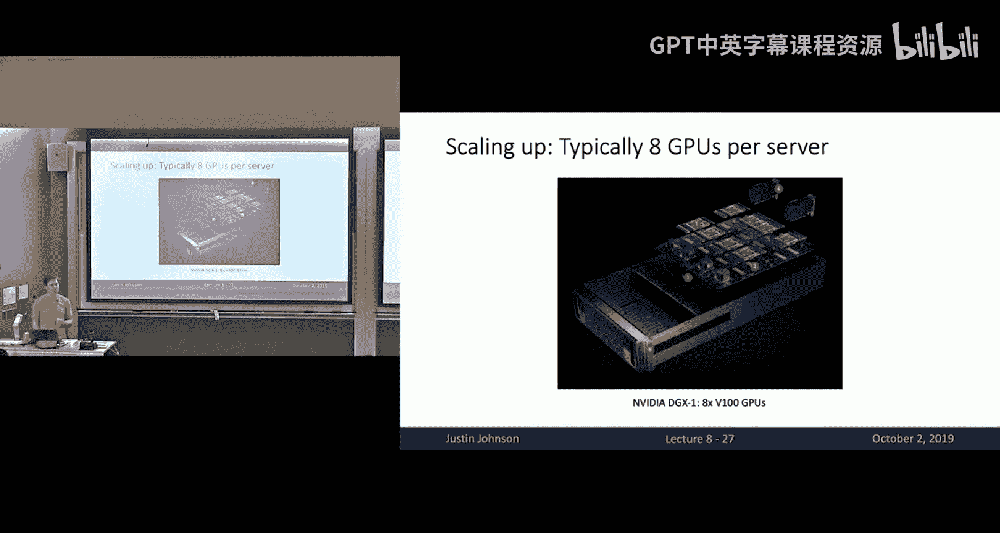

And Google' is a little bit secretive about exactly how these chips work。

 but my impression is that they're fairly somewhat similar in design to the Tensor cores inside of the NVIDA cards that they also contain specialized hardware that performs low precision or mixed precision matrix multiply in a single or few numbers of clock cycles。

And you cannot buy these things， but you can rent them on Google Cloud for $4。50 an hour。

 or I don't know if you've poked around at the settings on coLab。

 but there's actually an option for you to use these cloud TPU V2s for free on coLab。

 which we have not done for assignments， but it's I think very cool that you can use these for free on coLab。

But as we said， people are more and more interested in scaling beyond single compute devices and scaling to entire data center level compute。

 so the TP is really shine when they're assembled into these so-called TU pods。

 so Google creates these large rackscale solutions called a TPU pod that has 64 of these chips in one integrated machine and if you add these things all up together then it gets 11。

5 petaflops per second of computation and if you can rent them on Google Cloud for the low low price of $384 per hour。

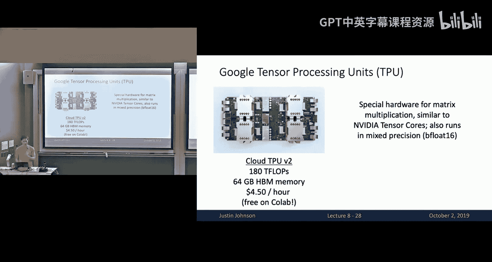

Now this is the Google Cloud TPU V2， so you can imagine that the following year。

 they followed it up with the cloud TPU V3， which just multiplied all the numbers on the previous slide by some large factor。

 so the cloud TPU V3 now has 420 teraflops on one of these boards and it rents for $8 an hour and the cloud TPU V3 pod has 256 of these TPU V3 devices for a total compute of more than 100 petaflops of compute all in one piece of programmable hardware that you can run your neural network models on。

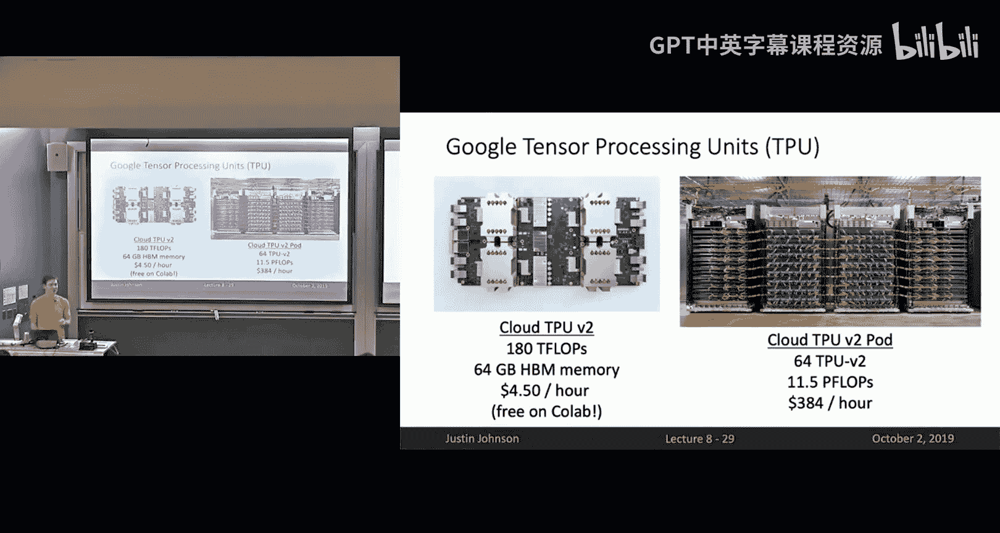

But unfortunately， for the TUV3 pod， you're going to need to call for pricing。

 those are too expensive I guess， to even put pricing on the website。

 so you need to talk to a sales rep if you think that you are willing to spend enough to purchase one of those things。

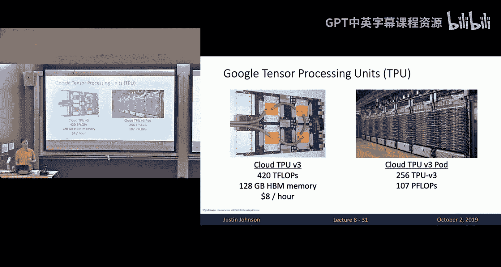

One big down one big caveat about Tpus is that in order to use TpUus， you need to use Tensorflow。

 So we'll talk a little bit more about Tensorflowlow later in the lecture。

 but that is Google's deep learning framework。 However。

 that might not always be the case if you go on pytorch Github and you kind of look through some of the commits that have been happening over the last couple of months。

 months。 You start to see some suggestive commits in the pytorch commit log。

 like this one that purports to add a TU device type and backend type for Pytorch tensors。

 So maybe one day maybe this is something they're working on。 I don't know。

 But it's kind of fun to look at the commit log of these open source projects。

 and you can get some sense of what features might be upcoming in the future。😊，有。

When I look at GPUs online available。That's ran。The ones there。具P。Yeah。

 so the question is that when you compare GPUs built for gaming and GPUs built for deep learning。

 they often differ in their memory， the memory actually differs in two ways。

 One is the amount of memory， so the GPUs built for compute tend to have more memory that allows you to train bigger models on the device because if you remember how back propagation works when you perform the forward path you're building up this computational graph that needs to store all the activations and those activations are getting stored in the GPU memory and then so then the size of the depth or size the model that you can train is somehow constrained by the amount of GPU memory on the device itself consumer GPUus tend to have less memory because they're really meant for gaming and you don't need 60 gigytes of GP memory to play games but for deep learning then you want a lot of GPU memories you can store all these activations of your computational graph up in memory for back propagation but actually the other big difference between consumer GPUs and compute GPUs is not just the amount of memory but also the type of memory。

So if you look at the consumer GPUs， they'll often use something like GDPDR6 in the the most recent consumer GPUs。

 whereas the computeoriented GPUs will use something called high bandwidth memory instead。

 and the difference is the bandwidth of the memory between the compute elements and the memory of the GPU because it turns out that GPUs are actually so fast that for many operations inside the GPU。

 actually moving the data for between the GPU memory and the compute elements is actually much more expensive than performing the computation itself。

 So for something like a Raylu that only performs one floating point operation on each element in the tensor。

 it's actually not bound by by the compute speed， those are actually bound by the speed which the GP can shuffle the data back and forth between the compute elements and the memory。

 So having increased memory speed and increased memory bandwidth also increases the overall speed of training these devices。

 even though the compute speed might look the same on paper。

So that's pretty much all I have to say about deep learning hardware。

 Are there any questions about GPUs or TPUs or CPUUs before we move on。Okay。

 but I I think those are super fun to think about。 So the next question is deep learning software。

 So probably you maybe won't have a lot of chance to play around a lot of different hardware computing environments because these things are pretty expensive。

 But on the software side， you actually have a lot of choices when when you're doing deep learning。

 So deep learning has been had this kind of zoo of different deep learning frameworks that have popped up over the years。

 in the early days， a lot of these some of the big ones that were used a couple years ago where things like Cafe and Torch and Fiano。

 they came out of academic groups like UC Berkeley NYU and Montreal。

 but increasingly as we moved to second and third generation deep learning software systems。

 we increasingly see that these are no longer built in academia and maintained by grad students。

 But instead these are built in in big industry groups that have a lot of staff on site to properly engineer these things and support them。

 So some of the bigger deep learning frameworks that you've seen in the recent years are cafe2 and pitorrch。

😊，That are produced that are built by Facebook。 Google built Tensorflowlow。

 Amazons does a lot of support of M Xnet。 Microsoft had this one called C NTK。

 the cognitive computing toolkit。 and Baidu had this one called paddle paddle。

 And there's some other ones like Chaer and Jax is this really cool upcoming framework from Google of it。

 we'll see if it gets traction in the next few years。 So for the longest。 So for a while。

 in deep learning， it felt like every time we did a project。

 you had to learn a new deep learning framework。 because these things were constantly evolving over time。

 that also made it hard to give this lecture because I needed to redo everything every year。

 But thankfully， I think the last few years， things have settled a bit。

 and kind of the mainstream deep learning， the two big mainstream deep learning frameworks today are Pytorch and Tensorflowlow。

 So these are the ones that I want to focus on。😊，Now recall that one of these central ideas in deep learning is this notion of a computational graph that want when we build and train neural network models。

 we have this notion of building up computational graphs in the forward pass for each of the operations that we perform inside of our model。

 and then during the backward pass， we want to traverse traverse backwards。

 this computational graph in order to compute the gradients of the loss with respect to the weights and then ultimately make our gradient step to update the model。

So this idea of a computational graph is really central to all deep learning frameworks。

 And if you think about what is the points or what are the big killer features that we expect from any deep learning framework。

 I think it boils down to these three。 One is that we rapid we want the framework to enable us to perform rapid prototyping of new ideas。

 That means that it should provide a lot of common layers and utilities for us。

 so we don't have to rewrite them ourselves for every project。

 Second is that it should be able to automatically compute gradients for us using this abstraction of a computational graph。

 in this class we've sort of forced you to write gradients for yourself because I think it's very instructive for you to do。

 but when you're out there in the world， it's actually much more efficient in practice to not drive those things yourself and instead let the software compute them for you。

 So a really efficient and effective mechanism for gradients with back propagation and computational graphs is the second key feature of all of these frameworks。

 And finally， the third major feature is running。This stuff on GPUs or TUs or whatever other other exotic hardware devices might come out in the future I mean。

 this is maybe a little bit hard to appreciate today because in PyTtorch。

 it's so easy to just run things on GPUs that it's so trivial why wouldn't you do it But if you look at the development of deep learning frameworks over time and the history of GPU computing in general it wasn't so long ago that running general purpose code on GPUus was really pretty painful and not so easy to do so I think things like Tensorflow and Pytororch have really been a triumph not just for deep learning but also for GPU computing more generally that they've made it really easy and really accessible to write code that is able to run parallellyze its operation over GPUs even without knowing any of the specifics about how the hardware works。

So with that kind of context in mind， let's dig a little bit more into some parts of pieytorrch that we haven't explored yet。

So a big one big caveat that we always need to mention is software versions。 So for this class。

 we are now using Pytorch version 1。2 because apparently coab updated in the last week or so from 1。

1 to 1。2 So now we're using 1。2 from now on。 Sorry about that。

 actually I was surprised by this I was running some examples and I saw all of a sudden Pytorrch was the new version there was no public announcement。

 there was no release notes， they just silently swapped the pytorrch version on everyone using coabab and it was a surprise So I think that actually bit some people on the homework around random seeds because when Pytorch switched from 1。

1 to 1。2 then I think what outputs you get for the fixed random seed actually changed and I think we saw some confusion on piazza around that point because when Pytorrch updated to 1。

2 then we had developed the assignment on 1。1 and the random seeds changed a little bit。

 So I apologize for that but it just happened silently。

Also a big caveat is that if you're looking at older Pytororch code， especially pre1。0。

 there was a lot of breaking changes in the Pytororch API， especially between 0。1 and 0。

4 so I think Pytororch 1。0 has been relatively stable in API for about the last year or so。

 but if you're out there in the wild on the internet looking at random Gitthub res you'll still see a lot of really old outdated Pytororch code that might not work under the more stable releases today。

 so that's just a caveat to watch out for。So I think the way I think about Pytorch is that there's kind of three different levels of abstraction that it gives you for building your neural network models。

 the top level， the lowest level of abstraction is the idea of a tensor。

 and that's the level of abstraction that you've been working with so far and all of the homework assignments where a pytorch tensor is just an array kind of like a multi-dimensional array that runs on GPUs and you can do operations on it is's basically like nupi but runs on the GPU if you're familiar with other libraries。

 but Pytororch gives you two other levels and in the first couple of homework assignments。

 you've seen how you can use only this tensor API for building neural network models and computing gradients and performing gradient descent and you can do all of that stuff using just this tensor API but Pytororch gives us a couple other higher levels of abstraction for thinking about building neural network models。

 The second is this autograd level for automatic gradients。

 And this is this is the part of pytorrch that lets us automatically build up computational graphs and backproagate through them。

In order to compute gradients and finally， there's yet another level of abstraction called the module level。

 where a module is now something like an objectoriented neural network layer that actually stores inside of itself state like learnable weights and by composing modules。

 it makes it very easy to build big neural network models。

So basically the way this breaks down is that on the first three assignments。

 we constrained you to only use this tensor8 interface in Pytorrch， but starting on assignments 4，5。

 and 6， then you'll be using the full generality of these different layers of abstraction to perform different types of computation。

So as kind of a running example throughout the rest of the lecture。

 we're going to use this example of training a two layer fully connected network with raylu non millarities with an L2 loss function iss kind of a running example to see how this works both in different frameworks and in different layers of abstraction。

 So something like this code on the screen now is something that you should be very familiar with by this point in the class。

 This is basically training a neural network using only these tensor operations。

 So at the top we're kind of creating random tensors for our data and our weights here we're doing a forward pass where it's a a matrix multiply and a raylu and another matrix multiply and an L2 loss function and then here is computing the backward pass where we manually compute the gradients of the loss with respect to the weights and then here is a gradient descent step where we actually update the weights and this type of code should be very familiar to you at this point in the semester。

And again， you know that flip in order to move and do all this computation on GPU。

 all you need to do is change this device argument that the tensors are placed on。

 and then all of your compute transparently runs on GPU。

Now we can move to the next level of abstraction， which is autograd。

 and first observation is that the code is quite a lot shorter。 So that's hopefully a good thing。

 And the idea with autograd is thator so far we've constructed tensors in various ways。

 But whenever you construct a tensor in pytorrch there's always another flag you can set called requires grad。

 And all you have to do to make pytorrch build computational graphs for you is set requires grad equals true on parts on the tensors that you want to build computational graphs。

 So here is an example of now training the exact same fully connected neural network model。

 but using the autograd level of abstraction in pytorch。

So here we can see that we're still initializing random tensors for the weights and the data。

 but now for our weight matrices， W1 and W2， when we construct them。

 we pass this additional flag requires grad equals true when constructing the tensor。

 and this tells Pytorch that these tensors are ones that we want it to track and build computational graphs for us。

And now our forward pass is actually very much abbreviated because we no longer need to explicitly keep track of all these intermediate results in the computation ourselves。

 because any intermediate results that will be needed for back propagation will be stored by pytorrch automatically somewhere in this computational graph that is being built up in the background for us。

 So to think and then these lines are then computing the forward pass。

 it's the exact same sequence of operations that you saw in the non-augrad example。

 the only difference is that now we can just throw away these intermediates because we don't need to explicitly store them。

And now after we've computed the forward pass and the loss。

 then we have this very magical line called loss stop As。

 and this one line of code is telling Pytorch to traverse the graph for us and compute all the gradients with respect to all of the weights that were taking as input。

So to walk this through this a little bit more concretely。

 the way that this works is that whenever pytorch whenever Pytorch performs a primitive operation on tensors。

 it checks whether any of the inputs that operation have this requires grad equals true flag set。

 and if any of the inputs to a pytorrch operator have requires grad equals true。

 that then pytorrch will in the background start building up a computational graph data structure that represents that computation So when first when this first function。

 this matrix multiplication between x and W1 runs， then because W1 has requires grad equals true。

 then pytorch will silently start building up this computational graph in the background that has the inputs x and W1 has a node for matrix multiplication and then has an output which is some anonymous tensor that is stored in the graph but is not given a name because we don't have any name for it in our code。

Then when we perform the clamp operation， then well， the output of this。

 So the other rule is that when pytorch when Pytorch performs an operation on any input that has requires grad equals true。

 then the output also has requires grad equals true。 So this all kind of works out recursively。

 So then the next thing is that when this dot clamp line executes。

 then it's operating on this anonymous output tensor that also has requires grad equals true。

 So this line will build up a new chunk of the computational graph。

 when this matrix multiply line runs， then we build up more computational graph and now rope in W2。

 when we perform this subtraction， we get more computational graph。

 This power adds more to the graph。 And finally this sum performs the final part of the graph。

 So then then basically every time Pytorch performs a primitive operator。

 it's just adding more onto whatever computational graph has been built so far。

And now when you call loss dot backwards more concretely you can see that we're calling loss dot backwards and loss is kind of the end thing which is a scalar at the very end of the computational graph。

 and then when you call loss dot backwards， a couple things happen one is that pytorch searches through the graph to find any leaf nodes that have requires grad equals true so the leaf nodes are the inputs of all of the inputs to the graph that would be xw1 W2 and y in this case。

 and now it searches for any of those inputs that have requires grad equals true set in this case。

 W1 and W2 have requires grad equals true set which means that now it will automatically do some graph search to find the path between that output load node loss and all of the input nodes that have requires grad equals true set and then after finding these paths between the output and the inputs that need gradient it will actually perform back propagation and back propagate through each of these nodes one at the time。

And then after back propagation finishes， it actually will throw away that graph and just free all the memory that was used for that computational graph。

 and it will store the gradients that were computed for the inputs in these in W1。

 grad and W2 do grad， which will now be new tensors that contain the computation that will contain the gradients computed during back propagation。

And now that this lost stop backward has magically computed all the gradients for us。

 Then now we can use this W1 dot grad and W2 dot grad to perform our gradient descent step。

And then a very important step and a very common source of errors is that you need to explicitly set those gradients to 0 after you perform your gradient descent step。

 the idea is that when we perform back propagation。

 it actually if your tensors might already have some gradients hanging around in their associated tensors。

 And when you perform when you call lost backward， it actuallyt it doesn't overwrite the existing gradients。

 instead it computes the new gradients and adds them to whatever old gradients will already there。

 So that means that if you so the normal thing is we want to compute fresh gradients at every iteration。

 which means you need to explicitly zero the gradients of your tensors on every iteration。

 and I'm I'm embarrassed to admit I've made this bug more times than I want to say。

 but it's easy to forget these lines。 and sometimes things will still train without even if you forget to zero the gradients。

 and that can be very difficult to debug。I think it's maybe a bit of a design flaw in Pytorch。

 I think it maybe would have been better to overwrite by default and accumulate if if you want to opt into that。

 But this is the API that we have to live with now because it's 1。0 and it's supposed to be stable。

And now another bit of weirdness that you see in this code is that these gradient updates actually are scoped under this with Torch。

 nograd context manager。And what this means is that any operations that fall under a nograd context manager mean that we're telling Pytorch to justt track don't build computational graph for any operations that happen within this context even if those even if some of the tensors did indeed have requires grad equals true so this context manager just overrides whatever the requires grad flag was on individual tensors and the reason for this is that we don't want to back propagate through our SGD steps that would cause memory to leak from iteration to iteration and it would just be very confusing and it would not be the SGD algorithm that we mean to implement whenever so kind of as a rule of thumb whenever you're doing an update rule or zero ingredients or anything that is outside the computational graph then you want to scope it under one of these no grad context managers。

Now Pytorch Pytororch autograd is also extensible In this example。

 we've kind of written out the forward pass by calling these basic Pytorrch operators， yeah。

 was there question？拍过。The question was， are the gradients calculated numerically or analytically Well。

 they use the VA propagation algorithm that we've talked about so far in this class。

 which is not it's not finite differences。 that's what we usually think of when we say numeric gradients It's not really either。

 It's a different thing numeric gradients is usually something like a finite differences approximation using the limit definition of the derivative and back propagation is not that when you say symbolic differentiation。

 that usually means you build up some symbolic data structure and then manipulate the structure symbolically to compute some new expression for the gradients。

 and back propagation is also not quite that。 back propagation is instead this structured application of the chain rule in order to compute sort of use the chain rule in the right way at every point in the computation in order to compute our gradients So it looks a little bit like symbolic differentiation but it's not quite traditional symbolic differentiation either。

But it's the back propagation algorithm that we've talked that we've been covering so far in this class。

Now， in this example， we've implemented our forward pass of the network using only these basic operators in Pytororch。

 like matrix multiplication， clamping， subtraction， etca。

 And it would be kind of a pain if you had to do all of your computation that way。 thankfully。

 Pytorch integrates very nicely with sort of basic abstract software abstractions in Python。

 So for example， you can define a python function which inputs Pytorch tensors and outputs pytorch tensors and then use that python function inside the neural inside the forward pass of your neural network。

 and this will work just fine。 So in this example， we're defining a sigmoid function and using this mathematical definition of the sigmoid in order to define a new function that we can then use in the forward pass of our network。

 But when when you define and this allows us to have some modularity in the way that we implement our neural networks。

But it's important to point out that when you use Python functions to perform modular computation inside neural networks or modularly structure your neural networks。

 then there's still a computational the computational graph level does not know about Python functions。

 then really the way this works， is that when you call the Python function。

 then each primitive Pytorch operation that happens inside of your Python function will just keep on adding to the overall computational graph。

 So that means that another way to put that is that defining things using using Python functions lets your code look sort of nice and modular and structured。

 But then every time your code runs， there will just be some giant computational graph that is kind of like a flattened version of all of the operations that you performed as your program traced through all of the different functions that you called。

So in particular， when this sigmoid function runs， then you can see that it will just add on more and more nodes。

 the computational graph for each of these primitive operations that we use to implement this sigmoid function。

 So we've got this minus one， this exponential， this plus one and this division。

And you may know that the sigmoid function is actually then when computing back when computing gradients through the sigmoid function。

 it will back propagate through each of these primitive nodes one by one using normal back propagation。

 But you may know that computing gradients through the sigmoid function in this way will actually be very numerically unstable and actually。

 if you implement the backward path of sigmoid by back propagating through this graph。

 then you'll very frequently get ns in or not a number overflow errors or infinities or other bad numerical things in your computation。

So pytorch also gives you and if you'll recall from a couple lectures ago。

 we saw that for the particular case of the sigmoid function。

 the local gradient of the sigmoid function has this very nice mathematical form that you can work out on paper which is that back propagating through the sigmoid as an entire unit unto itself then we get this very nice expression for the local gradient of the sigmoid function and in cases like this where we do not where we actually have some special knowledge about the way that gradients should be computed then pytorch gives us another layer of abstraction to implement this and that is to implement a new autograd function that is very similar to these little forward and backward modular APIpis that we've talked about previously so so by defining a new autograd function。

 this lets you define new primitive operations that will give rise to just one node in the computational graph So when defining a new autograd function。

 you can see that we define a forward which computes the forward pass then。

We also define an explicit backward function， which is receiving the upstream gradients。

 computing local gradient and returning the downstream gradients。

And now if we were to use this autograd function version of sigmoid in our computational graph。

 then this would give rise to only a single node in the computational graph and in order to back propagate through it it would just use this backward function that we had implemented for this one node but in practice。

 so it's very nice that Pytors gives you this flexibility and this freedom to very easily implement new basic elements of computational graphs。

 But in practice this is less common to see。 I think it's much more common in practice to just use Python functions to implement most things。

 but sometimes you need to actually use the mechanism on the right to define your own new primitive operators。

😊，Of course， then the next layer of abstraction in Pytorrch is the NN module。

 which gives us some kind of objectoriented API for building up neural network models and now this becomes very expressive very quickly。

 so here you can see that NN gives us this objectoriented API where now at torch。

 nN do sequential is some container object that is meant to that maintains a sequence of layer objects and then within each then we provided layer objects like a linear layer that stores the learnable weights and the learnable bias as attributes inside of that object。

 which means that we can now define the structure of our neural network model by just composing these layer objects like sticking them into containers。

And now when we compute the forward pass， all we need to do is pass the data to this object that we had built and that computes the forward pass for us。

 then torch NN also gives you common loss functions。

 so you don't need to implement those anymore from scratch。

 Then we can still call lost stop backward to compute gradients。

 and then the gradient descent step now looks very similar。

 We iterate all over all of the learnable parameters in this model and update them using our gradient descent rule。

Of course， it's kind of annoying to implement your own gradient descent rules all the time。

 so Pytorch also provides optimizer objects that implement common gradient descent rules so here you can see that we can build an optimizer object that encapsulates the atom optimization algorithm and we pass at the model parameters that we'd like to optimize as well as the hyperparameters like the learning rate and now when in our training loop。

 all we after calling after computing gradients by calling losstop backwards。

 all we need to do is call optimizer step and that will automatically make the gradient step for us and of course we also need to remember to explicitly zero the gradients after we step and this is again a common source of bugs。

Another very common thing to do in Pytorch is actually define your own new NN modules。

 In this example， our model had a structure that kind of made sense as a sequential sequence of layer objects。

 but in more general situations that aren't just sequences that you'll need to define your own module subclass that represents your computation So here we're again defining a two layer neural network with a rayluon nonlinearity as by defining our own custom subclass of the module class so in particular。

 you can see that here the initializer of our custom subclass takes in the sizes the sizes of the hidden layers and the sizes of the outputs that we need and then it actually constructs layer objects that are these linear objects that are built that are constructed in the initializer and then assigned as member variables inside our own module object。

And now in this forward pass， we can use any of those module objects that were built in the initializer to perform our computation。

 So you can see that we compute the forward pass by calling by passing the input to the first layer object。

 then calling then clamping the output of that to to our relu and passing the output of that to the next layer object to perform to predict the final scores。

 and then the rest of the training loop looks very similar。

I should also point out that a very common pattern is that you'll see people mix and match modules and sequentials or nest custom modules inside of other custom modules。

 and this is a way to very powerfully and very quickly and very easily build up very complex neural network architectures。

 So here's kind of a little toy example that gives you a hint of what you can do with this。

 So here we're we're defining remember in the last lecture。

 we talked about how many neural network modules are built up of these homogeneous blocks for something like a residual network。

 it has this residual block design and then the overall network is just repeating that same block design over and over again。

 So in situations like that， it would be very common to define a custom module subclass for the block that you want to use and then to build your model by instantiating multiple that subclass and stacking them together in maybe a sequential container。

So here in this example， we've defined kind of a weird little neural network block structure that I don't think is actually a good idea。

 but it fits on the slide here we're imagining a little kind of block design that computes two linear layers in parallel So our input is goes through one fully connected layer on the left then a separate fully connected layer on the right with different weights and biases and then the outputs of those two fully connected layers are multiplied elementwise and the results of those multiplication then goes through a raylu nonlinearity I suspect that this would actually not perform very well at all。

 but it's kind of a little instructive example that you can look at and then you can see that it's very easy to implement this idea sub by defining our own module subclass again in the initializer we define two separate andn dot linear objects and then in the forward pass we use those two linear objects to compute two parallel outputs then do this element-wise multiplication between them。

And then you can see that when we build the model， we build a sequential container that contains multiple instantiations of this little parallel block design。

 and this is a paradigm that you'll see very commonly in Pytorch code that kind of mix and match your own custom module subclasses with sequential containers。

Pytorch also gives you some nice mechanisms for loading data that make it easy。

 that can automatically build mini batches and iterate through data sets and all that kind of good stuff for you。

Pytorch also provides a bunch of pretrained models that you can literally get all these pretrain models in one line that all you have to do is import torch vision then if you want a pretrained Alexexnet。

 you just say Alexnet equals torchvision。 models Alexnet pre-trained equals true it will go out on the internet and download the pre-trained weights of the model automatically and cache them on disk for you and then return those weights for you to use right away in your code so this makes it very easy for you to quickly use pre-trained models to build up your own different designs and different architectures。

Now， a big point a major point of a major point of the design in Pytorch is this idea of a dynamic computation graph。

 What this means is that every time we run the four pass。

 we build up a new graph data structure and then when we call loss。

 we throw away that that graph data structure。 And the next time we run our iteration。

 we're going to build up another new graph data structure from scratch。 and then again。

 throw it away when we call when we call loss again。

 This maybe seems a little bit inefficient that it seems kind of silly to just build up that graph data structure on every iteration and then throw it away at every iteration again。

 just to rebuild the exact same thing at the next iteration。But what this means。

 but kind of the benefit of dynamic computation graphs is that it lets you use normal regular python control flow to control the flow of information through your neural network models。

 and that lets you do a very strange and funny and crazy things using very simple and intuitive code So here's an example that again doesn't make sense and I really don't recommend anyone use in practice。

 But here what we're doing is we're actually initializing two different weight matrices for the second layer of our fully connected network。

 this is W2A and W2B。 And now the choice of which weight matrix we use at every iteration of training is going to depend on the loss at the previous iteration of training。

 again， this is probably a terrible idea。 and I don't encourage anyone to write models that do this。

 But if you have such a crazy idea that you want to implement。

 you can see that it's very easy to do in pytorch just by using normal regular python control flow。

 And now in this way， on one iteration we might build up a computational graph that involves W2A then。

Then we'll throw it away and the next iteration will' build up a new graph that has W2B instead。

 and the main benefit of these dynamic computational graphs is that it lets the computation the structure of the computational graph be determined by normal regular Python control flow in cases where you want to maybe perform slightly different operations on different iterations。

 Yeah question。Tensor posts like this， too， really。We'll get to that。 Yeah， the question was。

 what about Tensorflowlow， I think， I think we'll hopefully get to that。 The quick answer is that。

 yes， it does now as of yesterday。So the big alternative to dynamic computation graphs is this notion of a static computation graph so here what we want to do is have a two stageage procedure。

 one stage where we build up a graph and then fix the graph for all of time and then in the second stage we iterate through and reuse the same computational graph many。

 many times and actually pytorch this is kind of a new functionality in more recent versions of pytorch Pytorch now gives you the ability to use static computation graphs using the Git or just in time compiler So what this means is that we can define our model as a python function it takes tensor input and returns tensorors as output and there's this very very very magical line called graph equals torch。

tscriptive model and what this very magical line does is it introspects the python source code for that function it parses the abstract syntax tree of the python source code of that function and then it builds a computational graph for you automatically after traversing the source code of your Python function and then returns。

Turns that thing to you as a graph object that you can call。And in particular in this model function。

 we see it has this conditional statement for this funny thing we were doing。

 and now the graph that is built for you has to now include some node in the graph that captures that conditional statement and now every time in every forward pass。

 will' simply reuse that same graph object and this can be even more succinct you don't even have to compile this thing explicitly。

 you can just add a torch dotit that script annotation to your code and itll have this compilation process will happen for you automatically when the Python process when the function is first imported into Python。

Now， one big benefit of static computation graphs over dynamic is the potential for optimization that you can imagine that maybe the graph you write is some long sequence of convolutions and batch norms and Raylus and things like that。

 And if we have a static computation graph， you can imagine using some compiler techniques to try to rewrite that graph in a way that might be more efficient computationally for example。

 you might want to fuse some operations like convolution and Ray and actually rewrite the graph in some non-trivial way that would make the computations be faster。

 and with a static computation graph， you can kind of amortize the cost of computing those optimizations or those graph rewrites and just do it once at the beginning of the program and then enjoy the speedups for the rest for every iteration where it might not make sense to separately re-optimize the graph at every iteration that might be too slow。

Another big benefit of static computation graphs is this idea of serialization。

 So what happens in practice with machine learning models is that people will want to train their models in some very expressive programming language like Python but once they have their models trained。

 they would like to deploy those models in environments that do not depend on Python So for example。

 what you can do with static computation graph is train up your model in Python。

 then export the static computation graph as a data structure on disk and then load up that static computation graph object into a C plus plus API to then run your trained model in a way that does not depend on the Python interpreter anymore。

 And this is again， whereas with dynamic computation graphs the code that builds the graph and the code that executes the graph is all kind of intertwined。

 So if you want to use this thing in production you probably need to depend on a Python interpreter and this was a big motivation for all of these tech companies really building in strong static functionality to their deep learning。

marks。A big downside of static computation graphs is debugging。

 So if any of you have used Tensorflow before， you'll see that it's sometimes very difficult to debug because there ends up with a lot of indirect between the Python code that you write and the code that eventually ends up getting executed。

 So you can come sometimes get very very confusing error messages。

 it can be very hard to know what's going on and what broke and very difficult to profile performance or other things like that。

 whereas with a dynamic computation graph。 the code you write is pretty much the code that runs。

 So they tend to be much easier to debug。Now， some applications of dynamic computation graphs are things where the structure of the model depends in some way on the input to the model。

 a canonical example of this is a recurrent neural network where maybe the number of time and we'll talk about these in detail in a later lecture。

 but the idea is that we input a sequence。 and now the number of time steps in the model is equal to the number of steps in the sequence and we want to perform different amounts of computation。

 depending on the length of the sequence that is passed into the model。

 they are also examples like recursive neural networks that maybe get used in NLP。

 So now the input to the model is some kind of semantic parse of a sentence。

 and now the structure like the way that the neural network model performs its computation is going to vary dynamically based on the structure of the parse tree that gets passed as input。

So these are， by the way， I don't expect you to know understand the details of these。

 These are just to to give you some flavor of where dynamic computation graphs can really shine。

And here's an example from Johnson at all two years ago。

 that is another example of dynamic computation graphs。

 So here we have actually one part of the model predicting what structure。

 the second part of the model should use。 So the first part of the model actually predicts some kind of program。

 and then that program is then implemented by the second part of the neural network model。

 So in order to do this not only does the computation of the neural network model depend on the input。

 the computation that the model performs depends on output of a previous part of the model And in order to implement models like this。

 I use Pytorch because you need you need this heavily heavy dependence on dynamic computation graphs to perform crazy models like this。

 And I think there's a lot of open open area for people to try out really crazy ideas。

 once we have this ability to build dynamic computation graphs very efficiently。

So that gives us just a couple minutes to talk about Tensorflow So Tensorflow I mentioned。

 has actually been going through kind of a schism in the last year or so。

 and kind of the classic version of Tensorflowlow is Tensorflow 1。

0 and actually yesterday was the final release or the release candidate of the final release of Tensorflow 1。

0。 Tensorflowlow 1。0 actually use static computation graphs by default everywhere。

 and later versions more some of the later versions of Tensorflow 1。

0 added some options to use dynamic computation graphs。

 But the main mode for doing computation in Tensorflow 1。0 was actually static computation graphs。

 Now， Tensorflow 2。0 was actually released this week on Monday。 and in Tensorflowlow 2。

0 dynamic computation graphs are the default。 and there is instead options to use static computation graphs So I think right now is a very dangerous time to read Tensorflow code on the internet。

 because you'll see。😊，See some horrible， horrible mix of 1。0 and 2。0。

 And sometimes even when you Google bits of documentation， they link between each other。

 and it's just a complete mess。 So I think maybe you should be careful。

 be very careful about reading TensorF code over the next couple of months。

 But hopefully in a year or so， maybe we will will settled on the 2。0 API。

So kind of to give you a flavor of this classic Tensorflow 1。

0 that it had this structure kind of like this that I don't want to walk through the details here。

 but in Tensorflowlow 1。0， your code always had two big chunks one at the top is this stage where you define your computational graph and then at the bottom is where you actually repeatedly run your computational graph and this is kind of the classic way that Tensorflow code was written and became this can be very difficult to debug now because what can happen is that in the piece of your code where you build a computational graph。

 maybe you have a shape error or a data type error or you mismatch the API in some way and you pass a tensor that doesn't make sense to some function Well then you don't actually get the error in the line of your code that caused the problem instead you only get an error message when you actually try to run the graph So what that means is that when you have an error then your stack trace will actually point to this mysterious session run line and you'll get a stack trace。

Deep into the guts of Tensorflow。 And the thing that caused the problem was maybe you had a shape error on one of the lines10 lines earlier here。

 And that can make debugging this classic Tensorflow code very challenging。But now in TensorFlow 2。0。

 it seems like they basically copied Pytorrch's API to some extent。

Because the dynamic graph API in pytorrch had been very popular。

 very widely very popular and very easy to work with and very easy to debug。

 So now if you look at this two layer network example in Tensorflow 2。0。

 it actually looks a lot like pitorrch。 Then you can see that here at the top we're kind of defining some tensorflow tensors。

 not pytorrch tensors that we're going to use to store our weights in our data。 Now。

 remember in pytorrch in order to track gradient we needed to set requires graph equals true。

 Well the equivalent in tensorflow is to wrap them in a TF variable object。 It turns out pytorrch 0。

4 force you to wrap things in a pytorrch variable object。

 but that was annoying API and that deprecated it， maybe Tensorflow will catch up in 3。0。

But then once we've done that， then in Tensorflow， we tell Tensorflow that we want it to track gradients for us by scoping our computation under this TF do gradient tape object。

 and that means that any operations that happen under this TF do gradient tape scope are going to build up a computational graph。

 much like the way that Pytorch builds up computational graphs when it encounters tensors with requires gra equals true。

And now to compute our gradients after we exit the TF。 gradient tape scopepe andd1 and call tape。

 gradient of loss with respect to the parameters， and that's a very nice line。

 it lets you remember what you're taking derivatives of what with respect to to。

 and that returns us new tensorflow tensors containing the gradients and then we can perform our gradient descent step as usual。

 so this should look very similar to this kind of autograd version of pytorrch code that we've seen。

Actually， now Tensorflowlow 2。0 also offers a very similar annotationbased jttingbased thing for static computation graphs that is very。

 very similar to the torch script annotation that we saw in pytorrch。

 So it's kind of nice to see these two frameworks kind of converging on some similar ideas when in the past that used to be very different。

 But now we can use static computation graphs in Tensorflow 2。

0 by defining our step function as some python function that takes the inputs。

 and then annotating it with this Tf do function annotation。 And again。

 this will perform a lot of magic and the python source code and build up aython and build up a computational graph for us by intersflecting the python source code。

 one thing to note about the Tensorflow version of these things is that in Tensorflow actually the gradient computation and the update actually can be part of your static graph as well。

 So that kind of folds the entire everything you do in one training iteration is now folded into the computational graph。

😊，So then in the training loop， all you need to do is call the step function。

 And now inside the step function， it will compute the forward pass。

 computeute the gradients and make a gradient step for all for us。Tsorflowlow 2。

0 also has standardized on Kra on this package called Kas that gives a highlevel API for working with neural network models that is very similar to that is similar in some ways to the NN package in pytorch so now here's an equivalent of training this two layer neural network in pytorch 2。

0 where we're using KOS so you can see that there is again now an objectoriented API that lets us build up our models as some sequence of layer objects it also defines loss functions and objectoriented optimizes for us and and now our training loop we need to just compute the for path of the model。

 compute our gradients and use the optimizer to make our gradient step and then it turns out there's a slightly different bit of API that we can use that actually has the optimizer called the backward call backward for us so this lets you then this ends up looking very similar to this training loop using NN and autograd and pytorch。

That lets you build up very powerful， complex neural network models with very small amounts of code。

Another very nice thing that I should mention about TensorFlow is the Tensor board functionality。

 So this is basically a web server that lets you track statistics about your model and it's really great and a lot of people use it and a lot of people love it basically what you do is you add some logging code inside your for Pass of your model that says like log I'm at iteration 10。

 my loss was 25 the gradient at EpoC1， my accuracy was 50% or any other statistics that you want to track over the course of training and after you just import add this little bit of logging into into your training loop then you can start up the tensor board server and get all these beautiful graphs to visualize the results of your models and Tensor board was so widely loved that the Pytorch folks actually provided API to let Pytorch talk to Tensor board So that's one really really nice so Tensor board is this very nice thing that a lot of people are using actually in both frameworks now。

😊，So then kind of my summary of Pytorch versus Tensorflowlow。

 I think you should have guessed that Pytorrch is my personal favorite because we've used it for all the homework assignments in the class and I talked about it first before Tensorflow。

 But I think one of the big some of the big downsides about pytorrch right now are that it cannot use Tpus although maybe that's coming。

 So today if you want to use Tpus to accelerate your machine learning models。

 you have to use Tensorflowlow。 Another big downside about pytorrch right now is that I think it's not very easy to run pytorrch models on mobile devices。

 I think that the torch do g the jtting mechanisms in pytorch have made it fairly easy to deploy pytorrch models in some nonmobil contexts。

 but if you want to deploy your train models like on an iPhone or something then it's actually quite difficult to do in pytorrch right now So in Tensorflowlow。

 Tensorflow 1。0 is very confusing staticgraphs by default， very confusing。 API is pretty messy。

 difficult to debug but。This is where you'll find， if you look at any Tensorflow code online right now。

 it'll mostly be Tensorflow 1。0 code。 I think Tensorflowlow 2。0 actually looks quite nice。

 but the jury is kind of still out。 It's very new and we'll see whether or not this ends up getting adoption or being a smoother way to develop models in Tensorflowlow。

 So I'm hoping that Tensorflowlow 2。0 will be great， but we'll see。

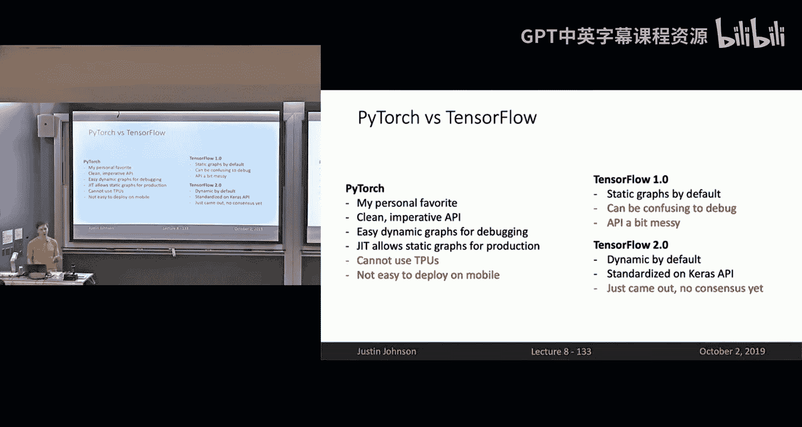

So then to kind of summarize today we talked about these three different bits of hardware。

 we talked about CPUUs， GPUs and TUs， we talked about in in software， the main takeaways。

 the main takeaways are static dynamic graphs and highverse Tensorflow so with all of that in mind come back next time and we'll talk about some nuts and bolts details about getting your neuralout models to converge。

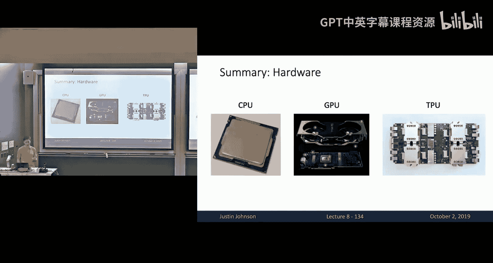

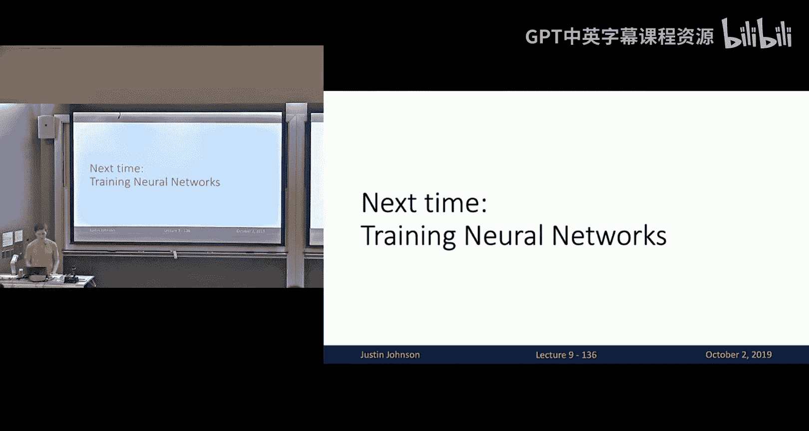