# 深度学习硬件与软件：09：硬件与软件

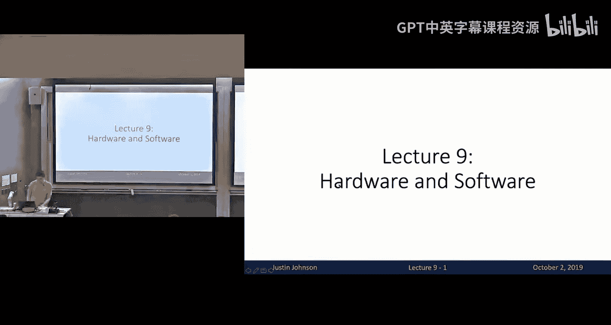

在本节课中，我们将学习深度学习背后的硬件与软件系统。我们将探讨不同类型的计算设备（如CPU、GPU、TPU）及其在深度学习中的角色，并深入了解主流深度学习框架（如PyTorch和TensorFlow）的核心概念与使用方法。课程内容将包含大量代码示例，帮助你理解如何在实际项目中应用这些工具。

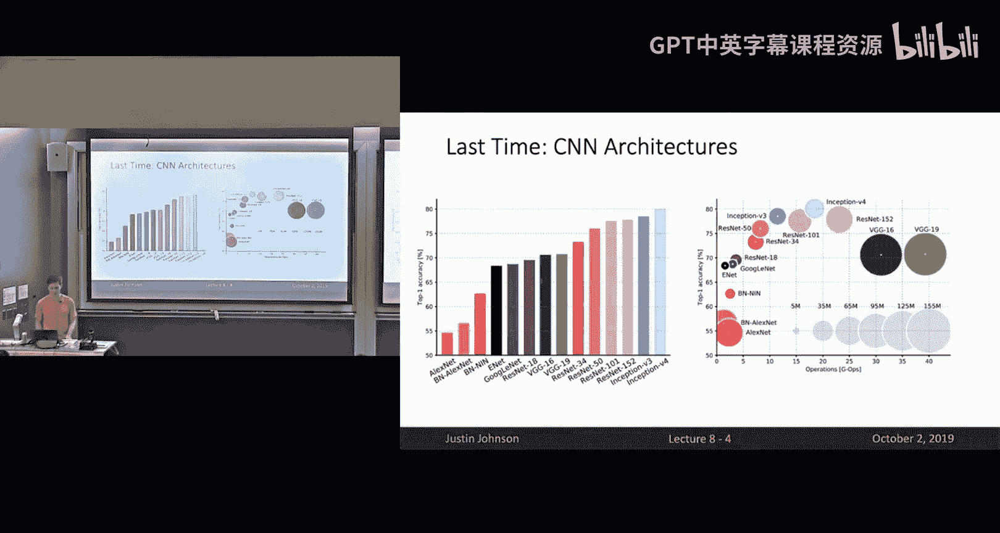

## 硬件概览

首先，我们来了解深度学习常用的硬件设备。计算机内部有多种组件，其中最重要的是中央处理器（CPU）和图形处理器（GPU）。从物理尺寸上看，GPU通常比CPU占用更多空间，这暗示了其在计算密集型任务中的重要性。

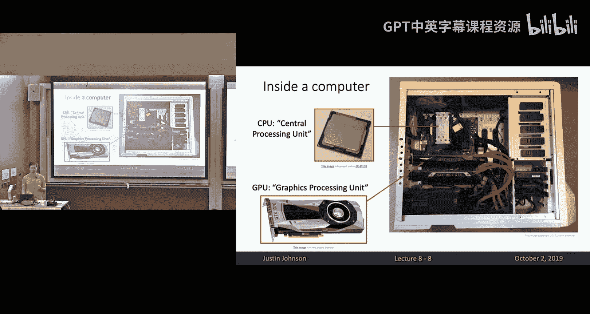

在深度学习领域，NVIDIA的GPU占据主导地位。虽然AMD也生产优秀的硬件，但其在通用计算和深度学习方面的软件生态尚不及NVIDIA成熟。因此，当提到深度学习中的GPU时，通常指的是NVIDIA GPU。

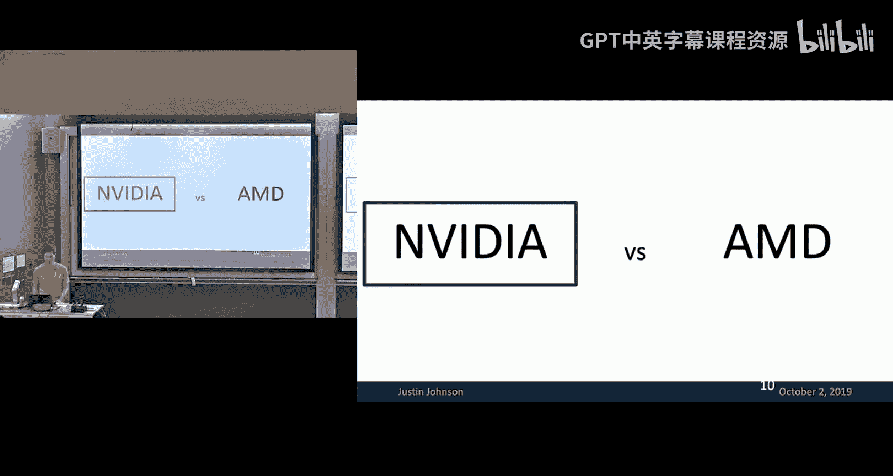

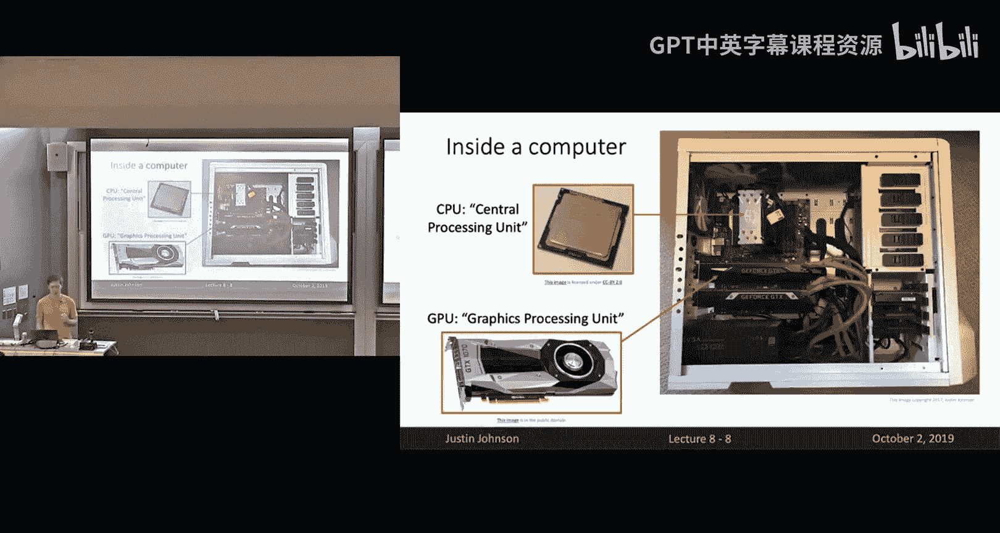

## 计算成本趋势

观察CPU和GPU的计算能力随时间变化的趋势很有启发。我们以“每美元千兆浮点运算次数”（GigaFLOPS per dollar）作为衡量标准。自2006年NVIDIA推出支持CUDA通用计算框架的GeForce GTX 8800 GPU以来，GPU的计算成本开始显著下降。

到2012年，用于训练AlexNet的GTX 580 GPU出现时，在GPU上进行大规模计算已比在CPU上便宜得多。这解释了为何AlexNet能比之前的卷积神经网络模型规模更大。从2012年至今，GPU的计算能力持续快速提升，成本不断下降，这为深度学习模型的爆炸式增长提供了关键的廉价算力支持。

## CPU与GPU对比

让我们具体比较当前顶级的消费级CPU和GPU。

*   **CPU示例**：AMD Ryzen 9 3950X（16核，基础频率3.5 GHz，依赖系统内存，售价约750美元）。其峰值计算能力约为 **4.8 TeraFLOPS**。
*   **GPU示例**：NVIDIA Titan RTX（4608个CUDA核心，频率1.35 GHz，集成24GB专用显存，售价更高）。其32位浮点运算峰值约为 **16.3 TeraFLOPS**。

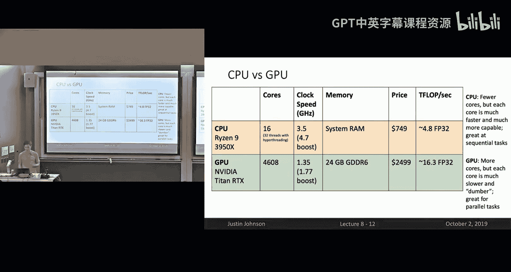

两者的核心区别在于设计哲学：
*   **CPU**：核心数量较少，但每个核心非常强大、快速，拥有更好的分支预测和缓存策略。
*   **GPU**：拥有大量相对简单的核心，运行频率较低，但通过并行处理海量简单任务来实现极高的总体吞吐量。

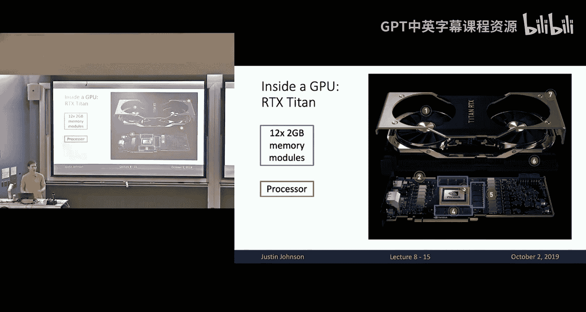

## GPU内部架构

以NVIDIA Titan RTX GPU为例，其内部像一个独立的微型计算机：
*   拥有自己的散热风扇和显存模块（如6个4GB模块构成24GB显存）。
*   核心处理器包含一个由众多重复计算单元组成的网格。

GPU的核心计算单元是**流式多处理器（SM）**。Titan RTX包含72个SM。每个SM内部又包含：
*   **64个32位浮点核心（FP32 Cores）**：执行标准浮点运算。每个核心每个时钟周期可完成一次乘加运算（计为2次浮点操作）。
*   **张量核心（Tensor Cores）**：专门为深度学习设计的硬件单元。

## 张量核心

张量核心是NVIDIA为优化深度学习计算引入的专用硬件。它能在一个时钟周期内完成一个4x4矩阵乘加运算（`C = A * B + C`）。这相当于128次浮点运算。

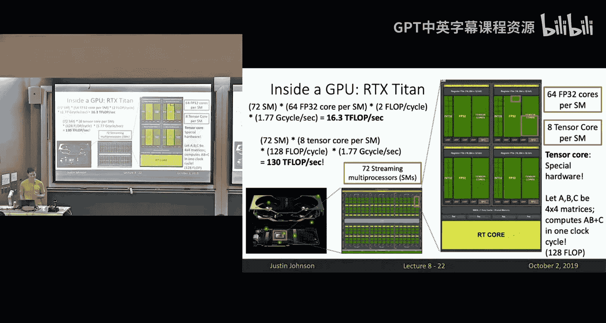

为了实现如此高的计算密度，张量核心采用**混合精度计算**：乘法使用16位浮点数（FP16），累加使用32位浮点数（FP32）。这种设计在保持数值稳定性的同时，大幅提升了计算效率和能效。

考虑张量核心后，Titan RTX的混合精度计算峰值可达 **130 TeraFLOPS**，远高于仅使用FP32核心时的算力。在PyTorch中，只需将输入数据类型转换为16位（如`torch.float16`），并配备正确的硬件和驱动，框架便会自动利用张量核心加速计算。

## 为何GPU擅长矩阵乘法？

矩阵乘法是GPU（尤其是张量核心）加速的典型例子。输出矩阵的每个元素都是输入矩阵行和列的内积，这些计算彼此完全独立，可以完美地并行化分配到GPU的数千个计算核心上。相反，传统的单核CPU必须顺序计算每个输出元素。

此外，矩阵乘法可以分解为多个4x4的小矩阵乘法，从而高效映射到张量核心上执行。这也解释了为什么神经网络中层的尺寸（如批量大小、通道数）常设置为2的幂次方，以更好地适配硬件，避免计算浪费。

## 编程与扩展

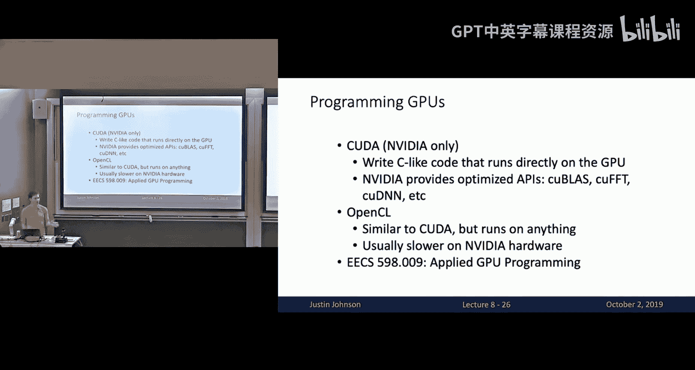

GPU使用**CUDA**语言进行编程。CUDA是C/C++的扩展，允许开发者编写直接在GPU上运行的代码。虽然CUDA编程很有趣且能提供极致优化，但对于大多数深度学习实践者来说并非必需，因为像PyTorch这样的框架已经集成了由NVIDIA高度优化的基础运算例程（如矩阵乘法和卷积）。

## 超越单GPU：分布式计算与TPU

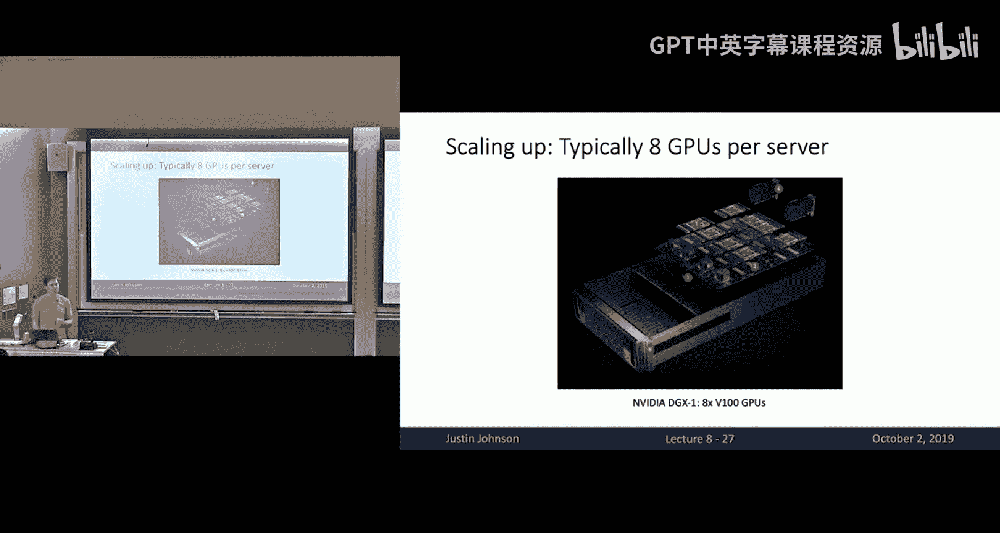

在实际应用中，人们常常使用多GPU服务器（如8 GPU服务器）甚至多个服务器集群来分布式训练大型模型，形成多层次并行计算 hierarchy。

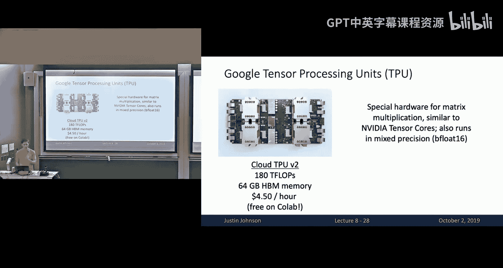

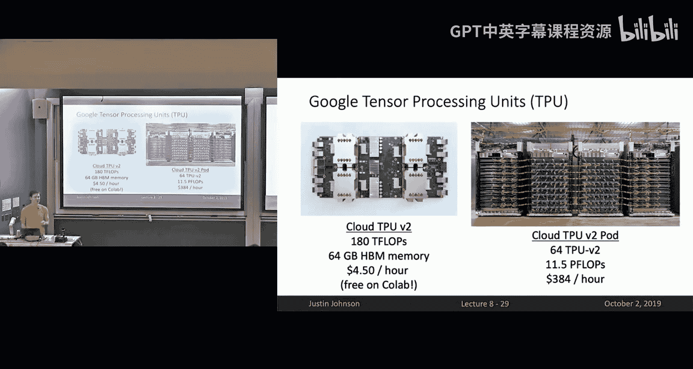

近年来，Google推出了专为深度学习设计的硬件——**张量处理单元（TPU）**。Cloud TPU v2提供约180 TeraFLOPS的计算能力，与高端GPU相当。用户可以通过Google Cloud租用，或在Colab中免费使用。

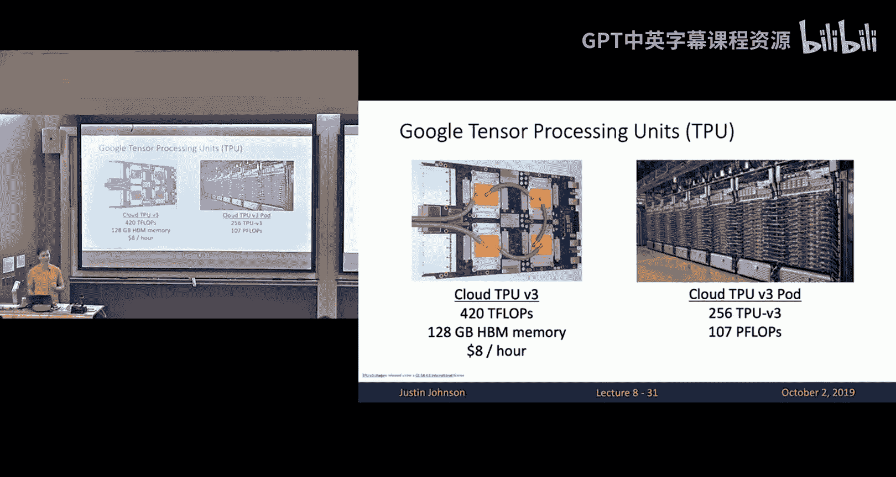

TPU的真正优势体现在**TPU Pod**中。TPU Pod将大量TPU芯片集成在机架级解决方案中，例如TPU v3 Pod包含256个TPU v3设备，提供超过100 PetaFLOPS的总计算能力。不过，使用TPU通常需要依赖Google的TensorFlow框架。

## 内存差异

消费级GPU（为游戏设计）与计算级GPU（为深度学习设计）的主要区别在于**显存容量**和**显存类型**。
*   **容量**：训练深度学习模型需要在显存中存储前向传播的激活值以供反向传播使用，因此需要大容量显存。
*   **类型**：计算级GPU常使用**高带宽内存（HBM）**，其数据吞吐速度远高于消费级GPU使用的GDDR6内存。对于像ReLU这样计算量小但数据移动频繁的操作，内存带宽往往是性能瓶颈。

## 深度学习软件

深度学习领域涌现过许多框架。早期有Caffe、Torch、Theano等学术框架，如今主流框架多由大型科技公司开发和维护，如Facebook的PyTorch/Caffe2、Google的TensorFlow、Amazon支持的MXNet等。目前，**PyTorch**和**TensorFlow**是两大主流框架。

一个优秀的深度学习框架应具备三个核心特性：
1.  **快速原型设计**：提供丰富的预构建层和工具。
2.  **自动梯度计算**：基于计算图抽象，自动进行反向传播。
3.  **无缝硬件支持**：轻松在GPU、TPU等设备上运行。

## PyTorch核心抽象

PyTorch提供了三个不同层次的抽象来构建神经网络模型：

1.  **张量（Tensor）**：基础的多维数组，类似于NumPy，但可在GPU上运行。这是最低层次的抽象。
2.  **自动求导（Autograd）**：自动构建计算图并计算梯度。
3.  **模块（Module）**：面向对象的神经网络层，内部可存储可学习参数。

在前三次作业中，我们仅使用了张量级别的接口。从第四次作业开始，将使用更高级的抽象。

## 使用张量进行训练（低级抽象）

以下代码展示了仅使用张量操作训练一个两层全连接网络：

```python
# 初始化（设备可设置为‘cuda’以使用GPU）
device = ‘cpu‘
N, D_in, H, D_out = 64, 1000, 100, 10
x = torch.randn(N, D_in, device=device)
y = torch.randn(N, D_out, device=device)
w1 = torch.randn(D_in, H, device=device)
w2 = torch.randn(H, D_out, device=device)

learning_rate = 1e-6
for t in range(500):
    # 前向传播：计算预测值y_pred
    h = x.mm(w1)
    h_relu = h.clamp(min=0)
    y_pred = h_relu.mm(w2)
    # 计算并打印损失
    loss = (y_pred - y).pow(2).sum()
    # 手动计算梯度
    grad_y_pred = 2.0 * (y_pred - y)
    grad_w2 = h_relu.t().mm(grad_y_pred)
    grad_h_relu = grad_y_pred.mm(w2.t())
    grad_h = grad_h_relu.clone()
    grad_h[h < 0] = 0
    grad_w1 = x.t().mm(grad_h)
    # 使用梯度下降更新权重
    w1 -= learning_rate * grad_w1
    w2 -= learning_rate * grad_w2
```

## 使用Autograd进行训练（中级抽象）

通过设置`requires_grad=True`，PyTorch会自动跟踪张量操作并构建计算图：

```python
# 初始化，对需要梯度的权重设置 requires_grad=True
w1 = torch.randn(D_in, H, device=device, requires_grad=True)
w2 = torch.randn(H, D_out, device=device, requires_grad=True)

for t in range(500):
    # 前向传播：操作会记录在计算图中
    y_pred = x.mm(w1).clamp(min=0).mm(w2)
    loss = (y_pred - y).pow(2).sum()
    # 使用autograd计算梯度。这会计算loss对requires_grad=True的所有张量的梯度
    loss.backward()
    # 手动更新权重，不需要梯度跟踪
    with torch.no_grad():
        w1 -= learning_rate * w1.grad
        w2 -= learning_rate * w2.grad
        # 更新后必须手动将梯度置零
        w1.grad.zero_()
        w2.grad.zero_()
```

**关键点**：
*   `loss.backward()`会遍历计算图，计算叶子节点（如`w1`, `w2`）的梯度，并存储在`.grad`属性中。
*   梯度是累积的，因此每次迭代后必须调用`.zero_()`将梯度清零。
*   权重更新等不应在计算图中的操作，需放在`torch.no_grad()`上下文管理器中。

## 定义新的Autograd函数

对于像Sigmoid这样有稳定梯度公式的函数，可以定义自定义的Autograd函数，使其在计算图中成为单个节点：

```python
class Sigmoid(torch.autograd.Function):
    @staticmethod
    def forward(ctx, x):
        y = 1 / (1 + torch.exp(-x))
        ctx.save_for_backward(y) # 保存供反向传播使用
        return y
    @staticmethod
    def backward(ctx, grad_y):
        y, = ctx.saved_tensors
        grad_x = grad_y * y * (1 - y) # Sigmoid的导数公式
        return grad_x

# 使用
sigmoid = Sigmoid.apply
y_pred = sigmoid(x.mm(w1)).mm(w2)
```

## 使用nn.Module进行训练（高级抽象）

`torch.nn`提供了面向对象的API来构建模型：

```python
# 使用 Sequential 容器
model = torch.nn.Sequential(
    torch.nn.Linear(D_in, H),
    torch.nn.ReLU(),
    torch.nn.Linear(H, D_out),
)
loss_fn = torch.nn.MSELoss(reduction=‘sum‘)
optimizer = torch.optim.Adam(model.parameters(), lr=learning_rate)

for t in range(500):
    y_pred = model(x) # 前向传播
    loss = loss_fn(y_pred, y)
    optimizer.zero_grad() # 清零梯度
    loss.backward() # 反向传播
    optimizer.step() # 更新参数
```

## 自定义nn.Module

通过子类化`nn.Module`可以构建更复杂的模型结构：

```python
class TwoLayerNet(torch.nn.Module):
    def __init__(self, D_in, H, D_out):
        super(TwoLayerNet, self).__init__()
        self.linear1 = torch.nn.Linear(D_in, H)
        self.linear2 = torch.nn.Linear(H, D_out)
    def forward(self, x):
        h_relu = self.linear1(x).clamp(min=0)
        y_pred = self.linear2(h_relu)
        return y_pred

model = TwoLayerNet(D_in, H, D_out)
# ... 训练循环与上述类似
```

## 动态计算图 vs 静态计算图

这是深度学习框架的一个核心设计差异。

*   **动态计算图（PyTorch默认）**：每次前向传播都会实时构建一个新的计算图，并在反向传播后丢弃。优点：
    *   **易于调试**：代码执行流程直观，错误信息清晰。
    *   **灵活性高**：可以使用标准的Python控制流（如if、for循环）动态改变计算图结构，适用于RNN、递归网络等模型。
*   **静态计算图（TensorFlow 1.x默认）**：先定义完整的计算图，然后多次执行。优点：
    *   **性能优化**：可以对计算图进行全局优化（如算子融合）。
    *   **易于部署**：可将计算图序列化并部署到不含Python环境的生产系统（如移动端、C++服务器）。

PyTorch也通过**TorchScript**提供了静态图支持：

```python
@torch.jit.script
def model(x, w1, w2):
    return x.mm(w1).clamp(min=0).mm(w2)
# 编译成静态图
graph = torch.jit.script(model)
```

## TensorFlow简介

TensorFlow也在演进。TensorFlow 1.x主要使用静态图，编码和调试较为复杂。**TensorFlow 2.0** 默认采用了类似PyTorch的**动态计算图（Eager Execution）**模式，并保留了转换为静态图的能力。

TensorFlow 2.0动态图示例：

```python
import tensorflow as tf

w1 = tf.Variable(tf.random.normal((D_in, H)))
w2 = tf.Variable(tf.random.normal((H, D_out)))
optimizer = tf.optimizers.Adam(learning_rate)

for t in range(500):
    with tf.GradientTape() as tape:
        y_pred = tf.matmul(tf.matmul(x, w1).numpy().clip(min=0), w2)
        loss = tf.reduce_sum((y_pred - y) ** 2)
    grads = tape.gradient(loss, [w1, w2])
    optimizer.apply_gradients(zip(grads, [w1, w2]))
```

TensorFlow 2.0也提供了高级API **Keras**，其风格与PyTorch的`nn.Module`类似。

## TensorBoard可视化

TensorFlow的**TensorBoard**是一个强大的可视化工具，用于跟踪训练过程中的损失、准确率、权重分布等指标。它深受欢迎，以至于PyTorch也提供了接口将数据导出到TensorBoard。

## 总结

本节课我们一起学习了深度学习的硬件与软件基础。

在硬件方面，我们探讨了：
*   **CPU**：强于复杂串行任务。
*   **GPU**：凭借海量并行核心和张量核心，成为深度学习训练的主力。
*   **TPU**：Google专为深度学习设计的专用硬件，擅长大规模分布式训练。

在软件方面，我们深入了解了：
*   **PyTorch**：以动态计算图为主，灵活、易于调试，深受研究人员喜爱。
*   **TensorFlow**：早期以静态图著称，TensorFlow 2.0转向动态图优先，并拥有强大的生产部署工具链（如TensorBoard）。

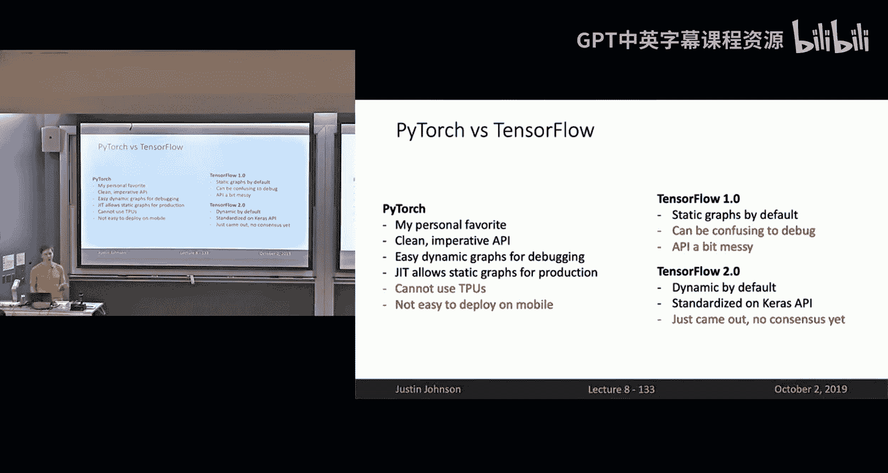

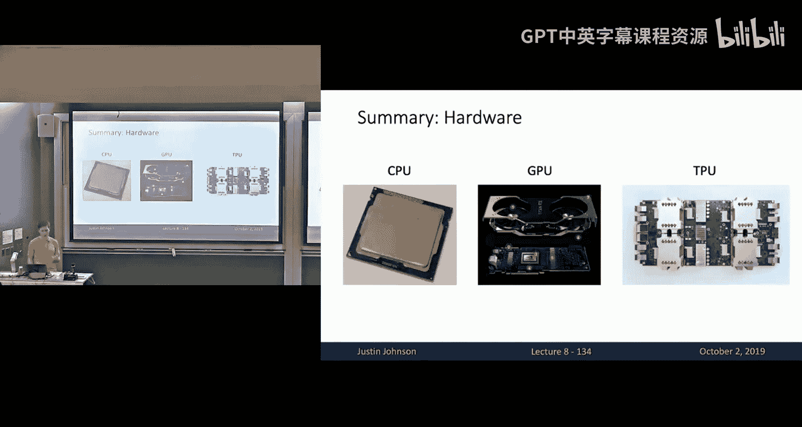

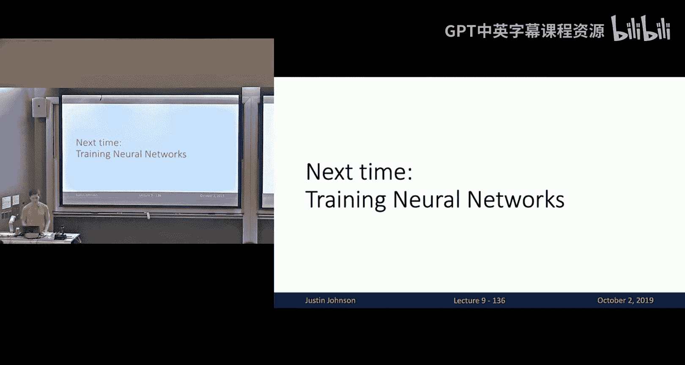

理解这些硬件特性和软件抽象，将帮助你更高效地设计、实现和优化深度学习模型。