# 密歇根大学《深度学习用于计算机视觉｜Deep Learning for Computer Vision UMich EECS 498-007 2019》中英字幕 p10 -10-10_TrainingNeuralNetworksPart1.zh_en -BV1jA4m1P7GN_p10-

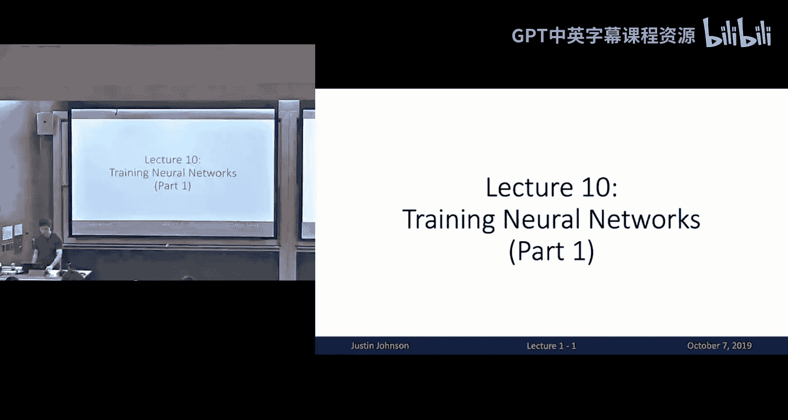

Okay， welcome back to lecture 10， we made it to double digits that's very exciting so today we're going to be talking about lots of tips and tricks for how you actually go about training neural networks in practice。

 but before that as usual administrative stuff。So a reminder that assignment3 has been released and it is due on Monday。

 October 14， which is a week from today， and again。

 I know I've been reminding you this every lecture。

 but please remember to run the validation script before you submit your assignment to make sure that your assignment is properly structured when you submit it。

Now the next important exciting bit is about the midterm， so I know it's hard to believe。

 but midterm is right around the corner， so midterm the midterm exam will be two weeks from today on October 21st。

 but it will not be in this room， it will be in Chrysler 220 so if you show up in this room two weeks from today and there's nobody here you're in the wrong place。

And we'll probably warn you about that several more times。

 The general structure is that it's going to have some combination of true false and some multiple choice and some short answer questions。

 and this is really going to focus on conceptual stuff。

 we don't expect you to memorize any of the particular nitty gritty details of things that we talked about in lectures so for example。

 we will not expect you to remember the exact architecture of an Alexnet or the exact architecture of a Resnet or something like that。

 but you should sort of know the general trends among those different architectures， for example。

The exam will be closed book， but will let you have one page of handwritten one page notes of cheat sheet that can be whatever kind of notes that you think will be useful for yourself in working on the exam and hopefully the process of creating and structuring such a cheat sheet will be a good exercise for yourselves as you're studying。

We've also got started to hear from some folks who have exam conflicts with the exam time for various reasons。

 if you have an exam conflict， then please we've created a Google form that it's linked to on the slides here and we'll also post on Piazza later so if you for any reason are unable to make the exam time whether that's I know some of you for example have a course conflict with the ECS 551 that has an exam right after hours and there' are some other reasons that people have had for not being able to make the exam so if that applies to you then please fill out the Google form and we'll take it from there。

AnyAny questions about the exam？All right， hopefully it'll be fun。

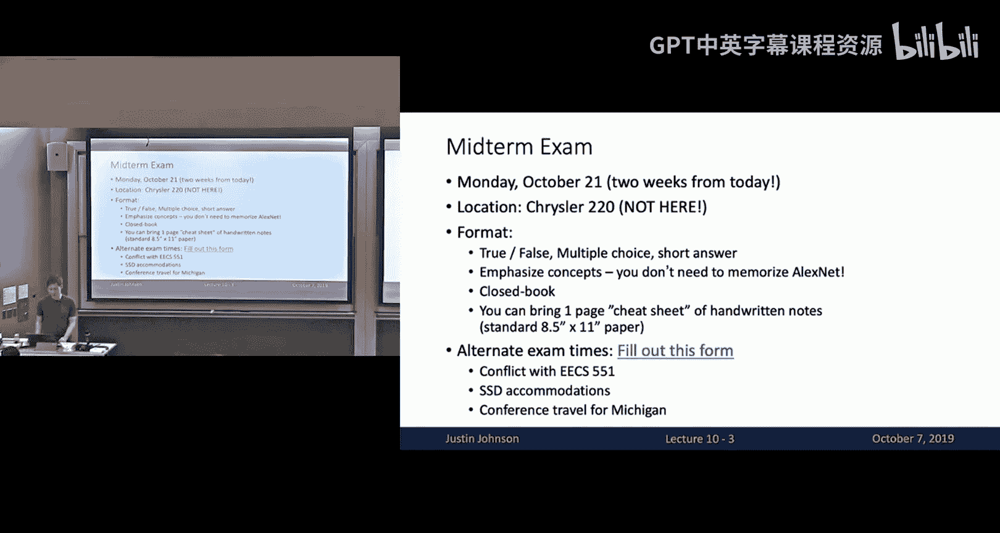

So last time we left off， we talked about the hardware and software of deep learning。

 and we talked about different types of hardware that you run these things on。

 like CPUUs and GPUs and TUs， and we also talked about different software systems that you can use for implementing these networks in particular。

 we talked about the difference between static graphs and dynamic computational graphs and we talked about some of the tradeoffs of both PyTtorch and TensorFlow。

So now at this point， we've pretty much seen all of the stuff that you need to know to train neural networks。

 but it turns out there's still a lot of little bits and pieces that you need to actually be super effective in your ability to train networks。

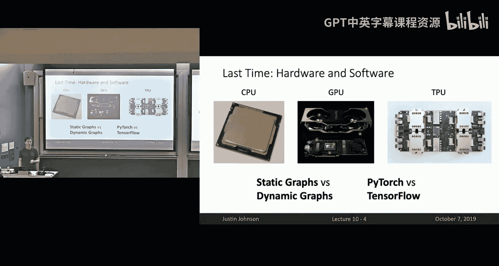

So I like to try to break this up into， I mean this is kind of like a bunch of PoPri that you need to know in order to be good at training neural networks and I like to break this up into maybe three different categories of things that you need to know about one is the onetime setup at the beginning before you start the training process that's where you need to choose the architecture。

 the activation functions you need to do a lot of stuff before you go and hit that train button and then once you begin training there's certain things that you might need to do during the process of optimization like schedule your learning rates or scale up to many machines or things like that and then after you're done training you might need to do some extra stuff on top of your train networks like model ensembling or transfer learning and over the course of today's lecture and Wednesday's lecture we're going to walk through a lot of these little sort of little nitty gritty details about how you actually go about training neural networks in practice。

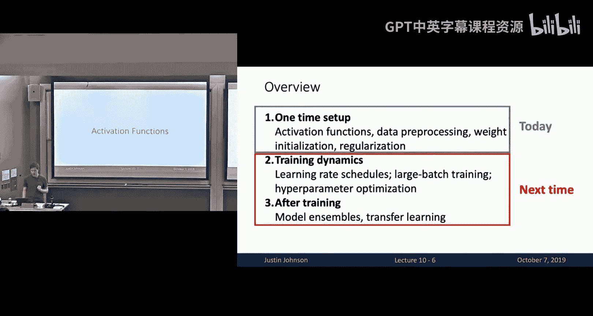

So today let's start off by talking about activation functions。

 you'll recall that in our little model of an artificial neuron。

 we always have to have an activation function that we always have some kind of linear function coming in that collects the inputs from the neurons in the previous layer and then those get summed and those get multiplied by your weight matrix and summed and then passed through some kind of nonlinear activation function before being passed on the next layer and as we recall having some nonlinear activation function in our neural networks was absolutely critical for their processing ability because if we remove the activation function。

 then all of our linear operations just collapse onto a single linear layer so the presence of one of these activation function recall was absolutely critical in the construction of our neural networks。

And we saw that there's this big zoo of activation functions， but we kind of left off。

 we didn't really talk much about these different types of activation functions and their tradeoffs when we last saw a slide。

 So today I want to talk in more detail about some of the pros and cons of these different activation functions and other considerations that go into choosing or constructing activation functions for neural networks。

So probably one of the most classic activation functions that had been used in neural network research going back several decades is the sigmoid activation function Sigmoid。

 because it has this sort of s curved shape this was a popular activation function because one it has this interpretation as a probability so you can one way that you might think about neural networks is that at each of the neurons it's either on or off and maybe we want to have some real some value between0 and1。

 that represents the probability of that feature being present so the sigmoid activation function has this nice interpretation as the probability for the presence or absence of a boolean variable had it also has this interpretation as the firing rate of a neuron if you recall these biological neurons。

 they received signals from other incoming neurons and then fired off signals at some rate but the rate at which they fired off was nonlinely dependent on the total rates of all the。

Inputs coming in， and the sigmoid function is a simple way to model that kind of nonlinear dependence on firing rates。

But so these are a couple reasons why classically， the sigmoid No nonlinearity had been very popular。

 but there are several reasons why it's actually not such a great nonlinearity in practice。

One problem is that it has these flat regimes at the beginning at the end。

 these saturated regimes with zero gradients， and these kill the gradient effectively and make it very difficult to train networks in a very robust way。

So to think about this， what happens to our sigmoid function when x is maybe very， very small。

 like -10 or -100。Well， in that case we'll be in this far left regime of the sigmoid nonlineity so the local gradient will be very。

 very close to zero， and then that means that all of our weight updates will also be very。

 very close to0 because if the local gradient to0， then it's just going to remember we're going to take our upstream gradients multiply the local gradients that's going to produce these downstream gradients and if that local gradient is of value very。

 very close to0， that means that no matter what the upstream gradients were。

 the downstream gradients will also be values that are very。

 very close to zero this will have the effect of making learning very slow because now all of the weight updates onto our weight matrices。

 all the gradients of the loss with respect to our weight matrices will be very low and it will also give very problematic training dynamics once we move to deep networks supposeose that we've got a network that's maybe 100 layers deep and then we immediately kill the gradient at some layer and then we'll basically have no signal to train gradients at any of the lower layers and this problem happens both when。

X is very， very small， like-10 as well as very， very large， like plus 10。 But where the only regime。

 So kind of when you have a sigmoid， if x gets too big or too small。

 then learning kind of dies for that layer。 and the only way in which learning can proceed is if somehow the activation is somewhere within this sweet spot near x equals0 where anyway the sigmoid function behaves somewhat linearly。

So that's the first major problem with the sigmoid activation function is that these flat regimes are going to kill the gradient and make learning very challenging。

A second problem with the sigmoid No linearity is that its outputs are not zero centered。

 You can because clearly， the outputs to the sigmoid are all positive。

 right because it's all above the Y the X axis。And to think about why this property of not having zerocented outputs is problematic。

 let's consider what happens when the inputs one of our neurons is always positive。 Remember。

 here's our little diagram of one neuron inside our neural network。

 and we're zooming in on just one of these things。 So now， suppose that the input。

 suppose we're building a multi layer neural network。

 where at every layer we use a sigmoid non nonlinearity。 That means that the inputs to this layer。

 the X's will also be the result of applying a sigmoid function to the previous layer。

 which means in particular， that all of the inputs X I to this layer will all be positive。

Now what can we say about the great now， given the fact that all of the XI's that are inputs to this layer are going to be positive。

 then what can we say about the gradient of the loss with respect to the WI's？Exactly， well。

 not quite that they'll so remember that in order to compute the gradient of the WI of the loss with respect to the WI。

 we'll take the local gradient and multiply by the upstream gradient。

 Now the local gradient is always going to be positive。

 because the local gradient of WI is just going to be X I and Xi is positive which means that the local gradients will all be positive。

 but then we multiply this by the upstream gradient。

 which could be positive or negative but the upstream gradient is just a scalar。

 and if the upstream gradient is positive， that means that all of the gradients of loss with respect to WI will all be positive。

 and similarly， if the upstream gradient is negative。

 that means that all of the gradients or the loss with respect to WI will be negative。

So what that means is that all of the gradients with respect to WI are going to have the same sign and like this is this seems like kind of a bad property for learning。

 So for example， suppose that that this means that it could be very difficult to make a gradient disscent steps that reach certain values of the weights that we might want to because of this constraint that the gradients are all going to be positive or all going to be negative as kind of a pictorial example of why this might be a problem suppose that we can have this kind of cartoon picture on the right。

 So here this picture is maybe a plot of W1 and W2 and we imagine that our initial value for the weights W is the origin and maybe the value of the weights that we want to get to in order to minimize the loss is somewhere down bottom to the bottom right。

Now in order to move in order to traverse from the origin to the bottom right。

 we need to take some steps where we're going we want to take positive steps along W1 and negative steps along W2。

 but with this constraint that the gradients with respect the gradient of the loss with respect to the weights are always going to have the same sign there's no way that we can take steps that align in that quadrant。

 so the only possible way for a gradient descent procedure to make progress toward that direction is to have this very awkward zigzagging pattern where it kind of moves up where all the gradients are positive and then moves back down to the left where all the gradients are negative and then moves up again and that's kind of a very awkward zigzaggy pattern。

 so that's kind of and by the way， this maybe doesn't look so bad in two dimensions but as we scale to weights with thousands or millions of dimensions this property is going to be very。

 very， very bad because now if we have a weight matrix with D dimensions then if you。

Partition up all of the possible signs of all of the elements of that weight matrix。

 there's going to be two to the power of D sort of quad higher dimensional quadrants or orns in that high dimensional weight space and under this constraint that they all have to be positive or negative。

 that means that any of our update directions can only move one in two of those possible two to the D or high dimensional orns so maybe so even though this problem looks bad in two dimensions。

 it gets literally exponentially worse as we move to weight matrices of higher and higher and higher dimension。

So that seems like a bad property of this sigoid No nonlinearity。

 that the fact that it's not zero centered and the fact in particular that its outputs are always positive leads to these very unstable and potentially awkward dynamics during training。

I should point out though that this whole analysis about the gradients with the gradients on the weights being all positive or all negative only applies to a single example。

 however， in practice we'll often perform mini- batch gradient descent and once we take an average over multiple elements in a mini batch。

 then we kind of relax this constraint， so though for a single example in the mini batch。

 we would end up with gradients that are all positive or all negative on each layer。

 when we consider the gradients with respect to a full mini batch of data examples。

 then this becomes less of a problem because you could imagine that maybe even though the gradients with respect to each elements are all positive or all negative。

 when you average them out and sum them out over the mini batch。

 then you could end up with gradients for the mini batch that are sometimes positive and sometimes negative。

So I think this is a problem， this is maybe less of a problem in practice than some of the other concerns around the Sigoid No nonlinearity。

 but it is something to keep in mind， nevertheless。

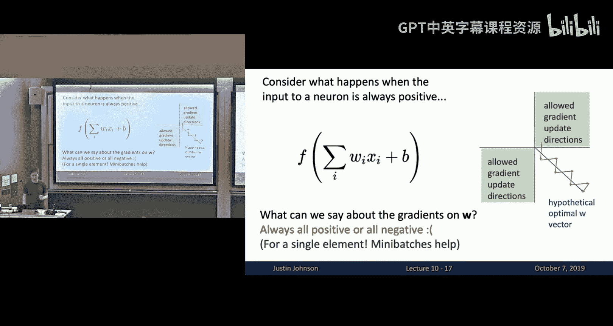

So that was our second problem with the sigmoid No nonlinearity is the fact that its outputs are not zero-cented and now a third problem with the sigmoid No nonlinearity is this x function。

 so I don't know if you know how these mathematical functions get implemented on CPUs but something like the exponential function is fairly expensive because it's a complicated transcendental function。

 so it can actually take many clock cycles to compute an exponential function and when I timed when I did some small experiment on this on my MacBook CPU the other day。

 and if I want to do if I want to compare a sigmoid No nonlinearity versus a raylu No nonlinearity for a single tensor of a million elements then on this MacBook CPU。

 the raylu ends up being about three times faster than the sigmoid because the raylu just involves a simple threshold whereas the sigmoid needs to compute this very expensive exponential function。

Now I should also point out that of these three this third problem of exponential being expensive to compute is mostly a problem for mobile devices and for CPU devices for GPUs。

 this ends up being less of a concern because for GPU devices。

 the cost of simply moving the data around in memory between the global memory and the compute elements of a GPU ends up taking more time for these nonlinearities and actually computing the nonlinearity。

 so in practice if you try to time these different nonlinearities on a GPU。

 then you'll find that they often all come out to be about the same speed。

 so you really need to move to some kind of CPU device in order to see speed differences between these different nonlinearities。

So that gives us these three problems with the sigmoid function and of these three problems。

 I really think number one is the most problematic。

 these number two and number three are things that you should be concerned about or should be aware of。

 but it's really I think really this saturation killing the gradient is really the most problematic aspect of the sigmoid No nonlineararity。

So then we can move on from sigmoid and we can look and another popular nonlinearity that people sometimes use is the TH No nonlinearity。

 Now， TNH is basically just a scaled and shifted version of sigmoid。

 If you go and look up the definitions on paper the definitions of sigmoid and TNH in terms of exponential functions。

 you can do a bit of algebra and just show that TNH is literally just a shifted and rescaled sigmoid。

So it inherits many of the same problems as the sigmoid No nonlinearity。

 right it still saturates for very very large and very small values。

 so it still results in difficult learning in those cases， but unlike the sigmoid it is zerocented。

 so if for some reason you have the urge to use a saturatinglineity in your neural networks。

 then I think TNH is a slightly better choice than sigmoid。

 but really it's still a pretty bad choice due to these saturating regimes。

So now the next nonlinearity is our good friend， the Raylu， the rectified linear activation。

 and this one is very nice。 I think were very familiar with this one by now。

 It's very cheap to compute because it only involves a simple threshold。

 So you can imagine for a binary implementation， all we have to do is check the s bit of the floating point number。

 if it's negative， we set it to zero。 And if it's positive we leave it alone。

 So Raylu is like the cheapest possible nonlinearar function you can imagine implementing that it's very。

 very fast， can typically don't be done in one clock cycle on most things。😊。

It does not saturate in the positive regime。 So as long as our inputs are positive。

 then we never have to worry about this saturation problem of killing our gradients。And in practice。

 when you try to train the same network architecture with a sigmoid versus a TN H versus a Raylu。

 it's very often to find that the Raylu version converges much。

 much faster up to six times as reported by AlexNet。

And when you go to very deep networks like 5000 layers。

 then it can be very challenging to get Sigmoid networks to converge at all unless you use something like batch normalization。

So there are some problems with Raylu one， of course， is that it's not zerocented。

 so just like the sigmoid non nonlineararity， which we saw has all of its outputs always positive。

 the same applies to the Raylu， so the raylu clearly all of its outputs are also non- negative。

 so that means that Raylu suffers from the same problem of gradients being all positive or gradients being all negative as the sigmoid。

 but since we know in practice that raylu networks can be trained without much difficulty that suggests that this actual non-zerocenting problem was maybe less of a concern than the other problems that we saw with the sigmoid function。

So the big problem with raylu， of course， is what happens when x is less than zero。

 Well here the gradient is exactly zero。 So if you imagine what happens for training this relu function。

 when x is very， very large like plus 10， then the local gradient will be1 and and learning will proceed just fine when when x is very。

 very small like minus10， then the gradient will be identically zero。

 which means that our local gradient is exactly zero。

 which means that our downstream gradients are also exactly zero now this is somehow even worse than a sigmoid because with a sigmoid in the very small regime。

 we weren't exactly zero， we were just very， very small， so even if our gradients were very。

 very small， we still had some potential hope that maybe learning could proceed but with a raylu once our gradients are once our values are less than0。

 then all of our gradients are identically zero and learning cannot proceed。

 our gradients will be completely zero， it will be completely dead。

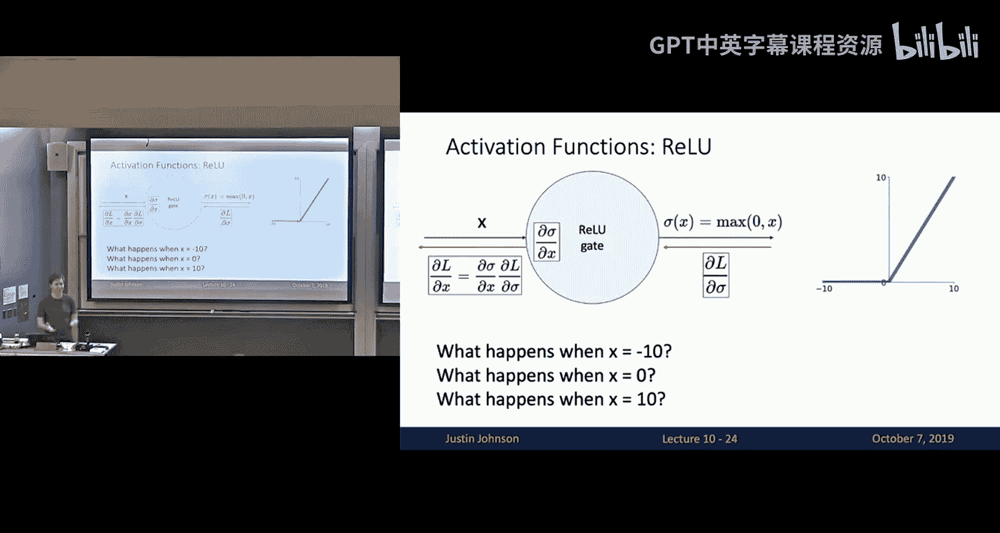

So then this leads to this potential problem that people worry about sometimes called a dead Raylu。

 So the idea here is that suppose in one of our raylu nonlinearities。

 the weights of that layer get totally large get very， very large in magnitude。

 such that the neuron in that layer has a negative activation for every data point in our training set。

 Well in that case， it means that the raylu the weights corresponding to that unit will always have gradients identically equal to zero as we iterate over the training set and that we sometimes refer to as a dead relu because it never has the potential to learn once the raylu kind of gets knocked off this data cloud of your training examples。

 then all of the future updates it will ever receive are going to be zero and it will be stuck off in limbo hanging outside your data cloud for the rest of etomy no matter how long you train so that seems like a problem。

In contrast we need our raylus to always somehow stay intersecting with some part of the data cloud。

 those are active raylus and they will receive gradient and they will train。

 even if and I should point out this problem only occurs if your if your activation value is negative for your entire training set as long as there's some element of your training set where you receive a positive activation。

 then that weight has the potential to get some gradient and has the potential to learn。

So one trick that I've seen people sometimes do， maybe I think it's less popular now。

 but to avoid this potential problem of dead Raylus。

 one trick you might think of is to actually initialize the biases of layers that use relu to actually have a slightly positive value。

 that means that gives that makes it harder to fall into this negative regime and harder to have dead relus。

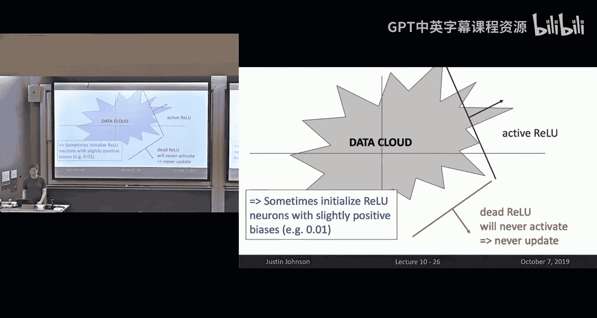

So we saw that one problem with the raylu No nonlineararity is the fact that it's not like the two big problems with Relu are that it's not zerocented and that it has zero gradient in in the negative regime so there was an alternative proposed called the leaky Relu that solves both of these problems leaky Relu is very simple。

 it looks just like Relu except so in the positive regime， it computes the identity function。

 and when the input is negative， then we're going to multiply by a small positive constant。

 so rather than being identically zero than in the negative regime。

 the leaky relu is instead has a small positive slope and what we can kind of imagine this as a relu that is not exactly zero。

 it kind of leaks out some of its information but just a little bit in the negative regime and now this 0。

01 this slope of the leaky Relu in the negative regime is a hyperparameter that you need to tune for your networks。

Now， the advantage of the leaky Relu is that like the Relu。

 it does not saturate in the positive regime。 It's still computationally efficient because it only takes a couple instructions to execute。

And unlike the raylu or the sigmoid， it doesn't ever die。

 the gradient because our local gradients will never actually be zero in the negative regime。

 our local gradient will just be this 0。01 or whatever other value for that hyperparameter we had chosen what this means is that these leaky relus in fact。

 don't suffer from this dying relu problem instead in the negative regime。

 they'll just receive smaller gradients and have the potential to keep learning。

But now an annoyance with this leaky Relu is this 0。01。

 this kind of leaky hyperparameter value that we need to set。

 and as you probably experienced when trying to tune even linear classifiers on the first couple of assignments。

 the more hyperparameters you need to search over， the more pain and frustration you have when trying to train your models。

 so clearly whenever you see a hyperparameter， one instinct you should have is that maybe we should try to learn that value instead。

So indeed， this is the exact idea behind the parametric raylu or Prelu。

 where now it looks just like the leaky Raylu， except the slope in the negative regime is now a learnable parameter of the network。

Whi now this is kind of a funny thing because now this parametric raylu。

 this prelu is actually a nonlinearity that itself has learnable parameters。

 but we can imagine computing that just fine， then during the backwards pass we will just back propagate into this value of alpha compute derivative of loss with respect to alpha and then also make gradient descent steps on alpha。

 and this alpha might be a single constant for each layer。

 or maybe this alpha could be a separate value for element for each channel in your convolution or each output element in your fully connected layer。

So that's fine， see work， you'll see people use that sometimes。

But one problem you might have with any of these relu functions is that they actually have a kink at0。

 right， They're actually not differentiable there at all。 You might ask what happens at 0。 Well。

 it actually doesn't matter what happens at  zero because it doesn't happen very often。

 So you can pretty much choose whatever you want to have it happen at0。

 and it's probably going to be fine。 But in practice， usually you just pick one side of the other。

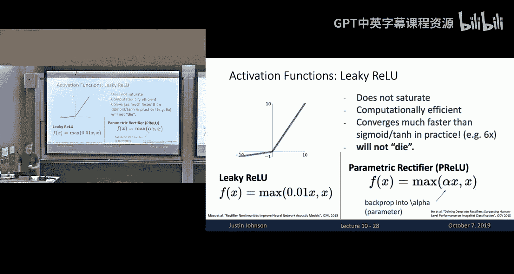

But one kind of slightly more slightly more slightly more theoretically groundedlinearity that you'll see sometimes is the exponential linear unit and this attempts to fix some of the problems of raylu that it's basically like a raylu but it's smooth and it attempts to be more zerocented so you can see the mathematical definition of the exponential linear unit here at the bottom of the slide。

 in the positive regime it just computes the identity function just like raylu but in the negative regime it computes this exponential value instead so on the left- hand side it kind of looks a little bit like the tail end of a sigmoid and in fact。

 we also see that it asymptotes to to minus1 or to some to some non-zero negative value as we go to the left this is to avoid this problem of zero gradients that we might have been concerned about with the normal raylu。

So this was designed to kind of fix some of these problems with Relu that now because the negative regime actually is non-zero。

 then you can imagine that this non nonlinearity might actually have zero centered outputs。

 and there's some math in the paper to support that conclusion。

There the problem here is that the computation still requires this exponential function。

 which is maybe not so good， and it also has this additional hyperparameter alpha might that we need to set。

 although I guess you could try to learn alpha as well and come up with a parametric exponential linear unit or pre Elu but I've never actually seen anyone do that in practice。

 but maybe you could try it and write a paper， who knows。Theres's you know it doesn't stop there。

 so there was another paper。's people love to propose very I mean。

 I think you should get get this idea right now that this nonlinearity is kind of this small。

 modular piece of a neural network that you can take out to find new things and run controlledt experiments。

 So it's very appealing for a lot of people to try to modify neural networks by coming up with new nonlinearities。

 So you'll actually see a lot of papers that try to come up with slight variance on nonlinearities and try to argue for why their ideas are slightly better than anyone that came before。

So as a result， there's a lot of these things out there that you can find one that's kind of fun is the Clu or scaled exponential linear unit。

 this one is fun because it's just a rescaled version of Alu that we just saw on the previous slide。

 the only difference is that we set alpha equal to this very long seemingly arbitrary constant and we set lambmbda equal to this very long seemingly arbitrary constant。

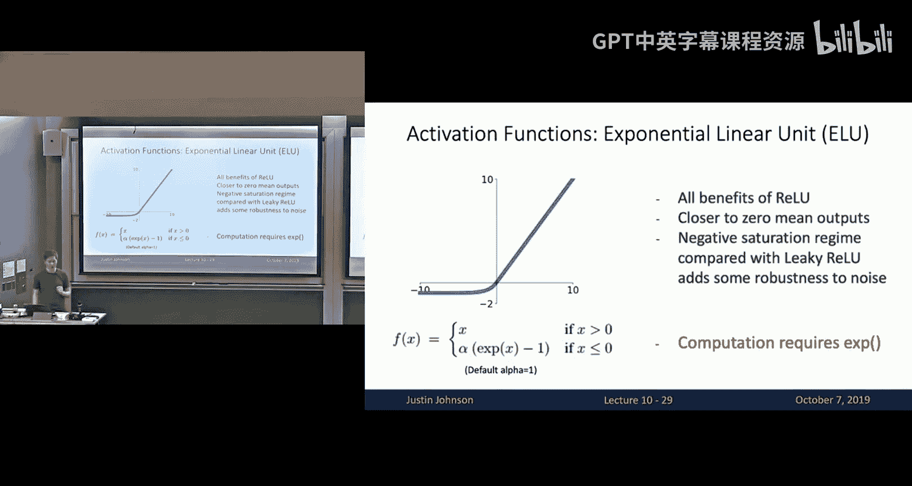

And the reason that we might want to do this is that if you choose Al and Lambda in this very particular way。

 then a very deep neural network with this salute nonlineararity has a kind of self-normalizing property。

 that as your layer depth goes to infinity， then the statistics of your activations will be well behaveved and even converge to some finite value as the depth of your network goes trends toward infinity。

 and what this means is that if you have very， very deep network， very。

 very deep networks with salute nonlinearities， then sometimes people can get these things to train very。

 very deep networks， even without using batch normalization or other normalization techniques。Now。

 unfortunately， in order to understand exactly why this is true。

 you have to work through 91 pages of math in the appendix of this paper。

 so if you have a lot of patience， you can go through this and figure out exactly why we set the values of these constants to those particular values。

 but I think that's a little kind of fun。But I think the bigger takeaway around a lot of these nonlinearities is that in practice。

 they really don't vary too much in their performance。

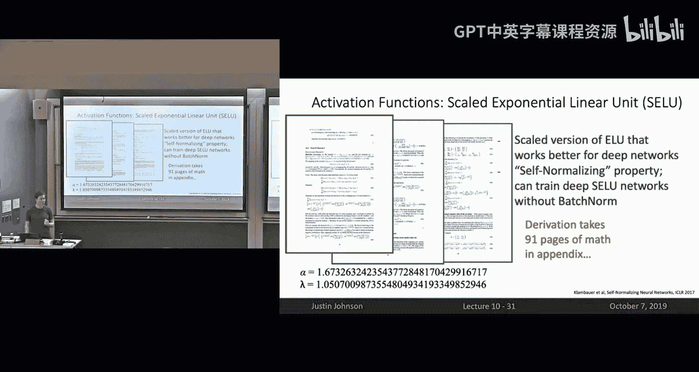

So here's a plot from a paper from another paper that was another of these papers about nonlinearities that actually compared the effects of different nonlinearities on different network architectures all on the CfR 10 data set and if you look at this plot you see that some of the bars are higher than some of the other bars。

 but the most important thing to take away from this plot is really just how close all of these things are。

 something like relu on resnet is giving us 93。8 leaky relu is 94。

2 a soft pluses a different one is 94。6。 So basically all of these things are like within a percent of each other in final accuracy on CfR 10。

 So and the trends here are just not consistent。 So if we look at a resnet then something called a gallu or a Sw nonlinearity is going to slightly outperform a relu。

 but if we look at a densenet， then Raylu is slightly better or equal to anything else So the real takeaway I think for No nonlinearities is just like don't stress out about it too much。

 because。Usually your choice of nonlineararity， as long as you don't make a stupid choice and choose sigoid to 10h。

 if you use any of these more reasonable， more modern nonlinearities。

 your network is going to work just fine and maybe for your particular problem。

 you might see a variance of maybe one or 2% on your final accuracy depending on which nonlinearity you use。

 but that's going to be very dependent on your data on your model architecture and on all your other hyperparameter choices so my advice is just don't stress out too much about activation functions basically don't think too hard。

 just use Relu， it'll work just fine and it'll probably work。

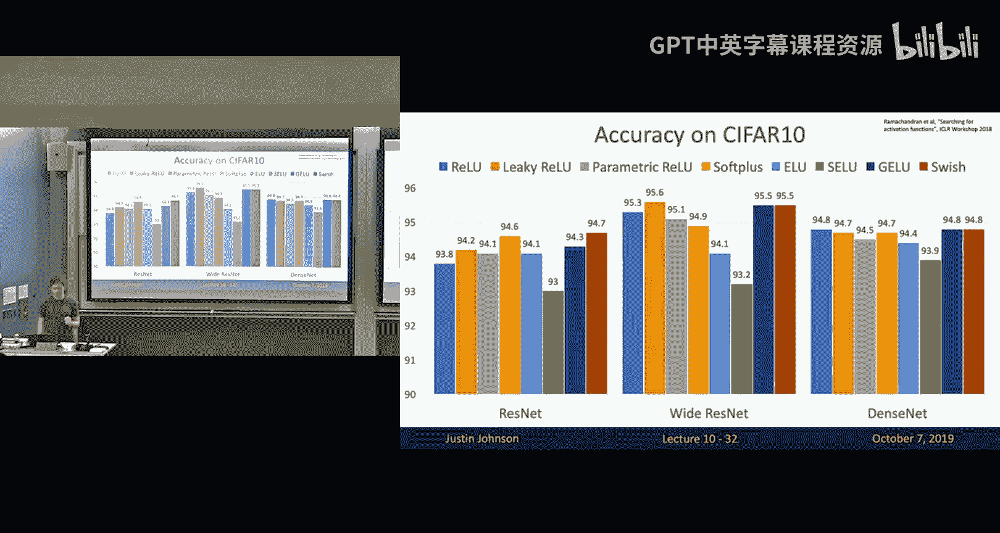

Now， if you're in some situation where you really， really must squeeze out that one last percentage point or that last half a percentage point or tenth0th of a percentage point of performance。

 then I think is a time when you should consider swapping out and experimenting with these different nonlinearities so in that case something like a leaky raylu or an Alu or a Clu or a Galu or whatever other thing you can think of that rhymes with Alu is probably a reasonable choice to try but don't expect really too much too much from it and basically don't use sigmoid or tanh。

 those are terrible ideas your network will not converge and just don't use those so that's kind of my executive summary on activation functions。

Any questions on activation functions before we move on？Yeah。关说。Yeah。

 the question was all of these activation functions are monotonic。 they increase。 Well。

 and why don't we use something like sine or cosine？ Well， I actually lied to a little bit。

 There's this Galu nonlinearity function that I didn't talk about， that is actually nonmontonic。

 But the reason is that if your activation function is nonmontonic is something like sine or cosine。

 If it increases and then decreases。 Then there exists multiple values of x that have the same Y。

 And that can be problematic for learning。Because that kind of destroys information in some way so if your activation function is noninvertible。

 that means that it's destroying information prefer and the reason we wanted activation functions in the first place was not so much to perform useful computation it was more just to add some nonlinearity into the system to allow it to represent nonlinearar functions I have seen people try to show off and train with sign or cosine or something exotic if you use batch normalization and are very careful。

 I think you could probably get that to train， but I would not recommend it but I think that's a very student observation and actually the Galu nonlinearity is a slight slightly interesting one to check out。

 so I think you should read that paper if you're interested。

 but there the idea is that they actually interpret themontonity of the activation function as actually a bit of regularization and they view that as the expectation they kind of combine it with something like dropout。

 which we'll talk about later and then show that if you take this expectation。

With some stochastic stuff that is sort of equivalent in some rough expectation way to a nonmontonic activation function。

 but in general， they're not very widely used。 and most activation functions you'll see in practice are indeed monotonic。

Were there any other questions on activation functions？Great， just use Raylu。

So the next thing we need to talk about is data preprocessing。

 and this is something that you've been doing already in all of the notebooks。

 if you've been reading through maybe the starter code and the data loading code and actually looked at the parts outside the code where we asked you to write code。

 which then you will have seen that you've been already doing this thing called data preprocessing at the beginning of all of your homework assignments already。

 so what's the idea with that。Well， basically the idea is that we want to before we feed our data into the neural network。

 we want to perform some preprocessing on it to make it more amenable to efficient training so the very as kind of a cartoon pixel here you can imagine your your data cloud of your training set shown here in red on the left where the x and the y values are maybe two features of maybe two features of your data like maybe the red value of one pixel and the blue value of another pixel if you're looking at images and the idea is that your original data is going to be this data cloud which which could be very long and skinny and shifted very far away from the origin so in particular if we're thinking about images then the way we natively store image data is usually as pixel values between0 and 255 so our data cloud for raw image data would be kind of located very far away from the origin。

And now before we feed the data into the neural network。

 we want to standardize it in some way and pull it into the origin by subtracting the overall mean of the training data set。

 and then rescale each of the features so that each feature has the same variance and we can do this by dividing by the standard deviations of each feature computed on the training set。

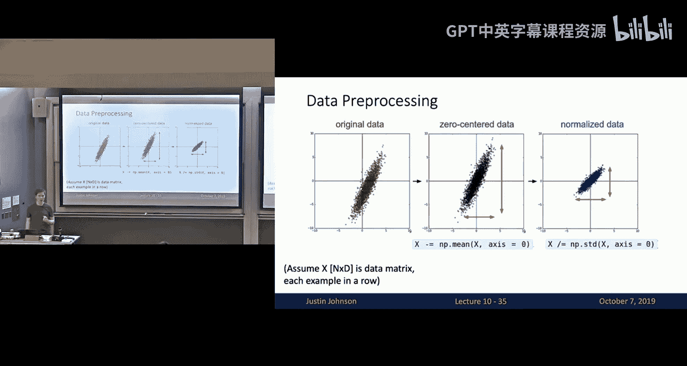

And this idea of why we might want to perform preprocessing in this way also kind of ties back to this discussion we had about about the not。

 about the zero about the bias problem with sigmoid non nonlinearities that recall if all of the inputs are going to be positive。

 then all of our gradient directions are going to always be positive or negative and similarly by the same logic。

 if all of our training data is always positive， then all of our weight updates will also be constrained to have either one sign or another sign but but for training data。

 we can easily fix this problem by just rescaling everything before we feed it into the neural network。

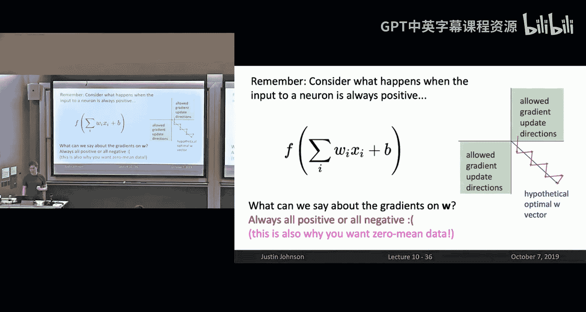

So for images it's very common to subtract the mean and divide by the standard deviation。

 but for other types of data， you might see maybe non-image data。

 you will sometimes see other types of preprocessing called decocorrelation or whitening。

 so here the idea is that if we compute the covariance matrix of our data cloud of the entire training set then we can use that to rotate the data cloud such that the features are uncorrelated。

 and this would be the green this would be the green data cloud in the middle of the slide that now we've basically taken our input data cloud and rotated it actually moved to the origin and then rotated it。

Another thing you'll sometimes do is then not only have unit mean zero mean unit variance for each feature。

 but actually perform this zero mean unit variance fixing after decocorrelating the data and that would correspond to this now stretching your data cloud out into this very well behaveved circle at the center of the coordinate axis here on the right shown in blue and if you perform both decocorrelation and this normalization。

 this is often called whitening your input data so this is sometimes pretty common to use if if you're working on non-inion problems where maybe your inputs your inputs are maybe specified as low-dimensional vectors in some way but for image data this is not so common。

Another way that you can think about why data preprocessing is helpful is to think about what happens if we try to learn even a linear classifier on nonstandardized data or nonnormalized data。

 so here on the left， suppose that we have this data cloud that is located very far from the origin and now we want to find this linear classifier that is going to separate the blue class from the red class。

Now data now， if we initialize our weight matrix with very small random values as we've typically done。

 then we can expect that at initialization， the boundary that our linear classifier learns is kind of near the origin and now if our data cloud is very。

 very far away from the origin then making very， very small changes to the values of the weight matrix will result in very drastic changes to the way that that decision boundary cuts through the training data cloud。

 and that means that kind of intuitively， if your data is not normalized。

 then that leads to a more sensitive optimization problem because very small changes in the weight matrix can result in very large changes to the overall classification performance of the system。

In contrast， on the right， if before starting training we had normalized our data by moving it to the center。

 now our entire data cloud also is sitting over the origin so we can expect that this will result in a better conditioned optimization problem。

Yeah， a question。Dated pre process。嗯。In a way， RGB is a little bit counterintuitive。这这个。

processed just so it's easier to interpret what's going on in their neuralnes by convertting RGB in RGB scale。

Yeah， the question is do people ever use other color spaces other than RGB I think people do use that sometimes in practice I've seen that less for image classification。

 I've sometimes seen that for more image processing type tasks like super resolution or denoising and there it's more common I think to feed raw inputs to the network as some other color space but in practice I think it usually doesn't matter too much what color space you use because in principle the equations for converting from one color space into another color space are usually fairly compact simple equations and the network could kind of learn in the first couple of layers to perform that kind of conversion implicitly within the first two layers or so if it really wanted to so in practice you do sometimes see people feed input data of different color spaces but in practice it usually doesn't have massive differences on the final results。

I mean， but I mean， if you're looking to interpret what's going on， you're let point， et cetera。Yeah。

 if you're talking about interpretability， I'm not sure whether HSV would be more or less interpretable than RGB。

 In either case， I think it's going to be kind of challenging to interpret what's going on inside those networks。

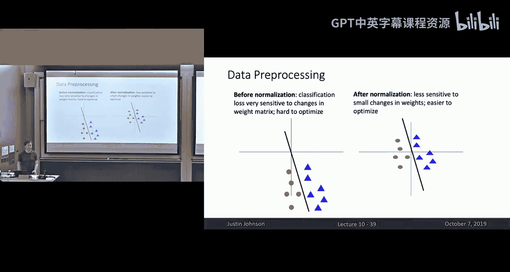

So then talking a little bit more concretely about what people actually do in practice for images。

 theres a couple things that are very common to do in images one is to compute the mean image on the training set for example。

 was done in AlexNet where they if your training data is something like endtrain by 32 by 32 by3 then if you average over the entire training data then you get a mean image of 32 by 32 by3 and one thing you can do is just subtract that mean image from all of your training samples Another thing that's very common is to subtract the per channel mean so you effectively compute the mean RGB color across the entire training data and then subtract only the mean color from each pixel and this is the way that for example VGG was trained another thing that's very common to do is to subtract the per channel mean and the per channel standard deviation so that means we're going to compute the mean RGB color over the entire training data set and we're going to compute the standard deviation of the threecol channel。

or the training data， and that gives us two three element vectors that we'll use to subtract the mean and divide by standard deviation。

 and that's kind of the standard preprocessing that's used for residual networks。

Any more questions about data preproces， yeah？这 one。你家先兄佢。简定的感觉。Mmhm。有。Yeah， so， yeah。

So the question is what do we do during training and testing， so whenever you're doing preprosing。

 you always compute your statistics on the training set and the reason we do that is not necessarily for computational efficiency。

 it's because that's to simulate how we would actually use the network out there in the wild because in the wild there is no such thing as a training set there is just the real world upon which we want to run this classifier and then there's no reasonable way that you could expect to recompute those statistics all the time over whatever real worldor data is coming in so to kind of simulate that process we will always compute our statistics on the training set and then use the exact same normalization statistics on the test set。

Yeah。Yeah， that's an excellent question。 So the question was， if we're using batch normalization。

 do we still need to use data preprosing think so yeah， this is very intuitive。

 You should think like what if I just put batch normalization as the very first thing in my network before I do any convolution or any fully connected layers or anything。

 This is the very first thing。 I think that'll actually work。

 but I think it works a little bit less than a little bit worse than actually doing the preprosing explicitly So in practice people still prefer to do this explicitly preprocessing and also have batch normalization。

😊，Okay， so then the next thing we need to talk about is weight initialization。

So whenever you start training your neural networks， you have to initialize your weights in some way。

 So here's a question， what happens if we just initialize all of the weights to0 and all of the biases to  zero。

Well， this is going to be very bad right because if all of the weights are0 and all of the biases are0。

 then you know assuming we have a relu or some other reasonable nonlineararity。

 then the outputs are all going to be zero and the outputs will not depend on the inputs。

 And even worse， the gradients will all be zero。 So we're like totally stuck。 So in practice。

 we cannot initialize to zero。 that's going to be very bad。

 and this problem of initializing to0 or more generally of initializing to a constant is referred to sometimes as not having symmetry breaking because it doesn't have any way to distinguish among different elements in the training set or even among different neurons in the network。

 So if you have these constant initializations than a very common failure mode is that will compute the same gradient for all of the training examples and the network doesn' is not actually able to learn in any way。

So in practice， what we've always done instead is just kind of hand wave and say let's initialize with small random numbers。

 and this is what you've mostly done on your homework assignments so far。 So for example。

 we can initialize with Gaussian with zero mean from a Gausian and maybe set the standard deviation as a hyperparameter。

And this is kind of what you've done on your homework assignments so far。

But let's dig into this a little bit more because it turns out that this strategy of initializing with small random Gaussian values works fairly reasonably okay for shallow networks。

 but it's going to not work so well once we move to deeper and deeper networks。So to see why。

 let's think about activation statistics and how they propagate as we move forward through a deep network。

 So here this little snippet of code is computing the forward pass for a six layer neural network with for a fully connected network with hidden dimension 4096 and we're using a T0H nonlinearity because we're not following the advice I told you a couple slides ago。

 and then what we're going to do is just plot the statistics of the hidden unit values at each of the six layers in this deep network。

And here you can see that now here， each of these plots is showing a histogram for the activation values for the six layers of this deep neural network。

 and what we can see is that for the first layer， after a single weight matrix and TH nonlineararity。

 we get kind of a reasonable distribution of values for the network。

 but as we move deeper and deeper into the network， we see that the activations。

 the activations all collapse towards zero。And now this is going to be very。

 very bad for learning because think about what this means for the gradients。So in particular。

 if all of the activations are0， that's going to mean that all of the gradients are also approximately going to be0。

 because remember， whenever we compute the local gradient on the weight。

 the local gradient on the weight is going to be equal to the activation at the previous layer。

 if you remember that equation from a few slides back。

 So what that means is that for this very deep network， when the activations collapse to0。

 then the gradient updates will also all be very close to0。

 and the network will not learn very effectively。Okay。

 so then maybe this so kind of our problem here maybe is that this weight initialization was maybe too small。

 so instead of initializing with 0。01 standard deviation。

 we could instead try changing that to initialize from 0。05 standard deviation instead。

 because maybe the problem was that all of our weights got too small because maybe our weight our weight values were just too small。

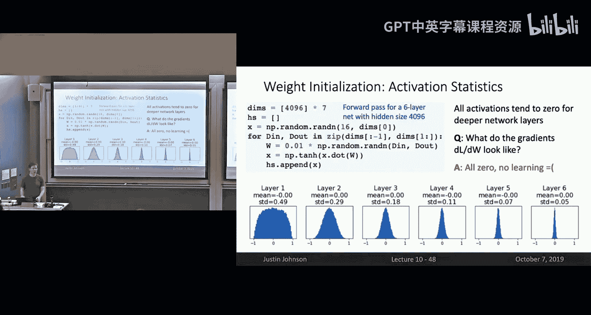

Now it turns out this is also really， really bad and now if our weight matrices are too big。

 then all of our activations are going to be pushed into the saturating regime of Th nonlinearity。

 so if we look at these histogram values again when we initialize for with these larger weight matrices。

 then we see that all the activations are in these saturating regimes of the TNh nonlinearity and again this means that now the local gradients will again be zero and everything will be zero and learning will also not work。

So we saw that when the one who initialized the weights to be too small。

 then they all collapseed to 0。 And when we initialized the weights to be too big。

 then the activations all all spread out to these saturating regimes of the nonlinearity。

So somehow we need to find a value for this weight initialization that is somehow in this Goldilocks zone in between too small and too large and it turns out that the Goldilocks initialization for these networks。

 one definition is called the Xavier initialization after the first author of this paper cited at the bottom so here rather than setting the standard deviation as a hyperparameter。

 instead we're going to set the standard deviation to be one over the square root of input dimension of the layer。

 and it turns out that if we make this sort of very special Goldilocks regime for initializing our weights。

 then we'll get very， very nicely scaled distributions of activations。

 no matter how deep our network goes。

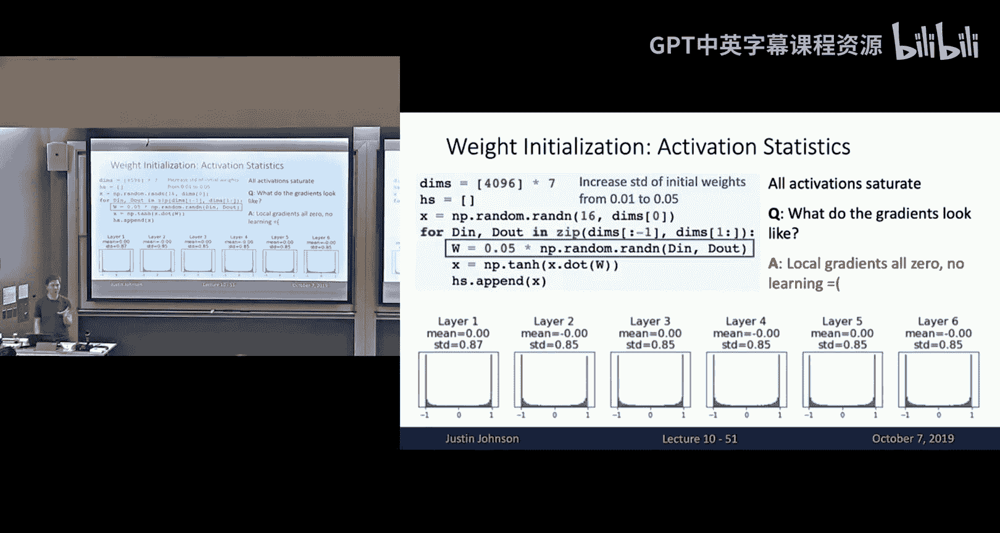

And I should also point out that this derivation is showing you for a fully connected network。

 but for a convolutional network， the DN will now be the number of inputs to each neuron。

 so that will now be the number of input channels times the kernel size times the kernel size if you want to do this exact same thing for convolutional networks。

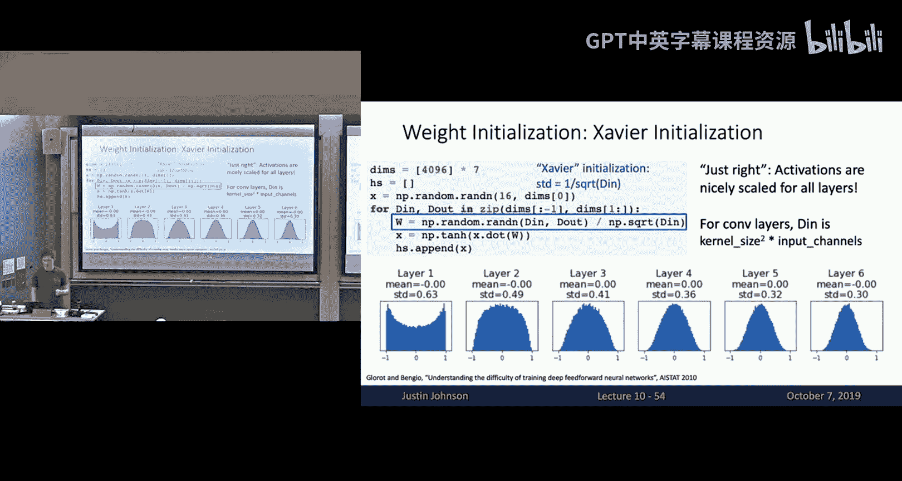

So then to derive this Xavier initialization， the trick is that we want to have the variance of the output。

 be equal to the variance of the input。 So the way that we set this up is we imagine that this this linear layer is going to compute y equals matrix multiply of weight matrix W and input activation vector X。

 So then each scalar element of our next layer ignoring a bias will be this inner product between one of the rows of W and the entire input vector X。

Now， if we want to compute the variances of one of these outputs Yi。

 then if we make a simplifying assumption that all of the x's and all of the Ws are independent and identically distributed。

 then we can use the properties of the variance to simplify in this way。

 and then we note that the variance of each one of the elements of the output layer Yi will be equal to DN times the variance of Xi times WI。

And then we make couple， then we make a couple other simplifying assumptions。

 We assume that X and W are independent random variables。

 And when you take the variance of the product of two independent variables。

 you look up on Wikipedia what to do and you get at a formula that looks something like this。

Then the next assumption is that we make another simplifying assumption that all of the inputs x are zero mean。

 which is maybe reasonable if they're coming out of a batch normalization layer on the previous layer。

 and we also assume that the Ws are also going to be zero mean。

 which is maybe reasonable if we assume that they were maybe initialized from some kind of Gaussian distribution。

So then once we have all of these assumptions， we can see that if we choose the。

 the magical value of variance of standard deviation equal to one over rather if。

If we set the variance of the W I's to be1 over D N。

 then we see that the variance of Y I is going to be equal to the variance of X I。

 So that motivates this derivation of the Xavier initialization。

 It's this idea of trying to match variances between the inputs of the layer and the outputs of the layer。

 and we see that if if we set the standard deviations in this very special way。

 then it will work out。

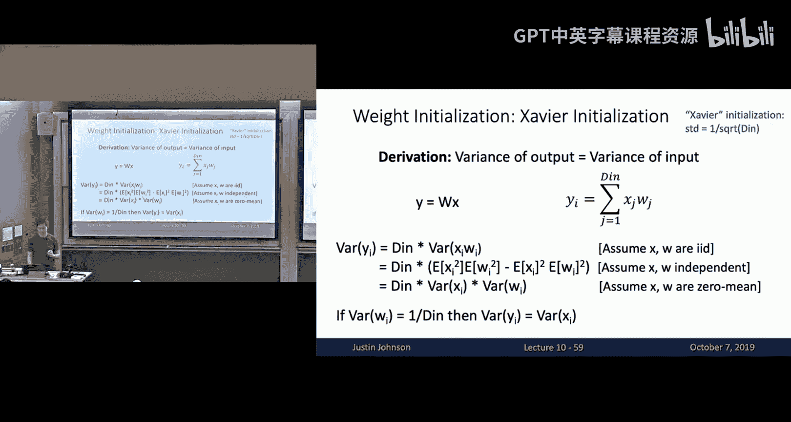

But there's a problem。 What about Relu， Relu right this whole derivation also hinges on the nonlinearity and and that's the reason why I actually use 10h in this experiment because this derivation is only talking about the linear layer。

 but that linear will be followed by a nonlinearity。 and for something like 10 H。

 it's symmetric and symmetric around0。 So as long as we match the variances of the linear layer。

 then things will generally be okay as we move through this through this centered nonlinearity。

But for Raylu， things will be very bad if we do this exact same initialization and now use our deep network to be Raylu instead of tan0 H。

 then our activation statistics are again going totally out of whack here these histograms look a little funny because there's a huge spike at zero because Raylu kills everything below zero。

 But if you kind of zoom in on the non-zero part of these histograms。

 you'll see that also for a deep network， everything is collapsing the activations are all collapsing towards zero again。

 which will again give us zero local gradients and no learning。

So to fix this we need a slightly different initialization for Raylu on the Neities and the fix is just to multiply our standard deviation by2 so now rather by square root 2。

 so for Xavier we have standard deviation of1 over DN now for Raylu we have standard deviation 2 over DN and intuitively that factor of 2 is to deal with the fact that Raylu is killing off half of its inputs and setting them to 0。

And this is called a Kying initialization after the first author of the paper that introduced it。

 or sometimes MSRA initialization after Microsoft Research Asia。

 where he worked when writing this paper。Now this is so then when you're initializing with raylu non nonlineararities。

 you need to use this MSRA initialization for things to work out well。

 and it turns out that actually I remember a couple of lectures ago we talked about VGG and that in 2014 there was no batch normalization and people could not get to VGG to converge without crazy tricks。

 well it turned out that actually once you have this timing weight initialization scheme。

 this is sufficient for getting VGG to train from scratch and actually the paper that introduced this。

 their big claim to fame was that they got VGG to train from scratch by simply changing the initialization strategy。

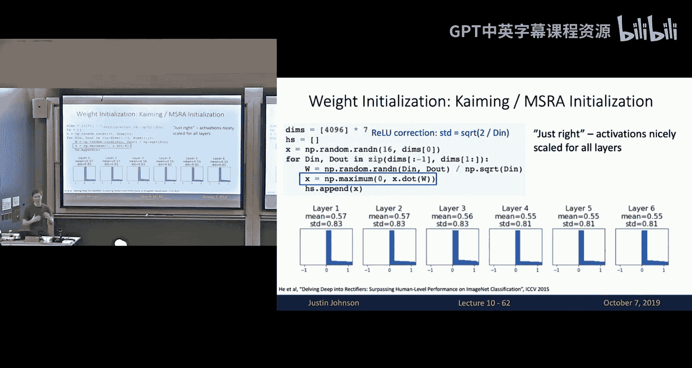

But this but remember， we've kind of moved on from BGG now and we talked in the CNN architectures lecture that the kind of standard baseline architecture you should normally consider is a residual network。

 And it turns out that this MSRA or chi initialization is not very useful for residual networks。

 And the way that we can see this is suppose we have a residual network。

 and we've somehow constructed the initialization of those internal con layers。

 such that the variance of the output matches the variance of the input。 Well。

 if we wrap those layers with a residual connection， now。

 that means that the variance of the output after the residual connection will always be strictly greater because we're adding the input again。

 So that means that if we were to use this MSRA or xavier initialization with a residual network。

 then we would expect the variances of our activations to grow and grow and grow and grow over many。

 many layers of the network and that would be very。

 very bad that would lead to exploding gradients and bad optimization dynamics again。

So the solution for residual networks is fairly simple。

 What we normally do for residual networks is to initialize the first layer with your MSRA initialization and then initialize the last layer of your residual block to be zero because that means that initialization this block will compute the identity function and your variances will be again perfectly preserved at initialization so that's the trick that's the way that we prefer to initialize residual networks。

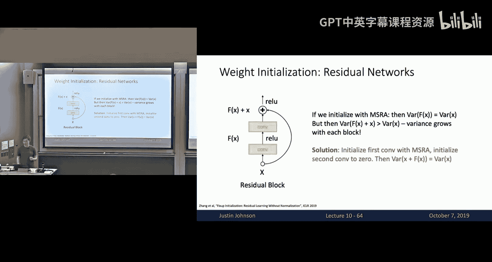

And I'd also point out that this whole area of how to initialize your neural networks and the reasons that you might prefer one initialization scheme over another is a super active area of research。

 and you can see papers even from this year that are giving new perspectives on the ways to initialize neural networks。

So are there any other questions on initialization， yeah？tically because。

initialization is want to be as close？To be。G步 max。都こ。possible。

That's not quite correct so so the idea was that oh maybe the idea with initialization is we just want to be as close as possible to the global minimum of the loss function。

 but before we start training， we don't know where that minimum is so instead the perspective that we normally take on initialialization is that we want to initialize in such a way that all the gradients will be well behaved at initialization and because if you choose maybe bad mal nonlinearities or bad initialization schemes。

 then you could end up with zero gradients or close to zero gradients right off the bat at the beginning of the training and then nothing will train and you won't make any progress towards the goal。

What you're doing when you avoid those？essentially you're saying that you know there's going to be another。

承保。I think the different， the way I'd like to think about it is that we want to。

 So you imagine this like lost landscape surface that we're optimizing。

 then we want to initialize in a place where it's not flat。

 So we prefer not to initialize in a local minima。 And that's the main constraint that we want to take into account when constructing initialization schemes。

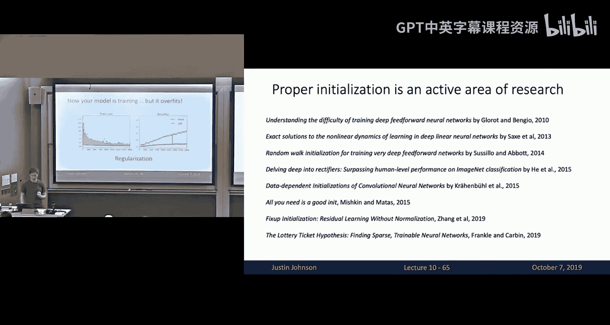

So this is all about so so far， we've talked about ways for getting your model to train。

 we set up the activation function， we set up the initialization。

 but then once you get your model to train， if you've done a really good job at optimizing it。

 you might see it start to overfit and it might start to perform better on the test set than it does on the training set and this would be a bad thing so now to overcome this。

 we need some strategies for regularization。

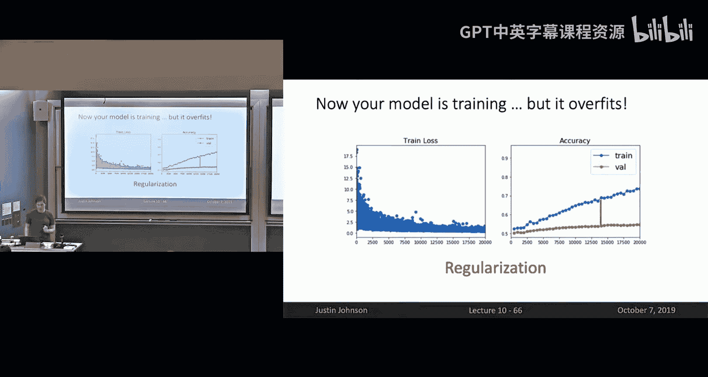

So we've already seen one simple scheme for regularization。

 which is to add another term to the loss function。

 The very common one that you've used on your assignment so far is L2 regularization。

 also sometimes called weight decay that just penalizes the L2 norm of your weight matrices。

 This is very common， and this is a very widely used regularizer for deep neural networks as well。

But there's a whole other host of other regularization schemes that people use in deep learning。

 One of the most famous is this idea called dropout。 So dropout is kind of a funny idea。

 What we're going to say is that when we add dropout to a neural network。

 we're going to explicitly add some randomness to the way that the network processes the data。

 So in each forward pass， we're going to randomly set some of the neurons in each layer equal to0。

 So we're going to compute a layer， a forward pass for a layer。

 randomly set some of the neurons to 0， and then compute another layer。

 then randomly set some of those to 0， then compute another layer and so on and so forth。

 and then the probability of dropping any individual neuron as a hyperparameter。

 but a very common choice would be 0。5 so that every any individual neuron has probability one half。

 we flip a coin， whether or not to keep it or throw it away。

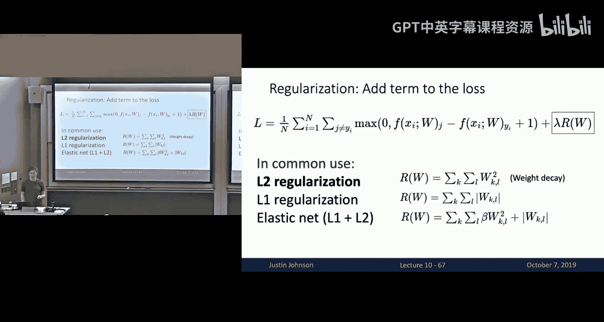

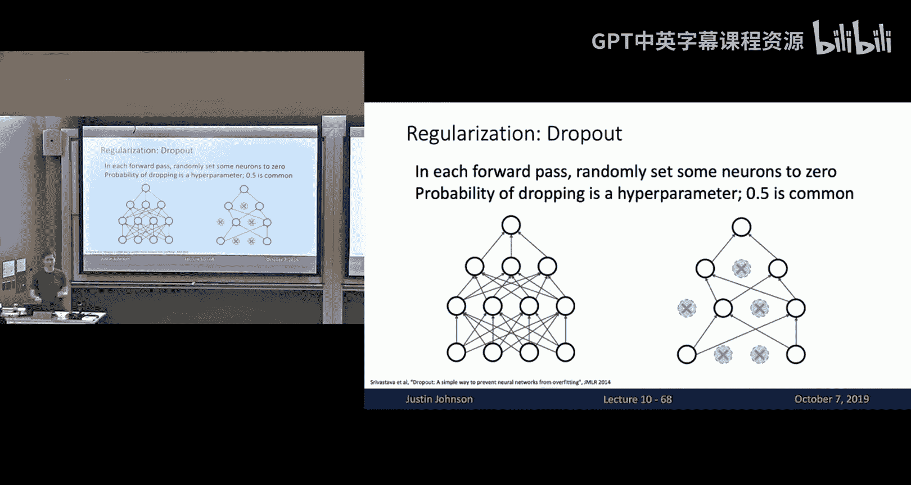

Seems crazy， right？But it's very simple to implement。

 right this is implementing a two layer fully connected neural network with dropout and you can see that the implementation is very simple。

 we just compute this binary mask after each layer and use that to kill off half of the neurons in each layer after we compute the matrix multiply。

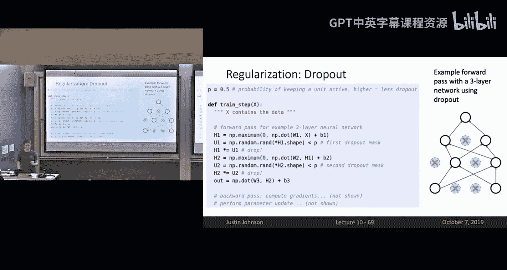

So then the question is， why would you ever possibly want to do this Well。

 one interpretation of what dropout is doing is that it prevents it forces the network to have a kind of redundant representation。

 another way this is phrased is that we want to prevent the co-adptation of features so we want to encourage the network in some way to develop representations where different slots in that vector represent maybe different robust ways of recognizing the object。

 so for example， if we are building a cat classifier。

 maybe maybe a bad thing would be for each element of the vector to just learn independently whether it's a cat。

 but if we add dropout， then maybe we want it to learn kind of more robust representations。

 maybe some neurons should learn about ears and some should learn about furry and different neurons should maybe focus on different high-level aspects of catness。

 such that if we randomly knock out half of these neurons。

 then it can still robustly recognize the cat even if we mess with its representation。

Another interpretation of dropout is that it's effectively training a large ensemble of neural networks that all share weights。

 because if you imagine this process of masking out half of the neurons in each layer。

 what we've effectively done is built a new neural network that is somehow a sub network of the original full network and now at each forward pass we're going to train a separate sub network of this full network。

 and then somehow we're going to have this very， very large。

 exponentially large number of subnets that all share weights and then the full network will somehow be some ensemble of this very。

 very large number of subnets that are all sharing weights。

So these are both two kind of admittedly hand waving explanations of what dropout might might be trying to do。

And there's a whole host of theory papers that try to give more concrete explanations for why this works。

But now a problem with dropout is that it makes the test time operation of the neural network actually random because we were randomly knocking out half the neurons to each layer at each forward pass and this seems bad because if you're deploying these networks in practice。

 you'd like their outputs to be deterministic you wouldn't want to upload a photo to your web hosting service one day and having recognized as a cat and the next day the same photo is recognized as something else that would be a bad property for your neural networks when they're deployed in practice So at test time。

 we want some way to make dropout deterministic and what we really want to do is kind of average out this randomness because once we've rewritten once we've built dropout into our neural network。

 we can imagine that we're rewriting our neural network to actually take two inputs。

 One is our actual input image X and the other is this random mask Z which is some random variable that we are drawing before we run the forward pass of the network And now the output that our network computes is dependent both in the input data as well as on this random variable So then in order to make the network。

Theterministic， what we want to do is somehow average out the randomness at test time。

 And what we can do is then take we can have the test time forward pass be this expectation of averaging out this random variable。

 So then if we want to compute this analytically， we just want to compute this integral to marginalize out this random variable Z。

But in practice， actually computing this integral analytically is like， we have no idea how to do it。

 That seems very hard and very intractable for for arbitrary neural networks。So in practice。

 we will instead think about what happens how can we think about this integral for only a single neuron Well for a single neuron that receives two inputs X and y and has these connection strengths W1 and W2 and then produces this single scalar output A then kind of the normal forward pass that we might imagine doing a test time is to take this inner product of the weight matrix and the two inputs X and y and now if we're using dropout then there are four different random masks that we might have drawn during training with equal probability where we could have kept them both we could have knocked out X but kept y knocked out y but kept X or knocked out both of them and each of these four options can occur with equal probability so then if we can in this case we can write out this expectation exactly because we've got exactly four outputs and they all have the equal probability and what we see is that for this example this output this expected output is actually equal to1。

On half the probability of this normal forward pass。

And this turns out to hold in general that if we want to compute the expectation of a single layer with dropout。

 then all we need to do is multiply by the dropout probability。

 So simply multiplying by the dropout probability allows us to compute this expectation for a single dropout layer。

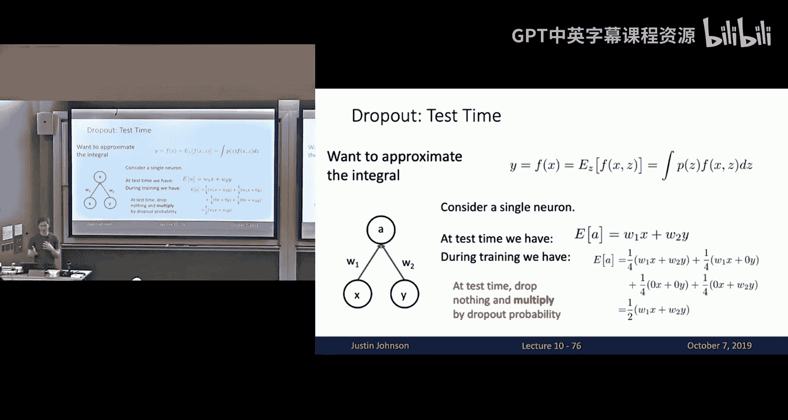

So that means that at test time， we just this derivation means that we need to at test time。

 we want the output to be equal to the expected input at training time。

 which means that at output and at test time， we want all neurons to be active。

 we want them all of our learned weights to actually do something。 So at test time。

 we'll use all of the neurons， but then we'll rescale the output of the layer using this dropping probability that we had used to drop individual neurons。

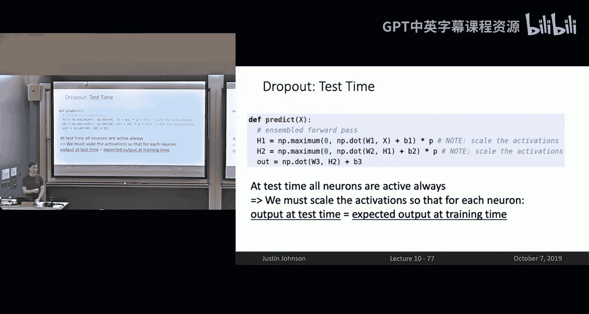

So this gives us our summary of implementing dropout that it's actually quite straightforward that when you implementing dropout during the forward pass during training。

 we're going to drop these random we're going to generate these random masks and use those to drop out or zero out random elements of the of the activation vectors and at test time we'll simply use the dropout probability to rescale the output and have no randomness Now this expectation is exact only for individual layers and this kind of way of computing expectations is not actually correct。

 if you imagine stacking multiple dropout layers on top of each other。

 but it seems to work well enough in practice。I'd also like to point out that a slightly more common thing that you'll see for implementing dropout is another variant called inverted dropout that's really fundamentally the same idea。

 it's just a different implementation of the same thing and the question is where do we want to do the rescaling we want to do rescaling during test time or we want to do rescaling during training time and we would prefer to not do rescaling during test time because during test time we want to really maximize the efficiency of the system because maybe it's going to run on mobile devices or in servers on lots of images or whatever so we maybe prefer to pay a little bit of extra cost of training time instead so in practice a very common thing you'll see with dropout is to generate these random masks at training time and then then if you're having dropout probability one half then during training time we'll drop half the neurons and then we'll multiply all of the remaining neurons by two and then at test time we'll just use all the neurons and use our normal wave matrix and in this way again the expected value the expected value of the output。

Training time will be equal to the actual output at test time。

 but it's just a question of where do we put the rescaling。

 Do we put it during training time or test time。

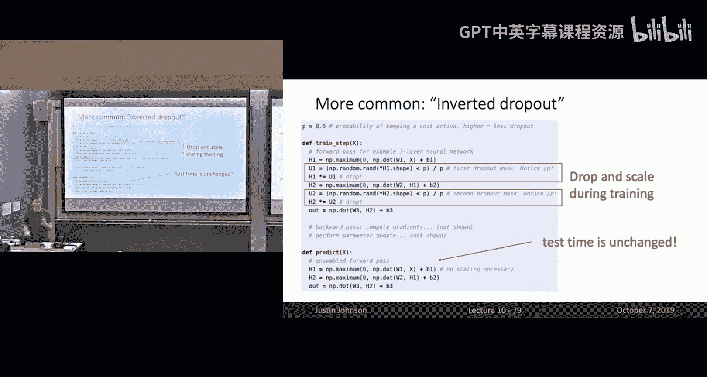

And then there's another question of now that we've got this idea of a dropout layer。

 where do we actually insert it into our neural network architectures Well。

 if we remember back to the Alexnet and BHG architectures。

 we remember that the vast majority of the learnable parameters for those architectures lived in these fully connected layers at the end of the network and that's indeed the exact place where we tend to put dropout in practice is in these large fully connected layers at the end of our convolutional neural networks。

But if you'll remember that as we moved forward in time and looked at more recent architectures。

 things like ResNe or GoogleNe actually did away with these large fully connected layers and instead used global average pooling instead。

 so actually for these later network architectures。

 so this actually did not use dropout at all but prior to 2014 or so Dropout was really a critical essential piece of getting neural networks to work because it actually helped a lot for reducing overfitting in something like AlexNet or BGG and they've it's actually become slightly less important in these more modern architectures like Resnets and so on and so forth。

Now this idea of dropout is actually something of a common pattern that we see repeated a lot in different types of neural network regularization that basically during training。

 we've added some kind of randomness to the system。

 like by adding a dependence on some other random source of information and then at testing。

 we average out the randomness to make a deterministic for dropout this randomness took the source of random masks。

 but we can see many other types of regularization that use other sorts of randomness instead。

And we've actually seen another regularizer already in this class that has this exact same flavor。

 And that regularizer is batch normalization。😊，Because if you recall。

 batch normalization adds randomness during training time。

 because it makes the outputs of each element in the batch depend on each other element in the batch。

 because during training， remember for batch normalization。

 we compute these per mini batch means instant standard deviations。

 which means that they depend on which random elements happens to get shuffled into each mini batch at each iteration of training。

So then so batch normalization is adding randomness by making depending on the weight in which we form batches at training time。

 and then at test time it averages out this randomness by using these running averages of means and standard deviations and using these fixed values instead at test time to average out this randomness。

And in fact， for these later architectures， like residual networks and other types of more modern architectures。

 batch normalization has somewhat replaced dropout as the main regularizer in these deep neural networks。

 so for something like a residual network， the regularizers that it's used to train are L2 weight decay and batch normalization。

 and that's it。And that tends to be actually a very useful way to successfully train large deep neural networks is actually just relying on the stochasticity of batch normalization。

😊，But theres several， actually， there I lied a little bit。

 There's one other type of thing one other source of randomness that happens a lot in practice。

 but most people don't refer to it as a type of regularization。

 And that's this notion of data augmentation。

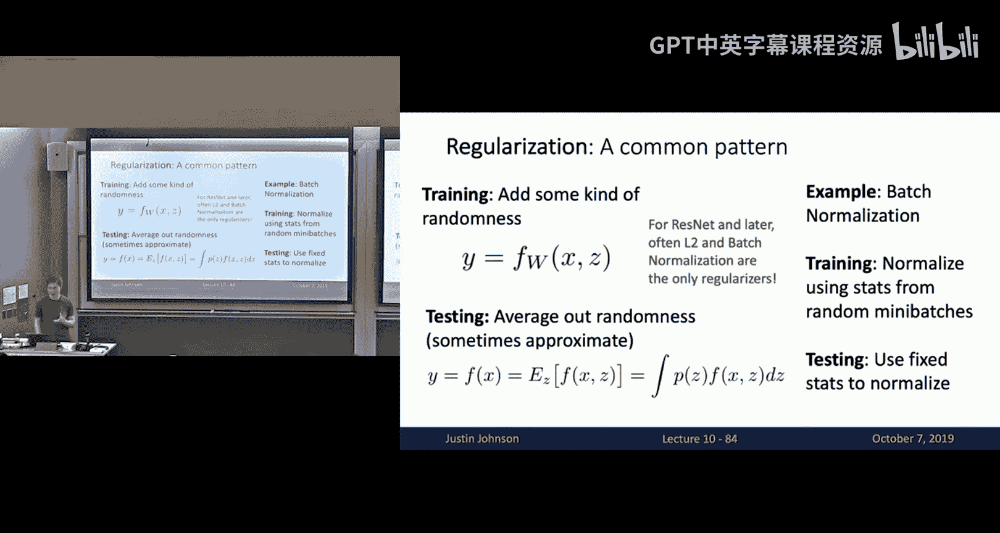

So so far in this class， whenever we've talked about loading and training iterations。

 we always imagine that we load up our training data。

 load up the label for that training data like this picture of a cat and the label cat。

 run the image through the network， and then compare the predicted label to the true label and then use that to get our loss and compute our gradients。

But it's actually very common in practice to perform transforms on your data samples before you feed them to the neural network。

And perform and somehow manipulate or modify the input image in a random way that preserves the label of the。

 of the data sample。 So， for example， for images。

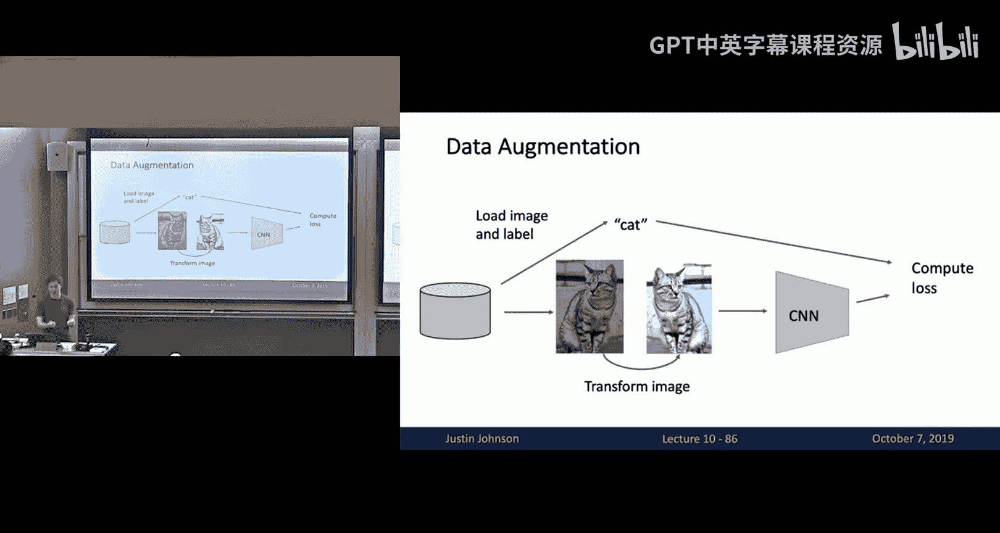

Some common things would be horizontal flips because we。

 as humans know that if we flip the image horizontally， then it's still a cat。

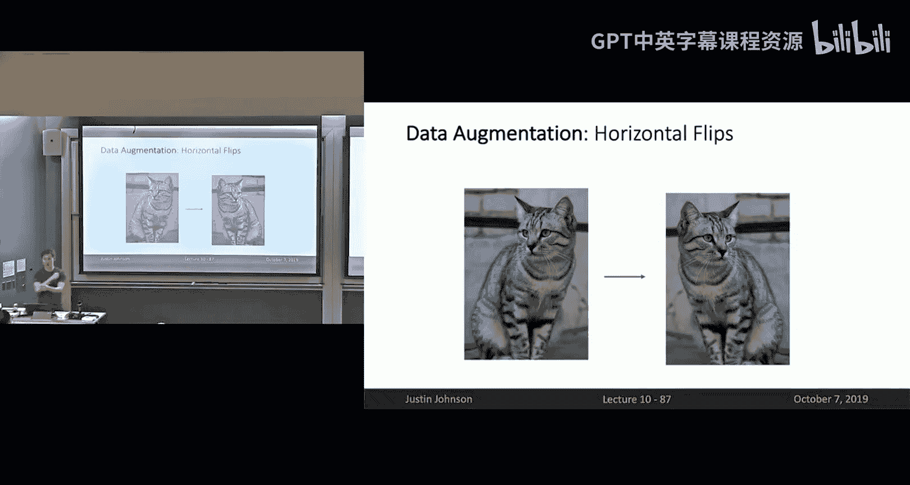

Other common things would be random crops and scales。

 so at every training iteration we might resize the image to have a random size or take a random crop of the image because we expect that a random crop of a cat image should still be a cat image and should still be recognized as a cat by the neural network。

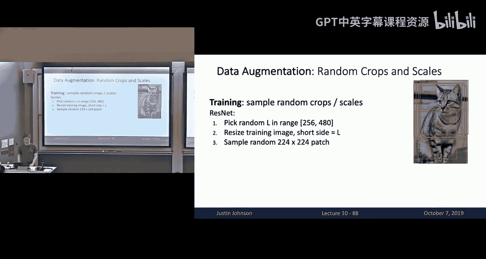

And the idea here is that add this effectively multiplies your training set because we add these data transformations to the model in a way that we know doesn't change the training label。

 and this somehow kind of multiplies your training set for free because now your network is trained on more raw inputs。

And then but this is again， adding randomness at training time。

 So for this example of random cropping and flipping and scaling for something like resnets。

 the way that they're trained is that at every iteration， every training image。

 we pick a random size， resize it to a random size。

 then take a random 224 by 2 to4 crop of this randomly resized image。

 And and we just do this random cropping and random resizing and random flipping for each element at every iteration。

 But now again， this is adding randomness to the network in some way。

 So we want to fitting with this idea of marginalizing out randomness at test time。

 we want some way to marginalize out this other source of randomness in our neural network。

 So then the way this is done in data augmentation is to pick some fixed set of crops or scales to evaluate at a test time。

 So for example， in the resnet paper they take these five different image scales。

 and then for each scale， they evaluate five crops of the image， the four corners and the center。😊。

as well as the horizontal flips of all these things and then average the predictions after running each of those different random crops through the network again and again。

 this is a way that we are adding randomness to the network at training time and then averaging out that randomness at test time。

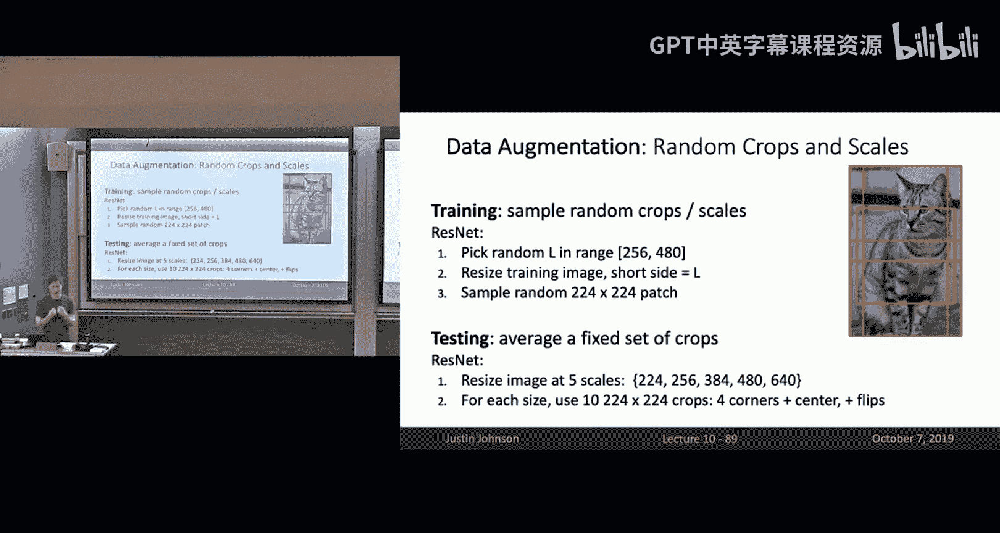

There's some other times people play tricks around also randomly jittering the color of your images during training time。

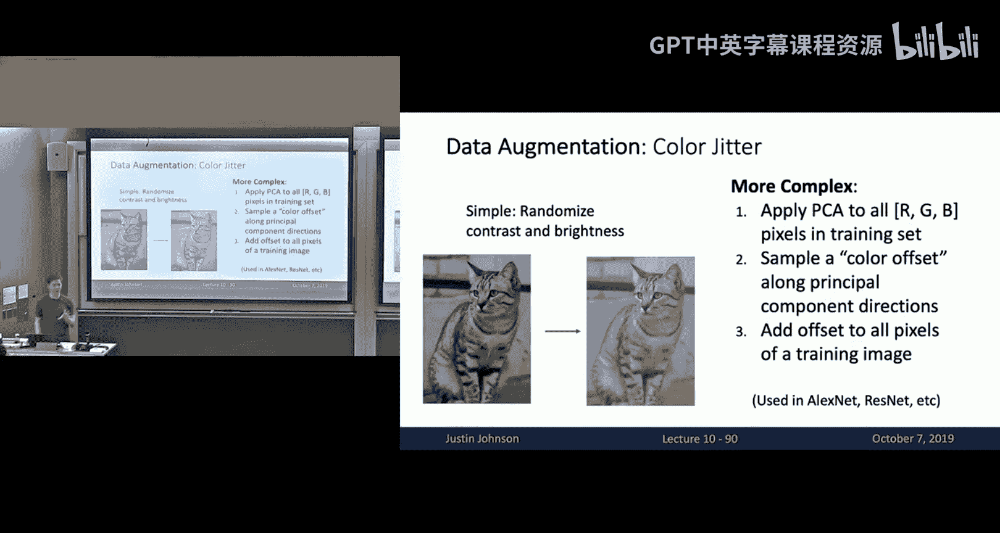

But in general， this idea of data augmentation is a way that you can get creative and add some of your own human expert knowledge to the system because depending on the problem you're trying to solve different types of data augmentation might or might not make sense so like for example。

 if you are building a classifier to try to tell right and lefthand apart then probably horizontal flipping would not be a good type of data augmentation to use but if we want to recognize cats versus dogs。

 then horizontal flipping is maybe very reasonable or sometimes I've seen in like medical imaging context where we want to recognize like slides or cells。

 then even performing random rotations is reasonable because depending on that for that source of data。

 you don't really know what orientation it might have come in at。

 So data augmentation is really a place where you can inject some of your own human expert knowledge into the training of the system about what types of transformations do and do not affect the labels that youre trying to predict。

So now we've seen this pattern in regularization of adding randomness at training time and then marginal marginalizing out the randomness at test time。

 So I just want to very quickly go through like a couple other examples of this pattern that I don't expect you to know in detail just to give you a flavor of other ways that this has been instantiated。

Well， one way， another idea is drop connect。 So this is very similar to drop out。

 but rather than zeroing random activations。 Instead。

 we're going to zero random weights during every four pass the network。 And again。

 we'll have some procedure to average out that stochasticity at test time。

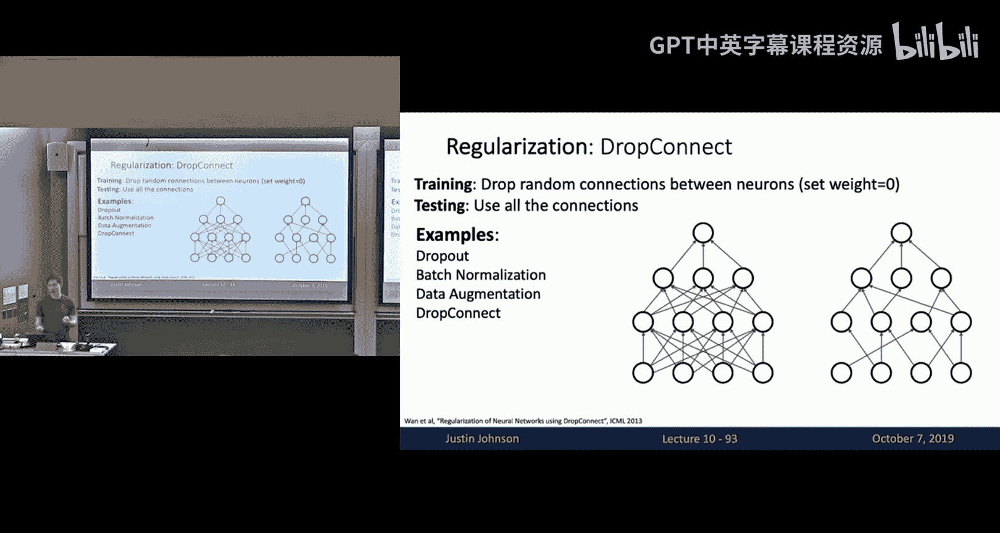

Another idea is that I find very cute is this notion of fractional max pooling。

 So here what we're going to do is actually randomize the sizes of the receptive fields of our pooling regions inside each of the pooling layers of the neural network so that maybe some neurons will have a two by two pooling region。

 some neurons will have a one by one pooling region and they'll be random in every four pass and this is fractional max pooling because this randomness between choosing a 1 by one receptive field and a  two by two receptive field means you can have like 1。

35 pooling in expectation so this is sometimes referred to as fractional max pooling。

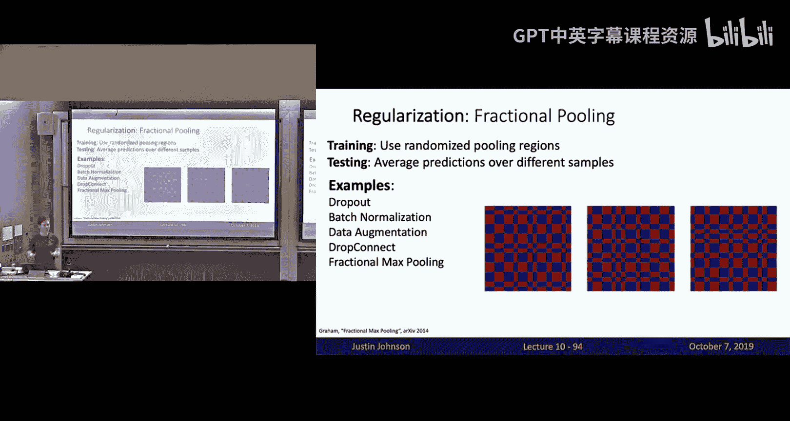

Another crazy one is we can actually build networks， deep networks with stochastic depth。

So we can build something like 100 layer ressonnet。 And then at every forward pass。

 we'll use a different subset of the residual blocks during training。 And then at test time。

 we'll use all of the blocks。 So we saw a kind of drop out that's dropping weights。

 dropping individual neuron values。 We saw a drop connect。 that's dropping individual weight values。

 This is something like drop block， that's dropping whole blocks from this deep residual network architecture。

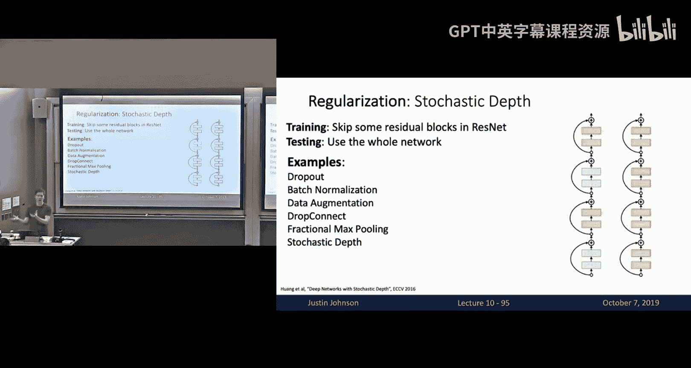

Another one that's actually more commonly used is this notion of cutout。

 so here we're simply going to zero set random image regions of the input image to zero at every four pass during training。

 and then at test time we'll use the whole image instead。

 and again you can see that we're performing some kind of randomness to corrupt the neural network at training time and then averaging out one that randomness at test time。

And now， this last one is really crazy that I can't believe it works。 It's called mix up。

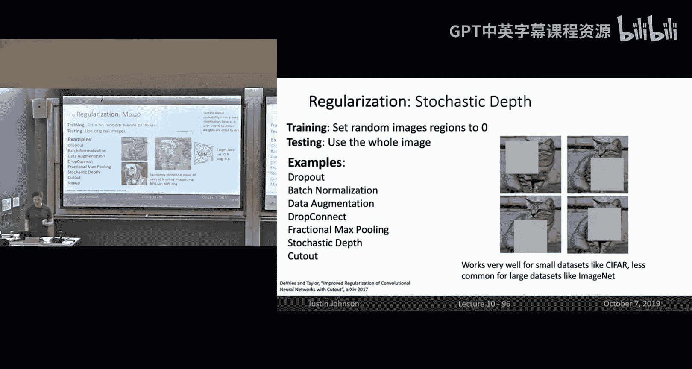

So here with mix up， what we're going to do is train on random blends of training images。

 so now rather than training on just a single image at a time。

 we'll form my training samples by taking a cat image and a dog image and then blending them with a random blend weight and then the predicted target should now be like 0。

4 cat and 0。6 dog where that target is now going to be equal to the blend weight。

And this actually seems totally crazy， like how can this possibly work。

 But the reason that it maybe seemss slightly more reasonable is that these blend weights are actually drawn from a beta distribution。

 which we have the Pf of the beta distribution up there， which means that in practice。

 these blend weights are actually very close to a 0 or close very close to 1。

 So in practice rather than being 0。4 cat and 0。6 dog， it's more likely to be like 0。95 cat and 0。

05 dog， So it's not as crazy as it initially seemss。

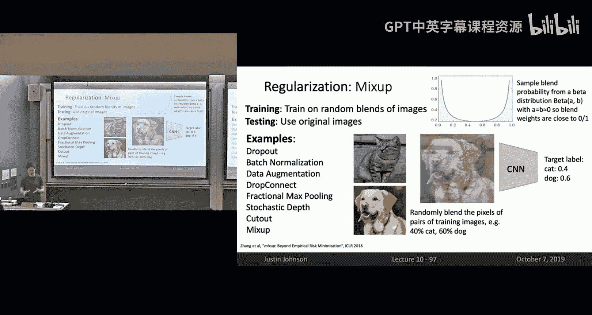

But then kind of takeaways for which regularizers should you actually use in practice is that you should consider dropout if architecture if you're facing an architecture that has very。

 very large fully connected layers but otherwise dropout is really not used quite so much these days and in practice batch normalization L28 decay and data augmentation are the main ways that we are regularizing neural networks in practice today and actually surprisingly these two wild ones of cut out and mixup actually end up being fairly useful for small data sets like CFR 10。

 so I think state of the art on CR 10 actually uses both of these techniques but for larger data sets like INe cut cut out and mixup are usually not so helpful。

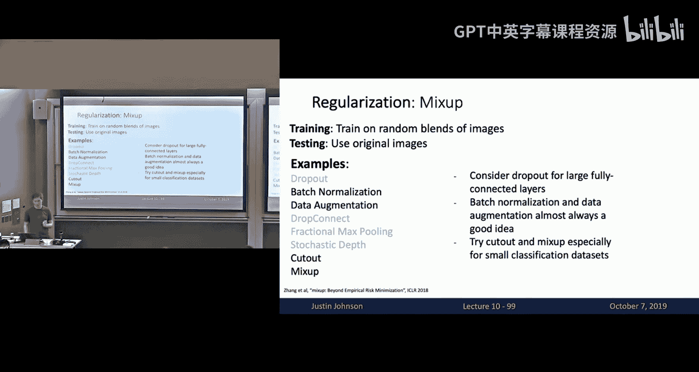

So that gives us our summary of part one of a lot of these nitty gritty details about choices you need to make when training neural networks。

 and then on Wednesday's lecture， we'll talk about some more of these details that you need to know in order to get your neural networks to train。

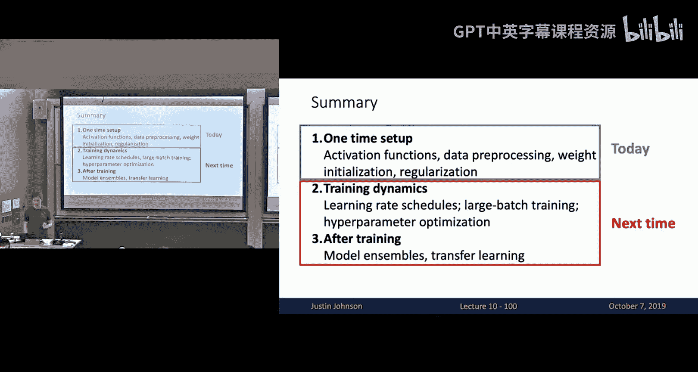

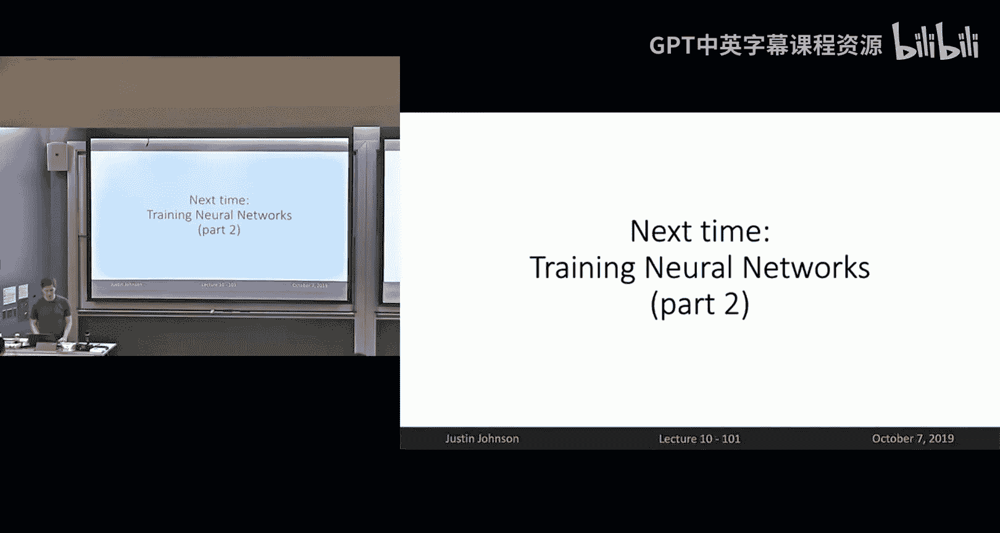