# 密歇根大学《深度学习用于计算机视觉｜Deep Learning for Computer Vision UMich EECS 498-007 2019》中英字幕 p11 -11-11_TrainingNeuralNetworksPart2.zh_en -BV1jA4m1P7GN_p11-

Yeah。

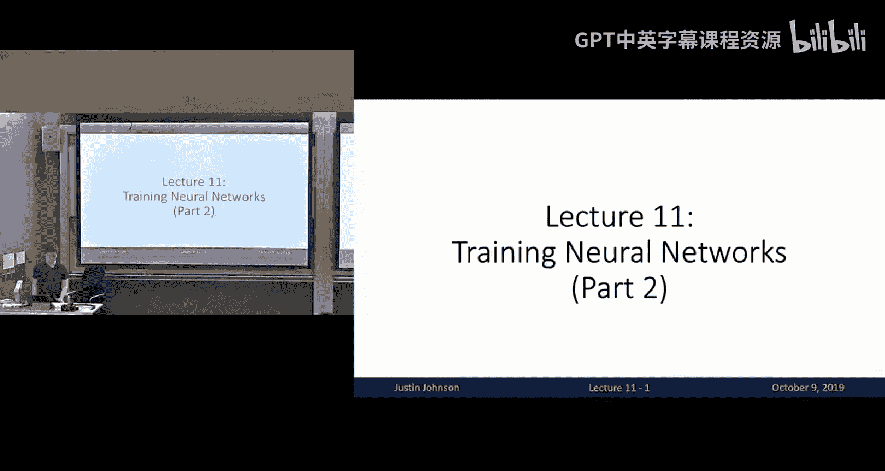

All right， welcome back to lecture 11， and today we're going continue our discussion about all the little nitty gritty tips and tricks that you need to train neural networks。

 I apologize I couldn't come up with a better title for this lecture and last lecture。

 They just end up being kind of a bit of potry of a lot of little things that you need that I think you need to know about training neural networks。

 but sort of had a hard time fitting them into a good theme or a good title other than that。

So our administrative notes for today。 remember that we have assignment 3 due on Monday。

 So today is the last time we'll see each other before that assignment is due。 And again。

 remember to run the validation script before you submit your assignment。

A second reminder about the midterm， we went over some of these details in lecture last time。

 but the most salient point to take away is that if you need to request an alternate midterm time for some reason。

 then go ahead and fill out this Google form that we've sent you。

 we got some responses on this already， but just in case anyone has not yet filled out this form。

 please do so if you need to request an alternate midterm time for any reason。

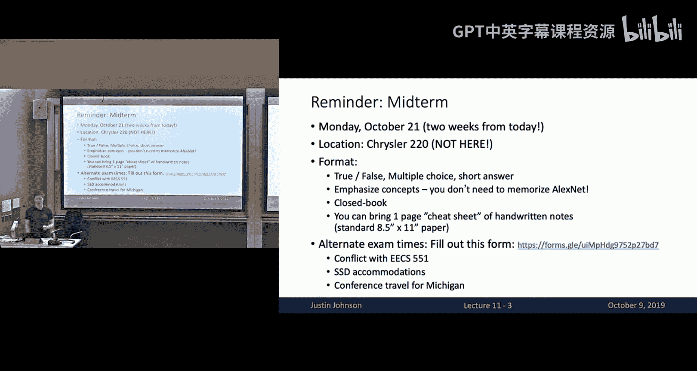

And then the other reminder is that there will be no class this upcoming Monday because of the fall study break。

 so you should use that time to finish your homework and start studying for the midterm。

 or maybe study for other midterms， I don't know， do whatever you want。

Any questions on these administrative things before we move on to the content for today？

Okay so to kind of recap last lecture and also this lecture， like I said。

 it's been a bit of a potpry of a lot of different topics that you need to know about how to train neural networks so the last time we talk we focused on some of these sort of one-time setup choices about the architecture and whatnot that you need to make before you start training so recall last time we talked about activation functions and we had a lot to say about the different activation functions。

 but in the end we just decided to stick with Relu because it doesn't matter too much we talked about data preprocessing and we finally explained the mystery behind those mean subtraction lines that have been appearing on your homework assignments so far。

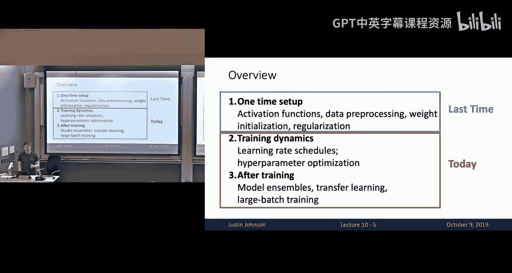

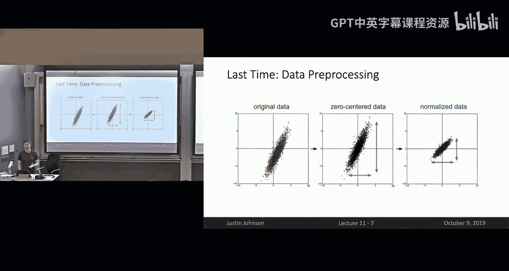

We talked about weight initialization and then saw how we can use this Xavier or timing initialization rules to force ours to beized force our activations to have good distributions over many layers of a deep network。

 and this was kind of a trade off between too small where things would collapse to zero or too large where things would explode。

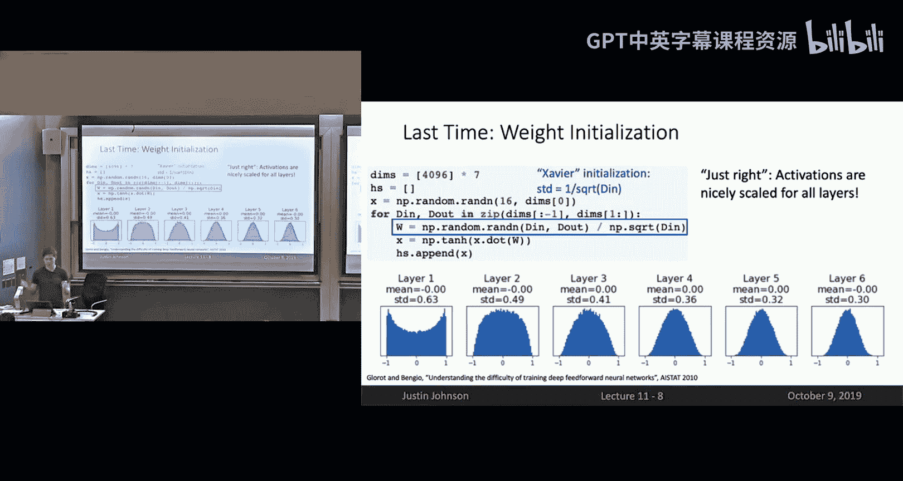

And then these last two points， I think we went a little bit fast last time in lecture。

 so if anyone had any lingering questions about any of these points。

 this would be your in to ask those。But then remember。

 we also talked last time about data augmentation， which was this technique by which we can artificially multiply the size of our training set by performing random transformations on our training data before we feed it directly into the network。

 and again， we saw that data augmentation was a way that you can inject priors about your own knowledge about the structure of your data into the training procedure of your neural network and that you could imagine inventing different types of data augmentation for different types of tasks。

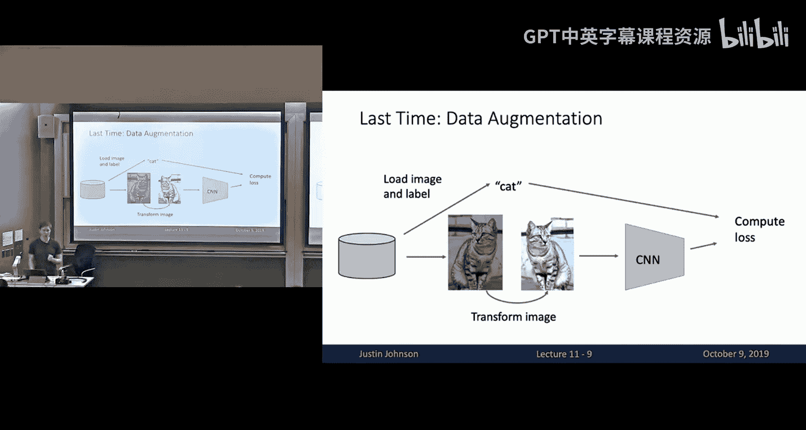

Then we also saw this very general concept of regularization where so far in your homework assignments。

 you've seen something like L2 regularization where we add an explicit term and explicit additional term onto our loss function that for example。

 penalizes the norm of the weight matrix but last time we saw this much more general class of regularizers that are commonly used in neural networks whereby in the forward paths。

 we somehow inject some kind of noise to mess up the processing of the neural network in some way。

 and then during testing， then we somehow marginalize out or average out that bit of noise。

 and as examples of this sort of paradigm of regularization we talked about things like dropout fractional pooling drop connect stochastic depth and these crazy ones like cut out and mix up that are actually used in practice quite a bit。

So I realized we went a little bit fast， especially around regularization toward the end。

 So I just wanted to make sure there were no lingering questions about any of these topics before we move on to new stuff。

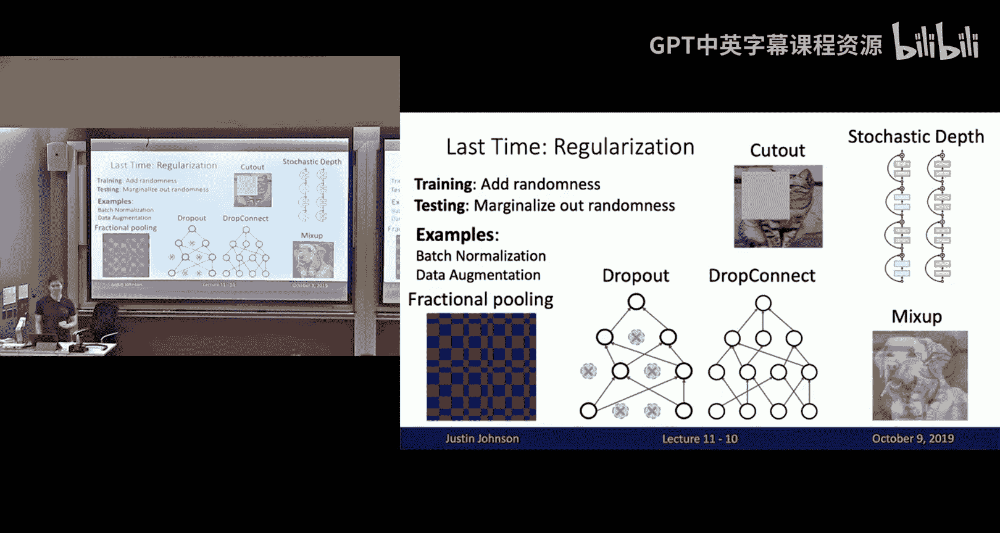

Okay， very good。So then that was kind of the stuff that we talked about last time and today we're going to move on to some other interesting topics about bits and pieces about how you train neural networks in practice in particular we're going to talk about things that you need to worry about during the process of training your model and getting your model to train that's sort of setting learning rate schedules and how to choose hyperparameter。

 I know this has been a very frustrating procedures for some of you and then some additional points that you might want to think about after you've successfully trained your model those are questions about maybe model enssembling。

 transfer learning and how to scale up your model to train on maybe whole data center levels of compute。

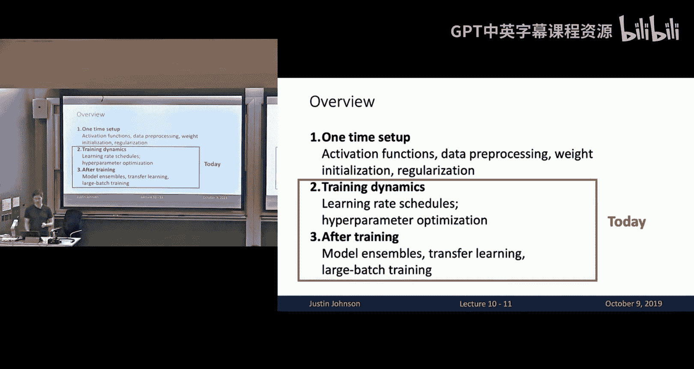

So the first of these topics is learning rate schedules。So I think at this point。

 we've seen many different optimization algorithms。 we've seen things like vanilla SGD。

 SGD plus momentum， Irad， RMSs crop， atom， and all of these have some kind of hyperparameter that's called a learning rate and usually this learning rate hyperparameter is probably the most important hyperparameter that you need to set for most deep learning models and at this point you've had the chance to use SGD for a variety of different types of models and hopefully you've started to get some intuition about what happens when you set different values of the learning rate with different optimizes so here on the left is a little bit of a cartoon picture of what you can sometimes expect might happen with different with optimize as you set different types of learning rates So here。

 for example in yellow if you set the learning rate too high then often things will just explode immediately and the loss will escape to infinity or you'll get Ns and it will very quickly go very wrong very fast。

In contrast， if you set something like in blue， a very low learning rate。

 then you'll see that learning tends to proceed very。

 very slowly and this is good because you make progress， things don't explode to infinity。

 but it might take a while to train for your loss actually drop to very low values and in contrast。

 something like in green， might be a learning which is high。

 but not so high that you explode to infinity and there you see that in contrast to the blue learning rate。

 setting a higher learning rate might actually converge to a fat to a value faster。

 but it might actually not converge to as low of a loss value and and what we kind of like is something like the red curve here。

 which is sort of ideal good learning rate， that you see it makes quick progress towards this areas of low loss while also not exploding to infinity and also actually training reasonably quickly。

So obviously if we can， we would prefer to choose this red learning rate。

 but if that's not always possible， we have sort of a question here。

 which is that if we can't find that one perfect learning rate that's going to work for us。

 then what are we supposed to do， how are we supposed to trade off between these seemingly suboptimal choices？

And this is a bit of a trick question， it turns out。

 because we don't actually have to make one choice for the learning rate。 In fact。

 it's very common to somehow choose all of them and to basically the basic idea here is to start with a relatively high learning rate that looks maybe something like the green curve and that will allow our loss our optimization to make very quick progress in the first iterations of training towards these areas of low loss and then over time after maybe after this green curve is sort of plateauing then we want to reduce the learning rate and continue training with these lower learning rate。

 maybe like this blue learning rate and this will hopefully let us get the best of both worlds that we can hopefully by starting with a high learning rate and then lowering it over time。

 then we can hopefully make quick progress at the beginning and also converge to very low loss values at the end of training。

But this has been sort of vague and not very specific so far。

 I just said we're going to start with a high learning rate and then end with a low learning rate。

 But then what actually concretely is that going to look like。

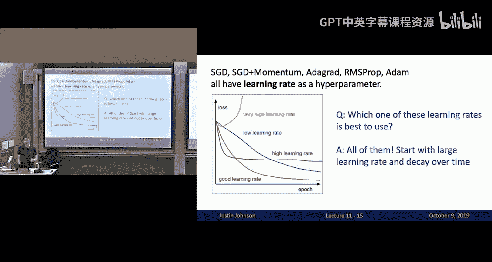

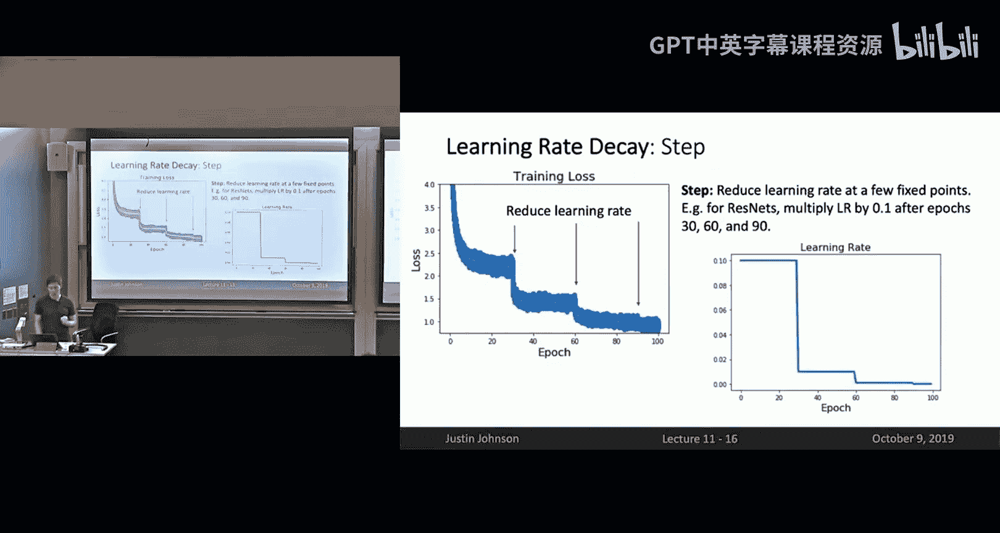

Well， so this process of choosing different mechanisms of starting of changing the learning rate over the process of training。

 these are called learning rate schedules， and there' are several different forms of learning rate schedules that are commonly in use when training deep neural network models。

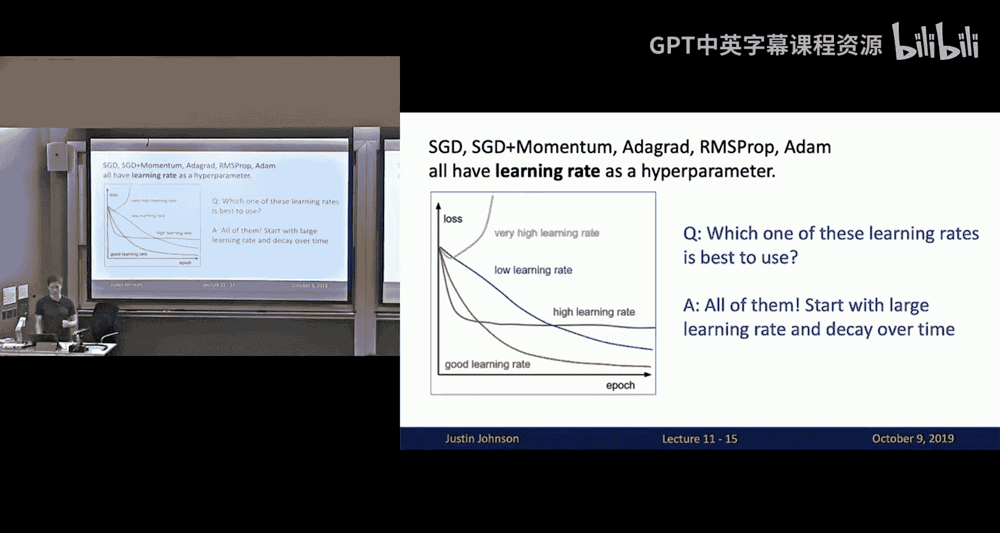

Perhaps the most commonly used learning rate schedule is the so-called step schedule so here what we're going to do is start with some value of the learning rate。

 for example for example the residual networks are very famous for using this kind of step learning rate schedule so with a step learning rate schedule we'll begin training with some relatively high learning rate like 10 to the minus1 for residual networks and then at certain chosen points during the optimization process we will decay we will just all of a sudden jump to a brand new lower learning rate so for residual networks。

 the schedule that they typically use here is to start with learning rate 0。

1 and then after 30 epochs of training， all of a sudden restart the drop the learning rate to 0。

01 and continue training for another 30 epos and then again drop the learning rate again after 60 epochs and again after 90 epochs where basically after every 30 epochs of training we're going to drop the overall learning rate by a factor of 10。

And if you look at a training curve that is here shown here on the left for one of these so-called step learning rate decay schedules。

 you get this very characteristic curve of the loss as a function of time that you get when using a step learning rate decay you can see that in this first phase of training during the first 30 epochs when we're using this relatively high learning rate。

 then we see we're making very quick progress where the loss sort of starts from this high initial value and they make sort of quick exponential progress towards lower loss values but then after about 30 epochs you can see that this quick progress has somehow steadied off and we're no longer making very fast progress after these first 30 epochs of training and after these 30 epochs this moment when we decay the learning rate and drop it by a factor of 10 we see sort of another a new exponential pattern begin where once we drop the learning rate again it sort of decays and then plateaus and then when we decay the learning rate again at 60 epochs sort of decays quickly and then plateaus again so this。

A very characteristic a very characteristic shape of learning curves that you'll see when models are trained using this so called step learning rate schedule。

Now， one problem with this step learning rate schedule is that it introduces a lot of new hyperparameters into the training of our model now not only do we need to choose the regularization and the initial learning rate like we did in all previous models we also need to choose at which iterations are we're going to decay the learning rate and what are the new learning rates that we're going to choose at the iterations where we decay it and that actually gives us a lot of choices so properly tuning one of these step decay schedules can actually take a fair amount of trial and error so what people usually do in practice is sort of look at these learning curves and let things train with the high learning rate for quite a long time and then they get a sense at which point the model tends to plateau So if you read papers sometimes they'll say that they use a heuristic where they keep training until the loss plateaus or until the validation accuracy to plateaus and then they decay the learning rate well that usually means that they're using some kind of heurically chosen step decay schedule。

But as you can imagine， if you're starting out at a new problem and you don't have a lot of time to experiment with lots of different decay schedules。

 then this step decay schedule can actually be a little bit tricky because it introduces so many new things into the model that you need to tune。

So to overcome some of those shortcomings of the step decay schedule one there's another learning rate schedule that has become sort of trendy in the past couple of years。

 which is the so-called cosine learning rate decay schedule So here rather than choosing particular points。

 particular iterations at which we're going to decay the learning rate instead want we're going to write down some formula ahead of time that tells us what will the learning rate be at every epoC as a function of the epoch number or the iteration number and then then then we only need to choose some kind of functional form that is the shape of the curve along which this learning rate will decay。

So one of these that's become very popular is co is this a halfwa cosine learning rate schedule where you can see that from the plot on the right where we show the learning rate as a function of time。

 we can see that it starts off at some high value and then the shape at which the learning rate decays is equal to one half of a period of a cosine wave and then what this means is that we start out at some initial high value of the learning rate and towards the end of training。

 our learning rate will decay all the way to zero as this wave of the cosine ks all the way to zero。

And now this cosine learning rate schedule is very appealing because it has many。

 many fewer hyperparameters than the step decay schedule。 So in particular。

 the cosine learning rate to case schedule only has two hyperparameters that we need to choose。

 One is the initial learning rate， this alpha 0 here on the equation。

 and the other is the number of epochs that we're going to use to train the model。

 which is this capital T。But what's particularly appealing about this cosine rate schedule is that it actually doesn't introduce any new hyperparameters when training the model because whenever we're training of the model。

 we always need to choose some learning rate and we always need to choose some number of iterations that we're going to train so those two hyperparameters so when using cosine learning rate schedule。

 it doesn't introduce any new hyperparameters it just gives additional interpretation or additional meaning to some of these other hyperparameters that we already were having to choose anyway beforehand so that tends to make cosine schedules a lot more a bit easier to tune compared to step toK schedules and the general rule of thumb with cosine schedules is just training longer tends to work better so in practice the only thing you really need to tune is that initial learning rate and then sort of come to grips with how long you're willing to wait for your model to train so that I think those are some reasons why this cosine learning rate the case schedule has become reasonably popular in the last couple of years and here。

I put some citations on the slide of some reasonably high profile papers from the last year or two that have used this cosine learning rate to case schedule。

But this cosine shape is just one of many shapes that you might imagine using for decaying learning rates over time so another decay schedule that people sometimes use is a simple linear decay again we're going to start with some initial learning rate and then decay it to zero over the course of training but rather than following this cosine decay learning schedule instead will simply decay the learning rate linearly over time and that seems to work well for many problems I should point out that I think theres not been super good studies that really compare these different schedules head to head so I can't really tell you concretely when cosine is going feet better or linear is going to work better I think what most people do in practice is they build upon some prior work and then they sort of adopt whatever type of schedule happen to be used in the prior work that they're building upon so what this means is that you'll see different areas of deep learning tends to end up using different types of learning rate schedules but it's not really clear to me that that's because they're intrinsically better for that。

AaIt's often I think just because they want to have a fair comparison with whatever piece of work came beforehand so with that kind of in mind if you kind of look at these citations and what type of you'll see that a lot of computer vision type projects are often using this cosine learning rate decay schedule whereas this linear learning rate decay schedule is often used for large scale natural language processing instead that are also trained using deep neural networks and again。

 I think that's maybe not something fundamental about vision versus natural language。

 I think it's more a function of what paper how different researchers in different areas proceeded upon their paths。

So then another learning rate schedule you'll sometimes see is this inverse square root schedule that sort of decays the learning rate across a different functional form。

 But again， it has this interpretation of starting out high and then ending up low。

Now this inverse square root schedule， I'm only putting it in here because it was used by one very high profilefi paper in 2017。

 but I've actually seen it used comparatively less compared to linear decay schedules and the cosine learning rate and the cosine decay schedules and I think the potential pitfall with this inverse square root schedule is that the model actually spends very little time at that initial high learning rate so with this inverse square root schedule。

 you can see that the learning rate very quickly drops off from its high initial value and then spends a lot of time at these lower later values。

 and if we compare that with the linear or the cosine schedule。

 then we see that in contrast with these other schedules that are a bit more popular。

 models tend to spend more time at those initial higher learning rates。

And then I think with all this talk about different learning rate schedules。

 I think I need to point out another very probably the most common learning rate schedule is just the constant schedule and and this one surprisingly actually works quite well for a lot of problems So here you know we simply set some initial learning rate and then keep that same learning rate through the entire course of training and this is actually what I recommend people do in practice until they have some reason to do otherwise where I see people mess up a lot of times when they're starting new deep learning projects is is to fiddle with learning rate schedules too early in the process and typically changing learning rate schedules should be something that you do rather far along into the process of developing your model and getting it to work and you can usually get things to work reasonably well just using a constant learning rate schedule and then the difference between performance with a constant schedule versus performance with one of these other more complicated schedules is usually not the difference between your model working。

not working， usually moving from constant to some more complicated schedule will maybe make things work a couple percent better。

 So it's important if you're really trying to push for the state of the art on some problem。

 but if your goal is just to get something to work as quickly as possible with as little mess as possible。

 then I think constant learning rates are actually a pretty good choice。

Although I should also point out that there is a bit of complication between learning rates and the optimizer that you choose。

 so when using stochastic gradient descent with momentum。

 then I think using some kind of learning rate decay schedule is fairly important。

 but if we're using one of these more complicated optimizes like RMS Pro or atom。

 then you can go farther using only a constant learning rate。

So that's kind of my caveat is that especially if you're using something like at。

 then you can actually get pretty far using just a constant learning rate。

So are there any questions about these learning schedules before we move on to some。

 some other topic， yeah。哎。まで。诶啊。I get mar。As function increased very much and I。

Tra data for more input bydo。The loss increase unusually， so you know what is the reasons？I mean。

 after the last。And I train more and more， I see that。UIt increase again。Yeah。

 so the question is sometimes you'll train for a long time， Los will be going down。

 you'll be very happy because you think you trained a good model。

 and then all of a sudden loss will go up， things will explode and you'll become sad。

 that's basically the concern。So actually， I think the answer for that， let me， let me actually。

 Yeah you might know this one because I。 I think that what happens sometimes is your prayer。I mean。

 I recognizeize it。I had this problem and I'm probably wrong about this case。行けばいるで。

Eers are growing too large。Yeah， I think it's really hard to say anything general about that case。

 I think there's a lot of reasons why something like that can go wrong。

 One case where I've run into a similar problem is if you forget the torch do zero grad that I warnedn you guys multiple times about a couple lectures ago maybe that was not applicable to your case but then if you're accidentally accumulating gradients over many iterations。

 then things will tend to work for a while， but then after some point then gradients will explode and things will be things will go wrong I think things can also blow up after depending on the problem type that you're working on you might also see bad training dynamics so for something like different types of generative models or especially different types of reinforcement learning problems then you'll often see very troubling behavior with these learning curves sometimes although if for kind of a standard well behavehaved classification problem if there's the loss is kind of blowing up after long periods of training。

 usually that indicate that makes me suspect some kind of a bug either bad hyperparameter。

or some bug in the way data is being loaded or maybe you're training on some kind of corrupt data actually I've seen that as a problem sometimes where maybe one sample in your training set is actually corrupted one one common failure mode is like flickickr actually takes users can upload images to flickr or with different photo sharinghar sites and then later decide to remove those images and then many data sets are constructed not by distributing actual JPEG files but by distributing links to flickr images so then if you go in naively try to download all the links in the data youll sometimes try to download some images that have been removed by users and then those will end up with some kind of default corrupted JPEG file and then during the training process。

 maybe it's an image of all zeros with some non-trivial label and then you'll explode when you try to train with a mini batch that includes one of these corrupted image files so sometimes sometimes data corruption in your training set can cause things to explode all of a sudden but I think there's really no general answer。

 you need to dig in more to the specifics of your problem。

Okay， but then another strategy， oh yeah， yeah， go ahead。

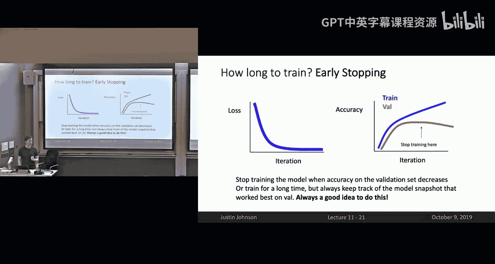

Yeah， so the question is about adaptive learning rates。

 So that would be something like Atgrad or RMS Pro or atom are examples of adaptive learning rate mechanisms。

 And there， I think things can still blow up。 Things can still go wrong Sometimes they tend to make things a bit more robust。

 but they definitely still don't solve all your optimization problems。

I just wondering because he noticed it。when they used a step function。Have as you have。Bss plateau。

嗯哼。😊，Didn't you check for that math？Oh yeah， the question is like， oh。

 maybe I want to write some heuristic that will look at the loss curve and then determine for itself when the learning rate will drop。

 I've seen people do this， but I recommend against it because I think you can get yourself into trouble to easily doing that。

 I think it's very easy to try to code up some clever solution that will try to smartly choose when to drop the learning rate but there's a lot of corner cases that are difficult to account for for example。

 if you look at these curves， they're actually very noisy so here I'm actually actually I'm plotting a scatter plot with each dot being the loss at a particular iteration but it's so noisy that to get any signal you need to take some kind of moving average over the iterations So then there just end up being a lot of now sort of meta hyperparameters that go into these heuristics about when to decay the learning rates and I think that're you're just setting yourself up for trouble there and you're better off just looking at the loss curves and trying to make some expert determination there。

Yeah， so actually the light blue curve is the average of the loss which。Yes， yes， that's correct。

 So the dark is actually a bunch of circles that represent the loss of each iteration。

 but they're extremely noisy， so these circles end up actually having a pretty huge variance between iterations on the individual training losses。

 So whenever I plot these things I always like to plot both the losses at every iteration to get some general sense of the variance。

 but then I also like to plot a moving average So this is usually a moving average of a window size of like 100 or 10 iterations that tells the moving average of the losses over some window。

 and that gives you a sense of both the overall variance of the training process as well as the longer term trends。

 So I think that's very useful a very useful thing when plotting losses to help you debug。

And I also point out that this is kind of a fairly characteristic image that you get when training with a cosine schedule。

 that it has a very funny shape， and if you're used to seeing plots like this with a step decay。

 then the first time you train with a cosine schedule you get very surprised。

 so this is something I've started to do recently and it's always coning to me when I see these very weird looking plots。

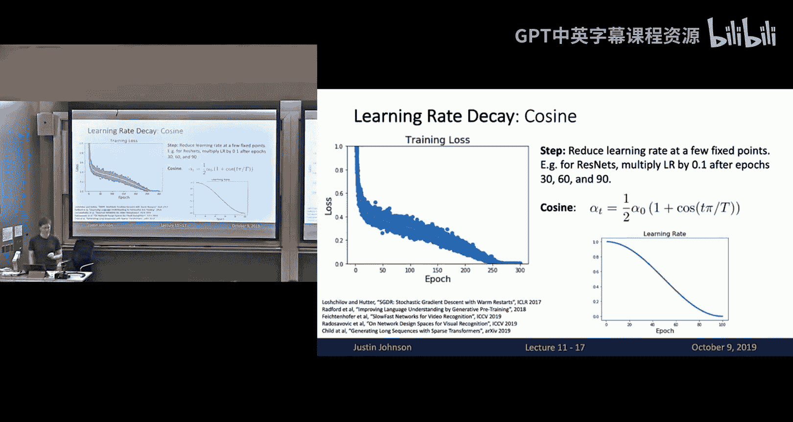

But I think another thing that you should always be doing that really helps you to choose how long you should train is this notion of early stopping。

 and I think this is a good mechanism to also go back to this exploding process during training so here the idea is that whenever you train neural networks。

 you want to look at really three curves， one is the training loss as a function of iteration which is here on the left。

And if things are healthy， you should see this kind of decaying exponentially in some way。

 but what you should also always be looking at is the training accuracy of your network。

 maybe that you check every every epoC or so， as well as at the accuracy both on the training set。

 as well as the validation set and looking at these curves can give you some other sense of the health of your network throughout the training process。

 So then what you'll typically do is you want to stop training。

 you want to pick the checkpoint the checkpoint of the model during training where you had the highest validation accuracy。

So what you'll typically do is you'll typically set some number of max iterations or max epochs that you're going to train for and then just let that thing train for that max number of epochs。

 but every epoC or every five epos or 10 epochs you should always check the training and validation set acuracies and then save the model parameters at that point to dis and then after the model finishes training then you can plot these curves and then select the checkpoint select the point in time at which your model perform the best on a validation set and then that the checkpoint that you should actually use when running a model in practice so if you do a process like this then if the model happened to blow up late in the training process and then it's maybe not such a big deal you can just look at this curve and then pull one of the model checkpoints from the point in training before the model blew up so this is a really useful skill a really useful heuristic on how to train your networks and how to select which checkpoint to use at the end of the day so this is something I really encourage people to use pretty much all the time whenever you're training deep neural。

That works。So then that kind of leads into a bit of a larger discussion of how are we supposed to go about choosing hyperparameters for our neural networks。

Well in kind of one thing that you'll commonly see people do is this notion of a grid search so here what we're going to do is select some set of we're going to select some set of hyperparameters that we care to tune and then for each of those hyperparameters we'll select some set of values that we want to evaluate for that hyperparameter and and often many of these hyperparameters you should be searching in kind of a log linear space rather than a linear space so then for example。

 we might want to evaluate here four examples of the learning rate。

 four different learning rates that are kind of spaced out in in a log linear way and also test out four different values of regularization strengths that again our space sort of log linearly and then given four values of the weight decay and four values of the learning rate then that gives rise to 16 combinations and if you have enough GPUs just trigamal and see which one works best and that actually is a fairly reasonable strategy。

That people sometimes do in practice。 But the problem is that this strategy requires a number of GPUs。

 which is exponential in the number of hyperparameter that you want to tune。

 So this very quickly gets very infeasible， very quickly。

So another strategy that sometimes people employ instead is random search rather than grid search and here again we're to the procedure is much the same。

 we're going to select some set of hyperparameters that we want to tune and now rather than selecting values that we want to try for each of those hyperparameters instead we're going to select some ranges for those hyperparameters along which we want to search and now we're going to during each time we train our model。

 we're going to select a random value for each of those hyperparameters that fall within that range and again for something like a learning rate and a weight decay you'll often want to search in a log linear space whereas for other types of hyperparameters like maybe with the network or model size or drop our probability。

 sometimes you'll see a linear rather rather than log linear spacing and it kind of depends on what the hyperparameter is as to whether it should be linear or log linear but now the idea is that with this random search idea。

 we set these ranges for different hyperparameters and then during each training run we draw a random value for a hyperparameter。

And then just let it go。And then however， many trials of your network you can afford to train。

 you train that many， and then whatever happens to work best at the end。

 gives you some that's the hyperparmeters that you use。And there's been some。

 maybe if you think about grid search versus random search。

 you know they're formatted very similarly on the slide so you should think so maybe you might think that they're very similar in how they perform。

 but there's actually a fairly strong argument for using random search instead of grid search that comes from this 2010 paper and the idea here is that if you have a lot of hyperparameters and you don't really know which hyperparameter are if you have a lot of hyperparameters you need to tune。

 probably some of those hyperparameters are going to be very important for model performance。

 whereas other of those hyperparameters， maybe it didn't really matter what value you were going set anything in that range would have been fine。

 but ahead of time before you train models you might not know which hyperparameter is in which category but usually it's the case that some hyperparameters matter and some0paras don't matter。

 but now the idea is that if you are using a grid search then you are always going to evaluate exactly the same grid of parameters on the。

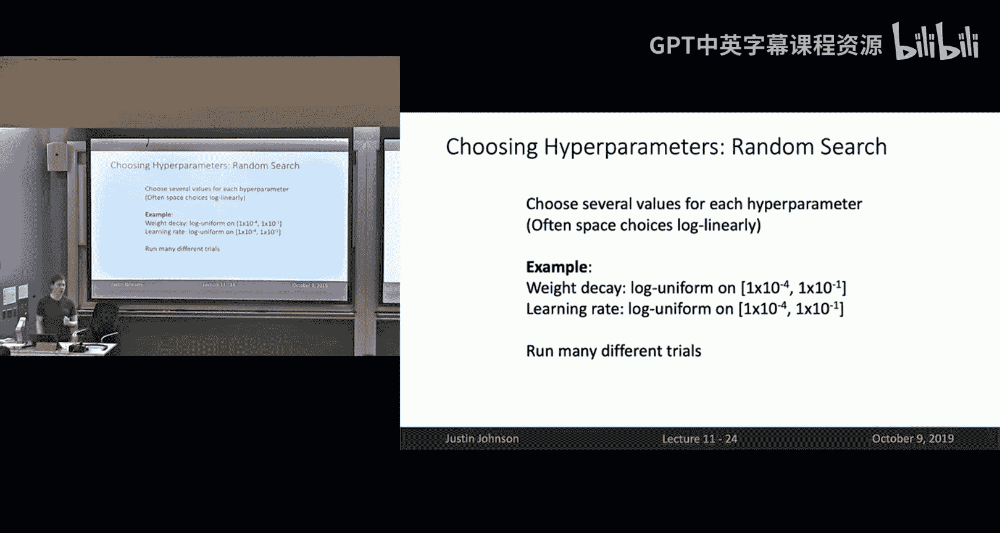

So what this means is that in this sort of cartoon picture。

 the parameter on the horizontal axis ends up being very important for this for getting good performance because you can see that this sort of distribution that we draw on the top of the grid is sort of the marginal distribution of model performance as a function of that hyperparameter value。

 So you can see that in this toy example， this horizontal hyperparameter is very important for getting very good performance because if we go far to the left。

 there's low performance。 and there's kind of a small。

 sweet spot in the middle that gives us very high model performance。

 In contrast in this sort of cartoon picture， the vertical hyperparameter is maybe not so important for model performance。

 and you can see we've also drawn this sort of orange marginal distribution on the left sand side of the plot that shows that no matter which value of this vertical hyperparameter we choose。

 things are going to perform about the same。And now the problem is that if we do a grid search。

 we are not being very we're not gaining as much information as we could from each trial of the model that we train because we're going to try the same values of the important hyperparameter many。

 many times repeated for for each value of the unimportant parametermeter so what that means is that for this important distribution of the important parameter。

 we're only going to get three samples in this cartoon example。

 so that means that maybe we don't have enough information to properly tune the right value or the right setting of that important hyperparameter Now in contrast if you're going to use random search on the right。

 then every trial that we run is going to have random hyperparameters for both the vertical and the horizontal hyperparameter and what this means is that when we plot these marginal distributions of model performance as a function of each hyperparameter then we end up getting more samples for each hyperparameter individually because the points on the grid don't align perfectly vertically or horizontally So what that means is that in a situation。

this where one hyperparameter is important and the other hyperparameter is unimportant。

 then we end up getting using the multiple repeated samples of the unimportant hyperparameter in order to give us more effective samples of the important hyperparameter So then if you look at these for the right- hand plot giving this random grid search we see we end up with many。

 many samples of this important hyperparameter that allows us to sample more points on this curve and hopefully find a better value overall。

 So if you're in a setting where you need to sort of search randomly over hyperparameters than usually using some kind of a random search is much more important than using some kind of a grid search。

So here this slide has shown you kind of a cartoon picture of some kind of idealized situation of what might happen with a random search。

 But here's an example of an actual random search that I did at a project at Facebook so we could use a lot of GPUs。

 So here so here these plots we were evaluating the learning rate and the regularization strength for three different categories of models that would be a feed forward model。

 a residual model and a different sort of model architecture called darts that details of what that is is not important for this purpose。

 But what you can see is that each point on these plots is a different model that we trained and the plot is quite dense。

 So we trained a lot of models and then the color of the point gives you the overall performance of the model at the end of training。

 And by looking at plots like this。 you can get some sense of the interactions between different learning rates that you might come across。

 So what you can see here is that here the X axis is the learning rate and。

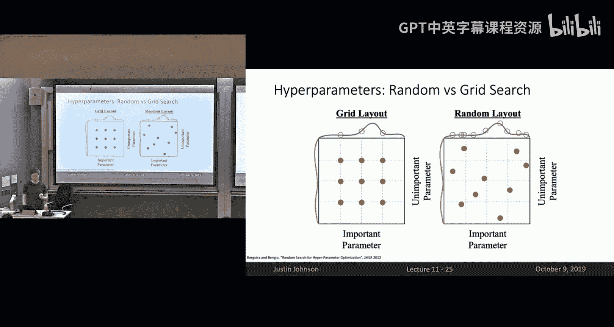

Access is the regularization strength along a log scale。

 And what we can kind of see is that there is some kind of nonchivial interaction between these two parameters that there's this kind of sweet spot or sweet river in the middle of good learning rates for eachregization strength and vice versa。

 Yeah， was there a question people thought of using gradient descent。

That's what I used to try for the last project， but I didn't realize that I was forget one of my weightlea。

don't gradientYeah the question is should can you use gradient descent to learn the hyperparameter Yes you can。

 and I think that's a really cool area of research that I really enjoy and I think it's really creative and really interesting So there's many different approaches to that that I think are slightly beyond the scope of this lecture but to give you a flavor of what that looks like I think that's actually a beautiful situation where the software systems that we end up building to help us solve our problems end up giving rise to new mathematical solutions as well and what I mean by that is when you have something like pytorch it's very easy to backproagate through arbitrary python code and you know your optimization is your optimization loop is again yet again just another bit of Python code So in principle。

 it's very easy in Pytorch to write code which will allow you to backproagate to sort of have an inner loop and an outer loop in the inner loop you're going to run optimization of your model parameters but you'll actually back propagate through that entire。

lo in order to compute gradients of the final model performance on the initial values of the hyperparameters and then in this outer loop。

 then you'll use gradient descent to learn the hyperparameters。 And there's a bunch of really。

 really cool papers along this direction that I would love to find some way to sneak into one of these lectures but then there's one paper I love there where they learn not only the learning rates but they also use a similar idea to learn the training data because now if you can back propagate through the learning process。

 we can actually learn the optimal training set that will cause the trained model to work well on the validation set。

 So this is like very crazy and very very， very fun to read papers in this direction。 So yes you can。

 but it's actually not commonly used in practice。 these things are super computationally expensive and people only sort of at this point in time。

 employ them for relatively small toy problems to show off that they can but for very largescale problems these kind of automatic methods of learning hyperparameter via gradient descent are really not very practical to scale。

😊，To very large scale problems。Yeah。the error。Sorry， say it again。Yeah。

 the color scale is error rate， but it looks like the color bar on the right doesn't quite match up to actual colors in the plot。

 So I apologize for that。 but clearly the point where we put the red dot or the values we ended up choosing for the paper。

 So that gotta be the highest one。 So you can see this dark purple means it's working well。

 And then moving towards yellow is things not working well。

 So I think there's probably some transparency issue between the actual color bar in the plot。

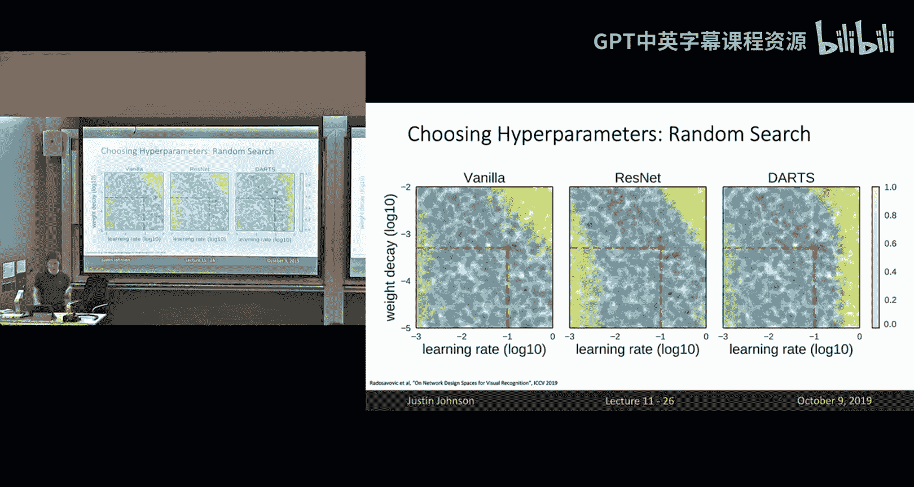

Maybe I need to talk to my coauthor about that。So but so this is that's kind of a good strategy to choose hyperparameters。

 If you happen to be working at Facebook or Google or another tech company and have access to a lot of GPU resources。

 But if that's not the case， then you need to be a little bit smarter in the way that you choose hyperparameters。

 So this is but I think you should not despair。 it's usually possible in my experience to choose pretty good hyperparameters for your problem without this massive massive hyperparameter search。

 So this is the procedure that I usually go about choosing hyperparameters when I don't have access to a very large GP cluster。

So the step one is that you implement your model， actually you need sort like write some code first。

 and once you're done with that， then you should always be checking your initial loss。

 And as we've talked about multiple times so far， usually by the structure of the loss function that you're using。

 you can kind of compute analytically， what sort of initial loss you expect at random initialization。

 So for something like this crossenttropy loss， you know it should be like minus log of a number of classes。

 So then your first step after implementing your model is you turn off weight decay and just check this loss at initialization。

 that only takes one iteration， it's very cheap to do very fast。 And if that loss is wrong。

 you know you have a bug and you should go back and fix the bug。

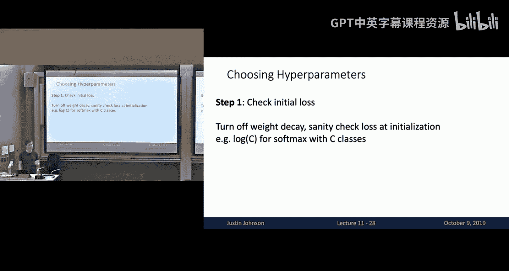

Then the next step is to try to overfit a very small sample of your training data。

 So here the idea is that you want to take something like between one and maybe five to 10 mini batches of data like a very。

 very tiny sample of your training set and now try to overfit this to 100 percent and when you're doing this you always want to turn off the regularization and your goal is just to overfit the training data。

 and when you're doing that， then what you need to do is fiddle with the precise architecture of your model。

 maybe the number of layers and the size of each layer， play with the learning weight。

 play with the method of weight initialization。 and now when when you when you play around with different some of these different hyperparameter。

 then you should be able to usually get get whatever model you're working on should be able to get to like 100 percent accuracy this very。

 very tiny sample of the training set within a very small amount of time your goal here is that you should be able to overfit in something like five minutes of training and because this sample training set that you're working on is。

Very small and now because the training times are very， very short。

 it allows you to kind of interactively play around with different values of these settings in order to find settings that cause you to overfit very quickly and the point of this step is to just make sure that you don't have any bugs in your optimization loop because if you can't overfit 10 training examples or 10 batches of data then you have no hope in actually fitting the training set for real and it's surprising how often you can catch bugs in your optimization setup or in your model architecture choices just in this stage and again。

 these training loops run very， very fast so you can do this interactively on a single GPU in most cases。

And in step2， we don't care about regular We don't care about generalization to the validation set at all。

 We're just trying to debug over the optimization process on a small training set。

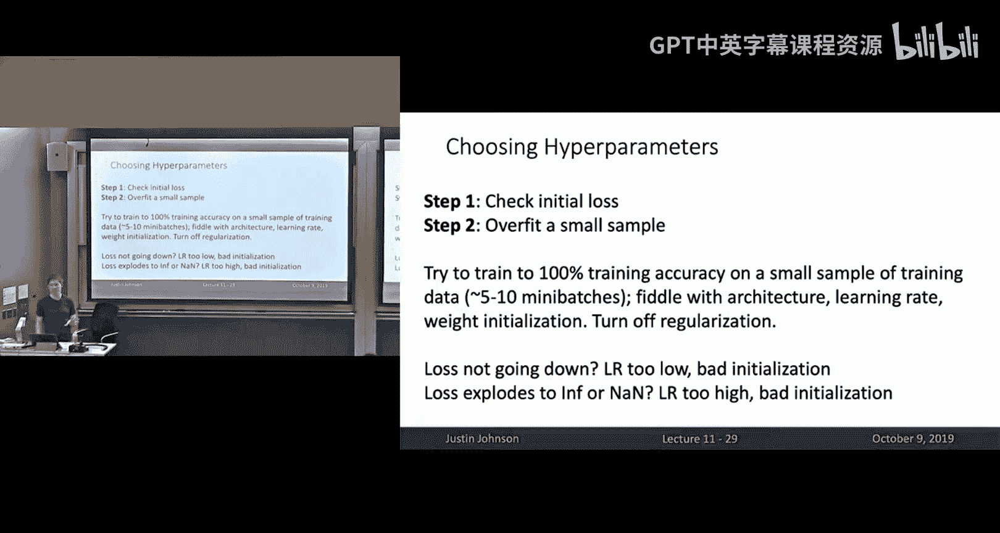

But once we've done that， then once we've succeeded at step2 and been able to overfit a very small amount of data。

 then what we want to do is take the architecture from the previous step and now use all of the training data and now your goal is to find a learning rate that will cause the loss to start to go down quickly on your whole training set now hopefully from step2。

 you found you know that your code is correct。 you know that your optimization loop is correct and you found a model architecture that you believe is sufficient for modeling your data and now in step3。

 you're going to take all of those architectural parameters and copy them over and you're just going to fiddle with the learning rate on the entire training set and the learning rate is the only parameter the learning rate。

 the only parameter you'll change and in changing the learning rate。

 your goal is to make the loss drop significantly within the first say100 iterations of training or so because usually for most problems that are set up properly usually you'll see some very high initial loss at the beginning and you'll tend to see some kind of exponential。

increasere in loss within the first0 to thousand iterations of training。

 And that's sort of empirically true across a wide variety of problems and neural network architectures。

 So at this stage， again， because you're only caring to train for something like 100 or 1 thousand0 iterations。

 And again， you can typically do this interactively。 and just choose learning rates。

 look at the learning curve and then based on what the plots look like。

 then go back and choose new learning rates and work interactively until you can find a setting of the learning rate that causes things to actually converge within the first start to converge within the first 0 or so iterations。

So now at this point， we're in relatively good shape。

 we've got an architecture that we know has the potential to model our data because it can overfi a couple training samples and we know our optimization is in a pretty good state because we know loss is starting to go down at the beginning of training So now step4 is to set up a very coarse hyperparameter grid maybe like a very。

 very small number of models， maybe you choose two different values of learning rates and two different values of regularization strength or just choose a very。

 very very tiny hyperparameter grid to evaluate that is somewhere in the neighborhood of all the choices that you have made up to this point and now hopefully because by following these previous steps。

 hopefully all of these hyperparameter choices within this very small grid will all end up being somewhat reasonable you will not have any catastrophically bad models within this very tiny hyperparameter grid So then after you have this course grid then you train on the full training set for something like one to five or one to 10 epochs and and that should be enough to give you some sense of the generalization。

Performance of your model beyond the training set and actually start to look at how it performs on the validation set。

And then at that and again， this is something that you probably cannot do interactively。

 but at this point， you've got enough familiarity with your model that you know that all of these choices should hopefully work。

 so you set up this tiny hyperparameter grid depending on how many models you can afford to train in parallel and then step back and then come back come back after a coffee break or a night of sleep or a week's vacation as the case may be。

 depending on how long your model takes to train and then come back and see how well these things did。

And then after you go to step4， then you enter this iterative loop of looking at the results of your previous tiny hyperparameter grid and then adjust your hyperparameter grid and then go back and train for longer then see。

 and then at this point you're in this sort of interactive process。

 but each iteration of of this procedure might take hours to days depending on exactly how long your model takes to train。

So always along the way， you're looking at the learning curves and then using that to make the determinations about how you should change what changes you should make in your hyperparameter grid going forward。

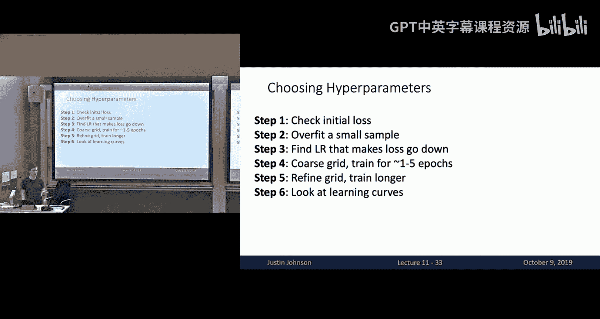

So when I say look at learning curves， I mean that we need to look at these plots that I mentioned earlier on that whenever you're looking at these things。

 you should always be plotting this training loss on the left。 And again， as I said。

 I like to plot both the raw acuracies as a scatter plot as well as a line plot of these moving average of losses and then on the right。

 I always like to plot the training and validation acuracies check every epoC。

 And then by looking at these learning curves， you can get usually gain some sense about what could be going right or wrong with your model。

 So here here， I'll give you a couple cartoon pictures of different sorts of shapes of learning curves that you should become familiar with。

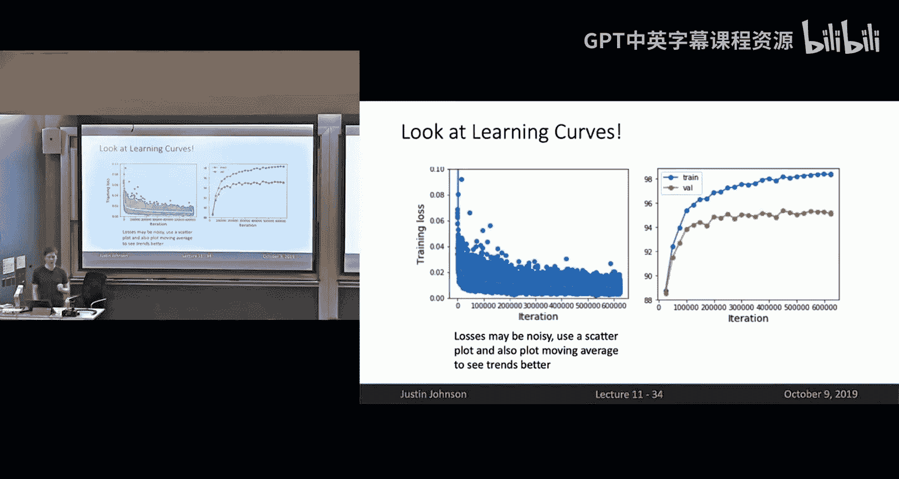

So one situation is when your learning curve looks something like this。

 where it's sort of very flat at the beginning and then makes a sharp initial drop。 Well。

 if you see a shape like this， that means that probably your initialization was bad because the law you were not making progress at the beginning of training。

So you should often adjust your initialization and go back and try again。Now。

 another problem is when we see a loss like this， where it's sort of making good progress and then it plateaus after a while。

 Well， when you see a loss a loss curve like this， then you should consider some kind of learning rate decay because it's possible your learning rate was too high and maybe around the time point where it tends to plateau is maybe the point where you should introduce some kind of learning rate decay and lower the learning rate。

Now conversely， if you have not followed my advice and have introduced learning rate decay too early in the model development process。

 then you might see a learning curve that looks something like this。

 so here the model was making good progress and then at some point we hit our step decay our point at which we were applying a step decay on the learning rate and then the loss made a small drop at the point where we stepped and then after that it was completely plateaued now usually this means that you decayed too early that if you look at the shape of the learning curve leading up to the point in time where we applied the decay then you think then this looks like the loss would have continued going down at the initial learning rate had we not applied learning rate decay。

So this is a shape that you should watch out for and usually means that you applied learning rate decay too early。

Now， these were all shapes of this moving average of training losses。

 but you can also gain some intuition by looking at these plots of training and validation accuracy over time。

So one characteristic shape of these curves that you might see here is often that they'll make some exponential increase at the beginning。

 and then they'll sort of slowly increase linearly over time。 Now if you see a shape like this。

 there's some kind of non nontrivial， but maybe healthy gap between train and Val and they're both continuing to go up then when you see a curve like this。

 it means things are going well and you just need to train for longer because it looks like these curves are still going up and hopefully just whatever you're doing。

 keep doing it for longer and your models will continue getting better。

 So this is a curve that you like to see in these train and Valel plots。Now。

 a plot like this means something very bad is going on。 So here。

 this is a characteristic plot of overfitting。 So here you can see that performance on the training set has continued to increase over time。

 but performance on the validation set has either plateaued or even decrease over time。

 Now this usually is Now it's very common to have some kind of a gap between train and Val。

 that's normal and healthy。 But when you see this very large and increasing gap between training and Val。

 that is a sign of overfitting。 And when you see a learning curve like this。

 that means that you need to either increase ir regularization strength， collect more training data。

 or maybe in some rare cases， decrease the size or capacity of your model。

 But this is this is a characteristic shape of overfitting。In in contrast。

 if you see a plot like this where the training performance and the validation performance is almost exactly the same。

 you might think this is a good thing because there's no overfitting， but usually this is a bad sign。

 usually if you see exactly the same performance on the training set and the validation set usually that means you are actually underfitting your data。

 and in fact， you would have been better off to increase the capacity of your model or decrease the regularization。

 and that will tend to give you better overall performance on the validation set even if even if that results in a larger gap。

 so this one is slightly counterintuitive that this is actually an unhealthy learning curve and usually means that you are underfitting the training data。

Any questions about these learning curves？Yeah， would you be able to tell them。I your accuracy？

Really low。Yeah， the the question is， can you also tell by looking at the absolute accuracies And if they're particularly low。

 And yeah， that's also definitely a good sign to know whether youre not you're underfitting the data。

 But there it requires you to have some prior knowledge about what is a reasonable accuracy on this data set。

 which you might not coming into a new problemtuition。哦。Well， so usually I mean。

 this is kind of empirical。 So usually it turns out that what we want is a model that achieves the best on unseen data and it happens。

 I mean， I think there's not a strong theoretical reason for this。

 but the empirical fact is that usually when you find a model that achieves the best accuracy on the unseen data。

 then there typically is some kind of a nontribual gap between performance on the training data and performance on the validation set。

 and that's kind of an empirical fact。 I think there's not really great theory that I can point to that for that observation。

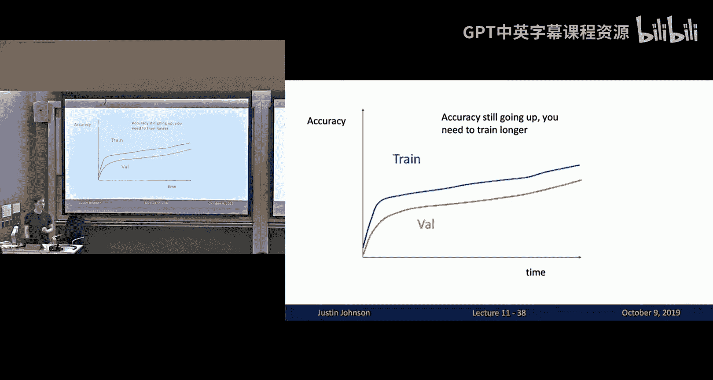

So then this brings us to our close our final step in this hyperparameter training policy。

 you look at these loss curves and then based on your intuitions about how things are going。

 that gives you some sense about how to adjust your grids based on looking at these loss plots that we've just looked down so then you go to step five and loop until you run into your paper submission deadline and you have no more time to train models。

So basically， what I like to think about when you're tuning these things is that you're some kind of a DJ tuning all these little knobs about your learning rate。

 strength and your hyperparameter strength and your dropout and your model architecture。

 And then hopefully， if you tune all these knobs in just the right way。

 you'll end up making beautiful music in the form of a model that works really well in unseen data。

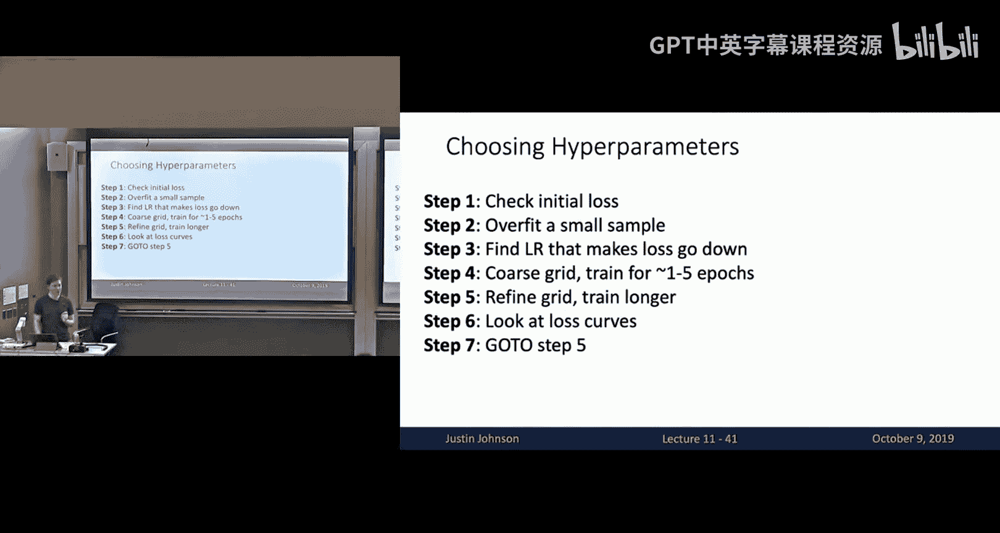

And in order to do that， it's often very helpful to set up some kind of a crossvalidation command center where you can look at you need to train large numbers of models in parallel and then look at these learning curves and parallel and use this as a way to get some idea about what sets of hyperparameters tend to be working well or tend to not be working well now back in the day before things like TensorFlow。

 this was a pain in the butt and we had to like write custom web code in order to visualize these learning curves and like learn ja plotting frameworks to plot these things or set up our own custom Jupyter notebooks for plotting these things and you could end up spending a lot of time just on the infrastructure of looking at the results of your experiments but now with things like Tensor board a lot of that work has been done for you so usually a lot more seamless nowadays to set up these kind of crossvalidation command centers as you will。

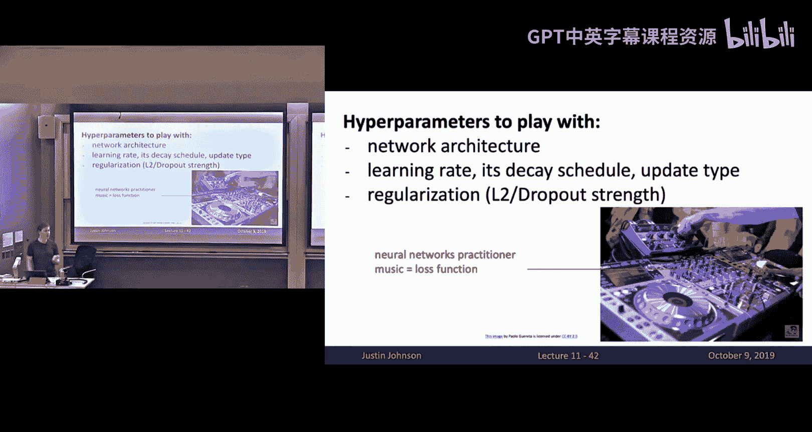

there's another there's some other heuristics that you can sometimes look at that can help you diagnose things that are going wrong in training。

 So for example， one thing you sometimes like to do is look at the ratio between the values of the weights of your network and and the magnitudes of the updates that you're making onto those same weights So that would be your gradient times your learning rate gives you the overall delta that you're going to use to update each value of the weight at each iteration and generally speaking you want the value between the absolute value of the weight and the absolute value of the updates for each of the scalar weights in your network to be not too large。

 typically if you're making updates that are of the same order of magnitude or larger in magnitude then the weight value itself that's usually some kind of a sign that something bad is happening So looking at these ratios between weight update magnitudes and weight magnitudes is sometimes some heuristic that people look at in practice or maybe looking at other kinds of statistics of the gradient magnitudes or weight magnitudes。

They can sometimes help you debug problems that are going wrong during training。

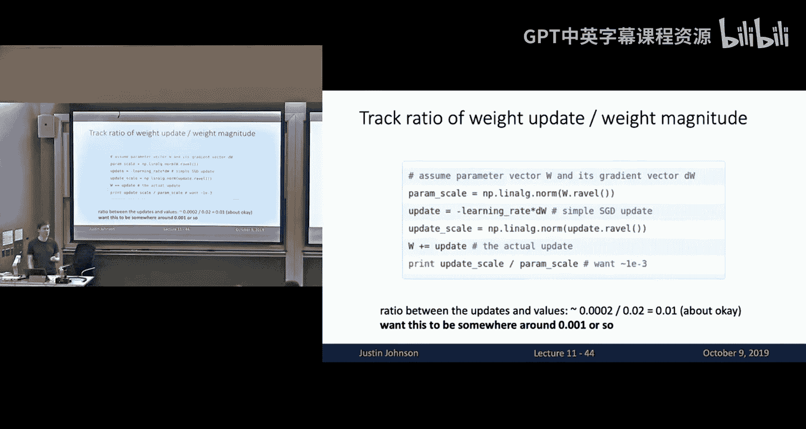

So that gives us to looking at these training dynamics， and hopefully if you follow this simple。

 seven step procedure that I've outlined， you'll be able to train really good models。

 even if you don't have access to a giant GPU cluster。

But then the question happens is that after you after you've successfully trained some models。

 then what can you do after that？ Now， well， now things get interesting。

So one thing that you often want to do is to get a little bit better on on your final test set and it turns out there's a very hip simpleple heuristic that applies almost across the board for getting a slightly better performance on basically whatever problem you're considering and that is that you train something like an independent models。

 however many you can afford to train and then rather than using one of them instead you just use all of them at test time so that means for each sample in your test set。

 you run it through each of your trained models to get the predictions from each of your trained models and then you average the predictions across all of your trained models and the exact mechanism of averaging kind of depends on the exact problem you're trying to solve for something like image classification you could。

 for example， take an average of the probability distributions that are output from each of the models because the average of a probability distribution is still a probability distribution and typically when you take an ensemble of a bunch of different models。

 you end up getting about one or two% better on your final test case on your final test set。

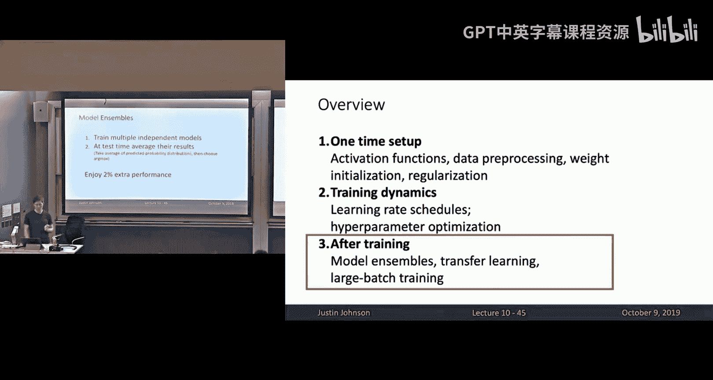

So that is pretty standard， no matter what the model architecture is or how many models youre more is usually better。

 but what task you're working on， what data set you're working on。

 what's your underlying CNN architecture， typically you get about one to2% better when you ensemble some set of models together so if you're really trying to squeeze out that last bit of juice。

 then this is a very common trick that you'll see people use。

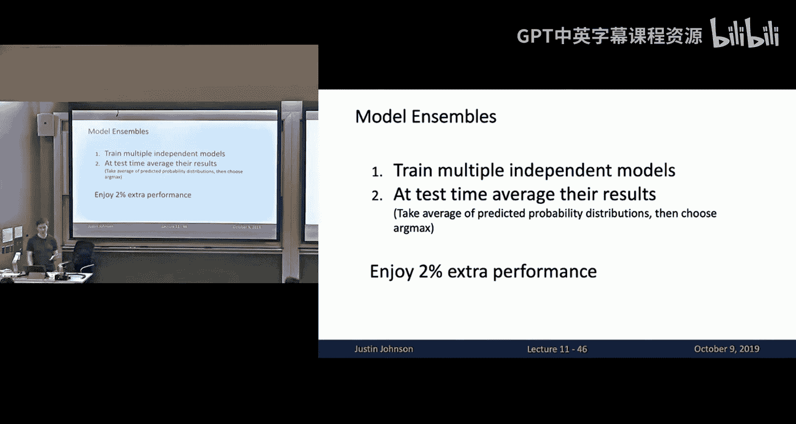

One kind of cute idea is that rather than training multiple independent models。

 sometimes you can get away with saving multiple checkpoints of one model during training and then actually average the results of those different checkpoints during training and that can also give you some improved performance and then one trick there is actually to train with a very very bizarre learning rate schedule that is actually periodic so this is like not super mainstream。

 but it's so crazy I wanted to point it out。 the idea is that your learning rate schedule is now actually periodic that it starts high。

 goes low， goes high again， goes low again， goes high again goes low again and then the checkpoints that you take during training to form your kind of ensemble are the values of the model weights that were at the very low point of each of those points in the learning rate schedule it's kind of a cute idea that you might see people use sometimes。

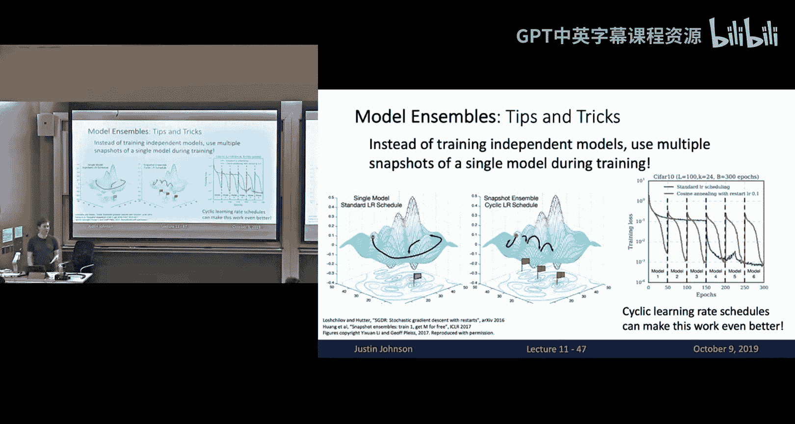

Another idea is to keep a running average of the model weights that you see during training。

 and this is called Polc averaging。 and it's used actually pretty commonly in some large scale generative models。

 So here， remember like in batch normalization we're always keeping this running exponential average of the means and the variations of our features and then during testing we use those this exponentially running mean of means and standard deviations for batch normalization during test time Well。

 it turns out you can actually do the same thing with the model weights。

 So then rather than using the model weights that result from any one iteration of gradient descent。

 instead you can take an exponentially running average of the model weights that you see during training and then actually use this exponential running average of the model weights at test time instead and this can have the effect of helping you to smooth out some of this iteration to iteration variation in the model that happens during training if you go back and look at these loss plots。

 remember there was a lot of variation in the loss between。Individual iterations of the model。

 And by applying some this kind of averaging to the model weights themselves。

 it can help to average out some of that noise that happens between individual iterations of SGD。

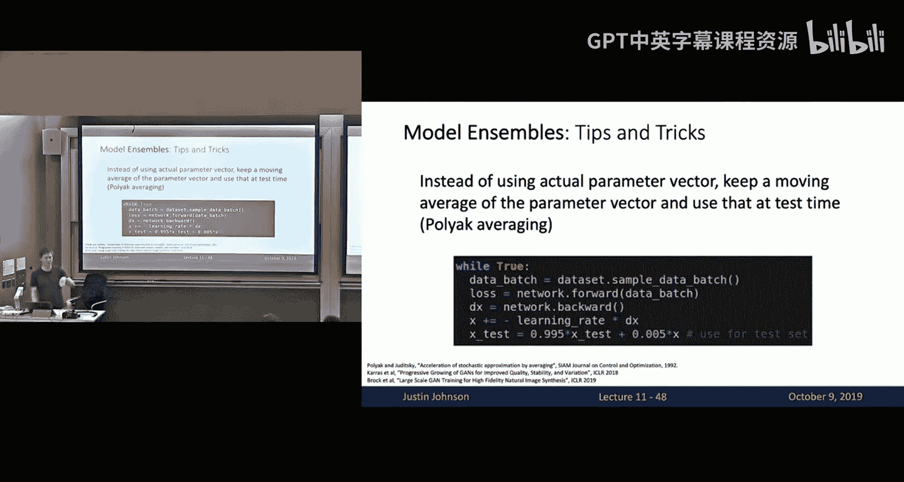

So those are ways that you can squeeze out just a little bit of extra juice on whatever is the original task you were trying to solve was。

 but sometimes we actually want to use one trained model to help us solve a totally different task and that is an extremely powerful tool that has become super mainstream in computer vision over the past several years。

 and that's basically the problem of transfer learning。

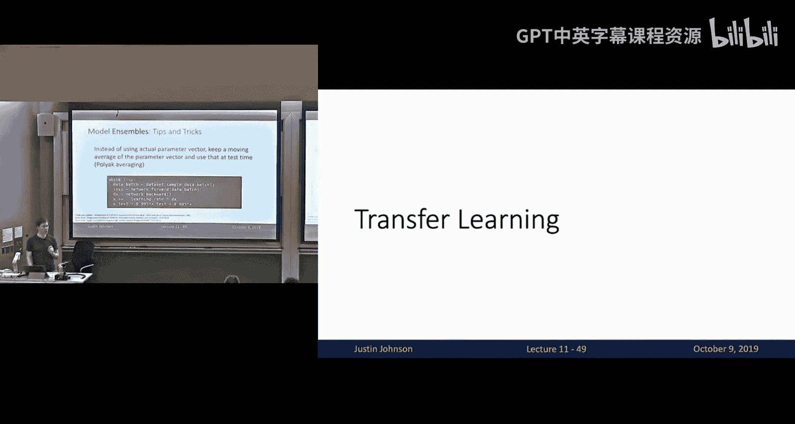

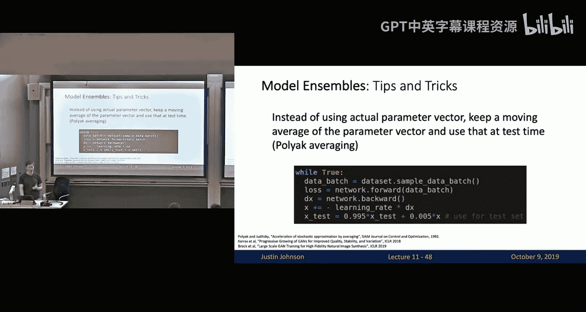

So here， the idea is that here there there's kind of a myth that goes around when training CNNs。

 The myth is that you'll often see people， see people say is that you need very。

 very large training sets if you want to successfully use deep learning for your problem。

 But I think this is actually false。 And I'd like to bust this myth。

So the idea is that I think if you utilize transfer learning。

 you can actually get away with using deep learning for a lot of problems。

 even in cases where you do not have access to a very large training set。 So for this reason。

 transfer learning has become a critical part of pretty much all mainstream computer vision。

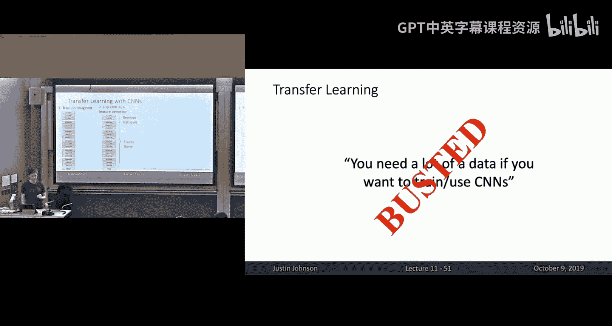

So the basic idea is that we'll take step one is train a convolutional neural network model on INet or some other very large scale image classification data set。

 and then make that part work as well as you possibly can using all the tricks that we've outlined。

And then step 2 is is to realize that we don't actually care about imagenet classification performance。

 Instead， we might care about classification performance on some other smaller data or some other task entirely。

 Well， here the idea is that we will take our trained network from imagenet and then remove the last fully connected layer。

 recall that for example， the last fully connected layer in something like an Alexnet takes us from these 4096 dimensional features into this 1000 dimensional vector of class scores。

 So in fact， this last layer in the network ends up being tied to the identities of the categories on which the model was trained。

 But now what we can do is simply throw away that last layer and delete it from the network and just use those 4096 dimensional vectors at the second to last layer of the network and some kind of general feature representation of our images。

 and then you can just run our freeze the whole weights of the network and just use those extracted features as a。

😊，And as a feature vector that represents your images。

And what people found out starting in about 2013，202014 was that this seemingly simple idea allows you to get very good performance on many many computer vision problems。

So for example， there was another data that called Caltech 101 that was unsurprisingly 101 object categories。

 but overall a lot lot smaller in size than INet and here what we're showing is the red curve so here the X axis shows the number of training samples on Caltech 101 that we're using per category and the Y axis is is the classification performance on this Caltech 101 data and now the red curve was this prior predeep learning method that was the state of the art on Caltech 101 that very particular designed set of feature extraction pipeline for this particular data and now the blue and the green curves show this very simple procedure of taking an Alexnet that was pre-trained on INe and then using the final the second to last layer of Alexnett features as this predefined feature vector and then simply training a logistic regressiongressor actually I think they used an SM in this case。

trained either a logistic aggressor or a support vector machine。

 which are these simple linear models that work on top of this fixed 4096 dimensional feature vector that was extracted from our pre-trained model。

 And what they found is that using this very simple procedure of training a linear model on top of these pre-extracted feature vectors。

 they were able to significantly outperform the state of the art on this data set。And in particular。

 they were able to get nontribual performance， even using something like five to1 samples per class on this new data。

 So this actually is very common and if you use an imagenet pre-train model to extract features then you can tend to get reasonably good performance on many downstream tasks。

 even when you don't have a very large training set and this is definitely not particularly to Caltech 101 we saw that this was also similar on this other bird classification data at that time。

 so here DPD and and P poof were existing methods that were very particularly tuned for this task of recognizing birds and what they found is that by simply training a logistic regressor on top of these pre-extracted features from an AlexNe。

 then they were able to outperform these previous methods and if they and by incorporating the Alexnet features into the previous method。

 they were able to get an even larger boost and this was simply。

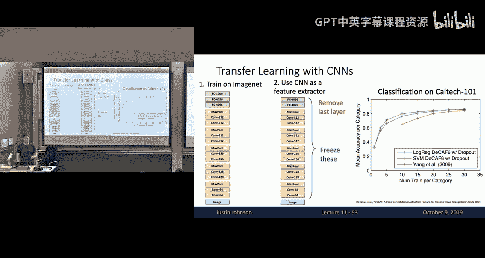

Swapping out the AlexNet features for whatever else that previous method was doing in their learning process。

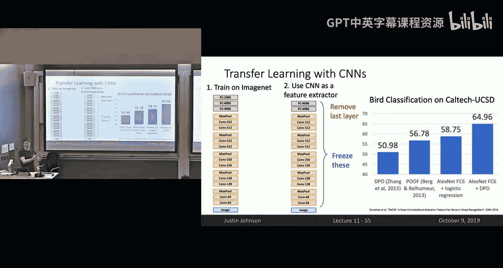

And this applies across not just Cticch 101 and birds。

 this tends to apply across a very large set of image classification problems。

 So there was another another paper benchmarked image this idea of extracting features and then training linear models on top of them for a whole suite of different image classification problems。

 So here you can see they got good performance on objects， scenes， birds， flowers。

 human attributes and object attributes。 and in all cases。

 they were able to outperform the previous state of the art on those data sets。

And what's astounding here is that each of those blue bars。

 which is the previous state of the art on one of those data sets。

 was typically a completely independent method that had been tuned independently for that one particular data and here they were able to use this very。

 very simple procedure that utilize this fine tuning and outperform all of these different methods。

 using one simple procedure of extracting features from a pre-trained model imageNe and then simply training linear models on top of those for the downstream tasks。

And this applies not only to image classification， but it turns out that this idea of utilizing features from a pre-trained network applies to a wide variety of image computer vision problems as well。

 So that same paper I guess beating 1，2，3，45，6 state of the art methods wasn't enough for them。

 they also benchmark a set of image retrieval tasks。

 So the details is not super important of how these works。 But basically the setup is that you。

 for example， get an image of some building in Oxford and your task is to based on the pixels of the one building retrieve other images from a database that are other images of the same building maybe from a different viewpoint or different time of day or something like that。

 So this is some kind of a like search by image know if you upload an image to Google and then search for similar images。

 And again， here by using these here the idea is that we're going to extract these features from our models that are pretrained on imagenet。

 and then we will simply use some kind of simple， nearest neighbor procedure to perform this image。

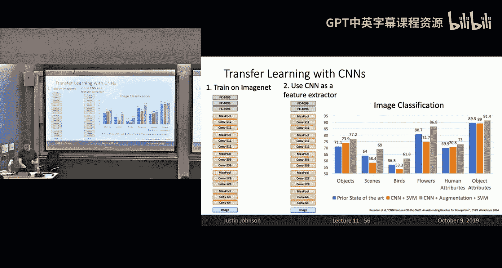

And again， by using simple， nearest neighbors on top of these pretrained feature vectors from Imnet。

 they were again able to outperform a large number of previous methods on a large set of image retrieval data sets。

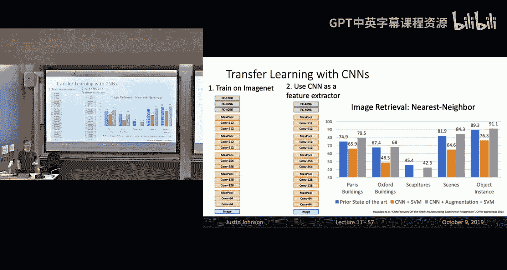

So this， this is probably the simplest example of this transfer learning task。

 where we simply extract feature vectors and then use them out of the box for some either a linear method or a retrieval based method。

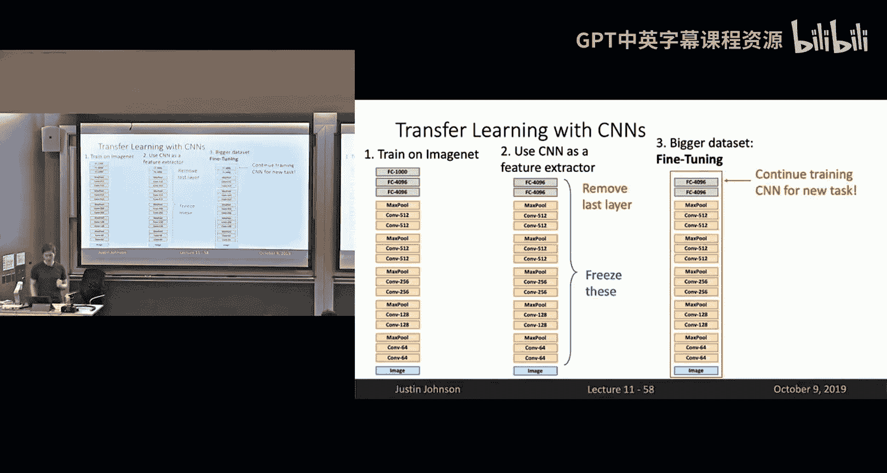

Yeah， question。都是法。Yeah， yeah， so yeah， thanks for pointing it out。 So for this paper in particular。

 they had another trick in their bag， which was actually applying data augmentation to the raw images before they extracted feature vectors。

 And they found that this was actually pretty important for beating these prior methods。 But again。

 this data augmentation is fairly simple and fairly straightforward。

 These are mostly these random scales and flips and crops that we kind of talked about in the previous lecture。

 And then they kind of take an ensemble over many different at test time。

 Take an ensemble over many different random data augmentations for the data point。 But again。

 it's sort of a fairly simple， straightforward procedure that is the same across all the data sets。😊。

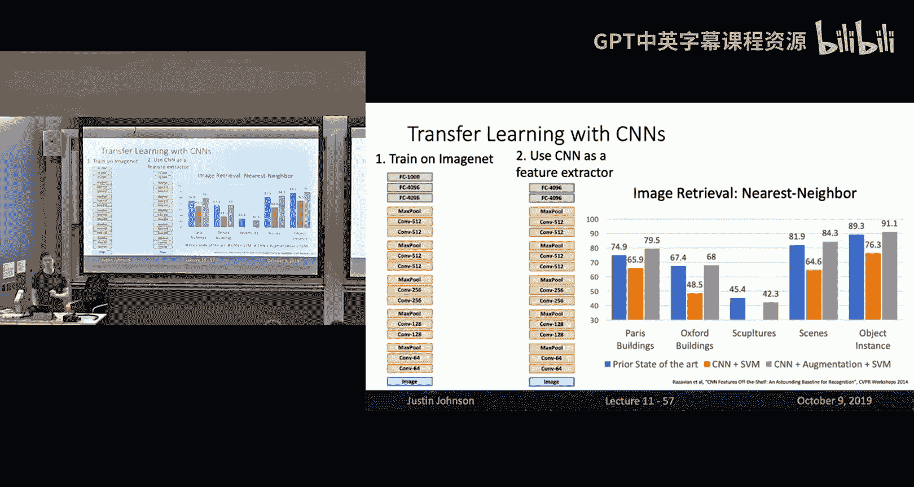

So that's kind of the simplest procedure where we simply use the pre-trained network and just use to extract feature vectors out of the box and then plug those feature vectors into some other algorithm。

 But if your data is a little bit larger， you can often do better than that using this procedure we call fine tuning。

 So here the idea is that we will take our model which has been pretrained on something like imagenet。

 and then maybe throw away the last layer and reinitialize the last layer to be maybe a new layer that pertains to the classification categories on our new dataset。

 and now we will continue training the entire model for our for our new classification dataset。

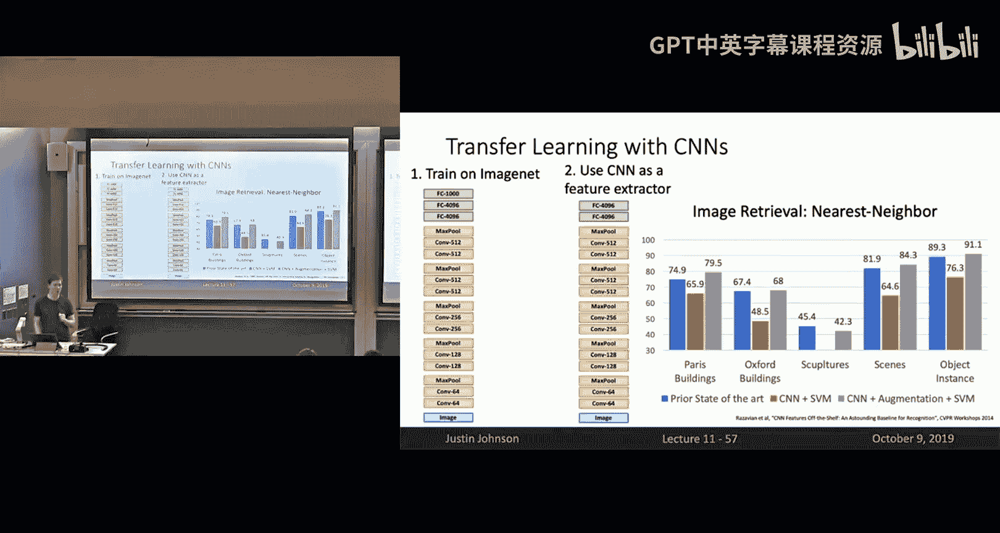

And in this and then rather than just using it as a fixed feature extractor。

 we'll actually back propagate into the model and continue updating the weights of the model to to continue improving performance on this downstream task。

And here there's a couple tricks and tips， one is that sometimes you often need to reduce the learning rates a lot when you're doing this fine tuning and another trick is that sometimes you might want to first start from extracting features and then getting a linear model to converge on top of features and then after you do that go back and finet the whole model so those are maybe some tips and tricks on this fine tuning that you might do in practice。

And it turns out that this procedure of fine tuning can actually give pretty substantial gains in performance on a lot of tasks。

 So here for this task of object detection that we'll talk about in more detail in a few lectures so you don't need to know how this works or what this number on the vertical axis is just higher is better and 100 is perfect So what this means is that the blue bar is using some kind of transfer learning for object detection on two different data sets this blue bar was using fixed feature vectors where we just freeze the entire network and use it as a fixed feature extractor and now the orange bars are where we actually continue training the entire neural network model on on the new data and what we can see is that by fine tuning actually things are working a lot better than this gives us a huge boost over just using the network as a feature extractor。

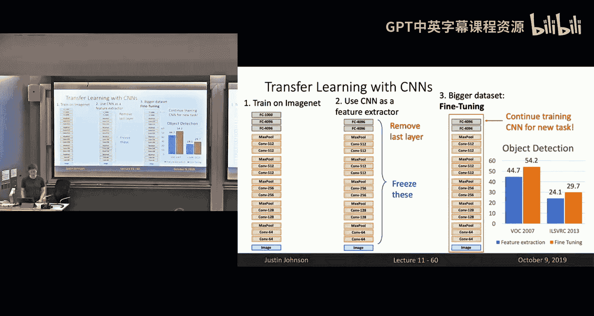

Another point here is that the architecture that you use matters。

 so I told you that step1 was to train a model on INe。 Well。

 it turns out that the model that you train matters a lot。 and in general。

 models that work better on ImNe tends to also work better for many。

 many other computer vision problems So this is why this is I think the reason why many people in computer vision and basically everyone in computer vision knows the exact relative order of all the models on INe and the reason for that is not because they are obsessed with the Inett challenge。

 it's instead because models that work better on INe for many years tended to also work better on basically every other problem that you tried。

 So there was a period in time when basically you would just take the latest and greatest model that work the best on INe and just apply it to whatever your problem at hand was and things would get better。

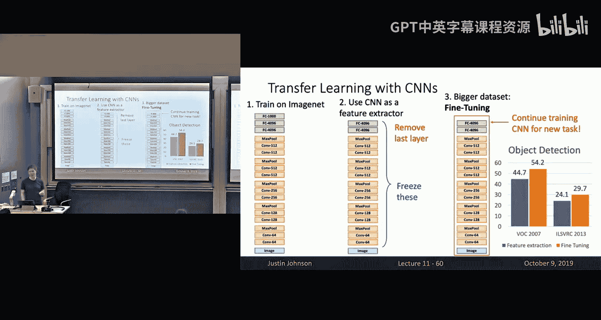

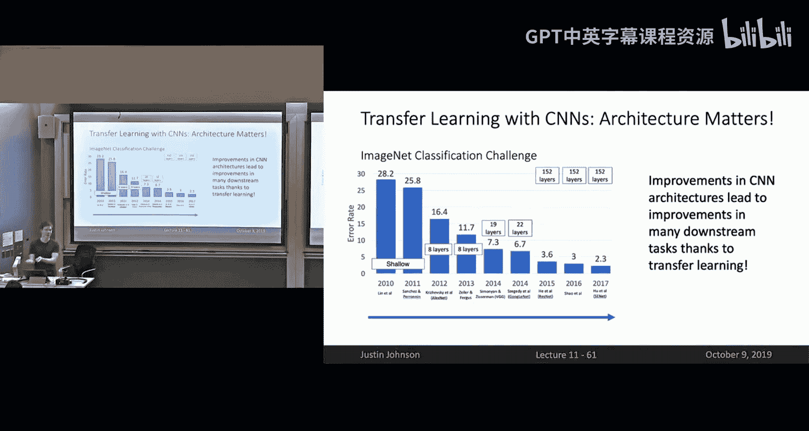

And an example from that comes from again this object detection problem。

 so it's very difficult to find papers that make controlled comparisons between different imagenet models。

 so this object detection comparison is not perfect。

 but it's the closest I could find so here again the Y axis is the performance on this object detection task zero is terrible 100 is perfect and starting and like in around 2011 the best state of the art at pre-deep learning was getting something like five on this task。

And now when we used an object detection method with Alexnett。

 we got 15 and then using the exact same object detection method。

 but just swapping AlexNet for VGG and doing everything else the same they gave us a boost from 15 to 19 and that's just the result of using a more powerful bigger network that works better on imageNe also gave us improvements on this new tasks and then then if you compare this 29 and this 36。

 again， this is the exact same object detection method。

 but one is using VGG and the other is using  50 layer Resnet and again。

 the jump from VGG to Resnet gave huge gains in performance， not just on INe。

 but also on a ton of ton of downstream tasks and this trend basically continued that models that worked better on INe tended to give you gains nearly for free with very little effort on a wide range of downstream tasks in computer vision。

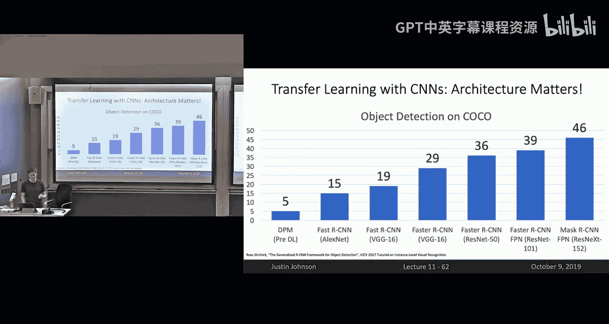

So then kind of the quick guide of how to approach transfer learning with CNNs is I like to think about this little two by two matrix where you can kind of think about your problem falling into one of these buckets。

 One is whether your data is very similar to imagenet。

 and the other is how much data do you have in this new dataset。

 Well if your dataset is very similar to imagenet that is tends to contain objects that look kind of like imagenet objects。

 then even if you have very， very little data， then like maybe tens to hundreds per category。

 then applying some kind of linear classifier on top of your pretrained features tends to work quite well。

 And if you have a fairly large amount of data， maybe hundreds to thousands of samples per category。

 then fine- tuunning an imagenet model on your new data tends to work quite well。

 Now if your dataset is fairly different from imagenet and similar and different is not well defined in this context I admit。

 But if your dataset is fairly different from imagenet， but you have a lot of data。

 often you can still initialized from an imagenet model。And fine tune and get good performance。 Now。

 the danger zone is right here where you have a very small data set and the nature of that data is somehow very different from the types of images you see in Inet。

 And if that's the case， then you're in trouble。 I would I still think that some linear classifier from a pretrain model or some fine tuning approach。

 will'll often give you reasonable results。 But this is really the danger zone where that you need to look out for。

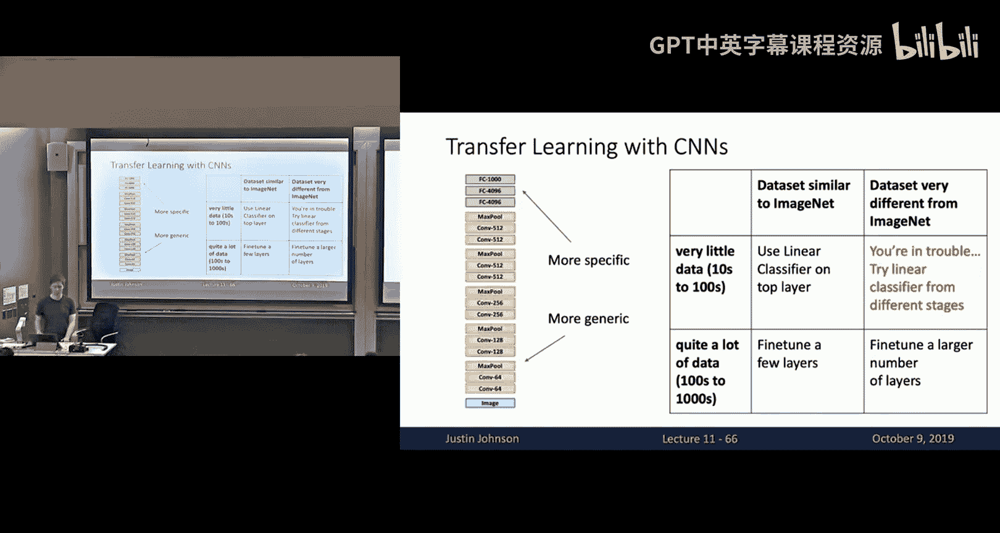

So I'd also like to point out that this idea of transfer learning in computer vision has really become the norm and it has become the mainstream way that we operate on many tasks in computer vision over the past several years that this is really the norm。

 not the exception that basically most computer a very wide majority a very wide set of computer vision papers are using some kind of transfer learning these days So we've seen this already in object detection where it is using somehow part of the model was pretrained on imageNe we'll also see this again in things like image captioning。

 where again part of the model was pretrained on imageNe。

And even what' even people get even wilder and sort of pretrain different parts of the model on different data sets and then plug them together and achieve some end result。

 So for some some kind of image captioning model that we'll talk about in more detail。

 maybe part of the model was pre-train on imagenet。

 And then part of the model was pretrained some other data and then you put them together and continue training for some eventual downstream task。

So somehow， I think one important shift in computer vision over the past several years has actually been finding pipelines of pretraining and fine tuning and possibly multiple rounds of it in order to make use of different types of data for your eventual end task。

And a very great recent example of this type of approach in computer vision actually comes from a very recent paper from our very own GSI Luway。

 where he has this very recent paper where they step1， train a CNN on imageNe。

 step2 fine-t that CNN for object detection on another data called visual genome。

 step3 train something called the language model called Bt on a differentant type of data。

 the details of which are not important right now， step4。

 you combine the results of two and3 and then finet them for some kind of a joint vision language task。

 and then step five， you finet in this eventual construction on your eventual downstream task be it image captioning or visual question answering or some other kind of eventual downstream task and I don't intend for you to understand the full details of what's going on in this model。

 this is just to give you a sense that this procedure of finetuning and a pre-training and fineting and transfer learning has become a very critical part of mainstream computer vision research and we'll have。

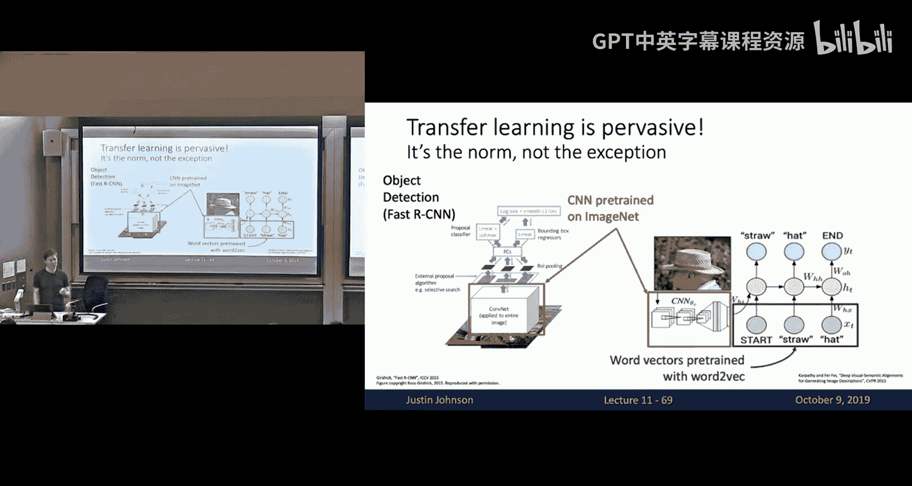

A guest lecture from Luwei later in the semester， where I think he'll talk in more detail about this model in particular。

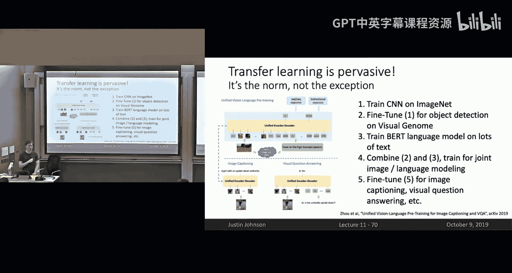

So even though transfer learning has become very， very pervasive， there's been some very。

 very recent results that have somewhat called it into question。

 so there's this very interesting result from just this year that shows that for the task of object detection。

 you can actually' you can actually get away without pre-training。

 which is something everyone thought was critical for many downstream tasks and computer vision The catch is that in order to do as well on object detection by training from scratch。

 you need to train for three times as long。So you can do just as well without pre traininging。

 but it requires you to train for many， many more iterations。

And the other takeaway from this paper is that in situations where you have very little training data。

 then pretraining also gives you some very good performance over fine tuning so I think this actually meshes with some of the earlier intuitions we had。

 whereas if you have very， very small dataset， than something like tens of samples per class。

 then something like pretraining and fine tuning is very。

 very effective and if you have larger data if your data size is larger。

 then you can consider not only fine tuning a whole model。

 but perhaps also training a brand new model from scratch。

But the caveat here is that even in cases where you have a fairly low large data。

 I think pretraining and fine tuning is still an extremely effective recipe in computer vision because it makes things train a lot faster。

 So even in cases where you do have a fairly large dataset at the end of the day for the task you care about。

 then initializing your model from a model pre-trained on Inet tends to make things train much。

 much faster。 So it's very， very useful to do in practice。

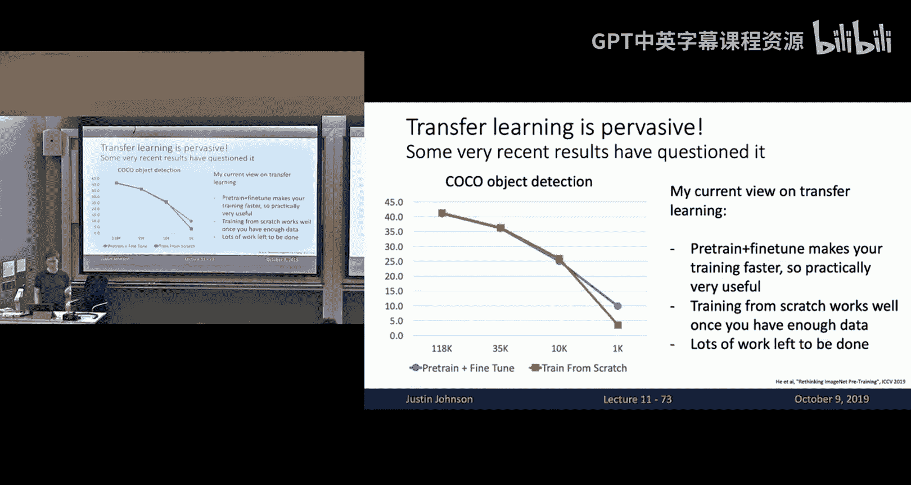

So I'd like to go， I think this one， this part is less critical。 So。

 if there's any sort of questions about transfer learning， I I'd rather take those here。

Alright。 So then I guess if you can bear with me for just like two minutes。

 we can blast through this stuff because you don't have enough GP to do this anyway。

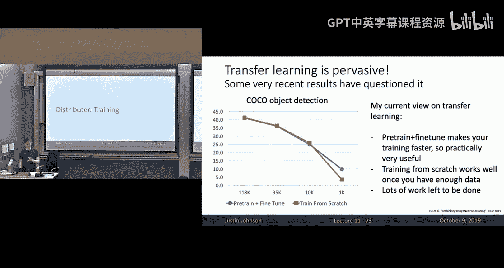

But。But basically a couple lectures ago， we talked about this notion of moving from single device to entire sort of rack scale or data center scale machine learning。

 So the question is how do you actually do that， So one idea is that we'll split our model across GPUs。

 maybe one thing you could imagine is you partition put some of the layers on one GPU。

 some of the layers on another GPU， some of layers on another GPU。

 This turns out to be a really bad idea because your GPUus will spend a lot of time waiting that only in this kind of scheme。

 only one GPU will be executing at a time， So it'll be a very inefficient use of your resources。

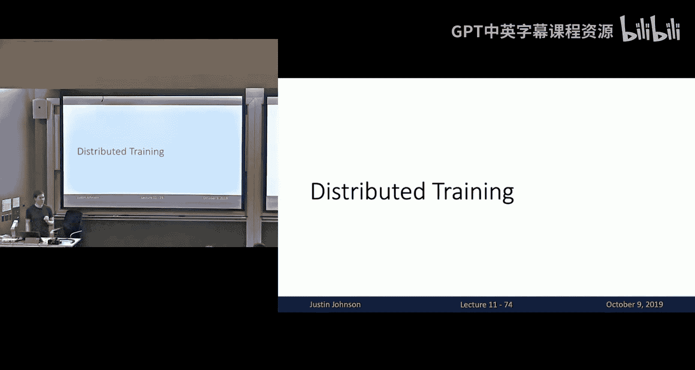

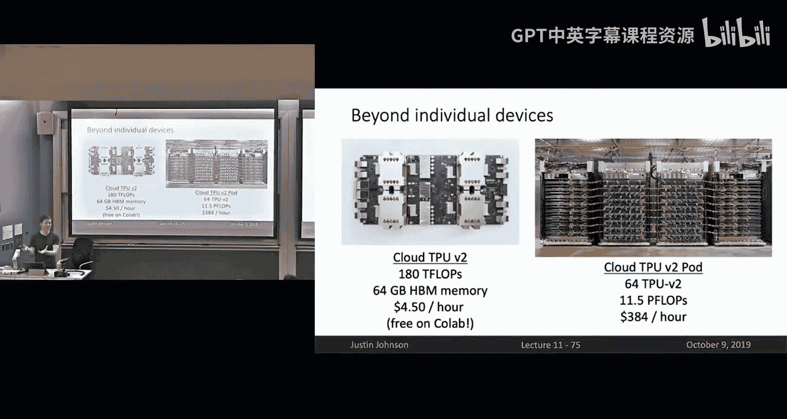

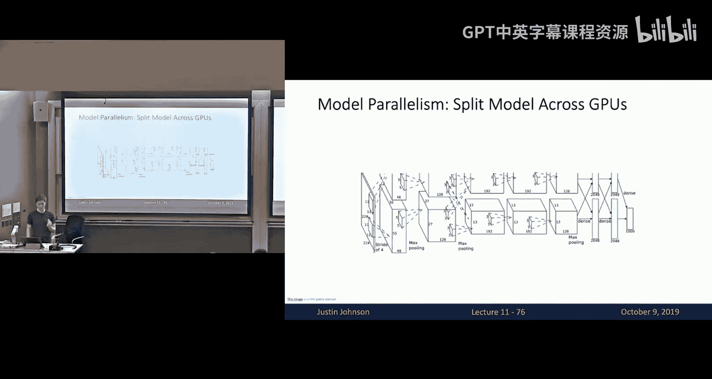

Another idea that you'll see sometimes， and by the way， this is called model parallelism。

 because the idea is that you're splitting up your model to run different parts of your model on different devices。

Another thing that another flavor of model parallelism that you'll see is to use different parallel split up your model into multiple parallel branches and then run those different parallel branches on different GP devices。

 And this is the type of mechanism that was actually used by the original Alexnett paper because if you recall the poor guy only had GPUs with only three gigys of memory So this was really critical for training AlexNet at that time。

😊，But this ends up being a fairly inefficient way of paralyzing across GPUs as well。

 because it requires synchronizing it requires a lot of communication between GPUs。

 and in particular it requires communicating the activations and the gradients of the loss with respect to those activations within the forward and backward passes。

 so this tends to be fairly expensive to do。

So instead the way the typical way that people instead parallellyze across multiple GPU devices is this idea called data parallelism。

 So here what we're going to do is take your batch of n images and then if we're training on two GPU devices will replicate the model on each of those two GPU devices and run run a smaller mini mini batch of n over two images on each of your independent GPUs and now after you split if you split across the batch dimension now your GPUs can perform most of their processing completely independently and there's much less need for communication across the GPUs So now these two GPUus can run forward pass completely independently compute loss completely independently compute gradient with respect to the parameters again without any communication between GPUs and the only point where you need to communicate is at the end of each forward and backward pass where these GPUs now need to communicate the gradient of the loss with respect to the parameters and some of those gradients across all the GPU devices in order to make a gradient step so。

Is the way that people typically make use of multiple GPU devices these days。

And this approach actually scales very well to very， very large numbers of GPUs。

 so you can imagine splitting this not just across two GPUs in your desktop。

 but across eight GPUs on a big server， or maybe across hundreds of GPUs in a data center and again the idea is the same that will take our batch of data。

 split it evenly across the GPUs do independent forward and backward passes on each device。

 and the only point of communication is where we need to sum the gradients across the different elements。

 the different devices。

Another variant you'll sometimes see is where you maybe combine model parallelism within each server and then do data parallelism across different servers in a data center。

 You can imagine this requires having a fairly large number of GPUs to play with。

But then basically this idea of splitt utilizing multiple devices by splitting across the batch dimension works really well。

 but it requires you to be able to train with very large mini batches。

So then basically the goal here is suppose you've got a model that works really well on a single GPU and now we want to scale up to train that same model on a very。

 very large set of GPUs and the goal here is usually that we want to reduce reduce the overall training time of that model so rather than training for a very long time on one GPU instead we like to train for a very short amount of time on that larger set of GPUs。

 so then hopefully the total number of epochs， the total number of times that we see each element in the training shit set should be the same。

 but we will instead form larger mini batches and make fewer overall gradient descent steps。

And basically the one really important trick to do this ends up being fairly straightforward。

 and it turns out that a very simple heuristic that works really well for this large batch training is to scale the learning rate linearly。

 so suppose that you've got a model that trains really well on one GPU using a learning rate alpha and a batch size of n then you can usually train on K GPUs with a batch size of KN n per GPU and a learning rate of K alpha so basically you scale the number of devices by K。

 you scale the batch size by K， you also scale the learning rate by K and this is the most important trick for getting things to work with a very large batches。

The other trick is that when if you imagine our batches are very。

 very large and we're maybe training up on 1000 GPUs， then that learning rate is going to be very。

 very large because now we're training like 1000 times whatever our old learning rate was and then the problem is that this very large learning rate can sometimes explode in the very first iteration of training。

 So then what people do is they often use a learning rate warmup schedule where they'll start the learning rate from zero and then gradually increase the learning rate over the first maybe1 thousand00 or 5000 iterations of training or so and then at that point they'll continue with whatever other learning rate schedule they would have used originally。

There's a couple other tricks that you need to use to get this to actually work。

 and I would recommend you check out this paper if you're interested in them。

 but the basic idea is that once you can once you get all these tricks to work。

 people were able to train models on imagenet very， very quickly using a very。

 very large number of GPUs。 So here this relatively wellknown paper was able to train models on Imnet in just one hour。

 but trick the secret is that they used the batch size of 8192 and they distributed this across 256 GPUs。

 and they had kind of a clickbaty title of the paper called ImNe in one hour。

嗯。And the problem is that once you write a paper called Imagenet in one hour。

 you are just begging for people to try to come and beat you。So after this paper came out。

 it seemed like all the big industrial labs were just were tripping over themselves to try to compete and see how many hardware resources could they throw out this problem and how fast could they train on ImageNet。

Yeah， question。just because。What resources you have when you asytoically reach a limit。Yeah。

 the question is， will you asymptotically reach a limit as your hardware increases。

 I think in theory， yes， but we haven't hit the asymptote yet， so let's keep going。

So after this paper came out they got one hour of training on 256 GPUs。

 so not long after another paper trained with a batch size of 12，000， it was a group from Intels。

 they were pushing Intel's new Knights landing devices that was kind of like a GPU and they got it to train in 39 minutes it is a great huge improvement and another group at Intel came out。

 they trained with a batch size of 16，000 and they trained it on 1600 Z on CPUUs and they got it to train in 31 minutes and then another group came out and they got it to train in 15 minutes but they trained with a batch size of 32。

000 on 1000 GPUs and if you look this is like kind of linear if you compare this original imagenet in one hour then you know you can train four times as fast with four times as big a batch size on four times as many devices so in practice if you read papers from a big industrial labs。

 they'll often use these tricks in practice。

