# 密歇根大学《深度学习用于计算机视觉｜Deep Learning for Computer Vision UMich EECS 498-007 2019》中英字幕 p12 -12-12_RecurrentNeuralNetworks.zh_en -BV1jA4m1P7GN_p12-

Okay welcome back today we're on lecture 12 and today we're going to talk about a new species of neural network type called recurrent neural networks。

 but before we get to that as usual we have some announcements so reminder that assignment three was already due on Monday but if you're holding out and planning to use some late days on that assignment then maybe some of you are still working on it so that's a reminder the other important reminder is about the midterm this will remember that the midterm will be on Monday so do not come here during class time on Monday instead go to Chrysler 220 and there we'll have the midterm exam and it will be a lot of fun I'm sure。

😀Yeah。And there was a question on Piazza just earlier today on what exactly the midterm would cover。

 so the midterm will be everything before this lecture。

 so everything up to training neural networks parts one and two。

 and then today's content will not be on the midterm， so if you all want to leave now。

 I guess that's okay。But again so really important that you actually show up for the midterm。

 we've got a bunch of requests for alternate midterm times if any if you have not submitted this form and you can't make the regular midterm time you need to submit this form like right away so we can schedule you an alternate time any questions on the midterm before we move on yeah we' get this。

question is will there be a practice midterm exam Yes I'm planning to release a practice midterm exam but I need to find some time to make one unfortunately I mean I didn't really realize this as a student but exams don't grow on trees right you have to make them and it actually takes a lot of effort to make exams and then so making practice exams is like extra work。

 but I think it's worthwhile so yes there will be some practice exam hopefully released by this weekend。

Yeah。This is one page on single side。I guess you can have both sides。 That's fine。

 You're allowed to flip your sheet of paper。Okay， any other questions on midterm？Okay， great。

 so then I guess we can move on to the fun stuff for today。

 So before we talk about recurrent neural networks。

 I wanted to back up and remember we had this slide from a couple lectures ago where we were talking about hardware and software and this was kind of our TLDR conclusions about Pytorch versus TensorFlow and if you'll recall kind of my biggest gripes with Pytorch as of that lecture where that it didn't have good TPU support for Google specialized Tensor processingsing unit hardware and it did not have good support for exporting your train models onto mobile devices like iOS and Android devices。

😊，Well， since that lecture， Piyetororch has actually released a new version 1。

3 and two of the biggest features in the new version of Piyettorch actually addressed these two big concerns that I had with Piyettorch。

 so Pyetororch 1。3 now offers some experimental mobile API that theoretically makes it really easy to export your models and run them on mobile devices which seems awesome and there's now also experimental support for Piytorrch code on Google TPUs which also seems really cool。

 so I just thought it's nice to keep you guys up to dateate when things change in the field of deep learning as you can see things are changing even within the scope of one semester and some of our earlier lecture content becomes outdated even just a week or two later sometimes but so this is the new Piytorrch version 1。

3 we're going continue sticking with version 1。2 for the rest of this quarter unless coabab silently updates to 1。

3 on us again， which may happen， I don't know。So these are really cool new features， but like I said。

 this was just released， so it's going to take a little bit of time。

 I think before we see whether or not these new features are really as awesome as they're promised to be。

So then kind of stepping back to last lecture， remember the last two lectures we've been talking about all these nuts and bolts strategies for how you can actually train your neural networks。

 so we talked in great detail about things like activation functions， data preprocessing。

 weight initialization and many many other strategies and little details that you need to know in order to train your neural networks。

So now， hopefully， by this point in the class， you guys are all experts at training deep convolutional neural networks for whatever type of image classification problem I might want to throw at you。

 So since you are now experts at that problem， start it's now the time in the semester when we need to start thinking about new types of problems that we can solve with deep neural networks。

 So that brings us to today's topic of recurrent neural networks。😊，So basically。

 all the problems and all the applications we've considered of deep neural networks in this class so far have been what is called a feed forward network。

 Now these feed forward networks are something that receives some single input at the bottom of the network like a single image goes through one or multiple hidden layers maybe with special fancy layers like convolution or batch normalization。

 but each each layer sort of feeds into the next layer。

 and at the very end of the network it's going to output some single output like so the classical example of these kind of feed forward networks are these image classification networks that we've been working with so far here there's a single input。

 which is the image and there's a single output， which is the category label that we want our network to assign to that image now as we've been the reason we covered image classification in such detail is because I think it's a really important problem that encapsulates a lot of important features of deep learning but there's a whole lot of other types of problems that we might imagine wanting to solve using deep neural networks。

So for example， we might want to have problems that are not one to one， but instead are one to many。

 so where the input is a single input like maybe a single image and the output is no longer a single label。

 but maybe the output is a sequence an example of this would be a task like image captioning where we want to have a neural network to look at an image and then write a sequence of words that describe the content of the image in natural language now you can imagine this would be much more general than this single label image classification problem that we've considered so far。

Another type of application we might imagine is a many to one problem where now maybe our input is no longer a single item like an image。

 but maybe our input is a sequence of items。 For example。

 a sequence of video frames that make up a video。 And now at the end。

 we then maybe want to assign a label to this to this sequence of inputs。

 maybe we want to look at the frames of a video sequence and then say maybe what type of event is happening in that video。

 So this would be an example of a many to one problem because the input is a sequence and the output is a single label。

Of course you can generalize this， you can imagine problems that are many to many that want to input a sequence and then output a sequence。

 an example of this type of problem would be something like machine translation where we want to have neural networks that can input a sentence in English so that would be a sequence of words in English and then output a translation of that sentence to French which would then be a sequence of words in French。

 and again， and sort of on every four past the network。

 we might have input sequences of different length and output sequences of different length this would be an example of something we call a many to many problem or a sequence to sequence problem。

There's another sort of sequence to sequence problem where maybe we want to process an input sequence。

 and then we want to make a decision for each element of that input sequence。

 This is another example of a type of many to many classification problem。

 So here an example might be processing frames of a video and rather than making a single classification decision about the entire content at the video。

 maybe instead we want to make a decision about the content of each frame of the video and maybe say that the first three frames where someone dribbling a basketball。

 The next10 frames or someone shooting a basketball。

 The next frame was him missing the shot and then the next a couple frames were him being booed by his team。

 something like that。 So maybe and maybe we'd like to build this network in a way that can process sequences so。

So you can see that once we have the ability to work not just with single single inputs and single outputs。

 but now if we have the ability to process sequences of inputs and sequences of outputs that allows us to build neural networks that that can do much more general types of things And now the general tool that we have in deep learning or rather one of the general tools that we have for working with sequences both the input and the output level is a recurrent neural network。

 So the rest of the lecture we'll talk about so whenever whenever you see a problem that involves sequences at the input or sequences at the output。

 you might consider using some kind of recurrent neural network to solve that problem and an important task here and an important point here is that for all these problems we might not know the sequence length ahead of time for each of these tasks。

 we want to build one neural network that can process sequences of arbitrary length So we'd like to be able to use the same video classification network to process a video frame like like a very short video frame or a very。

 very long video。Sequence。So in this recurrent neural network。

 will be this very general tool that will allow us to process different types of sequences in deep learning problems。

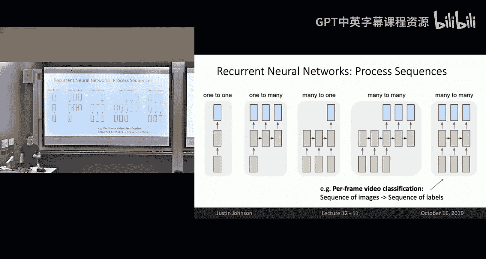

But recurrent neural networks are actually useful even for processing non-sequential data。

 so it turns out that sometimes people like to build use recurrent neural networks to perform sequential processing of non-sequential data So what do I mean by that as an example So this is a project from a couple years ago where they were doing our favorite image classification task。

 So remember image classification is there's no sequences involved it's just a single image as input and a single category label as output but now the way that they want to classify images is actually not with a single feed forward neural network instead they want to build a neural network that can take multiple glimpses at the image。

 then it maybe wants to look at one part of the image， then look at another part of the image。

 then look at another part of the image， where at each point in time。

 the position that the network the decision of the network of where to look in the image is conditioned upon all the information that it's extracted at all previous time steps。

 And then after looking at many many glimpses in the image。

 then the network finally makes some classification decision about what。

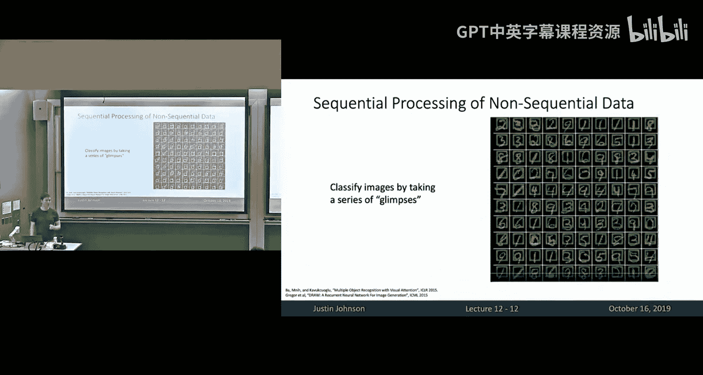

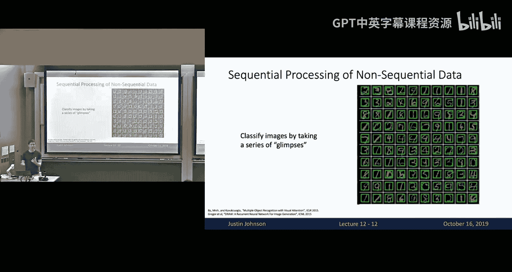

the object that it's seeing in the image so here we see so this is an example of using a sequential processing inside of a neural network even to process nonsequential data so here this visualization we're showing that it's doing digit classification and each of these little green squares is one of the glimpses that the neural network is choosing to make to look at one little sub portion of the image in order to make its classification decision。

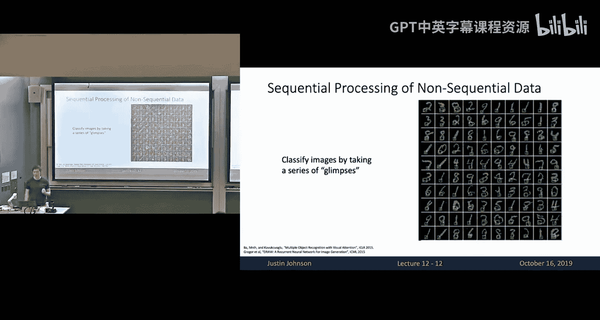

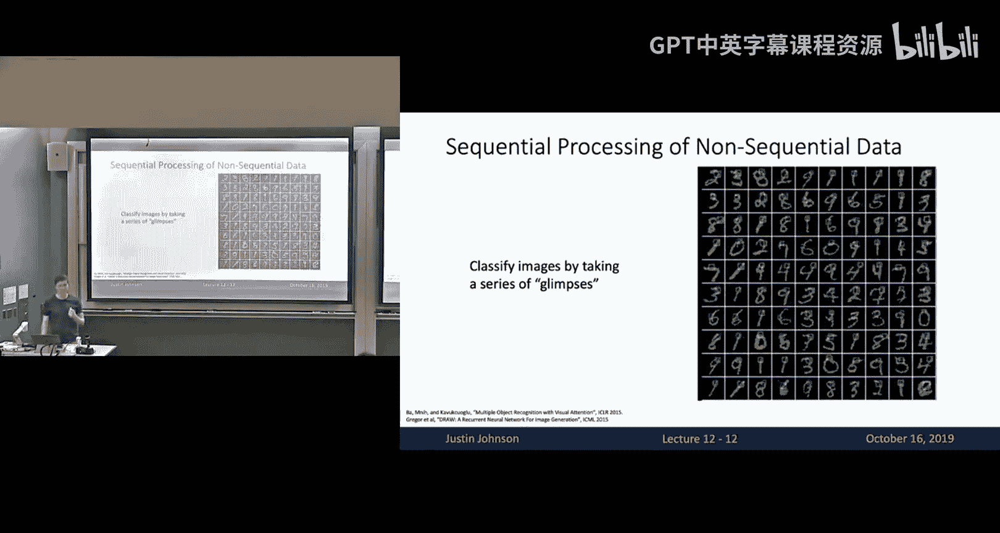

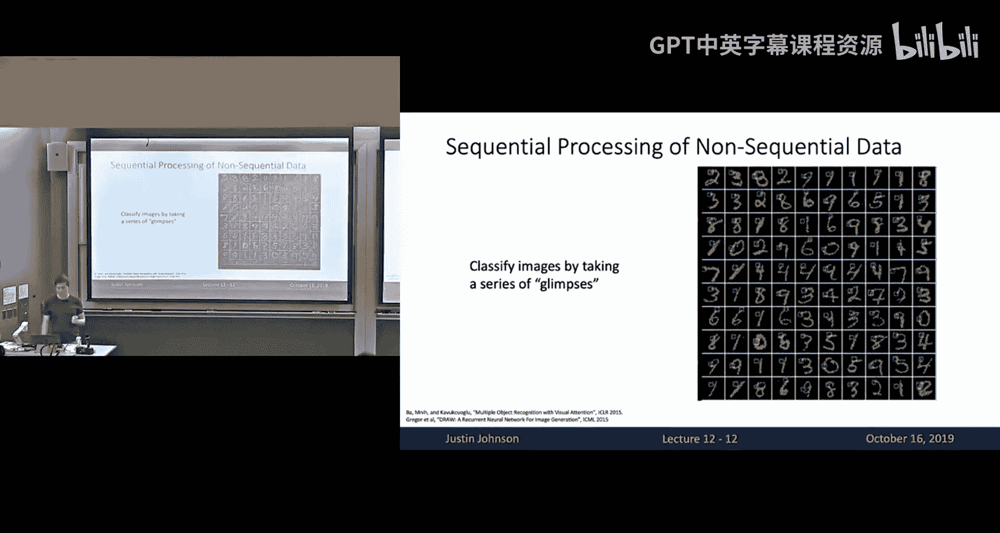

Now another example of using sequential processing for nonsequential data is sort of doing the inverse and now generating images so here rather than trying to taking so in the previous slide we saw the network was taking the images input and then using a sequence of glimpses to make a classification decisions now instead we have some task where we want to build neural networks that can generate images of digits and now the way that it's going to do this is by painting little sequences of the output canvas。

 sort of one time step at a time， so at each point in time the neural network will choose where it wants to write and then what it wants to write and then over time those writing decisions will be integrated over time to allow the network to build up these output images using some kind of sequential processing even though the underlying task is not sequential。

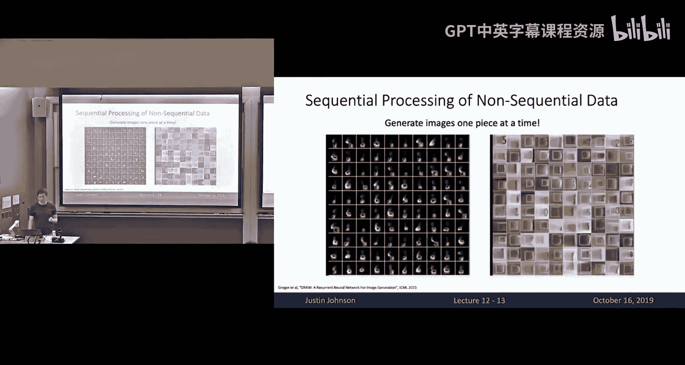

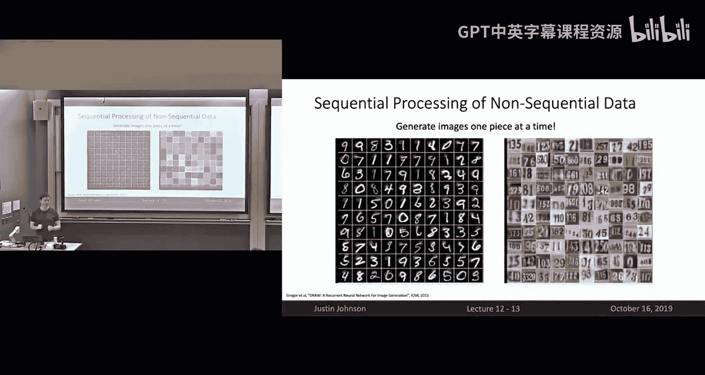

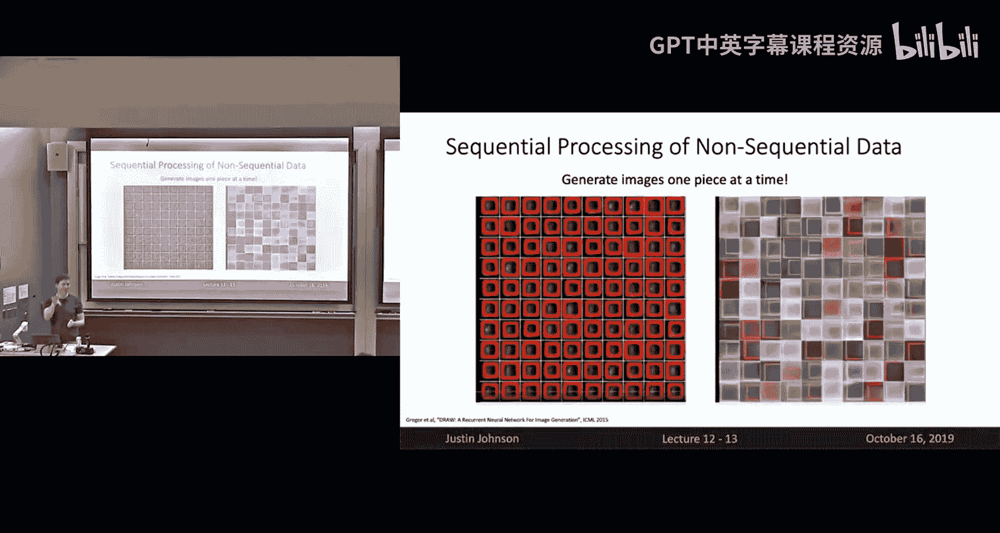

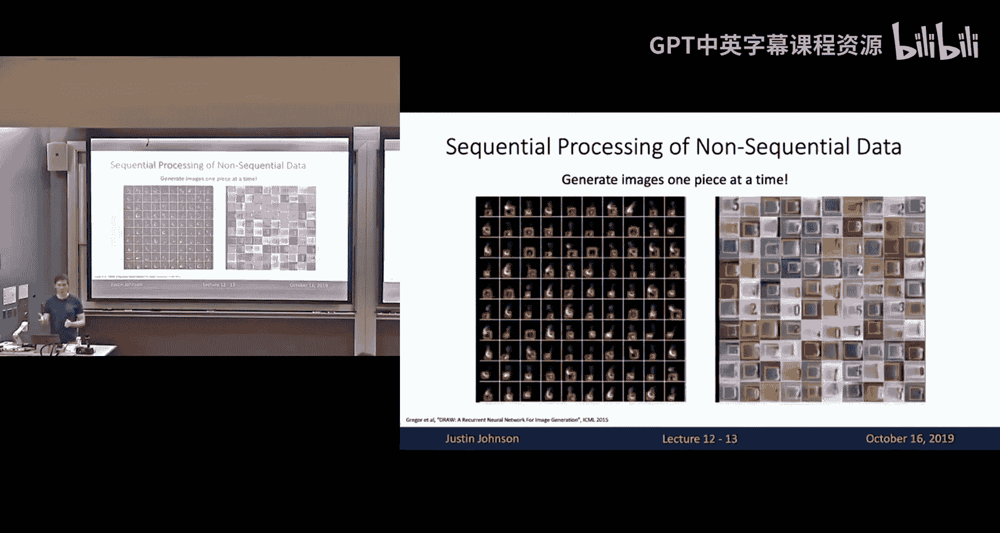

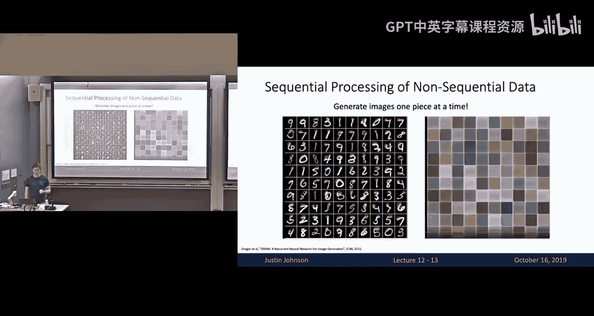

So here these examples are from a couple years ago here's one that I saw on Twitter just last week。

 So here the idea is again we're we're building a neural network that can produce these images。

 which is a nonsequential tasks but using sequential processing。

 So here what they did is actually integrated the neural network into an oil paint simulator and now at every time step the neural network chooses what type of brushstr it wants to make onto this virtual oil paint canvas and then at every time step it's conditioned on what it saw in the previous time step it chooses where to make one of these virtual oil paint brushstrs and then over time it actually builds up these sort of stylized artistic images of faces So these are all examples of where you might imagine using a recurrent neural network。

 So now we've seen that recurrent neural networks can be used both to open open the door to new types of tasks involving processing sequential data and they can also give us a new。

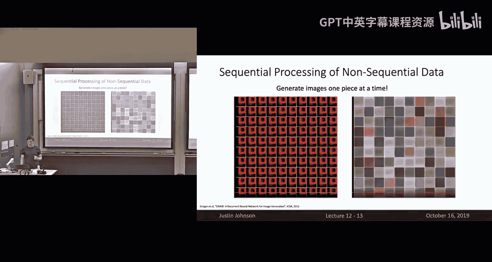

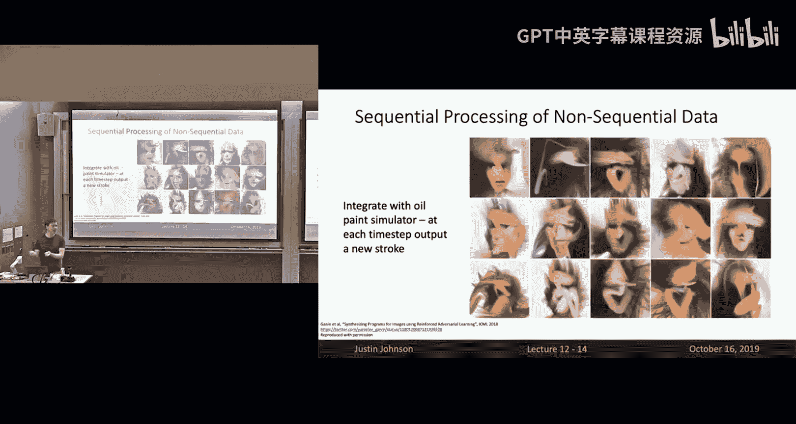

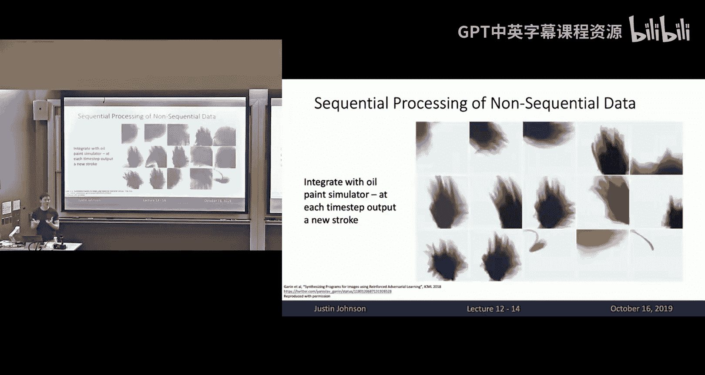

To solve our old types of problems where we might want to use sequential processing even for these inherently nons tasks。

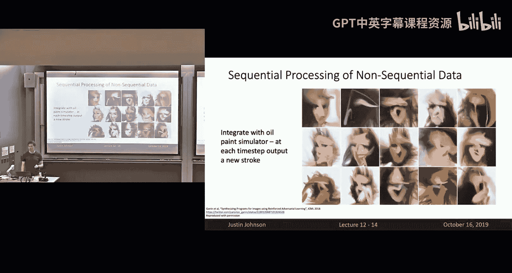

So hopefully this is good enough motivation as to why a recurrent neural network is an interesting thing to learn about。

 So given that motivation， what is a recurrent neural network and how does it work。

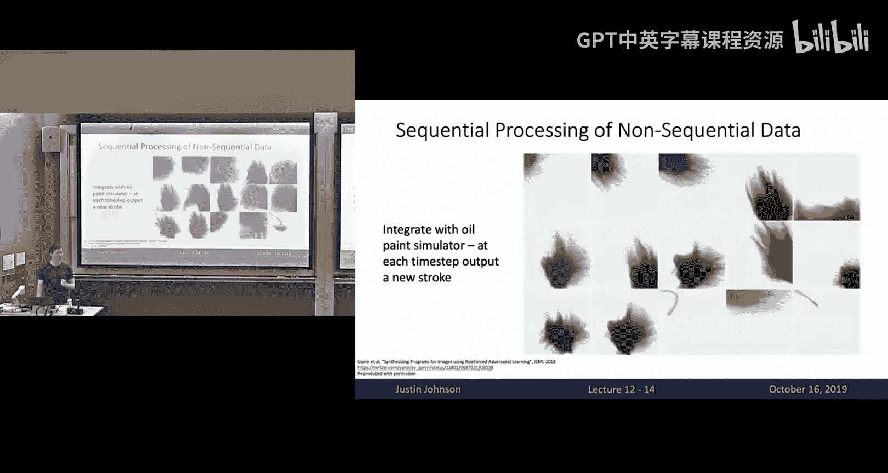

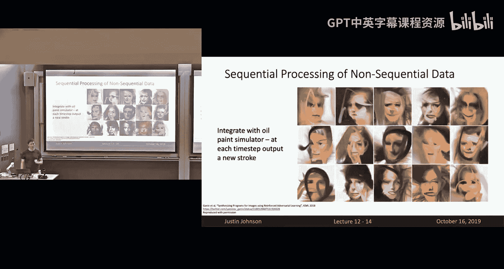

Well， the basic intuition behind a recurrent neural network is， like I said。

 we're processing sequences， so then at every time step。

 the recurrent neural network is going to receive some input X here shown in red and going to emit some output Y shown in blue and now the recurrent neural network will also have some internal hidden state which is some kind of vector and at every time step。

 the recurrent neural network will use the input at the current time step to update its hidden state using some kind of update formula and then given the updated hidden state it will then emit its output for the current time step Y so concretely we can see then concretely what this might look like is that in order to define the architecture of a recurrent neural network。

 we need to write down some kind of recurrence some kind of recurrence formula or recurrence relation FW so here now now we have this intuition that the network is working on this sequence of hidden states where。

H subT is the hidden state at time T， which is just going to be some vector just like the hidden state activations of the fully connected networks that we've worked with in the past。

And now it will write down this recurrence relation F that depends on learnable weights W。

 and learnable this function will take as input the hidden state at the previous time step。

 Ht minus1， as well as the input at the current time step X T。

 and it will output the hidden state at the next time step H T。

And then you can imagine that we can write down different types of formulas， FW。

 that cause these inputs and hidden states to be related to each other using different algebraic formulations。

So the most simple way that we can right and the important critical point part is that we use this same function。

 F W with the same weights， W at every time step in the sequence。 and by doing this。

 we're sort of sharing weights and using the exact same weight matrix to process every point in time and every point in the sequence。

And by this construction allows us to have just a single weight matrix that can now process sequences of arbitrary length because again。

 we're using the exact same weight matrix at every time step of the sequence。

So now with this kind of general definition of a recurrent neural network。

 we can see our first concrete implementation of a recurrent neural network。

 so this simplest version is sometimes called a vanilla recurrent neural network。

 or sometimes anman recurrent neural network after Professor Jeffrey Elman who worked on these some time ago。

So here the hidden state consists of a single vector Ht at every time step and now we are going to have two learnable weight matrix matrices。

 one is W H H， which is going to be multiplied on the hidden state at the previous time step and the other is W X H which is going to be multiplied on the input at the current time step So what we'll do is we'll take our input at our current time step。

 multiply it by one weight matrix， take our previous hidden state multipied by the other weight matrix。

 add them together， also add a bias term， our learnable bias term。

 which I've omitted from this equation for clarity。

 and then we're going to use the non nonlinearity that I told you not to use and squash them through a tan H and then based and that after squashing through a tan H。

 this will give us our new hidden state Ht at our new time step and now we can produce our output at this time step Yt by having another weight matrix that is going to be just a linear transform on that hidden state Ht。

So is this definition of this sort of element recurrent neural network clear。

 exactly what's going on？Great， so then one way to think about this is another way to think about the processing of a recurrent neural network is to think about the computational graph that we build when we're unrolling this recurrent neural network over time。

 so we can imagine that at the very beginning a processing our sequence we're going to have some initial input to that this first element of the sequence x1 and we need to get some initial hidden state H0 from somewhere and to kind of kick off this recurrence it's very common to either initialize that first hidden state to be all zeros is one very common thing sometimes you'll also see people learn the initial hidden state as another learnable parameter of the network but those are both kind of implementation details you can just imagine that this initial hidden state is all zeros and that usually works pretty well。

So then given this initial hidden state and this first element of the sequence。

 then we feed them to this recurrence relation function FW that will output our first hidden state H1。

And then now， given our first hidden state， we'll then feed it again to the same function FW and slurp in the next element of the sequence x2 to produce the next hidden state and so on and so forth。

And what's important here is that we're using the exact same weight matrix at every time step of the sequence。

 so you can see that in the computational graph this is manifested as having a single node W for the weight matrix that is then used at every time step in the sequence。

 so then you can imagine that maybe during back propagation。

 if you remember the rules for sort of copy nodes in a computational graph then in the forward pass if we use the same node in multiple parts of the computational graph。

 then during the backward pass， what do we have to do？Yes， we need to sum。

 So this will be important when you implement recurrent neural networks on assignment 4。

 So hopefully that will be fun。And you can also see by this design that， again。

 because we're using the exact same weight matrix at every time step in the sequence。

 then this one recurrent neural network can process any sequence of arbitrary length and if we receive a sequence of two elements we'll just sort of unroll this graph for two time steps if we receive a sequence of 100 elements will' unroll this graph for 100 time steps。

 and no matter what length of sequence we receive， we can use the same recurrent neural network and the same weights to process sequences of arbitrary length。

And now at every time now so this is kind of the basic operation of a recurrent neural network。

 and then remember we saw all these different one to many。

 many to many these different types of sequence tasks that we might want to use well now we can see how we can use this basic recurrent neural network to implement all of these different types of sequential processing tasks。

So here in the case of many to many， where we receive a sequence of inputs and now we want to make a decision for each point in the sequence。

 this again might be something like video classification。

 we want to classify every frame of a video Now we can have another weight matrix。

 maybe W out or W Y that's going to produce our output our output Y at every time step in the sequence。

And now maybe we have some desired label， then to train this thing。

 we might apply a loss function at each time step in the sequence， so for example。

 if this was something like video classification or we're making a classification decision at every point in the sequence。

 then we might apply， we might have a ground truth label at every point in time。

 and we apply cross entropy loss to the predictions at every time step to now get a loss time per element of the sequence。

Then to get our final loss function， we would sum together all of these per time step losses。

 and that would give us our final loss that we could back propagate through。

 So now this would be something like the full computational graph for a many to many recurrent neural network that is making one output per time step in our input sequence。

Now maybe if we were doing a many to one situation。

 this might be something like video classification where we just want to produce a single classification label for the entire video sequence。

 then we can just hook up our model to make a single prediction at the very end of the sequence that only operates on the final hidden state of the recurrent neural network and what you can see is that at this final state of the recurrent neural network it kind of depends on the entire input sequence so hopefully by the time we get to this final hidden state that kind of encapsulates all the information that the network needs to know about the entire sequence in order to make its classification decision。

then maybe if we're in some one to many situation， something like image captioning。

 where we want to input maybe a single element， like an image。

 and then output a sequence of elements like a sequence of words to describe the image。

 then we can also use this recurrent neural network。

 that now we pass a single input at the beginning， which is our single input X。

 and then we use this recurrence relation to produce a whole sequence of outputs。

Now there's another a very common application of recurrent neural networks which is the so-called sequence to sequence problem This is often used in something like machine translation where you want to process one input sequence and then produce another input sequence where the lengths of the two sequences might be different again this might be something like we input the sequence of words in English and then output a sequence of words in French giving a translation of the sentence and I don't speak French。

 but I think that an English sentence does not always have the same number of words as a corresponding translation in French so then it's important that we are able to build recurrent neural networks that can process an input sequence of one length and produce an output sequence of another length。

So the way that we implement this is the socalled sequence to sequence recurrent neural network architecture。

 and this is basically taking a many to one recurrent neural network and then feeding it directly into another one to many recurrent neural network。

So here the way this works is that we have one recurrent neural network called the encoder that will receive our input sequence。

 this might be our English sentence that we're receiving as input。

 and it will process that input sequence one element at a time。

 and then will then the entire content of that entire sequence will be summarized in the hidden vector that's predicted at the very end of the sequence。

And now we can take that hidden vector at the end of the encoder sequence and feed it as a single input to a second recurrent neural network called the decoder and now this second recurrent。

 this second decoder network is now a one to many network because it receives the single vector which was output from the first network and then it produces a variable length sequence as output and here from this computational graph you can see that we're using different weight matrices in the encodeder and the decoder shown in orange and purple here which is pretty common in these sequence of sequence models Yeah question。

好。The question the question is why do we separate them like this Well。

 one problem is that the number of output tokens might be different from the number of input tokens so we might want to process the English sentence and then output the French sentence but you don't know how like the number of words in the output might be different from the number of words in the input so there it's important that we separate them somehow you might imagine we just use the same weight matrix for both the encodeder and the decoder and that would be like we process for we process the whole sequence where we give it input for the first k time steps then for the last K time steps we don't give it any input at all and just expect it to produce an output and people do do that sometimes。

Yeah， the question is， how do we know how many tokens we need in the second one。

 So that I think is a detail we'll get to in a couple slides。 Was there another question over here。

Okay， good， good， I'm glad you're thinking about that because we'll get there。

So then so as kind of a concrete example of how this works as a more concrete task。

 we can talk about this so-called language modeling task。

 so here the idea is we want to build a recurrent neural network that's going to process an infinite stream of input data and then at every point in time it's going to try to predict what is the next character in the sequence。

 and this is called a language model because it allows you to write down it allows the neural network to score the probability of any sequence being part of that language that is' learning。

So here the way that we set this up is we'll typically write down some fixed we'll have some fixed set of vocabulary that the network knows about in this case our vocabulary consists of the letters H EL and N O。

 and this will be some fixed vocabulary that we need to choose this at the beginning of training and now we can see that our input sequence we've encoded each now we want to process this training sequence。

 hello H ELLO so now you can see that we process this input sequence by converting each of its characters into a one hott vector so given our vocabulary of size4 H ELO then we convert the letter H into the vector 1000 because consists of just having a one for that first slot in the vector meaning the first element of our vocab so then we process our input sequence in these one hot vectors and this gives us a sequence of vectors that we can feed to our current neural network。

So then we can use our recurrent neural network to process this sequence of input vectors and produce this sequence of hidden states。

 and now at every time step then we can use our output matrix to at every time step predict a distribution over the elements in our vocabulary at every point in the sequence and now because the task of the network is at every point in time。

 it's trying to predict the next element in the sequence。

 so you can see that after it receives the first element H in the input sequence。

 it tries to predict the next element E， so then that would be a cross-enttropy classification loss at that time step in the sequence。

Then after then once it receives the first two input characters， H and E and needs to predict L。

 which is the third character in the sequence and so on and so forth。

 So then you can see that the target outputs in this sequence are equal to the target inputs just kind of offset by one。

So then once you've got a trained language model， so that's kind of what a language model looks like during training。

 you've got your input sequence， you shift the output and input input sequences and then try to predict the next character in every time step of processing but now once you've got a trained language model。

 you can actually do something really cool with it and you can use your trained language model to generate new text that is in the style of the text that it was trained on so as an example of what that might look like。

 given our trained given a language model that we've now trained on a set of sequences。

 then what we can do is we can feed it some initial seed token on like the letter H and now what we want to do is have the recurrent neural network generate new text conditioned on this initial seed token。

So then the way that this works is we give it our input token H。

 we give it the same one hot encoding， we go through one layer。

 we unroll one tick of this recurrent neural network sequence and then get this distribution of predictions for the next character in time and now because our model has predicted a distribution of what characters it thinks should happen at the next time step。

 what we can do is sample from that distribution to just give a new invented character for what the model thinks is probable at the next time step。

And then after we take that sampled character， we can take the sampled output from the first time step of the network and feed it back as input in the next time step of the network。

 So then we have this sampled character E that we can feed back as input at the next time step and then go through another layer of processing of this recurrent neural networks and we again compute the next hidden state。

 compute a new distribution of a predicted outputs and then gives us a new distribution over what the model thinks the yet next character should be and then you can imagine repeating this process over and over again。

 so then given your trained language model， you can see it it with some initial initial token and then just have it generate new tokens that it thinks are likely to follow that initial token that you give it。

So as kind of one little ugly detail is that so far we've talked about encoding our input sequence as a set of onehot vectors。

 And if you think about what happens in this first layer in this first layer of the recurrent neural network。

 is that remember in this vanilla neural network， we were taking our input vector and then multiplying it with our weight matrix。

 Well， if our input vector is just a one is just a one hot vector with a one in one slot and zeros in all other slots。

 Then actually that that matrix multiply is kind of trivial。

 because if we were if we were take a matrix， multiply by a one hott vector。

 then what it does is just extract one of the columns of the vector。

 So actually you don't need to implement that with a matrix multiplication routine。

 you can implement that much more efficiently with an operator that just simply extracts out rows of a weight matrix。

So for that reason it's very common to actually insert another layer in between the input to the network and the recurrent neural network called an embedding layer that does exactly this。

 so herebedding the input sequence the input our sequence will be encoded as a set of one hott vectors and now the embedding layer will just perform one sparse matrix multiply implicitly。

 so effectively this embedding layer just learns a separate each row of column of the embedding matrix corresponds to an embedding vector corresponding to element in each element of our vocabulary。

 so then a very common design for these recurrent neural networks is actually to have this separate embedding layer that happens between raw input the raw input zero hot sequence and before the embed these vectors to this embedding layer before passing to our recurrent neural network that computes these sequence of hidden states。

So now to train these things， we've sort of seen this example of a computational graph using recurrent neural networks already and what we saw is that in order to train one of these recurrent neural networks。

 we need to kind of unroll this computational graph over time and then at every time point in the sequence。

 we give rise to some loss per time step then these get summed over the entire length of the sequence to give a single loss。

 so kind of mean this is sometimes given a fancy name called back propagation through time because during the forward pass。

 we're kind of stepping forward through time through a sequence and then during a backward pass we're back propagating backwards in time through this sequence that we had unrolled during the forward pass。

But now one problem with this back propagation through time algorithm is that if we want to work on very。

 very long sequences and train on very， very long sequences。

 then this is going to take an enormous amount of memory because say we want to train on sequences that are like a million characters long。

 well then you need to unroll this computational graph for a million time steps that's probably not going to fit in your GPU memory。

So in practice， when we're training recurrent neural networks and especially recurrent neural network language models on very。

 very long sequences， sometimes we use an alternative approximate algorithm called a truncated back propagation through time。

So here the idea is that we want to sort of approximate the training of this network on this full possibly infinite sequence。

 but then what we'll do is we'll take some subset of the sequence。

 maybe like the first 10 tokens or the first0 tokens of the sequence。

 then we'll unroll the four pass of the network for that short prefix of the sequence。

 and then compute a loss only for that first chunk of the sequence。

 and then backproagate through the initial chunk of the sequence and make an update on the weights。

And now what we'll do is we'll actually record the hidden weight the values of the hidden states from the end of this initial chunk of the sequence。

 and then we'll receive the second chunk of the sequence and we'll pass in these recorded hidden weights that we remembered when processing the first chunk and then we'll unroll a second chunk of the sequence。

 like the next1 hundred characters in our possibly million character sequence。

 so then we'll unroll this next1 hundred characters of the sequence。

 compute a loss for the second chunk and then back propagate not through the entire sequence。

 but instead back back propagate only through this second chunk of the sequence。

 and then this will compute gradients of this loss with respect to our weight matrix。

 then we can make an update on the weight matrix and continue so then we would next then take the next chunk of the sequence。

 remember what the hidden state was from processing the second chunk and then use that recorded hidden state to continue unrolling the sequence forward in time。

 then again make a chunkncated back propagation through time and another weight update。

So what this back propagation through time algorithm does is basically the forward pass。

 because we're always carrying information forward forever perfectly through these remembered hidden states。

 then the forward pass is still sort of crossing and infinite potentially infinite sequence。

 but now we're only back back propagating through small chunks of the sequence at a time。

 which means that this drastically reduces the amount of stuff that we need to keep in GPU memory。

 so this trick of truncated back propagation through time makes it feasible to train recurrent neural networks on even infinite sequences。

 even though you only have finite amounts of GPU memory。So all this sounds really complicated。

 but in practice， you can implement this whole idea of sort of training with truncated back propagation through time。

 Yeah， question。好 to前的。Next time。Yeah， the question is for this truncated back propagation through time。

 how do you set the H0 for passinging the second chunk？Yeah。

 then you would use the final hidden state when processing the first chunk。

So then right when crossing the first chunk， we'll have this final hidden state and then we'll just pass that final hidden state from the first chunk。

 we'll become the initial hidden state when processinging the second chunk。

 And that's the trick that means that it's sort of processing everything forward in time。

 potentially infinitely， because it's carrying all this information forward in time through the hidden states。

 But then we're only back propagating through finite chunks of the sequence at a time。

 does that clarify。Yeah， question。trust。Yeah， it's the question about weight updates so when doing truncated back propagation through time。

 usually you'll go like forward through a chunk， backward through a chunk， update the weight matrix。

 then you'll copy this hidden state over， go forward， backward update。

 and then copy this one forward forward backward update so then you'll always every time you do backp through some portion of the sequence that'll compute derivative of that chunk's loss with respect to the weight matrix。

 then you can use that to make a weight update on the weights of the network。Yeah。Chunk case process。

 we don't need to go back to。而 be go forward。Yeah， exactly。

 so the idea is that with this truncated back propagation through time。

 once you process one chunk of data， you can throw it away。

 like you can like evict it from the memory of your computer because then all the information about that sequence that's needed for the rest of training is stored in that final hidden state of the recurrent neural network at the end of pressing the chunk。

So then all this sounds may be kind of complicated。

 but in fact you can implement this whole process of truncated back propagation through time for training or currentin neural network language models and then sampling from them to generate a new text。

 you can do it in like 112 lines of Python and this is no pytorrch， so no autograd。

 this is doing although gradients manually I did a version of this in Pytorrch and then once you have PyTrch you can do it in about like 40 or 50 lines So it's actually not a ton of code to actually do this stuff。

And now what's fun is that once you've implemented these things。

 you can have fun and just sort of train recurrent neural network language models on different types of data and then use them to generate new text to kind of get an insight to what types of stuff these networks are learning when we train a language model on text。

So for example， what we can do is download the entire works of William Shakespeare。

 concatenate them into a giant text file， and then that's a very， very long sequence of characters。

 and then we can train a recurrent neural network that processes the entire works of William Shakespeare and tries to predict the next character given the previous10 characters or something like that and just train a recurrent neural network whose entire purpose in life is to predict next character from works of William Shakespeare。

 and then once we train this thing， then we can sample from the trained model。

And after the first couple of iterations， it doesn't look like it's doing too good。

 then what we're doing remember is we're sampling what the network thinks is the next character and then feeding that sample back back to the network as the next input and then repeating this process to generate new data So at first this thing is basically generating a garbage because it's fairly random weights if you train this thing a little bit longer。

 then it starts to recognize some structure in the text， so it makes things that look like words。

 it puts spaces in there， it maybe puts some quotes， but if you actually read it， it's still garbage。

We train a little bit more。 And now it almost looks like sentences。 There's some spelling errors。

 but it says something like afterair fall Uuch that the hall for Prince Vs smmokey。

 So it's like starting to say something。 But you train it even longer。

 And now it starts to get like really， really good and starts to generate text that looks fairly realistic。

 So now it says， why do what they day， replied Natasha。

 And wishing to himself the fact the princess Mary was easier。 So， you know。

 the grammar's not perfect。 but this does look kind of like real English。

 And now you train this thing for a very long time。 and sample longer sequences。

 And it generates very plausible looking Shakespeare text。

 So you can see these look like stage directions。 panreas。 aas。

 I think he shall come approached in the day with little strain would be attained into being never fed。

 and who is but a chain and subjects of his death。 I should not sleep。So this sounds very dramatic。

 It sounds very much like Shakespeare， but unfortunately， it's still gibberish。 Now。

 you can actually go farther and imagine training these things on different types of data。

So this was the entire concatenated works of William Shakespeare。 a couple years ago。

 I did this one have you anyone ever taken an algebra algebra course or an algebraic geometry course。

 well that's this sort of very abstract part of mathematics it turns out there's an open source textbook for algebraic geometry that's something like many。

 many thousands of pages written in lateek So what I did is I downloaded the entire latex source code of this several thousand page algebraic geometry textbook and then train a recurrent neural network to generate the next character of latex source code。

 given the previous hundred characters on this entire source code of this algebraic geometry textbook。

Then you sample fake math that the recurrent neural network is just inventing out of the weights that it's trained。

 Unfortunately， it tends not to compile。So it's not so good at like producing exactly grammatically correct latex source code。

 but but you can manually fix some compile errors， and then you can actually get this thing to compile。

 So now these are examples of generated text from our current neural network that was trained on this algebraic geometry textbook。

So you can see that it's like this kind of looks like abstract math， right， it's like having lemmas。

 it's having proofs。 it even puts the little square at the end of the proof when it's done proving things。

It tries to refer to previous lemmas that may or may not have been proven elsewhere in this text。う。

And it's kind of like very adversarial and kind of rude in the way that some math books are。

 So like the proof is see discussion in Sheav's upsets。So clearly。

 you should have referenced back somewhere else in this textbook in order to understand this proof。

We can look at some more in algebra geometry， you actually have these cool commutative diagrams that people draw that show relationships within different mathematical spaces that are generated with some latex source code some latex package。

 and the recurrent neural network attempts to generate commutative diagrams to explain the proofs that it's generating that are also nonsense。

😊，And actually， one of my favorite examples of this is actually on this page as well。

 if you look at the up top left， it says proof omitted。

Which is definitely something that you'll see in math books sometimes。So we can go further on this。

 So what's another really so basically at this point。

 you've got this idea that once you've got these character level recurrent neural network language models。

 you can train them on basically any kind of data you can imagine So we also at one point we downloaded the entire source code of the Linux kernel and train a recurrent neural network language model to predict this to just model the C source code of the Linux kernel then what you can do is you can sample from this and just generate invented C source code。

And this looks like pretty reasonable right like if you're not looking at this thing carefully。

 this like definitely looks like it could be real kernel source code。

 you know it's saying like static void do command， struck Sac file， pointer M void star pointer。

 it puts the bracket it in dense， it puts like int column equals 32 left shift。

 left shift command of two， like it even puts comments。

 like free our user page pointer place to place camera if all dash。

 so the comments don't really make sense， but it knows that you're supposed to put comments。

It also knows that you're supposed to recite this copyright notice。At the top of files。

 so when you sample from this thing it outputs this copyright notice。

 it also kind of knows the general structure of C source code files， so after the copyright notice。

 you can see it's having a lot of includes， like includes Linux KX。 H so includes a bunch of headers。

 includes a bunch of other headers， it defines some macros， it defines some constants。

 and then after all of that it starts defining functions。

So you can see that this thing just by doing this very simple task of trying to predict the next character。

 then our recurrent neural network language model has somehow been able to capture a lot of structure in this relatively complex data of this C source code of a Linux kernel。

 So then one thing you might one question you might want to ask is how is it doing this。

 What kinds of representations are these recurrent neural networks learning from these data that we're training them on。

😊，Well， there was a paper from Carpathy Johnson and Feifei a couple years ago that attempted to answer some question like that。

 so here the idea is that we wanted to try to gain some interpretability into what these recurrent neural network language models were learning when we train them on different types of sequence data sets。

So here the methodology here is that we take our recurrent neural network and we unroll it for many time steps and we just ask it to perform this prediction task of predicting the next character。

 So then in the process of predicting the next character。

 these recurrent neural networks are going to generate this sequence of hidden states one hidden state for each character of input and then trying to generate that character at output So then what we can ask is we can ask what do the different dimensions of those hidden state capture。

So for example， what we can do is maybe look at dimension like 56 of those hidden states and now because that's going to be the output of a tanNh because it has that nonlineararity。

 then we know that each element of that hidden state vector will be a real number between negative 1 and1 so then what we can do is take the activation of element 56 in that recurrent neural network hidden state and then use the value of that hidden state which is between 0 and1 to color the text on which the network was processing and that can give us some sense for what different elements of that hidden state when they light up when processing text。

So here's an example of a not very interpretable result。

 So basically what we've done is when we we trained a neural network to on this Linux kernel data set。

 and then we ask it to predict the next character。 And now at every time step。

 we've chosen like element 56 So there current neural network hidden state。

 And then we use the value of the hidden state at each character to color the text that of of the text that it's processing。

 I this is this visualization clear。So then when when when one of the characters is colored red。

 that means that the value of that cell is very high， close to positive one， and when it's blue。

 it means it's very low， close to negative one。 So then then what you can do is kind of look at these different hidden cell states and try to get some intuition for what they might be looking for。

A lot of them look like this， and you have no idea what they're looking for。

 They just look totally random。 but sometimes you get some very interpretable cells in these recurrent neural networks。

So here's an example of one where we trained on actually Tolstoy's war and peace。

 and then we tested the recurrent neural network。 and we found that one of these cells is actually looking for quotes。

So what you can see is that this one particular cell of the recurrent neural network is all blue。

 which means it's all off， all off， all off。 And then once it hits a quote。

 then that one cell flips all the way on and turns all the way red。

 And it remains red all the way all the way all the way until the end quote when it flips all the way back to blue。

 So what what that kind of gives this intuition is that somehow this recurrent neural network has learned this kind of binary switch that keeps track of whether or not we are currently inside of a quote。

We found another cell that tracks where we are in the current line。 So for example。

 after we hit a carriage return， then it resets to negative one。

 then it slowly increases over over the course of a line because this data always had line breaks at 80 characters。

 then after we get about 80 characters， then it knows we have to have a new line。

 and then we reset that cell back to blue。When training on the Linux source code。

 we found a cell that track that tracked the conditions inside if statements。

 which was very interesting。 We also found another one that was checking whether or not we were inside a comment inside the Linux source code。

And we found ones that were also tracking what is our indentation level inside the code。

So basically I thought this was really cool， this means that even though we're just training this neural network to do this seemingly stupid task of trying to predict the next character。

 then somehow in the process of simply trying to predict the next character in sequences。

 then the recurt neural network learns all of these features inside a hidden state that detects meaningful all these different types of structures in the data that is trying to process So I thought that was a really cool result that gives us some insight into what types of things these recurrent neural network language models are learning。

So now as an example back to computer vision， one thing that we can use these type of recurrent neural network language models for is the task of image captioning。

 so here what we want to do is we want to input an image。

 this is an example of a one to many problem so going to input an image。

 feed it to a convolutional network that you guys are all experts on now to extract features about the image and then pass the features of that convolutional network to a recurrent neural network language model that will now generate words one at a time to describe the content of that image and then we can train this thing on if you had a data set of images and associated captions。

 then you could train this thing using normal gradient descent。

So to kind of concretely look at what this looks like， this is an example of transfer learning。

 So we're going to step one， download a CNN model that had been pretrained for classification on INe。

 then we're going to chop off the last two layers of that network。

And now we're going to have now here we actually want to operate on sequences of finite length。

 So unlike in the language modeling case， we're kind of mostly concerned with operating on these like infinite streams of data and doing truncated back propagation through time。

 But now in image captioning， we actually want to focus on sequences that have some some actual start and actual end。

 So then what we always do is then we start the first element of the sequence is always a special token called start。

 which just means like this is the start of a a new sentence that we want you to generate。

So then now， but now we need to somehow connect the data from the convolutional neural network into the recurrent neural network。

 So the way that we do this is we slightly modify the recurrence formula that we use for for producing hidden states of the recurrent neural network。

So recall that previously we had seen this recurrent neural network that applies a linear transform to the input。

 a linear transform to the previous hidden state and then squashes through a tanNH to give the next hidden state。

 Well now to incorporate the image data， we're going to have three inputs at each time step of the neural network we're going to have the current element of the sequence that we're processing。

 we're going to have the previous hidden state and we're also going to have this feature that was extracted from the top of this convolutional neural network pretrained on imagenet。

 So now given these three inputs， we will apply a separate or linear projection to each of these three different inputs add them together and again squash through a tanNH。

 So now you can see that we've modified the recurrence relation of this recurrent neural network that allows it to incorporate this additional type of information which is the featured vector coming out of the image。

And after that， then things proceed very much like they did in the language modeling case so then what we do is in sort of the test time case。

 this is going to predict a distribution over the tokens or the words in our vocabulary we sample from that distribution to get the first word in this example man we pass that back to be processed by the recurrent neural network as the next element of the input sequence pass it again and then sample the next word and then this repeats So this would be man in straw hat。

 and then here's the answer to your question a special token called stop or end So whenever we're processing sequences of finite length it's very common to add these two extra special tokens into the vocabulary。

 one called the start token that we put at the beginning of every sequence and one called the end token that we insert so then during training we force the network to predict the end token at the end of every sequence and then during testing once the network chooses to。

the end token。 Then we stop sampling， And that's the end of the output that we generate。

Did that answer your question about how we know when to stop？Good。was there question here？Yes。

 could you go over what the green blue and？Purple things， I kind of get what they are generally。

 but just specifically， I suppose X would be like the last one。What what's the difference？Yes。

 the question is what's the difference between blue and purple so here these three inputs green is the input at the sequence at the current time step so that would be like one of these input tokens start n in straw hat。

 that would be the x of the current time step， the H at the current time step is the blue thing that's the previous hidden state from the previous time step of the sequence。

 which would be something like when we're trying to predict H2 then H would be H1 which the hidden state of the previous time step and now the purple is the feature vector coming from the convolutional neural network。

 which we're calling V which is going to be a single vector that we extract once from the convolutional network and then pass it to each of the time step。

 the recurrent neural network。So that， then for each of these three inputs。

 we have a separate associated weight matrix with with dimensions such that they can be added in a way that doesn't crash。

Does this that clarify a little bit？Okay， so then once once we've got this， then it'。

 it's fun to look at some results for these things。 You know， this computer vision。

 we've gotta look at images。 We've got to look at results and have a little fun。😊。

So sometimes when you train this thing up on a data set of images and associated captions。

 sometimes these image captioning models seem to produce really shockingly good descriptions of images。

 So here the one of the upper left it says a cat sitting on a suitcase on the floor。

 which is like pretty good that's like a lot more detail than we were able to get out of our previous image classification models that just output a single label or maybe in the upper right it says a white teddy bear sitting in the grass that looks pretty correct at the bottom it says two people walking on the beach with surfboards a tennis player in action on the court So it's like giving us these really non-trivial descriptions that seem really exciting So when these first papers came out that were first doing these image captioning results it got people really excited because for the first time these networks were saying very non-trivial things about the images that they were looking at they were no longer just single labels like dog or cat or truck。

But these image captioning models actually， it turns out are not that smart。

 and it's actually really instructive to look at the cases where they fail as well。

 So here's an example， if we feed this image to a trained image captioning model。

 it says a woman is holding a cat in her hand。Which I think it says that because somehow the texture of the woman's coat maybe looks kind of like the texture of cat fur that it would have seen in the training set。

Or here， if we look at this， it says a person holding a computer mouse on a desk。 Well。

 that's because this data set came out before iPhones were prevalent。

 So whenever someone was holding something near a desk。

 it was always a computer mouse and not a cell phone。Here。

 it says a woman is standing on a beach holding a surfboard。Wwhichch is like completely wrong。

 But the data set where this was trained has a lot of images of people holding surfboards on beaches。

 So basically whenever it sees someone standing near water。

 it just wants to say it's a person holding a surfboard on a beach。

 even if that's not actually what's in the image at all。 we have a similar problem in this example。

 So this is can maybe this is hard to see it's a spider web kind of in a branch。

 and it says a bird is perched on a tree branch again。

 maybe it's just sort of copying whenever it saw a tree branch， there was always a bird there。

 So whenever it sees a tree branch just wants to say a bird perched on a tree branch。

 even if that's actually not what it says at all。 maybe one more example here it says a man in a baseball uniform throwing a ball。

 So now this one I think is really interesting because it knows it's a man in a baseball uniform。

 but it kind of gets confused about exactly what action is happening in the scene that when we look at this。

 we have this human understanding of like physics and we know that there's no way he could have like thrown a ball from that position So we know that he's probably like diving in。

To try to catch the ball。 But that kind of fine grain distinction is just something that's completely lost on this model。

 So I think these image captioning models are pretty exciting。

 but they're actually like still pretty dumb and they're pretty far from solving this computer vision task。

 And I think that's you really get that sense when you look at these failure modes。😊。

So now and by the way， these image captioning， you'll have fun。

 you'll get to implement your own image captioning model on the fourth homework assignment。

 which will be out shortly after the midterm。

So now another thing we need to talk about is gradient flow through these recurrent neural networks so here is a little diagram that kind of illustrates pictorially what's going on in this vanilla or element recurrent neural network that we've been considering so far so here is showing the processing for one time step of the recurt neural network so here we have the input XT coming in at the bottom we have the previous hidden state HT coming in at the left then you can imagine that these are concatenated and then then have this linear transform by the weight matrix and then squash this TH down linearity。

So now you should be able to recognize some problems about what's going to happen during the gradients in the backward path of this model。

So if we imagine what happens during the backward pass of this model， then during back propagation。

 we're going to receive the derivative of the loss with respect to the output hidden state at HT。

 and we to compute and we need to back propagate through this little RNN cell to compute the gradient of the loss with respect to the input hidden state Ht minus-1。

And now there's sort of two really bad things that are happening in this back propagation。

 One is that we're back propagating through a10 H nonlinearity。

 And we told you repeatedly that T0 H nonlinearities were really bad and you shouldn't use them。

 So that already seems like potentially a problem。 But， you know。

 these R NNs were invented in the 90s。 They didn't really know better back then。

 So maybe we can excuse that。But another big problem that happens when back propagating through this recurrent neural network is that when we back propagate through this matrix multiply stage。

 that actually， then during back propagation， it's going to cause us to multiply by the transpose of the late matrix。

 because you know when you back propagate through a matrix multiplication。

 then you're going to multiply by the transpose of that weight matrix。

So now think about what happens when we have not just a single recurrent neural network cell。

 but now we're unrolling this recurrent neural network for many。

 many time steps now you can see that as the gradient flows backward through this entire sequence。

 then every time we flow through this recurrent neural network cell。

 then it's going to multiply the upstream gradient by this weight matrix so then during back propagation。

 we're going to take our gradient and just multiply it over and over and over and over again by this exact same weight matrix W transpose。

And now this is basically like really bad。 So suppose here I'm only showing four in the slide。

 but imagine we're unrolling the sequence for like 100 or 200 or 100 time steps。

 So then during back propagation， we're multiplying by the same matrix  a thousand times。

 Now that can go really bad in two ways。One is if if the largest sort of intuitively。

 if the matrix is too big as measured by its largest singular value。

 then multiplying by the same matrix repeatedly is going to cause it to just blow up and explode to infinity on the other hand。

 if that weight matrix is somehow too small as measured by its smaller smallest largest singular value being less than one。

 then those gradients will just tend to shrink and disappear and vanish towards zero during back propagation and the only possible way that so then basically we're caught on this knife edge where if the singular value is just a little bit greater than one。

 then our gradients will explode to infinity if our singular value just a little bit less than one。

 then our gradients will vanish to 0 and we'll have either this explodeding gradient problem or this vanish ingredient gradient problem as they're called。

And the only way we can get this thing to train is if somehow we arrange for our weight matrix to have all its singular value is exactly one。

 and that's the only way we're going to able to get stable training out of this kind of a network over very。

 very long sequences， so that seems like a problem。

So there is one kind of a hack that people sometimes use to deal with this exploding gradient problem called gradient clipping。

 So here， remember here what we're doing is like we're not using the true gradient when we're doing back propagation。

 So after we compute the gradient of the loss with respect respect to the hidden state。

 we check the Euclidean norm of that vector because you know the gradient of the loss with respect to the hidden state is just a vector and then if the Eucidean norm of that gradient of that local gradient is too high。

 then we just we just clip it down and cause it to be smaller。 and we continue back propagation。

 So now basically what we're doing with this idea of gradient clipping is that we're computing the wrong gradients on purpose that will hopefully not explode not explode at least So this is like kind of a horrible dirty hack。

 it means you're not actually computing the true gradient of the loss with respect to the model weights anymore。

 but this is a heuristic that people sometimes use in practice to overcome this exploding gradient problem。

Now， the other problem is what do we do， how do we deal with these vanish ingredients and how do we avoid this problem of singular values being very。

 very small？ Well， here， kind of the basic thing that people do is they throw away this architecture and they use a different flavor of recurrent neural network instead。

So here， so far we've been talking about this vanilla recurrent neural network。

 but there's another very common variant that people use instead called long short term memory or LSTM。

 LSTM， very common acronym you should get to know very well and here this is a slightly complicated and confusing looking functional form。

 and it's not really clear at the outset when you first see these equations like what's going on or why this is solving any problems whatsoever。

But basically the intuition of this LSTM is that rather than keeping a single hidden vector at every time step。

 instead we're going to keep two different hidden vectors at every time step one is called CT。

 the cell state and the other is HT， the hidden state and then we're going to use at every time step we're going to use the previous hidden state as well as the current input to compute four different gateit values ifFO and G and those will be used to compute the updated cell state and the those will be used to compute the updated hidden state I also think it's interesting to point out that this paper actually was published in 1997 that proposed this LSTM architecture and maybe for the first 10 years it came out。

 it wasn't very well known and then starting around about 2013 or 2014 people sort of rediscovered this LSTM architecture and it became very。

 very popular again starting around that time and nowadays this LSTM architecture is is one of the most commonly used recurrent neural network architecture。

is used to process sequences in practice。But then to unpack a little bit more about what this thing is actually doing。

 let's look at it this way。 So here what we're doing is that at every time step we're receiving some input Xt and we are also receiving the previous hidden state Ht minus1 and now just like the recurrent neural network。

 we're going to concatenate the input vector Xt and and the previous vector Ht minus1 concatenate them and then multiply them by some weight matrix but now in the recurrent neural network in the vanilla or Lman recurrent neural network case。

 the output of this matrix multiplication basically was the next hidden state up to a nonlinearity but now for this LSTM instead the output of this matrix multiplication we're going to carve up into four different vectors each of size H or H is the number of elements in the hidden unit and these will be called these four gates。

 the input gate， the forgetgate gate， the output and this other one I don't know what to I just call the gateit。

Because I can't think a better name。But the intuition here is that now。

 rather than using the rather than directly predicting the output from this matrix multiply， instead。

 we predict these four gates。 And then we use these four gates to update the cell state and update the hidden state。

So you'll notice that these four gates each go through different nonlinearities。

 So the input for G and output gate all go through a sigmoid nonlinearity。

 which means they're all going to be between 0 and1 and now the gate gate goes through a Th nonlinearity。

 which means it's between -1 and 1。 So now if you look at this equation in Ot in Ct you can see that in order to compute the next cell state what we do is we take the previous cell state Ct minus1 and we multiply it elementwise by the forgett gate。

 So now the forget gate remember is all elements between 0 and1。

 So then the forget gate has the interpretation that it tells us for each element of the cell state。

 do we want to reset it to0 or continue propagating that element of the cell state forward in time。

And that's that's how we use the forget gate。 And then we add and then we also add on the elementwise product of the input gate and the gate gate。

 So now the gate gate is kind of remember between negative one and1。

 So that's kind of what we want to write into the cell state at every element of the cell state。

 And now the input gate is again between 0 and1 because it's a sigmoid multiply elementwise with the gate gate。

 So the interpretation is that the gate gate is all tells us at every at every point in the cell。

 we can either add one or subtract one。 and the input gate tells us how much do we actually want to add or subtract at every point in the cell。

 So that's how we use the input forge and gate gates。

 And now to compute the final output state what we're going to do is take the cell state squash it through a tan h down linearity and then multiply elementwise by the output gate。

 So now the interpretation here is that the cell state is this kind of internal hidden state that's internal to the processing of the LSTM。

 and the LSTM can choose。ToRe parts of its cell state at every time step as modulated by the output gate。

 So then the output gate tells us how much of each element of the cell do we want to reveal and put in place into the hidden state。

 Because we we could put the part。 if we put some element of the output gate to 0。

 then it would sort of hiding that element of the cell and keeping it as kind of a private variable internal to the LSTM。

So there's kind of a tradition in explaining LSTMs that you've got to have a number of very confusing diagrams to try to explain them。

 So here's mine。So one way that you can look at the processing of a single LSTM is that from the left。

 we receive two things from the previous time step， we receive the previous cell state， CT 1。

 and the previous hidden state HT 1， and now we concatenate the previous hidden state and the current input Xt。

 we multiply them by this weight matrix W， and then we divide them up into these four gates。

 and then we use these four gates to compute the cell。

 the next cell CT that we're going to pass along to the next time step as well as produce the next hidden state HT that will pass on to the next time step。

And now what's interesting about looking at the LSTM this way is that it gives us some different perspective on gradient flow through the LSTM。

 especially compared to the vanilla RN。So now if you imagine back propagating from the next cell state CT back to the previous cell state CT minus1。

 now you can see that this is a fairly friendly gradient pathway because when we back propagate this。

 then we first back propagate through a sum node， so then remember when we back propagate through a sum node。

 then what happens。Yeah， that we copy the gradients。

 So back propagating through a sum is very friendly。 So that's not going to kill the information。

 So we first hit this sum node and that's just going to distribute the gradients down to the inner parts of the LSTM as well as backward in time to the previous cell state。

 and then we back propagate through this elementwise multiplication with the forget gate。

 So now this has the potential to destroy information。

 but this is not directly back propagating through a sigoid nonlinearity。

 from the perspective of computing the derivative with respect to the previous cell state。

 this is just this is just back propagating through this elementwise constant multiply where we're multiplying by a constant between 0 and1。

 So now this again has the potential to destroy information。

 If that forget gate is very close to zero。 but if the forget gate is very close to one。

 then back propagating backwards to the next cell state or to the previous cell state is basically not going to destroy any information。

 So now there's what you'll notice is that when we back propagate from the next cell state to the previous cell state then we are not back。

Proagating through any nonlinearities。 And we're also not back propagating through any matrix multiplies。

 So this top level pathway through the LSTM is now a very friendly pathway for gradients to propagate backwards during the backward pass。

So now if you imagine kind of chaining together these multiple LSTM cells one after another to process a long sequence。

 then this upper pathway through all the cell states kind of forms this uninterrupted gradient superhighway along which the model can very easily pass information backwards through time even through many。

 many time stepss so because now we see that this kind of funny formulation of the LSTM。

 basically the whole point of it is to achieve these better dynamics of the gradient flow during the backward pass compared to the vanilla RNN。

Yeah。Yeah， so do the question is we still do need to backproagate through to the weights。

 so that could potentially give us some problem， but kind of the hope here is that for the vanilla RnN our only source of gradient is coming through this very long long set of time dependencies so then if our information gets very diluted across these many。

 many time stepss then we can't learn but now for the LSTM there's always going to be some pathway along which information is kind of preserved through the backward path so you're correct that when we back propagate into the weights。

 then we are going to back propagate through a matrix multiply and through these nonlinearities。

 but there exists a pathway along which we do not have to backproagate through any matrix multiplies or any nonlinearities so the hope is that that will be enough to keep the flow of information going during the learning process。

Yeah。output still。Yeah， so this LSTM still has some HT at the end， and usually for an LSTM。

 the cell state is usually considered kind of a private variable to the LSTM。

 and then usually you use the hidden state HT either predict to do whatever prediction you want on the output of the LSTM。

So now also this design of the LSTM as sort of giving us this uninterrupted gradient superhighway should remind you of another architecture that we've already seen in this class。

 Can anyone guess？Yeah， the ResNe， so remember that in the residual networks we had this problem of training very。

 very deep convolutional neural networks with perhaps hundreds of layers and there we saw that by adding these additive skip connections between layers and a deep convolutional network。

 then it gave us very good gradient flow across many many。

 many layers and it's basically the same idea with the LSTM that we've got these additive connections that are now giving us this uninterrupted gradient flow not across many。

 many layers but through many， many time steps in time so I think the LSTM and the Resnet actually share a lot of intuition and kind of as a fun pointer that's another kind of thing called the a highway network that actually came out right before Resnets that looks even more like an LSTM kind of cements these connections a little bit more so you can check that out if you're interested in those connections。

any questions about this LSTM before we move on to something else？Yeah， how is someone。对。Yeah。😊，Yeah。

 the question is like how do you possibly come up with this， Well it's called research。So I mean。

 it's this iterative process of you have some idea that maybe I have this idea that I think if I do this thing then things will improve and then I try it and it doesn't work and I have another idea and I try it and it doesn't work and if have another idea and I try and it doesn't work。

 and then eventually you come up with an idea or maybe not you but somebody is going to come up with an idea sorry I don't mean you specifically。

I mean kind of you generically or me generically any individual person you know it can be troubling but then as a community hopefully over time。

 eventually someone will come up with an idea that actually works well that then gets adopted by the community and if you look at the development of the LSTM actually it got more complex over time so actually this would be kind of fun to go to read this history of papers and see exactly how it developed but kind of they start with one thing and then they make it a little bit more complicated it works better and they kind of iteratively refine these things over long periods of time but yeah if I knew how to come up with things as impactful as the LSTM like oh man。

 that'd be awesome。I wish。Okay， any any other questions on LSTM。Okay， so then so far。

 we've talked about single layer R N N。 So this is something I just want to briefly mention， right。

 that we've got this process， this sequence of inputs。 We we produce this sequence of hidden layers。

 and we use this sequence of hidden hidden hidden vectors to produce a sequence of outputs。😊，Well。

 we've seen sort of from pressing images that more layers is often better and more layers often allows us to achieve models that perform better on whatever task we want to use。

So clearly， we'd like to have some way to apply this intuition of stacking layers also to recurrent neural networks。

 so we can do that by just applying another recurrent neural network on top of the sequence of hidden states that are produced by a first neural recurrent neural network。

 So this is called a multi layer or deep recurrent neural network。

 So here the idea is we've got one recurrent neural network that processes a raw input sequence and then produces the sequence of hidden states and now that sequence of hidden states is just treated as the input sequence to another recurrent neural network that then produces its own second sequence of hidden states and you don't have to stop with two。

 you can stack these things as far as your GP memory will take you or as far as much space as you have on the slide in this case。

 But you can imagine stacking these recurrent neural networks multiple to many， many layers。

 I think in practice for recurrent neural networks。

 It's actually you'll often see improvements from like。Maybe be up to three or five layers or so。

 But I think in recurrent neural networks， it's really not so common to have these extremely。

 extremely deep models like we do for convolutional networks。Yeah， it was her question。Yeah。

 so the question is do we use the same weight matrix for these different layers or different weight matrix for these different layers and usually you would use different weight matrices for these different layers so this is kind so you should think of each of these layers of RNN as kind of like the layers in our convolutional network so then at every layer in a convolutional network we typically use different weight matrices and very similarly we'll also use different weight matrices at every layer in this deep recurrent neural networks。

So then kind of going back to this other question about how people come up with these things。

 There's actually other different architectures。 I mean， this is something that you can imagine。

 People play around with a lot。That it's very intuitive it's very appealing to think like， oh。

 maybe I can just like write down a better equation for a recurt neural network and it'll just make all of our problems go away。

 So you'll see a lot of papers that try to play around with the exact architecture in the exact update rules of different recurrent neural networks。

 So there's like a ton of papers about this that you'll see one that I want to point out and highlight is this one on the left called the gated recurrent unit that looks kind of like a simplified version of an LSTM。

 I don't want to go into the details here。 But it has this similar interpretation of using additive connections to improve the gradient flow。

And as compute power has gotten cheaper and cheaper。

 then people have also started to take brute force approaches to this as well。

 So there was a paper from a couple years ago I liked where they used evolutionary search on the space of update formulas。

 And they did a brute force search over tens of thousands of update formulas for different where each update formula then gives rise to different or current neural network architecture。

 So rather than trying to come up with it yourself。

 you just have some algorithm that automatically searches through update formulas and then tries these different update formulas on different tasks。

And what they found is that so here are examples of three of the update formulas that this paper found。

 but kind of the general takeaway is， you know， nothing really works that much better than LSTM。

 So let's just stick with that。 So I think maybe the interpretation here is that there's actually a lot of different update formulas that actually would result in similar performance across a large number of tasks。

 and then maybe the LSTM just happens to be the one that people discovered first。

 and it has kind of a nice historical precedent so people continue using it。

We also talked a couple lectures ago about this area of neural architecture search where you train one neural network to produce the architecture of another neural network。

 we saw that in the context of convolutional- I mean we didn't see in detail but we saw very briefly in the context of convolutional networks and it turns out people have also applied similar ideas to recurrent neural network architectures as well so here there was a paper from Google where they now have actually one recurrent neural network predict the predict the architecture of the recurrent neural network cell encoded as a sequence and then train that thing on hundreds of GPUs for a month and then eventually at the end of training。

 then you get this learned architecture on the right that I guess work a little bit better than LSTM but I think the takeaways from a lot of these papers is that these LSTM and GRU architectures that we already have are actually pretty good in practice and even if they're not perfectly optimal。

 they tend to perform well across a wide variety of problems。

So then kind of the summary today is that we introduced this whole new flavor of neural networks called recurrent neural networks。

 I hope I convinced you that they're cool and interesting and let you solve a lot of new types of problems and we saw in particular how this LSTM improves the gradient flow compared to these vanilla recurrent neural networks and we finally saw this image captioning example that let us build neural networks that write natural language descriptions of images that you'll get to do on your fourth assignment but before we get to the fourth assignment coming next time will be the midterm so hopefully that will be fun on Monday and I'll see you there。

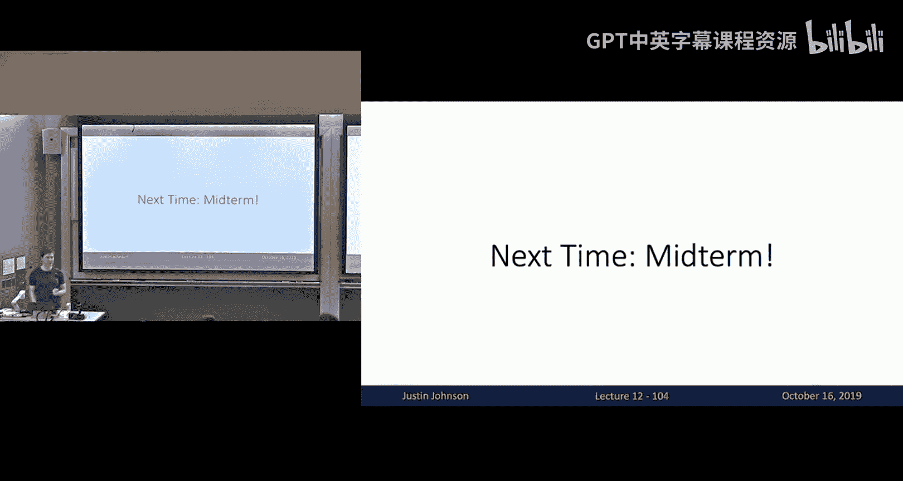