# 深度学习用于计算机视觉：12：循环神经网络


在本节课中，我们将要学习一种新型的神经网络——循环神经网络。我们将探讨其工作原理、应用场景以及如何解决序列处理问题。

## 概述

在前面的课程中，我们深入学习了如何训练深度卷积神经网络进行图像分类。现在，我们将把目光转向能够处理序列数据的新问题类型。循环神经网络正是为此类问题设计的强大工具，它不仅能处理输入或输出为序列的任务，甚至还能对非序列数据进行顺序处理。

## 循环神经网络简介

上一节我们介绍了前馈网络，它处理的是单一的输入和输出。本节中我们来看看循环神经网络，它专为处理序列数据而设计。

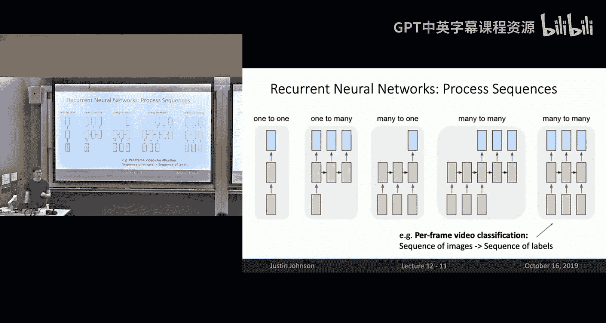

循环神经网络的基本思想是，网络在每一个时间步接收一个输入，更新其内部隐藏状态，并产生一个输出。关键之处在于，网络使用相同的权重矩阵和更新规则来处理序列中的每一个元素，这使得它可以处理任意长度的序列。


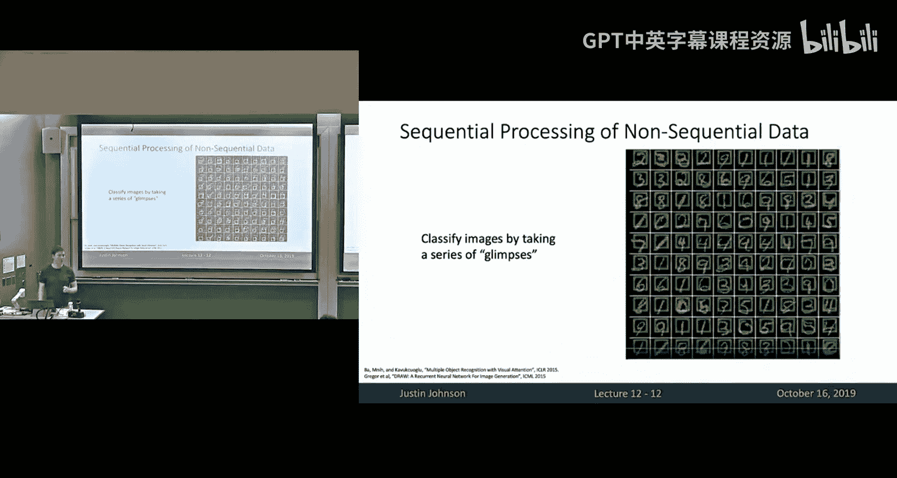


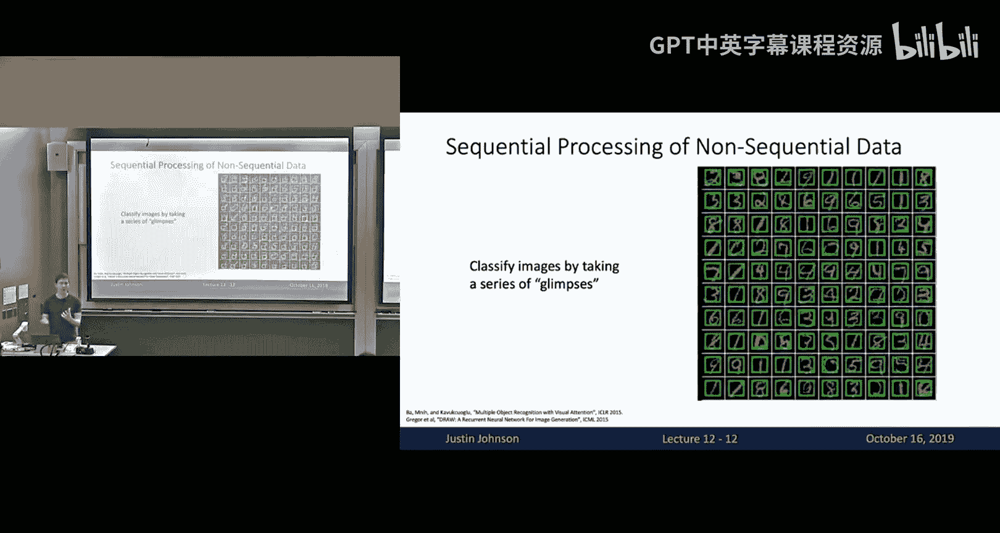

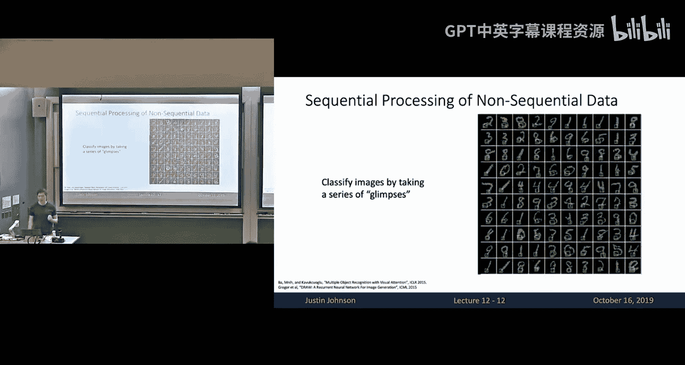


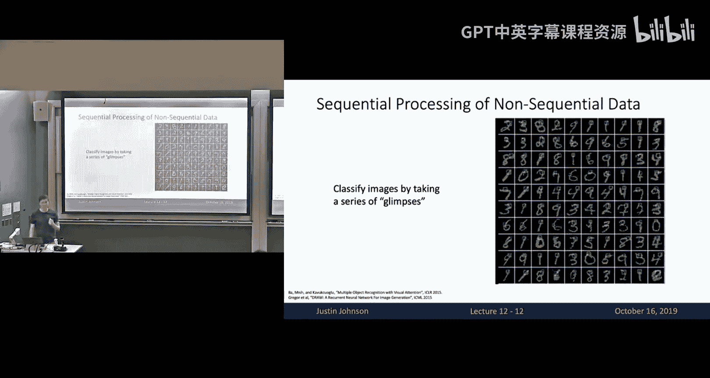


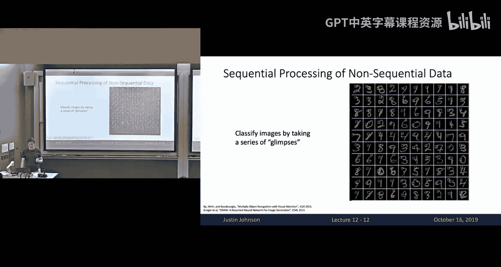

以下是循环神经网络在一个时间步的核心更新公式：

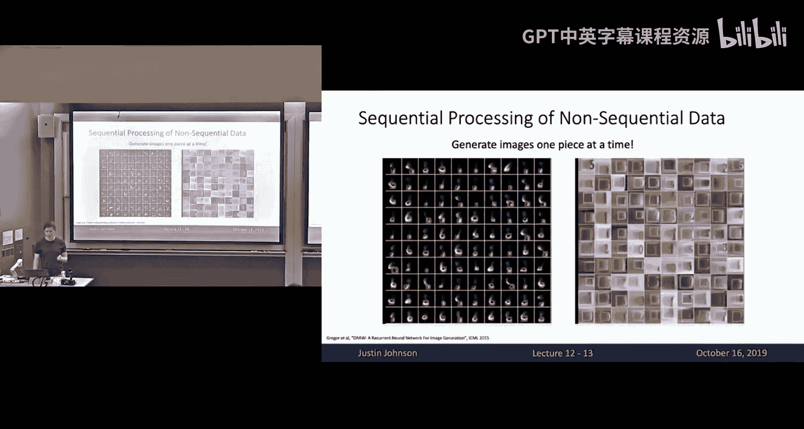

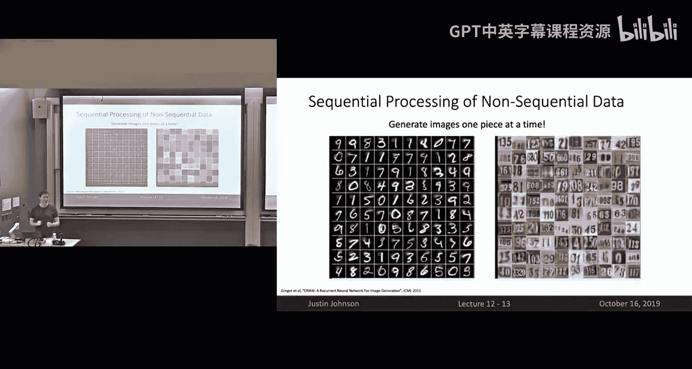


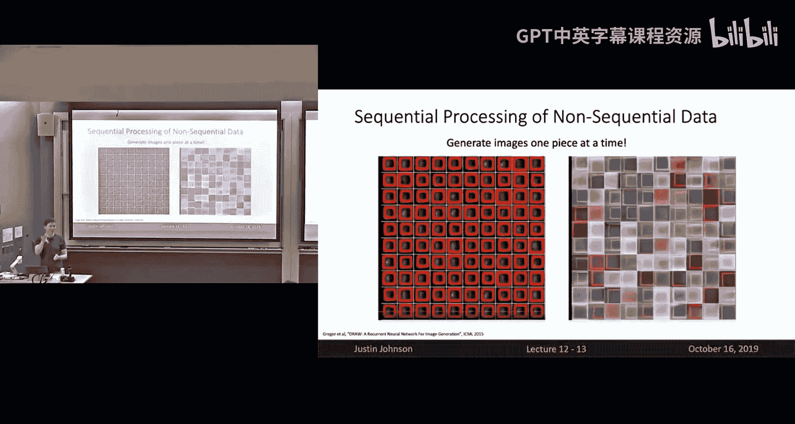

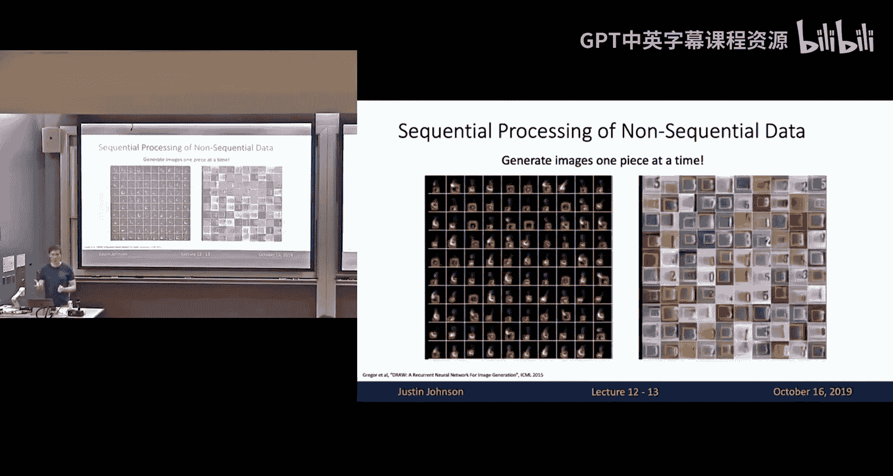

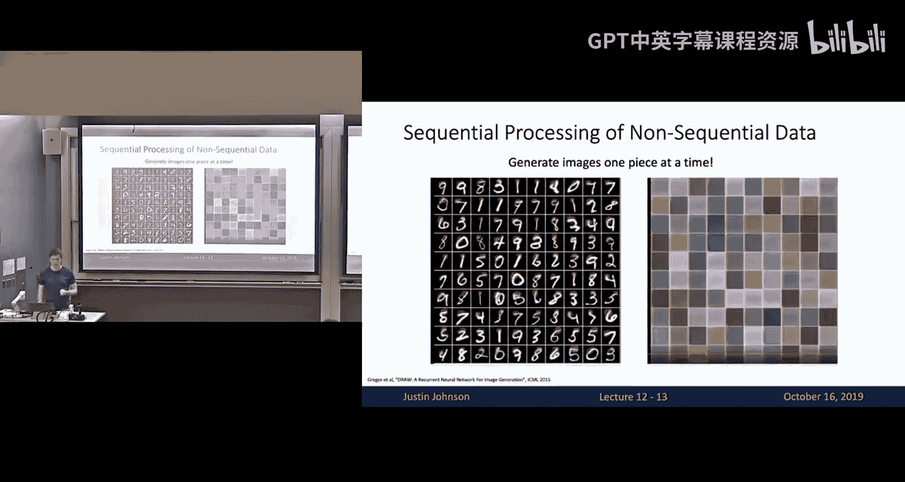

```
h_t = tanh(W_hh * h_{t-1} + W_xh * x_t + b)
y_t = W_hy * h_t
```

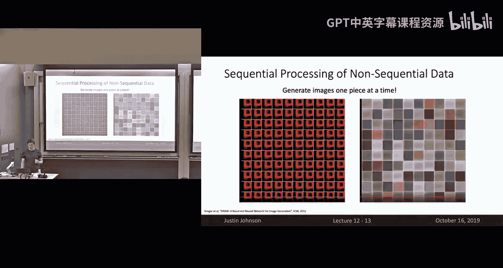

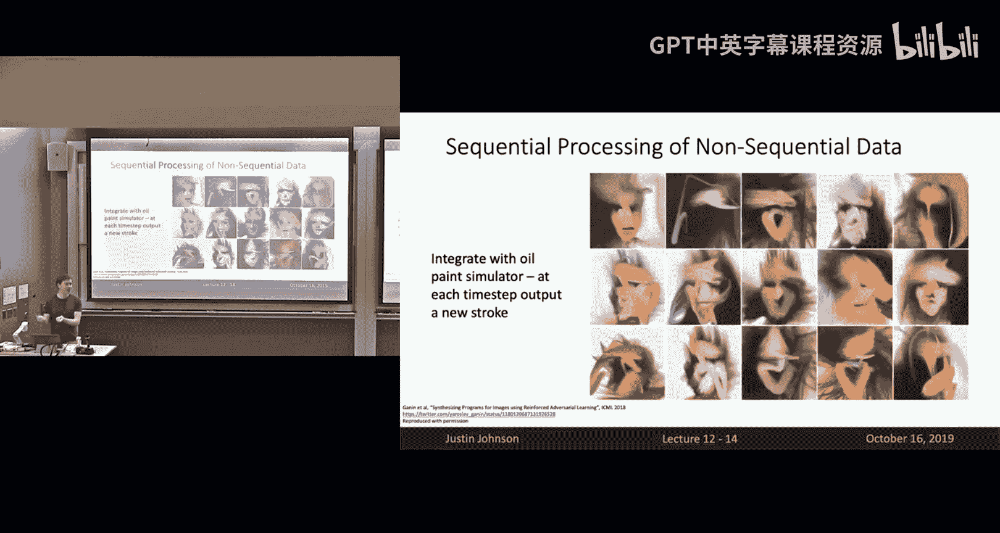

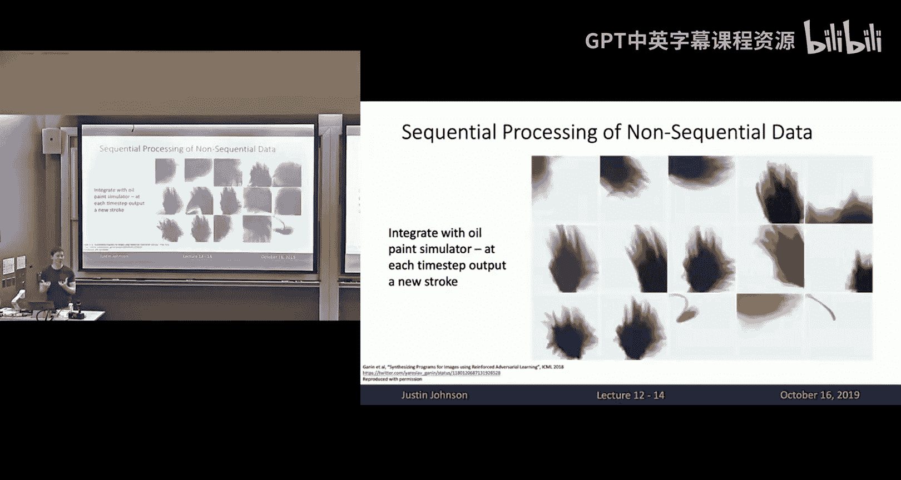

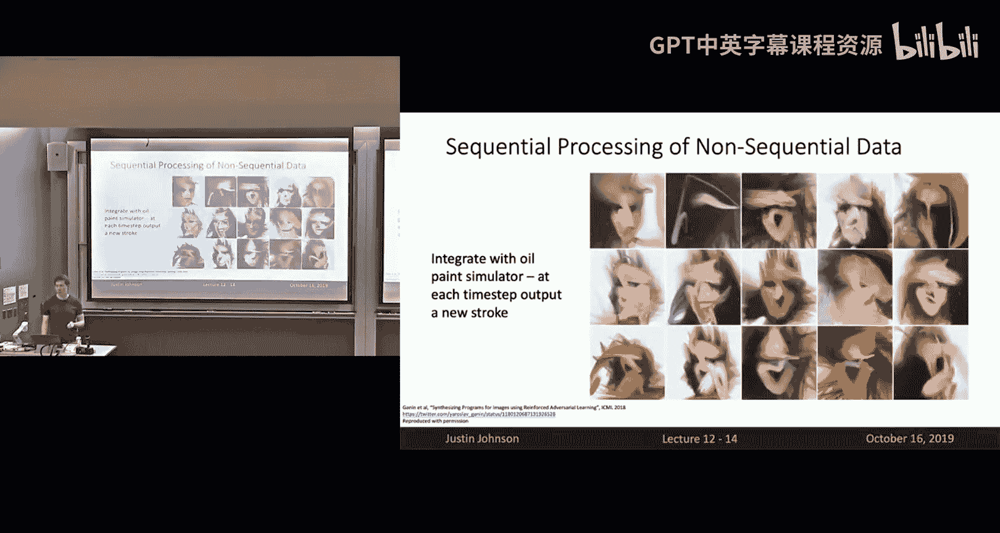

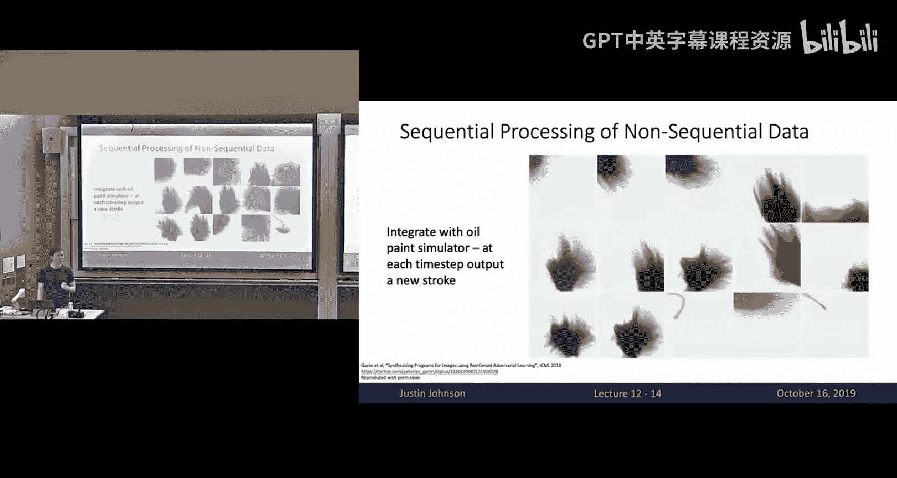

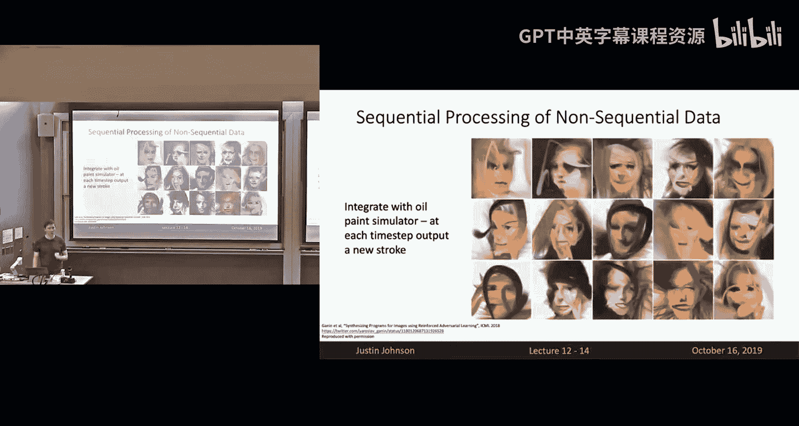

其中：
*   `h_t` 是当前时间步的隐藏状态。
*   `h_{t-1}` 是前一个时间步的隐藏状态。
*   `x_t` 是当前时间步的输入。
*   `W_hh`, `W_xh`, `W_hy` 是可学习的权重矩阵。
*   `b` 是偏置项。
*   `tanh` 是激活函数。

## 序列处理任务类型

循环神经网络可以应用于多种序列处理任务。以下是几种主要的任务类型：

*   **一对一**：这是经典的前馈网络模式，例如图像分类（单张图像输入，单个标签输出）。
*   **一对多**：输入是单个项目，输出是一个序列。例如，图像描述生成（输入一张图像，输出描述该图像的文字序列）。
*   **多对一**：输入是一个序列，输出是单个项目。例如，视频分类（输入一系列视频帧，输出描述整个视频的单个标签）。
*   **多对多（序列到序列）**：输入和输出都是序列，且长度可能不同。例如，机器翻译（输入一个英语句子，输出对应的法语句子）。
*   **多对多（同步）**：为输入序列中的每个元素生成一个输出。例如，视频帧级分类（为每一帧视频分配一个动作标签）。

## 循环神经网络的应用

循环神经网络的应用非常广泛，不仅限于处理明显的序列数据。

### 在非序列数据上的应用

有时，人们会使用循环神经网络对非序列数据进行顺序处理，以获得新的视角或能力。

*   **顺序注意力图像分类**：网络不是一次性观察整张图像，而是通过一系列“瞥视”来逐步查看图像的不同部分，每次瞥视的位置基于之前收集的信息决定，最后做出分类决策。
*   **顺序生成图像**：网络通过一系列步骤来“绘制”图像，例如生成手写数字或油画风格的肖像。在每个时间步，网络决定在哪里画以及画什么，逐步构建出完整的图像。

## 循环神经网络的工作原理

理解了循环神经网络能做什么之后，我们来看看它是如何工作的。

### 展开计算图

为了更清晰地理解循环神经网络如何处理整个序列，我们可以将其在时间维度上“展开”。这意味着我们将每个时间步的重复操作显式地画出来，形成一个链式的计算图。在展开的图中，相同的权重矩阵 `W` 被用于每一个时间步。

在反向传播时，梯度会沿着这个展开的图从最后的时间步流回最初的时间步，这个过程有时被称为“随时间反向传播”。由于权重是共享的，梯度在流经每个时间步的权重节点时需要被累加。

### 语言建模示例

语言建模是循环神经网络的一个经典应用，其目标是预测序列中下一个出现的字符或单词。

在训练时，网络接收一个字符序列（如“hello”），并在每个时间步尝试预测下一个字符。输入字符通常被编码为独热向量，并可能通过一个嵌入层转换为密集向量。损失函数（如交叉熵损失）在每个时间步计算，并求和得到总损失。

训练完成后，我们可以通过“采样”来生成新文本：
1.  给定一个起始字符（种子）。
2.  网络预测下一个字符的概率分布。
3.  从该分布中采样出一个字符。
4.  将采样得到的字符作为下一个时间步的输入。
5.  重复步骤2-4，直到生成足够长的文本或遇到停止符。

通过在不同数据集（如莎士比亚文集、Linux内核源代码）上训练，循环神经网络可以学习并生成具有相应风格和结构的新文本。

### 处理长序列：截断随时间反向传播

处理非常长的序列时，完全展开计算图会消耗大量内存。为了解决这个问题，我们使用“截断随时间反向传播”技术。

其思想是：
1.  将长序列分成较短的块（例如每块100个字符）。
2.  对第一块数据执行前向传播，计算损失，并执行反向传播以更新权重。记录下处理完该块后的最终隐藏状态。
3.  将记录的隐藏状态作为初始状态，对下一块数据重复步骤2。
4.  如此反复，网络可以在前向传播中保持对长序列上下文的记忆，同时在反向传播时只处理有限长度的数据块，从而节省内存。

## 图像描述生成

将循环神经网络应用于计算机视觉的一个典型例子是图像描述生成。这是一个“一对多”的任务。

模型通常由两部分组成：
1.  **卷积神经网络**：作为编码器，处理输入图像并提取视觉特征向量。
2.  **循环神经网络**：作为解码器，接收图像特征向量，并生成描述文字序列。

在循环神经网络的每一步，其输入包括：上一个时间步的隐藏状态、上一个时间步生成的单词（或起始符），以及从图像中提取的特征向量。其更新公式扩展为：

```
h_t = tanh(W_hh * h_{t-1} + W_xh * x_t + W_vh * v + b)
```

其中 `v` 是图像特征向量。网络持续生成单词，直到预测出特殊的“结束”符。

虽然图像描述模型有时能产生惊人的准确描述，但它们也经常犯一些符合训练数据统计规律但不符合图像实际内容的错误，这表明它们离真正的视觉理解还有距离。

## 梯度流与长短期记忆网络


在训练循环神经网络，特别是处理长序列时，梯度流会遇到问题。

### 梯度消失与爆炸

在基本的循环神经网络中，梯度在反向传播时需要多次乘以相同的权重矩阵 `W` 的转置。这会导致：
*   **梯度爆炸**：如果 `W` 的奇异值大于1，梯度会指数级增长。
*   **梯度消失**：如果 `W` 的奇异值小于1，梯度会指数级衰减到0。

梯度爆炸的一个应对技巧是“梯度裁剪”，即在梯度范数超过阈值时将其缩放。但这只是一个启发式方法。

### 长短期记忆网络

为了解决梯度消失问题并更好地捕捉长期依赖关系，人们设计了长短期记忆网络。

LSTM 在每个时间步维护两个状态向量：
*   **细胞状态**：一个“高速公路”，信息可以几乎不变地流过。
*   **隐藏状态**：基于细胞状态和输出门产生的输出。

LSTM 通过三个“门”结构来控制信息流：
*   **遗忘门**：决定从细胞状态中丢弃哪些信息。
*   **输入门**：决定将哪些新信息存入细胞状态。
*   **输出门**：决定基于细胞状态输出什么到隐藏状态。

LSTM 的关键优势在于，从细胞状态 `c_t` 到 `c_{t-1}` 的梯度路径主要是通过加法节点和元素乘法（乘以接近1的遗忘门），避免了连续的非线性变换和矩阵乘法，从而极大地缓解了梯度消失问题。这与残差网络通过跳跃连接改善深度网络梯度流的思路相似。

## 其他架构与总结

### 深度循环神经网络

与卷积网络类似，我们可以堆叠多个循环神经网络层以构建更强大的模型，即深度循环神经网络。较低层的RNN输出其隐藏状态序列，该序列作为较高层RNN的输入序列。

### 其他变体

除了LSTM，还有其他循环神经网络变体，如门控循环单元，它提供了一个更简化的架构。此外，也有研究使用神经架构搜索或进化算法来自动发现高效的RNN单元结构，但LSTM和GRU在实践中仍然因其稳定性和良好性能而被广泛使用。

## 总结

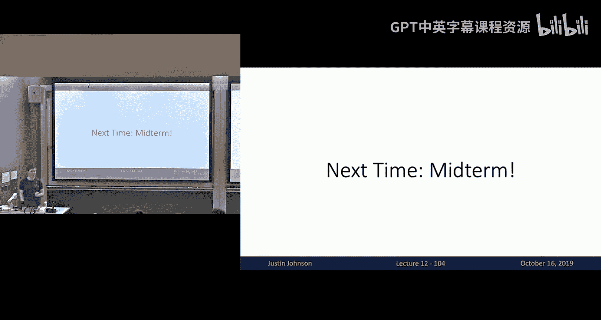

本节课中我们一起学习了循环神经网络。我们了解了RNN如何通过共享权重处理可变长度序列，探索了其在语言建模和图像描述生成等任务中的应用。我们还深入探讨了训练RNN时面临的梯度挑战，并介绍了LSTM如何通过其门控机制和细胞状态来改善梯度流，从而能够学习长期依赖关系。循环神经网络为我们打开了一扇门，使我们能够用深度学习模型处理丰富多彩的序列数据世界。