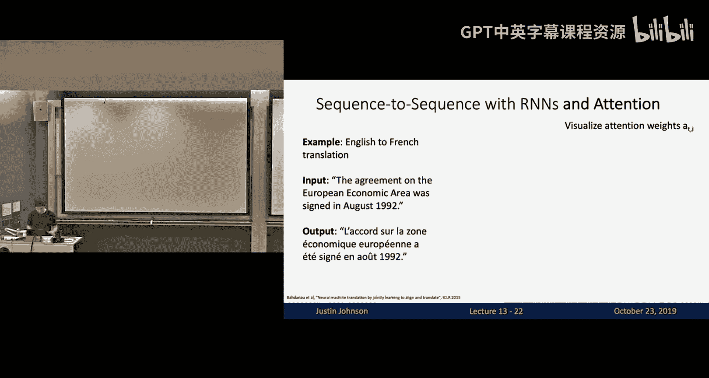
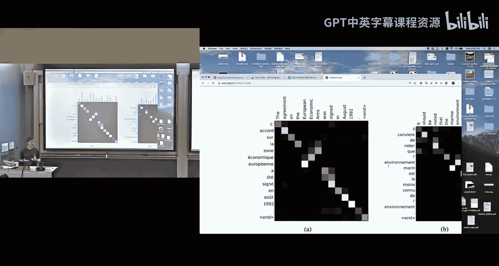
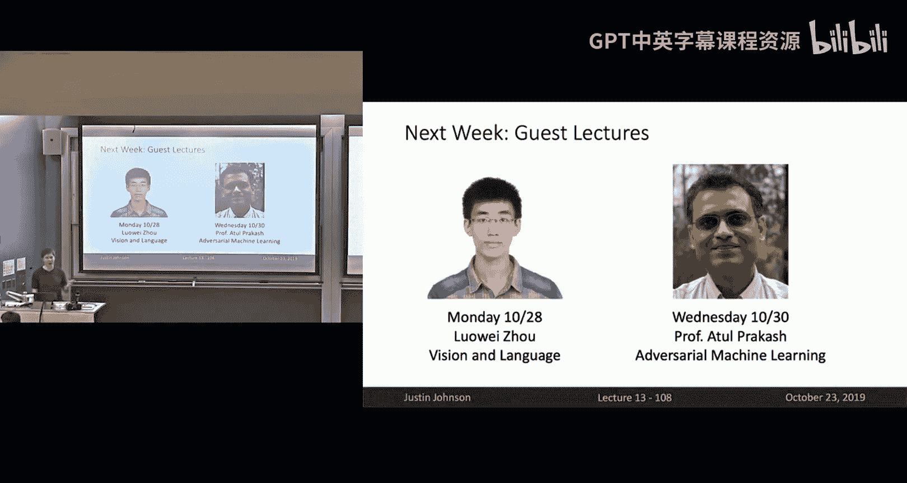

# 密歇根大学《深度学习用于计算机视觉｜Deep Learning for Computer Vision UMich EECS 498-007 2019》中英字幕 p13 -13-13_Attention.zh_en -BV1jA4m1P7GN_p13-

Okay， it seems like a microphone is not working today， so I'll just have to shout loud， is that okay。

 anyone can hear me in the back？ね。Okay good， so today we're back at lecture 13 today we're going to talk about de and I'll try to avoid making bad jokes about making tension。

But before that you all survived the midterm so that' is exciting。

 we know you're probably anxious to know how you did so we'll try to get those graded as quickly as possible and we'll aim to have grades released in about one week from now and another point is that there's a couple students who still have not yet taken the midterm due to scheduling constraints so please avoid talking about the midterm on Piazza or with other folks who might not have taken again but if you have questions about particular parts of the midterm that feel feel free to stop by any my office hours or any TA office hours。

Also， we found a water bottle in the exam room after the end of the exam。

 so if you think that's yours， then post on Gaazza or you can stop by my office and I'll get them back to you。

If not， I guess I got a free water bottle。So then also now that we're past the midterm of course it's time to start thinking about assignment4 so we've been hard at work on building that thing and it should be released either sometime tonight or sometime tomorrow it's going to cover a lot of stuff it's going to cover a hightor autograd you're going to use autograd now to build residual networks and start to play around with some of these different types of neural network architectures we've been talking about you'll write your own recurrent neural networks and use them for much captioning。

 you'll write your own attention on top of recurt neural networks that we'll talk about today you'll implement your own feature visualization。

 style transfer and adversarial examples that we'll cover in the next couple of lectures so remember at the beginning of the quarter beginning of semester when I that assignments would get blogger as we went on well here you go So any questions on these administrative stuff before we move on to attention。

Okay， very good， so last time before the midterm we left off by talking about recurrent neural network。

And remember that we saw recurrent neural networks with this really powerful new type of structure that we could insert into our neural network models that would let us process process sequences of vectors for different types of tasks。

 and we saw that by moving from these fee forwardward neural networks to recurrent neural networks that could process sequences。

 this allowed us to build neural networks to solve all kinds of new types of tasks。

 so we saw examples of maybe machine translation where you want to transform one sequence in front of a sequence or we saw examples like image captioning where you want to predict a sequence of words to write a natural language caption about input images。

And today we're going to pick off pretty much where we left off at the end of the recurrent neural networks lecture last time。

 because that will lead very naturally into the discussion of attention。So to recap。

 let's think back to this problem of sequence to sequence prediction with recurrent neural networks。

So here remember the task is that we receive sum sequence of input， this is x1 through xt。

 might be and then we want to produce some output sequence y1 through y T。

 where here maybe the x's are the words of a sentence in English and the Y's are maybe the words of the corresponding sentence in Spanish and we want to do some translation that converts that converts sentence in one language into sentence in another language。

 and of course because different languages use different words for different concepts and of course the two sequences might be of different length。

 so we represent that here by saying that the input sequence has length of capital T and output sequence y has length T of capital T prime。

So then remember last lecture we talked about a sequence of sequence recurrent neural network architecture that could be used for this kind of a sequence of sequence translation problem。

 so we that the way that worked is that we use one neural network called one recurrent neural network called the encodeder。

 which would receive the X vectors one at a time and produce this sequence of hidden states H1 through HT。

 and then at every time step we would use this recurrent neural network formulation FW that would receive the previous hidden state and the current input vector XxiI and then produce the next hidden state。

So then we could apply this one recurren neural network to process this whole sequence of input vector。

And now here's going a little bit more into detail on how this works。

 so then once we process the input vector， then we want to somehow summarize the entire content of that input sentence with two vector is here so one we need to produce because remember we're going to use another recurrent neural network as a decoder that's going to be used to generate the output sentence one word at a time so now we need to summarize the input sentence in two vectors。

 one we need to compute this initial hidden state of the decoder network which is shown here as S0。

 and we also would like to compute some context vector C shown here in purple that will be passed to every time step of the decoder and now here it's often one common implementation here which is be to set the context vector equal to the final hidden state and then another common thing would be to set the initial hidden state as0 to be predicted with some kind of be forward layer or like like a fully connected layer or two。

And now in our decoder， what we're going to do is we're going to start off by receiving some input start token to say that we want to kick off the generation of this output sequence and then at the first time step of our output recur neural network or the decoder is going to receive both the initial hidden state S0 as well as this context vector C as well as this start token Y zero and then it will generate the first word of the output sentence so then this would repeat over time。

 and now at the second time step of the decoder number it's going to again input the hidden state of the previous time type S1。

 word the first word of the sentence， and again we'll receive again this context vector C。

 so then we can run this for multiple time steps and then you can see that we've been able to translate this input sentence。

 we are eating bread into its corresponding Spanish translation is almost going under the path which I'm hoping getting right because I haven't taken to Spanish and Y。

But then one thing to point out about this architecture is that we're using this context vector here in purple serves this very special purpose of transfer information between the encoded sequence and the decod sequence。

 so now this context vector is supposed to somehow summarize all of the information that the decoder needs to generate its sentence。

 and then this context vector fed in at every time step of the decoder。

So kind of this is a fairly reasonable architecture that we left off on for last time。

But there's a problem here is that maybe this kind of makes sense and we can imagine this working out if these sequences are going to be fairly short so for these simple example。

 any kind of example that fits on the slide is only going to be sequences that are couple elements long。

 but in practice we might want to use these types of sequences sequence architectures to process very。

 very long sentences or very very long documents。So for example。

 what if we were translating not a short simple sentence but trying to translate an entire paragraph or an entire book of text？

Then this architecture becomes a problem because now what happens is that the entire information about that input sentence or input document is all being bottlenecked through this single context vector C shown in purple。

 and while using a single vector to represent the entire sentence might make sense for a single short sentence。

 it feels kind of unreasonable to expect the model to pack an entire paragraph or entire book worth of content into just a single context vector C。

So that seems like so in order to overcome this shortcoming。

 we want to have some mechanism to not force the model to bottleneck all of its information into a single vector C。

So there's a simple workaround that we might imagine well。

 what if rather than using a single context vector C。

 what if instead we compute a new context vector at every type step of the decoder network。

And then we can sort of allow the decoder the ability to choose or reconstruct a new context vector that focuses on different parts of the input sequence at every time step of the decoder。

Well that seems like a pretty cool idea， so the way that we formalize this intuition is with a mechanism called attention so here we're going to still use a sequence to sequence recurrent neural network。

 we're going to have a recurrent neural network，as the encodeder that will encode our input sequence as a sequence of hidden states and that we're again going to use a decoder network that is again our recurrent error network that produces the output one at a time。

 but now the difference is we're going to add some additional mechanism into this network called an attention mechanism which will allow it to recompute a new context vector at every time step of the decoder。

 so to see how that works， the encoder looks exactly the same。

 we still are going to produce this sequence of a hidden states of the input sequence and then predict this initial hidden state for the decoder sequence。

But now here's where things get different， and here's where things diverge from the previous sequence to sequence architecture that we've seen。

So now what we're going to do is we're going to write down some alignment function here shown in the upper right- hand corner F subatT and now this alignment function will maybe parameterize as a fully connected neural network。

 so you should think of this alignment function as a little tiny fully connected network that's going to input two vectors one is current the current hidden state of the decoder and the other is one of the hidden states of the encodeder and now this alignment function will then output a score to say how much should we attend to each hidden state of the encodeder。

 given the current hidden state of the decoder so for example。

 when we're about to and then we'll use this information to somehow construct a new context vector at every time step of the decoder。

 so concretely the way that this looks at the first a very first time step of the decoder is that we've got our initial hidden state。

 our initial decoder hidden state s sub0ro here and now we'll use this F subATTT function to compare S0。

with H1 and that will give us so this alignment score E11 and that is basically how much does the model think that the hidden state H1 will be necessary for predicting the word that comes after output hidden state as 0 this will output a single and this alignment function will output scalarrs so then this will output a scalar E11 a scalar E E12 that's again going to say how much do we want to use the second hidden state of the encodeder when we're trying to produce the word the first hidden state of the decoder and then we'll just run this function for every hidden state of the encodeder passing it in that hidden state of the decoder。

So now we've got an alignment score for each hidden state in the encoded in the encoded sequence。

 but these alignment scores are just arbitrary real numbers because they're getting spit out from this speed4 neural network F subatTT so then the next step is that we'll apply a softmax operation to convert those set of alignment scores into probability distribution right so remember the soft this is the exact same softmax function that we've seen in the image classification setup that's going to input a vector of arbitrary scores and then output of probability distribution with the intuition so that means that higher scores will give higher probabilities each of the outputs will be real numbers between0 and1 and all of the output probabilities will sum to1 so basically now weve predicted this probability distribution that says for the first hidden state of the decoder how much do we want to you how much weight do we want to put on each hidden state of the encoder。

So now that we've got these attention and this probably distribution is called attention weights。

 because this is how much we want to weight each of these hidden states。

So now the next step looks a little bit scary， but it's basically we're going to take a weighted sum of each of the hidden states of the encoded sequence and we'll sum them up according to these predicted probability scores。

 and this will produce our context vector C1 that we're going to use for the first time step of the decoder network。

😡，And what this basically means is that we've used this。

 the network has sort of predicted for itself how much weight do we want to put on each of the hidden states on the input sequence。

 and we can dynamically shift that weight around for every time step of the decoder network that will allow us to predict a different context vector for each decoder time step。

And now we can finally run the first time step of our decoder or currentrent neural network。

 so this decoder network will input the context vector that we just compute it。

 it will input the first word which is the start token that I forgot to put on the slide。

 and then it will output this first predicted word of the sentence。

And now the intuition here is that when we're trying to generate these output words of the output sentence。

 then each word of the output sentence probably corresponds to one or multiple words in the input sentence。

 so then we're trying to dynamically generate this context vector that causes the output of the decoder network to allow it to focus on different parts of the encodeder network for each time step so maybe the kind of concrete intuition here is that when we're trying to translate this particular sentence we are eating bread。

 then the first word we need to generate istmos， which means which is sort of like we are doing something in Spanish so then the intuition is that maybe we want to place relatively high weights on these first two words of the English sentence and relatively low weights on the latter two words of English sentence and that will allow the decoder network to focus on the important parts of the input sequence that are needed for producing this particular word。

The output sequence。And the other point is that these are all differentialable operations。

 we are not telling the neural network which things it is supposed to pay attention to at every time step of the decoder sequence。

 instead we're just letting the network decide for itself which parts it wants to look at。😡。

And because all of the operations that are involved in this computational graph here。

 all of these operations are differentiable， which means that we don't need to supervise or tell the network which parts it's supposed to look at。

 instead we can just write down this whole big mess of operations as one big computational graph and then backproagate through each of these operations to allow all parts of this network to be jointly optimized and it will decide for itself which parts of the sequence it wants to focus on。

😡，So then at the next time step， we'll kind of repeat a very similar procedure so now we've got a new hidden state of the decoder network S1 well again take that S1 hidden state of the decoder。

 compare it to each hidden state of the input sequence。

 this will produce a new sequence of alignment scores， E21， E22 etc。

 and then we'll again run the softmax to get us a new probability distribution over the input sequence that now tells us while generating the second word of the output sequence。

 which words of the input sequence we want to focus on and then we'll again use these predicted probabilities to produce a new context vector which is again a weighted sum of the hidden states of the input sequence that are weighted by this new probability distribution that our model has predicted at the second time step of the decoder。

And then we can kind of repeat this process over and then again。

 we'll run the next forward pass or the next time step of the decoder RNN that will receive the second context vector。

 receive the first input word， and then produce the second output word。And then again。

 the intuition here is that maybe when we're generating the second word commendo means something like eating we or are eating。

 so then when generating the second word， then maybe the model might prefer to put some more attention weight on the time steps of our eating and then it might choose to ignore the parts of we and bread。

 which are not irrelevant for producing this particular word of the alpha sequence， but again。

 this is all sort of trained and end differentially。

 we're not telling the model which parts to's supposed to focus on。

 but the intuition is that this gives the model the capacity to choose to focus on different parts of the sequence when generating the alpha sequence。

So then again， then we can kind of unroll this for multiple time stepss。

 and then we've got this example of sequence to sequence learning with attention。So now again。

 this basically overcomes this problem of bottlenecking that we saw with this vanilla sequence to sequence model。

Because now rather than trying to stuff all of the information about the input sequence into just one single vector and then using that one vector in every time step of the decoder。

 we're giving the decoder this flexibility to generate its own new sequence of context vectors that are going to vary with each time step of the decoder network So now again。

 the intuition is that if we're working on very， very long sequences。

 and this will allow the model to sort of shift its attention around and focus on different parts。

 the input for each different part of the output。😡。

So then one very cool thing that you can do is have my slide completely messed up。

So maybe if we go out a presentation it should show up better。

This image cannot not currently be displayed。Well， isn't that exciting？Okay， let's a。

Let's just pull up the paper really fast and then we'll get the image I want。

Sorry about this technical difficulty， has anyone ever seen that problem in PowerPoint before？

基。Okay， so this is the image that PowerPoint refused to display for me。

But basically what we're doing here is we've trained a sequence of sequence for current neural network that's going to input a sequence of words in English and then output a sequence of words in French。

 or maybe it was the a reverse I can't actually remember because this figure is not clear but we're doing some translation task between words in English and words in French so then way one thing and then again this model has been trained with this sequence of sequence attention so at each time step of the decoder network it's generating this probability vector over all of the words of the input sequence that allow it to focus its attention on different words of the input sequence while generating the output sequence and we can actually use these attention weights to gain some interpretability into what the model is doing or how the model is making its decisions when doing this translation task。

So you can see we've got this English sentence at the top。

 the agreement on the European economic area was signed in August 1992 period end。

 and then down the bottom here， we've got a corresponding sentence in French。

 which I will not attempt to pronounce because I will horribly butcher it。

But what's very interesting and now this diagram here is then showing us for every time step of the output what are these attention weights that the model is choosing to produce so there's a lot of interpretable structure in this figure that we can see so the first thing is that up here in the upper left corner of the thing we see this diagonal pattern of the attention weights。

 that means that when generating the word the model put most of its attention on the French token lu dash or apostrophe and when generating the English word agreement then it put most of its attention on the French word accord which I guess means agreement hopefully so that what this means is that this gives us this interpretability that while generating these first four words of the output sequence。

 those correspond in a one to one manner to the first four tokens of the French sequence。And again。

 this correspondence was discovered by the model for itself。

 we're not telling the model which parts of sentences align to which other parts but now the really interesting thing happens with this zone economic Europe sorry the English is European economic area but the corresponding part of the French sentence has the three same words but they're in a different order so now I'm guessing zone in French corresponds to area in English and you can see that economic and English corresponds to economic and French and European as this corresponding structure as well。

 so now the model is sort of figured out that these three words correspond。

 but the order flips in the sentence and this sort of trend continues throughout the entire sentence。

 so what's really cool about these attention mechanisms is that now we've actually got some interpretability into we have some insight into how the model is choosing to make its decisions which is something that't really gotten we haven't really been able to do before with other types of neural network architectures。

Okay， so let's go back to the broken PowerPoint。Okay， so we went through all those。Right。

 so then another interesting- so there are any questions about this translation problem with attention and reoccurrent neural networks。

All right， cool， so then another really important thing。

 so now we've got this pretty cool setup that we've got this attention mechanism that lets the model generate sequences and then at each time step generation choose to look at different parts of the input sequence。

 but there's actually something that we can notice about the mathematical structure of this model which is that this attention mechanism that we' built。

 does not actually care about the fact that the input is a sequence。

It just so happens in this task of machine translation having that our input is a sequence and our output is a sequence。

 but for the purpose of this attention mechanism， it didn't actually use the fact that the input vectors or a sequence and so in principle。

 we can actually use the exact same flavor of attention mechanism to build models that attend to other types of data。

 which are not sequences。So as an example， we can do image captioning with a recurrent neural network and add attention。

 and again， it looks like image has refused to display。

 but there was supposed to be a cute picture of a bird here。Right。

 so you can imagine that we've got our invisible picture of a bird is being processed with a convolutional neural network that is then producing some feature。

Some feature vector here， actually this is like really messed up， let me see if I can。

 oh my God look at that。We need those images。That's like really bad。Yes。

 see like we actually need those images， right？Okay。

 so we'll try to do it this way and I'll just have to trust you to use your imagination。

 and I'll promise to， I'll describe what those images were' supposed to be and we'll go through it with the slides in this view。

 so at least youll be able to see where there is supposed to be an image that you're supposed to imagine。

😡，Right so here on the left， we're supposed to input this image of a bird and then we run it through a convolutional neural network。

 and you should imagine remember that the convolutional neural network。

 if we take the outputs of the final convolutional layer。

 we can interpret that as a grid of feature vectors。

 so the second image you should imagine as a grid of feature vectors that correspond to different feature vectors corresponding to each spatial position of this invisible image of a bird。

And now what we're going to do is we're going to use this exact same attention mechanism that we did with the sequence model that is going to input the- so then we're going to use that sequence of that grid of vectors to predict this initial hidden state for a decoder RNN。

And now this decoder RNN will use that initial hidden state as0 predict to then use our comparison function F subATT to compute a pairwise alignment score between every position in the grid of features and our initial hidden state as0 and again。

 each of those outputs will be a scalar that is high when we want to put high weight on that part of the vector and will be low when we want to give low weight to that part of the vector。

And that will give us this grid of alignment scores。

 so then above the grid of features you should imagine a second grid of alignment scores where each element in that grid again contains a scalar that is produced from this FATTT mechanism。

😡，And now we have another image that we need to imagine is that we have that grid of attention scores that will then pass through a softmax operation that will then normalize all of those scores to some probability distribution that sums to work。

 and again， this will basically be the model predicting a probability distribution over all positions in the input image that it will choose to attend to when generating the first word of the output。

So then again， we'll take a weighted combination of those cading vectors that we'll take this grid of vectors and we'll have a linear combination of them that are all weighted by these predictive attention probability scores。

 and this will produce this first context vector C1 that we will use when generating the first token of the output sequence。

And then we can pass that through the first layer of the R in a decoder and generate the first word SQL。

 so now you should imagine a SQL here， and then we can repeat this process again。

 so then again we can use the next hidden state to compare the hidden state S1 with every position in the grid of features to produce another grid of alignment scores again。

 normalizedize through a salt Max to give a new distribution over all positions in the image。

 and then give a new context vector， the second text up of the decoder that we' use to generate the word over so now you're clarifying this picture in your mind and then continue forward and eventually generate this caption。

 SQL over water style。And you can see that this structure of the model is now very。

 very similar to that which we've done in the sequence of sequence translation case。

 that we're generating this output sequence， which is a caption， we generate one word at a time。

 and now at every time step of generating this output sequence。

 we're allowing the model the ability to generate its own new context vector by having a weighted recombination of the grid of features of the input image。

Oh no， these are like really important。Okay， we got to go back the paper， they place。

 I know what all these papers。はい。Okay， so that was supposed to be this image。

Right so then then we can get up so this was the bird image we were supposed to be imagining for and what you can imagine here is that now when generating this the model is receding this input bird image that you can now finally see。

 and then we're generating this output sequence of words one word at a time a bird is flying over a body of water period and now in every time step of generating this output sequence。

 the model is predicting these attention weight， they give a probability distribution over the positions of the grid of features that are predicted by the convolutional network。

 which is possibly the input image so then you can see that when producing when predicting the words bird flying over。

 then the model tends to give attention， to these positions in the input image。

 that correspond to the bird， and then maybe when it predicts the word water。

 then the predicted attention weight is sort of now ignoring the bird and instead looking at the parts of the image that have the water around them instead。

Yeah， question picture on the second。Yeah， so the picture of the second row is something we were not supposed to talk about today and it was actually not on the PowerPoint slide。

 but since you asked， the idea is that in this method in this version of the potential that we've seen so far。

 the model is actually using this weighted recombination of features at every point in the input image。

 but what if instead rather than having a weighted recombination。

 what if we wanted the model to just select exactly one position in the input grid or features and then rather than using a weighted recombination。

 instead just use the features from exactly one position in the input。

 and it turns out that that's what the secondarrow was doing training the model to do such a thing requires some additional techniques that we'll cover in a later lecture。

 so that part was actually cropped out in the image on the slide。

Now the next slide was supposed to be this figure， which gives us a couple more qualitative examples of this model using its attention mechanism to focus its attention on different parts of the input image when generating a text of the output。

 so for example here， when the model is looking at this image of these people playing Frisbeees。

 then it generates the caption， a woman is throwing a Frisbee in the park。

 and then when generating the word Frisbee， you can see that the model chooses to put its attention on the portion of image that actually corresponds with the Frisbee。

Was there some question over here？Yeah， yeah I have some questions about how C city is calculated。

主管人没。そう。What is each idea here。Yeah， so here you would have seen if you were using your imagination Strna。

 but here we actually would have a grid input of features being predicted by the convolal network where HIJ is the IJ feature and the grid of features predicted by that。

So it's supposed to be like。Yeah， so that so it would be one position in the feature map。

 so actually this was supposed to be a3 by3 grid that was H11， H12， H13， H21 H22 H23。从环速为S啊。Yeah。

 so then the idea is that we predicted this probability distribution。

 which gives us a probability distribution over all the positions in that grid。

 so then where the probability is high， that means we want to put a lot of attention or emphasis on the。

On the features from that position and where the attention ratess are low is' going to have very little emphasis on the features at that position。

So she is a wait for while。ねさ。Fature thatます。So CT is a vector， CT is a vector， HHIJ is a vector。

 EETIJ is a scalar which tells us how much do we want to emphasize the vector HIJ at time step T and now ATIJ is a scalar。

 telling us how much do we want to as a normalized scalar。

 telling us how much do we want to emphasize vector HIJ at time step T。

And then CT is a vector where we're summing over all positions in the NHIJ。

 and then we now ATIJ is a scalar that we multiply by the vector HIJ。

 so then this is a sum of vectors， then CT will be a vector。

I'm going to see real quickly if I another version of this presentation somewhere that is less messed up。

No。我 have to证。You know， these are important too。Okay but basically the idea is that one intuition around why we might want to do this image captioning is it actually has a biological motivation as well。

 so if you imagine on the left here of diagram of the human eye。

 then you know the human eye as a sphere and then you've got a lens at one side。

 light comes in through the lens and then at the back of your eye。

 there's a region of the eye called the retina and then the light comes in through the lens is projected onto the retina and the retina contains photossensitive cells that actually detects the light and those signals from those photossensitive cells gets sent back to your brain and get interpreted as the stuff that we see now it turns out that the retina is not not all parts of the retina are not created equally。

There's actually one particular region of your retina in the very center of the retina called the phobia。

 which is much more sensitive than all other parts of the retina。

 and what that means is that the graph on the right is supposed to be a graph of visual acuity on the Y axis and the X axis is supposed to be the position in the retina。

And what this means is that at the very far parts of the retina， you have very low visual acuity。

 and as you move towards the phobia， the visual acuity goes up and up and up and up and up。

Then right in the phoba you've got this very， very high visual acuity and then moving down from the phoba it moves down。

 down， down， down， down towards the edge of the retina on the other side where you have very low visual acuity and what this means is that there's only a very small region in your eye that can actually see the world with high definition and kind of having an intuitive sense here。

 you kind of put something right in front of you， you can see it with good detail as you move your hand to the side。

 you can kind of tell that there's something here but you can't really see it you can't maybe it's hard to count how many fingers our way over here and that's because different parts of your retina actually have different amounts of sensitivity now actually to account for this problem or this design of the human retina your eyes actually do are actually constantly moving around very very rapidly。

In time periods of something like tens of milliseconds， your eyes are constantly moving。

 even when you feel like you're looking at something， there's something stationary。

 your eyes are actually constantly moving around， taking in different parts of the visual scene。

 and those very， very rapid eye emotions are called psychootics and they're not something that that you have conscious control over。

 but basically those satic mechanisms that your eyes do are a way that the human body tries to overcome this design problem of only having very high sensitivity in a very small portion of the retina。

And now what this means， and now image captioning with RNNs actually is sort of very loosely inspired somehow by these maybe stic motions that the human eye makes。

So that you know when you look at something， your eye sort of constantly looks around different parts of the scene in every moment in time。

 and similarly， when we're using an image captioning model with attention， then at every time step。

 then the model is also kind of looking around at different positions in space very rapidly。

 but sort of very loosely like the psychotic motions that you're humanized。

So I'm sorry you havet use your imagination too much for that work。

And now so then the first paper that introduced that this idea was called show attend and tell right because you're going to show the model some input image。

 it's going to attend to different parts of the image and then it will tell you what it saw by generating words one at a time Now this was such a catchy title that a lot of other people started using titles like this when building models that use attention of different flavors so then we had ask attend an answer and also show ask attendant answer that you can kind of guess what these are doing these are models that look at an image。

 they're presented with the text of a question about that image。

 they attend to different parts of the image or different parts of the question and they answer the question。

We've got listen attendance spelled， this is going to process the raw audio waveform of some piece of sound。

 then it's going to generate letters to spell out what words were spoken in that piece of sound。

 and it's going to attend when generating the words of the output one at a time。

 it's going to attend different temporal positions in the input audio file。😡。

We had a listen attendant walk that was a processing text and an outputting decisions about where a robot is supposed to walk in some interactive environment。

 we have show attend and interact that's also supposed to output some robot commands show attend and read so you know these paper titles got to be very trendy after a while but basically this is to say that this mechanism of attention that we've seen so far it' actually very。

 very general and we've seen it used for this machine translation problem where we want to input a sequence into another sequence and it can also be used for all these other tasks so basically anytime you want to convert one type of data into another type of data and you want to do it over time。

 one time step at a time， then often you can use some kind of attention mechanism to cause the model to focus on different chunks of the input or different parts of the input while generating each part of the output。

So that gives us this very general mechanism of attention。

 and then they all work exactly the same way， so you can kind of guess how the models work just by reading the titles of these papers。

Oh man this image finally showed up and you can see the bird it's great so then now we've seen this mechanism of attention used for a bunch of different tasks but over the past couple of years what do you do in computer science once you've got something that seems useful for a lot of different tasks then you want to try to abstract it away and generalize it and apply that idea to even more types of tasks so then I want to step through a couple steps that we can start from this piece of this mechanism of attention that we've used now for image captioning and machine translation and by generalizing it just a little bit we'll end up with a very powerful new general purposese layer that we can insert into our recurrent neural into into our neural networks。

So one way to reframe the type of attention mechanism that we've seen so far is that it inputs a query vector。

 we're going to call it Q， and in the previous attention that would have taken the place of these hidden state vectors that we had at each time7 the output。

 we also have a collection of input vectors x that correspond to this set of hidden vectors that we want to attend over。

 and we also have some similarity function F of ATT that we're going to use to compare the query vector to each of our database of input vectors。

😡，So now this is then the computation of this attention mechanism that we've seen several times now is that in the computation we want to produce this vector of similarities by running this FATT attention function on the query vector and on each element of the input vectors and then this will give us theseized similarity scores that we will run through a softmax function to give a normalized probability distribution over each of the input vectors X。

 and now we will output a single vector y that is a weighted combination of the vectors x in the input。

Okay， so now the first generalization is that we want to change the similarity function。

 So previously we had written down the similarity function as this kind of a general F subATT function。

 and that's indeed what early papers on attention had done。

 but it turns out it's much more efficient and works just as well。

 if we use the simple dot product between vectors as our similarity function and that's going to simplify things a bit。

 So now when rather than running a neural network to compute these similarities。

 we can compute all these similarities all at once with some kind of matrix multi and that will be much more efficient。

But then there's actually a little detail that people use rather than using the dot product。

 instead people often use what's called a scaled dot product for computing these similarity scores。

 so now when computing the similarity score between the query vector Q and one of our input vectors X。

 the similarity score will be Q dot product with XI divide by square root DQ where DQ is the dimensionality of those two vectors。

And now why would you want to do that Well， the intuition is that we're going take we're about to take those similarity scores and we're about to run them through a softmax and we know that if elements of the softmax are really large。

 then it will have a vanishisheding gradient problem right if there's one element of those E in that attention weights E that is much much higher than all the others。

 then we will end up with a very， very highly peaked softmax distribution that will give us a gradient very close to zero almost under。

😡，And that might make learning challenging。So what we want to do is and another problem is that as we consider vectors of very。

 very high dimension， then their dot products are likely to also be very high in magnitude so as a concrete example。

 consider computing the dot product of two vectors A and B both of dimension D and suppose that these are constant vectors now the dot product of those two now remember that the dot product of two vectors is the product of their magnitudes multiplied by the cosine of the angle between the vectors so then if suppose that we have these two constant vectors。

 then the magnitude of one of these vectors now is going to scale with the square root of the dimension of the vector which means that if we are going to work with neural networks that have very。

 very large dimensions， then naturally we would expect these dot products of very high dimensional vectors to give rise to very high values so to counteract that effect we're going to divide the dot product by the square to the dimension to counteract of this effect by which the dot product tends to scale as we scale up the dimension and that will give us nicely more nicely behaved gradients。

As we flow through the softmax function。So then the next generalization is that we want to allow for multiple query vectors right so previously we always had a single query vector at a time right at each time step of the decoder。

 we had one query and then we used that query to generate one probability distribution over all of our input vector。

Well， now we'd like to generalize this notion of attention and have a tension that has a set of query vectors。

So now our inputs， now we input a set of query vectors Q and a set of input vectors x。

 and now for each query vector， we want to generate a probability distribution over each of the input vectors。

So then we can compute all of these similarities then we need to compute a similarity between each query vector and each input vector and because we're using this scaled dot product as our similarity function。

 we can compute all of these similarity scores all simultaneously using a single matrix multiplication operation then remember we want to compute for each query vector。

 we want to compute a distribution over the input vectors。

 so now we can achieve this by doing a softmax over these output attention scores where we take the softmax over only one of the dimensions。

And then we want to generate our output vectors as now now we want to generate but previously we were generating one output vector。

 now because we have a set of query vectors， we want to generate one output vector for each query vector right where the output vector for query QI will be a weighted combination of all of the input vectors and they will be weighted by the distribution that we predicted for that query vector。

And again， if youre kind of careful with your matrix shapes。

 you can actually compute all of these linear combinations all simultaneously using again。

 a single matrix multiplication operation between these predicted attention weights A and the input vectors x。

Are we clear to this point？Okay， so then the next generalization is the way that we use the input vectors。

So if you look at this formulation， we're actually using the input vectors in two different ways right now。

 right first we're using the input vectors to compute the attention leads by comparing each input vector with each query vector。

 and then we're using the input vectors again to produce the output。

and these actually are two different functions that we might want to serve so what we can do is separate this input vector into a key vector and a value vector right so what we're going to do is we're still going to input a set of query vectors Q and a set of input vectors X。

 but now rather than using the input vectors directly for these two different functions inside inside the operation instead we will use we will have a learnable key matrix WK and a learnable value matrix WV and then we will use these learnable matrices to transform the input vectors into two new sets of vectors。

 one of the keys and one of the values。And now we use these two keys and values for these two different purposes in the computation of the layer。

 so then what we're going to do is we're going to in order to compute the similarity scores。

 we compare each query vector with each key vector， and then when computing the output scores。

 then the outputs are going to be a weighted combination of the value vectors that are going to be weighted by the predicted similarity scores。

Right and the intuition here is that this gives the model more flexibility in how it uses its input data right because the query vector is kind of the model saying that I want to search for this thing and then hopefully it needs to get back information which is different from the thing it already do it's kind of like when you search into Google how tall is the entire state building。

 that's your query and then Google goes and compares to your query to a bunch of web pages and then returns you the web pages but you don't actually care about web pages that match your query because you already know the query。

 you want to know something else about the data which is relevant which is related to the query in some way so in a web search application。

 you retrieve according to this query， how tall is the entire state building。

 but the data you want to get back is actually a separate piece of data which is that height like however many meters which maybe occurs in the text that is next to the query in the text is that kind of distinction clear what you might want to separate the key value and the value vector it gives the model then more。

Fx to just use its inputs in two different ways。Okay。

 so then this is kind of a complicated operation so we have a picture and this picture actually shows up so we can kind of visualize this operation where we've got this set of query vectors coming in here at the bottom。

 Q1 to Q4， and then we've got this set of input vectors x1 to x3 coming in on the left and now the first thing we do is for each input vector。

 we apply the key matrix to computeute a key vector for each input。

And now we compare each key vector to each query vector。

 and this gives us this matrix of unormalized similarity scores for or each element in this similarity matrix is this scaled dot product between one of the key vectors and one of the query vector。

And now the next thing we do is these attention scores are unormalized。

 so the next thing we want to do is for each query vector。

 we want to generate a probability distribution over each of the key vectors or each of the inputs。

 so the way that we do this is we perform a softmax operation over the vertical dimension of this alignment matrix E and this gives us our alignment scores a and now because we've done the softex over the vertical direction now each column of this alignment matrix gives us a probability distribution over all of the inputs x1 x2x3。

SoNow the next thing we do is we've got our alignments， now we need to compute the output。

 so then we again transform the input vectors into another into the we transform each input vector into a value vector that gives us these value vectors V1 v2 v3 in purple and then we're going to perform a weighted combination of the value vectors according to these computed alignment scores so then what we do is that for example when computing V1 will sum will take a product going this way and then take a sum going this way and what that means is that。

Actually that's not quite right right because what we want to do is we want to take a V1 multiplied by a11 V2 multiplied by a12。

 V3 multiplied by a13， and then sum going up so it's kind of like we need to take the value vectors and then match them up with each column and then take a sum going up and then what you can see is that this produces one output vector Y for each query vector Q and these output vectors y it will be this linear combination of value vectors where the weights are determined by the dot products between the key vectors and the query vectors。

Okay， so now this is an attention layer， and now this is a very general layer that you can imagine inserting into your neural networks that now anytime you have sort of two sets of data。

 one that you want to think of as a query and one that you want to think of as the inputs。

 and you can imagine just inserting this attention layer that computes this kind of all pairs combination where each query is sort of recombined with each input。

And now one special case of this is the self attention layer where we actually have as input only one set of vectors。

 and now what we want to do is compare input of each vector in our input set with each other vector in our input set。

And the way that we do this is that we add another learnable weight matrix to layer。

 so now rather than have taking the query vectors as input。

 we're going to again predict the query vectors by transforming the input vectors one at a time。

 and then everything else is the same as what we've already seen。

So if you look at how this works pictorially， on the right， we receive as input。

 this set of input vectors， x1x2x3。And now for each input vector。

 we convert it into a query vector by multiplying with this query matrix。And then similarly。

 we also convert every input vector also into a key vector using the separate key matrix。

And now we compute these alignment scores that gives us the similarity between each key vector and each query vector。

 which is then this pairwise similarities between each pair of inputs in our input sequence X。

Now we do the exact same thing， we do a softmax to compute a distribution over each column。

 and then we take our input vectors and I'll convert them again into value vectors and then perform this again weighted similarity to produce this sequence。

 this set of output vectors y。And now this is a very， very general mechanism right。

 so what now we've got this is basically a whole new type of neural network layer right because it's inputting a set of vectors and it's outputting a set of vectors。

And internally， what it's doing is comparing each vector with each other vector in the input in this sort of nonlinear way that has decided what the network for itself。

So now to give some insight and also until like actually this this one really interesting thing about the selftention layer is to think about what happens if we actually change the order of the input vectors right so what if we change the input vectors and we have the same vectors but rather than presenting them in the order 1。

2，3 we now present them in the order 312 So now what's going to happen then we're going to compute the same key vectors and the same query vectors because the computation of the key vectors in the query vectors was all independent of each other so we'll end up computing the exact same key vectors in the exact same query vectors but we'll just have them also permuted in the same way that the input vectors were permuted。

And then similarly， when we go to compute our similarity scores between these permuted vectors。

 we will end up computing all the same similarity scores， but now again。

 this matrix will be permuted because all the rows and columns are permuted。

 but the values in this matrix are the same。And then similarly the attention weights that we're going to compute will again all be the same but permed。

 the value vectors will all be the same but permuted。

 and the output vectors will all be the same but permuted。😡。

So what this means is that one technical way to talk about this is that this self-attention layer or self-attention operation is permutation equivariant。

 that means that if we take our input vectors X and then apply some permutation to them S。

 then the output is going to be the same as applying the layer to the unpermuted inputs and then permuting the outputs。

 does that make sense？😡，Right and then another way to think about that is that this selfatten layer doesn't care about these order of its inputs。

 it is somehow a new type of neural network layer that doesn't care about order at all。

 it just operates on sets of vectors so one way to think about what this self attentionten layer is doing is that you give a set of vectors it compares them all with each other and then gives you another set of vectors。

😡，So this means that this layer actually doesn't know what order the vectors appear in when it processes them。

 but in some cases you actually might want to know the order of the vector。So for example。

 if you were imagining some kind of a translation or captioning task。

 then maybe the further you get along in a sequence。

 then the more likely it becomes that you should generate a period or generate an edge token。

 so for some types of tasks， it might actually be a useful signal to the model to let it know which vectors appear in which positions。

 but because this self- attentionten layer is permation equivariant by default it has no way of telling which vector is the first one and which vector is the last one。

So then as kind of a half， we can recover some sensitivity to permutation by appending each input vector with some encoding of the position。

 so there's different ways that this can be implemented。

 one way that you can implement it is you just learn a lookup table and you add a learnable way to the network where you're going to learn a vector for position one。

 learn a vector for position two， learn a vector for position3 and so on。

 and then when you perform a four pass of your network。

 you're going to append the position one vector onto the first vector。

 append the learn position two vector the input and so on and so forth and now this gives the model the ability to now distinguish which parts of the sequence are at the beginning and which parts of the sequence are at the。

And this is sometimes called positional encodings， and you'll see these sometimes used in these subattention models。

Now another variant on this self attention layer that we'll sometimes use is called a masked self attention layer。

So here， the intuition is that when doing some kind of tasks。

 we actually we want to force the model to only use information from the path。

So if you remember in our recurrentarrow network， this sort of happened by design by the way that we had this progression in states。

 so for some kind of task like language modeling， we might want to try to predict。

 we want to ask the network to predict the next token given all of the previous tokens and using this default transformer of this default self-atten layer the model the model is allowed to use every vector when producing every output vector so that it won't work for this kind of language modeling task。

But we can fix that by adding some structure to this attention matrix， so if we want， for example。

 to force the model to only use information from the past。

 then we can manually intervene into this predicted matrix E and what we can do is just put in a minus affinity and every position we want to force the model not to pay attention to things。

So then in this example， we when producing the output vector for the first input Q1。

 then we want it to only depend we want the first output to only depend on the first input。

 so what we do is then we block those parts of the matrix by slotting in negative infinities。

 so then when we compute the softm going up the column。

 then softm of minus infinity will give us a zero in weight in the attention weight matrix above。

So then this is a sort of structure that you'll see when you want。

 and this is called a mask subattention layer because we're kind of masking out which parts of input the model is allowed to look at when producing different parts of the output。

And this is used very commonly for these language modeling tasks where you want to force the model to always predict the next word given all the previous words。

Another variant of this selfatten layer you'll sometimes see is a multi-headed self- attentiontion。

 so what this means is we'll just run we will choose a number of heads H and now we'll run h self- attention layers independently in parallel so then given our input vectors X。

 what we'll do is we'll split so if our vector x has dimension D。

 then we'll split each of our input vectors into equal chunks into h chunks of equal sides and then feed the chunks into these separate parallel of selfat layers and now these will produce each h parallel sub attentionten layer。

 we'll produce some set of outputs， one output for each input and then we'll concatenate those outputs to get the final output from this multi-headed selfat layer。

And now this multiheaded self attention layer is actually used in practice quite commonly。

 and here there's basically two hyperparmeters that we need to set when setting up one of these multiheaded self attention layers。

 one is this all right， so then the input and the output dimension are kind of fixed。

The dimension of the query vector x is now the input dimension of our data。

 and the final dimension of y is our output。We want to predict。

And now internally in the model there's two hyperparameters we need to set one is the dimension of the internal query of key vectors DQ and that's a hyperparameter that we can set and the other hyperparameter is the number of heads that we want to use so these are both when you see sub attention layers used in practice。

 you'll see people report the width the overall width or size and flare that means the query dimension D and they'll also report the number of heads in a sub attention layer H。

So then as an example， this self attentionten layer is this brand new primitive that we can imagine inserting into our neural networks。

 and this is basically a whole new type of layer that we can slot into our networks。So as an example。

 we can see how we can build a convolutional neural network that incorporates one of these self-at layers。

 so here we can imagine some convolutional network is taking acute cat as input and producing vector some grid of feature vectors of size C cross H cross W as the output of some stack of convolutional layers。

Now what we can do is we'll use three different one by one convolutions to convert our grid of features into a grid of queries。

 a grid of keys， and a grid of values， and these will have separate parallel。

 and these will be converted with three separate one by one convolutions with their own weights and biases that are learned。

And now we'll compute this inner product between the queries and the keys that will give us these attention and then we compute a Somax that will give us for every position in the input image。

 then how much does it want to attend to every other position in the input image。

So then this will generate this very， very large matrix of attention weights of size H cross W by H cross W。

And now we'll use these attention weights to then have this weighted linear combination of value vectors。

 and we'll end up producing a value vector for each position in the input。

And what this means is that now after we do this linear combination。

 then every input vector from the feature we're producing a new grid of feature vectors。

 but now every position in the output grid now depends on every position in the input grid。

 and that's qualitatively a very different type of computation than we have with something like convolution。

😡，And now in practice， when people do these things they'll often insert maybe another one by one convolution after the end of this attention operation and it's also very common to add a residual connection around this entire self-attention operation and now once we put all these pieces together。

 this gives us this new self-contained self-attention module that is now this new neural network module that you can imagine sticking inside of your neural networks。

 and you can imagine building networks that have maybe some convolution， some self-atten。

 more convolutions， more self-attention， and this gives us basically a whole new type of layer that we can use to build neural networks。

And now it's interesting to think that basically at this point。

 we've got three different primitives that we can use to process sequences of vectors with neural networks。

So the most obvious is these recurrent a networks that we talked about in the previous class that given a sequence of input vectors x。

 it produces this sequence of output vectors y or H。

 and now what's nice about recurrent neural networks is that they're very good at handling long sequences when we use these recurrent a networks like an LSTM and they're very good at carrying information over relatively long sequences。

And in particular， after a single RNN layer， then the final output or the final hidden state YT actually depends on the entire input sequence。

 so then a single RNN layer is sort of able to summarize an entire input sequence。😡。

But there's a problem with recurrent neural networks。

 and that's actually that they're not very paralyzing。

Because if you think about the way that a recurrent neural network is computed。

 we need to compute hidden state1 then hidden state2， then hidden state 3， then hidden state4。

 and this is a sequential dependency in the data that we just cannot get around。

 so if you recall back to the lecture on GPUs the way that we build really big neural network models is by taking advantage of massive massive parallelism inside of our graphics processinging units or tensor processingum units and somehow a recurrent neural network is not able to do a very good job at taking advantage of this massive parallelism that we have in our hardware so that's actually a problem for the scalability of building very。

 very large recurrent neural network models。So now we actually know another way of processing sequences so we could actually use one dimensional convolution to process sequences。

 so you could imagine using one dimensional convolution and then having a one- dimensional convolutional kernel that we slide over the input sequence so maybe each position in the output sequence depends on a local neighborhood of three adjacent elements in the input sequence and this is also something that we could use to process sequences now convolution is unlike recurrent neural networks。

 using convolution to process sequences is highly parallelizable because each output element in the sequence can be computed independently of all other output elements。

 so using convolution breaks this sequential dependency that we had with recurrent neural networks。

But the problem with convolution is that it's not very good at very。

 very long sequences because if we want to have some output depend on the entire sequence。

 then we can't do that with a single convolution layer， we're going to have to stack on many， many。

 many， many convolution layers on top of each other in order to have each point in the sequence。

 be able to see or talk to or depend on each other point in the input sequence so that's actually also a problem for using convolution to process sequences。

But the benefits， they're very parallelizzable， unlike where Criography works。

And now what you should think about is that self-attion is a new mechanism that we can use to process sequences or sets of vectors that overcomes both of these shortcomings。

 one is that selfat is good at long sequences because given a set of vectors it compares every vector with every other vector so then similar to an R&N after a single selfat layer。

 each output depends on each input okay if that's a good thing but also like convolution。

 self-at is highly， highly paralyzable。Ca if you if you recall the implementation of selfatten a couple of slides ago。

 selfattention is computed with these giant check with just a couple matrix multiplies and one Somax operation。

 so this self-attention operation is highly， highly parallellyzable and it's very。

 very well suited to running on GPUs， so what you should think about is self-atten is now an alternative mechanism we could use to process sequences or sets that overcomes both of these shortcomings of convolution and recurrent networks。

The downside with self attention is that they take a lot of memory。

 but GPUs are getting more and more memory all the time， so maybe we can ignore this point。

So then the question is that if you're faced with a problem where you want to process sequences with neural networks。

 how should you combine these things， should you use RNNs， should you use convolution。

 should you use self-attention， should you use some combination of them。

 Well it turns out there was a very famous paper a couple years ago that said that attention is all you need。

And it turns out if we want to build neural networks that process sequences。

 we can do it using only self attention。And the way that that works is that we build a new primitive block type called the transformer block。

 and this transformer block is going to depend on self attention as the only mechanism to compare input vectors。

😡，So the way that it works is that we receive this input sequence of vectors， x1 to x4。

 we'll run all of our vectors through a self- attentionten layer that might have multiple heads。

 and now after the self- attentionten layer， each output from the self- attentionten layer will depend on each input。

 so that gives us our interaction between each element between all a lens of the sequence are set。

And now after a self attention， we'll add a residual connection around the self attention that will improve the gradient flow through the model。

After the residual connection， we'll add layer normalization。

 recall that adding having some kind of normalization in our deep neural networks is going to aid optimization and and in convolutional networks we'll often use batch normalization。

 it turns out for these sequence models， layer normalization is a very useful thing to do。

But what's interesting about the layer normalization。

 the way that it works out is that the output of self-attention is giving us a set of vectors。

 and now layer normalization does not involve any interaction or any communication among those vectors。

 it's going to normalize each of the output vectors from selfatten independently。

 so the layer normalization does not involve any communication between our vectors。

After layer normalization， we're going to run a feed forward multilayer perceptionron。

 as well call it a fully connected neural network， and the output of layer normalization will be a set of vectors and we'll take each of those set of vectors and run it through a little fully connected network and again this little fully connected network is going to operate independently for each sequence that for each vector in our set which is which is output from the previous layer normalization。

We're going to add another residual connection around these multilar perceptrons。

 and then we'll add another layer normalization output after the output of this residual connection。

And then we'll put all these things together into a block that called the transformer block。

 and this will be the basic building block of these and this can be the basic building block for large scale models that process sequences of vectors。

 so now the input of a transformer block is a set of vectors x。

 the output is also a set of vectors y with the same where the number of output vectors is the same as the number of input vectors but the number of output but it might have a different dimensionality right we could use you can imagine changing the dimensionality of these vectors inside the model。

And now what's interesting about this self attention block is that the only interaction between the vectors occurs inside the self attention there because the layer normalization and the multi perceptions all operate independently on each input vector。

And because of these nice properties of self- attention that we saw。

 this transformer block will be highly paralyizzable and very amenable to GPU hardware and highly parallelizzable。

 highly scalable， so this is going to be a very good fit for our market。

And now what we can do is just build a transformer model is just a sequence of these transformer blocks and in order to build a transformer model。

 we need to choose a couple hyperprintctors。😡，One is the overall depth of the model。

 the number of blocks that we use。In the original attention is all you need paper。

 they used a sequence of 12 blocks， each of those blocks had a query dimension of 512 and they used six multihead attention layers。

 sorry six multihead attention heads inside each selfat operation。

And that's basically it right so then what it turns out is that this transformer architecture has been called somehow the ImNet moment for natural language processing and it turns out that these transformer models have been very。

 very useful for natural language processing tasks so you know in computer vision it's very common to pre-trainer models on ImNet and then fine- tune them for some other downstream task and it turns out that we can use these transformer models to achieve a very similar effect for a lot of sequence prediction or language prediction tasks。

So the common paradigm that's emerged in natural language processing maybe this is all like really really recent stuff this is all basically research in the last year。

 but there's been a whole bunch of papers in last year that basically show that we can pre-train a very large transformer model by downloading a lot of text from the internet and then train a giant transformer model on a lot of text from the internet that tries to predict the next word or do other types of language modeling tasks on a whole bunch of internet text。

Then we con find two in this big transformer model on whatever downstream language processing task you want to use。

 you want to do， whether it's machine translation or language modeling or language generation or question answering。

 or whatever other type of task you might want to do with natural language processing。😡。

And this has been- remember a couple lectures ago， we talked about how ImageNe in one hour was this like really trendy thing that all the companies were getting behind and trying to beat each other。

 well a very similar thing has happened with these transformer models in the last year that basically over the past year。

 every big AI lab has been competing with T with each other to trying to build bigger and bigger and bigger transformer models。

😡，So the original one was this so-called transformer base and transformer large models from this 2017 paper attention is all you need their large model had 213 million parameters。

 learnable parameters and they trained it for 3。5 for three and a half days on eight GPUs。

 so that's like a lot of training， a lot of GPUs， a lot of parameters。

 but like kind of reasonable for a lot of research groups。But things got really crazy， really fast。

So the next one， the original transformer paper it was folks at Google， so they had a lot of GPs。

There was a followup paper called BERT that really introduced this pretraining and fine tuning paradigm。

 they had much bigger models that were up to 340 million learnable parameters。

 and they trained this thing on 13 gigabytes of text that they download from the internet。

And you know， text is small， so 13 gigabytes of text is actually a lot， a lot， a lot of data。

I couldn't actually find the training time or the hardware requirements of this model in the paper。

But then another good group from Google came out and a team from Facebook kind of jumped on this as well。

 and they had two new models called Excel Net largege and Roberta that were trained on more than 100 gigabytes of data。

 and each of these are now trained for fairly ridiculous amounts of time。

 so the Google model was trained on 512 GPU devices for two and a half days。

 and the Facebook model was trained on 1，024 GPUs for one day。

And you know that's how long it takes to chunk through 16 gigbtes of test。But not to be one upped。

 open AI came out and really decided to push the envelope。

 so they generated their own data set of 40 gigabytes of text and they transformer models with up to a 1。

5 billion learnable parameter。😡，And the model like I should point out all these models are the same right。

 the only thing they're doing is using transform models that have more layers。

 have wider bigger query dimensions inside each self attention layer。

 and use more self attention heads， but all these models are fundamentally the same。😡。

And now this open AI model called GPT2， they trained models up to 1。5 billion parameter。

And the latest results， I think， is from NviDdia， they came out month just in August this year。

 they had a transformer called Megatron， right？😡，If you guys have watched Transformers the movie。

 you know that Megatron is the leader of the Transformers in the movie the Transformers so NVIdia wanted to build the biggest badest transformer model of them all。

 so they built a transformer model called megatron and their biggest megatron model has more than 8 billion learnable parameters and they trained it for nine days on 512 GPUs。

😡，So I went ahead and had the the liberty of computing how much this would cost to train this model on Amazon Web services。

 does anyone have a guess？😡，快是的。How much500，000 anyone else got a guess？是。Okay， 500。

000 is actually a good guess， so if you were to train this model on Amazon Web services。

 it would cost you about $430，000 using the pricing today。

 so my research group will not be training this model any tech soon。

But really all these companies have been jumping all over each other to try and train bigger and bigger and bigger transform model models and what's really amazing about these transformer models is that as they get bigger。

 they seem to get better and the thing we are bottlenecked right now on transformer models is just how big of a model can we train how much how much we're not bottleneck by data because we can download as much text as we want from the web the only constraint on these models at the moment seems to be how many GPUs can you wangle together and how long can how long can you patiently wait to have them trained so I think this is a really really exciting area of really AI and machine learning research right now and I'm excited to see where this goes in the next couple of years now another really cool thing that we can do with these transformer models is actually generate text from them right so actually open AI was very famous for this with the open AI model they trained it to actually generate text from the internet this is using this language generation language models that's very very similar to the recurrent neural network of models that we've seen for。

But basically with these transform models we can take the model and give it some input text and then use that as seed text to the model and then have the model generate new text that it thinks would be probable to happen after this query text so for example what we can do is write to some human prop so this is going to be written by the cubit in a shocking finding scientists discovered a herd of unicorns living in a remote previously unexplored Valley in the Andes Mountains even more surprising to the researchers was the fact that the unicorns is spoke perfect。

So this is a totally crazy sentence right but this was written by a human。

 but I do feed this sentence as seed text into a transform model and you sample from the transformer model to generate more language。

 so now this next part is all written by the transformer。

So it says the scientists named the population after their distinctive horn or Ovids unicorn。

 these fourhorn silver white unicorns were previously unknown to science Now after almost two centuries。

 the mystery of what sparked this odd phenomenon is finally solved and it goes on and it goes out and it talks about Dr。

 Jorge Perez who's an evolutionary biologist who has ideas about how where these unicorns originated so somehow this transform models are able to learn a very。

 very amazing representation of the text on which they train and their ability to generate this very coherent long form text is just glows past all these recurrent neural network models that people were using before。

So this idea of training bigger and bigger transformers on different types of tasks has got a lot of people really excited right now。

 and I think this is a super open area for people to explore in research these days。

And if you're interested to write your own text and see what Transformer has to say。

 there's a website， talk totransformer。com。I can't take credit for making this。

 but someone put up this website， you can go on there， you can write your own C text。

 and then see what type of text transfer model will generate after this stuff。So then in summary。

 what we've seen today is that we can add this attention。

 well first off we saw I don't know how to use PowerPoint but after that we saw because there're supposed to be a picture here but we saw that we could add attention models that we can add attention to our RM models and that allows them to dynamically attend different parts of their input then we saw them to generalize that attention mechanism to this new type of operation called self attention to a new general mechanism for building neural networks and operate on sensor vector。

 then we saw that we could use this as the building lock of these transformer models which are basically the thing everyone's excited copy。

That's our summary for today and now next week I will actually be out of town in a conference。

 so we're going to have two guest lectures， so on Monday our GSI Oway will be giving a guest lecture on some of his research and vision and language and then on Wednesday we'll have a guest lecture from Professor Oto Prakash who's a professor here also at Michigan and hell he'll be telling you about adversarial machine learning and adversarial attacks on the models so hope you've enjoyed that at those guest lectures next week and I'll be back。

