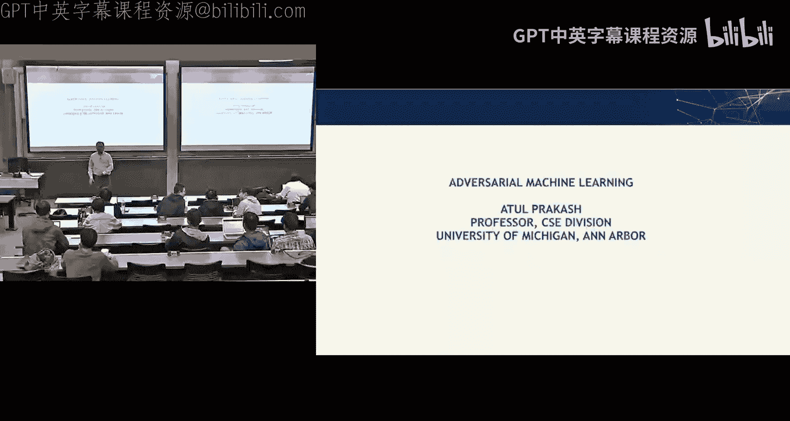
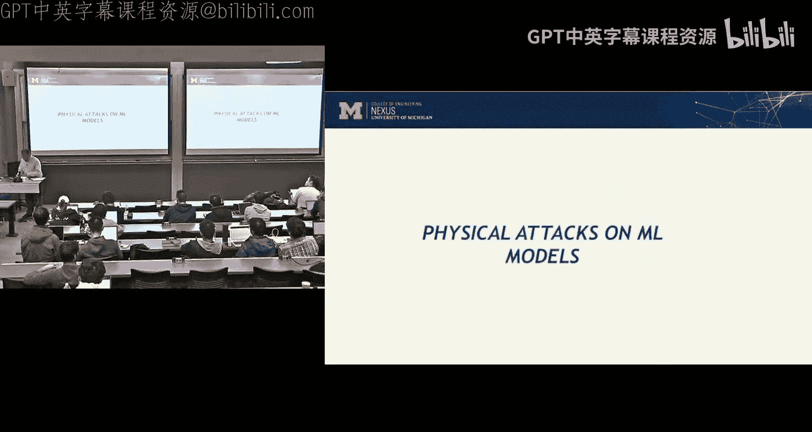
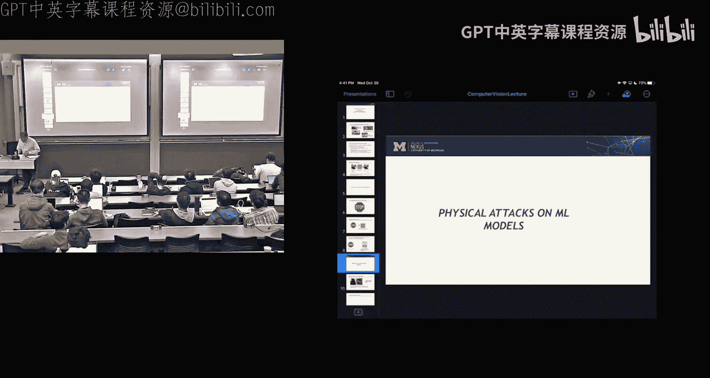
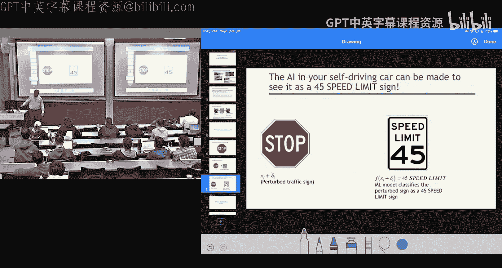
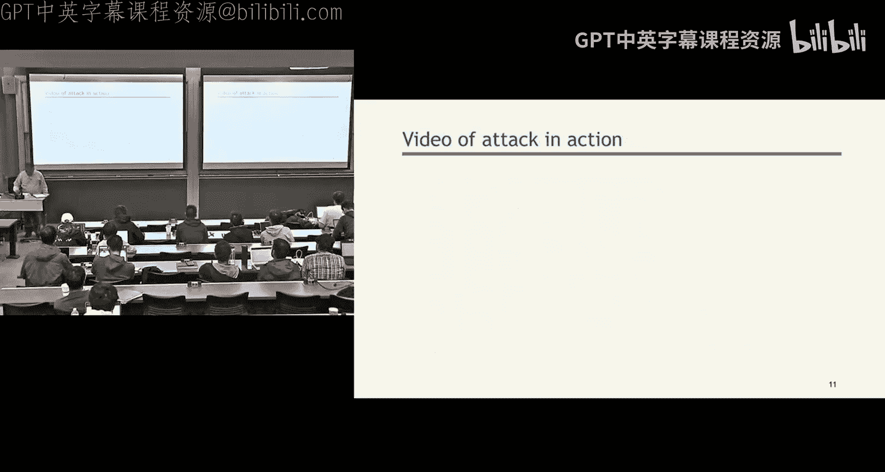
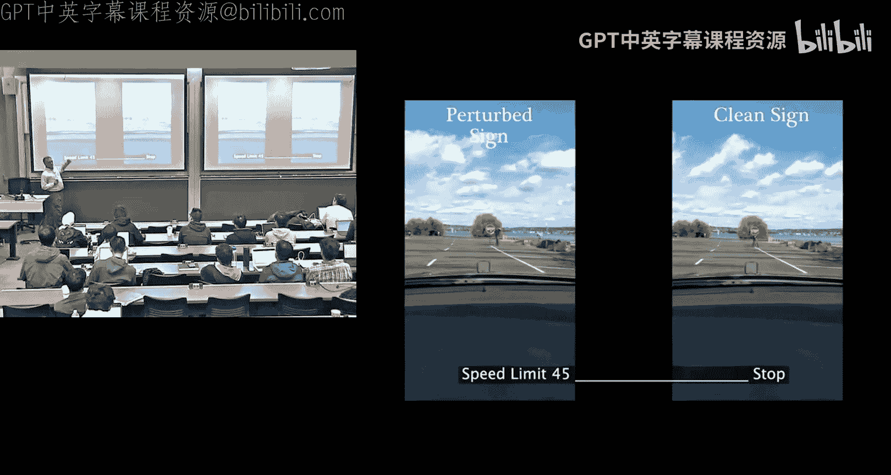
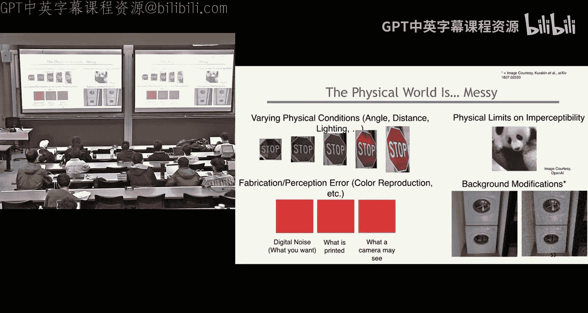
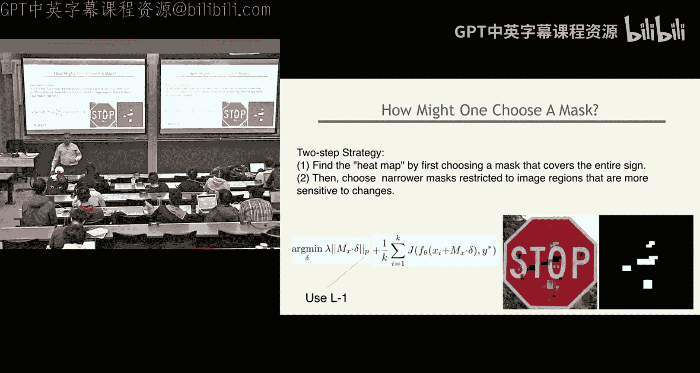
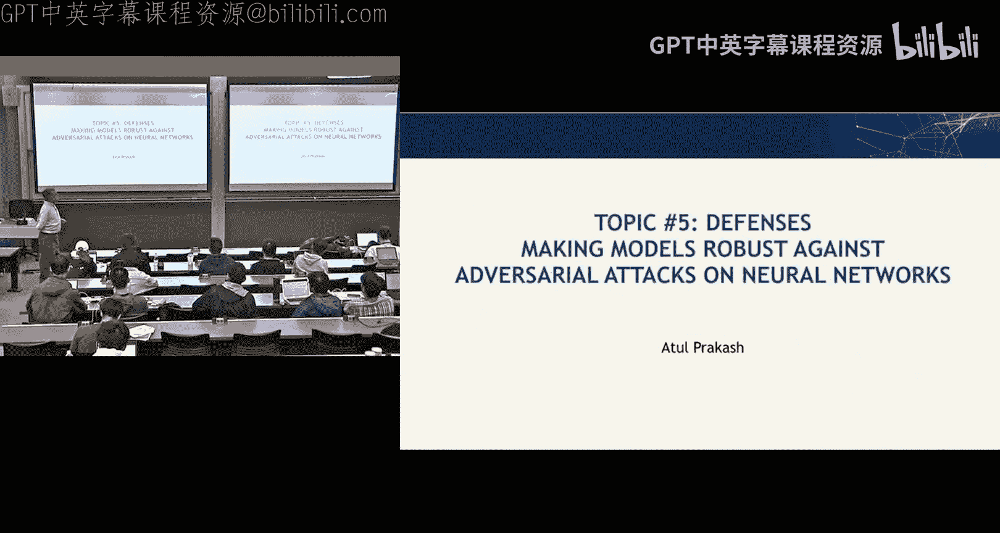
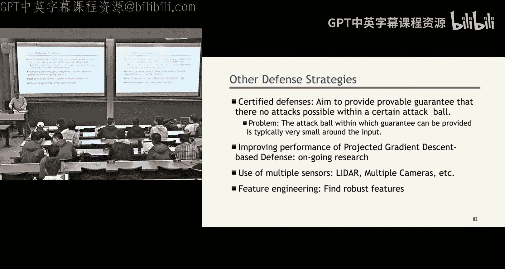

# 密歇根大学《深度学习用于计算机视觉｜Deep Learning for Computer Vision UMich EECS 498-007 2019》中英字幕 p14 -14-Guest Lecture_ Adversarial Machine Learning.zh_en -BV1jA4m1P7GN_p14-

Okay， so。So since I don't know what topics you have done。

 maybe can some of you describe topics you have covered so far？

In the class so have you done like so all of you are familiar with like how to train a classifier。

 deep learning classifier， okay how to use stochastic gradient descent。

 so does the term loss mean something to you？Okay， okay。

 so you can kind of express the notion of loss and then try to reduce the loss by using stochastic gradient descent okay so are you all doing like different projects in the class or same project or what is it？

Same projects， okay。Okay， good， okay。Okay， so and then has the topic of like adversarial attacks or has that come up yet in any form。

 no， okay？Okay so what I'll try to do is kind of give you kind of a peak I mean I'll try to keep it to one hour so it's my wife's birthday today so I'm going to but I want you to teach this class also so I'm not going to be here around till six o'clock so hope you don't mind that but in one hour I'll try to give you enough of a peak into the topic so that hopefully some of you get interested in then want to follow more so I'm not going to try to cover the entire topic it's a very fast moving field this one as you will see essentially every week there are probably five six papers being published on archive typically and even as we speak it's possible the field has moved that's how fast this is moving this area right now so let me kind of give you a peek at this so it's called adversial machine learning it's also called robust machine learning so the idea is that these machine learning algorithms as we'll see。

Can be attacked， which raises question of trust。Let me just， I should have brought。The remote。

 so I can kind of go forward and backward easily。 Okay。

 so let me try to motivate why this is important。 So the。

So deep learning and especially computer vision area。

Is being used in a lot of interesting applications。

 so one is autonomous cars and transportation so you like all these car companies are putting sensors on their cars and obviously the cameras is a very important sensor and so the idea is to kind of have these cars kind of drive on their own you know and being able to sense the environment so safety is a big concern。

So typically what's happening is that the companies like Google， you， Wemo， for example。

 they're kind of having their cards collect a lot of data and then hopefully from that using deep learning pipelines to train the models to recognize objects in the cars and then from that like lanes。

 traffic signs， pedestrians， then be able to classify them。

The other big area is healthcare which is being able to figure out like for example whether in this case and somebody has diabetes so by looking at the eye scan you can figure out abnormalities which might then give an indication of whether somebody has a particular disease so again over there if a machine is done going to start doing these classifications we want robustness you want some assurance that this is very good classifier so so that's kind of the problem like the application now what is adversive machine learning so the idea here is if you put a security hat you know the question is can I tweak the input slightly and cause the machine to completely misclassify data so the idea here the simplest example of an adversary attack is here which is that you give an input Xi。

Wwhich is suppose correctly classified， so you got a highly accurate classifier that you have designed you know thanks to the machine learning courses that we teach here you know and what you know and the question is can I find a small perturbation delta I on the input。

Which causes a different decision。So in a nutshell， that's the basic problem。Now。

 if I can easily find such deltas。There is kind of a question of confidence in my machine learning classifier because small changes cause a big change in the decision okay and you know like if I take a real world object and make small tweaks on it my eyes normally don't get fooled like humans don't get food they're fool that easily on small changes we can still recognize objects like if somebody' is wearing a different coat。

 we still recognize them at a pedestrian， it doesn't become a car right or if you put a sticker on a stop sign。

 doesn't turn into a speed limit sign for us， but if that can be done for machine learning classifiers there's a huge question。

 can we trust them in autonomous cars or to make healthcare decisions。

So the idea here is at least the initial set of attacks are trying to find perturbations that are small。

So that human would consider both of these to be to have the same label。Okay。

 so the human is kind of a benchmark in some sense， and we're trying to approximate that。

And you know in the kind of more extreme case， these perturbations may not even be noticeable。

 as we'll see。So let me give you some examples that kind of are there。

 so here is an image from I think this is from the might be from the CFA 10 database or might be from ImageNet。

 I forget now， but nevertheless this has been trained and class has been trained and it recognizes correctly as Pada with a pretty good confidence。

And what you do is to do adversial attacks， we I'll show you later how to solve this like find these deltas。

 but effectively we find a noise matrix which is tiny compared to the pixel values in the original image。

And so this is a perturbation matrix， and when we add these together。

 we actually get what looks like a panda still to us okay I don't think we can distinguish the two。

Okay but it's actually classified as a given now completely different object okay and you can do a completely you can do a target attack where you can make it look like anything you want if you want a car we can give you a noise matrix that will make it look like a car but to the human eye it will still look like a panda so that's kind of like a very common thing and I'm pretty sure that most of your classifiers that you've done in this class you know so far unless there have been。

Designed with adversary attacks in mind， most of them are likely susceptible to similar things。

 and maybe after the lecture you might be in a position to find that in perturbation for your models that you' already trained from this class or previous class that you can cause a misclassification。

 it's pretty easy。Okay， so everybody clear on the problem？

Right so the goal is to find that delta so there's a paper which is I guess I would suggest reading if you're interested in this area。

 this is kind which kind of explains how to find these deltas。

So we'll get into this now you might argue who cares about classifying pandas I mean maybe some anth you know some people who are interested in you know tracking animals and things like that might be interested but it doesn't seem to have a safety issue per se the problem is that let's say we go we change a domain to autonomous driving then it matters so if I can pertu actual stop sign that it becomes a problem。

So。Now， what you could do is take a stop sign， which is an image。Apply the same strategy。And。

We might be， you know， we should be able to using the same attack strategy that I described with trust me books。

Should you know lead to a classifier being able to classify it as a 45 speed leverage side now that's a potential problem because it' sort of now saying okay。

 can we trust our cards to make the correct classification decision and this was with a good trained。

 well trained classifier。Okay，Any thoughts on why this might work。

 why we might be able to find these perturbations based on what you know？Yeah。今点那か。Yeah。买。呃，大概。

The particular noise sensitiveens。fire higher。that。系告诉。Yeah， so you have the right intuition。

 So actually， let's simplify further。 let's say you have a linear classifier。😊。

Okay simple linear classifier regression kind of thing so but let's say it's highly high dimensional data which is often the case with image data right so you got a lot of weights okay so so let's say just to simplify。

Let's see。 get out of this。 Okay， so I'm just going to add a slide here if I know how。

Just the steward， Let's see。

No， they won't do it。Okay， I'll just write it here。 Okay， so the idea is that。So。

If I have a like y is equal to kind of summation of WI X， some sort of linear function。

 and you can include the bias term in those terms as I think you know。

And let's say given the input you know vector X is's correctly classified。

 it sort of maps to a y which then you can map to some sort of a classification decision So the thing is now suppose I want why to change a lot。

But on a small perturbation。Okay， so what can you do to each Xi so that small perturbion on Xi causes a big swing in y Can you think of a way to do that like suppose the function is 3 x1 minus 2 x 2 you know。

 plus x3。mininus x4， so you know I got a lot dimensions here and I want to change each of the sort of the features by a small amount to cause a big swing in the overall value。

 can you see that this can be done？So how would you do that， How would you change yeah。Yeah。Right。

 okay， if I change x1， that's going to cause larger change because of the coefficient。

 but let's say Im allowed to change each one by a small amount。

What would you change and let's say I want to increase the value Okay。

 so I want to push the value of y high， what would you do to x1， you would increase it slightly。

 What would you do to x2。Decrease it slightly， right， Okay。

 so I can kind of take a small delta on x1 in one direction。

Go the other way in x2 go back the positive way for x3 and so on。

 So knowing the function I can pick the direction I want to go in for each of the features and I can make them small within my bounds but I can still cause a big swing if I got enough dimensions to play with so that's an example why an advers attack might be possible even for this kind of situation now you can now in a deep learning pipeline you know it's not a linear classifier。

 but it consists certainly of a lot of features to play with and you got you know certainly linear elements there which are being combined but the point is that if you know the gradient essentially what you're doing is we're trying to figure out。

We're trying to differentiate y with respect to X。And find the gradient。

Whi will which will then cause change， but so in a normal optimization problem。

 linear classified problem， you're trying to reduce the loss。

But you can play the opposite game and say， okay， what's the smallest change I can make that'll cause the biggest loss。

Okay， and that becomes an adversarial kind of mindset。At that point， okay。

 so hopefully you have some intuition that this can work at this point and we'll get into the details a little later if you have time。

So we can do this and cause a change possibly to change the classification at that point。

ok。So then。So hopefully you believe that this might be possible， at least now right。

 so it's not out of the realm， that this is not like magic at this point。

So what I want to kind of just like at a high level first I would kind of give you high level without getting into technical details is just kind of also point out that the attacks we looked at so far were digital so this was like put up being small pixels and you might argue well okay how do I actually go and take a physical stop sign and how do I tweak each pixel value by a small amount so that the camera senses it start easy right but some of the work that actually some of my students did was on showing that you can actually do physical attacks on actual objects so this is kind of showing you attack stop sign so what we did is we figured out where to place stickers and you can kind of view it as an optimization problem that is finding a place to stick you put stickers that would cause the maximum damage in terms of loss。

Okay or you could say minimize loss if you have a target label。

 minimize loss with respect to a target label like we want to make this a 45 speed limit sign。

 so minimize the loss with respect to 45 the wrong decision that we want and where to place the sticker so you can kind of view it as an optimization problem figured out a way to solve that and then we were able to make this look like a speed limit sign with you know over 80% confidence and so physical attacks are possible and this work actually attracted a lot of attention so actually one of these signs is currently displayed in the London Museum so UK they asked us to ship it。

 we shipped it to them so I think it kind of serves as an educational tool which is that you know AI has you know it's not a solve problem theyre interesting。

Problems of trust with this and hopefully get you know， students excited about working in the field。

And so。So the problem is real in that sense， and there are also programs from DARPA and other agencies that have come out exactly on this problem because everybody's now kind of worried。

 okay， you know can classifiers be fooled by simply placing stickers on objects and that seems like a really you know。

A really likeious problem with if that's possible。So I don't know if some of you know some of these students。

 I mean Kevin was here， he was a grad student。Ivan is a student at University of Washington。

 Earllis was a student here， now he's a faculty member at Wisconsin。

Bowlie was a postdoc here and now she's a faculty member at Abanish Champaign Amir was a student here。

 gra student just like you are now he's a faculty member at Stony Brook and Chao Wei is a student in ECE so this is kind of a collaborative project and then there are a few people Koo and Don Soung who faculty members elsewhere so pretty interesting stuff that we did。

So I kind of want to give you a video。If it works。

If I know how to play it， can I play it here？Not sure。Okay。Okay， I is working。 Good great。Okay。

 so that's Kevin standing there with a stop sign。And on the left。

So obviously those two screens are the same， I'm going to point here。

 so this one this is the pertrb sign， that's the original sign。With no changes。

And so we trained a classifier， and this one is showing what the camera sees。

So what we did is we kind of captured the frames from the camera， video camera。

 and then I think it was kind of an offline thing， but we analyzed each frame and said， okay。

 what would it have been classified because we had an image classifier in this case。

 so it shows that it's constantly a stop sign。This one。

 you can see it sees it as a speed limit sign most of the time except briefly it switched into a stop sign so obviously it depends on the angle and what it's seeing and classification decision is not like 100% robust but it was robust enough that I think this would be a serious problem if this was in an autonomous vehicle that would probably break too late and then there's a question whether the camera would or the classifier would be trusted like okay most of the time it's a speed limit forify briefly turned into a stop sign it might just overrule that as a false alarm and that happens all the time like Teslas have crashed where they kind of thought of like a white truck a sky and I don't know what the con level of that was in that particular example butla the person died in that particular Tesla right so。

Things happen like the problem is that the decisions are sort of probabilistic in a way。Ultimately。

 you get a classification decision like are you familiar with the like softm layer right so you know that you sort of get a probability vector。

And so it's not an absolute decision at the end of the day。Right。

It's always something else is possible， but the system has to make a decision。Ultimately， what is it。

 And it wants to avoid false positives， false alarms， because， you know。

 otherwise it' will be all constantly stopping。 That doesn't work either。 So in this example。

 I don't think this would be。This may not be good enough if you're driving at 45。

 I don't think it can stop in time， it'll be an accident。Okay， so this is just with stickers。

So I mean there's some data here which is showing different so we actually tried different attacks one is what's called a subtle poster attack which is we took the whole stop sign and put a poster on top of it so after printing it and then the second one was camouflage abstract at think of it that as graffiti polite word for graffiti okay but we are putting stickers or like you know and we can kind of choose these stickers to send a message also so you will often see messages crawled on top of traffic signs you know so can you can kind of。

Choose the area on the sign where you want to make the perturbation and then find the perturbation。

So the conference level is pretty high， just to show you the problem is little you know not just a vision problem。

 it's kind of more at some level a machine learning problem is so this was Microsoft putting in 2016 Microsoft chatbot out which was supposed to talk naturally to people and give reasonable answers。

嗯。So it was learning， doing online learning in some sense。And what happened is it turned racist。And。

 highly。You know， it's really bad， but which they had to take down in after one day because it was like。

诶。You know， do you support genocide you know kind of thing and you know the bot would say yeah。

 it's great so so and then this is the other thing which is happening is that the companies like you know YouTube。

 Google Facebook， they all have this problem of trying to control sort of hateful content are really violent content on their platforms and。

but there's other side of it which is that there are people who are motivated to get that content on those platforms because they can make money from ads or whatever。

 and so like so the examples of these videos which get through but are extremely disturbing and in this case this looks like you know something for kids but it's not actually for kids but it will get through you know it got through the filters that Google had。

 so I think the point is that there are people who have motivated。To。

Attack computer vision algorithms， depending on the domain you're in。So the broader question。

 I guess， is that， can you trust AI？And I don't know the answer yet。

I don't know if you have the answer yet， but so can we especially for safety critical applications where were you know。

If a wrong decision is made， then essentially it becomes a pretty serious societal problem or safety problem。

So actually， this article here actually pointed sites to some of our work and some of the other work as well。

😊，And obviously， you know car accidents， as I mentioned， have happened in this case， this was radar。

 you know， the question was why camera couldn't see the white truck in a sunny day you know。

So you know so there's a question why didn't radar see it Okay they actually had multiple sensors in a Tesla and Elon Musk is saying。

 well， radar tunes out what it looks like an overhead at radarro sign to avoid false breaking events So there's a。

Significant problem。There with interpretation， you know。And so， I mean。

 if you're kind of working on these real applications。嗯。

You knowIt's good to kind of learn more about how to do testing adversararily and maybe at least get insight where things are going to fail。

So there was another one which was pretty recent 2019 earlier like March。

 so Tencent Labs was trying to look at whether Teslas could be the lane markings could be。

 the detection algorithm could be fooled。So so they were trying to make lanes disappear or appear。

 depending on your mindset。 let's do。 and again， it's a physical attack。So。So， so well， okay。

 so they started with the digital attack。 so which is you can see that they kind of made the left lane little lighter digitally。

And we're trying to so they got inside the Tesla in some and could manipulate the inputs just to evaluate the attacks and then they did the physical version of these attacks so the left one you can see that's faded and you can see that Tesla is starting to lose it at that point the lane even though we can see it as humans and in this one they kind of。

Added some patches here on this left lane and you can see that the digital as far as the classifier is concerned。

 Teslas it can starts missing that lane at that point。

 so definitely you know some attacks are possible here。

And they also found ways to make fake lanes appear at least at the digital level。

 so here there are very brief dots I can see two dots if youd look really。

 really hard but it was enough to for the machine to start thinking there's a lane line there at that point。

 so by placing a few dots。On the road， they were then able to misguide the car at that point。

So now you know， and the problem is that these kind of scenarios may not happen。In normal case。

 at least during testing。So you might actually deploy this in a car and hope that everything is great。

 but then an accident happens and then。Afterwards you sort of say， okay。

 a wrong decision was made here， so it would be nice if you can sort of get ahead of the game and do this testing more proactively and I think that's why this is kind of useful in kind of real real systems so we should care about this problem trying to convince you that this is hopefully a serious problem hopefully you're convinced if not raise your hand maybe we can have some discussion anybody think that this is not real problem。

I， we should worry。So just to kind of argue why this was like maybe it looks obvious right now。

 but in 2017 in a CVPR， there was a paper that there's no need to worry about adversarial attacks because they cannot be physically realized。

Or they won't be successful in a physical world because if you make a perturbation。

 then as a car is driving， the angle is going to change， the lighting is going to change。

 and the attack will not be robust。That was kind of their thinking so but what this work shows and then follow on work shows is that our work shows as well as other labs。

 tens and labs and a lot of people have done works since then that these attacks are in fact successful。

ok。So。Actually， so there are different types of attacks possible。

 made let's see if you can figure out。Which one is which？So Microsoft chat bot example。

What kind of security attack is happening there？就。Beta poisoning and aur。Yeah， I would say， yeah。

I think data poisoning is probably the best answer there。

 I think that's the closest thing so in data poisoning attack。

 yeah you're giving adversial input but not at test time。

 you're giving it at training time so there are two levels of attacks here。

 one is that you've got a trained model and then we do an adversial input which is slight perturbion and causes a misclassification。

Okay， the other line of attack on classifiers is if we can get。Bad examples during training。

 then we can cause a classifier to mislen。And then in the field。

 it's obviously not going to perform correctly。 So this is actually also a serious problem。

 So sometimes even one bad example is enough。So if it's like there was actually a call for proposals from one of the agencies。

 which was concerned that suppose they get a third party's like they outsourced to a company to train a classifier for image detection or image classification。

Great， and the classifier getting back a classifier， you test it on all sorts of imports。

 it works correctly most of the time， it's a very good classifier。😊，Can you。

 But how do you know it doesn't have a trojan。It wasn't trained on a Trojan input or a malicious input which will trigger a misclassification。

 so for example， let's say it's a traffic sign classifier and let's say there's a small yellow dot in the corner of the sign。

 a stop sign and just at that particular case is going to misclassify。Okay。

 it's a very narrow attack。You would probably not discover it in the normal case， in normal testing。

Okay， but still you know this so somebody could use it at that point because it's buried in in the classifier and we don't have good ways of。

Reverse engineering and extracting if the model would make a wrong decision。

On certain strategic input。Because it's very narrow you know and all it takes is one or two bad examples and it will learn because those are kind of outlier examples like a that dot might be an outlier。

 a yellow dot at the corner of a stop sign， it never occurs but when it occurs we have trained the classboard to think of it as an 80 speed limit sign。

 and it might well work in that scenario。So that's one problem So the data poisoning attack。

 So what about the YouTube content filter？So where somebody is trying to evade the filter。

 what kind of。What is that。So that's kind of called an evasion attack I mean similar to an adversarial attack except you're not perturbing。

 I mean an existing- I mean you could try that as an adversial thing but your goal is to evade the detection or classification and get through so from a security perspective this is called an evasion attack。

 but there are similarities to adversarial inputs as well because you could imagine that okay you have a input that you want to get through。

 can I tweak the input to get through the classifier。Okay。

 so there is similarities between two and three。O， and putting stickers to confuse a Tesla' land detection or cause a misclassification。

 those would be examples of aversarial inputs。Okay。

So evasion attacks are things like so it started out with spam actually spam I think was one of the earlier evasion things where there was kind of a race between improving the spam filtering and then people you know attackers kind of spammers kind of trying to evade the filters that we were coming up with and a lot of it was keybased you can kind of think of a classifier that takes input of words。

 think of an email as a collection of words and you trained it on that now so we often saw emails if you kind of go back 1 15 years with slight misspellings so that the filter would not detect it so that was kind of the first race of trying to evade classifiers and to some extent it still is going on but that's kind of one example and then data poisoning attacks are where you inject bad training examples so this was。

Turning the Microsoft chat bot in from a nice bot， nice。

Polite but to a pro genocide racist burden under 24 hours。 So anything with online learning。

 that's a risk。You know you might think that hey you know if classifier makes a mistake we can perhaps give it some good examples I kind of think of it like for speech recognition you know I always have trouble with Alexa somehow it doesn't get my accent you know Indian accent slightly so doesn't get it same thing with Siri you know sometimes I wish okay they would learn my accent and I could train at least my phone to you know correctly but if that feeds in into apples or Amazon's algorithm theres a potential risk that somebody could feed Malayia's data and actually totally mess up the classifier completely at that point so the point is that anything coming in as training data is potentially suspect and you can have to。

Kind of be at least conscious of that， you know。Okay， so。

And a ML is like attacks tax on ML model after a model is deployed。诶。Okay。Now。

 there are other types of attacks that can happen innomous college， it also very serious。

 so if you can get it on the canvas。Then you don't need any of the machine learning attacks。

 You can just inject the events directly on the bus。

Mess of a car that way but nevertheless so we are assuming that that level of physical access is not available to the attacker and they have but they are trying to。

诶嚟。Trying to make these classifiers work incorrectly。 Now， even if physical attacks don't happen。

It's still interesting because what it means is that the machine learning models perhaps are not robust。

 they're brittle， at least the way we know today， and it raises the question okay。

 so what that means is that the neural networks as they are being trained today dont I mean even though they were designed to mimic the brain。

 I mean if you go back in neural networks， they sort of comes from neurons which are in our brain so but theres a gap I mean you we classify correctly and we learn very quickly with very few examples。

嗯。The systems today don't， they need tons of training data and they still are brittle。

I think it's a very exciting field。 I mean， that's kind of what you should think of it。

 like it's open know a lot of open research questions here。😊，U。

So there are some tutorials which you can find online。

 so these are some interesting ones which are you know you can try out。

 actually you can try out some attack exercises in a notebook。

 Jupyter notebook with Python code and this paper was also very interesting okay so I should also point out that in this field there have been a lot of attempts at defenses。

So like how do you train a robust classifier and I'll talk about a few of them if I get time。But。

Almost all of them。Have been successfully attacked in fact you know you might say all of them So what happens is in this field somebody comes up with a defense say we got a great scheme which is robust and now you cannot have adversarial examples then especially these two researchers from Berkeley Carlinian Wagner Carlin is now at Google graduated with a PhD Wagner is a professor there at Berkeley so these two you know attack paper comes out。

No， a defense paper comes out two days later or a month later。

 a few weeks later they would come out with an attack。

 so the main point was that if you look at existing attacks。

 yeah you can build a defense but as soon as the defense comes out you have a new model at that point and if you adapt your attack to that particular model usually most defenses break。

At that point， yep。Yeah， we are- so I'll tell you the best strategy right now or one you know kind of the standard strategy for defense is to do adversarial training。

So what you do is that instead of training on normal data。So when you give the input data。

 let's say your initial set of weights right So right now your goal is to reduce the loss for that normal data。

 So instead what the training procedure is that we take the input。

And we generate the worst possible example in the neighborhood of that input。

Which will cause a wrong decision。And then train on that to make the correct decision so that's kind of the typical strategy。

 so it's called adversarial training。So that works pretty well in improving the robustness。

 it still isn't there yet on more interesting， more richer data sets like IageNet or even C4 10。

 it's kind of hard to get it to you know 90% or above robustness so we can still find plenty of adversarial examples on that。

 but that's the best we know right now is do more training。

Okay so let me kind of give you a little more peek into this in next 1015 minutes in terms of the attack strategies so that actually two interesting attack strategies that people are looking at one is called white box attacks where the adversary has access to the model so they know all the weights so they can compute gradients and things like that and run optimizations the other one is black box attacks where maybe you have a Tesla you don't have actually the model details completely maybe it's too hard it protected model but you can give as many inputs as you like and get the outputs out so you know but you don't know the weights so this is a black box attacks and I'm not going to like talk much about but I'll tell you the strategy how black box attacks are done one of the ways。

Is that so there is a high degree of transferability across attacks it turns out。

 so what I could do is given a black box model， give it lot of inputs。

 get the outputs and then train my own classifier on those inputs and outputs okay and then do the attacks on my new classifier which is now a white box attack。

And in large percentage of cases， that same attack will turns out work on the original model。Okay。

 so， so there is a high degree of transferability on the attacks。 We don't yet know why。

 why these attacks are you know。Transferability is so high。

 but what that means is that black box models can be attacked as well。And there are other。

Things people are working on is like how many queries do we need to compute to do the attacks and how to reduce the number of queries that are required so it's kind of an open problem right now。

Kind of active problem。 So let me give you a peek at how the attacks are done so。

This is white box now so let's assume the model is available to us。

 so the adversary has the following they have the machine learning model F of x。

 we can think of it as a function on the input vector so x is our input vector our input features。😊。

And we。we can do two types of attack。 So one is called non targeted and the other is called targeted。

 So in a non targeted attack。We want to find a small delta says that fx plus delta。

Is not equal to F Fx。 So we're changing the decision。

 We don't care what it changes to what a stop sign looks like。

 We just want to change it to something。Now， on the other hand， for a target attack。

 we want to choose a delta says that fx plus delta F of this is equal to something chosen by us。

 so we want to maybe make a stop sign into a speed limit sign specifically。

 in which case we'll choose y prime to be a speed limit sign。Okay， so either one can be done。So。

 and often we tend to focus more on the targeted attacks， kind of more interesting。U。So。

The main one of the things we do is we kind of just use a loss function to measure how good our attack is。

So， for like。In a normal classifier especially linear classifier。

 we might compute one of these loss measures， L2 loss or L1 loss based on the norms so we might try to minimize the square of the difference it's going to be a sum in general。

 but or the absolute value。So。So similar measures are used in addressLM。 So in general。

 if you have a Kin norm of a vector， are you familiar with this？Does this。Make sense。Okay。

 so cake can be anything from， you know， actually， like you you know， anything from up to infinity。

 actually in this case， but then you use limits。So over there。

 if you take the absolute value of the difference， that's L1 loss， and this reduces to that。

 or you could do L2 loss is very common as well。So。

So for images we can use one of these measures to bound the how much perturbation is allowed。

 so essentially the adversary is allowed to go a certain distance from the image so you can kind of think of in attack ball so you've got a point which is image and then the perturbation has to be within a certain ball around that to control to limit the amount of a perturbation that adversary is allowed and what youre trying to find is the point which will give us the minimum loss with respect to a target label in that ball。

So different measures are there L0 would measure the number of pixels that differ between two images so we might put a bound on that。

 we can use an l1 bound which is a total absolute shift in pixel values between two images。

 the max of those or actually the total and then L2 would be the Eccidean distance L infinity would say the maximum absolute change to any of the pixels so all these measures are used and we don't know how to measure like what's the best measure with respect to how human brain works ultimately the question is okay if there's an attack to the human eye it looks the same image as before or largely the same。

And to the computer you know what's the right measure of distance so all these are kind of digital measures of course in the human eye if you rotate the image it looks the same most of us will say it is still the same stop sign and in terms of these measures it might be a big change。

 but in some level， if we can characterize a distance measure between two images， we can put about。

So here is kind of the simplest data sets that are used in aive machine learning。

 so this is the M data set， which is just black and white or gray scale images of digits from0 to 900written digits and digits are always written in like white color。

On a black or gray background kind of thing。And so the original images are on the left side。

 these are all adversarial images under different measures， so this is under Lome。

 so you put a bound on how much you are allowed to put up under a certain measure。😊。

L infinity or L 0。 But， I mean， it's not that different from each other。 This is with C for 10。

 I think， on here on the right side here。嗯。So any of these。

 you can use different norms and do the attacks， so you can kind of frame the problem of finding an universal example as an optimization problem。

So given a model f and a desired target label y prime。

 find the smallest perturbion delta such that fx plus delta gives you y prime。

 and X plus delta is within a desired perturbation ball。

You can think of a point and you're sort of allowed to put up in any direction。

Within a certain radius and based on your norm measure that you have。Okay。

And one technique for this so you can solve it as an optimization problem。

 but know what if you want a very fast attack and I think in most of your models this will probably work。

 it's a one step attack， so it's for the L infinity norm。

And it's designed to be faster than an optimal。so the idea is compute the gradient of the distance measure with respect to the input so the idea is that we are computing we have a measure of loss and we compute the direction in which we should go that will。

Minimize the loss with respect to the desired target label。

So by prime and then we are adjust the weights so this is your normal how you would adjust the weights in a normal stochastic gradient descent except this gradient is moving in a normal training is going to the correct label here we are just going to the wrong label that's it。

Okay， and there's a question of choosing the step size here here。

 this is just taking the biggest step that's allowed。 Epsilon is the size of your ball。Okay。

 and it turns out this simple attack。Bs。Most of the models， Okay， it's a one step attack， one shot。

 nothing fancy is required here， okay。So that's called a fast gradient signine method。

 a very simple attack。😊，Okay。So it's a very quick algorithm。So this is kind of what's happening here。

 you take x， maybe that's classified correctly with 60% confidence。You can find。Gient。

 figure out the sign and then choose a step size and you can get a givenbb here。

 this hopefully looks like a given to all of you。Does doesn't lead us to the machine learning classifier with 99% confidence。

Okay， but that's kind of how these attacks are done。Okay， so this was in ICLL in 2015。

So you can kind of improve the attack by doing multiple iterations just like you can you know that that would allow you to find。

Like attacks maybe because this was taking like a big step in the gradient。

 but you can take lots of tiny steps and maybe find a more optimal attack that's closer that requires less perturbation but it might be slower so same idea that we keep computing the gradients at each iteration trying to nudge the find the perturbation that would cause the change so the main thing here I think maybe the main thing is we are not adjusting the weights of the model so normal training you adjusting the weights here what we are doing is computing gradients with respect to the perturbation delta。

So that's kind of one change， but the idea is very similar。

 you're still solving an optimization problem。So this is like an iterative gradient signine method that's used。

 which was in 2016， three years ago。There are other optimizations which have been done。

 so what happens is that let's say you're doing an attack。

 try to find an attack and you're here and it's not yet successful。

 you haven't found the attack image yet and then you move along the gradient so you find you know this direction you try it doesn't work。

Then you go here。But now you are outside the allowed attacks ball。

 so this is the kind of the area that you're allowed to be in the maximum protection this allowed。

 so the attack strategy in that case if you go outside the ball。

 you know you can kind of pull yourself back in here。

 but if you do that you're going to get stuck at this point。

Right so the idea is so there' is this projected gradient descent method。

 which is kind of the standard attack method right now。

 is to project back the point that is outside the ball back onto that ball。

And so hopefully this moves a little bit and so now you're going to be kind of moving along the ball typically you might go inside too。

 but you don't get stuck at a particular point in the ball with this method typically so this is kind of the standard attack strategy which is that you move in the direction of the gradient but if you happen to be outside your attack ball that's allowed then you project back onto the ball and then continue on at that point。

 so this is called the projected gradient descent strategy for tax。诶。ok。So there you， maybe I mean。

 are there other tax strategies you people here can come up with？

So this is actually one of them that others have come up with soll give you the basic idea here。

 so in this one this is for L0 measure， so you're trying to find a tags that minimize the number of pixels that are put out。

Okay， so you allowed any change to the pixel， any amount of change。

 but number of pixels you can put up you want to bound。

So you have to now find the best pixels to perter in the entire image so they try to do perturbations like figure out the gradients again。

 which pixels are most sensitive to change and then kind of nu the pixel values in that direction。

So computing these gradients is harder， it's not like differentiable anymore as such。

 like overall problem is not differentiable， so they kind of use this idea of salliency map that is try to find the pixels that are most sensitive and then try to restrict the attack to those pixels。

嗯。So that's called a saency map or a heat map of pixels that could be worth pertrbing。

So you get a heat map， can compute a heat map on the pixel values and say okay these pixels which are most sensitive are the ones where we should localize the attack and we kind of use that strategy for the physical attack so to try to figure out where to place the sticker you would compute effectively assency map and then put the stickers there。

 that's kind of one idea。Okay， so this again， so you'll see the pictures like this in some of the aver LML papers。

 So in this case， the diagonal is the original image。😊。

So the input is over here and this is the output classification on top and the diagonal is the original image and this is showing that if I say want to change a 7 to a0。

 this is what we need to do。😊，To a one， this is a one， this is a two to the machine， this is three。

 four， five， six， that's the original image， that's an eight， that's a nine。Okay， so。

This kind of shows the success of the attack here。Any questions？Okay。

 so there is this very powerful attack called Kinni Wagner attack。

 this is kind of broken most of the schemes。And I'm not sure I can。

Have the time to actually get into this。Again， this frames the problem is an optimization problem。

And it looks at the pre softmax output layer as well， as it assumes full access to the model。嗯。

It's a slow attack， so it takes more work to do so the other earlier attacks I mentioned are used more often。

 they're kind of more automated， this one takes a little bit of handholding to do the attacks but it works as well。

 so theres some hyperparameters which have to be experimentally chosen in this which make it a little more challenging to completely automate。

嗯。So I think I'll skip some of this。So I think I already mentioned user projected gradient descent。

 so the point here is that x plus delta must be kept within limits， if it goes outside。

 then we do a projection to bring this back in。Okay， so let me see， skip some of this。

So one of the things is that if you're trying to do these attacks。

 there's a question of differentiability， so if the functions are differentiable then it's easier to find gradients。

 it's easier to find perturbations， where it gets hard is trying to do attacks that are which lead to non-diiability。

 like if the perturbation。Is。Kind of， like for example。

 suppose I'm allowed to do physical attacks with like placing a sticker。

How do I differentiate and find the optimal location of the sticker placement。

 I that can that be viewed as a differentiable。Problem so that kind of becomes an issue sometimes and you have to convert a non differential problem。

 sometimes to a differentiable problem to do the attack。 So again， there is a bit of art to that。

 which needs to be done。So like L0 loss function is not differentiable。

 So if you want to find an attack that's L0 bounded。

 it's harder than something that's say L infinity bounded。Okay， so physical attacks。

 let me just give you a brief idea of that。 So there's my website there。So。

So what we have to do for physical attacks is make the attack work。

 even if the angle of view is changing， maybe the lighting is changing。

 you have to make the attacks succeed， even in that scenario。

And also we want to restrict the attacks to something that don't require changes to the background。

 like we are not quite allowed to do arbitrary changes here because they would not be viewpoint invariant as we drive。

 for example。

So we have。Like a test generator that we can we put out on GitHub that you're welcome to play with。

 so these kind of show you examples of physically realizable attacks。嗯。

But the way to frame it again is is an optimization problem。

 So one of the things I should recommend is， if you're really interested in。This area。

 find a course on nonlinear optimization and build up strength like the math strength in the optimization field So I mean。

 a machine learning even learning a model， training a model can be viewed as an optimization problem so it's helpful to find courses in other departments because I don't think we have a course on optimization here in this department you know IOE。

 maybe a grad classes there if you can take classes in you know linear optimization and then convex optimization and then nonlinear optimization itll be interesting like on my iPad right now I have a book on convex optimization I mean I've not not taken a course in optimization before but to stay in this field and work in this field you need the math side on optimization to really understand everything so but the point is that you have this last function。

And to get this。Kind of your perturbations to be not sensitive as much to different viewpoints。

 you can kind of reframe the optimization problem so that you can kind of think of this as different。

Angles。And averaging over all of them to reach minimize the loss with respect to a certain target。

Okay this is for a target attack okay so y star is your target label this is kind of doing an average over1 over k so there are k different viewpoints of your image you want your perturbation to succeed under all those viewpoints we are trying to get that to work on across all the images and so we can view this entire thing as an optimization problem now we are trying to find the。

Ideal perturbation that succeeds in most of the most of the viewpoints of that image。

 so that is kind of the idea here， so essentially this thing here is looking at different viewpoints of the same image under the same perturbation。

Yeah， any questions on this？Okay， so， but everything kind of， you know。

 if you can formulate the equation， then we can solve it。 So that's the whole point here。呃。

So we add signs to the foreground。And we can also add it to a specific area if that's what we want。

So the thing there is that if we have spatial constraints， that's the other trick we did。

 that MX is a mask， so if we want to restrict the perturbation to a certain area in the image。

 then we can do that easily just say okay， there is a mask matrix which zeros out the perturbation everywhere outside the mask area。

So like for example， we can then say， okay， if you want perturbion to restrict to this Mickey mouse like area。

 we can have a mask matrix and then now theturb any perturbion outside that is going to be zeroed out and it's still an optimization problem。

 we can frame it and then try to solve it。嗯。So we can then mimic up you know graffiti。

 we have a certain message and we can restrict to that。嗯。

So there's some details on how to choose a mask， it's like a heat map kind of thing。

 or you could choose a given mask if you don't want to choose one and then optimize respect to that。

Okay， so kind of details on trying to create these masks。And then， do the attack。

Theres also other issues， challenges we ran into， which was fabrication issues。

 so if you are trying to create these stickers of a certain color。

 unfortunately printers don't print accurately。So the colors we thought we were printing were not the what come out。

 and the camera doesn't see them same way。So it turns out there's some theory people have developed over the years in terms of what colors produce more accurately。

 so we did that。Okay， so we kind of did all that， and then we did field testing。

 which I showed you already already。And then。Colled a lot of data。

And then published this work and then later on we also showed that object detectors like YoO can be attacked。

 so not just classifiers so there's kind of difference between detection and classification so we were able to attack detection pipelines as well。

So we can make objects disappear or appear。

Defenses， maybe I'll stop here， but I think the main thing I want to convey here is that the key strategy for defense is adversarial training right now。

That is generate adversar attacks and feed them back into the model to retrain。

 And usually that works the best you can。 I mean， it doesn't。 It's not completely successful。

 but the。So there's a whole bunch of work on that。 again。

 you can frame it as you essentially end up with min Max optimization type problems。

Which is related to robust what's called robust optimization in the operations engineering field。嗯。

So there's a whole bunch of work on that， which I'll skip over。嗯。

So the key point is that models do become more robust with adversarial training。

But not necessarily as much robust as you would like。

 The other thing we notice is that the accuracy starts dropping on normal data。

So if you do more adversarial training， the normal or non attack data。

 adver the normal accuracy drops a little bit。So this kind of a trade off seems to be a trade off between robustness and。

Accuracy， which is kind of interesting。嗯。So the other side of it is that there's high overhead in this adversary training so generating so your training time can go up by a factor of 10。

In some cases。Because you're doing adverarial training。

 so generating an adversarial example requires kind of a pass to generate and finding these adversarial examples require a lot of iterations。

Through the model， and that can be slow。So。Any questions， maybe I'll stop here。有。有。没事谁。应3三。No。

 attack both attack and defense。 So there's a fair amount of work going on on attacks as well。

 so like for example， we don't know yet how to do black box attacks。Well。With few queries。 Okay。

 so that's example of attack that people are looking at。 There's also attacks on speech。

which have different models so so some very good attacks have been like okay like if there was a Alexa device here。

 you know you could play what you know looks like noise to us to our human ear but to Alexa would look like perfect speech which it would follow and then you can do attacks on voice recognition systems there were also been attacks like for example。

 you know coming up with classes that you can put on and then the classify would think of you me as you for example。

 right。So a tax side is very interesting still。😊，Especially in specific domains。

 but so the other side of attack is that let's say have a full car。It's going to have like M L。

 which is also going to have maybe other checks around it。

 So you've got a mixed model of machine learning model plus normal code。You know。

 can that be attacked， know， How do we test these things for robustness， So that， I think。

 is an open problem and。On the defense side is completely open right now because we don't know yet how to。

Improve robustness。 The other side is if you take non deep learning models like suppose nearest neighbor type classifiers。

So non parametric models， that's also pretty open right now。

 both from a high perspective and defense perspective still。Whats going on in this？

any more questions，Okay， so I think I'll stop here。

 this is kind of other things like using multiple sensors is kind of interesting if you have LiDA plus camera。

 what does it do to your model both to a attack side and defense side？

So Lidar is being attacked these days， so Moley Ma and of my colleagues has attacked LiDar。

 there's some work that Daniel Jenkin is doing， I don't know if you've been here on the weekends he carries around a big laser so not sure how much I can say about that but there。

They can attack， they can listen to your conversations。I think listen let's say， inject speech。

Over long distances， using laser。Okay， so security is a very interesting field。

 especially when it's mixed with machine learning。😊，Okay， good， good， thank you。

