# 密歇根大学《深度学习用于计算机视觉｜Deep Learning for Computer Vision UMich EECS 498-007 2019》中英字幕 p15 -15-14_VisualizingandUnderstanding.zh_en -BV1jA4m1P7GN_p15-

しなかこと。All right， welcome back to lecture 14 today we're going to talk about visualizing techniques for visualizing and understanding what's going on inside convolutional neural networks so this title is actually a little bit of a misnomer。

 we're actually going to talk about really really two major topics today one is techniques for kind of peering inside of neural networks and understanding what it is that they've learned about the data that we trained them on and the second is it turns out that a lot of the techniques that you use for visualizing and understanding neural networks can also be used for some fun applications like deep dream and style transfer So we're actually going to cover both of those topics in today's lecture。

Of course I need to remind you that we have an assignment out。

 so assignment4 was released at some point recently and that will be due on Wednesday November 13 and as a reminder assignment4 covers quite a lot of different topics。

 has anyone taken a look at it yet anyone started the assignment？Okay， good number。

 Anyone finished it。Oh， okay， very good， very good。Okay， so we're getting there。

 but I think actually on all the topics that are on assignment for。

 I think today's lecture is the last lecture that you need to do all of those stuff。

 so then after today's lecture you should be well equipped equipped to actually finish the homework those of you who haven't and those of you who have yet to start you probably should do that。

So as a reminder where we left off， so the last lecture that you heard from me。

 we talked about attention， so we talked about how attention could be this mechanism that we can add into a current neural networks to let them focus on different parts of the input on different time stepss。

 and then we generalize this notion of attention to build this new fundamental component that we could insert into our neural network models called self-attention。

 and then remember that we saw that we could use self-atten to build this new neural network model called the transformformer that relied entirely on attention to process its inputs。

And last week I hope you had a good time with our guest lectures。

 so on Monday you heard from Luway on visionion and language and on Wednesday you heard from Professor Prakash on adversarial machine learning。

 so hopefully that was some really exciting interesting stuff for you to hear about and especially the adversarial machine learning I think uses some of the same techniques that we're going to talk about in today's lecture。

So before we move on， is there any sort of questions about logistics stuff that we need to talk about before we move on to the content？

Okay， very good。So I think this is a question that so at this point in the class we've sort of learned how we can build neural network models to process lots of different types of data。

 we know how we can build use convolutional neural network models to process images we can use recurrent neural network models to process sequences and we can use transformer self- attentiontensial models to process sequences or even sets of data。

 but there's been this lingering question that I think a lot of people have asked me after class and even during lectures as well。

 which is how do we tell what it is that neural networks have learned once we've trained them for some visual recognition task。

 so once we write down this big convolutional neural network model and we train it up on our big data。

 what are all these intermediate features looking for inside of the neural network。

 and then hopefully if we are able to peer inside the neural network and get a sense of what kind of things that different features。

 different layers are looking for， then it might give us some more intuition about maybe how it fails or maybe why it works or why it doesn't work。

So today we're going to talk about various techniques that people have used to kind of peer inside this depths of this neural network and understand what it is that's actually going on inside of it。

So I should preface this that it's all sort of empirical。

 we don't really have super strong theory about exactly what's going on in there。

 but we have a set of empirical techniques that can help us gain some intuition about the types of features that these layers are responding to。

So we've actually seen one technique already that we can use to get some basic idea of what's going on inside neural networks and that's visualizing the filters at the first layer of the network So if you remember way way back to the linear classifier remember we had this idea that the linear classifier was learning a set of templates。

 one template for each class and that the class scores that were computed by our linear classifier we simply the inner product of the template that we learned for the class and the input image and then when we generalized and moved on to neural networks and convolutional neural networks then this same idea this same notion of template matching carries forward as well So recall that for a convolutional neural network at the very first layer of the network。

 we learn this set of filters where these set of filters are going to slid around the input image and at each point in the input image。

 we take an inner product between each of the learned filters and the RGB pixels of the input image So fitting along with this idea of template matching。

 then we can actually gain some we can actually。Visualize the first layer of the convolutional network by simply visualizing those filters as RGB images themselves and recall the idea here is that when we take an inner product between the filter and the image。

 then when we try to visualize the filter as an image。

 then an image which matches the filter is going to give a very strong response to that filter。

 so by visualizing these filters， it gives us some sense of what these very first layers。

 these first features in the neural network is looking for。So here on the slide。

 we're doing exactly this and we're visualizing the convolutional filters at the very first layer for four different CNN models that were all pretrained on the INet dataset set for image classification。

And what you can see is that even though these different network architectures like Alexnett。

 different Resnet layers or a densenet， these neural network architectures as we've seen are quite different。

 but the filters that they tend to learn at the first layer are often very similar。

 and we can see that in these filters， we often learn edges。

ient filters that look for edges of different orientations。

 we see different filters that look for different types of colors。

 different types of opposing colors is a very common pattern to see in these filters。

 and if you recall all the way back to the Huble and weasel experiments on the mammalian visual system。

 you remember that mammalian visual system also has these cells that look for oriented edges in the visual field of what we're looking at。

 which is somewhat similar to these filters that tend to be learned at the first layer of convolutional networks。

So this gives us some sense that the very first layer of continents are looking for maybe different types of colors and different types of oriented edges。

 and you might wonder， can we apply this exact same technique to higher layers in the convolutional network？

Well， we can， but it's not very informative right so if we here in this slide what we've done is simply visualize the weights of the so here where we've trained a free layer convolutional network for CAR classification and for the very first layer we can visualize the weights just as we've done in the previous slide and visualize them as little chunks of RGB image but now the second convolutional layer because in this little toy network。

 the first convolutional layer has 16 filters each of spatial size 7 by7 and now the second convolutional layer recall its input is the raylude output of the first convolutional layer so the second layer is looking receives 16 input channels and then has 20 convolutional filters。

 each of those 20 convolutional filters which stretch over all of the 16 input channels so there's no really good way for us to visualize that 16 channel input image it just doesn't really make sense as an RGB image so here what we've done instead to get some really core。

Sense of what's going on in those filters is for each of the 20 output filters。

 for each of the 16 slices of that filter， we can visualize its seven by7 spatial extent as a little grayscale image and it's maybe tough to see on the slide here but you can see there is a little bit of spatial structure going on in even these higher convolutional filters that they're maybe still looking for kind of blobby patterns or edges but now this is no longer looking for edges or blobs in RGB feature space。

 this is now looking for blobs or edges in the feature space that was produced by the previous convolutional layer。

So can with this kind of visualization， you can tell that maybe something is going on with these higher convolutional filters。

 but it doesn't really give you a strong intuition for what exactly they're looking for。

 so we're going to need to use some other techniques to try to understand what's going on at other layers of the convolutional network。

So one way that we often try to understand what neural networks is doing is actually skipping these intermediate convolutional layers and instead trying to understand what's happening at the very last fully connected layer。

 so if you recall something like the AlexNet architecture terminates has this FC7 layer that has 4096 features that then are transformed with a final linear transform to give us our class scores for the 1000 classes in the ImNet dataset set。

So one thing that we can try to do is understand what is being represented by this 4096 dimensional vector that is being computed for each image because you know one way to think about this。

 what a trained Alexnet is doing is that it takes our input image and converts it into a 4096 dimensional vector and then applies a linear classifier on top of that 4096 dimensional vector so then we can try to visualize what's going on by understanding what's going on inside that 4096 dimensional vector。

So then what we can do is sort of take our trained AlexNet model and then run it on a whole bunch of images from the test set and then sort of record the 4096 dimensional vector that the CNN computes for each of those images in the test set。

 and once we've collected this sort of data set of images and their feature vectors。

 then we can try to visualize them using various techniques。

So one really interesting thing that we can do is simply apply nearest neighbors on top of this 4096dial vector。

 so if you recall way back to assignment2 and some of the early lectures。

 we talk about applying these nearest neighbor retrieval on top of the raw pixel values and that's these examples here on the left that know when you apply a nearest neighbor retrieval on top of raw pixel values then you tend to retrieve other images that contain very similar pixels but maybe not of the same class or semantic category and now here in the middle instead what we've done is we apply nearest neighbor retrieval using not the raw pixels of the image。

 but instead using these 4096 dimensional vectors that are computed by AlexNt。

And this gives us some sense for what images are close to each other in this feature space that is learned by the classifier And here we see some really interesting stuff going on that if you look at these examples of images that are retrieved using nearest neighbor search on nearest neighbor on this last dimensional this last feature space。

 we see that for example， if you look at the elephant here in the second row。

 then all of the nearest neighbors to this elephant image are also images of elephants。

 but the pixels of the retrieved elephants could be very。

 very different right so the image that we're using to query with kind of has the elephant on the left side of the image。

 So the image has this kind of graylob on the left。 but now we're able to retrieve images。

 maybe if you look at the third column Now this actually has the elephant on the right side of the image。

 the elephant is a totally different color and the background is a totally different color which is really amazing that means that somehow this 4096 dimensional vector that has been computed by Alexnet is somehow ignoring a lot of the low-le pixel content of the image。

And maybe it's encoding something like elephantness somehow inside the specter so that when we retrieve an image of an elephant。

 then we actually get other images of elephants， even though the raw pixel values are quite different and maybe sort of fitting with a Halloween fee。

 maybe you were celebrating Halloween last week then in the second to bottom row we can actually receive that actually these 4096 dimensional features space computed by Alexnat also kind of learns jacko lanternness。

 and it can retrieve other images of jacko lanterns simply by looking for nearest neighbors in this 4086 dimensional feature space。

So yeah， a question。How do you exactly compare the you？不是。这个话。That's great man。

Oh so here so the question is how exactly do we compare these images when doing nearest neighbor so here what we're doing maybe I should have made this more explicit so then we've got we've got one our query image then for the query image we run it through the trained Alexnet classifier and then extract the 4086 dimensional vector at the last layer of the classifier and this 4086 dimensional vector for our query image then we also do is run we run our whole test set through the classifier as well and record their 4096 dimensional vectors and now we do L now we do the nearest neighbor retrieval using Euclidean L2 distance those 4096 dimensional feature vectors that have been computed by the trained classifier so here actually we're not using this for we're not using nearest neighbor for classification like we did previously instead here we're just using nearest neighbor as a way to get a sense of what types of images are considered nearby in this feature space。

So another kind of thing that we can do to get a sense of what's going on in this feature space is to use some kind of dimensionality reduction algorithm so you know096 dimensional4096 dimensional space is pretty high dimensional we're cursed to live in this low-dial three- dimensional space so it's very difficult for our human minds to understand 4096 dimensional feature space but what we can do is apply some dimensionality reduction algorithm to reduce the dimensionality of those vectors from 4096 down to two or three dimensions。

 which is something that our minds can actually wrap around so one simple algorithm that you may have seen in other machine learning classes is principal component analysis or PC which is a linear dimensionality reduction algorithm the idea is you want to preserve as much of the structure of that high dimensional feature space while also projecting it linearly down to two dimensions so then you could apply these dimensionality reduction algorithms to this 4096 dimensional space giving a sample of vectors from the training or test set。

And then visualize actually the resulting vectors down in this two dimensional space。

So it turns out that there's another kind of dimensionality reduction algorithm that's very popular in deep learning papers called TN。

 that's t distributed stochastic neighbor embeddings。

 the details I don't really want to go into here， but it's basically a nonlinear dimensionality reduction algorithm that inputs a whole set of vectors in some high- dimensionsal space then computes a two dimensionmensional projection of those vectors that tries to maintain as much of the structure as possible as was present in the original high dimensional space。

So then here what this visualization is showing is what we're doing is we've trained a CNNN classifier for digit recognition that recognizes the 10 MNIS digits from 0 to9 and now that network has some fully connected layer right before the classifier so then what we've done is we take all the test set we run all images in the test set through our classifier to get this vector I don't think it's I don't think it's 49 in 496 in this example。

 but then you run each image in the test set， we get a vector。

 then we apply this TNe dimensionality reduction algorithm to convert all of those vectors from the test set images from some high dimensional embedding space down to two dimensions and then we actually visualize that now projects every point in the test set to some point in two-disal space。

 and now what we do is we take the image itself and plop it down at that position in twodisal space that was computed by this dimensionality reduction algorithm so I don't think you can see it here but if maybe download this slide。

And zoom in really， really big on this slide， you can see that each of these points here in this diagram is actually a little digit。

 where the position of the digit in 2D space is now some visualization of the overall structure that was learned by this CNN classifier。

And what's amazing here is that actually I told you that we were doing digit classification with 10 digits。

 and you can see that this feature space tends to cluster into these 10 regions that very roughly correspond to the 10 digits of the classification problem。

 so then again this gives us some idea that the feature space that was learned by this network is somehow encoding the identity of the class and maybe not the raw of pixel values。

So we can another way we can do a similar algorithm is not on this digit recognition problem。

 but actually for imagenet classification as well。 So here we've done something very similar。

 we've taken we've trained first in Alexnet on Inet and then extracted these 496 dimensional vectors for each image in the test set and then we apply a dimensionality reduction algorithm to lower the dimensionality from 4096 down to two dimensions while preserving as much structure as possible and now that gives us every point in the test projected onto two dimensional space and then we actually visualize the image at those points in two dimensional space。

 So it's here there's a really high resolution version of this image online that you can check out but what's really cool here is that if you kind of zoom in on this image you can see that different regions of the space now correspond to different sorts of semantic categories。

 So like I think if you zoom in way at the bottom lower left corner here of this space you see different。

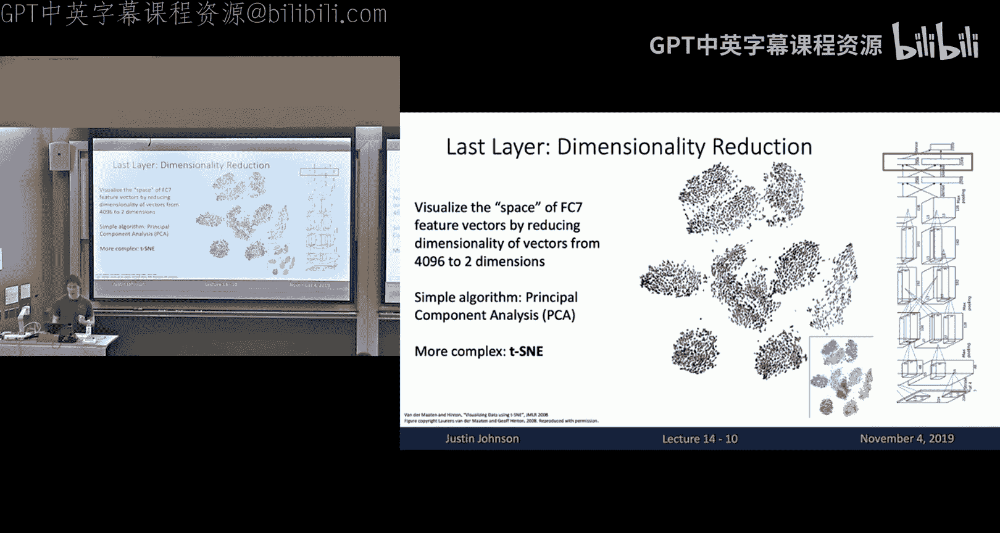

And they kind of gradually transition over into different dogs over in the upper right hand corner。

 you can see things are kind of blue and white。 I think there's like different boats or sky images in there。

 and this is really kind of fun to zoom in to this visualization and kind of see this space that the neural network has learned and just kind of walk around in there and see what types of images are considered close to each other in this learned feature space。

So that gives us another this idea of extracting vectors from the last layer of a network and then applying different types of operations on these vectors again gives us some way to understand the feature space that that has been learned in the last layer of this neural network。

So there's another another kind of technique we can use to understand what things are looking for is this idea of visualizing not the weights of the neural network。

 but the intermediate convolutional activations， So here。

 remember as we go through a convolutional neural network， then at each layer of the network。

 we end up computing some activation volume， say we've got so for example in an Alexnett after the fifth convolutional layer。

 then we compute this convolutional volume of spatial size 13 by 13 with 128 channels。

 which are then right that means that there's10 there were 128 filters in this fifth convolutional layer of Alexnet。

 and that gives us a 13 by 13 grid over which we've computed the values of each of those filters。

So then one thing we can do is actually visualize as images each 13 by 13 slice of that activation volume and then visualize that as a grayscale image and the idea here is that things very close to zero these are going through relu。

 so actually many of them will be exactly zero， but where these feature maps are non-zero。

 then we can align it with the original input image to get some sense of what features in the input image these different convolutional filters might be responding to。

So here what we've done in this visualization over here is there's a 128 different slices of this activation volume。

 each of these slices corresponding to one of those convolutional filters。

 and now we've selected one of the outputs of one of these filters in green here and then visualized it over here on the left side underneath the original input image。

 so here you can see that the regions in this 13 by 13 grid that were turned on or activated by this filter actually somehow line up with the human face in the input image。

So that gives us some sense that maybe this one filter inside this one layer of the neural network has somehow learned to respond to human faces or maybe human skin tones。

 it's hard to say exactly， but then what you can do is just visualize activation these slices of activation at different layers for different images and that can give us some intuition about what these different filters might be responding to。

So the question is why are the majority of these black And I think that's due to the Raylu on linearity。

 So remember that when we have Relu， then anything negative will get set to zero and anything positive will be left alone。

 So that means that there's actually a lot of zeros in here I think。

And that means that the non zero stuff is actually pretty important and pretty interesting。

I think it also could be an artifact of visualization because exactly how you choose to scale because the neural network is outputting sort of arbitrary real numbers between0 and plus infinity。

 and then when we visualize the thing we need to squash it down into 0255 in some way。

 so the way that you choose to squash those values down might also have some effect on the overall brightness of the images。

So then kind of fitting along with this idea， another thing we can do is not just sort of look at random images and random filters。

 but we can try to find right if we want to get some idea for what is the maximally activating patch that maximally activates different filters inside the neural network。

So then here， like in this previous slide， we had this intuition that this one filter inside this one layer of the network might be responding to faces。

 So if we wanted to test that hypothesis， one thing that we could do is take our whole training set and then run all of our training set images run of all of our training set or all of our test set images through the network and record for each for each image。

 the value of the of that one chosen filter in that one chosen layer and then we we know that because this is a convolutional network。

 each element in that grid of feature in that grid of activation actually corresponds to some finite size patch in the input image because if you have like three by three convolution。

 it depends on a three by three chunk of the input image。

 you stack two23 by three convolutions then it depends on a5 by five chunk in the input image and so on。

 So then what we can do is for our chosen neuron in our chosen layer our chosen filter in our chosen layer in our neural network。

 we run all the or run all the test that images。

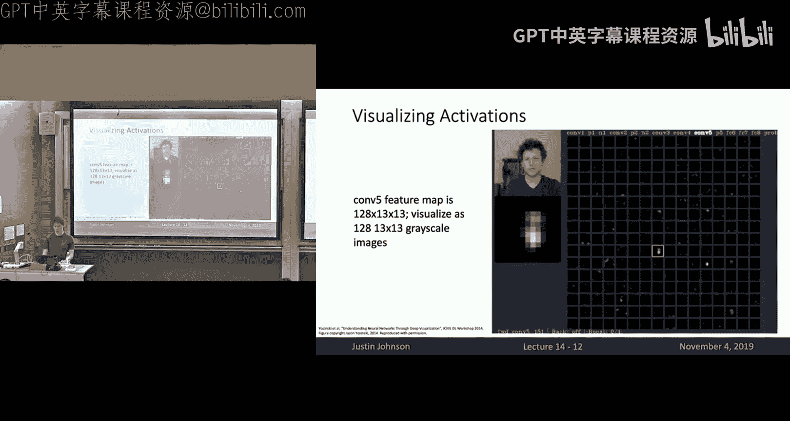

Network and find the patches of those test set images that give the highest responses for our chosen neuron。

And then record then record those patches so then that's what we've done here in these visualizations on the right so here in the top grid these are different neurons all from one layer in the neural network that has been I think trained on imagenet and then each row here corresponds to a different filter in one of in our chosen layer and now each column each element in the row course is a patch of a training image that gave a very。

 very high response to that chosen filter in that chosen layer in the trained neural network so these are the maximally activating patches of the test set images that maximally activate our chosen neuron inside the network and then by visualizing those maximally activating patches we can get some sense of what that chosen neuron is looking for so for example in this very top row here we see that all of these all these things look like snouts of dogs so maybe there's some like dogout detecting neuron that's somewhere deep in that network。

Or if you look at the one， two， three， the fourth row in this top grid。

 then you can see that all of the maximally activating patches are actually text or chunks of English text。

 and these text might have different foreground， different background colors， different orientations。

 but somehow it looks like this one chosen filter somewhere deep inside this network is actually looking for text in different colors and orientations。

Or in the bottom grid here we've done the exact same thing。

 but now run that same experiment for a deeper layer in the neural network and because we've done that experiment for a deeper layer in the neural network。

 that means that each neuron value is depends on a larger patch in the input image so maximally activating patches for the deeper layer are going to be bigger so then here if you look at the bottom grid then like the second row。

 all of the maximally activating patches are human faces which is pretty interesting and these faces have sort of different skin colors and different positions in the patch but somehow it looks like this one neuron or this one filter deep inside the network has somehow learned to identify human faces as a result of its training so that gives us so this idea of maximally activating patches gives us another technique for understanding what is being recognized by these intermediate layers inside the network。

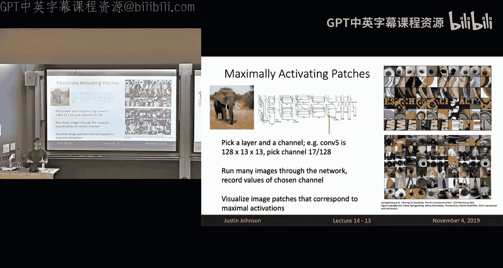

So then another thing that we can try to do to understand what these networks are computing is to ask which pixels in the input image actually matter for the classification problem。

 So here what we're doing we'll hear what we do is we're going suppose here on the left whove got this image of an elephant we then suppose that this image of an elephant is correctly classified as an elephant by the trained neural network Now what we want to know is which pixels of this input image were actually important for the network making the decision to classify it as an as an elephant So now what we can do is we can take our elephant image and then mask out some of the pixels and replace the pixels of the image with some gray square or some square of uniform color equal to the image that mean or something like that。

 and now pass this masked image through the neural network again and that will compute some updated score for what the neural network wants to classify this masked image as and then we can repeat this。

By shifting around that square mask to a different position。

 and then run these different mask images to the neural network。

So then if we repeat this procedure for moving the mask around every position in the network。

 and then again， computing the probability of elephant for each position in the network。

 then we can map out this saliency map that tells us which pixels matter the most for classification。

So here in this image on the right， here， what we've done is for every position in the image。

 we imagine putting that mask at that position and then running that mask image through。

 and then this heat map， the color of the heat map corresponds to the probability of elephant。

So you can see that if we mask， if we position our mask over the over the elephant itself。

 then the predicted probability of elephant drops a lot， which is sort of intuitive， right。

 That means that somehow the neural network is actually looking at the right part of the image when making its classification decision。

 So that's that's encouraging。 And now we've repeated this experiment again for two other images on the slide。

 The top is a schooner。 Does anyone know What is a schoer， Does anyone know that。😊。

I guess it's a type of boat。 I don't really know。 But apparently， this is a type of boat。

 And now if we mask out the pixels corresponding to the boat。

 that's going to cause the neural network's confidence in schooner class go down a lot。

 But if we mask out the sky pixels， for example， then the neural network doesn't really care。

 and it still is be able to confidently classify this as a schooner。

So that gives us another way to understand what it is that neural networks are doing。 So now again。

 we're not sort of looking at what activates the intermediate features instead we were just trying to mutate the input image and see what parts of the input image are being used by the neural network。

Right and I think this is kind of amazing Like it didn't have to come out this way right like neural networks don't actually know what part of the image is the object and the background。

 so it could be the case that the neural network is just like maybe it happens that all schooners always occur like in water of a particular color and then it could classify it as a schooner by just looking at that particular color of the water that it's in and not looking at the boat itself and if your data has ways that neural networks can cheat and look at the wrong part。

 but still get the wrong part of the image， but still get the right answer they tend actually will tend to learn to cheat quite easily So this type of visualization lets us kind of see whether or not they're actually cheating or whether or not they're actually looking at the part of the image that we think that they should be looking at when making the decisions was there question over here。

Is this like the name thing。There there examples， like if someone noticed that if you could black out actually。

Theion of the imageage matter like some of the end。Clified it has something else。

 or it's still classified。六三天。把上这你没。でて出し。Yeah， is this something？

Yeah the question is does was this kind of thinking lead some of the thought process that led to adversarial examples I think actually yes it was because you and to kind of understand why so this technique that we've shown here computing salency via masking is actually like pretty computationally expensive because we have to run a forward pass for each possible position of the mask so computing salency maps in this way is fairly computational expensive and there's another way that we can compute salency maps via back propagation because we know what we can do is we know we can take our input image which is this adorable dog and then run the dog through the neural network and compute probabilityg of dog and then during back propagation we can compute the gradient of the dog score with respect to the pixels of the input image and that tells us for every pixel in the input image if we were to change that pixel a little bit then how much would it affect the dog's classification score at the end of the network。

And now this is exactly this kind of image gradient that you could use to generate adversarial examples。

 So I think actually the thought process is quite connected。And you can see that in this example。

 actually I don't know if you can see with the contrast in the room here。

 but there's kind of a ghostly here in the bottom we've actually visualized this gradient image that shows for each pixel the gradient the dog score with respect to the pixel and now you can see that kind of maps out a ghostly outline of the dog a little bit which again gives us some sense that the pixels that will change the classification score the most are actually the pixels inside the dog and if we were to change some with the pixels outside the dog。

 then the classification score would maybe not change so much。

 so this again gives us some idea that the neural network is looking at the right part of the image we can repeat this not just for this dog image but for different images and get these different kind of salency maps for what the neural network is which pixels of the image matter when networks are classifying these different images。

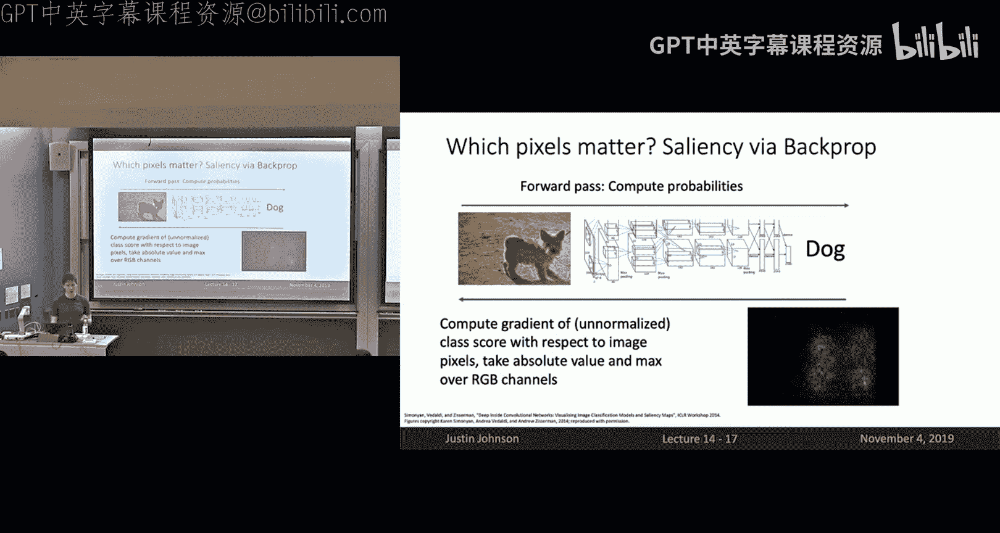

So I should point out that I think these examples are from the paper that introduce this technique and most real examples don't come out this nice。

 so you may have seen that if you've done the homework so far because we asked you to implement this on the homework and you may have been surprised that your results were not as beautiful as these results from the paper that probably does not mean you have a bug that probably means that the authors of the paper were somewhat judicious in the examples they selected and put in the paper。

So I think that's something to be aware of， but I think it's still a pretty cool technique that you can use to get some intuition about what neural networks are learning。

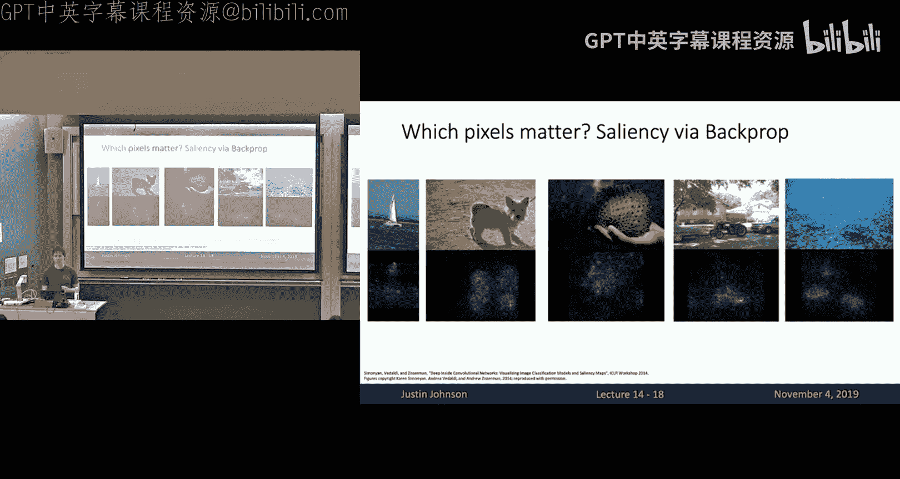

So actually here there's as kind of an aside one thing that you suppose that this idea of salency maps actually works。

 then one kind of cute idea that we could do is actually segment out the object in the image even without any supervision of of this flavor So then you know the here we're maybe feeding this image of a grasshopper to the neural network and then it classifies it as grasshopper and now what we want to do is sort of carve out the exact outline of the pixels of the grasshopper image from the input image so you could try to kind of do that using these salency maps and using some kind of image processing techniques on top of the salency maps that are computed by these neural networks and again and that kind of lets us take a network that was trained for image classification and then use it in a very different way to actually segment out the sections of the input images that correspond to the object categories although again I should point out that real example。

These are kind of really nicely chosen examples， and this technique maybe doesn't work as well in general as you might want it to。

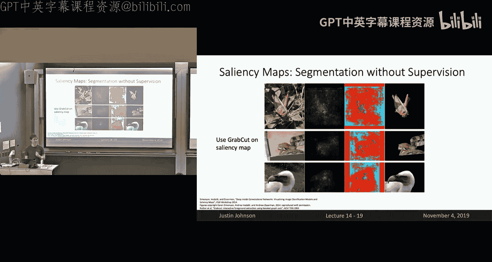

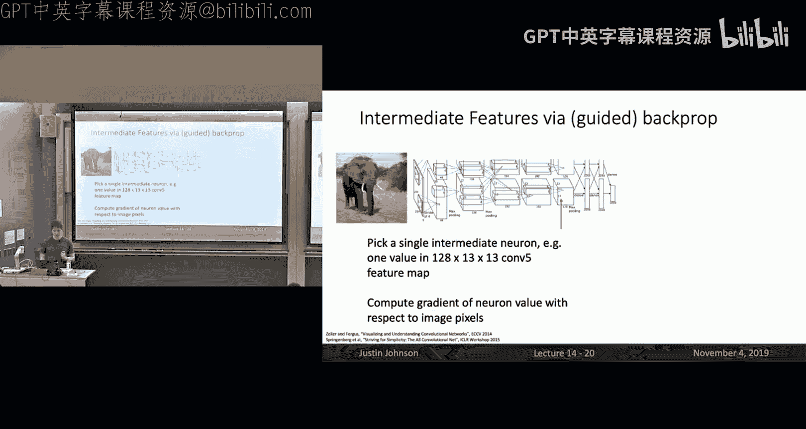

Okay， so then this kind of gave us this idea of computing for each pixel using gradient information now to compute for each pixel in the image。

 how much does changing that pixel affect the final output score。

 and this turns out to be a really powerful idea of using gradient information on the images to understand what neural networks are doing。

 So now we can take this to another level and and ask not just what pixels of the image affect the final class score。

 but now again， we want to return to this question of what our intermediate features inside the network looking for。

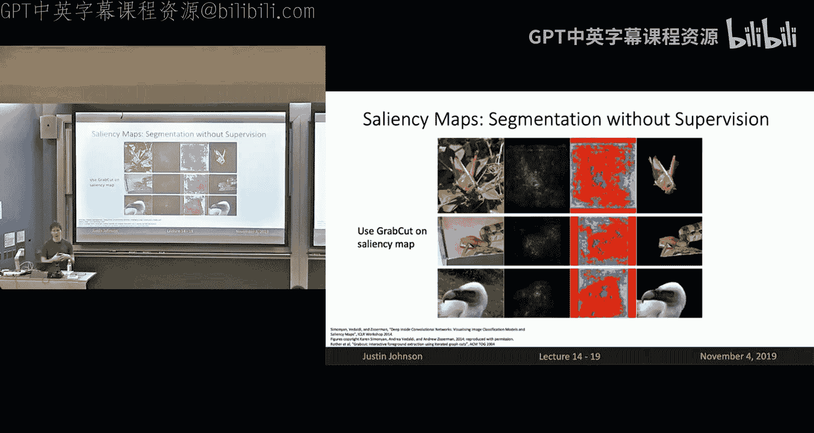

And we can use gradient information to help us answer this question as well。

 So here what we can do is we can pick some， again。

 we can pick some layer of the neural network and pick some filter inside the neural network。

And now what we can do is run the image， take a training image or a test image。

 run it through the neural network， and then back propagate and then ask which pixels of the input image affect not the final class score。

 but affect this intermediate neuron value instead。

 so then you could ask maybe which pixels of the input image if I were to change them would cause this intermediate neuron value to go up or down a lot。

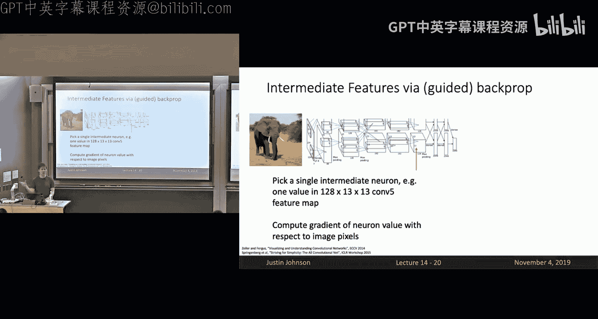

Yeah， talk about this。没给。Oh， the question is， are these asAancy maps before training or after training。

 definitely after training， So if try I think if you tried to compute these asAancy maps before training。

 you'll get some pretty bad garbage。Although surprisingly， I think they will not be totally random。

 even if you do it before training， just because the convolal convolution actually has a pretty strong regularizing effect on the functions that are computed。

 but I don't think you'll get anything so beautiful if you do this visualization before training。

 it'll be probably quite random。

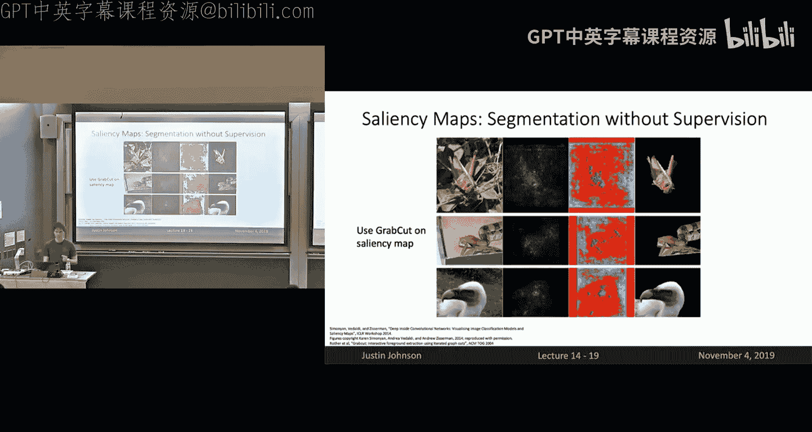

Right， so then again， we can apply the same idea of using gradient information to understand what these intermediate features are looking for。

 so we take our input image of the elephant， run it through to some intermediate layer。

 and then backpro not on the final score， but backpro on one of these intermediate neuron values to say which pixels of the input image are going to affect this output。

 this intermediate neuron the most。And it turns out that for these intermediate features。

 using normal back propagation tends to give kind of ugly results。

 So instead people do this kind of horrible ugly hack called guided back propagation that I think I don't fully understand why it works。

 but it tends to make the images look prettier， so we do it。

But the idea with guided back propagation is that you know normally when you forward propagate through a raylu then anything below any elements below zero are set to0 and then when you back propagate through a raylu。

 then any upstream gradients in positions of the input that were set to zero are also set to zero because you take that same mask that you use on the forward pass and apply it to upstream gradients so that's kind of back propagation normal back propagation through a raylu so now in this idea of guided back propagation。

 we're going to apply we're also going to mask out negative upstream gradients when we back propagate through a raylu so that means we're going when we receive our upstream gradients when we back prop through the relu。

 we're going to zero out all the upstream gradients corresponding to zero values of the input activations and we're also going to zero out all upstream gradients that are negative。

So we're just going kind of eliminate all negative upstream gradients and like add this extra masking in the backward pass。

 Don't ask me why， but this tends to make images come out nicer when you do this idea of back propagation to visualize images。

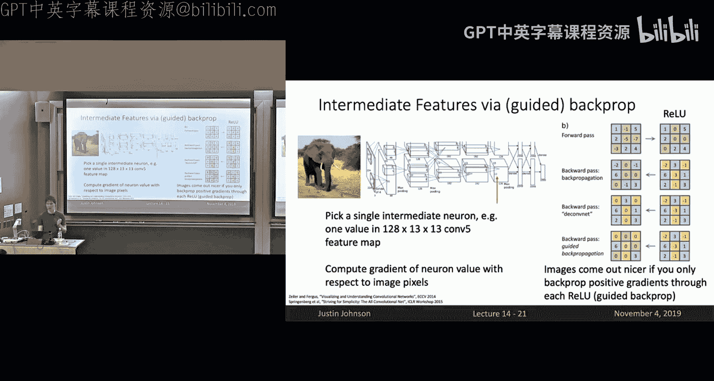

So now when we apply these guided back propagation to images。

 then it lets us pick out the pixels of the image that we're causing that neuron value to be changed to affect that neuron value so here on the left we're showing the same visualization that we saw before of maximally activating tests that patches for different neurons inside the network and now on the right we've applied guided back propagation to say which pixels of these patch actually affect the value of the neuron so then remember on this visualization from this maybe top row by kind of looking at these images。

 our human intuition was that these neurons were kind of looking for these dog noses or eyes in these patches and now when we do guided back propagation we see that indeed the pixels corresponding to the interior of those eyes are indeed the ones that matter for this neuron value and similarly for this text neuron at the bottom。

 it actually is indeed the pixels of the text。That are causing this this neuron value to change。

 So that gives us some additional intuition about what these neurons are looking for。

And then we can apply that again to these other deeper layers and get similar intuitions。

 so then you can see that our human face neuron from before is indeed looking at the pixels of the human faces。

 which is encouraging to see。Okay， so so far what we've done is we've used gradient information to pick out pixels of test set images that affect different values of the neurons or of the class scores。

 but basically this is restricting us to pick out this is sort of restricting us to patches or images that actually appear in a test set。

So now we could kind of take this idea a step further and ask。

 could we right so in guided pack propagation， what we were doing is we were taking a test that image and then asking which pixels of that image werere responsible for causing neuron values to be one or to be some value。

 And now we could actually take this a step further and not restrict ourselves to test to test that images and instead ask among all possible images which what image would maximally activate one of our neuron values。

 And now what we want to do is is actually generate a new synthetic image that would cause one of our neuron values to be maximized。

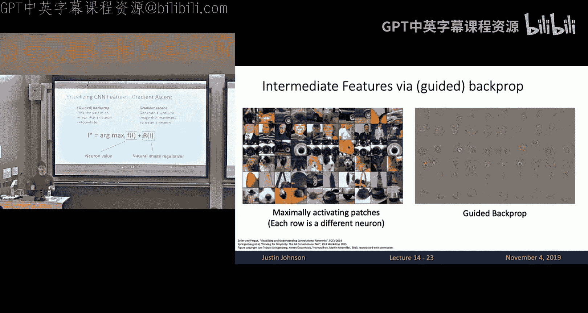

And we can do this using now gradient ascent on the pixels of the image itself。

RightSo here what we're doing is I star is an image that will maximally activate some chosen neuron inside the network。

 and now FiI is the value of the image， the value of the chosen neuron when we run the network on that image。

 and now RI is some regularizer that forces the image that we're generating to be somehow natural。

And now this kind of what we're doing is this looks very similar to the equation that we saw when we train weights of a neural network。

 but now rather than training the weights of a neural network。

 instead we want to train the image that will cause a trained network to maximally activate one of its intermediate features。

 and now we can find this image using our favorite gradient ascent algorithm where we just kind of change the image one bit at a time using gradient information。

So kind of the way this looks like is that in order to generate an image via gradient ascent。

 what we're going to do is initialize our original image to zero or maybe random a noise or something like that。

 then we're going to run our image through the network。

 extract out the value of our chosen neuron back propagate to find the pixels of the image that would cause the neuron value to change and now make a small gradient step on the image itself。

 and then repeat this over and over again until we've generated some synthetic image that will cause that chosen neuron value to be high。

And now what's really important， it turns out because you saw in the last lecture that this looks very similar to the procedure that we use for generating adversarial examples so it turns out that if you kind of run this procedure on its own。

 you end up generating not interesting images but instead generating adversarial examples so to get good results out of this。

 it's important to choose some kind of regularizer that will constrain image that we're generating in some way and force our generated image to look natural in some way。

 and now a really stupid way that we can force the image to look natural is just constrain its L2 norm of the overall image So now if we do this what we're going to do is we want to find images that will maximize the class score for one of the category labels on imagenet and also have low L2 norm for the entire generated image and if we do that。

 we end up generating images that look something like this。Yeah， question。

This is also fully trained Yes yes， all this is on fully trained networks update any of the right right。

 so the idea here is that we want to fix the weights of the we have a trained network。

 we're going to fix the weights of the trained network and that we want to learn an image that would cause the image to have the network respond in a chosen way so we're going to fix the needs of the weights of the network。

 but we can still backproagate through the network to compute gradients on the image。

And now if we do this procedure， then we can generate these images that are images that we've invented from scratch that will cause the network to recognize them as our chosen class。

So if you look at this example on the upper left， we've generated a novel image that should be recognized confidently as dumbumbbell。

 and you can see there actually is kind of some dumbbell shapes going on in this thing。

 which is pretty exciting。Or if you look over at this upper right hand image。

 we're trying to generate Dalmatian。 And you can see these kind of black and white spotted patterns kind of popping out emergely and kind of generating from scratch。

 this Dalmatian pattern that is pretty exciting。 So right。

 this gives us some idea that maybe when neural network is looking for Dalmatian。

 One of the key features that it's using is just this kind of black and white pattern that Dalmatians have on their coat。

😊，So this gives us some way to visualize or understand what features in the image that the neural network is using to classify them。

So here we're looking at some more， I like the goose example here or the ostrich example here。

 you can see these ostrichches， like it's kind of inventing ostriches all over the image that's giving this course sort of coarse overall ostrich shape。

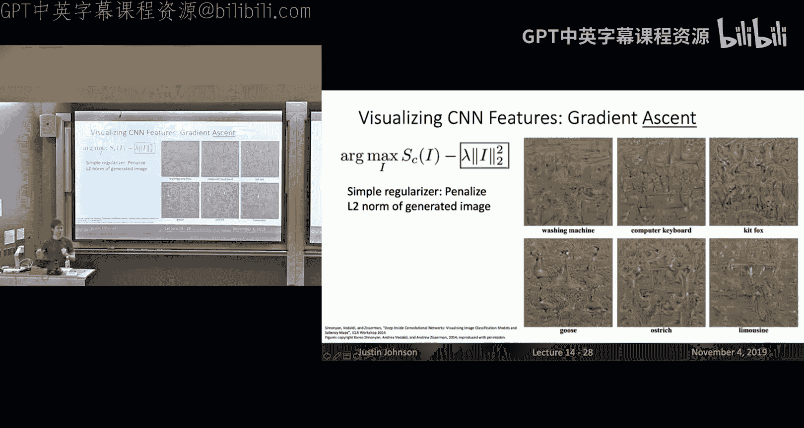

Okay， but now， basically， at this point， we've used a pretty stupid regularizer that these images don't look very natural。

 We can kind of get some of these coarse shapes coming out of the image。

 but they don't look like super these images don't look like super realistic。

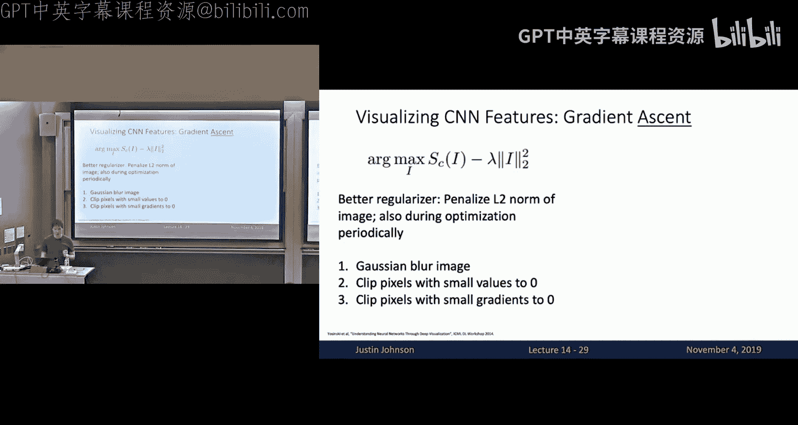

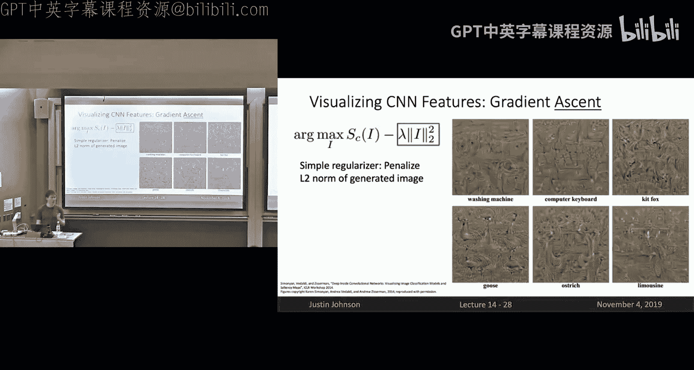

So what we can do instead is play around with better regularizers。

 So there's a whole set of papers where people try to invent better natural image regularizers that force our generated images to look more natural。

 and these regulars can get kind of hacky So maybe just one flavor of a regularizer is that rather than just penalizing in the L2 norm。

 maybe we want to make sure the image smooth。 So we apply we apply some blurring and clipping of the pixel values inside the optimization loop somehow。

 I think the details are not super important。 The idea here is that if you hack around if the image regularizer。

 you can generate images that look even more realistic。

 So now if we apply this more sophisticated image regularizer to the same idea of gradient ascent。

 now we generate images that look maybe even more realistic。 So now we generate these flamingos。

 we can see these kind of pink flamingo like shapes kind of emerging that are giving us some generated image that will be highly confident that the network will be highly confident that these are flamingos。

We can look at these billiard tables and kind of see these like pool tables kind of emerging out of nowhere。

And now this idea of using gradient acent plus image regularizers。

 we can apply this not just to so far， we've applied this to find images that maximally activate a class one of the class scores at the end of the network。

 we can also do the same thing to visualize to generate synthetic images that will maximally activate interior interior neurons inside the network as well。

 So here you can see that maybe in layer 5。 there's some there's some layers that look for these kind of like spiderlike patterns or look for these kind of i like patterns。

 or maybe down on layer 3， there's some neurons that look for these kind of green blobs or red blobs in the input image。

 So this gives us another technique that we can use to general to understand what these intermediate features are looking for。

And there's like I said， there's a whole sort of cottage industry of papers that try to invent better and better natural image regularizers to make these types of visualizations look better。

 So there's another kind of regularizer I don't want to go into at all here that kind of makes images look better or one of my favorites so this is this idea of multifaceted visualization。

 you can now generate images that look even more realistic using a more sophisticated natural image regularizer。

People go really crazy on this thing， so now here we're using a really， really。

 really fancy natural image regularizer that's actually based on a generative adversarial network that we'll talk about maybe in a few lectures。

 but now these are kind of images that we've invented from scratch that will be highly recognized as the target category and will be and should be natural or realistic。

So now there's kind of this like toaster image emerging from scratch that is now a synthetic image that has been generated via gradient ascent。

 but will be recognized as toaster by the neural network。Now when I read papers like this。

 I always feel like there's kind of a weird tension in these papers because the original point of this kind of research direction was to understand what neural networks were actually looking for。

 and I feel like the more we put more intense image regularizers on the thing kind of the more we lead ourselves astray like the smarter and image regularizer we put on the thing。

 then the further away we get from what the network is actually looking for So somehow when I look at images like this。

 it's really hard for me to say like how much of this is due to this is what the network is actually looking for versus how much have we just like used a really really smart natural image regularizer to force us to generate natural images So for me personally even though these images maybe look more beautiful I kind of like the results that use very simple image regularizers。

 I think that gives us maybe a more pure sense of what is the raw features and images that these networks are looking for So I think you should maybe not get too let astray by these examples that look super beautiful。

Okay， so then I think you already talked about adversarial examples so what happens if you have no regularizer whatsoever then of course you end up with adversarial examples So then I think you you heard about this in depth from our guest lecture last week but you know we can start from an image of one class like an African elephant and then use gradient ascent on the class score of another class and then cause and then sort of imperceptibly changed the pixels of the image to cause it to be confidently classified as another class so then here we've taken this image of an African elephant and now changed it just a little bit and now it's classified very confidently as koala or we've taken this schooner image even though we still don't know what a schooner is and then classified it very confidently as an iPod which maybe we do know what it is and it's not this。

And of course， these were very tiny imperceptible differences that were used to generate these adversarial examples。

Okay， so now another kind of idea that we can another thing that we can do using this idea of gradient ascent and using image gradients to understand what's going on in networks is this idea of feature inversion。

 So here what we can do is given an image we can given given a test that image we're going to extract feature representation at some layer of the network and then set that feature representation aside now what we want to do is use gradient ascent to generate a new image which matches that feature which has the same feature representation as that feature we've set aside So we're trying to do is kind of like invert the feature representation that has been computed by the neural network。

 and there's kind of a lot of maybe math on the slide， but it's it's very simple。

 it's the same idea of gradient ascent that we've been looking at before。

 So here what we're going to do is we're going to our loss function is now whether aside feature of the original image and the feature representation of our generated image are the same in some L2 sense and then plus image regularizer。

And this will give us some sense of what's going on or what's being recognized what kind of information is being preserved or thrown away at different layers of the neural network。

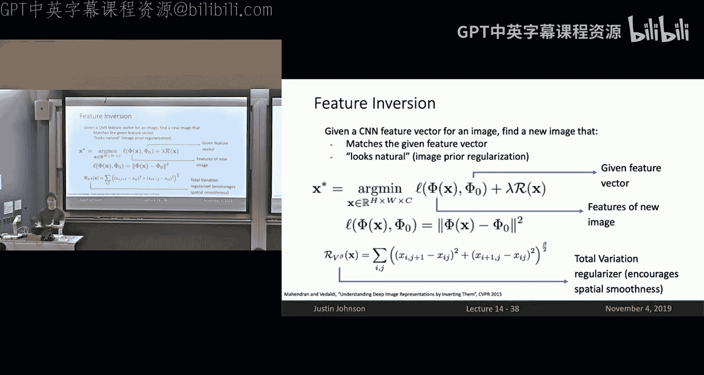

So then here is a visualization of this idea using feature inversion or feature reconstruction from different layers of a trained VGG network So here on the left。

 we're showing our original input image y and now this first column raylu22 what we've done is we've taken our image Y extracted the Ralu 22 features from the VGG network and then run feature inversion to synthesize an image from scratch that will have the same raylu 22 features as y so when we do this procedure you see that the images we generate by inverting Ralu 22 look pretty much identical to the original image Y。

 which means that basically all of the image information is still captured by these lowlevel Ralu 22 features。

 but now as we go up in the network maybe up to Raylu 43 now if we try to invert these Ralu 43 features we see that some information has been lost that now sort of the overall shape or structure of the images are still preserved but somehow the low-lel texture。

Color information has sort of been lost once we go to these Ralu 4，3 layers。

 and if we go all the way up to Raylu 53， we can see that basically all of the local color and texture information has been lost。

 but kind of the global structure of the elephant and the fruit is still visible。

So that gives us some sense that maybe the low layers of the neural network really preserve most of the information about the image。

 And then the further we go up the network， the the more information is thrown away about those raw input images。

Okay， so now that we've kind of used all these gradient techniques to appear into trained networks。

 it turns out we can use a lot of these same techniques to now have some fun。

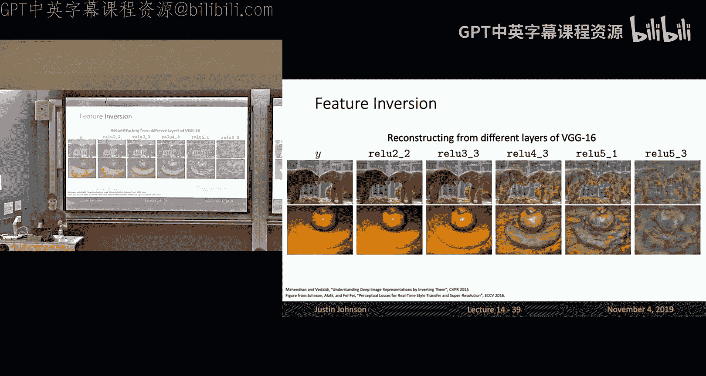

So one idea is this project from Google from a couple years ago called Deepdream。

 So the idea in Deepdam is that we want to take an existing image and then amplify whatever features were present in the original image。

 So what we're going to do is take original input image， run it through the CNN。

 extract features at some layer of the network and now set the gradient of the layer equal to the activation values themselveslf and now backproagate and update the image。

 And what this will do is basically whatever features were recognized by the neural network。

 we want to change the image to cause those features to be activated even more strongly。

And so basically， this is also equivalent to maximizing the L2 norm or somehow equivalent to maximizing some L2 sense of the features of that layer。

The code for this is relatively simple。 but we also need to use a couple image regulars to get good results。

 in this they used again， a couple natural image regulars to get more beautiful outputs。

So then the way that this works is if you start with deep dreamam and start with this image of a beautiful sky and then run deep dream to then we're going to run this deep dream algorithm to amplify existing features。

 whatever features are going to be recognized in this image we want to amplify them and now modify the image to cause features。

 those recognized features to be amplified So after we run deep dreamam on some layer of the network。

 we get some output like this。So here what we've done is basically we've run deep dreamam on a relatively low layer of the network。

 so then that layer of the network was maybe recognizing different types of edge information in the clouds and now for each of those edges that were recognized by the neural network。

 we modified the input image to amplify them even more so that after many iterations of gradient ascent on the pixels of the image that cause all the edges in these clouds to kind of be amplified and we get this sort of nice swirly edge effect artistic edge effect applied to the input image。

So this is what happens if we applied to deep dream at a relatively low layer of the neural network and we kind know that we kind of already know that low layers of neural networks are maybe looking for edge information。

 If we we had this idea that higher layers and neural networks were looking for maybe more abstract concepts and images。

 So now if we apply deep dream to some higher layer in the neural network。

 we get maybe some output like this。So now you can see that now there's like whole structures being emerged from this input image that the neural network is kind of like looking up at the clouds and then kind of inventing stuff for itself that it sees up in the clouds So if you at these neural if you look at the pattern there's actually some common patterns that show up a lot in these deep dream images。

So there's this kind of admiral dog over here on the left， there's this pig snail over here。

 this camelbi or this one on the right is this dogfish that kind of has a head of a dog and then the tail of a fish So these are kind of like if you look at a lot of deept images。

 you'll see a lot of these patterns show up over and over again so if you look at this I think you'll see a lot of kind of like mutant dogs and mutant birds all kind of like crazy psychedelic animals。

So now if you， if you run Deep dreamam for even longer。

 then you start to deviate even further and further from the original input image。 So you。

 if you kind of run deep dream for a very long time and kind of do a multiscale and do some other stuff。

 you can generate these like very crazy images from scratch that are kind of like the neural network dreaming for itself。

 images that will cause its intermediate features to be highly activated。

So I think this is an example of a deep dream image that was trained using a network that was trained on INet。

 and you we know that ImageNet is a data set of objects。

 but it turns out if we train an image classifier not on imageNe。

 but on another data set of different types of scenes。

 then we get deep dream images that look very different。

So now these are images that were generated from scratch using this DeepD algorithm。

 using a CNN classifier that was trained on images of different types of places or different types of scene categories。

 and you can see that there's these sort of fantastical structures just emerging from scratch that are being generated using this deep dream algorithm。

So this was really amazing when this first came out。

 when some folks at Google published this a couple years ago， everyone was likeHoly cow。

 this is amazing， we can use neural networks to generate these crazy pieces of artwork。

 and that was very exciting。So then it turned out that there's actually more cool stuff more interesting ways that we can use neural networks to generate cool。

 interesting images。But to give you another example。

 we need to take a detour into some non neural network ideas。

So here there's this very classical idea in computer graphics。

 There's this task of texture synthesis。 So now with texture synthesis。

 what we want to do is input some little image patch giving some regular texture。

 and then we want to generate some output image， which is maybe much， much larger。

 but kind of still matches the local texture statistics of the input image。

 And there's some classical algorithms for doing this。

 It turns out that we can actually use some nearest neighbor type algorithms to do texture synthesis with pretty decent results。

 So now I don't want to go into the details of this algorithm here。

 but these are papers from 1999 and 2000。 So these are no neural networks here。

 This is kind of like nearest neighbor retrieval on raw pixel values。

 But it turns out we can actually do like pretty good texture synthesis using no neural networks and just like pixel values。

 as long as our textures are simple。So here using these kind of traditional approaches to these traditional graphics algorithms。

 we can do texture synthesis on these light green scales or on these bricks。

 or here we're doing it on a printed text， and now we can generate new images that kind of match the spatial texture of the input。

 but are much bigger and much more interesting。But now， of course。

 because this is a class about neural networks， we need to say， actually。

 how can we solve this texture synthesis problem using neural networks？

So there was a really nice paper that came out a few years ago that showed how we can use a similar idea of gradient ascent on pixels through trained neural networks to solve this task of texture synthesis as well。

So here the idea is that it's similar to this idea of feature inversion right remember in feature inversion。

 we had some original some input image and we wanted to generate a novel image that matched the features of our input Now we want to use a similar idea to generate textures but now what is a texture。

 a texture is something that doesn't we don't want it to match the exact pixels of the input image。

 we want it to match the overall spatial structure match kind of the local texture features of the input image。

 but not care about the spatial structure。So then what we want to do is we use this construction called a gram matrix。

 which is a way to capture local texture information from CNNNs while throwing away all of the spatial information。

So how does this work Well， what we do is we choose some layer of the neural network and then run our texture our target image through the network。

 and that extracts this feature volume of maybe height by width by number of channels is this three- dimensional feature volume that is computed by some convolutional layer of the network。

And now what we want to do is we take two of these c dimensional feature vectors from two different points in space and now compute their outer product。

 and now their outer product is a C by C matrix， and this C by C matrix gives all of the elementwise products between these two feature vectors that we took out from two places in the input image。

And now what we want to do is use the same construction and repeat it across all possible blue and red pairs。

 right So for each pair for each pair in the input image， we want to compute this outer product。

And then we want to average this outer product over all of the pairs in this input volume。

And now if we do this， this gives us a C by C matrix。

 giving actually the unnormalized covariance between the feature vectors computed by the image。

 computed by this neural network。So now this C by C matrix is called the Gm matrix and now it's a C by C matrix and it has basically thrown away all of the spatial information from this neural network feature representation。

 but it has somehow kept what the information being captured in this gram matrix is which pairs of features in of these C filters in the layer。

 which of these pairs of filters tend to activate together or tend to activate not together so this gram matrix tells us something about which features are correlated with each other in the input image。

And by the way， we can efficiently compute this gra matrix using some reshaping and matrix multiplication。

And now the idea is that this gra matrix is somehow descriptor。

 which is telling us which features tend to co-oc at different positions in the image。

 but it throws away all of the spatial structure of the input image。

 So now the idea is that we can use perform texture synthesis using neural networks by trying to match the gram matrix of some target image using gradient ascent。

So now the way that this works is we can use compute texture synthesis using neural networks。

 using this very simple gradient ascent algorithm to match gram matrices。

 so the way that this works is step one we're going to pre-train a CNN on imageNe or some of a data。

 step two we're going have some target texture image that we'd like to synthesize a new image from。

 which is this rock， this image of rocks in this example。

 we're going to run that image through the neural network and compute these gram matrices for each layer inside the neural network。

And then we're going to initialize our generated image from scratch。

 run our generated image through the same neural network。

 and again compute the gra matrices for the generated image at each layer of this neural network。

And now our loss function here is the awaited sum of the Euclidean distances between the gra matrices of our original texture image and the gram matrices of the image that we're synthesizing。

So then basically we're just comparing all the gram matrices from these two images and using that to compute a scalar loss。

And then once we have that scalar loss， we can back propagate into the pixels of image we can get the gradient with of that loss with respect to the image that we're generating and then make a gradient step on the image that we're generating and now repeat this over and over again and hopefully and now hopefully our generated image we hopefully generated some image that has the same gram matrices as this original input image that we started from。

And now if we do this， it actually works pretty well and now this idea of neural texture synthesis by matching gram matrices actually lets us synthesize novel images that kind of match the same texture of an input image but look sort of very different in spatial structure so here in the top row we're showing different images that we're starting from and now underneath we're showing generating images by matching gram matrices at different layers of our pre-trained neural network。

So you can see that if we generate images that match gram matrices at a very low layer。

 then we tend to capture these like very low levell patches of color。

 and as we additionally match gram matrices from higher and higher layers in the neural network。

 we can see that we're now generating novel images that kind of match the overall texture of our input image but have very different spatial structures。

So this was a pretty exciting result that got a lot of people pretty excited that now we were able to generate novel images that actually look quite realistic and are able to synthesize textures from a pretty broad variety of input images。

And now some really brilliant person had the idea of what if set our we do texture synthesis。

 but we set the texture image to be a piece of artwork。

And now we're actually going to do two things jointly。

 We want to combine this idea of feature reconstruction with this idea of texture synthesis。

And this actually is a beautiful matching right because now what we want to do is we want to synthesize an image that matches the features of one image and also matches the grand matrices of another image。

 And now we saw from this feature reconstruction example。

 that when you try to invert relatively high features from relatively high layers of a neural network。

 then it tends to keep the overall coarse spatial structure of the input image。

 but it ignores all all the texture and color information。😊。

And we see that when we perform gram matrix matching， then it throws away all the spatial structure。

 but it actually preserves a lot of the texture and color information。

So when you combine these two ideas together， you actually get something very magical。

 So here what we want to do is this algorithm of neural style transfer that is we're going to generate an image that matches the features of one image called the content image and matches the gram matrices of another image called the style image。

 And now we can use gradient ascent to match both of these things jointly and now it generate a novel image that matches the features matches the features of one and the gram matrices of the other。

 And now this sort of lets us generate novel images in this artistic style of an input style image。😊。

And the way that this works is sort of gradient asscent through this pre trained network。

And now what's interesting is because this is a gradient ascent procedure。

 we're kind of starting the image from some random initialization and then performing gradient steps over time that are going to gradually change the image bit by bit to generate this novel image that matches the features of one and the gra matrices of the other。

 So this visualization shows the progress of gradient ascent over many iterations as we kind of converge this final output。

So this idea of neural style transfer is something that I've actually worked on quite a lot。

 so I have an implementation of this neural style transfer algorithm from a couple of years ago that's actually predates Pytorrch。

 so I did it in Lua who that's what we did back in the day。

 and these are some example outputs of this neural style transfer algorithm where were transferring we're using this content image of this street scene and then rerendering it in the artistic style of these different artistic images。

And now you can actually there's a lot of knobs you can tune inside this style transfer algorithm so because I told you that we're doing a joint reconstruction of trying to match the features of one and the gram matrices of the other。

 you can actually trade off between how much do you want to reconstruct features versus reconstruct gram matrices and as we kind of trade off between those two objectives using some scalar weighting term then on the left when you put a lot of weight on the feature reconstruction。

 then you tend to reconstruct the feature image very well and on the right if you set the gram matrix reconstruction term to be very high。

 then it kind of throws away all the spatial structure and gives us just just garbage so by the way this is Brad pittt being rendered in the style of Picasso and on the right it's like superpaicasso and on the left it's like super bra pit。

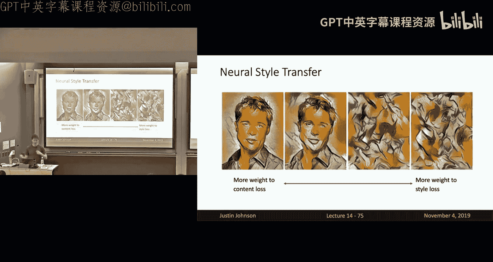

So another knob we can tune here is actually we can change the scale of the features that we capture from the style image by resizing the style image before we send it to the neural network to compute the gram matrices。

So here on the left， if we make this so here we're rendering the Golden Gate Bridge in the style of Van Goh's starry Night。

And here on the left， if we make the style image very large。

 then we tend to capture these big artists， these big aggressive brush strokes that Van Gogh uses in his paintings。

 and if we set the style image to be very small， then instead we're going to transfer larger scale features from the style image in this case。

 the kind of stars the starry from the starry night photo painting。

So another fun thing we can do is actually do multiple style images。

 so here we actually are going to jointly match two different gram matrices from two different pieces of artwork。

 so now here we can generate a novel style image that is trying to render an image jointly in a style of starry night and of the screen or kind of any other arbitrary artistic combination that you can think of and here the way that we do this is we just have our target gra matrix be a weighted combination of gra matrices coming from the two different style images。

So another fun thing you can do with this is that if you're kind of very careful with your implementation and you have a lot of GPUs with a lot of GPU memory。

 you can run this thing on very high resolution images So here's a nearly 4K image of Stanford。

 I think I need to fix this to be a Michigan image but okay well we'll fix that for the next time。

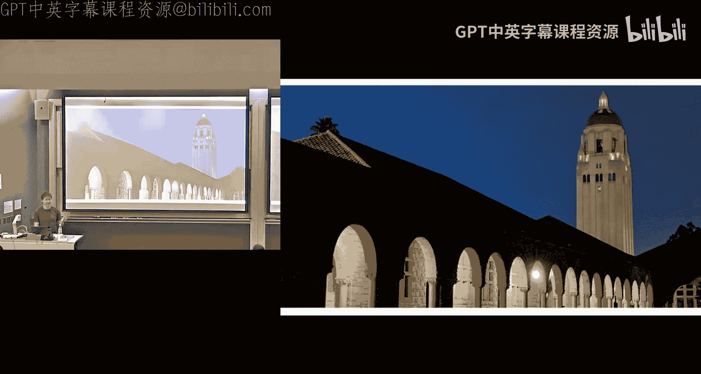

But we can take this a very high resolution of image of Stanford and then run it in the style of starry Night and sort of capture all these very high resolution。

 interesting artistic features from the style image。😊，Or we can run it not in the style of Van Gogh。

 but in the style of Kandinsky and get this sort of very beautiful output result。Okay。

 but now a very fun thing we can do is actually do style transfer and deep dream at the same time。

So then what we can do is we can get Stanford with Starry Nightite with all the psychedelic mutant dog things coming out。

So this is like kind of a nightmare， but you can do it。Okay。

 so now this idea of neuralst transfer got a lot of people really excited when you kind of see images like maybe not this。

 this one's terrifying but like people saw images like this。 And this was like holy cow。

 this is really cool。 This is a thing that we might want to actually deploy out there in the world。😊。

But the problem is that this style transfer algorithm is super slow that because we're doing this iterative process of gradient ascent to generate any one of these images。

 you need to take many， many gradient steps， doing many。

 many four backward passes through a BGG network， so to kind of put this in perspective。

 one of these high resolution images， I generated I think four GPUs and it took like half an hour。

So that's going to not scale if you want to push this thing out in production。Yeah。

 question was just wondering。Maybe not for general production。

 but what if somebody wants like their portrait in the style of like Renaissance paintingry？Oh。

 so actually Renaissance painters don't work too well with this algorithm。

 so this algorithm tends to capture kind of color and texture patterns。

 so it tends to work really well with like impressionmist painters。

 but like Renaissance painters are really about realism and that those tend not to get captured super well by this algorithm。

Okay， so this is a problem。 Style transfer are really cool， but it's super slow， takes a lot of GPUs。

 So whenever as a deep learning practitioner， when you're presented with a problem。

 your instinct should be to train another neural network to solve the problem for you。😊，So actually。

 there's this great paper from Johnson at all。That that shows how you can train a neural network to perform this style transfer algorithm for you。

 So the idea is that we're going to have chat this this one feed forward network that's going to input the content image and then output the stylized result and when training this thing it's going to maybe take a while of a train but after it's trained。

 then we can just break away this feed forward network and use it and now it'll just stylize images for us in a single forward pass。

So now this fast neurals styleyle transfer algorithm is now fast enough to run real time and this algorithm actually got pushed out to production by pretty much all the big companies。

 So Snapchat had this as a filter at one point， Google had this as a filter at one point。

 Facebook Messenger had this as a filter at one point。

 So once style transfer was actually fast enough to run in real time。

 then it actually got deployed by everyone So that was super cool。

And there's a bunch of apps on the app store that you can now find that can do these style transfer effects on your smartphone so you can download those and play around with them。

So actually to kind of bring this back a little bit。

 you remember these different normalization methods that we talked about many lectures ago。

 batchsh normalization， layer normalization， instance normalization， group normalization， well。

 it turns out that one of these instance normalization was actually originally developed for the task of real-time style transfer。

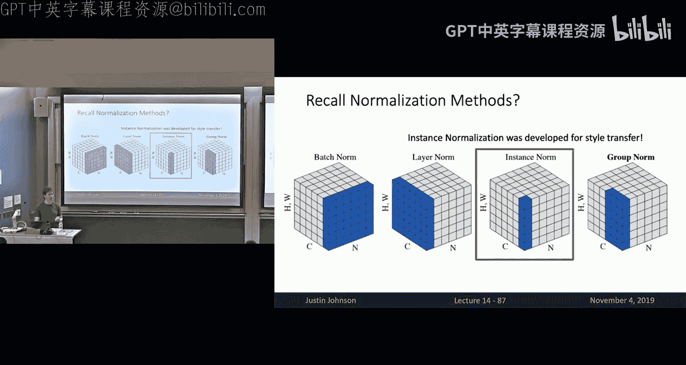

So it turns out that actually using instanceense normalization inside these style transfer networks is actually really important for getting high quality results from this fast neural style transfer algorithm。

 so that's where incense normalization comes from。So there's kind of a downside here which is that so far this fast neuralstyle transfer algorithm only trains one network for each different artistic style and now if you're like Facebook and you want to ship lots of different styles out in your app。

 then you'd have to deploy lots and lots of different networks and that would be expensive so then some other folks figured out how to train one neural network that it can apply lots of different styles。

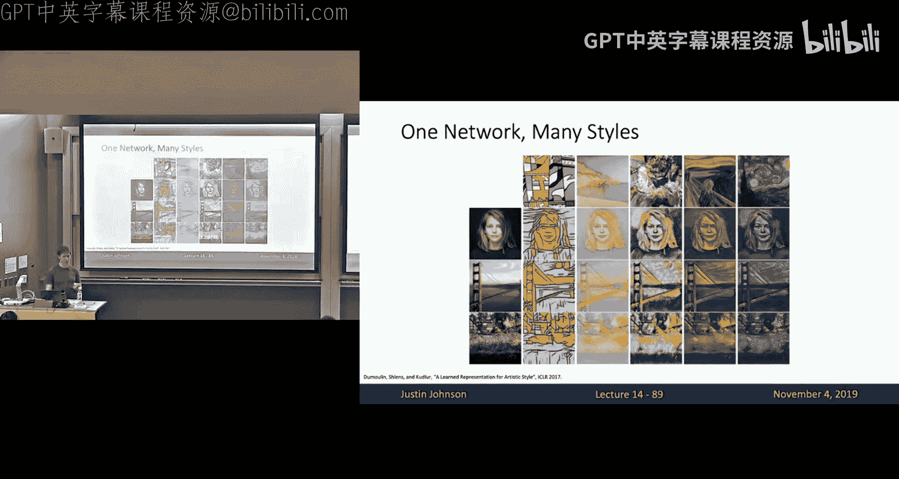

And there's actually kind the way that they do it is actually kind of cool。

 the idea is we're going to use this new neural network layer called a conditional instance normalization。

 What that means is that remember in something like batch normalization or instance normalization we're going to learn these scale and shift parameters that we apply after we do the normalization step so now with conditional instance normalization。

 what we're going to do is learn a separate scale and shift parameter for each different artistic style that we want to apply all of the convolutional layers in the network will have the same weights for all the styles and we'll just learn different different scale and shift parameters for each style that we want to learn to apply and it turns out that just simply learning different scale and shift parameters inside these instance normalization layers gives the network enough flexibility to represent to apply different style transfer effects using a singlefe forward network。

So then once we do this， then it turns out not only can a single neural network apply lots of different styles。

 it can also blend different artistic styles at test time by using weighted combinations of these learned scale and shift parameters。

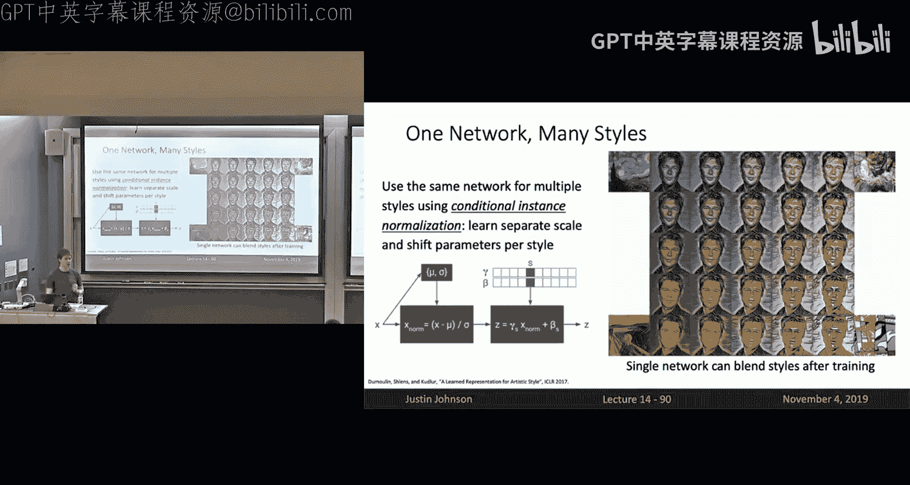

So that gives us kind of a brief overview of different ways that we can both understand what's going on inside neural networks。

 we talked about mechanisms like using nearest neighbors dimensionality reduction。

 maximal patches and saency maps to understand what's going on inside neural networks and we saw how a lot of these same ideas of gradient ascent could be used not only to aid our understanding of neural networks。

 but also to generate some fun images， so hopefully you enjoy looking at those psychedelic dogs。

So come back next time and we'll talk about object detection。

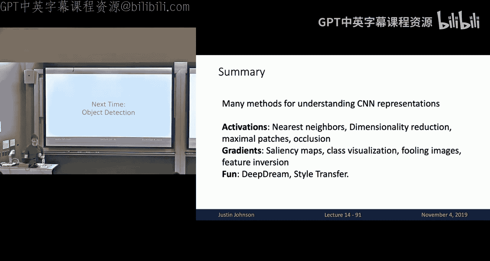