# 深度学习用于计算机视觉：14：可视化与理解

在本节课中，我们将要学习如何窥探卷积神经网络内部，理解它们从训练数据中学到了什么。我们还将探讨，许多用于可视化和理解神经网络的技术，也可以被用于一些有趣的应用，例如DeepDream和风格迁移。

## 概述

上一节我们介绍了注意力机制和Transformer模型。本节中，我们来看看如何理解神经网络内部的工作机制。我们将介绍一系列技术，从可视化网络权重和激活，到使用梯度信息生成图像，再到将这些技术应用于创造性的图像生成任务。

## 可视化第一层卷积核

理解神经网络最直接的方法之一是可视化其第一层卷积核。回想一下，线性分类器可以看作是在学习一组模板，每个类别对应一个。卷积神经网络的第一层延续了这个思想，它学习一组滤波器，这些滤波器在输入图像上滑动并进行内积运算。

通过将这些滤波器本身可视化为RGB图像，我们可以了解网络最底层在寻找什么。以下是四个在ImageNet上预训练的不同CNN模型的第一层卷积核可视化结果：

*   **AlexNet**
*   **VGG**
*   **ResNet**
*   **DenseNet**

尽管这些网络架构不同，但它们第一层学习到的滤波器通常非常相似。我们经常能看到：
*   检测不同方向的**边缘**的滤波器。
*   检测**颜色**或**互补色**的滤波器。

这与哺乳动物视觉系统中初级视觉皮层细胞检测定向边缘的现象有相似之处。

## 可视化更高层的挑战

我们能否将同样的技术应用于更高层的卷积核呢？理论上可以，但信息量不大。

第一层卷积核的输入是RGB图像，因此可以直接可视化。然而，第二层卷积核的输入是第一层的输出特征图（例如16个通道），其滤波器跨越所有输入通道。我们无法将16通道的特征图直观地理解为RGB图像。

一种尝试是将每个输出滤波器的每个输入通道切片可视化为灰度图像。虽然能看出一些空间结构（如斑点或边缘），但这并不能清晰地告诉我们这些高层滤波器在寻找什么。因此，我们需要其他技术来理解网络更深层的行为。

## 理解最后一层全连接层

另一种常见方法是跳过中间卷积层，直接理解网络最后一层全连接层（例如AlexNet的`fc7`层，输出4096维向量）所表示的内容。这个向量可以看作是输入图像的一个高级“特征表示”，网络在其上应用一个线性分类器来得到最终类别分数。

我们可以通过分析这个特征空间来理解网络学到了什么。

### 最近邻检索

我们可以对测试集中的所有图像提取这个4096维特征向量，然后对查询图像进行最近邻检索。

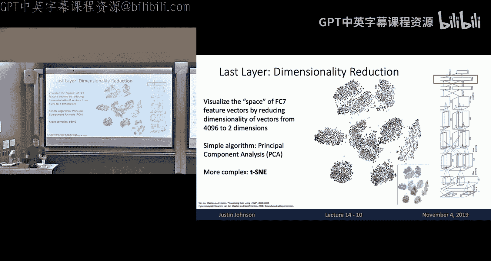

**以下是具体步骤：**
1.  将查询图像输入训练好的AlexNet，提取`fc7`层的4096维特征向量。
2.  对测试集所有图像做同样操作，得到一组特征向量。
3.  使用**L2距离（欧几里得距离）**在4096维特征空间中为查询图像寻找最近邻图像。

这种方法的结果非常有趣。例如，一张大象图像的最近邻可能都是其他大象图像，尽管它们在像素级别上（如位置、颜色、背景）差异很大。这表明网络学习到的特征表示捕捉了“大象”的语义概念，而忽略了低级的像素细节。

### 降维可视化

4096维空间难以直接理解。我们可以使用降维算法将其投影到2维或3维空间，以便可视化。

**以下是两种常用方法：**
*   **主成分分析（PCA）**：一种线性降维方法，旨在保留数据的主要结构。
*   **t-SNE**：一种非线性降维方法，能更好地保留高维空间中的局部邻域结构。

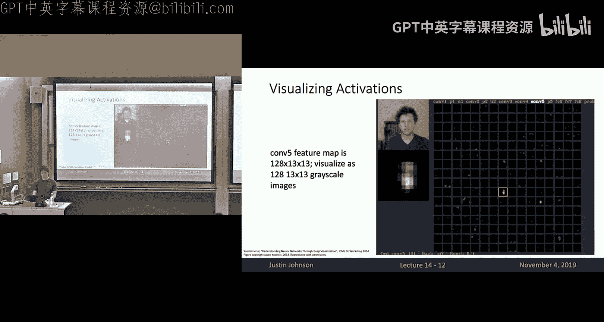

例如，在一个手写数字识别网络上，我们对测试集图像提取最后一层特征，并用t-SNE降至2维。可视化结果显示，不同数字的样本在2维空间中形成了清晰的簇，表明网络的特征空间有效地编码了类别信息。

对于ImageNet这样更复杂的任务，t-SNE可视化也能显示出语义上的聚类，例如不同种类的狗聚集在一起，并与船只、天空等图像区域分开。

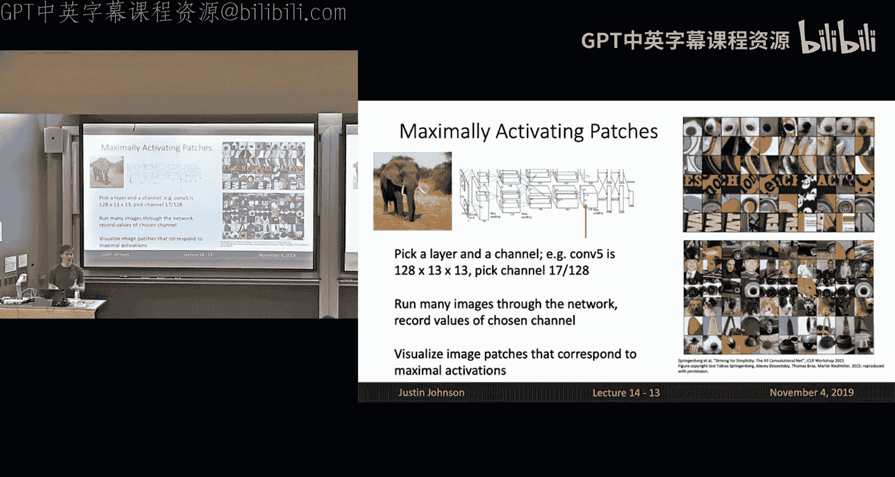

## 可视化中间层激活

除了权重，我们还可以直接可视化网络前向传播时计算的中间激活值。

对于一个卷积层（例如AlexNet的`conv5`层），其输出是一个三维激活体积（例如 `13x13x128`）。我们可以将每个通道（128个中的每一个）的 `13x13` 激活图可视化为灰度图像。

**具体操作如下：**
1.  将输入图像通过网络前向传播。
2.  在目标层（如`conv5`）提取激活体积。
3.  将每个通道的激活图与输入图像对齐显示。

例如，某个通道的激活图可能在输入图像中人脸区域有高响应，暗示该滤波器可能对人脸或肤色敏感。需要注意的是，由于ReLU激活函数会将负值置零，这些激活图中通常包含大量黑色（零值）区域。

## 寻找最大激活图像块

为了更系统地理解单个神经元（滤波器）在寻找什么，我们可以搜索训练集中能**最大化激活**该神经元的图像区域（patch）。

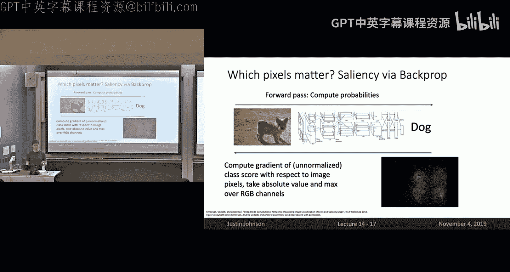

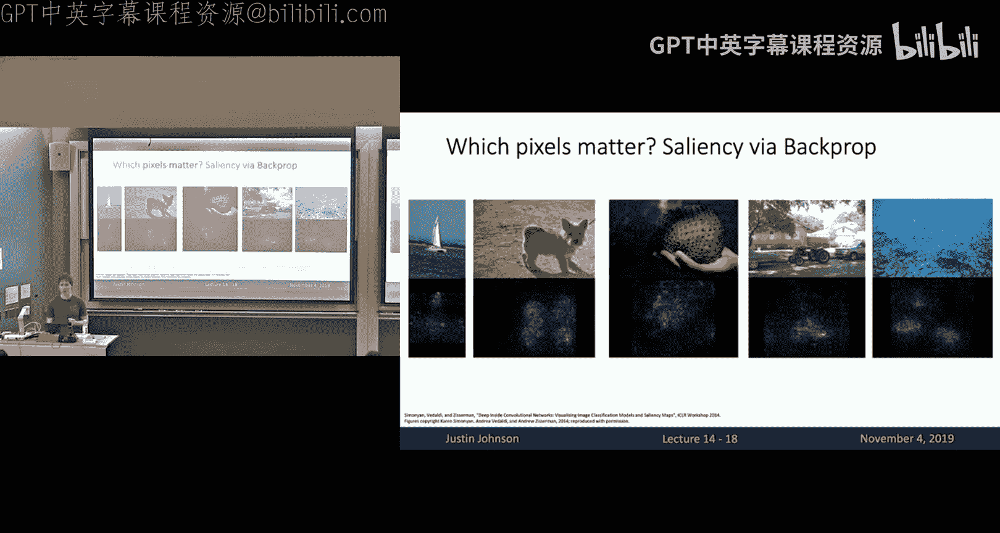

**具体步骤如下：**
1.  选择一个目标层和目标通道（神经元）。
2.  将整个测试集图像输入网络。
3.  对于每个图像，记录目标神经元在所有空间位置上的激活值。
4.  找出激活值最高的那些空间位置。
5.  根据网络的感受野，回推这些位置在原始输入图像中对应的图像块。
6.  将这些“最大激活图像块”收集并可视化。

例如，在某个中间层，一个神经元的最大激活图像块可能都是狗的鼻子或眼睛；另一个神经元的最大激活块可能都是各种颜色和方向的文本；在更深的层，一个神经元的最大激活块可能都是各种人脸。这直观地展示了不同层神经元所检测的语义复杂度在逐渐增加。

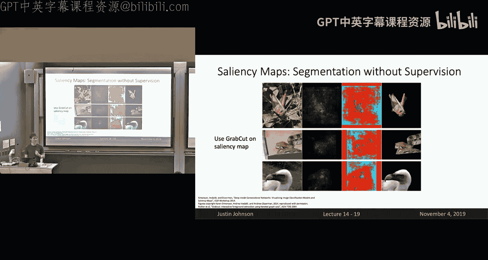

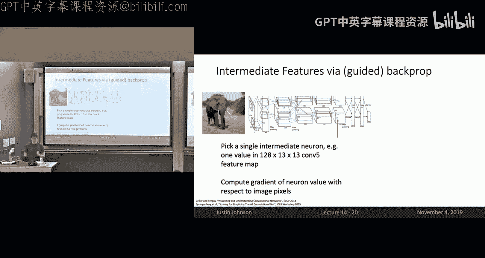

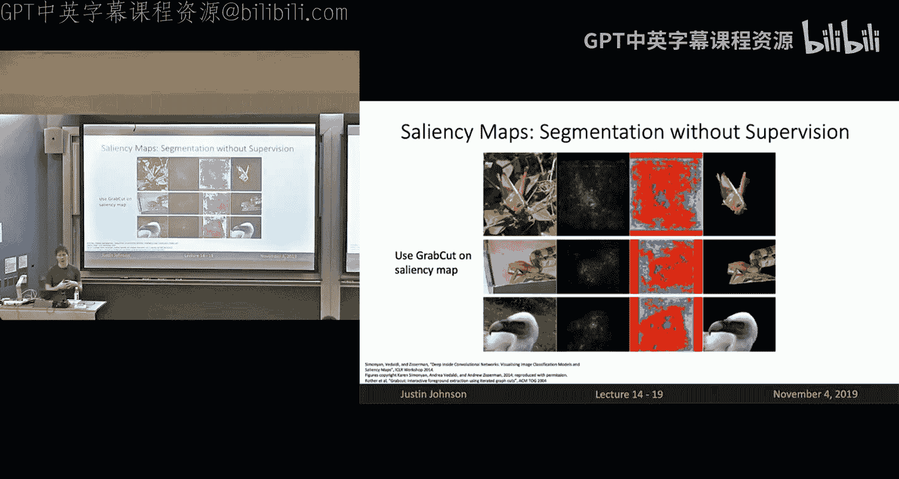

## 计算显著图（Saliency Maps）

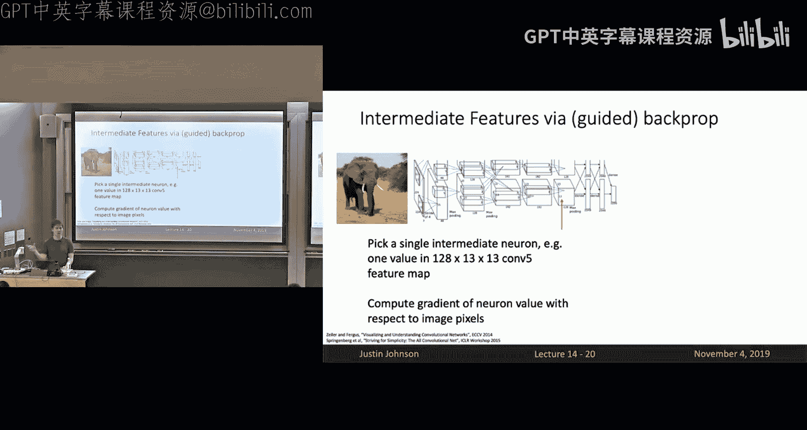

我们还可以通过分析**输入图像的哪些像素对最终分类决策最重要**来理解网络。一种方法是使用遮挡（Occlusion）。

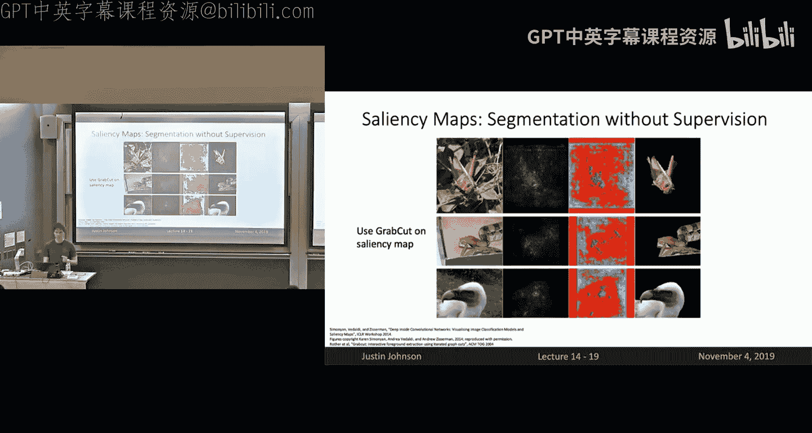

**具体步骤如下：**
1.  将输入图像（如一张正确分类为大象的图片）输入网络，记录目标类别（大象）的分数。
2.  在图像上放置一个灰色方块（遮挡块），遮挡住部分区域。
3.  将遮挡后的图像再次输入网络，记录新的大象分数。
4.  将遮挡块滑动到图像每个位置，重复步骤3。
5.  生成一个热图（显著图），其中每个位置的颜色表示当该区域被遮挡时，目标类别分数的下降程度。

如果遮挡住物体本身（如大象），分数会大幅下降；如果遮挡住背景，分数变化不大。这表明网络确实在关注图像中与物体相关的区域来进行分类。

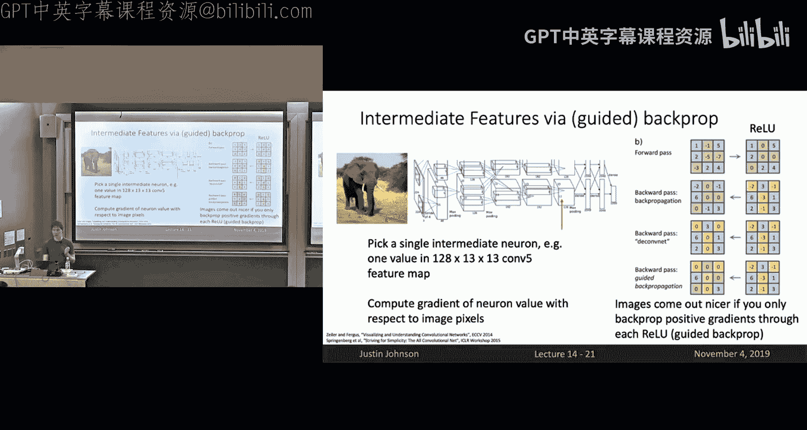

## 基于梯度的显著图

上述遮挡法计算量很大。一种更高效的方法是使用**梯度**。

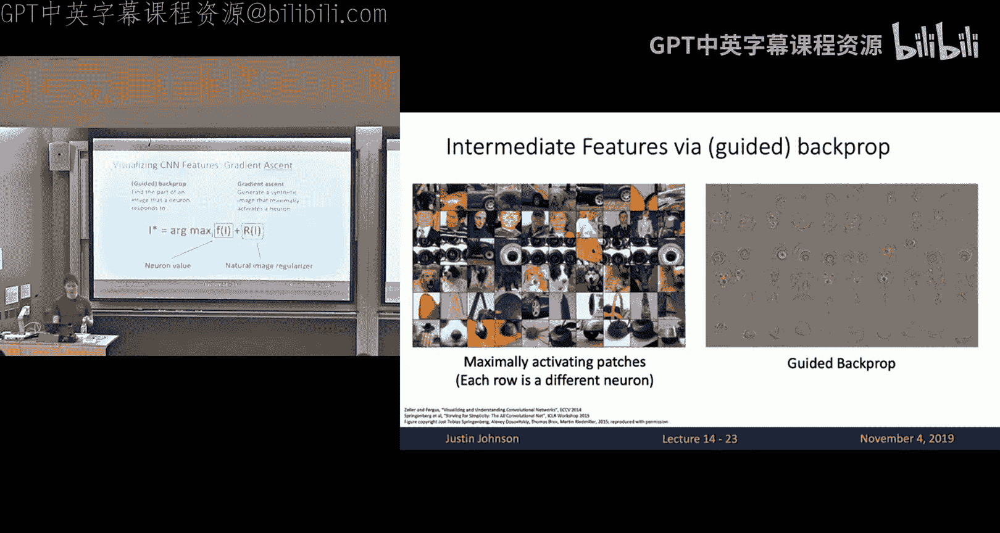

**具体步骤如下：**
1.  将输入图像输入网络，计算目标类别分数。
2.  通过反向传播，计算目标类别分数相对于**输入图像每个像素的梯度**。
3.  这个梯度图就构成了显著图，它表示每个像素的微小变化对类别分数的影响程度。

梯度大的像素（通常是物体轮廓内的像素）对分类决策更重要。这种方法与生成对抗样本的思想紧密相关。

## 引导式反向传播（Guided Backprop）

当我们想可视化**中间神经元**（而非最终分数）对输入图像的敏感性时，直接使用标准反向传播得到的梯度图可能很杂乱。**引导式反向传播**是一种改进技术。

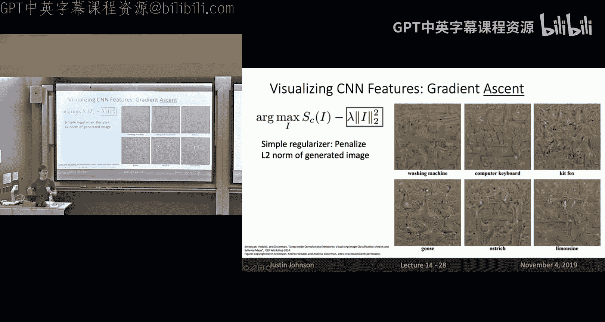

**其核心修改在于ReLU层的反向传播：**
*   标准反向传播通过ReLU时，会将前向传播中输入为负的位置对应的上游梯度置零。
*   引导式反向传播额外增加一个约束：**也将上游梯度中为负的部分置零**。

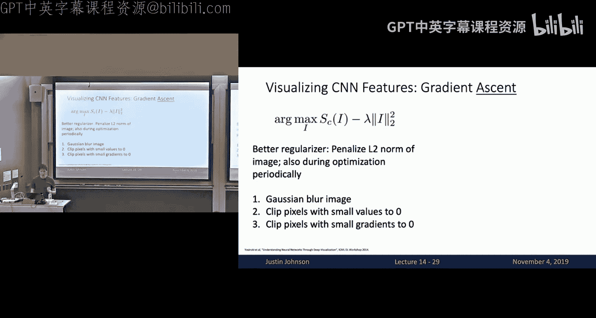

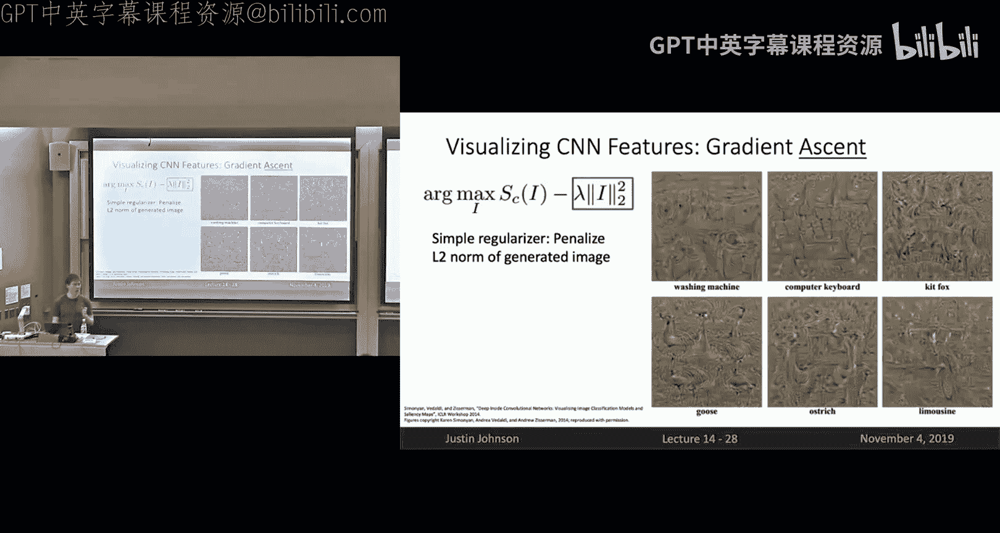

这样做的结果是，生成的梯度图更清晰，能更好地突出那些对激活目标神经元有正面贡献的输入像素。例如，对于之前那个激活狗眼睛的神经元，引导式反向传播生成的显著图会精确地高亮图像中狗眼睛的像素。

## 生成最大化激活的图像

我们可以更进一步，不局限于测试集中的图像，而是通过优化**直接生成一个全新的合成图像**，来最大化激活某个神经元或类别分数。

这通过**在图像像素空间上进行梯度上升**来实现。

**目标函数可以表示为：**
```
I* = argmax_I [ S_c(I) - λ * R(I) ]
```
其中：
*   `S_c(I)` 是图像`I`对于目标类别`c`（或目标神经元）的分数。
*   `R(I)` 是一个正则化项，用于迫使生成的图像看起来更“自然”。
*   `λ` 是权衡两项的超参数。

**最简单的正则化器是L2范数正则化**（惩罚图像像素值的L2范数）。使用这种方法，我们可以生成一些能高度激活“哑铃”、“斑点狗”、“鸵鸟”等类别的合成图像。这些图像虽然看起来不真实，但能揭示网络用于识别该类别的关键视觉特征（如哑铃的形状、斑点狗的斑纹）。

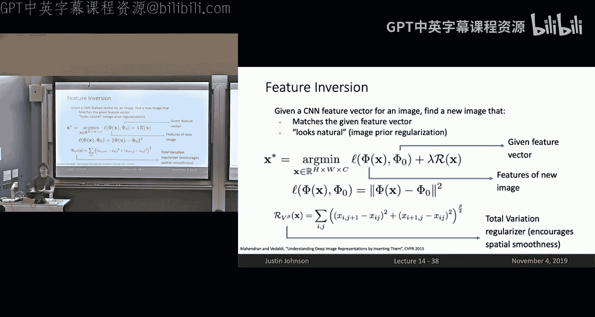

通过设计更复杂的图像正则化器（如加入平滑约束、使用更高级的先验），可以生成看起来更逼真的图像。但需要注意的是，正则化器越强，生成的结果可能越偏离网络“真正”在寻找的特征，而更多地反映了正则化器本身的偏好。

## 特征反演（Feature Inversion）

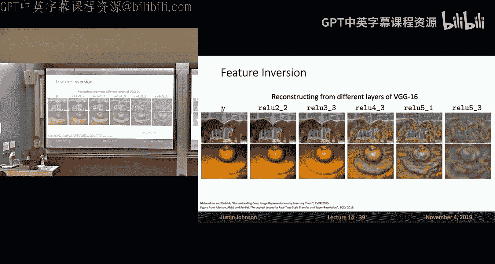

特征反演旨在回答：网络的某一层特征保留了多少原始图像的信息？

**具体步骤如下：**
1.  给定一张输入图像，通过网络前向传播，提取某一中间层（如`relu4_3`）的特征。
2.  固定网络权重，初始化一个随机噪声图像。
3.  通过梯度上升优化这个噪声图像，使其在该层的特征表示与步骤1中提取的特征尽可能接近（例如，最小化L2距离），同时加入图像正则化。

可视化不同层的特征反演结果可以发现：
*   低层（如`relu2_2`）的特征几乎能完美重建原始图像，说明低层保留了大部分像素信息。
*   中层（如`relu4_3`）的特征重建的图像保留了物体的整体结构和形状，但丢失了细节纹理和颜色。
*   高层（如`relu5_3`）的特征重建的图像只保留了非常粗略的全局结构，局部细节几乎全部丢失。

这表明，随着网络层数的加深，特征表示变得越来越抽象，逐渐抛弃了低级的视觉细节，转而编码更高级的语义信息。

## 应用：DeepDream

DeepDream利用梯度上升来**放大和增强**输入图像中网络已识别出的模式。

**其核心思想是：**
1.  将输入图像输入网络，前向传播至某一目标层。
2.  将该层的**激活值本身设为梯度**（即设置梯度等于激活值）。
3.  执行反向传播至输入图像。
4.  使用计算出的梯度更新输入图像（实际上是进行梯度上升），增强那些已被激活的特征。
5.  重复此过程多次。

如果在低层（检测边缘）应用DeepDream，云彩中的边缘会被增强，产生漩涡状的艺术效果。如果在高层（检测复杂模式，如动物部件）应用DeepDream，网络会“幻想”出图像中本不存在的结构，产生各种 psychedelic（迷幻）的动物混合体，如“狗鱼”、“猪蜗牛”等，非常有趣。

## 应用：神经风格迁移（Neural Style Transfer）

风格迁移结合了特征重建和纹理合成的思想，能够将一幅图像（内容图像）的语义内容与另一幅图像（风格图像）的艺术风格相结合，生成全新的图像。

### 纹理合成与Gram矩阵

风格迁移的基础之一是纹理合成。传统方法使用非神经网络算法。而基于神经网络的方法使用**Gram矩阵**来表征纹理。

**Gram矩阵的计算：**
1.  将风格图像输入预训练CNN，提取某一层的特征图（尺寸为 `H x W x C`）。
2.  将该特征图重塑为 `(H*W) x C` 的矩阵 `F`。
3.  计算Gram矩阵 `G = F^T * F`，其尺寸为 `C x C`。
   *   `G` 中的元素 `G_{ij}` 计算了第 `i` 个特征通道与第 `j` 个特征通道在所有空间位置上的相关性（协方差）。
   *   Gram矩阵**丢弃了所有的空间位置信息**，只保留了特征通道间的统计相关性，这恰好能描述图像的纹理风格。

通过梯度上升生成一个新图像，使其在多个网络层上的Gram矩阵与风格图像的Gram矩阵相匹配，就能实现神经纹理合成。

### 风格迁移算法

风格迁移的目标是生成图像 `I`，使其：
1.  **内容损失最小**：`I` 在较高层（如`relu4_2`）的特征与**内容图像** `C` 的特征相近（保留内容结构）。
2.  **风格损失最小**：`I` 在多个层（如`relu1_1`, `relu2_1`, `relu3_1`, `relu4_1`, `relu5_1`）的Gram矩阵与**风格图像** `S` 的Gram矩阵相近（捕获风格纹理）。

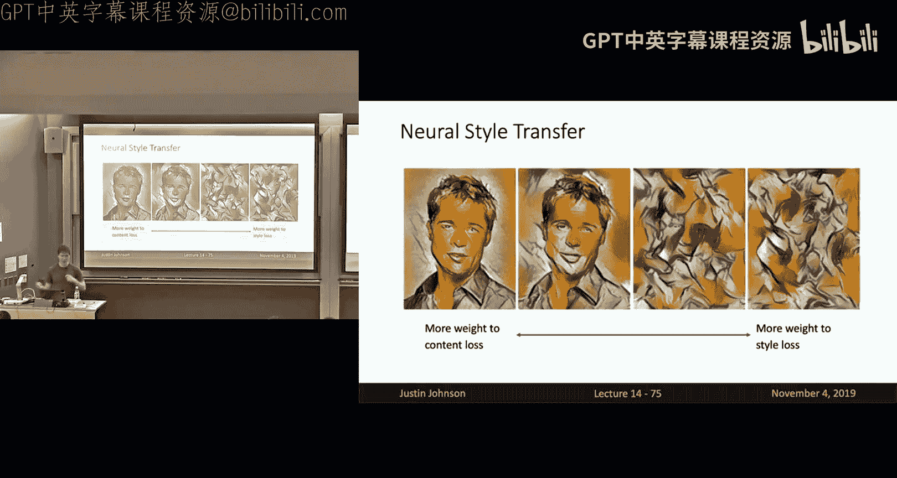

**总损失函数为：**
```
L_total(I, C, S) = α * L_content(I, C) + β * L_style(I, S)
```
其中 `α` 和 `β` 是权衡内容与风格权重的超参数。

通过梯度上升优化图像 `I` 的像素，最小化总损失，即可得到风格迁移的结果。这个过程是迭代的，速度较慢。

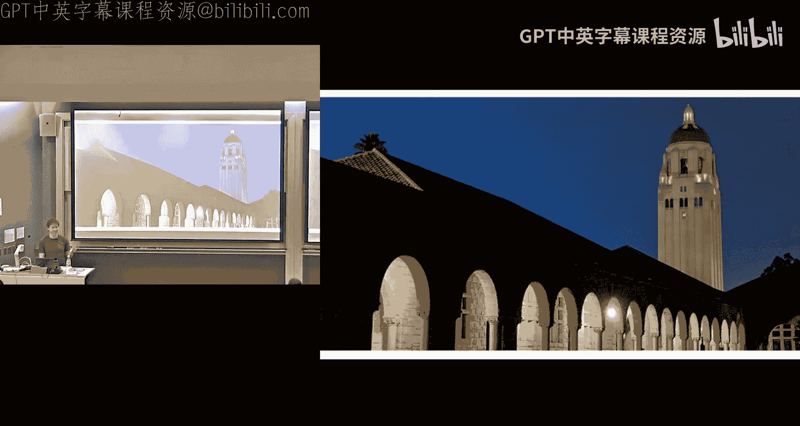

### 快速风格迁移

为了解决原始算法速度慢的问题，研究人员训练了一个**前馈神经网络**来直接进行风格迁移。

**训练过程：**
1.  固定一个预训练好的VGG网络作为损失网络。
2.  随机初始化一个风格转换网络（通常是一个编码器-解码器结构的CNN）。
3.  使用与原始风格迁移相同的损失函数（内容损失+风格损失），但这次是对风格转换网络的**权重**进行优化，而不是对单张图像的像素。
4.  训练完成后，风格转换网络可以在单次前向传播中快速对任何输入图像进行风格化。

**实例归一化（Instance Normalization）** 的提出正是为了提升快速风格迁移网络的质量。更进一步，**条件实例归一化（Conditional Instance Normalization）** 允许单个网络学习多种风格，只需为每种风格学习不同的缩放（scale）和偏移（shift）参数，而卷积权重共享。

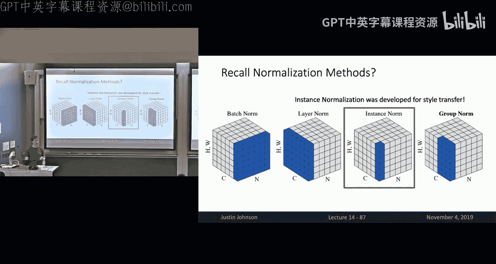

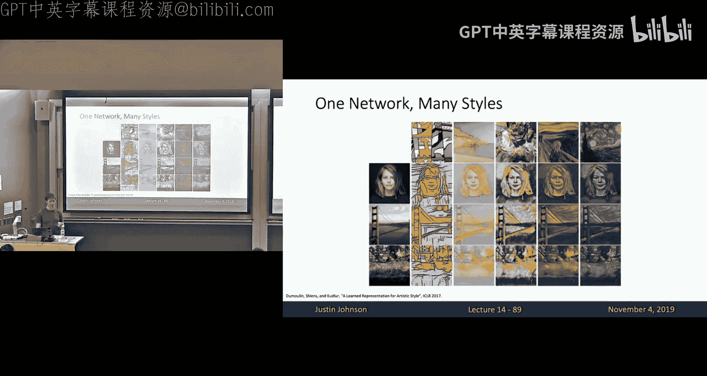

## 总结

本节课中我们一起学习了多种可视化和理解卷积神经网络的技术：
1.  **基础可视化**：可视化第一层卷积核、最后一层特征空间的最近邻和降维。
2.  **激活分析**：可视化中间层激活、寻找最大激活图像块。
3.  **基于梯度的分析**：计算显著图、使用引导式反向传播、生成最大化激活的合成图像、进行特征反演。
4.  **创造性应用**：将这些技术应用于DeepDream和神经风格迁移，生成有趣的艺术图像。

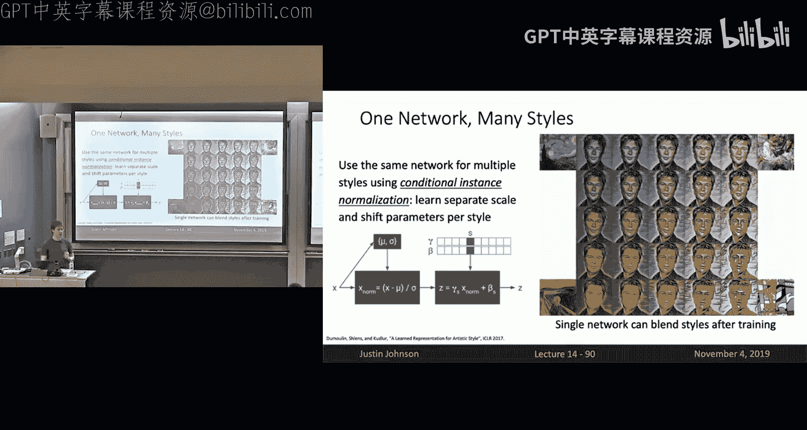

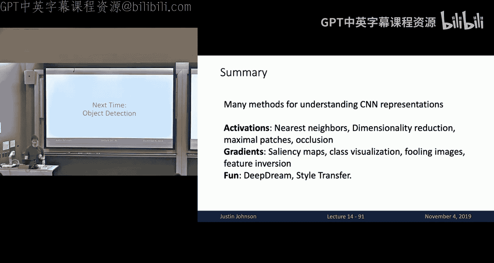

这些技术不仅帮助我们理解神经网络内部的运作机制，也为图像生成和艺术创作开辟了新的可能性。下一节课，我们将探讨目标检测任务。