# 密歇根大学《深度学习用于计算机视觉｜Deep Learning for Computer Vision UMich EECS 498-007 2019》中英字幕 p16 -16-15_ObjectDetection.zh_en -BV1jA4m1P7GN_p16-

All right， well welcome back to Le 15， today we're going to talk about object detection。

So as a quick reminder， we have assignment4 released and we willll be due a week from today and it covers a whole bunch of stuff and now with all of this stuff we've now covered in lecture so hopefully you can all get working on this assignment now。

So as a reminder that last time we were talking about this task of understanding and visualizing what's going on inside our convolutional neural networks and we talked about a lot of different techniques for doing exactly that。

 like looking at nearest neighbors in feature space by looking at max activating patches or using guided back propagation or other techniques to compute salliency maps on our features and we talked about methods for generating images like these synthetic images via gradient asscent or this task of feature inversion。

 and of course we also saw that a lot of these same techniques that could be used for understanding CNNs could also be used for sort of making fun artwork with convolutional neural networks。

 so we saw the deep dream and artistic style trends for algorithms as mechanisms for generating artwork with neural networks。

And now today we're going to talk about something maybe a little bit more practical。

 which is a new core computer vision task of object detection。

So basically the main computer vision task that we've talked about so far in this class is something like image classification right so in image classification。

 of course we know that a single image is coming in on the left。

 we process it with our convolutional model and it outputs some category label for the overall image。

 like maybe classifying it as a cat or dog or car， just giving we're an image classification。

 we're just giving a single category label attached to the entire image as a whole。

And has been useful this is a really useful task that has a ton of applications for a lot of different settings。

 and it's also been a really useful task for kind of stepping through the whole deep learning pipeline and understanding how to build and train convolutional neural network models。

But it turns out that this image classification task is only one of many different types of tasks that people in computer vision work on。

 so there's a whole hierarchy out there of different types of tasks that people work on in computer vision that try to identify objects and images in different sorts of ways and in particular。

 in today's lecture and in the next lecture on Monday。

 we'll talk about different types of computer vision tasks that involve identifying spatial extents of objects in images。

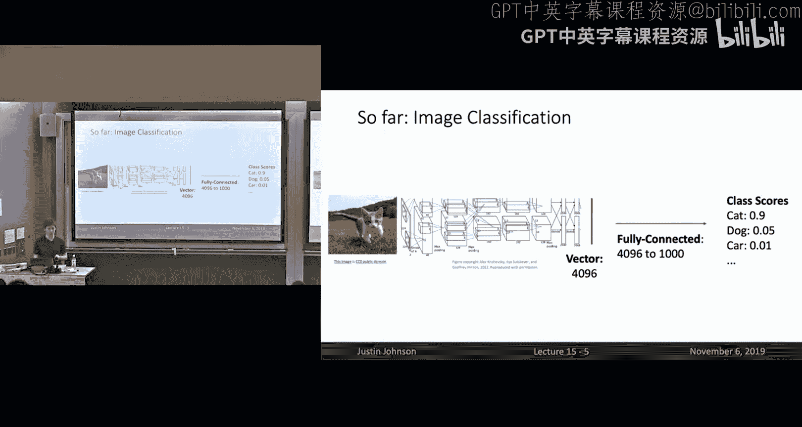

So of course， for the classic image classification task。

 we're simply assigning a category label to the overall image。

 and we're not saying at all which pixels of the image correspond to the category label。

 which is attaching a single overall label to the image。

Now other types of computer vision tasks actually want to go farther and not just give a single overall category label。

 but actually want to label different parts of the image with different categories that appear in the image。

 so between today's lecture and next lecture we'll talk about all of these different tasks。

 but the one that I want to focus on today is the task of object detection。

 which is sort of a super core task in computer vision that has a ton of useful applications。

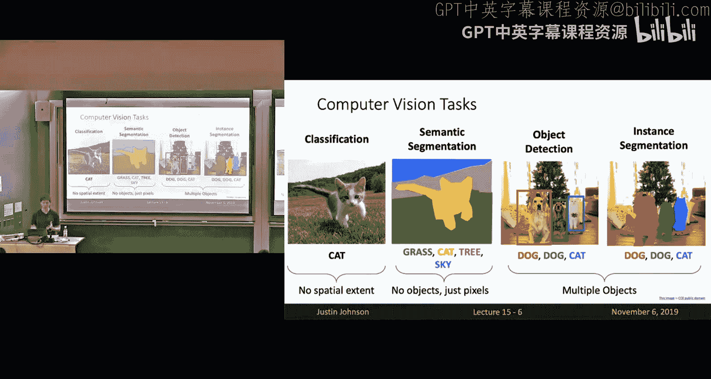

So what is object detection， Ob detection is a task。 We're going to input a single RGB image。

 and the output is going to be a set of detected objects that for each object in the scene。

 we want our model to identify all of all of the interesting objects in the scene。

 So for each So for each of the objects that we detect。 we're going to output several things。

 One is a category label， giving the category of the detected object and the other is a bounding box。

 giving the the spatial extent of that object in the image。

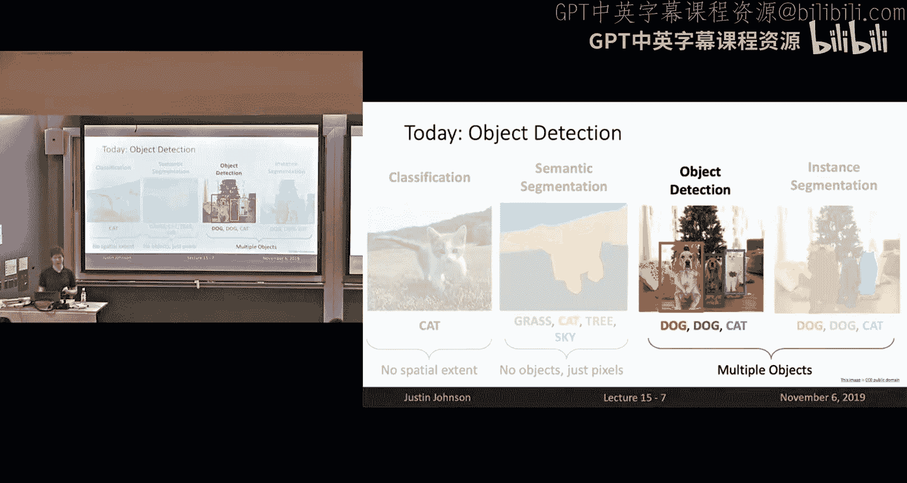

So on the category labels， just like with image classification， ahead of time。

 we're going to prespecify some set of categories that the model will be aware of。

 so in something like remember in something like CFFR classification。

 our model is aware of 10 different categories for CR 10 in something like imageNe classification。

 our model is aware of 10 different categories， well for object detection we'll also be aware of some fixed set of categories ahead of time。

And then for each of our detected objects we're going to output some category label for the object。

 just as we did with image classification， but now the interesting part is this bounding box that the model needs to output a box telling us the location of each of the detected objects in the image and these bounding boxes we usually parameterize with four numbers that's like the X and y。

 giving the center of the box in pixels and the width and the height， W and H。

 giving the width and the height of the box again measured in pixels。

So you could imagine models that produce sort of arbitrary boxes with arbitrary rotations。

 but for the standard object detection task， we usually don't do that。

 and instead usually boxes only output boxes that are aligned to the axes of the input image。

 so that means that whenever we're working with bounding boxes。

 we can always define a bounding box using just four real numbers。

So now this seems like a relatively small change compared to image classification right。

 how hard could it be， where just now we need to just output these boxes in addition to the category labels。

 Well， it turns out that that adds a lot of complication to the problem。

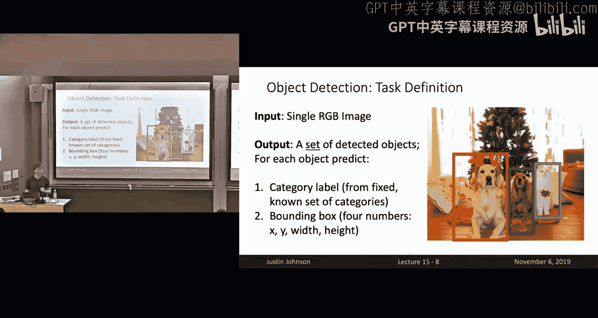

So a couple of the types of problems that we need to deal with once we move to object detection。

 Well， one of the biggest ones is this idea of multiple outputs that with image classification。

 our model was always outputting a single output for every image which was a single category label。

 but now with image classification， we need to output potentially a we need to output a whole set of detected objects。

 and each object each image might have different numbers of object it might have different numbers of objects in it that we need to detect。

 So now somehow we need to build a model that can output avariably sized number of detections which turns out to be quite challenging。

Of course， there's another problem here， which is that for each object in this set。

 we need to produce two types of outputs。 One is this category label that we're very familiar with。

 and the other is this bounding box object。 So now we need some other way to deal with processing bounding boxes inside of our network。

And then another kind of computational problem with object detection is that it typically requires us to work on relatively high resolution images。

 So for something like image classification， it turns out that relatively low resolution images of like 2。

2，4 by 2，2，4 pixels tends to be enough spatial resolution for most of the image classification tasks that we want to perform。

But now for object detection， because we want to identify a whole lot of different objects inside the image now we need enough spatial resolution on each of the objects that we want to detect。

 so that means that the overall resolution of the image needs to be needs to be much higher。

 So as a concrete example for object detection models。

 it's more common to work on images of resolution something like on the order of like 800 by 600 pixels So that's like a lot larger image resolution compared compared to image classification。

 So that means we can use fewer images per batch we need to train longer。

 we need to use multi distributed GPU training and that's kind of a computational issue that makes object detection much。

 much more challenging。Okay， but but I think that object detection is a really useful problem， right。

 I think there's a lot of cases where we want to build systems that can recognize stuff in images。

 but actually needs to say where it is in the image。

 So one example might be something like a self-driving car that if if you're building a vision system for a self-driving car。

 it needs to know where all the other cars are around it in space。

 So therefore it becomes really critical that it can not only just assign single category labels to images。

 but actually detect whole sets of objects and actually say where they are in space。

 So this is so basically after image classification。

 I think object detection is maybe the number two most core problem in computer vision these days。

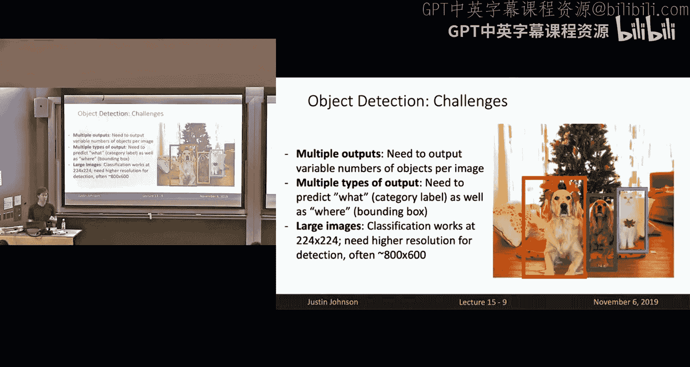

Okay， so then with all that in mind， let let's consider a simpler problem。 For。

 let's forget for a second about this set this problem of producing a set of outputs。

 And let's think about how we might approach this problem。

 if we just wanted to detect a single object in the image。 Well。

 it turns out that detecting a single object in the image。

 we can actually do with a relatively straightforward architecture。

 So here we might imagine taking in our our image on the left and assuming that there's only one object in the image。

 passing it through our favorite convolutional neural network architecture。

 like an Alexnet or a BG G or some kind of resnet。 that would eventually result in some vector representation of the image。

And now from that vector representation， we could have one branch that does image classification that is saying what is in the image。

 and this would look very much like all of the kinds of image classification models that we've seen so far that it's going to output a score or category and that's going to be trained with the softmax loss on the ground truth category。

 and this is basically the same as the image classification model that we've seen many times。

But now the new part is that we can imagine attaching this second branch that also inputs this vector representation of the image and now has a fully connected layer to go from maybe 40。

96 dimensions in that final vector representation to four real numbers。

 giving the coordinates of the bounding box of that one object。And now this， these box coordinates。

 we can imagine training with some kind of regression loss like L2， like the L2 difference。

 but like the L2 difference between this set of four numbers giving the box that we actually output and the set of four numbers giving the actual coordinates of the box that we were supposed to detect。

And then then we could imagine training this the second wear branch with with some kind of L2 loss or other kind of regression loss on real numbers。

And now the problem is that we've got two loss functions because we're asking our model to predict two different sorts of things。

 One is the category label and one is the bounding box location。 and for each of these two things。

 we have an associated loss function， but in order to compute gradient descent。

 we actually need to end up with a single scalar loss。 We don't know how to deal with sets of losses。

 So the way that we overcome this is just add up the different losses that we have in this network potentially as a weighted sum to give our final loss。

 and now this is a weighted sum because we might need to tune the relative importance of this softmax loss and this regression loss to make sure that they don't overpower each other in the overall weighted sum loss。

And now this idea of taking multiple loss functions right now this idea is that we've got one network and we want to train one network to do multiple different things。

 so then we attach one loss function to each of the different things that we want our network to predict and then we sum them up with a weighted sum and this turns out to be a pretty general construction that applies whenever you want to train neural networks to output multiple sorts of things and this general construction is called a multitask loss because or we want to train our network to do sort of multiple different tasks all at once what we need to boil it down to a single loss function for training at the end。

And to kind of see how you might work on this in practice， this backbone network。

 this CNNN would often be maybe pretrained for imageNe classification。

 and then you would sort of fine tune in this whole network for doing this multitask localization problem。

And this seems like kind of a silly approach for detecting objects and images It's very straightforward。

 We're just basically attaching an extra fully connected layer at the end of the network to predict these box coordinates。

 But this relatively simple approach actually works pretty well。

 if you know that you only need to detect one object in the image example and actually this particular approach to localizing objects and images was actually used in way back in the AlexNe paper when they had some task where they want to classify and also give a bounding box for the one classification decision that they make。

 So this is actually a reasonable approach if you know that you only need to detect one object in the image。

😊，But， of course， we know that real images might have multiple objects that we need to detect。

 So this， this， this relatively simple situation is not going to work for us in general。

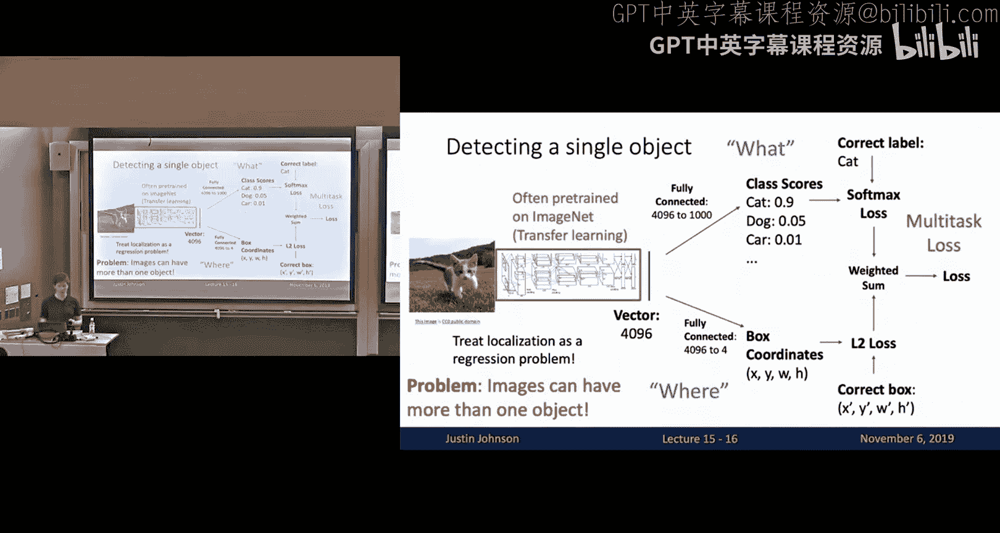

And to kind of imagine what this looks like， well， we need in general。

 different different images might have different numbers of objects that we need to detect。

 So for this cat image， maybe there's only one object in there， the cat that we need to detect。

 So then we need to predict only four numbers coming out of our network。

 which are the four bounding box coordinates of the one cat bounding box。

But now for this middle image， maybe there's three objects we want to detect two dogs and one cat。

 So now we need to predict 16 numbers。 actually I can't I can't add right。

 that's only 12 numbers right three times 4 is only 12。 So that's a bug in the slide。

 That's what happens when you make the slides very fast。 You have some bugs on there。

 right so in this case， we need to our network only output 12 numbers。

 And for this this image of all these adorable duckling is floating around in the water with their mom。

 There's like a lot of ducks in here。 I can't even count them。 There's like way too many。

 But basically this means that we need our network to output a whole lot of different duck detections like duck duck duck duck duck and maybe a goose。

 but there's actually no goose here。 So then we need to output maybe lots of different numbers from our neural network model。

 So then we need some some mechanism that allows our model to output variable numbers of objects for each for each different image that we might see。

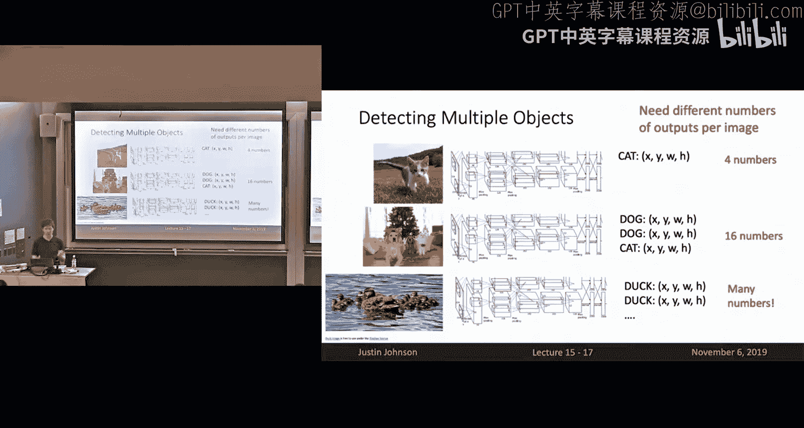

So there's a relatively simple way to do this， which is called a sliding window approach to object detection。

Here the idea is that we're going to train we're going to have a CNN， a convolutional neural network。

 and we're going to train it to do classification。 But now this CNN that's doing classification is going to categorize window or subregions or subwindow of our input image。

 And now for each subwindow that we apply it to， it's going to output it's going to output if we want to detect C different categories we're actually going to output a decision over C plus one outputs where we add a new output for a special background category。

 So that means that if we then basically this is we are reducing this problem of detection down to an image classification problem。

 So then all we need to do is apply this classification CNN to many。

 many different regions in the input image and for each region that classification CNN we'll tell us either is this a dog or a cat or is this some background region where there is no object that we care about。

So then you could imagine if we applied this sliding window CNN object detector to this blue region in the input image。

 Well， there's no object precisely localized by this blue bounding box。

 So this so for this image region our detector should say background to mean that there is no bounding box in this image region。

 So we slide our region over and then run it on a different region in the image and this one it should say that there's a dog here because this is a region that is well localized with with that box。

 and then this one will also be a dog。 This one should be a cat and then that basically we take we take this object detector and we slide it over different regions in the input image and for each of those regions。

 we run the CNN on that region and it tells us whether it's an object or whether it is background。

Okay， this seems like a relatively simple approach to doing object detection。 but there's a problem。

 Let's think about how many possible bounding boxes there are in an image of size H cross W。

 and hint， it's going to be a lot right So if there's h if we have an input image of size capital H cross capital W。

 then consider a box of size lowercase H cross lowercase W。

 Now the number of positions that we can put this in， well。

 there's capital W minus lowercase W plus one possible position x positions that we could put this box and similarly。

 for the number of y positions that we can put this box。

 So that means that the number of positions we can put this box in is this quadratic equation that depends both that depends on the product of capital W and capital H。

But but in fact， this is even worse because we need to consider not just boxes of a fixed size。

 We need to consider all possible boxes of all possible sizes and all possible aspect ratios。

 So if we sum this thing up over all， all lowercase W and all lowercase H over all possible sizes that are less than the full image size。

 then we get this this quattic expression that sort of depends on the fourth power of the number of pixels in the image。

 rather the square of the number of pixels in the image， But it's like h squared times W squares。

 that's like really， really bad。And how bad is this， Well。

 if we have something like an 800 by 600 image， then it comes out that theres that there's about like 58 million different bounding boxes that we could imagine evaluating inside this 800 by 600 image。

 So if we wanted to do some kind of dense sliding window approach and actually apply our CNN sliding window classifier on each one of these possible image regions。

 This is going to be absolutely completely infeasible。

 There's like no computational way that we could run our object CNN forward pass 58 million times just for one image。

 We'd be waiting forever for any detections that we wanted to come out。Yeah， is there a question？你没去。

you like。は same。Yeah， the question is that even if you could do this and you had like infinite compute。

 you'd probably end up identifying the same object over and over again with sort of slightly offset windows。

 And yeah， that's exactly correct。 That'll actually turn out to be a problem。

 not just for this sort of impossible to implement version of object detection。

 but that'll actually be a problem for other real types of object detectors as well。

 So we'll talk about this idea of nonmax suppression in a little bit that can overcome that problem。

Okay， so then basically， this is not going to work。

 So we need to do some other approach to object detection。

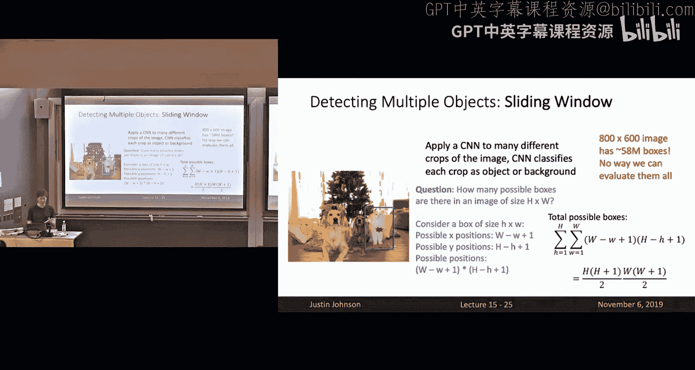

Well that brings us to this idea of a region proposal。 So here。

 the idea is maybe if there's no way that we can possibly evaluate the object detector on every possible region in the image。

 maybe we can have some external algorithm that can generate a set of candidate regions for candidate regions in the image for us such that the candidate regions gives a relatively small set of regions per image but which are have a high probability of covering all the objects in the image So was a few years ago。

 there was a whole bunch of different papers proposing different mechanisms for generating these candidate regions called region proposals。

 and I don't really want to go into any of the details of exactly how they work because spoiler alert eventually they'll be replaced by neural networks too but for now what you can kind of think about is that these original these sort of early approaches to region proposals would perform some kind of image processing based on the input image and maybe look for b blob type regions in the image or look for edges in the input image or use other。

Llevel image processing cues to look for image regions that have a high probability of containing objects。

 So one of these very famous methods for region proposals was this method called selective search So selective search was some kind of algorithm that you could run on a CPU and it would give you about 2000 object proposals per image in a couple of seconds of processing on a CPU and these 2000 object proposals that it would region proposals that it would output would have a very high probability of covering all of the all of the interesting objects that we cared about in the image。

Okay， so that gives us so then once we have this idea of region proposals。

 it gives us a very straightforward way to actually train a practical object detector with deep neural networks。

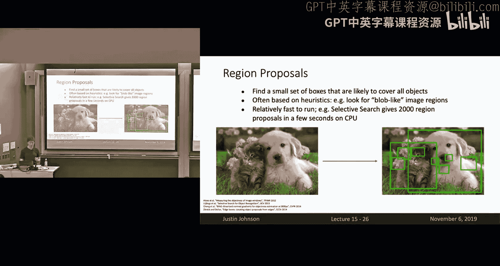

So that brings us to the very famous paper， very famous method called RCN。

 which the R stands for regionbased。 So this is a regionbased convolutional neural network system for object detection。

 And this is like one of the most influential papers I think in deep learning that came out back in CBPR 2014。

 And since then it's sort of been very， very impactful overall。

 So here but the way that it works is actually pretty straightforward in a way。

 So then what we're going to do is we're going to start with our input image。

 And then we're going to run our region proposal method like selective search。

 So then selective search will give us something like 2000 candidate region proposals in the image that we need to evaluate here we're only showing three because I can't fit 200 on the slide。

And then for each of these candidate image regions。

 these candidate image these region proposals could all be different sizes and different aspect ratios in the image。

 but then for each of those region proposals， we're going to warp that region to a fixed size of something like 224 by 224 and then for each of those warped image regions we're going to run them independently through a convolutional neural network and then that convolutional neural network will output a classification score for each of these regions so then again this classification score will tell us will be a classification over C plus one categories so it will tell us whether or not that region is a background region with no object or whether it actually or if it's not a background region。

 then what is the actual image label that the category label that that region should be assigned。

And you could imagine sort of training this thing now using sort of all the standard machinery that we know for training classification networks。

 and this will actually work pretty well， but now there's a slight problem here。

 which is that what happens if the region proposals that we get from selective search do not exactly match up to the objects that we want to detect in the image because here the entire mechanism of the all of the bounding boxes are just coming out of this sort of black box selective search method and there's no learning happening that' actually outputs the boxes。

 so to overcome that problem we're actually going to actually use kind of a multitask loss similar to this very simple mechanism we saw earlier。

 and now each of these now this CNN is actually going to output an additional thing which is a transformation that will transform the region proposal box into the final box that we actually want to output for that object of interest。

And this is now because a bounding box actually is specified and another thing I mean。

 one thing to point out here is this idea of bounding box regression。

 we're not inventing a box from scratch， instead we just want to modify the region proposal that we were given as input because we think that the region proposal was probably pretty good。

 but we just might need to tweak it a little bit to cause it to fit better at the object that we were looking at。

And now because a bounding box can be parameterized with a sequence of four numbers。

 then we can also parameterize a delta on top of an existing bounding box。

 also using a sequence of four numbers。So there's a lot of different parameterizations of these bounding box transformations that you'll see people use。

 but I think the most common one is this that I put on the slide here。

 so here the idea is that if we're given a region proposal that has its center at Px。

 PY and has height and width P and BW， and then if our connet is outputting transformation。

 giving four numbers， Tx， TY， TH and TW， then we are going to output then our final output box is going to somehow combine the transformation that our CNN outputs and the coordinates of the region proposal that we were given as input。

And the parameterization here is going to be relative to the overall box size in translation。

 so that means that then the x coordinate of our output bounduning box will Tx will be the original X coordinate of the region proposal plus the X transform times the width of the box so that means that and parameterizing these things relative to the input bounduning box size kind of makes it work out because of the fact that we had to warp the original image regions before feeding them into the CNN。

 so that kind of means that these transformations that we're outputting are kind of invariant to the fact that we had to warp the original input regions。

So what that means here is that if we were to output like a Tx of0。

 that means leave the original region proposal alone in x position， that means it was pretty good。

 And if we output Tx equals1， that means I want to shift over the region proposal by an amount in x equal to the width of their image region and then we a similar transform for transforming things in the vertical direction and now for the scale it's going to be logarithmic。

 so then we're going to scale up the width or the height of the region proposal according to by exponentiating that transform and then multiplying that。

 and again this makes it sort of scale andvari to the fact that we had to warp the input regions before beating them to the original CNN。

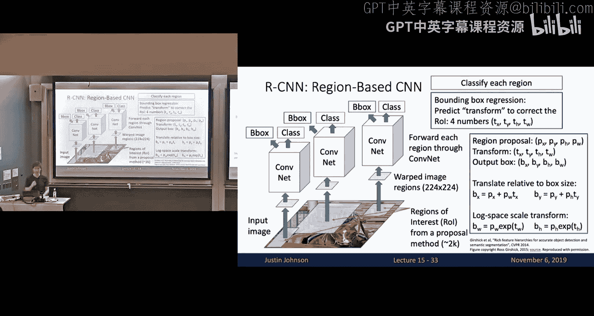

Okay so that gives us our that gives us our first full object detection method using convolutional neural networks。

 So now the pipeline at test time looks something like this that will be given a single RGB image and then we'll run this selective search algorithm on the input image on CPU to generate something like 2000 region proposals and now for each of those region proposals。

 we' resize them to some fixed size like 224 by 224 and then run them independently through our conet to predict both a classification score of a category versus background as well as this Bbox transform that will transform the coordinates of the original region proposal。

And because now at test time， we actually need to output some finite set of boxes to use maybe in our downstream application。

 So there's a lot of different ways that we can do that that kind of depend on exactly the application that you're using here。

 So one idea that you might use is that you want to somehow use the predicted scores for all the region proposals to output some small finite set of boxes for the image So one idea here is that maybe if maybe you always want to output like 10 objects for image you don't really care what the categories are then you could imagine thresholdholding based on the background score and output the 10 region proposals that have the lowest background score and maybe this would be this would give you 10 boxes that you could output for your final prediction Another option here would be to set a threshold per category because our classification network is actually outputting a full distribution giving us a score for background as well as a score for each of the categories So another option here is to set some threshold for each category such。

That if the classification score for the category is above the threshold。

 then we output the box as a final detection， otherwise we don't emit the box and the exact mechanisms of exactly how you convert these scores into final detections kind of depends on exactly what downstream application you're working at。

this。Yes， yes， so these these cos all share weights。

 So these these comes we use the exact same continent with the exact same weights。

 and we just apply it to each image region that is coming out of our region proposal mechanism。Yeah。

 because if they didn't share weights， it wouldn't really work out because we might have slightly different well we might have different numbers of region proposals for each image and even if we did have a fixed number of like 2000 proposals for image。

 it would be sort of infeasible to train 2000 separate Coms for each region proposal and it wouldn't really make sense because right these things are just looking we just want to train them to look at image regions and then tell them what whether there's an object centrally cropped in that region。

Yes， yes， so I haven't really told you about the training of this because there's a couple of subtleties in exactly how you train this thing。

 but kind of to imagine how you might train this thing。

 you're going to form batches where the batches consist of different image regions from the same image or maybe different image regions across different images so then when you run this thing at training time。

 it's basically going to have a batch of image regions and then for each of those image regions it's going to output a classification score as well as these bounding box transformation parameters and then you'll use this idea of multitask loss to compute a single loss that sums both the regression loss and the classification loss and then you'll back propagate into the weights of the CNN and make a gradient step。

But there's a little bit of subtlety here in exactly how you decide which region proposals should be considered objects versus background。

 but I'll kind of gloss over that that here for the sake of simplicity。Yeah。The question is。

 do you input the rotation to the con？Oh the location。 So yeah。

 we actually do not input the location of the box to the Comnet。

Because this should be somehow a translation invariant that maybe and scale invariant as well。

 because maybe a cat in the upper lefthand part of the image should look the same as a cat in the lower right- hand part of the image。

 so we actually do not input the location information usually here and actually if you look back at the way that we parameterized this box transformation。

 this box transformation was parameterized in such a way that it will work even though we're not putting in the location information because the way that we're parameterizing these transformations is kind of invariance to the location and scale of the box in the image。

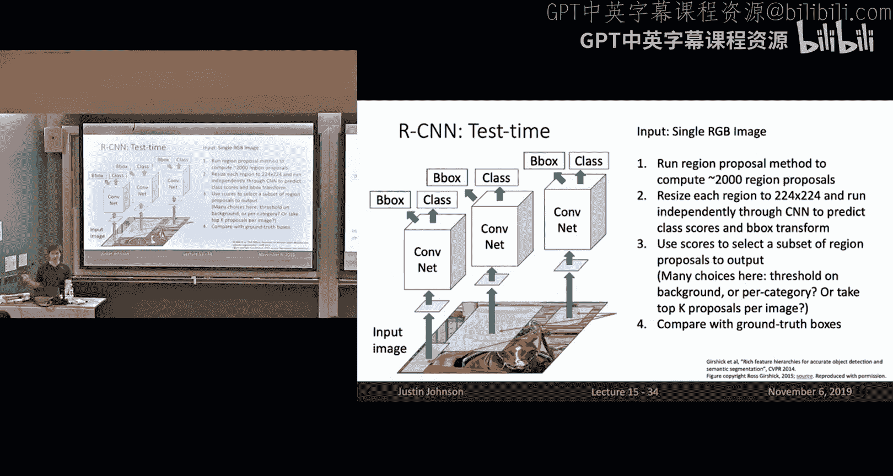

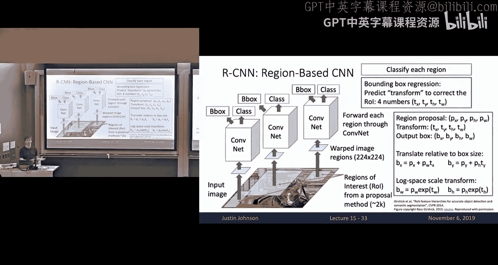

Yeah。我。嗯呃。S。车的。好。大力起。Is it like a paper？我情况。Yeah， the question is how do you choose the size at which you warp the boxes and usually that's tied you have the same hyperparameter when you're doing image classification right so you know whenever we do image classification。

 you always build a CNN that operates on some fixed image resolution and then you have to warp your images to fit that fixed image resolution and it's exactly the same thing here except now we're warping image regions rather than warping full images so that would be a hyperparameter but in general。

 what we tend to do for detection is use the same image resolution for that warping as we would have done in a classification case instead so for classification networks we usually use image resolution of 224 by 224 during training So for detection we' also warp the regions to 224 by 224。

Okay， but now， so then then once we have our oh， yeah， another question。

These parameters by training or fixed by testing or are fixed by training which parameters？The game。

U， so this question of like these K proposals or these thresholds。

 these would be used only during testing， so during training。

 you would always train on all of the potential region proposals and then these thresholds。

 these top K， those would be thresholds that you set at test time。

And so the way that you would choose those thresholds is usually by tuning on some validation set for your downstream application。

 but those thresholds or those top K doesn't enter into the training process at all for this network。

Okay， any more questions on this RCNN algorithm？Okay。

 so then once we've got our now that we've got an algorithm that can basically this this is a practical algorithm that can input an image and then output a set of bounding boxes for all the objects detected in that image。

 So then， of course， we need some way to evaluate our results to say whether or not the boxes that we output are actually similar to the boxes that we should have output so we can write some performance number that we can put in a paper and make it bold to show that we're better than other people。

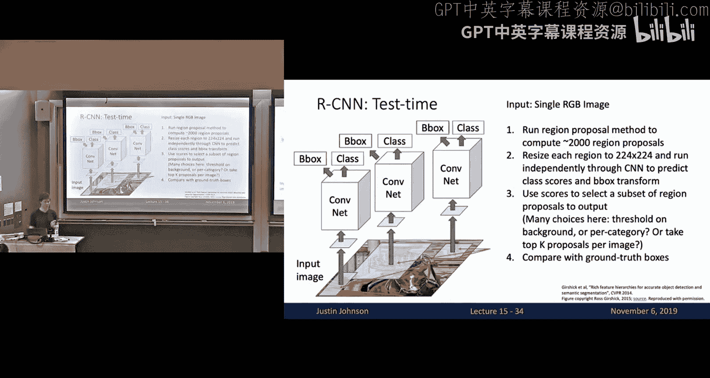

So then we need some mechanism， so basically in order to do that。

 we need some mechanism that can compare to bounding boxes。

 So suppose that in this image of this adorable puppy that the green box is the true box that the system should have output for this image and suppose that and these things will never be perfect。

 So suppose that our algorithm outputs this blue box。

 then we need some way to compare whether or not our blue box matches the green box and because these are all real numbers。

 then it will never match exactly。

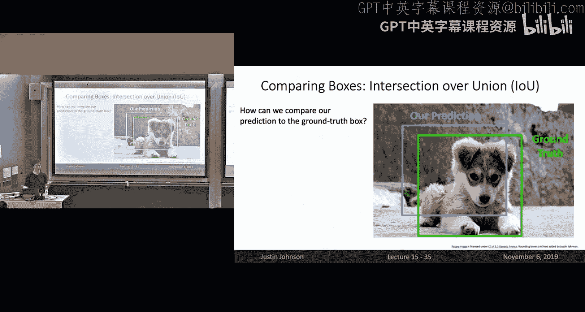

So the way that we normally compare two sets of bounding boxes is with a metric called intersection over union all usually evaluated as IOU。

 You'll sometimes also see this called the Jaquard similarity or Jaquard index and other situations。

 But for object detection we usually call it IOU。 And the the way that we compute this is it's a similarity measure between two boxes。

 And it's basically the way we compute it is exactly what the name is saying。

 So you compute the intersection of the two boxes， which is again a box shown here in this reddish orange color on the slide。

 And then you separately compute the union the area of the union of the two boxes。

 which is this purple region。 actually the purple region together with the orange region is shown on the slide。

And then the intersection of reunion is just the ratio of the intersection region to the union region。

 and then for this example， our intersection intersection of reunion is something like 0。

54 So this will always be a number between 0 and1 right because we know that if the two boxes coincide perfectly then the intersection is equal to the union so then this ratio is one And if the two boxes are completely disjoint and don't overlap at all。

 then their intersection will be 0 and their union will be nonze so this will be a ratio so this will give a ratio of 0 So this intersection of reunion is always a number between 0 and1 where higher numbers mean a better match between the two bounding boxes and to kind of give you a sense for what people usually look at these IO numbers is that IOU greater than 0。

5 is usually considered like an okay decent kind of match between two bounding boxes So for this green box and this blue box here。

 these have an IOU of 0。54 So it's like it's not perfect but it kind of got the general just。

Of where the object was supposed to be。 So that's kind of what an IOU of a 0。 usually looks like。

And now an IOU of 0。7 is usually like pretty good。 Like maybe we made some slight errors and we cut off a little bit of the bounding box。

 but overall， we did a pretty good job at localizing the object。

 And now any kind of IOU greater than 0。9 is like nearly perfect。

 So actually if you flip between these， I actually had to reduce the width of a lines to cause you to be able to see any gap between these two boxes now once we move to 0。

9。 And in fact， for a lot of sort of real applications depending on the resolution of your image0。

9 might be like only a couple pixels off of the true box。

 So basically you'll almost never get IOU of1。 So IOU of 。

9 is usually like almost perfect sort of threshold。

So then this IOU metric is something that we use all over the place whenever we need to compare to bounding boxes。

But now now there's actually another problem that was pointed out a little bit earlier。

 which is that actually these these practical object detection methods will often output a set of overlapping boxes that output like many overlapping boxes that are all kind of around the same objects。

 So for this these are not real object detections， I just kind of made these put on the slide。

 But for this example of these two puppies in the image Then an object detector usually will not output exactly one box per object。

 Instead， object detectors will usually output like a whole bunch of a whole bunch of boxes that are all kind of like grouped very near each each object in the image that we actually care about。

So then we need some kind of mechanism to get rid of these overlapping boxes。

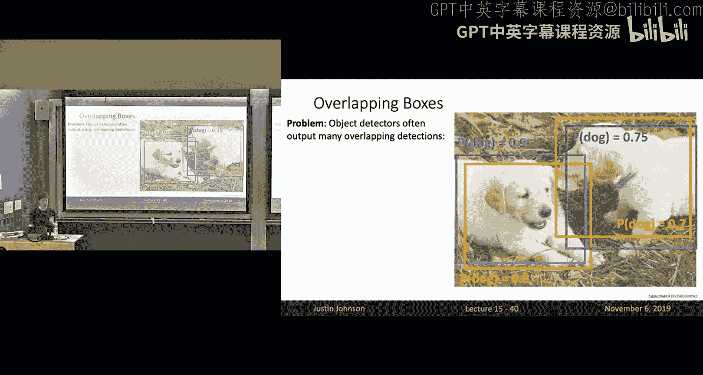

And use the way that we do that is by post processing the boxes coming out of our object detection system。

 using an algorithm called nonmX suppresspression or NMS。

 and is there's a lot of different ways you can implement nonnX suppression。

 but the simplest way is this with this fairly straightforward greedy algorithm。

So now basically we've got our the native outputs from object detector is this whole set of boxes in the region and in the image and for each of those boxes。

 we have some probability that it that is each of our categories So for each of these four boxes that are being output by the detector we have like different probabilities that each of those boxes are a dog as coming out of the classification scores So then the greedy algorithm for non-max suppresspression is that first you select the highest scoring box in this case is the blue box that has the highest probability of dog as output by the classifier and then you compute the intersection of aunion between that highest scoring box and each other box in that was output by the detector and and by construction because we started with the highest scoring box each of these other boxes will have lower scores than the one that we're looking at here and then we compute the intersection of aunion between that highest scoring box and all the other boxes which we've computed here。

And then we're going to set some threshold， often something like 0。

7 relatively high and say that if we， if our detector output two different boxes that had an intersection of reunion greater than this threshold。

 then it's likely that they did not correspond to different objects。

 It's likely that they were we think that instead they were probably just kind of duplicate detections that fired multiple boxes on the same object。

 So then any boxes that have IOU greater than that threshold with our highest scoring box will simply eliminate。

So now in this example， the blue box and the orange box have an IOU of 0。78。

 so then we will eliminate the orange box， and then after eliminating the orange box we'll then go back to step1 and we'll choose the next highest scoring box that was output that by a detector which in this case is the purple box with a P of dog at 0。

7。5 and we'll then again compute the IOU between that next highest box and all the other lower scoring boxes so in this case there remains only one lower scoring box which is the yellow box and these have an IOU of 0。

74 so then we would eliminate the yellow box and the final outputs from our object detector would be these two this blue box and this purple box that are now fairly separated and don't have high overlap。

Okay， so this seems like a pretty reasonable algorithm。

 and basically all object detectors that you'll see out in the wild will almost always rely on some kind of on this non-nac suppression algorithm to eliminate shared detections But there's kind of a subtle problem with nonnac suppression is that it'ss going to get us into trouble in cases where there actually are a lot of images objects in image that have high overlap。

 So this is kind and we don't actually have a good solution for this right now as a community in computer vision So this is actually a big failure mode of object detectors right now is when you've got like really。

 really crowded images with lots and lots and lots of objects that are all highly。

 highly overlapping and then it becomes as very， very difficult to tell the difference between very close boxes that are actually different objects versus very close boxes that are duplicate detections of the same object。

 So this is somewhat of a bit of an open challenge， I think， in object detection right now。

But people are working on it， it's an exciting field。Okay。

 so then another thing we need to talk about is we've talked about a way to compare individual boxes using this IOU metric。

 but we also need some kind of overall performance metric to tell us how well our object detector is doing on the test set overall So this actually was fairly trivial thing to do for image classification task because for image classification for every object in a test set。

 we would take the AGmax score and then check whether or not it was equal to the true label and then we could just compute an accuracy on the test set and for image classification this simple accuracy metric was like really easy to compute and let us tell whether or not one image classification model was doing better than another。

Well， now this task of object detection actually complicates things a lot and and the metric that we use and we need some。

 again， some metric that kind of quantifies the overall performance of the model on the test set。

 And because detection is a much more complicated problem。 Unfortunately。

 the metric we use to compare these things is a little bit hairy。

 So I'll try to walk you through it a little bit to get a sense of what it's computing。

But basically now suppose that we've trained an object detector。

 and we want to get a single number to put in our paper to tell us how well does this object detector do on this data set。

 Well， now what we're going to do is compute some metric called mean average precision。

 and this is basically the standard metric that everyone in object detection uses to compare their object detectors。

And now to do it， what we're going to do is first run our trained object detector on all of the images in the test set。

 and then we'll use non-nex suppression to eliminate these duplicate detections on the test set。

 So this will then after this we'll be left with a bunch of detected boxes for each for each image in the test set and for each of those boxes we'll have a classification score for each of the categories that we care about。

And now for each category， we're going to separately compute a number called the average precision。

 which tells us how well are we doing overall on just this one category。

 And if you're familiar with these metrics， then the average precision is the area under the precision recall curve。

But in case you're not familiar with that， we can step through it a little bit more。

 So then what we're going to do is then for each category that we care about。

 then we're going to sort all of the detections on the test set by their classification score and we'll do this independently per category。

 So then here the boxes in blue are meant to represent all of the detections that were output by our detector on all of the images across the entire test set。

 So that means that maybe the highest scoring probability of dog region across the entire test set had P dog equals 0。

99。 The second highest scoring dog region across the entire test set was P dog equals 0。

95 and so on and so forth。And now the orange boxes represent all of the ground truth dog regions on the test set。

And now what we're going to do is we're going to march down our detected regions or in sorted order of their score。

 and for each region we're going to try to match it with a ground truth region。

 using some IOU threshold often 0。5 is a common choice。

So then suppose that our highly confident dog detection with P dog equals 0。99。

 it actually does indeed match some ground truth dog in that image with an IOU greater than 0。5。

 Well， then in that case， then we're going to flag that detection as a true positive and say that that was a correct detection。

 And now for that and then for that correct detection。

 it lets us compute one point on a precision recall curve。So then now。

 now that we've sort of now we're considering only the top scoring detection coming out of our model。

 So then the precision is the fraction of our detections that are actually true。

 And the recall is the fraction of the of the ground truth that we hit。So then in this case。

 we are considering only the top detection， so our precision is one out of 100%。

 and our recall is one thirdd because among the set of detections we're considering。

 we cover one thirdd of of the true ground truth detections。

 So that gives us one point on a curve where we're going to plot precision versus recall。

 and then we'll repeat this process for the next for the next detection in our ground truth。

And suppose that our second highest scoring dog region also matches some ground truth now this gives us another point on the precision recall curve。

 now we're considering two detections， both of which were true positives。

 so if precision is one and and of the three ground truth regions then we're hitting two of them so our recall is 0。

67 so let lets us plot a second point on the precision recall curve。

Now suppose that this third region actually was a false positive and did not match any region。

 any ground truth region in its image。 this would give us another point on the precision recall curve。

 and then again， suppose the next one is another false positive。

 this gives us another point on the precision recall curve and then suppose this final one was indeed a true positive that is again match this this final true ground truth region。

 So then for this final one then our precision is three out of five because of the five detections we consider three of them as true positives and then recall is 100 because we got all we hit all of the ground truth regions。

So then once we plot all of those precision recall these points on the precision recall curve。

 then we can plot the full curve and then compute the area under that curve。

 And the area under that curve will have to be a number between 0 and1 where 0 means we like did terribly。

 and one means we did really well。 And this area under the curve is called will be the average precision for that category。

 So now for this， for this case， for this， for this object detector。

 our dog average precision will be 0。86。And now it's interesting to think about what do these A numbers mean。

 Like this is not a very intuitive metric at all。 Well， what this means is that， well。

 first thing about how could you possibly get AP of 1。0 Well in order to get Ap 1。0。

 that means that we would have had we would have had to not all of our true positives would have had to come before all of our false positives。

 So the only way we can get A 1。0 is if all of the top output detections from our model were all true positives and we did not have any duplicate detections and we did not have any false positives。

 and they all match the ground truth some ground truth region with at least IO 0。5。

And so this is going to be very， very hard to get。 And in practice。

 you' like you'll never get object detectors that actually get APp 1。0。

 and you might be wondering like why do we use this complicated AP metric for evaluating object detectors。

 and that's because for different applications you might want to have different choices about you might want a different tradeoffs between how many objects you hit and how many objects you miss。

 So for some applications like maybe in self-driving cars。

 it's really important that you not miss any cars around you。

 So you want to you want to make sure you have maybe very high you not miss anything。

 but maybe in other applications， false positives are not so bad。

 and you just want to make sure that all of your detections are indeed true。

 So different use cases kind of require different thresholds and different tradeoffs between precision and recall。

 but by computing this average precision metric， it kind of summarizes all possible points on this tradeoff between precision and recall。

 So that's why people tend to use this metric for evaluating object detection。

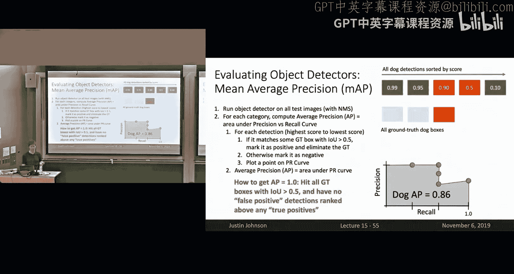

But of course， this was only the dog average precision。 So in practice。

 we'll repeat this whole procedure for every object category and then get an average precision for each category and then compute the mean average precision as the average across all the categories so that was a lot of work just to evaluate our object detector。

 but it actually gets a little bit worse right because of the way we computed this mean average precision。

 it didn't actually care about localizing boxes really。

 really well right because remember when we were matching the detected boxes to the ground truth boxes。

 we only use an IOU of 0。5。 So it didn't actually matter that we get really。

 really accurate detections So in practice， we'll also then tend to repeat this whole procedure for different IOU thresholds and then take an average over all of these different mean average precisions computed at different IOU thresholds。

Wow， so that was kind of a disaster。 That's a lot of work just to evaluate your object detector。

 But I thought it was kind of useful to walk through this in detail because this is actually how people evaluate these things in practice。

 And whenever you read image， whenever you read object detection papers。

 they'll always kind of report this mean average precision number。

 But it's actually kind of hard to find a definition of what it actually is。

 if you're reading papers。 So I wanted to kind of walk through this very explicitly。

 with any questions on this computation of the metric。😊，No， I think I just lost everyone。

 I'm sorry about that。

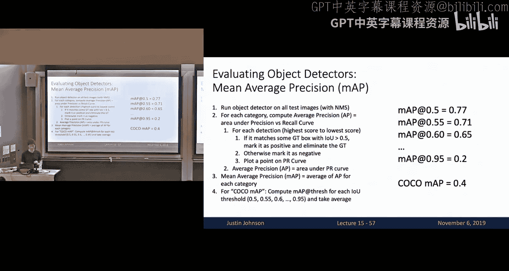

Okay， but then forget about the metric。 Let's back let's go back to object detection methods。

So at this point， we've got this RCN， which is this regionbased convolutional neural network。

 and it worked pretty good for detecting objects， but there's kind of a problem here。

 which is that it's actually pretty slow right because if we're trying basically we need to run our forward pass of our object detector for each region proposal that's coming out of our region proposal method for something like selective search。

 there's going to be like 2000 region proposals。 So that means to actually process an image for object detection。

 we're going to have to do like 20004 passes of our CNN So that's actually going to be like pretty expensive right that's not going to run real time。

 if we have to do 20004 passes of our CNN for every image that we want to process。

So we need to come up with some way to make this process faster。

And the way that we make the way that people have made this process faster is basically to swap the CNN and the warping。

 and that will basically allow us to reshare a lot of computation across different image regions。

So how does that work， Well， if we kind of take this， this R CNN method， actually， nowadays。

 people call it slow R CNN just because it's like so slow。 And then the alternative method is。

 of course， fast R CNN。

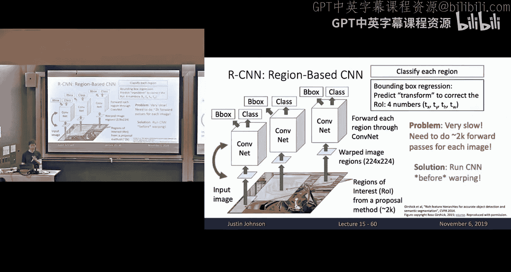

So fast R CNN basically is going to be the same as slow R CNNN。

 except we're going to swap the order of convolution and region warping。

 So now we're going to take the input image and process the whole image at a high resolution with a single convolutional neural network。

 And this is gonna to be no fully connected layers， just all convolutional layers。

 So then the output from this thing will be a convolutional feature map giving us convolutional features for the entire high resolution image。

 And it's for a bit of terminology。 This con that we run that we run the image on is often called the backbone network。

 And this could be like an Alexnet or a B G G or a resnet or whatever your favorite classification architecture is。

 this will be called the backbone。😊，And now we're still going to run our region proposal method like selective search to get region proposals on the raw input image。

 but now rather than cropping the pixels of the input image。

 instead we're going to project those region proposals onto that convolutional feature map and then apply cropping now on the feature map itself rather than on the raw pixels of the image So we'll do this cropping and resizing on the features that are coming out from the convolutional backbone network。

And then we're going to run a little tiny， light， pretty lightweight per region network that will output our classification scores and our bounding box regression transforms for each of these detected regions。

And now this is going to be very fast because most of the computation is going to happen in this backbone network and the per region network that we run per region is going to be very。

 very relatively small and relatively lightweight and very， very fast to run。

So if you imagine doing something like fast RCN with an AlexNe。

 then the backbone that is going to be all of the convolutional layers of the AlexNe and this per region network will just be the two fully connected layers at the end。

 So these are relatively fast to compute even if we need to run them for a large set of regions and then for something like residual networks then we'll take basically the last convolutional stage and run that as the per region region network and then we'll use all of the rest of the network as this backbone network。

 So then we are saving computation here by doing most of our computation is going to be shared among all of our region proposals in this backbone network。

Okay， but then there's a question of what does it mean exactly to crop these features because in order to back propagate。

 we need to actually back propagate into the weights of the backbone network as well。

 So we need to crop these features in a way that is differentiable and that ends up being a little bit tricky。

 So one way that we can crop features in a differentable way is this operator called Ri pool region of interest pooling。

 So then here we have our input image and some region proposal that has been computed on that input image。

 And then we're gonna to run the backbone network to get these convolutional image features across the entire input image。

 And just to put some numbers on this thing the input image might have three channels RGB with spatial size 640 by 480 and then the convolutional features might have 512 dimensional features with spatial size 20 by 15。

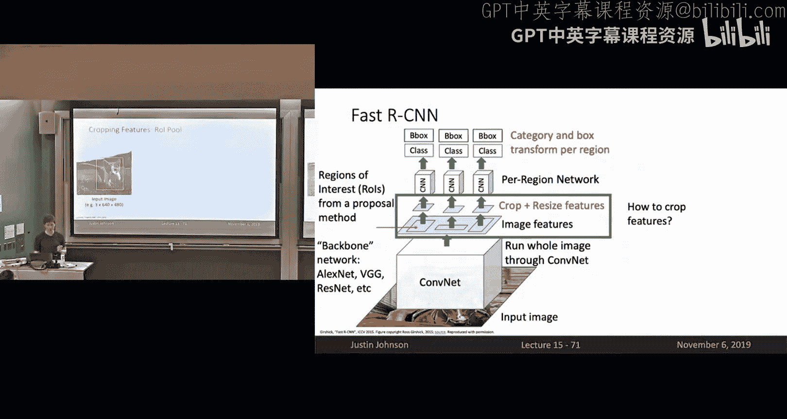

And now， because this network is fully convolutional。

 then each point in this convolutional feature map corresponds to points in the input image。

 So then what we can do is just project that region proposal onto the feature map instead。

And then we can snap that feature。 But what after we do that that that projection。

 the region proposal might not perfectly align to the grid of the convolutional feature map。

 So the next step is we can snap that grid to the convolutional feature map。

And then divide it up into subregions， say we want to do two by two pooling。

 So we do would divide that snapped region proposal into into roughly equal 2 by two regions as close as we can get。

 keeping on aligned line to grid cells。And then perform max pooling within each of those regions。

 So then this blue region would be like a 2 by2 by 512。

 and then we'll do max pooling within that two by two region to output a single 512 dimensional vector in the pooled output。

 And then for the green region， it's going to have a spatial size of three by two and with five dimensional5。

12 dimensional vectors at each point。 and then we'll do a max pooling again to give us a single 5。

12 dimensional vector coming out of that green region。

So what what this does is that this means that even though our input region proposals might have different sizes。

 then the output of this ROI pool operator is always going to be a tensor of the same fixed size which means that we can then feed it to these downstream CNN layers that are going to do this per region computation so this will all work out and now we can back propagate through this thing by simply like in the way that we would normally back propagate through max pooling so when we get upstream gradients for the region features。

 then we'll propagate them down into the corresponding regions in the image features and then when we're training on batches containing many。

 many regions for the same image then we'll end up getting gradients over over most of the entire image feature map。

This is a little bit complicated。But now there's a slight problem is that there's a bit of misalignment in these features because of the snapping and because of the fact that these green and blue regions could be different sized。

So there's a slightly more complicated version of this that people use sometimes called RI align that I think I don't want to go into in detail due to time constraints。

 but basically it avoids snapping。 and instead uses biline interpolation to make everything really nicely aligned。

 So you can go through these maybe maybe later on your own。 But the idea here is that with RI align。

 it's very similar， we're doing a sort of cropping in a differentiable way。

 but we're having better alignment between the input features and the output features。

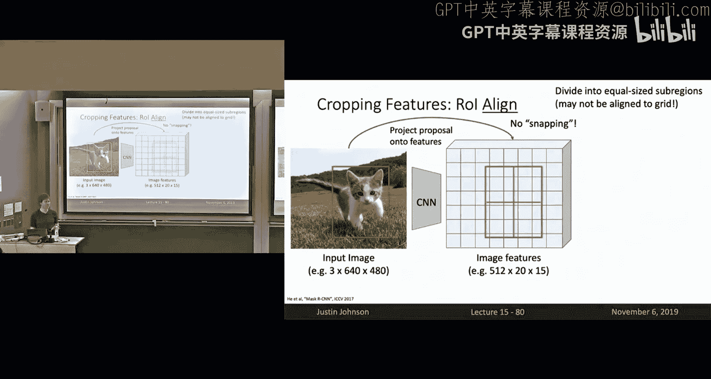

Okay， so then this gives us faster R CNNNN here on the left and slow R CNNNN right on here on the right。

 And then basically the difference between them is that we've swapped the order of convolution and and cropping and warping。

 And now faster CNNNN is much faster because it can share computation across all of these different image image proposal regions。

And how much faster is fast RCNN， you might ask， well。

 we can look at the training time as well as the inference time。

 So for training for training R CNNNN took something like 84 hours on whatever this is a couple years ago。

 So it's really old GPUs。 And if we train fast RCNN on the same same GPU setup。

 then it's something like 10 times faster to train overall。 And now at inference time。

 fast RCNN is like a lot lot faster than RCNN because we're sharing a lot of computation across these different image regions。

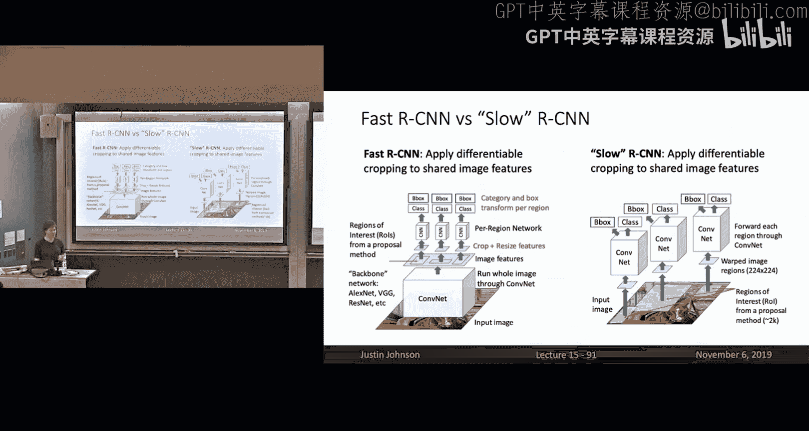

But now an interesting thing is that once we have fast RCNN。

 then actually most of the time in fast RCNN is spent computing those region proposals。

 because remember that those region proposals that we kind of depending on were being computed by this sort of heuristic algorithm called selective search that runs on the CPU。

Okay， and now once we have fast RCNN， then something like almost 90% of the runtime is just being taken up by computing these region proposals。

So then of course， you remember that these were being done by this heuristic algorithm so because we're sort of deep learning practitioners。

 we just wanted to replace everything with deep neural networks。

 so instead we want to find some way to actually compute the region proposals as well using a convolutional neural network in hopefully a way that'll be efficient。

And this will then hopefully improve the runtime overall of these object detection systems。

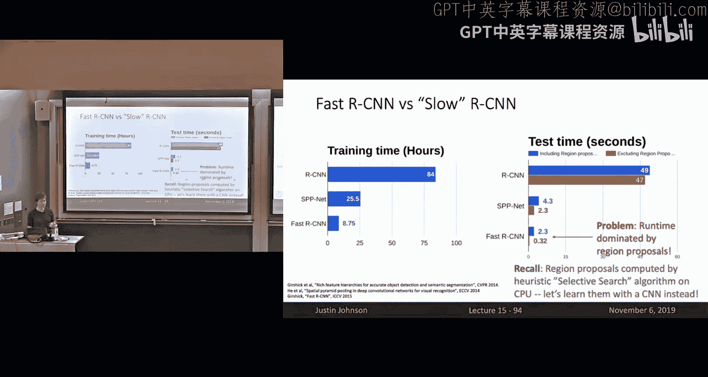

So the method that does that is then called faster RCNN， because it's even faster than faster RCNN。

 these authors were like really， really creative with their names。

But the idea here now is that we want to eliminate this heuristic algorithm called selective search and instead train a convolutional neural network to predict our region proposals for us and the way that we're going to do that is it's going to be very similar to this fast RCNN algorithm that we just saw except after we run the backbone network。

 then we're going to insert another little tiny network called a region proposal network or RPN that we'll be responsible for predicting region proposals So the pipeline here is that we'll have our input image。

 we'll run the input image through the backbone network to get our image level features we'll take the image level features pass them to the region proposal network here on the left to get our region proposals and then once we have the region proposals。

 then we'll do everything the same as fast RCNN。 So we'll take our region proposals to differentiable cropping on the image features and then do a per region little per region network to predict our final classification and bounding box transformations。

So now the only new part here is this region proposal network。

 and then the question is like how can we use a convolutional neural network to output region proposals in a trainable way？

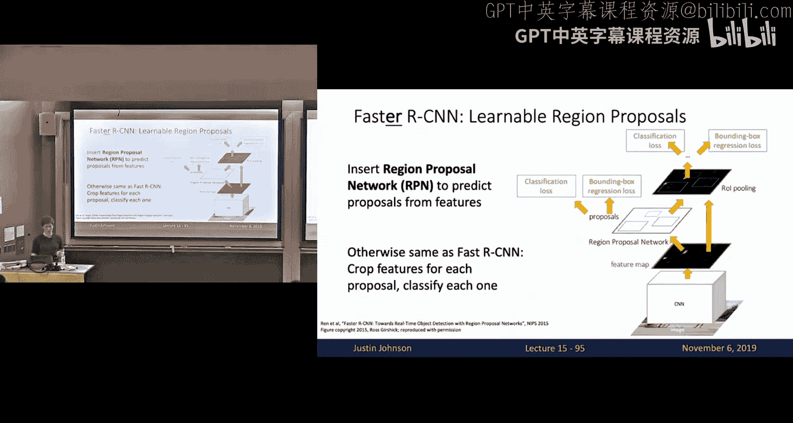

So then then we need to dive into a little bit the architecture of this region proposal network。

 So again， just because we're relying on this same backbone network。

 then we take original input image and then feed it through our backbone network to get these image features at a relatively high resolution。

 maybe again， looking again， like 5，12 by 20 by 15 in the same example。

And now the idea is that again， we recall that these convolutional image features coming out of the backbone network are all kind of aligned to positions in the input image。

 so then what we can do is at each point in this convolutional feature map。

 we can imagine an anchor box that is some bounding box of a fixed size a fixed aspect ratio。

 but it just slides around and we place an anchor box。

 at every position at every position in this convolutional feature map coming out of the backbone network。

And now our task is to train a little convolutional neural network that will classify these anchor boxes as either containing an object or not containing an object。

 so then this will be a binary classification problem that so we need to output a positive score and a negative score for each of these region proposals or for each of these anchor boxes and because there's one anchor box per point in this image level features then we can output these a negative scores with just another convolutional layer by maybe attaching a single one by one convolution that just outputs a score for yes。

 a positive negative score for whether or not that in corresponding anchor should contain an object or should not contain an object。

And then we could train this thing using a softmax loss with two categories， yes。

 being there should be an object here and no being there is no object here。But of course。

 these anchor boxes might actually be pretty poor fit to any objects that might actually appear in the image。

 so we're going to use a familiar trick and in addition to a score for each of these anchor boxes we will also output a box transform for each of these positions in the convolutional feature map that will give us a transformation that transforms the anchor box。

 the raw anchor box into some actual region proposal that we're going to use so then here the anchor box is maybe shown in green and then the actual region proposal box is going to be shown in yellow and then region these box transforms can be trained using a regression loss just like we saw that was used in previous approaches。

But， of course， this is not complicated enough。 again。

 we can predict these coordinates for the these these values for the box transforms with just another convolutional layer。

And of course， this was not complicated enough already， so in practice。

 using one anchor box of a fixed scale and size per position in the convolutional feature map is usually not expressive enough to capture all the types of objects that we want to recognize。

So in practice， instead， we'll typically use a set of K different anchor boxes of different scales and sizes and aspect ratios at every point in this convolutional feature map。

 But again， oh， yeah， question。To himself。Oh yeah。 so the question is for anchor is an object。

 should it be K or 2 K。Yeah it's a bit of an implementation detail。

 so the original paper has 2K so there they output at a score a positive score and a negative score and use a softmax loss and could do something what we've done equivalently is output a single score where high values of plus means that it's positive high values of negative means that it's not an object and use a logistic regression loss instead。

 but these are pretty much equivalent and it doesn't really matter which one you do but you're right that actually most actual implementations will usually output an explicit positive score an explicit negative score per anchor and then use a softmax loss。

 but you could use logistic regression and output one score doesn't really matter。

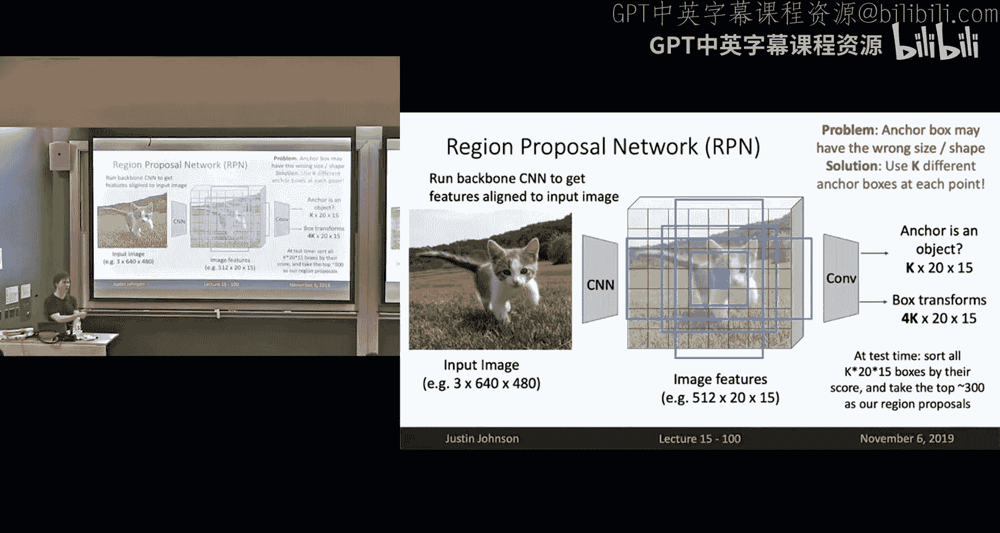

ok。But then right， So then the solution is that we'll actually consider k anchors at every position every position in the feature map and the sizes and aspect ratios of these anchors will all be hyperparameters。

 So like how many anchors you use and what is the scale and size of these anchors。

 These are all hyperparameter that you need to set for object detection。

 So that's a little bit of a mess。Okay， so then that gives us kind of this full faster RCNN method that actually now has four different losses that we need to train this thing for。

 So then in the region proposal network， we have two losses。

 we have this classification loss that is classifying the anchor boxes as being object or not object we have the regression loss in the region proposal network which is outputting transformations from the raw anchor positions into the region proposal positions and then we have all the stuff from fast RCNN。

 which means that for each anchor for each of the region proposals coming out of the region proposal network。

 we're going to run this per region network on each of the proposals which then gives us two more losses so one is the object classification loss that tells us whether each proposal。

 what is its object category or whether or is a background and this final object regression loss that' is going to regress again from the region proposal output from the RPPN to the final box that will output from the object detector。

So this is kind of a mess。 And there's a lot。 there's even more details that I didn't have time to go into。

 But there's actually， turns out object detection is pretty complicated topic to get to work。

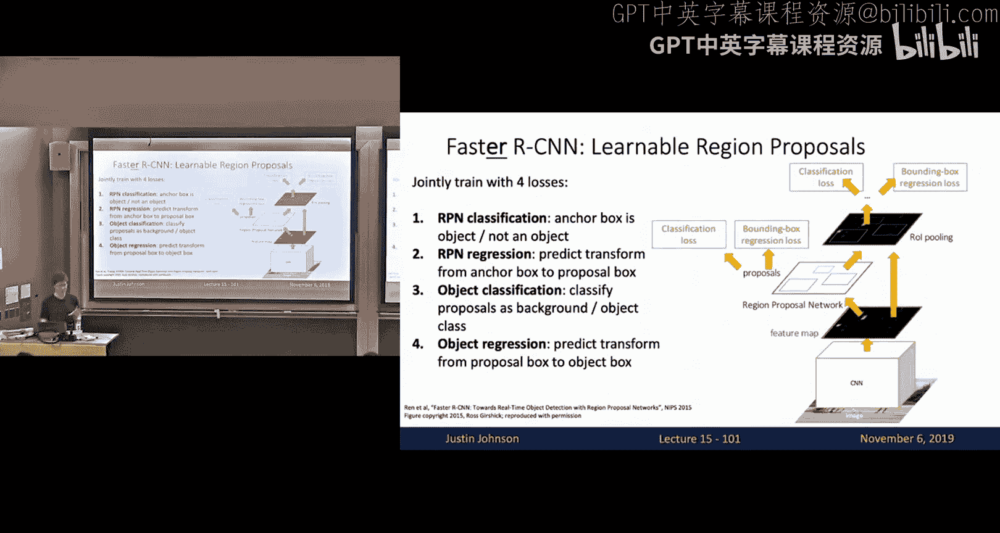

Okay， but once you actually do all this， then faster RCNN is like really， really fast。

 So then because we've eliminated this bottleneck of computing region proposals on the CPU。

 and instead we're just computing region proposals using this like really。

 really tiny convolutional network on top of the image features。

 that means that this thing is like really fast and actually can run in real time。

 So faster RCN on a GPU is something like 10 times faster than fast RCNN。

 And SP net is a different method that we don't have time to talk about。

 But it's kind of in between fast and RCNN。

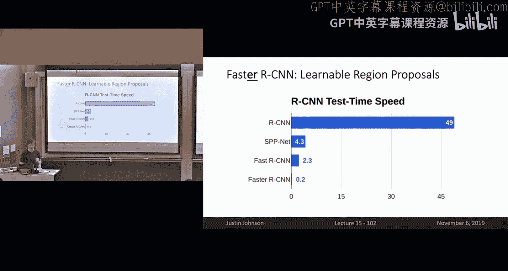

Okay， so then faster RCNN is usually called a two stage method for object detection because there's kind of like two conceptual stages inside the method。

 One is this first stage in blue where we run one network on the entire image so that's we're running these convolutions to give us the convolutional features for the image and then we're running the region proposal network which is again a couple convolutional layers that gives us these detection these region proposals and now once we've got these region proposals then our second stage is going to run once per region and these second stage is going to then output these final classification scores and regression parameters for each region that we output。

But then there's a question here， which is like， do we really need the second stage。

 And it kind of seems like we could actually get away with using just the first stage and just ask this first stage to do everything。

And that would kind of simplify the system a little bit and make it even faster because we wouldn't have to run these separate computations per region that we want to work on。

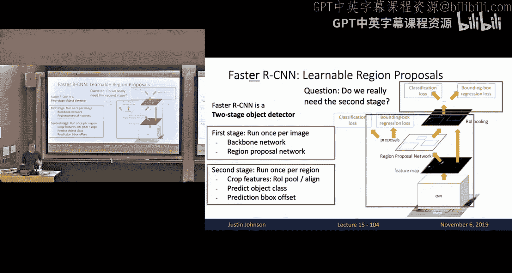

So that gives us then basically this works and we can use there's methods for object detection called single stage object detection。

 which basically look just like the RPN in faster RCNN。

 except that rather than classifying the anchor boxes as object or not object instead。

 we'll just make a full classification decision for the category of the object right here。

So now suppose that we want to classify， suppose again。

 we have C object categories that we want to classify now when producing outputs for the anchors now again we've got maybe 20 by 15 spatial size in our image feature map we've got K anchor boxes at each position in the feature map and now for each of those anchor boxes we want to directly output classification scores for the C categories and for the background category and again。

 we can just do this again directly using a convolutional layer or a couple convolutional layers。

And then you sort of train this thing up。 and now rather than using a binary or two class loss in the RPN。

 instead you just directly use your full classification loss and you still output these box transforms one per anchor。

But actually it tends to work a little bit better if you use a slightly if you actually output a separate box transform per category。

 and this is called a category specific regression as opposed to category agnostic regression where you're just outputting one box transform that is supposed to work for any categories。

 and thats end this category specific regression， lets the model kind of specialize its behavior a little bit to different two different categories。

Okay， so this basically this object detection is like really。

 really complicated and there's a lot of different choices that you need to make when doing object detection。

 right like you've got these different kind of meta algorithms like faster RCN is this two stageage method you've got these single stage methods like SSD and you've got sort of hybrid approaches like RFfCN that we didn't have time to talk about So that's kind of one major choice you need to make when you're doing object detection。

 there's another choice you need to make， which is like what is the architecture of the underlying backbone network and that affects the performance as well。

 So all of the network architectures that we've talked about for classification。

 we can also use for object detection。And now there's a bunch of other choices as well。

 like what is the image resolution， what is the cropping resolution。

 how manys how many anchors do we use， what are the size of the anchors。

 what are the IOU thresholds that we use iss like a whole bunch of hyperparameters that go into this。

 and it's really， really hard to get fair comparisons between different opt detection methods due to all of these massive numbers of hyperparameters and settings that and choices that you need to make。

But there's actually one really great paper from two years ago in 2017 that tried really hard to just like they basically like reimplemented all object detection methods that were available at the time。

 and they tried to do a really fair head tohead comparison of all these different choices that you can make in object detection So I'd really recommend reading this 2017 paper。

 if you want to get some more insight onto some of the tradeoffs of these different choices but basically they produce this amazing plot in the paper。

 they kind of like each point here is a trained object detector and the X axis gives us the speed at test time on a GPU and the y axis gives us the overall mean average precision which is this performance metric that we said we can compute for object detection and now the color of each point is corresponds to the backbone the architecture of the backbone network。

 whether it's like an inception network or a mobilenet or a Resnet or a PGG and now the shape of each dot gives the meta architecture。

😊，That is whether it's a two stage method like faster RCNN or a single stage method like SSD。

And kind of the takeaways here are that the two stage methods tends to work better。

 right when you use two stage methods， then it allows the network to have sort of multiple glimpses at the image information。

 and that tends to make performance work better。 But they're a lot slower because you need to run different you need to run computation independently for each region proposal that you want to consider。

AndNow a second takeaway is that these single stage methods are tend to be a lot faster because they don't have any computation per region。

 instead， they're just sharing all computation across the entire image。

 so they tend to be a lot faster， but they tend to be less accurate because they get less opportunities to kind of look at the raw image information。

And the other takeaway is that bigger networks tend to work better。 So as you， if you look at。

 if you compare using a tiny network like a mobile network to a very large network。

 like a Resnet 101 or an inception Resnet V2， then as you use larger backbone networks。

 then your performance tends to improve。Okay， so those are kind of the takeaways that you should have about these different high level choices in object detectors。

But it turns out that this paper was from 2017 and now is 2019。 and this is a fast moving field。

 So like theres have been some changes since then。 So I've tried， So let's。

 let's look at what is kind of the current state of the art on this task。 Well， first off。

 we need to shrink the chart in order to fit the current state of the art methods on on the on the chart here。

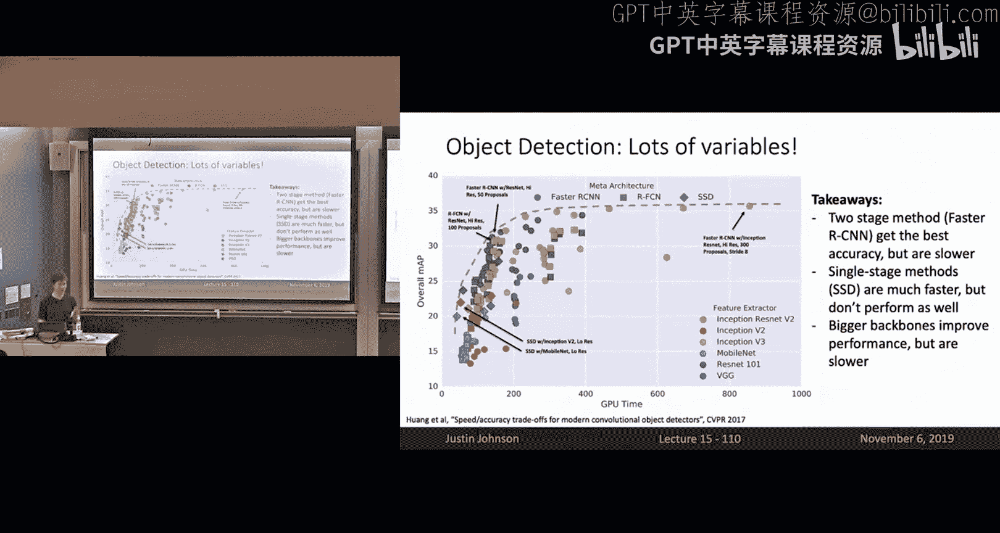

So then basically， since 2017， GPUs have gotten faster and people have figured out more tricks to get object detectors to train better。

So one trick is that we can just train our networks longer and that tends to make them work better because as GPUs get faster。

 we can afford to train them for longer。 And another thing is that there's some trick called feature pyramid network that we don't have time to get into that gives us kind of a multiscale feature representation in the backbone And if you combine those two approaches。

 then you get a pretty big performance boost。 So this green dot here is now faster RCNN with Resnet 101 feature pyramid network and it gets 42 mean average precision this coco data set with a runtime of only 63 milliseconds at test time。

Things， and if you use an even bigger network like Res next 1，0，1， then it works even better。

Single stage methods have gotten quite a lot better as well since 2017 and in 2017。

 single stage methods tended to work a lot worse than two stage methods。

 but nowadays single stage methods are almost as good as two stage methods so then one of the state of the art single stage methods is actually very competitive in performance to two stage methods now。

Another thing is that very， very big models tend to work even better。

 So this is now 152 layer res next trained for using this feature pyramid network approach and trained for a very long time。

 And now it gets all the way up to 49 mean average precision。

And if you do some additional tricks at test time， like at test time。

 you run the image at multiple scales and multiple sizes and multiple orientations and you kind of ensemble all of these predictions at test time。

 you can get even better improvement And if you train on a lot of data and train a bunch of models on a lot of data and ensemble all the predictions。

 then you can get even better performance。 So the current state of the art I checked on the leaderboard for this data set right before this lecture was all the way up to 55 mean average precision。

 which is a pretty massive jump over the state of the art just in 2017 was 35。

 So this is like super active area of research， and we just don't have time to get into all the tricks that are necessary to achieve these high results。

 But there's a lot of literature that you can read to kind of get some sense of how things are working。

Okay， but then basically， there's a whole lot of stuff going on in these object detection methods。

 So my general advice is like， don't try to implement them yourself because there's like way too much stuff going on in these things and you're gonna get it wrong and you're not gonna match these performance。

 So like， really don't try to implement these things yourself unless you're working on assignment 5 in which case you will implement an object detector from scratch。

 So hopefully we'll be able to make it in a way that's reasonably easy for you to understand。

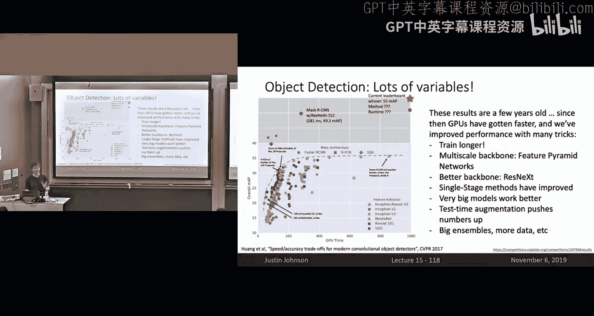

But in practice， if you do find yourself needing to use object detection in practice for some real application。

 you really should not implement it yourself just because there's way too many tricks involved。

 So in practice， there's a couple there's a bunch of really high quality open source code bases that do object detection now And if you find yourself needing to do object detection in practice you should really consider building on top of one of these。

 So Google has this Tensorflow object detection API that implements pretty much all of these different object detection methods in Tensorflowlow and Facebook has this of course we like ptorrch in this class So Facebook just released like just released like a month ago a brand new object detection framework called Deron2 which implements all all of these numbers in ptorch And in fact if we look back at these chart these like purple dots in these green dots。

 all of these new dots were actually pretrained models that are available in Deron2 So you can actually this orange star。

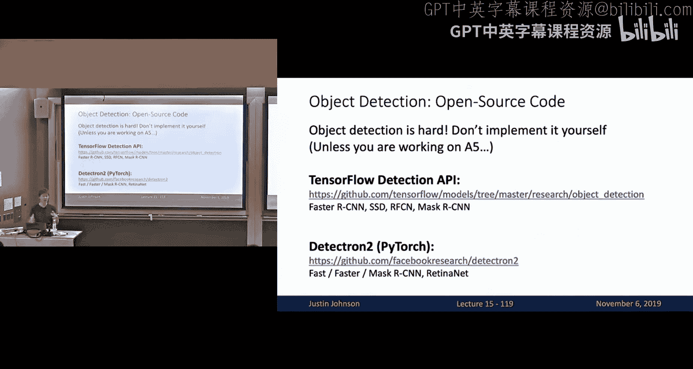

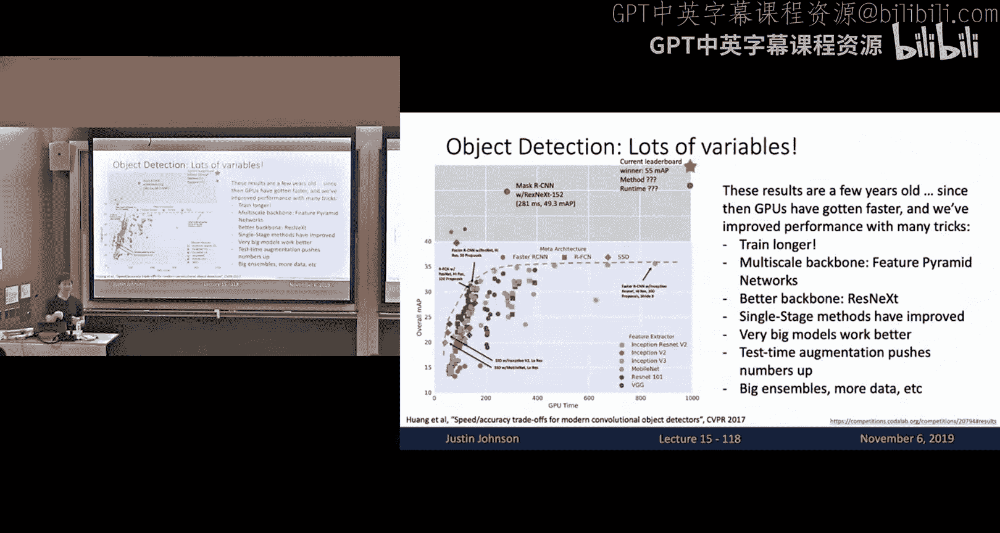

Our dot is not in a touch on 2， But other than that， this， this purple dot， like。

 you can just download the code and download the model and get that really complicated purple dot over there。

So， that's what I would recommend you to do in practice if you find yourself needing to do object detection。

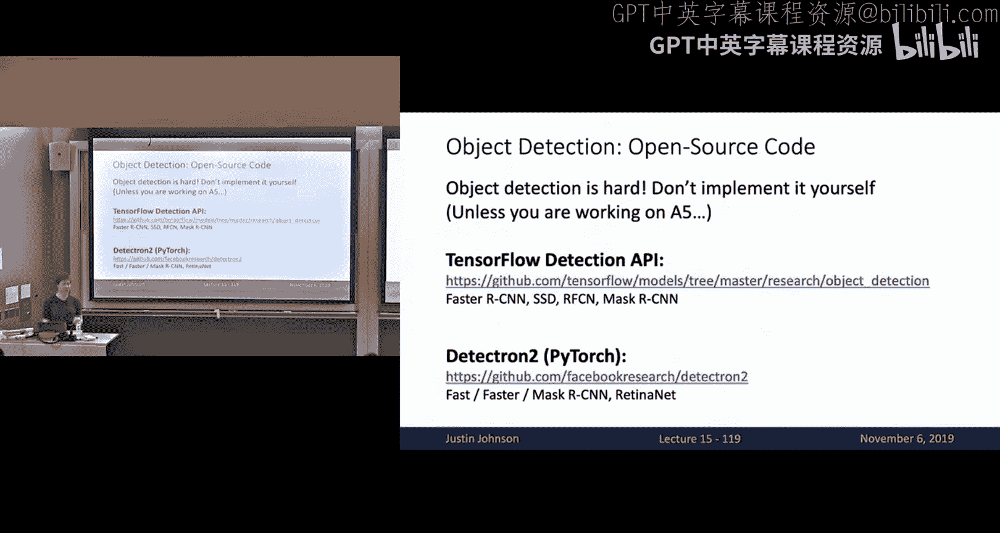

So today I know we've covered a lot， but I thought it was important that we try to get a sense of how things work in object detection。

 so we talked about these different methods for object detection。

 moving from slow RCNN to fast RCNN to faster RCN and then moving from there even to these single stage methods that are really fast so that gives us our quick like one lecture overview of object detection hope I didn't lose too many people on that because I know it was a lot of material but next time we'll talk about even more these localization methods and we'll talk about probably some more object detection stuff and some methods for segmentation and key point estimation。

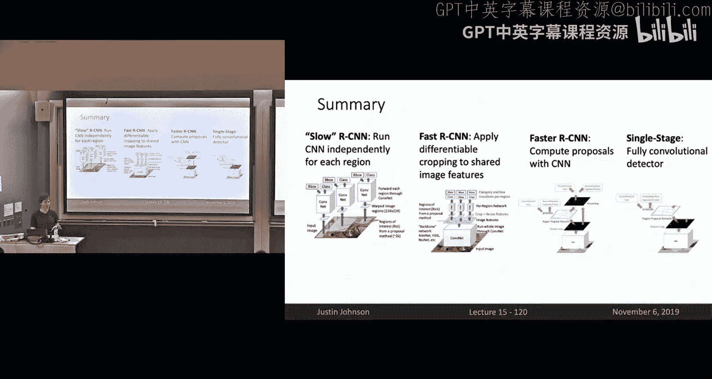

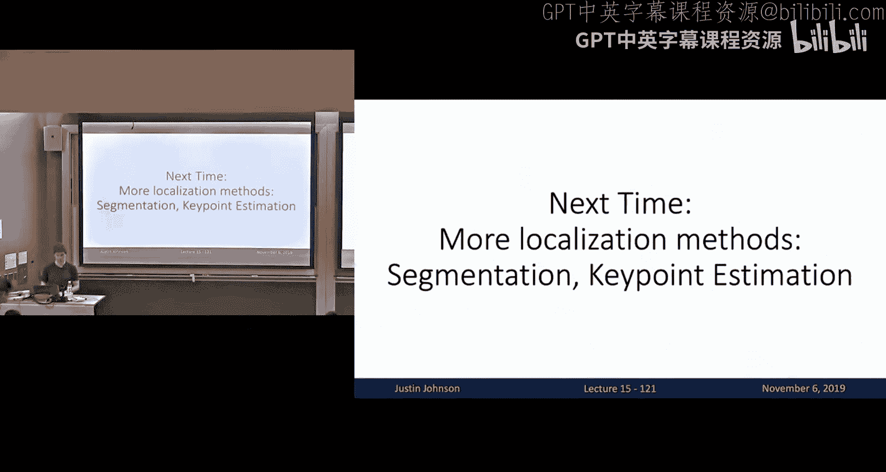