# 密歇根大学《深度学习用于计算机视觉｜Deep Learning for Computer Vision UMich EECS 498-007 2019》中英字幕 p18 -18-17_3DVision.zh_en -BV1jA4m1P7GN_p18-

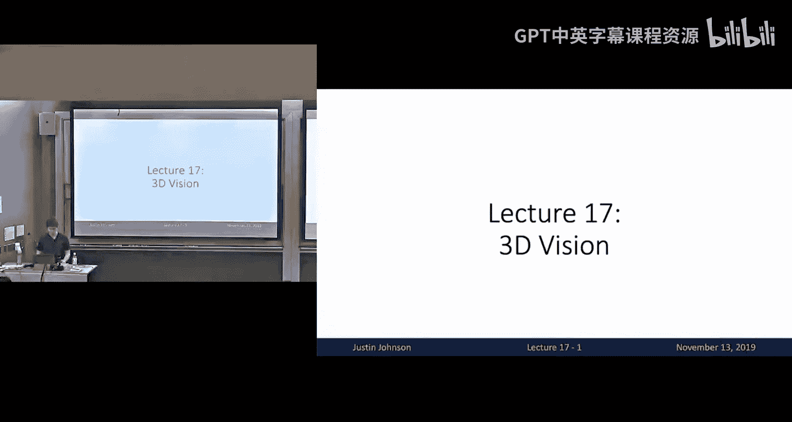

Alright， sorry for the late start， but let's get started。 So welcome back to Le 17。

 That's a prime number。 It's very exciting。 And today's lecture， we're going to talk about 3D vision。

😊，So a reminder that assignment 4 is due today by midnight and it covers a bunch of stuff that you should be very familiar with by now。

 so hopefully most of you are finished working on assignment4 at this point。

And then assignment five will be out sometime soon。

 probably early to mid next week and just stay tuned for more details on assignment5 coming up。

 but assignment5 will be about object detection， so that'll be super exciting you'll get to implement your own single stage and two stageage object detectors and use them to train up your own object detection systems so that's where you are going to go against my advice and actually implement your own object detectors but I think that'll be instructive and a pretty fun assignment for you to work on and that should be released early next week early to mid next week sometime。

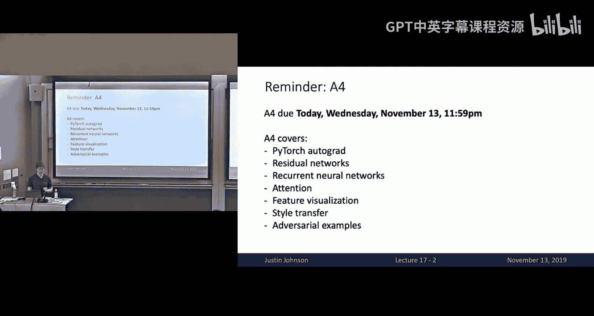

Okay another thing I wanted to recap on is sort of the overall course structure and kind of where we are in the course so the very first lecture I had divided up the structure of the course into two major sections。

 the first section was these fundamentals where we talked about what are neural networks。

 how do we train them， how do we implement back propagation for different types of layers and during this first section of the course we were going in really deep detail on all of these different fundamental topics that you need to know about if you're going to work with neural network models and now and now at this point you should have realized a bit of shift in the tone of the class。

 especially the last few lectures and that's because at this point we're kind of deep into this second half of the course where're really talking about more applications and more research kinds of topics so here I just want to sort of emphasize that during this second half of the course I maybe not expecting you to fully understand every little detail of everything that we talk about and the main purpose of this second half is less to understand every single detail of everything and more to get a general sense of。

Can you use these different types of neural network models for what are the broad class of problems you can apply them to and how can we use all these basic building blocks that we learned about in the first module in order to solve or tackle a really wide array of real- worldor problems so I just wanted to point that out in case you felt as if the speed of the lectures the last couple lectures has been speeding up or anything like that that's actually by design and that's still we can sort of cover more material and let you get a broader sense of how neural networks are used for a lot of different problems。

And any questions on this type of structure or administrative stuff before we move on？

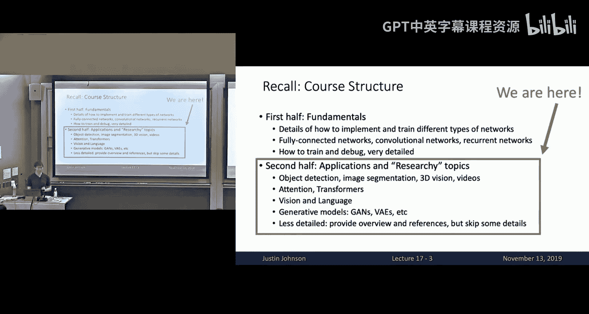

Okay。So then the last two lectures， we had really done this kind of whirlwind tour of a bunch of different tasks in computer vision where we wanted to not only identify objects and images but really localize what parts of images corresponded to the different objects that we recognize so we talked about this wide array of different types of tasks in computer vision including semanic segmentation。

 object detection， instant segmentation and we talked about others like keypoint estimation that are also not on the slide。

 but the last two lectures basically have been whirlwind tour of different ways that you can predict the twodimensional shape or the two- dimensionsional structure of objects that appear in images and these have a lot of really useful real worldorld applications。

 so these are types of computer vision tasks that actually get used a lot in practice out there in the world。

But it so happens that the world we live in is actually not twodimensal the world that we live in is actually threedimenional。

 so then there's a whole separate research area which is how can we add this third dimension to this third spatial dimension to our neural network models and now build neural network models that can not just operate on two- dimensional data but somehow push into this third dimension and understand the 3D structure of the world and the 3D structure of different types of data。

 and that's going to be the topic of today's lecture is how can we add 3 dimensional information into different types of neural network models。

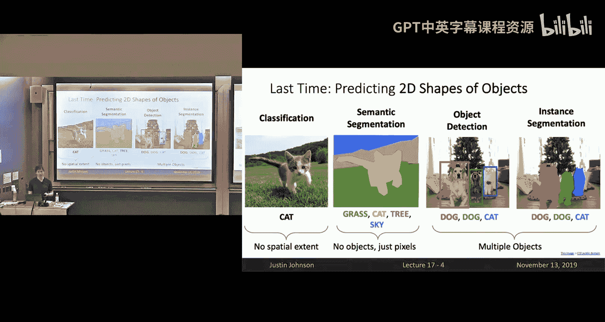

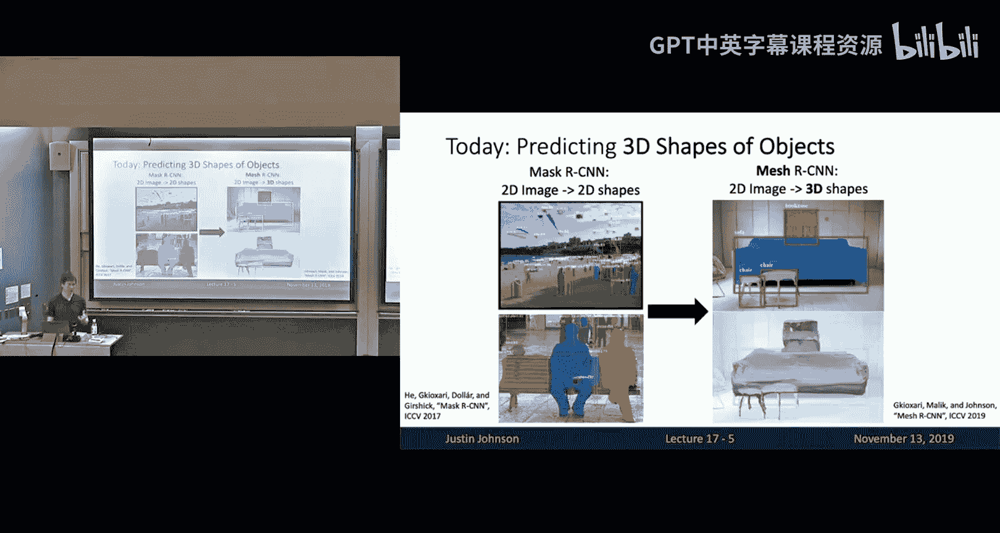

So we're going to focus on two categories of 3D problems today。

 one is the task of predicting 3D shapes from single images。

 so here we're going to want to input some single RGB image on the left and then output some representation of the 3D shape of the objects in that image and the second and here for this task of 3D shaped prediction we're using the 3D data as the output of the neural network model so then the input is still going to be our favorite two- dimensionmensional image representations that we've used many。

 many times before， but now the output of the model will somehow be a three- dimensionmensional representation of the objects。

And but sometimes you might not want to produce three dimensional outputs from your neural network models。

 instead it's also a common thing that you might want to ingest or input three dimensional information into your neural network models and then perform maybe some classification decision or some segmentation decision based on a 3D input data。

So that's what we're going to focus on today is sort of how can we structure our neural networks to both predict different sorts of 3D information as well as ingest different sorts of 3D information And I said and for both of these problems。

 we'll focus on the fully supervised task So for all of the tasks we talk about today we'll assume that we have access to a training set that has maybe the input image and the corresponding 3D shape or the 3D shape and the corresponding semantic label that we want to predict。

 So everything today will make this fully supervised assumption that we have access to this full training set。

 the supervised everything we want to predict。But I should point out that this is just really scratching the surface of what types of topics are possible in 3D computer vision and it's really sort of impossible to do proper justice to this topic in just a single lecture so instead we'll have to just point out on one slide that there's a lot more to 3D computer vision than just these sort of shape prediction or shape classification types of problems and what's really interesting about maybe 3D computer vision is that this is one area where there's actually a lot of non-deep learning methods that are still alive and well and still very important to know about and that's because there's there's a lot of geometry involved in actually the 3D structure of objects and 3D structure of the world so there's a whole there's a whole large set of types of tasks that people work on in 3D computer vision that we just don't have time to talk about today but to give you a sense one thing you might want to do is maybe like this concept of structure from motion where you maybe want to input a video sequence that's a sequence of 2D image frames and now you want to predict or reconstruct。

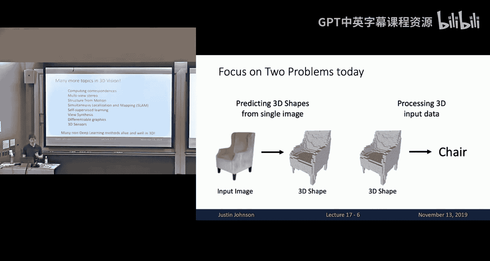

rejectory of the camera through the 3D world through the video sequence and there's a whole that's just maybe one flavor of a type of problem that you can do in 3D computer vision that's sort of just beyond the scope of what we have time to talk about in a single lecture so I just want to give you that context that there's a lot more to the world of 3D vision than we're going to talk about today but today we'll just focus on these two particular problems of supervised shape prediction and then maybe supervised shape classification。

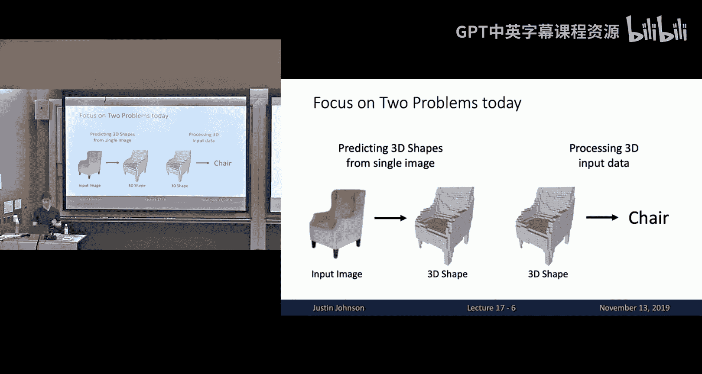

So in any kind of questions on this sort of preamble about 3D computer vision before we really dive into these different types of models？

All right， so then if we're going to talk about 3D shape prediction and 3D shape classification。

 then I've been a little bit cagey here with this term 3D shape。

 so here that that's kind of a loose ill-defined term but in practice if there's a lot of different types of representations that people use to model 3D shapes and 3D information so we're going to structure this by talking about these different five different types of 3D shape representations that people work with often in practice that all have their different sort of pros and cons and we'll see how each of these five different types of 3D shape representations can be processed or predicted with neural network models。

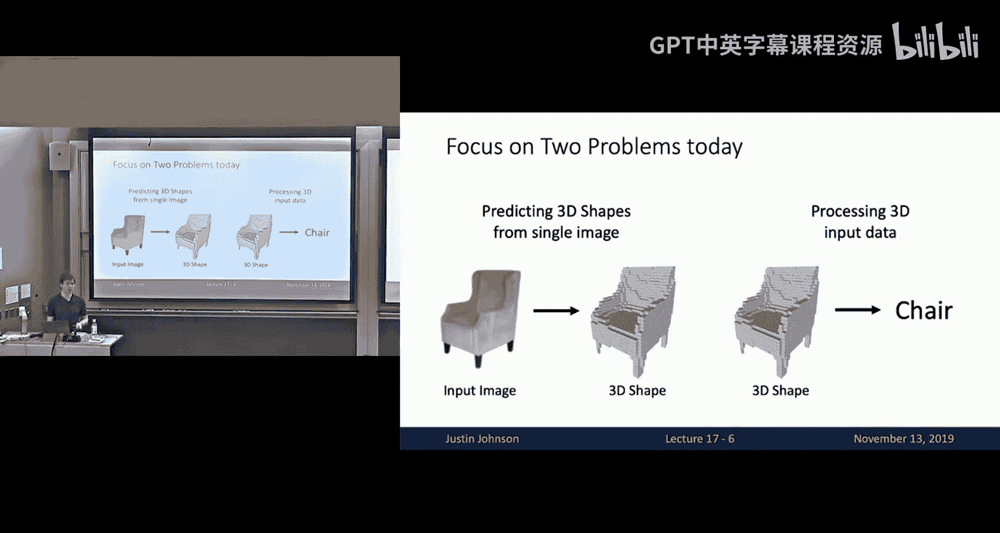

So and then if these cartoon graphics of these 3 shape representations are maybe not super clear at the outset。

 hopefully by the end， you'll understand that each of these five little cartoon pictures that we've shown here are all sort of meant to represent different representations of the same underlying 3D shape。

So the first representation to talk about is that of the depth map。

 so a depth map is conceptually a very simple 3D shape representation and basically what a depth map does is it assigns to each pixel in an input image。

 it assigns the distance from the camera to that pixel because each pixel in the image corresponds to some object out there in the real world。

 and now a depth map tells us for each pixel in the image what is the distance like in meters between the camera and that position out there in the real world that the pixel is trying to represent。

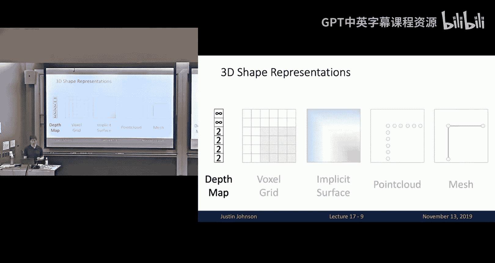

And then this is then then a traditional RGB image that we're used to working with would be maybe a height by width grid of pixel values where each pixel value gives us the color of the pixel and now a depth map is just a similar 2D grid where now the value of the pixel is not the color it's just this depth in meters of that pixel and then it's very common to actually combined together an RGB image and then add on this fourth channel of information giving the depth information and that would be an RGBD image and sometimes these RGBd images are actually called 2。

5 d images because they're not like real full 3D because one of the cons or one of the tradeoffs of these depth images is that they can't capture the structure of occluded objects because say that in maybe this example here there's actually part of the bookcase that's occluded by the couch in the top image but now the depth map doesn't have any 3D representation for the portion of the bookcase which is behind the couch instead。

This RGBD or depth map representation only is able to represent the visible portions of the image。

 So for that reason， we sometimes think of it as a slightly less powerful powerful or less general 3D representation。

 which we encapsulate by just calling it maybe 2。5D to mean that it's not fully 3D。

But one reason why this depth map type of data is very important is that we can actually capture depth map data with various types of raw 3D sensors。

 so something like the Microsoft Connect that you may have been familiar with。

 actually uses a form of structured light to estimate these depth images directly using some fancy sensor tricks。

 or if you look at something like the face ID sensor on an iPhone。

 then that's also capturing some kind of depth image because it's projecting out these infrared dots and then able to use that information to estimate the depth at each pixel of the image that it captures。

 so these map information understanding how to work with these depth map images is super important because this is actually a type of 3D data that we can just capture from the world using actual sensors。

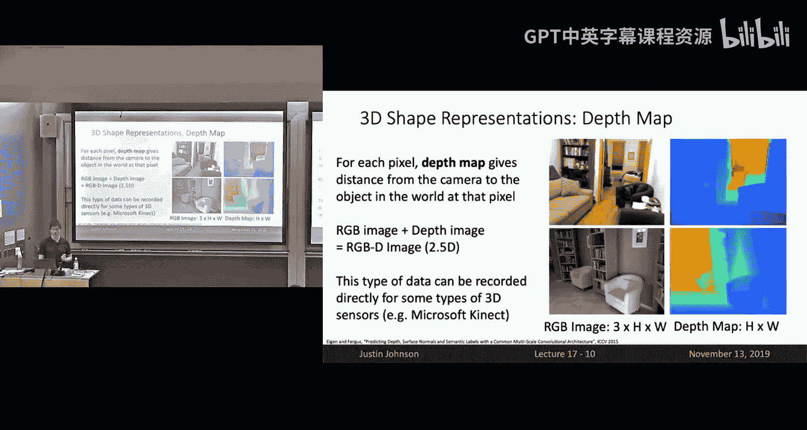

And then it turns out actually trying then one task that you might want to try to do is to try to input a vanilla RGB image and then give in an RGB image。

 try to predict this depth channel that is try to predict for every pixel in the input image。

 what is this distance from the pixel to the object out in the world that that pixel is covering。

And it turns out that we can actually the architecture that we could use to predict this is actually something that we saw Latin last lecture and that's this idea of a fully convolutional network。

 So if you recall in the last lecture when we talked about this task of semantic segmentation there we wanted to predict for every pixel in the input image what was the semantic category label of the pixel and there we saw that using some kind of fully convolutional network with some pattern of downsamp and up sampling inside the network was a useful neural network architecture that let us make one prediction per pixel and we can reuse that exact same type of architecture now for predicting these depth maps so then in order to maybe predict the depth map from a single image you would input your RGB image to some fully convolutional network。

 the final convolutional layer of that network would have maybe one filter or one output channel that then the output of that one filter would be interpreted as that depth that we're trying to predict。

And then we would train this thing using some kind of loss function that compares for every pixel of the predicted depth。

 we look at the corresponding pixel of the ground truth depth and try to compare them。

 and then obviously we want our predicted depth to be the same as the ground truth depth。

Or do we It turns out that that's actually not quite possible with 3D vision。

 And the reason is this fundamental problem that we run into with 3D representations。

 which is the problem of scale depth ambiguity。 So here if you're looking at a single image。

 you can't really tell the difference between a large object that's very far away and a close object that's very close to you。

 So in particular， if we had this image of a cat and if you were looking at a cat that was like right in front of your eye versus a cat that was twice as large and two times as far away from you。

 they would look exactly the same， they would project the exact same image onto retina onto onto the retina in your eye or onto the sensor in any kind of digital camera and for that reason that the overall the absolute scale and the absolute depth is actually ambiguous from a single 2D image。

 So as a result of this so whenever you're working with any kind of 3D representation or 3D prediction problem。

 it's always important。

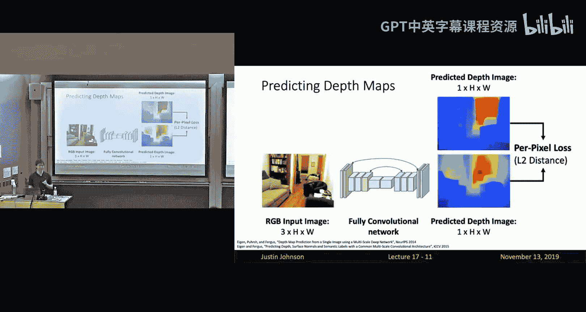

To think about this， this potential problem of scale depth ambiguity。

 And then it's often the case that we need to actually change something in the structure of our neural network model in order to deal with this problem of scale depth ambiguity。

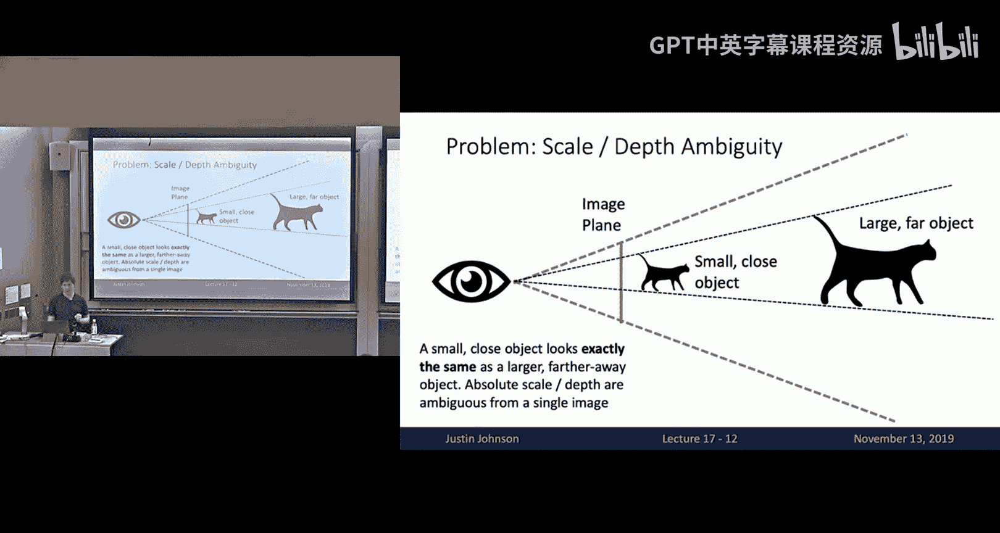

So I don't want to walk through the math here in concrete detail。

 but it turns out that there's a very clever loss function that we can use for this depth prediction problem that is actually scale invariant and what I mean by that is that suppose that our neural network predicted a ground truth depth that was correct up to some constant scaling factor of the true depth like maybe our network just predicted the depth all of the predicted depths from our network where like one half of what they were supposed to be from from the ground truth Well。

 then this scale invariant loss function would still assign zero loss to that situation the only thing that it cares about is somehow that there's the way that you would get zero loss with this loss function is that if there exists a scalar that you can multiply your predictions by and then match the ground truth perfectly then in that case you get zero loss but this loss function does not actually penalize a a global multiplicative offset in scale。

And there's some clever math behind this loss function and to see exactly why that works and how that works out。

 I suggest you look into this 2014 Nps paper that's referenced on the slide。

 and that will walk you through the mathematical details of exactly how this scale variance is achieved with this particular mathematical form。

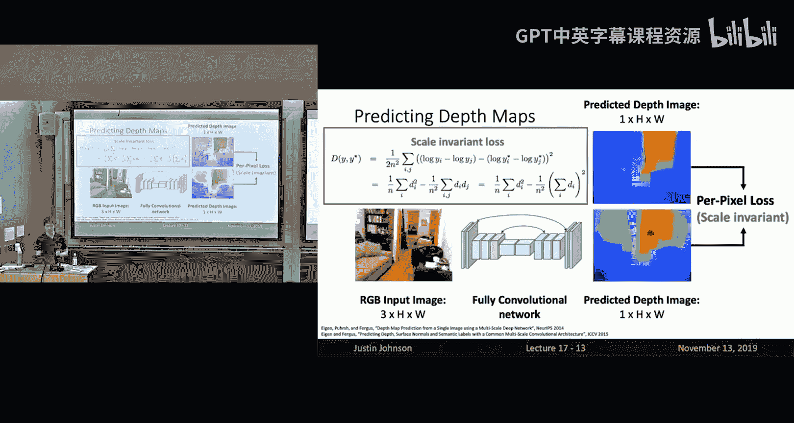

So then there's actually another very related 3D shape representation that is very similar in spirit to this idea of RGBD or depth images。

 And that's the idea of a surface normal map or surface normal image And here just like with a depth image what we wanted to do is assigned to each pixel。

 the distance in meters between the pixel and the object out there in the world。

 what a surface normal what a surface normal representation will do is assign to each pixel we want to know what is the orientation of the surface of that object out there in the world。

 So then for every pixel we would have some unit vector if for each pixel that tells us the orientation of the surface for for the object that that pixel is showing。

 and it's typical to represent or draw these 3D normal map these normal map images using RGB colors。

 So here for this particular example， this image on the right is showing a normal map version of this image on the left。

 So here blue represents maybe pointed up So you can see that。

for and the top of the bed is all kind of colored blue to means that those normal vectors are pointing up red is kind pointing kind of pointing this way to say that maybe the side of the bed is kind of pointing this way and then green is pointing the other way so if you look at the cabinets。

 you can see that they're colored green and the exact mixture between RGB tells us the exact orientation of the surface normal at every point in the image。

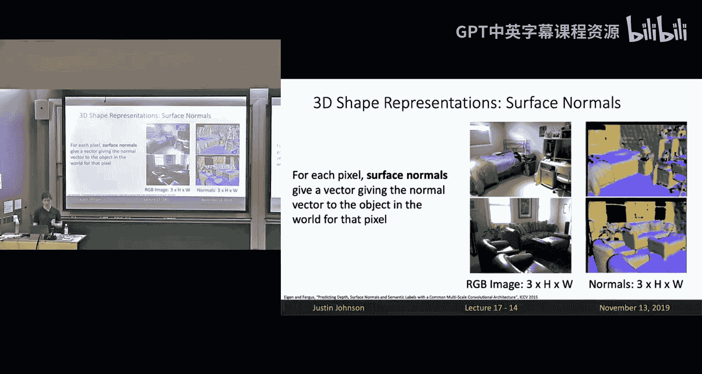

And now we can imagine predicting these surface normals using a very similar technique， right。

 we can just take our RGB image， run it through a fully convolutional network and now predict at the output of three channel image that tells us what is this three- dimensionmenal vector at every position in the input image。

 And now the loss function here， we want to compare the angles between two vectors so we can use a per pixel dot product normalized by the norms of the vectors in order to have our loss function be something like related to the angle between the vectors that our network is predicting and that is present in a ground truth。

So is so and it actually turns out that you can actually train one joint network that does both semantic segmentation and surface normal estimation and depth estimation。

 and you can actually train one network that will input a single RGV image and then predict for you all of those things all in a single forward pass so that's kind of one so that's a fairly conceptually simple or 3D representation。

 but I think it's actually pretty useful in practice for a lot of different applications。

 because once you have a depth map and once you have a surface normal。

 that actually gives you quite a lot of information about the 3D structure of the image that you're looking at。

But of course， the drawback of surface normal or of these depth map representations is that they can't represent occluded parts of the image。

 so if we want to have a more complete 3D representation of our 3D scenes。

 we need to move on and consider other types of  3D shape representations。

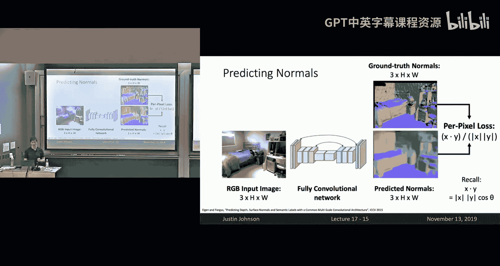

So then the next 3D shape representation that we can think about is a voxel grid。

 Now a voxel grid is conceptually very， very simple right So what is going on in a voxel grid is we're just going to represent the 3D world as some 3D grid and within each cell of the grid we want to have have it be turned on or off to say whether or not that cell in the grid is occupied So this is basically like a Mincraft representation of the world right because you know the whole world we're assuming the world is built from blocks and then theres there's some identifier or some property at each grid cell in the world。

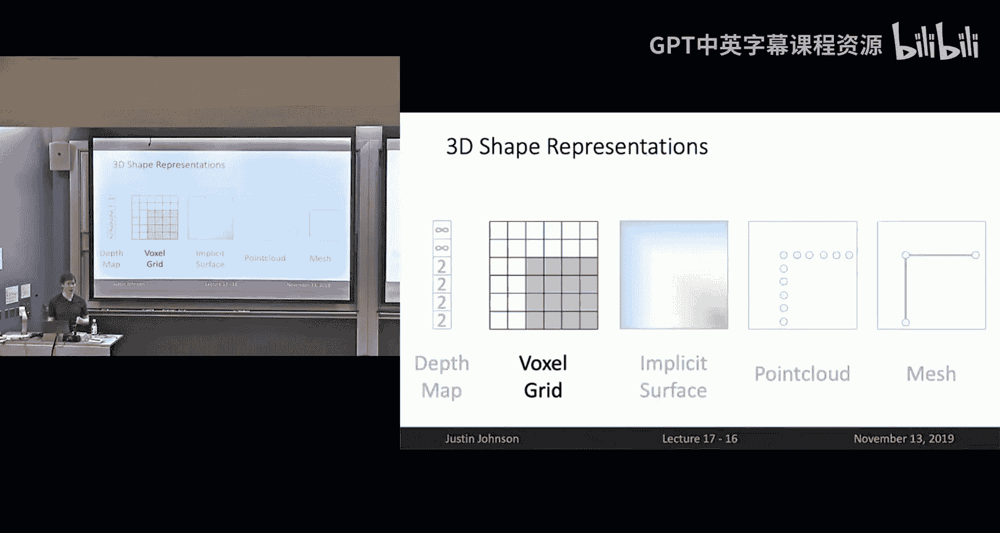

And now these voxel representations are conceptually pretty easy to think about and pretty straightforward to think about and it's sort of basically like the mass representation that we use in Macar CNN for representing foreground or background of an object。

 except extended into 3D， so you can imagine that all of the similar machinery that we use for processing maybe twodimensal occupancy grids in masscar CNN or for segmentation。

 we can use similar sorts of machinery to represent these 3D voxel occupancy grids。

But now a big problem with voxal representations is that you actually need to use a very high voxel resolution if you're going to capture the very fine details of the objects in the scene。

 so as an example， if you look at this chair， there's actually a lot of sort of very fine detail over the part of the chair where you might put your hand there's actually a very subtle curvature there that looks like it be very comfortable to rest your hand on but if you look at the voxel representation on the right。

 you can see that it's very blocky and a lot of this really fine-grained geometry of the chair has been lost as we move from sort of a raw like the actual input image to some vox size representation of the scene and to actually recover these very fine details。

 we would need to use a very， very high voxel resolution and that could be computationally expensive。

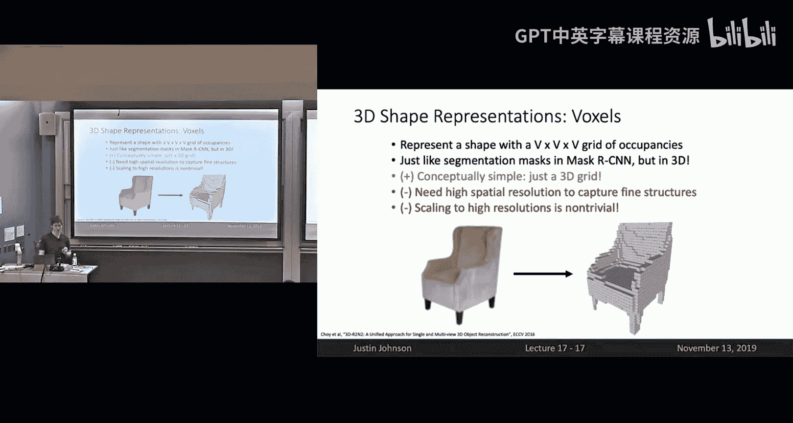

But it turns out that actually v processing voxel grids is fairly conceptually simple right so suppose that we were given a voxel grid as input like we received as input this voxel representation of the chair on the right and now our task was to classify these different voxel grids and say is this grid the shape of a chair or is an airplane or is a couch or something else。

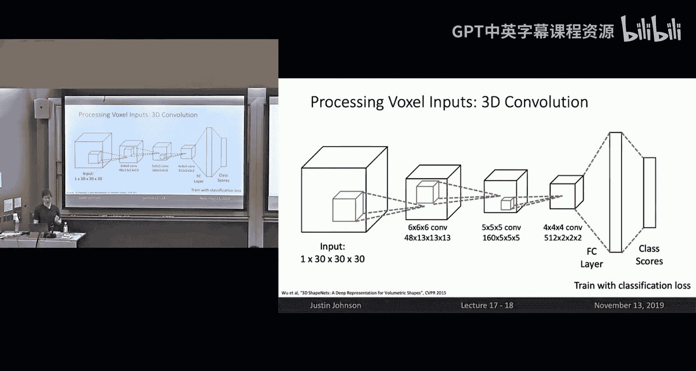

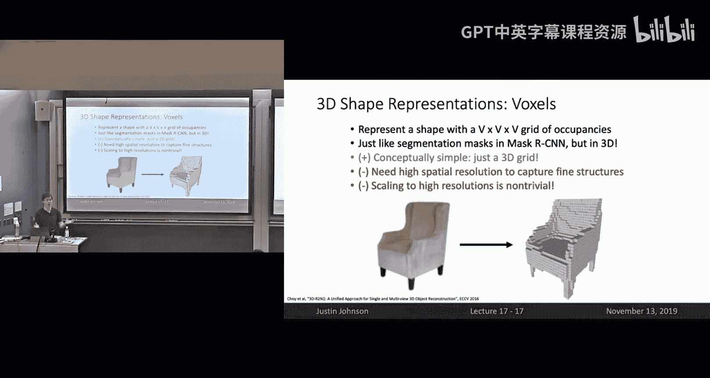

Well， if we wanted to do this kind of classification of a voxel grid。

 we can use a very familiar sort ofD convolutional network neural network architecture。

 The difference is that now we need to use 3D convolution or 3 dimensional convolution as our basic building block。

So here， the input to such a 3D convolutional neural network would beel this raw voxel model。

 this raw voxel grid telling us every point in 3D space is that voxel occupied or not occupied and now every layer of the model would be some 3D convolution operation where now our convolutional kernel is some little 3 dimensionmenal cube that we're going to slide over every point in 3D space over the previous feature map。

 compute inner products and that will give us a scalar output at the next layer So now you can imagine building up 3 dimensional convolutional neural networks that are very similar in structure to the familiar 2D convolutional neural networks that we've seen many。

 many times before so you can build up maybe several layers of 3D convolution followed by maybe a couple fully connected layers or some kind of global average pooling layer and then finally go to some classification layer and basically all of the types of neural network architectures that we're familiar with working with for two- dimensionmensal images you can imagine porting them over into into these 3D voxel grids fairly straightforward way。

Oh。Yeah， so to explain the input dimension a little bit。

 So here the one is the featured so we have now at every stage of the network。

 it's a four dimensional tensor。 So we have three spatial dimensions and one channel or feature dimension。

 So for the input to the network it's a voxel grid。

 So there's three spatial dimensions of 30 by 30 by 30 and then for the input to the network we have one feature at every point in that voxel grid。

 which is whether or not that voxel is occupied。 But now as we move along the convolutional as we move through the 3 d commnet。

 then we will still have three spatial layer three spatial dimensions at each layer。

 but now we might have a whole feature vector at every point in that 3D grid。

 which gives us a 4D tensor。 So if you look at the second layer in this network。

 it's a 48 by 13 by 13 by 13 spatial grid well the 13 by 13 by 13 is a spatial size and now within every point of that grid we have a 48 dimensional vector which means that。

This layer was produced using a 3D convolution operator that had 48 filters because each one of our three dimensional filters is now going to give rise to a full cube with one scalar value at every point in the cube。

 and then we need to stack up those cubes to give us a four dimensional tensor。Does。

 I clarify the the dimensions a little bit of these networks。Yeah， yeah。

 So then the input would be some binary tensor that just says whether every point in space is occupied or not occupied。

 although maybe if you had some other type of information。

 like maybe if you were literally trying to work on Minecraft。

 then you might actually have like the block type at every position in space。

 which you might represent is like an integer or something like that or some oneho representation。

 But for those representing raw 3D shapes， then the input you would usually be some binary representation。

 just to say whether or not each point in space is occupied。Yeah。Oh yeah。

 but the kernel does not need to be binary， so typically only the input to this network would be binary and everything else would all be real valued。

 just like it has been in all the applications we've seen so far。

 So the kernels would be real valued and each of these intermediate feature layers would be real valued。

 It's just the input is going to be forced to be binary in this case。Okay。

 so then the next task you might want to do with voxels is actually predict voxels from an input image。

 So in this previous case， we're sort of assuming we receive voxels as input。

 and then we want to classify them or make some prediction on input voxels。

 a related task is say we receive an input image。 And now we want to predict a voxel grid that gives the 3D shape of that input image。

 So now the input on the left is is our familiar three dimensional tensor giving two spatial dimensions and one RGB channel dimension。

 And now all the way out at the other side on the right。

 we need to somehow end up with a four dimensional tensor that has three spatial dimensions and one channel dimension。

 giving us the occupancy probability at every point in the voxel grid。

 So then we need some architecture that lets us sort of add an extra spatial dimension somewhere inside the model。

 And then assuming we had some way to convert the spatial dimensions on the right way。

 then the output， we could imagine training this thing with some crossenttropy loss。

 because ultimately maybe we predict an occupancy。

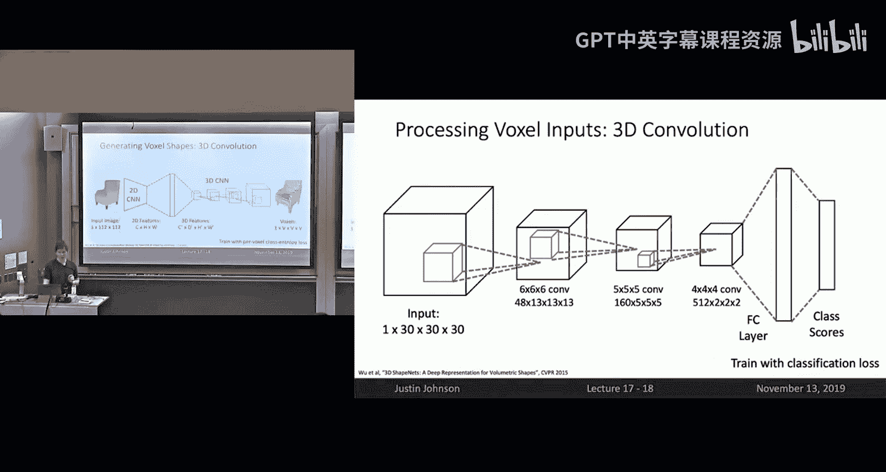

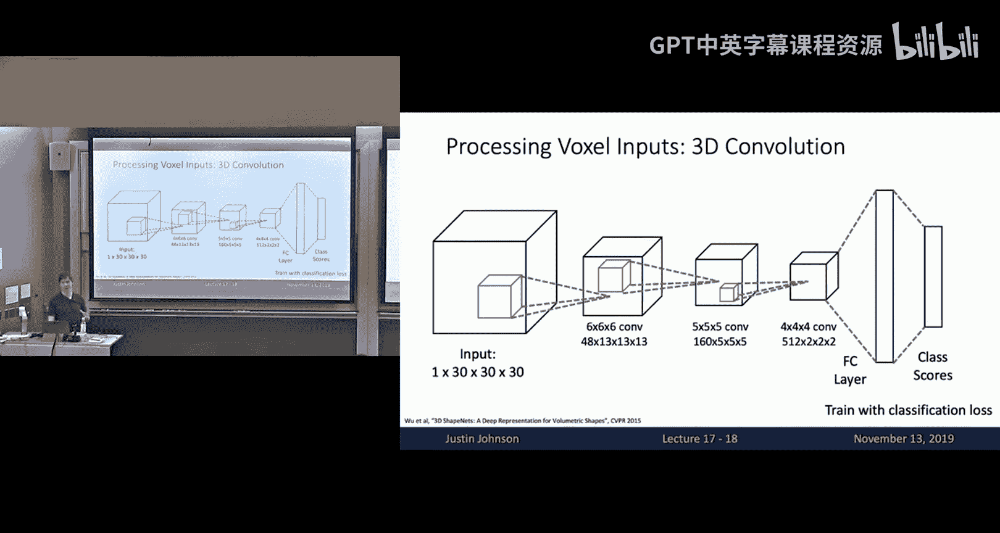

or occupancy score for every point in the boxoxel grid。

 and then we compare that with our binary occupancies that we have in our ground truth。

 then you can imagine training this thing with a softm or a logistic regression type of binary classification loss。

But now as for the network architecture， one fairly common way to predict voxel grids would be to actually bridge the gap between 3D and 4D tensors using a fully connected layer。

So what we could imagine is processing our input image with a familiar two dimensional CNN。

 And then at the end of a two dimensional CNN， we would have a three dimensional tensor that has two spatial dimensions by H and W and one channel or feature dimension C。

And then you could imagine flattening this three- dimensionmenal tensor into a big vector and then having a couple fully connected layers and then from the output of the fully connected layers。

 we could sort of reshape them back into a four- dimensionmensal tensor so then we could sort of use these fully connected layers in the middle to sort of add an extra spatial dimension between our three- dimensionsal input and the four dimensionmensal output that we want to predict and then once we've got this initial  three- dimensionmensal output then you could imagine doing some three dimensionsal convolution with sort of  three dimensional spatial upsampling on the right hand side of the figure in order to go from this 3D representation with small spatial dimensions up to a 3D representation with the large number of spatial dimensions that we finally want to predict at the output of the network and you can imagine that that now this second half of the network would have sort of 3D analogs of all the different unpooling or upsampling operations that we talked about in last lecture in the context of semantic segmentation。

So this is a fairly straightforward way to deal with predicting 3D voxel information。

 but it turns out that this type of architecture is very computationally expensive because actually these 3D convolutions。

 any kind of 3D convolution operation is going to be extremely extremely computationally expensive because the number of receptive fields is now going to scale cubically with the spatial size of the feature map of the feature grid。

 which means that the computational cost of performing 3D convolutions is very。

 very high compared to the cost of doing 2D convolutions， So as a result。

 sometimes people try to predict 3D voxel grids using only 2D convolutions and this is sometimes called a voxel tube representation and here the idea is that our input image is going to be a  three- dimensional tensor with three channel dimensions and two spatial dimensions and then we're going to go through some two dimensional convolutional。

work where at every point in our two dimensional convolutional network。

 we will still have two spatial dimensions and one channel dimension。

 But now the very last layer of our network will be very special and say that we want to predict a an output voxel grid of size V cross V cross V then for the last layer in our 2D CNN we will arrange the spatial convolutions such that the 2D spatial size of the final layer of our 2D CNN will be V cross V and then the number of output channels or output filters of the final of the final 2D convolution will be the filters or V channels of the last 2D convolution and now at the very end of the network。

 then we will play a bit of a trick where the output of the convolution have sort of literally had two spatial dimensions and one channel dimension but when computing the loss。

 we will interpret that channel dimension as。Actually， the depth dimension of the output tensor。

 and by kind of using this voxel2 representation， it lets us predict voxel representations using only 2D convolutions。

 which is much more computationally efficient。And this is called a voxel tube representation because it has this interpretation that we're doing 2D convolution that looks at the input image。

 and then for the final layer of the convolution， it's sort of predicting a tube along the channel dimension that gives us a whole tube of voxel probabilities or voxel outputs as the channel outputs of our final 2D convolutional layer。

So is maybe these two different approaches of 3D convolution and voxel 2 representations clear for predicting voxel outputs？

没没得。Yesす。Just that all。Yeah， that's a good question so the question is do we sacrifice anything when we move from this 3D convolution model to this voxel 2 representation model and what we lose is actually translational invariance in the Z dimension so one nice property of convolutions is that they don't sort of care about the position in space where the inputs are located right so suppose that we were do 2D convolution and recognize a cat then recognizing a cat in the upper left hand corner and recognize a cat in the lower right-hand corner should be exactly the same because if we're sliding two dimensional filters over the image。

 then whenever our cat filters of intersect the cat then they'll fire cat features but now for a 3D CNN we would also get sort of 3- dimensionmenal spatial invariance that if there was some particular 3D structure in the input data that could occur at any point in 3D space then we could imagine having a 3D kernel that is now invariant to arbitrary 3D translations of the input。

But when you're using a voxel  tube representation。

 that's not the case because now suppose that you wanted different versions we wanted to be able to represent somehow in the model。

 different shifts in the Z dimension than you would actually need to learn separate convolutional 2D convolutional filters to represent each possible offset in the Z dimension。

 So basically I think what you're giving up with this voxel2 representation is translational invariance or translation translational equivariance in the Z direction。

 but you still would get translational equivariance in the X Y plane。

 So I think that's what we're giving up here。

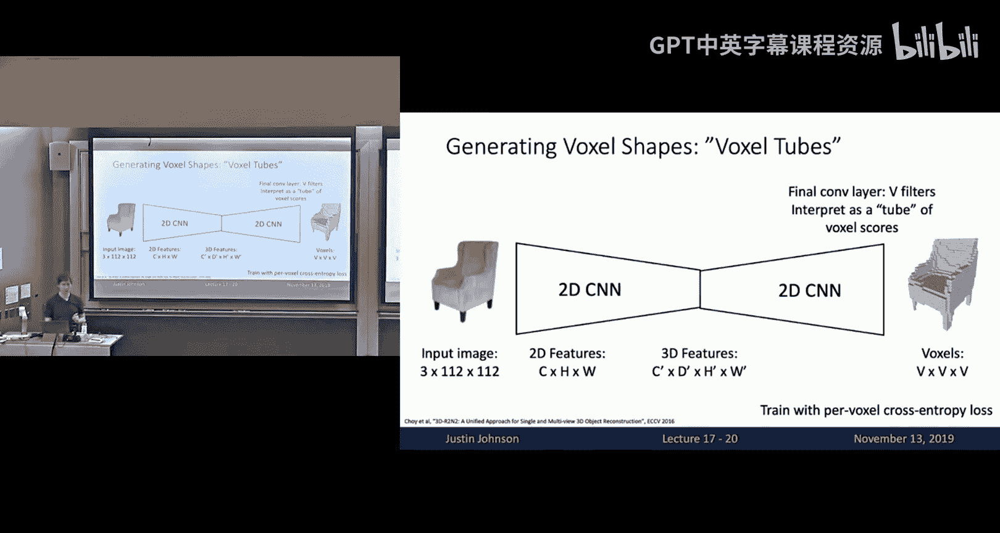

Okay but then a big problem with voxel representations is that they take a lot of memory。

 So we already noted that if we wanted to represent the very fine grained details or fine fine grain structure of objects。

 then we would need to use a very high resolution voxel grids。

 and it turns out very high resolution voxel grids take a very lot of memory and GPUus don't actually have enough memory to work with very high resolution voxel grids。

 So as an example， suppose we wanted to represent a voxel grid that was 1024 by 1024 by 1024。

 and then because this is a neural network within each cell of the voxel grid。

 we want to have a 32 bit floating point number that represents the occupancy probability or the occupancy score for every point in this highdial voxel grid Well then just storing this three dimensionmenal tensor would take almost four gigyte of memory。

 and that's not counting all of the convolutional layers that we would need to use in order to actually predict this high resolution voxel grid。

 So as a result of this。Very high memory requirements of voxel grids。

 people just don't it's just not possible or not feasible to use sort of naive voxel grids at very high spatial resolutions。

But there are some tricks that people sometimes play in order to scale voxal representations up to higher spatial resolutions。

 So one trick is to sort of use a multi a kind of multiresolution of voxel grid。

 And one way to do this is this idea called anoct tree。

 So I don't really want to go into too much detail here。

 But the idea is that we're going to kind of represent a voxel grid where some a kind of multiple resolutions。

 so we will be able to capture the coarse spatial structure of the object using some low resolution voxel grid。

 maybe at 32 cubed。 and then we can represent maybe we can fill in the fine details by turning on a sparse subset of numbers a voxel cells at higher spatial resolutions like 64 cubed or 128 cubed。

 and now implementing these things gets quite tricky because you need to deal with kind of mixing multiple resolutions and now using sparse representations of these voxel grids。

 So the implementation of these types of structures is a bit nontrivial。

 But if you can manage that implementation hurdle then you can actually ske use this。

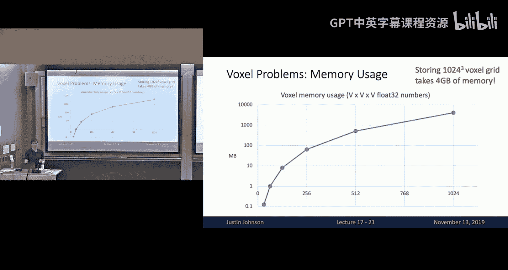

Tricks to scale box or representations up to fairly high spatial resolutions。

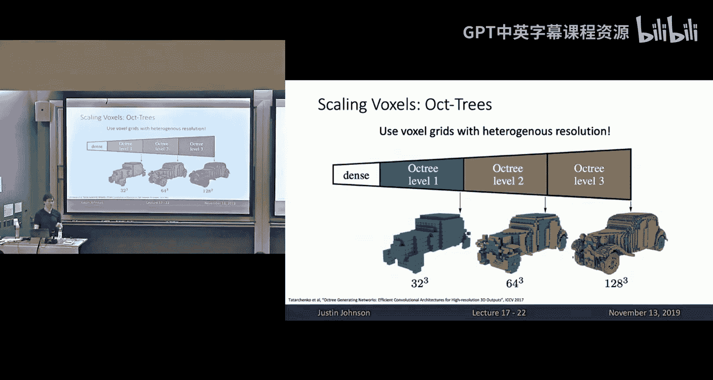

Another trick that I thought was kind of cute is this idea of a nested shape layer。

 which is kind of like these nested Matroshka Russian dolls。

 so the idea is that rather than representing this like full 3D shape as a dense voxel grid instead we we' going to represent the shape of the object from the inside out so we're going to have some kind of like coarse outer layer and then minus some negative voxels that are inside plus some more positive voxels minus another layer of negative voxels and then we don't actually have to and we can represent all of these things sparsely。

 we don't have to represent the full voxel grid in a dense way。

 we just kind of represent it as this sum indifference of a couple different sparse voxel layers so this is another way that people are able to scale voxel representations to fairly higher spatial resolutions。

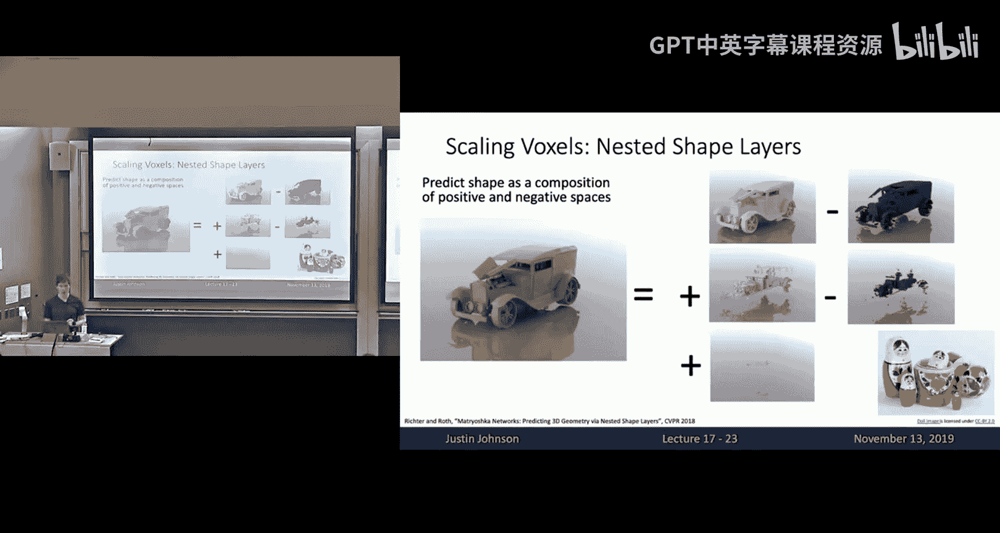

Okay， but then so that's kind of the voxal grid representation。 And that's。

 that's actually one that gets used quite a lot in practice。 Now。

 another kind of really interesting 3D shape representation is that of an implicit surface。

So with the idea with an implicit surface is that we want to represent our 3D shape as a function。

And what we're going to do is learn some function that inputs some coordinate in 3D space。

 and what it's going to output is the probability that that that arbitrary position in 3D space is either occupied or not occupied by the object。

And then then rather than kind of trying to fill so with a voxel grid。

 what we're kind of doing is sampling such a function at some finite set of points in 3D space and then storing those samples to the function in some explicit grid representation。

 but now with an implicit function we're kind of just using some mathematical function itself to represent these 3D shapes implicitly。

 so then we could then sample from this function at arbitrary points in 3D space and it should be able to tell us whether or not arbitrary positions in 3D space are either inside or outside the object and then the actual the exterior surface of that object would be represented as the level set of points in 3D space where that occupancy probability is equal to one half。

And then we can kind of represent this representation visually on the left here。

 where now this implicit function， the color of each position in space sort of gives what the value of this implicit function would be if we were to have evaluated it at that point in space where blue corresponds to values very close to one and red correspond value is very close to zero。

 and then this white region in the middle is where we actually have this level set of one half that represents the actual surface of the 3D shape。

You'll also sometimes see this called a signed distance function。

 where the idea is that this function is giving us Euclidean distance from the point in 3D space to the surface。

 where that distance is maybe positive or negative。

 depending on whether the point is inside or outside the object。

 but these are basically sort of equivalent representations。

 It's just a question of whether whether the output of this function is between0 and 1 or between minus infinity as infinity。

 but otherwise they're sort of equivalent。And now of course。

 whenever you see a very complicated function that you might want to represent or learn。

 what we're going to do is just like learn this function as a neural network。

 So then what we're going to do is learn a neural network that inputs a 3D coordinate and then outputs a probability to say whether that 3D coordinate is actually inside or outside the shape。

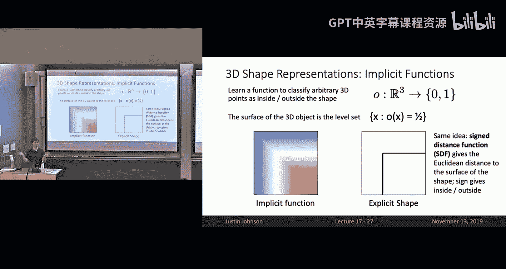

And then you could imagine training such a function by having some data set of samples from your 3D shape and then training it to classify these coordinates as being either inside or outside the 3D shape and now if we actually wanted to extract some explicit shape representation from this learned function。

 what we could imagine doing is kind of sampling that learned function at some grid of points in space and then the function would tell us whether each one was inside or outside and then then we could imagine going back and resampling the function now at new points that are kind of on the boundary of being inside or outside then you could imagine sort of going back and iteratively resampling new points from this learned implicit function to actually extract some explicit representation of the boundary of the shape that the implicit function represents。

But of course this is actually this actually has a lot of sort of hairy implementation details as well。

 as you might imagine， and the exact procedure of how you hook up these architectures and how you connect image information to these SDF neural network functions or how you actually what is the exact algorithm for extracting a 3D shape from a trained SDF these are all sort of complicated details that I don't really want to get into I just thought that this is a kind of interesting way to represent 3D shapes because we're sort of representing the shape implicitly as the values computed by a learned function。

 whereas most of the other representations that we use are kind of explicitly representing the shape of the object using some primitives in 3D space So I think this is an interesting 3D shape representation to be aware of。

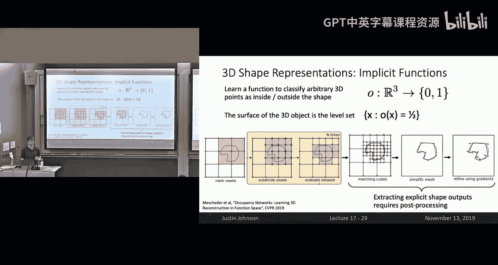

Okay， so then the， the next 3D shape representation to think about is the。

 the point cloud representation。So here， a point cloud representation is basically saying we're going to represent a 3D shape as a set of points in 3D space。

 where the set of points in 3D space are going to somehow cover the surface of that 3D shape that we want to represent。

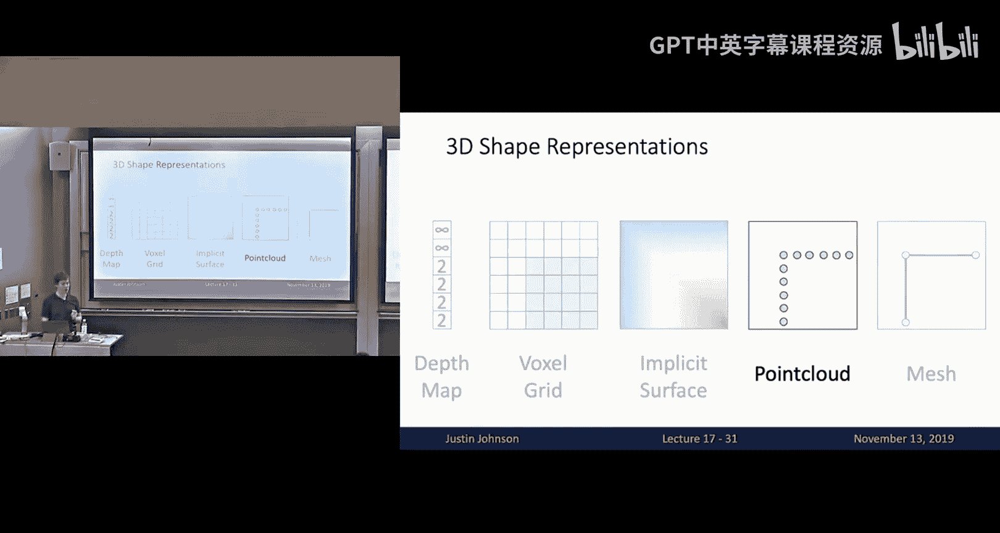

So for example， if we wanted to represent this airplane here as a plain cloud representation。

 then we might represent it as the set of points in 3D space that all kind of we have many。

 many points on the surface of the airplane representation。

So one sort of nice property about point cloud representations is that they're somehow more adaptive compared to voxel grid representations。

 So we saw that if we wanted to use a voxel grid to represent a 3D shapes with very fine details and with high fidelity。

 then you would need to use a very， very high voxel resolution。

 But now with a 3D point cloud representation， you can imagine that we can represent fine details of 3D shapes by varying the density of the point cloud at different points in space。

 So for a point cloud representation like for parts of the object that require very fine detail。

 like maybe the tips of the wings or the tail fins of this airplane。

 you can imagine putting more points there， just represent those fine details。

 whereas other parts of the object， like maybe the fuselage of the plane that don't have as much fine structure you can imagine having maybe allocating fewer points on that part of the object to represent it with less fidelity。

 So that means that even if you have a fixed finite number。Points to allocate for your 3D shapes。

 Then you can position those points out in space in different ways to more flexibly or adaptively represent areas of high and low detail of the shapes you want to represent。

But sort of one downside with 3D point cloud representations is that you need to do some kind of postpro if you actually want to extract out some actual 3D shape to visualize and that's kind of clear even from this visualization that we're showing on the screen because mathematically this point cloud representation each of our points are infinitesimally small。

 but there's no way that we can actually visualize these infinitesimally infinitesimally small points so even just to visualize a point cloud representation。

 we kind of need to inflate the points to some finite ball size and then render these balls So that's what we're showing on the screen here。

 So that means that this raw point cloud representation is something that we can't really work with for a lot of applications。

 in order to for any kind of downstream application we might need to do some post-pro on the point cloud to convert it into some other format or some other representation for us to render or visualize or work with。

 But that said this point cloud representation is still a very useful thing to work with in neural networks and this is actually a very。

And representation that's used， for example， in。Maybe self-driving car applications。

 so for a selfdriving car they actually have this spinning lightA sensor that's on the roof of the car。

 and then it actually collects this point cloud representation of the environment around it。

 so then for any kind of self-driving car application you need kind of the raw data that the system is ingesting is some point cloud representation of the world around it and that's maybe and then then it's sort of important that we are able to build neural network models that can ingest these raw point cloud representations and then make some decision based on raw point cloud inputs。

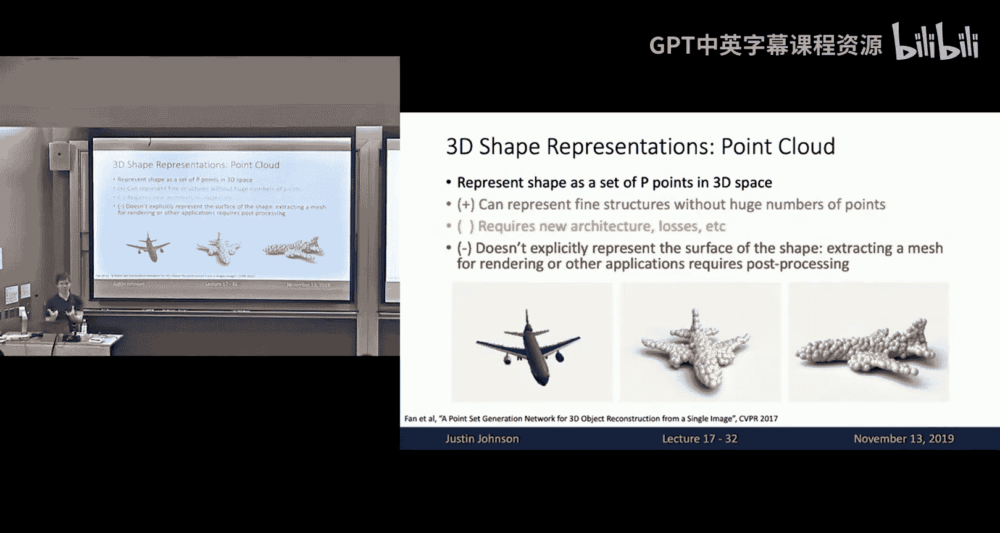

So then one kind of neural network architecture that people often use for ingesting point cloud inputs is this so called pointnet architecture。

So here this is kind of a simplified version， but what we want to do is input a set of 3D points。

 so then our input is going to be a point cloud with P points and each of those points will have an XYz position in 3D space and now we want to input this set of points as input to the network and then we maybe want to make some classification or regression decision based on this point cloud input so maybe one thing we might want to do is classify what is the category of the shape that is being represented by this input point cloud。

So then once then we need some kind of neural network architecture that can input a set of points and then output some classification score。

But what's interesting here is that we don't want the order of the points in the cloud to matter right this point cloud is really a set of 3D points and then the order that the points are represented in memory actually should not matter。

 So what that means is that the operations this kind of like the transformer that we talked about several lectures ago we want the operations performed by our neural network to be invariant or equivariant to the order of the points that are represented So then one way that we can do this is this pointnet architecture So here what we're going to do is train a little is have a little MP a multilayer perceptron a fully connected neural network that is going to input a three dimensionmenal coordinate and then go through several fully connected layers and then finally output a feature of dimension D and then we can run this fully connected network independently on each point in the cloud and that will then give us some feature vector for every point in the cloud and then then this。

Then if we had point clouds with varying numbers of inputs。

 then we could imagine just running this NLP independently on point clouds with arbitrary numbers of points。

And then once we've used this fully connected network to extract a feature vector for every point in the cloud。

 then we can use a max pooling operation to do some max pooling over all of the points in the cloud。

 and that will collapse these P points in the cloud down to a single feature feature vector of dimension D。

 and then this single vector of dimension D， we could then imagine going back to using to some other fully connected network to eventually output our final class scores or class probabilities。

And because this max pulling up， because the max function doesn't care what order its inputs were in。

 then this architecture doesn't care what order the points were represented on the input tensor。

 so that means that this architecture is really operating on sets of input points。

 so it's quite appropriate for dealing with these point cloud representations。

And this is actually maybe quite a simplified version of a point at architecture。

 so in practice you might imagine so this is kind of doing one layer of global aggregation across all the points。

 but in more complicated versions of this architecture。

 what you can imagine doing is taking this pooled vector and then concatenating it again to all of the vectors of the points in the cloud and then doing more independent MLPs and then more pooling and kind of iterating this procedure of independent operation on the feature vectors of the points。

 pooling across the points and then concatenating that pooled vector back back to the feature vectors of the points and you can imagine sort of more complicated variants of this type of architecture。

But this is sort of very commonly used for processing point cloud inputs。

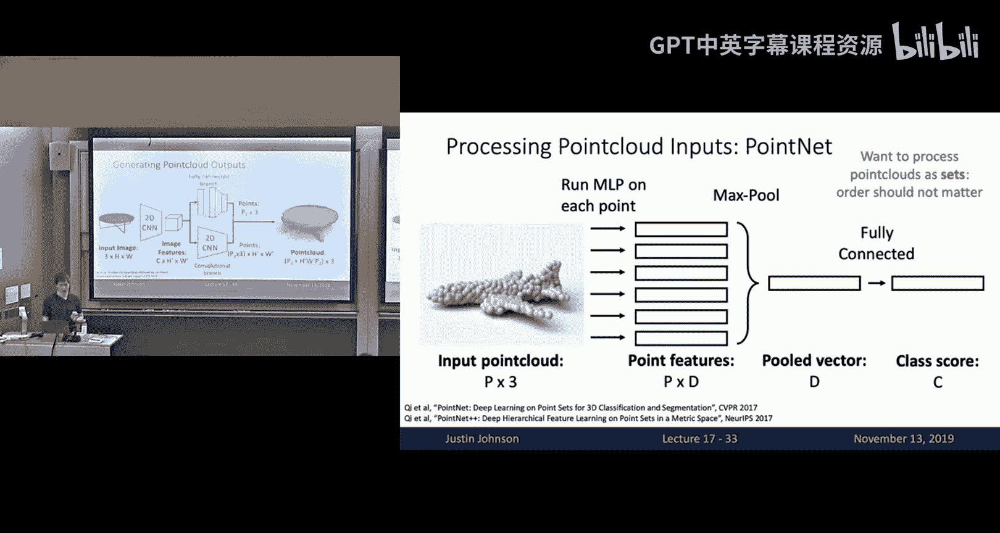

Now， another thing we might want to do is generate point cloud outputs。 So here。

 what we might want to do is input an RGB image and then output a point cloud representing the the 3D shape of the point the 3D shape of the object。

So then what we could imagine doing is kind of hooking up some some neural network architecture that is now spitting out some 3D point clouds that give the 3D shape。

 and maybe we can skip over the exact details of this architecture。

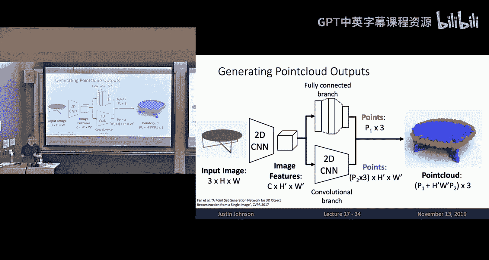

Because I think the interesting point about generating point clouds is that we need some kind of loss function that is able to compare our predicted the point cloud that our network predicted and the point cloud that we should have predicted。

 And now this is kind of a new thing that we haven't really seen before because we need to write down a loss function that operates on two sets and tells us how similar is this point cloud this these two sets。

 the one that we predicted and the one that we should have predicted。And of course。

 this loss function needs to be differentiable so we can back propagate through it and use it to train the network。

Well， one function that we often use to compare point clouds is called the champer distance。

 and it has this particular mathematical form， but I think it's maybe easier to understand if you walk through it visually So here the idea is that we're going to input two sets of points the orange points and the blue points and now the champer distance should tell us how different are these two sets of points So there are two terms in this loss function So the first one what we're going to do is for each blue point we're going to find its nearest neighbor orange point and then we're going to compute the Euclidean distance between each blue point and its nearest neighbor orange point and then we're going to sum up those those distances across all of the blue points and that will be this first term in the loss function。

And then the second term will do something kind of equivalent。

 so for each blue point we will now find sorry for each orange point。

 we will now find its nearest neighbor blue point and then compute that distance to its nearest neighbor and then sum of all of those distances and now our and then our final chamfer loss will then be the sum of these two sort of nearest neighbor matching loss functions。

And now you can see that the only possible way to get this to drive this chamfer loss to zero is if the two point clouds coincide perfectly。

 that is if every orange point is exactly on top of some blue point and vice versa。

 that's the only way that we can achieve zero loss。

 but of course because of this nearest neighbor operation。

 the order of the two points in the clouds does not matter so then this chamfer loss function is is somehow measuring the L2 nearest neighbor distance between two sets of points in 3D space。

So then we can imagine using this chamfer loss function to train our neural network that's predicting point clouds so then we could have the point cloud that's predicted by our model and then the point cloud from the ground truth data set that we should have predicted and then compute this chamfer distance between them and back propagate through everything to train the weights of the network。

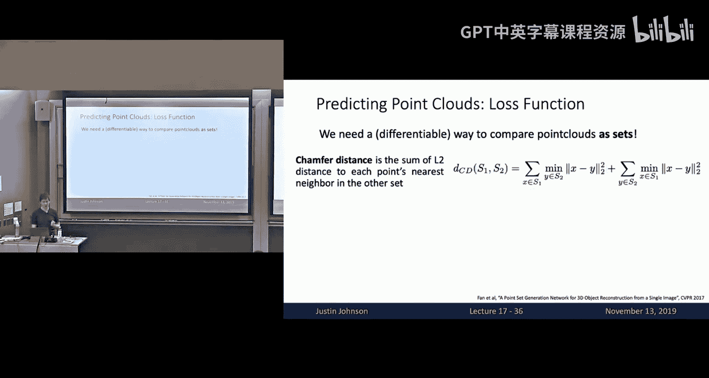

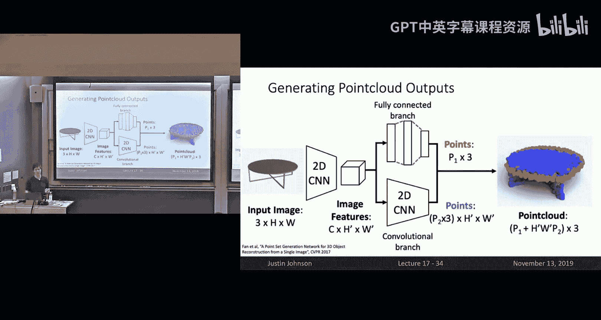

So that gives us our point cloud 3D shape representation。

 and the final one is the mesh representation of 3D triangle meshes。

So here a 3D triangle mesh is actually a very commonly used representation in computer graphics if you've ever taken like a graphics or a rendering class。

 and here what we're going to do is represent the 3D shape as a set of vertices in 3D space。

 which is basically a point cloud representation， but now in addition to this set of points in 3D space。

 we're also going to have a set of triangular faces that are triangles with vertices on the point cloud。

 and then this will basically represent the  3D shape of the object， not as a set of points in space。

 but as a set of triangular faces that are all interconnected through vertices。

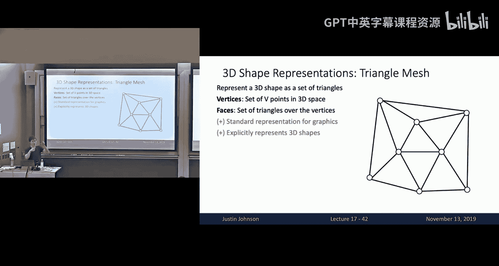

So this is also sort of adaptive because we can have sort of bigger or smaller triangles at different points in the model and it's also very useful for computer graphics because it gives us this explicit representation of the surface of the object and what this means is that we can also sort of interpolate arbitrary data over the surface of a triangle mesh using something like very centric coordinate interpolation but the exact details of that don't matter what that means is that。

 for example， if we had maybe if we attached data at each vertex like a color or a normal vector or a texture coordinate or some other pieces of data at each vertex。

 then you could sort of interpolate those pieces of data over the triangular faces of the triangle mesh so that would sort of let us represent this sort of extension of our finite samples of data over this entire 3D surface in 3D space and that's for example。

 how we often render 3D textures in computer graphics engines。

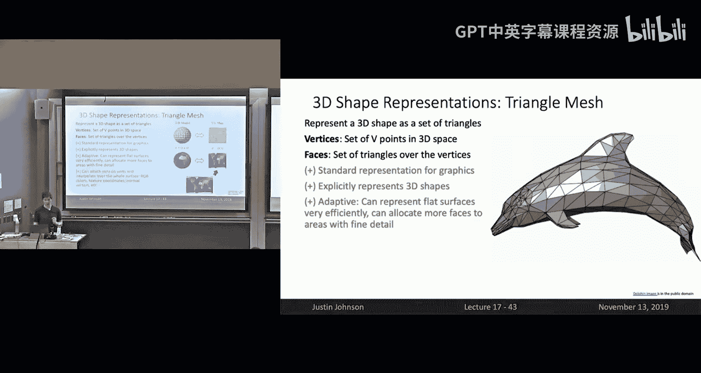

So for all those reasons， I think this 3D mesh representation is really nice。

 especially for graphic C type applications。But actually。

 processing 3D meshes with neural networks is kind of a nontrivi operation。

 You need to sort of invent a lot of new structures to process meshes with neural networks。

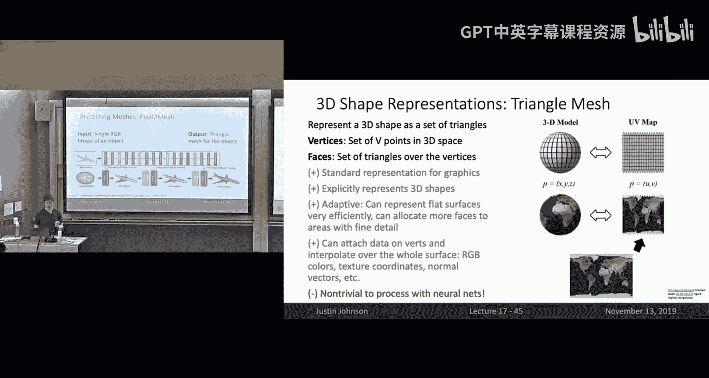

So there was a very nice paper presented by some folks at EC last year in 2018 that had I think a lot of really cool ideas for processing meshes with neural networks。

 this was called pixelix to mesh because what they wanted to do was input a single RGB image on the left and then output a triangle mesh giving the full 3D shape of that object in the image。

 and they had maybe three four key ideas for processing meshes with inside of a neural network that I thought were quite interesting。

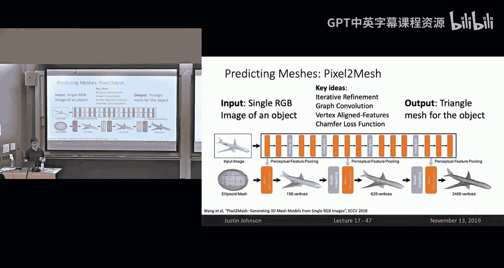

So the first is the idea of iterative mesh refinement。

 So ultimately we want to build a neural network that is able to output or emit a triangle mesh representing a 3D shape。

 but it's sort of difficult to invent 3D meshes from scratch in the differentiable way。

 So instead what we're going to do is sort of input some initial template mesh to the neural network and then throughout processing of the neural network what it's going to do is deform that initial template mesh to give our final mesh output。

So then what we're going to do is sort of input to the network this sphere。

 initial sphere or initial ellipsoid mesh that gives us some initial positions for all the vertices and some set of triangular faces over those vertices。

 and then we're going to then iteratively refine the positions of those vertices。

 So then in the first stage of processing we'll process that input mesh in some way。

 see how much does that initial mesh match the image。

 and then move the vertices around in 3D space to give some updated or refined version of that triangle mesh。

 then given that refined triangle mesh， we will again somehow compare it to the input image。

 see how much does it match the input image and then again move each of the vertices a little bit in order to further refine the exact structure of the 3D mesh that we output And you can imagine going through several stages of this。

And hopefully， by the end， you'll be able to output a 3D triangle mesh that matches the geometry of the input image very nicely。

 So that's the first sort of interesting and useful idea for processing triangle meshes with neural networks。

😊。

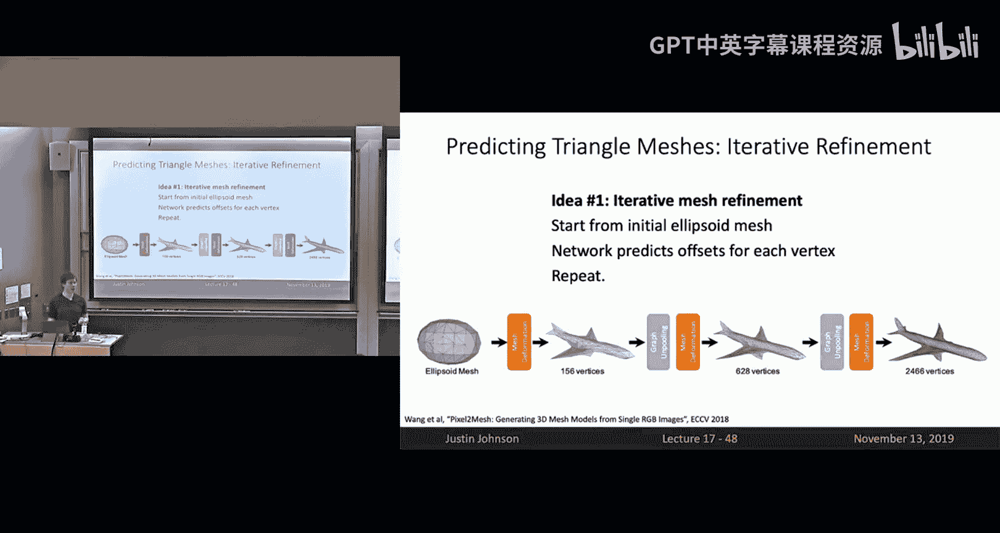

The second is that we need some kind of neural network layer that can operate over mesh structured data and the way that we do that is using an operator called graph convolution So we're very familiar with two dimensionmensional and threedimensal convolution right the idea with normal 2D convolution is that we have some grid of feature vectors and then at the input and then the output we're going to compute a new grid of feature vectors and every feature vector in the output grid is going to depend on some local receptive field or local neighborhood of the features in the input grid and then we're going to slide that same function over every point in the grid to compute all of our feature vectors in the output Now with graph convolution it's going to be very similar but sort of extending not to two- dimensionmensal or three dimensionional spatial grids but instead to arbitrary graph structured data So what we're going to do is that the input to a graph convolution layer will be a graph and a feature vector attached at every vertex of the graph and now the output of the graph convolution layer we want to compute。

New feature vector for every vertex in the graph。And the output feature vector for a vertex should depend on a local receptive field of the feature vectors in the input graph to the graph convolution layer so then we can use this particular mathematical formalism up here at the top that lets us compute a new output feature vector F prime I for vertex V that's going to depend both on the input feature vector f as well as all of the neighboring feature vectors fj that are all the neighbors in the graph to that feature vector f and the way that we do this is have maybe there's sort of a lot of different lowlevel ways that you can implement graph convolution。

 there's a lot of different papers showing exactly slightly different architectures for this thing。

 but they all share this similar intuition that we want to compute the output feature vector in a way that depends on sort of the local neighborhood of feature vectors in the input graph and then we're going to apply this same function to every vertex in the graph and sort of slide it over convolutionally and this is sort we think of this as a convolution because we're sort。

Sliding this function over every vertex in the graph to compute our output feature vectors and then just like image convolution can be applied at test time to arbitrary grids of arbitrary sizes。

 well then a single graph convolution layer can operate on graphs with arbitrary numbers of vertices and arbitrary topology or connectivity patterns at test time so we can use sort of one neural network layer that can process graphs of arbitrary topology。

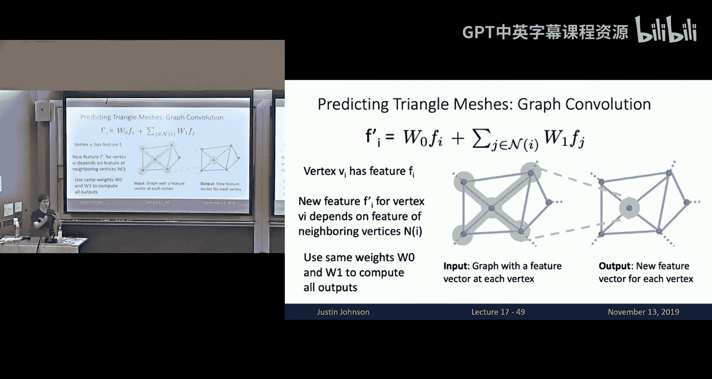

So then in order to process triangle meshes with graph convolution where the main body of the network is now going to be a graph convolutional network where we stack off many。

 many of these graph convolution layers， so then inside the body of this network we will always attach a feature vector at every vertex in the mesh and now at every layer of graph convolution it's going to update or compute a new feature vector for every vertex in the mesh in a way that sort of depends on local neighborhoods of the input of the neighbors in the mesh to all to each vertex where the neighbors are sort of along the edges as indicated by the faces so you can imagine stacking up many。

 many graph convolution layers to now update to now process feature vectors and propagate them along the edges of this mesh so I thought this was again a very nice way to process mesh structure data with some kind of neural network structure。

But now the problem is that I said that our initial task here was to input an RGp image and then output the triangle mesh so we need some way to actually mix in image information into this graph convolutional network so that brings us to I think the third really cool idea that this pixel to mesh paper had and that's this idea of getting vertex aligned features so here what we want to do is for every vertex in the mesh we want to get some kind of feature vector from the image that represents the kind of visual appearance of the image at that spatial position of the vertex so then what we can do is take our input image and then run it through a twodiional CNN and that will give us some two-dial grid of image features that we've seen many。

 many times and now what we can do is if we understand the camera intrinsics or then what we can do is take our 3D triangle mesh and then project the vertices of the mesh onto the image plane using of a 3D to 2D projection operator and that will take that will take。

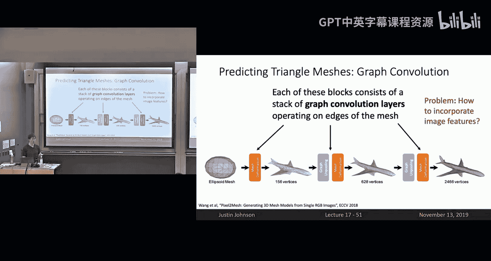

Every 3D position of each vertex out in space and now project it down onto the image plane。

And now for each of those projected vertex locations。

 we can use bilinear interpolation to sample a feature vector image from our convolutional neural network features that now gives us a feature vector for each vertex that is perfectly aligned to the position in the image plane where that feature vector projects。

And this idea in this bilinear interpolation is basically the same that we saw last lecture in the ROI align operator in Mascar CNN。

 but so here we still want to kind of sample feature vectors at arbitrary positions in the 2D image plane。

 but rather than sort of sampling them at a regularly spaced grid like we did in the ROI align operator。

 instead what we want to do now is sample a feature vector at every point in the image plane for all of the projected vertex positions。

 and that will allow us to mix in image information into our graph convolutional network。

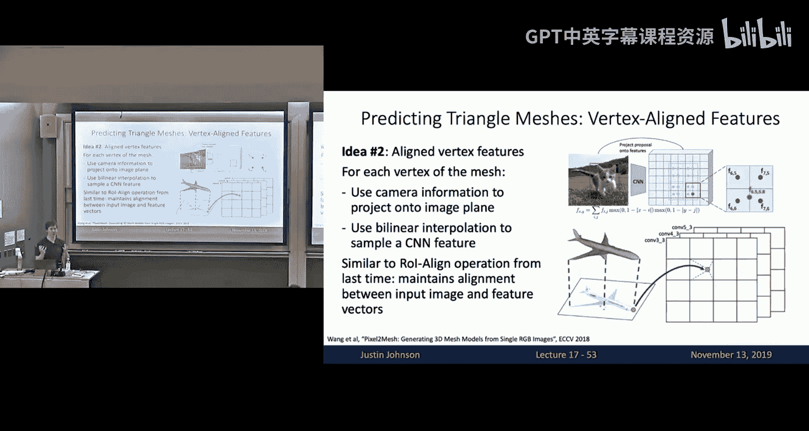

Okay， so then the final thing that we need to figure out with processing graphs is what is our loss function。

 So then we're going to have our model predict some 3D triangle mesh。 and we have some ground truth。

3D triangle mesh。 And we need some loss function that now compares 3D triangle meshes and tells us how similar our predicted mesh was to the ground truth mesh。

But the problem here is that we can actually represent the exact same 3D shape using different triangle meshes and mean as an example here。

 we could represent a square using two big triangles or using four small triangles and both of these different mesh representations represent the exact same shape and somehow we want our loss function to be invariant to the particular way that we represent the shape using triangles we just want the loss function to depend on the underlying shape itself and not the particular way that we decide to carve it up into triangles。

So the idea to get around that is actually our loss function。 we we've actually already seen though。

 weve actually already seen the answer。 So what we're going to do isre going to take our meshes。

 convert them into point clouds by sampling points along the interior of the mesh and then use our cham distance to compare these。

 these two point clouds。And in practice， what we're going to do is sample points from the ground truth mesh on the right。

 sample points from the predicted mesh on the left。

 and then compare these two point cloud representations using this cham loss that we've already seen。

But of course， the problem here is that for the ground truth mesh on the right。

 you can imagine doing that sampling offline and sort of sampling all those points and caching them to disk。

 but now in order to sample points on the left from our prediction now we need in order to do that we actually need to do this sampling operation online so that's sort of a difficult implementation to do and then also we need to be able to back propagate through this sampling operation on the left if we're going to do this do this online and it turns out there is a way to sort of backproagate this sampling operation in a nice way that you can check out this ICL 2019 paper to see the exact details。

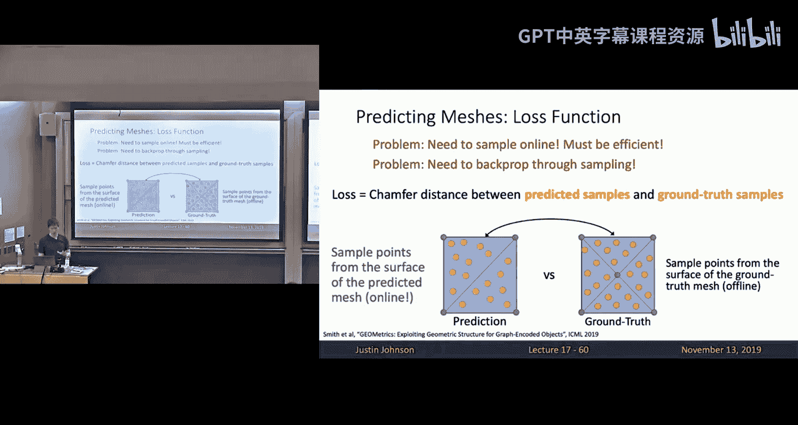

Okay so then once we've seen all of these four key ideas that gives us a way that we can operationalize a neural network that can input an RGB image and then output a triangle mesh that represents the 3D shape of that image right so then we're going to use iterative refinement。

 we're going to use graph convolution at several points in this graph convolution network we're going to mix in image information using vertexign features and we'll train the thing using a chamfer loss function。

So that gives us our four 3D shape representations there's actually a couple more issues we need to deal with when dealing with 3D shapes but maybe we won't go into full detail on these so we need some metrics to compare 3D shapes to actually tell whether our models are working well we saw in 2D we can use intersection over union to compare bounding boxes we can actually use a similar type of intersection over union to compare 3D shapes。

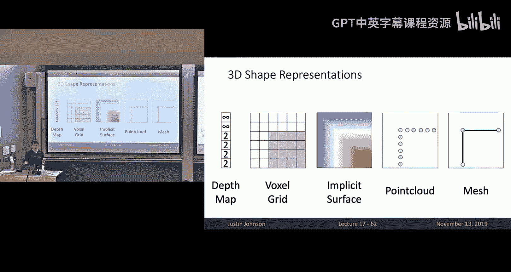

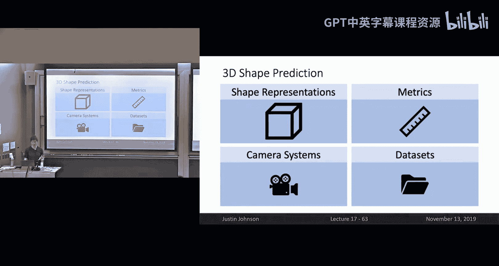

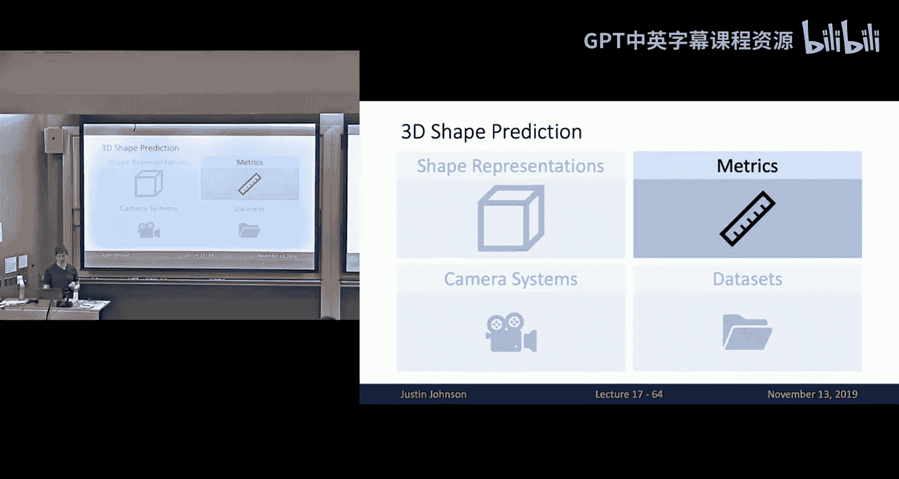

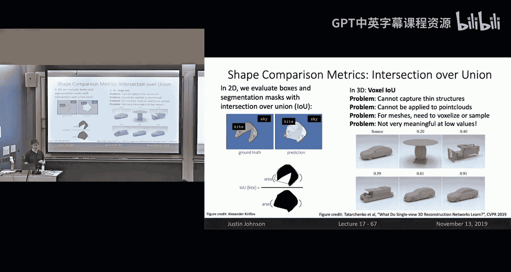

But it turns out that actually intersection over union of 3D shapes is maybe not as meaningful or useful as a metric as we might like。

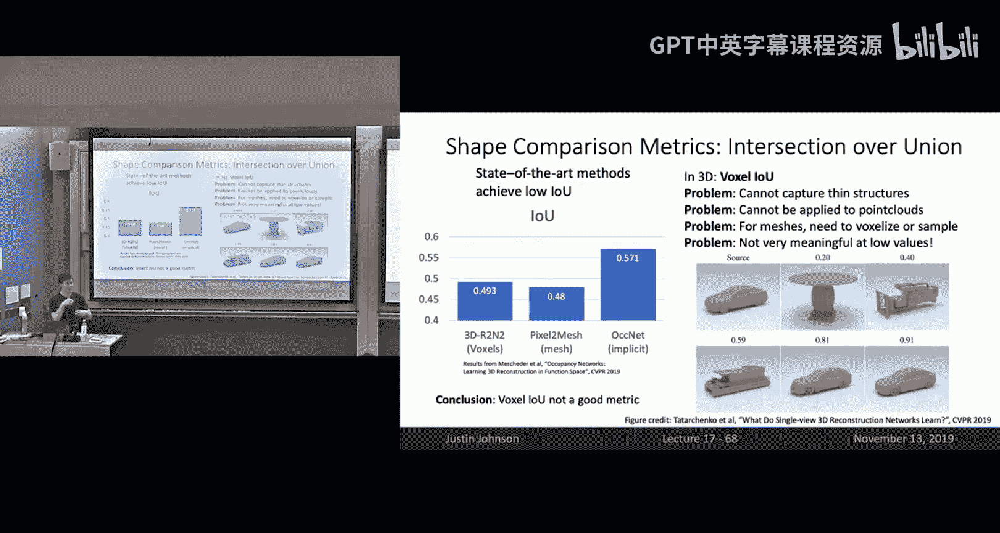

So another metric we can use to compare 3D shapes is this chamfer distance that we've already seen。

 So one way to compare 3D shapes is to sample point clouds from each of our different shape representations and then compare them using a chamfer distance。

But the problem with the Champer distance is that because it relies on this kind of L2 distances。

 then it's very sensitive to outliers。 So if you look at these， these two examples here， this， this。

 this one example on the left has very different chambermper distances to these two examples on the right because of this L2 nature of the of the loss function。

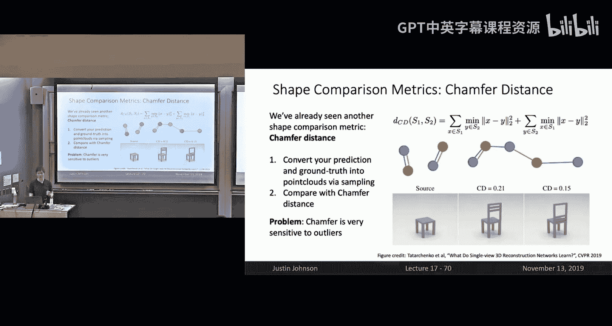

So as a result， I think a better loss function for comparing 3D shapes is to use an F1 score which also operates on point clouds So this is sort of similar to the champer loss in that we will take our two3D shape representations and sample point clouds from them and then compare the 23D shapes as point clouds So then what we're going to do is maybe we've got our predicted point clouds in orange here and our ground truth point point clouds in blue and then we can compute the precision that is the fraction of the predicted points that were actually correct and when I say correct that means that a predicted point is counted as correct if it is within some threshold radius of a ground truth point so then for this example we kind of imagine expanding out a sphere around each of our predicted points and then if some ground and truth point falls within that sphere then the predicted point is counted as true so then the precision in this example it would be three over four because three of our four predicted orange points are correct and have a blue point fall within them。

Within the radius。Then we can go the other way and compute the recall。

 which is what fraction of the ground truth points were hit with a predicted point within some radius。

 And then here， for this example， the recall will be two thirds because two out of the three。

That doesn't seem right。 It actually looks like they're all hit。 No。

 they're not hit because the one on the lower right doesn't quite hit。

 They're just sort of barely touching right So then of these three blue points。

 two of them are hit with a predicted point within the radius and the third one is not。

 So our recall is  twots。 And the F1 score is is this is this a geometric mean of the precision and the recall。

 So in this case it would be 0。7。 So this is the number between 0 and1 and the only way we can get one is if both the precision and the recall are one。

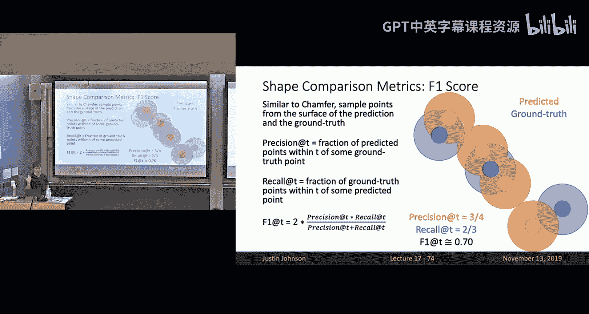

And the F1 score is sort of a nicer metric for comparing 3D shapes because it's more robust to outliers。

 So I think that this is the the the sort of best robust like sort of the nicest metric we have right now for comparing 3D shapes。

Okay， so another thing you need to deal with， worry about when you're working with 3D shapes is actually the camera coordinate system that you're working with。

 because now cameras and these camera systems get kind of complicated once you're working in 3D。

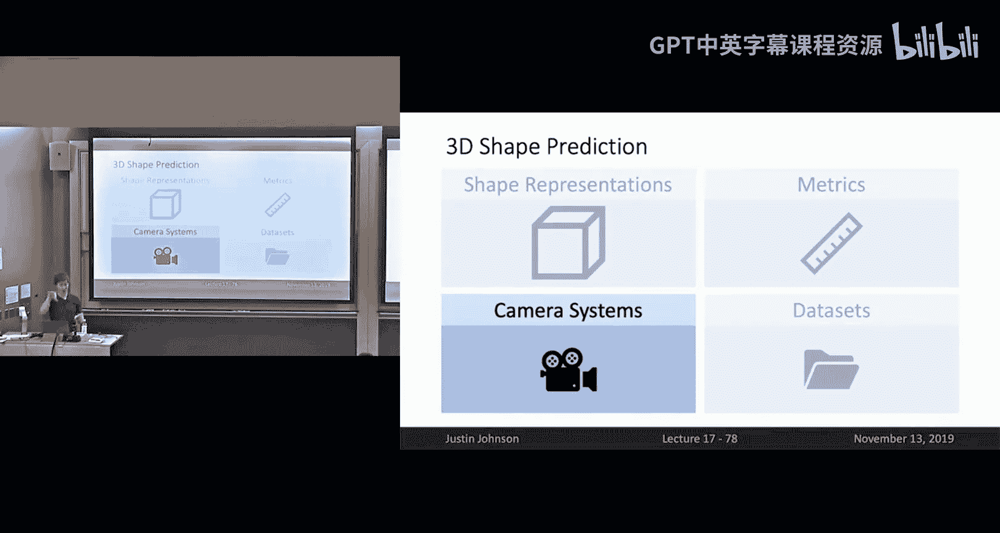

So there's one so suppose we're working on this task where we're going to input input an image and then we want to output a 3D shape representing the 3D shape of that input image Now then we have to answer the question。

 what is the coordinate system that we're going to use to represent the 3D shape out in 3D space Well one option is to use a so-called canonical coordinate system and what this means is that we sort of for the object for each object category。

 we kind of fix canonical directions of front and left and up and down So for example。

 if we're maybe training a network to predict 3D shapes of chairs。

 then we say that the plus Z direction is maybe always the front of the chair and the plus Y direction is always up is always going up normal to the seat of the chair and then plus x is always to the right。

Another option is to predict in view coordinates。 So this would be to use a 3D coordinate system for the target that is aligned to the input image。

 And this would be another option for representing the3 the coordinate system of the 3D shapes。

 when we're trying to predict them。And actually if you read a lot of papers in detail。

 I think a lot of people use view coordinates just because it's sort of easier to implement because these 3D models are kind of stored on disk in some canonical coordinate system。

 you could just kind of load them up from disk and then predict the coordinate system that they're stored with natively。

 so I think a lot of people use these canonical coordinates for a lot of in practice。

But I think view but but there's a problem with canonical coordinates。

 which is that it means that the features of your outputs are no longer properly aligned to the features of your inputs。

 whereas if you use a view coordinate system， that means that the position of your the features corresponding to each thing that you output are going to be better aligned to the original input that you process as input So for this reason I think it's preferable to make predictions in view coordinates there's actually then some research that backs this up so here did this experiment where they see that if you train two networks that are identical。

 but one is in view coordinates and one is in canonical coordinates。

 then the network in canonical coordinates tends to overfit to the training shapes that it sees during training。

 whereas networks that are trained in view coordinates tend to generalize better at test time to either novel 3D shapes or to novel object categories。

 So for those reasons I think it's maybe preferable in most scenarios to make predictions in view coordinates。

So then then as kind of an example， what that looks like is that if we're going to make viewcentric voxel predictions。

 then what that means is that this voxel tube representation that we talked about for predicting voxels becomes very natural。

 because now we're going to maybe for every position in the input image。

 we need to predict an aligned tube of occupancy of voxel occupancies。

 which then is sort of natural to process with this 2D voxel tube convolution representation that we talked about。

Okay， so then we also need to maybe cover a couple of the data sets that people often use for these tasks。

One is Shanet， because we're all very familiar with Inet。 and Inet was this like know。

 a largescale data set of images that led to deep learning revolution and bla， bla， bhlah， blah。

 And because because of Inet was so successful， then like everyone wanted to build a data and call it something net。

 So then we have shapenet， which is supposed to be like the imagenet of 3D shapes。

 So then shapenet is actually a fairly large scale。

 It gives about 50000 of 3D cad models or 3D mesh models spread across 50 different categories。

 And then it's common to render these 3D cad models from a variety of different viewpoints to actually generate a fairly large data of maybe around a million images。

 So it's fairly similar to imagenet in scale in terms of images。😊。

But because it's kind of synthetic right because these objects are just like isolated caD models。

 they're not real images， they don't have real context to them。

 so it's kind of nice for playing around with 3D representations。

 but it's not a very realistic data set。

Another data set that I like a lot is this Pix 3D data set from some people at MIT。

 which actually has real world images， and it actually has 3D mesh models of furniture that are aligned pixel wise to the input images。

And the way they collected this was quite ingenious because it turns out that people loved to shop at Ikea and when people buy Ikea furniture。

 they love to go online and say， like， hey， look at my new IKEA bed model like whatever。

 and then then you can just like Google the Ikea model number and then get a lot of images that show you like this exact bed in a lot of different rooms。

And then it turns out that IKEa actually publishes 3D mesh models of their furniture。

So then what they can do is download all these 3D meshH models from IkeA。

 go on Google image search and search Google for a bunch of images of specific IKEA models and then pay people to align the IKA models to the input images so that's like pretty cool I thought that was a very clever way to collect the data and because of that it means we actually get like real worldord images with like lots of like cluttered messy bedrooms and stuff that show that show off like different types of Ikea furniture in sort of cluttered real world scenarios。

Okay， so then that finally brings us to this mesh R CNNN architecture that we teased in the last lecture。

 So here we're basically combining all of the detections to all of the detection pipeline that we built up in the previous lectures。

 But now in addition， then we want to input a real worldord RGB image。

 detect all the objects in the image。 And then for each detected object。

 emit a full 3D triangle mesh to give us the 3D shapes of each of those detected objects。

And the way that this works is that it's basically， as we said last time。

 all the detection stuff is basically Macar CNN， and then the 3D shape prediction part is sort of a blend of all of these 3D shape prediction methods that we've talked about in this lecture。

So one of the things that we do in mesh RRCN is actually use a hybrid 3D shape representation。

 we ultimately want to predict a mesh， so we liked this idea of mesh deformation from pixel to mesh。

But the problem with mesh deformation is that it constrains the topology of 3D shapes that you can output because if you recall。

 this idea of 3D mesh deformation is that the model was going to input some initial 3D mesh。

 then it was going to reposition all the vertices in order to give our final output mesh。

But this only works if the model the shape that we output has the same topology as that initial 3D mesh shape。

 so for example， it means that there's no possible way to deform like if you' taken a topology class。

 you know there's no way that you can continuously deform a sphere into a donut so then it's just fundamentally impossible to input this like ellipsoid or spherical mesh and then deform it to predict a donut output so that's kind of a fundamental limitation with this idea of iterative refinement。

But it turns out that that these other shape representations we've talked about today actually do not suffer from this。

 so basically what we're going to do is we want to overcome this limitation of limited topologies of this iterative refinement method by first making coarse voxel predictions。

 converting the voxel predictions to a mesh， and then using iterative refinement from there。

So basically the pipeline is that given an input image。

 we'll do all of the 2D object recognition stuff that we're familiar with from NAscar CNN。

 so this is going to be these RPNs and then for each RPN we're going to regress boxes and then have a second stage it's going to do our classification and our instant segmentation。

 and that's going to give us these boxes for all the detected images in the scene。

Then for each detected detected image， we're going to use a voxel tube representation。

 a voxel tube network in the second stage of the the macar CNNN pipeline to predict a coarse voxel representation of the 3D of of each of each shape。

And then we'll convert each of those predicted voxel representations into some blocky mesh representation。

 and then use that blocky mesh representation as the initial mesh to use to go along for iterative refinement that then allows us to finally output for each detected image。

 for each detected object， output this this high fidelity mesh representation。

And then our results is like basically we could predict things with holes that's the big thing right because because we're going through this intermediate voxel representation。

 it allows us to output meshes that have sort of arbitrary topology if you look at so these are some example results where the top row shows our input RGB image the middle row shows examples from this iterative refinement approach that is going to deform from a sphere from an initial sphere mesh and you can see that because it just can't get rid of holes in objects。

So for this example of the chair on the left， it seems like the network kind of knows that there should be a hole there。

 so it kind of pushes the vertices all the way from the hole， but it just can't delete that face。

 so it just has no way to actually properly model the holes in these objects。Whereas in our results。

 because we go through this initial coursearse voxlor representation。

 then the voxlor representation can be used to model the initial holes in the object。

 and then the meshes can be used to refine and give us this very fine crane outputs。

There's a slight problem though， which is that if we train only with the champer loss。

 we actually get really ugly results， so we actually find that we need to use some regularization term that encourages the result the generated meshes to be less degenerate and more visually pleasing So the way that we do that is that in addition to minimizing the chamfer loss between the predicted mesh and the ground truth mesh。

 then we also minimize the L2 norm of each edge in the mesh。

 and it turns out that this relatively simple regularizer lets the model predict now very well structured meshes。

And then the results is that now we can predict these full triangle meshes。

 we can input these real world images on the left， we can detect the objects in the images。

 and then predict these output 3Dsh mesh models that give very finegra 3D shapes for each of the detected objects and you can see that they actually represent not only the visible portion of the objects but also the invisible backsides of the objects and from this bookshelf example on the upper left hand here。

 you can see that we can represent we can output these 3D meshes with very complicated topology with a lot of different holes。

 so that's a kind of nice nice result。

And then you know because this is built on top of an object detection framework。

 then it can actually detect many， many objects per scene。

 but of course it doesn't work perfectly so and actually another kind of nice feature of this architecture is that it actually predicts it does what we call aoral prediction so that means that it predicts not only the visible parts of objects but also the occluded or the invisible parts of all the objects So for example。

 if you look at the image on the left， you can see that like part of the couch is actually occluded by the dog's head。

 but our prediction on the right， we actually predict the full we actually predict the 3D shape of the couch even in the region of the image where the couch was covered up by the dog's head。

So that's that's called amodal prediction。 And that's actually a thing that something like masscarcina usually will not do。

And notice that we don't predict the dog because Ikea doesn't sell dogs。

And then there's another， it's also kind of interesting to look at the failure modes here。

 And what's an interesting failure mode is that we see that places where the 2D recognition fails are also places where 3D recognition tends to fail。

So here， if you look at the predicted segmentation mask for the bookcase。

 you see that the regions of the image where we miss the segmentation mask are also the regions of the image where we miss on the predicted Mash。

 So that makes me think that maybe improvements in 2D recognition could also lead to future improvements in a 3D recognition。

So then to kind of recap where we got today， we talked about these two fundamental problems of understanding 3D shapes of neural networks。

 which was predicting 3D shapes from images or maybe classifying 3D shapes and we had kind of a very fast walkover of how you can represent all these different types of 3 3D shape representations using neural networks and that's kind of where we ended off today and basically today was about adding a third spatial dimension to our own neural networks and now next time we'll talk about videos which is like adding a temporal dimension to our neural networks so that'll be a different way that we can extend our neural networks to it to an extra dimension so come back next time and learn about that。

