# 密歇根大学《深度学习用于计算机视觉｜Deep Learning for Computer Vision UMich EECS 498-007 2019》中英字幕 p19 -19-18_Videos.zh_en -BV1jA4m1P7GN_p19-

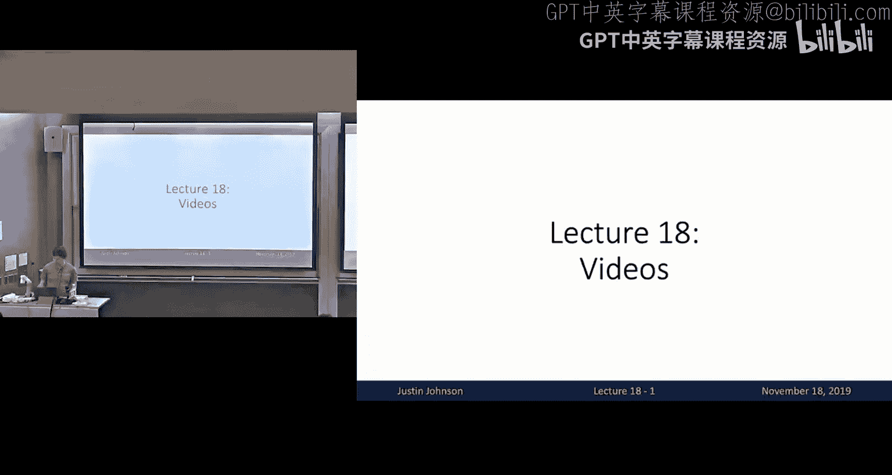

All right， it's 32， so let's get started。So welcome back to Lec 18。

 and today we're going to talk about videos。So an administrative note is that you may have noticed that assignment 4 has been due and assignment 5 is not yet out。

 so we apologize for that， so we're actively working on it and we're working as hard as we can to get assignment 5 out later this week sometime and whenever assignment 5 is released then you'll have two weeks from the time of release to do it so then assignment 5 will cover object detection that should be fun you'll get to implement your own single stage and twos stageage object detection systems but again sort of please bear with us since this is the first time we're using this this is a new homework assignment this year so we kind of had to build it all from scratch and it maybe took a little bit longer than expected because as I warned you and I should have known building object detection systems is pretty hairy so we apologize for that we'll get it out as soon as we can。

And grades and we should have grades forthcoming for all the assignments that you've turned in so far。

 we'll be getting grades out for those as quickly as possible。

 I know we've gotten a little bit behind on those as well。So apologies for that。

 but hopefully we can make up for it with some exciting talk about videos today。

So last time for the majority of the class， we have been talking about this task of 2D image recognition。

 so for example， we spent a long time diving into a lot of details about different ways to build image classification systems with deep learning。

And over the past a couple of weeks ago， we spent two lectures talking about moving beyond image classification and really stepping into understanding and recognizing 2D shapes of objects and images。

 and that led us to tasks like semantic segmentation， object detection， instant segmentation。

 keypoint prediction， panopic segmentation， and all these other sort of 2D shape prediction tasks。

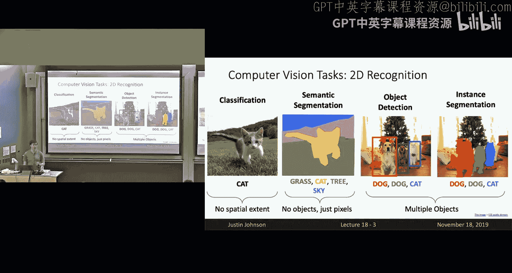

And then in the last lecture we pushed beyond the second dimension and started talking about ways to represent 3D shapes with deep neural networks so in the last lecture we talked about predict taking as input a 2D image and predicting the 3D shape or we talked about ways for processing 3D input shapes and then making different classification decisions and of course we did that in a context in order to do that we needed to define these different types of 3D shape representations so it turns out that it's pretty complicated to represent shapes in 3D and we actually needed to define these different sorts of representations to represent 3D shapes and they all had their own pros and cons and we saw how we could build neural network models that could deal with all these different types of 3D shape representations。

Well so last lecture was really about pushing convolutional networks from two dimensional stuff to three dimensional stuff and we did that by adding this third spatial dimension and now today there's actually another way that we can imagine augmenting our neural network models with an additional dimension so last time we we added an extra dimension of space today or instead going to add an extra dimension of time so when you think about what is a video。

 a video is basically a sequence of images that unfold over time。

 so this is basically another way to deal with  this is another sort of 3D type of representation that we can work with with deep neural networks。

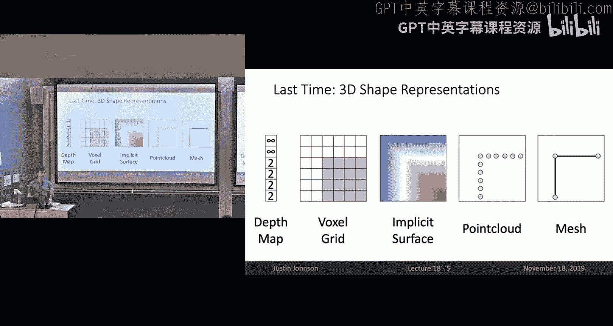

Except that now unlike having three spatial dimensions like we did in the previous lecture。

 instead now we have two spatial dimensions and one temporal dimension。

 and that will lead to a lot of additional challenges because as it turns out。

 we might want to do different sorts of things to represent the spatial dimensions and the temporal dimension in maybe different ways and we might want to treat them differently depending on the structure of the task we're working about。

So then for pretty much everything that we're going to do in videos。

 our networks are basically moving from these three dimensional tensors that we've worked with from 2D data and instead moving to these four dimensional tensors So for example。

 we can look at a video as a four dimensional tensor that has T being the time or temporal dimension3 is the channel dimension which is maybe three colors RGB channels for the raw input video and then two spatial dimensions H and W and actually we'll see that for exactly what type of architecture you use for video stuff you might sometimes transpose those first two dimensions So sometimes we'll want to put the temporal access first and sometimes we'll want to put the channel access first and we'll see cases where we want to use either those two different representations。

 but the basic idea is that a video is just a four dimensional tensor we've got one spatial one temporal dimension to spatial dimensions and one channel dimension and we need to figure out ways to build deep neural networks that can work with this sort of data。

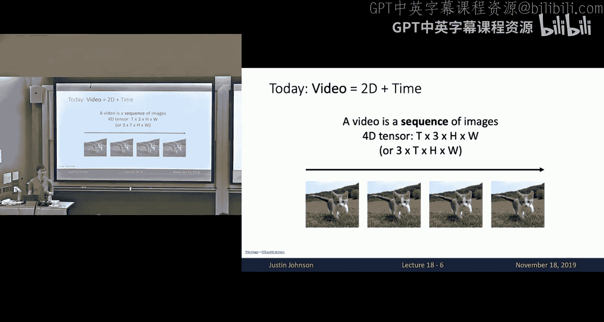

So as a kind of motivating task that we'll use to motivate a lot of our architectures on video。

 we'll imagine this task of video classification。 So here this is basically the analog of the image classification task that we've seen many。

 many times except extending it in time So now the network will accept some input video that will be a stack of RGB frames and the system we'll need to select some category label that classifies the action or activity or a semantic category of that input video and just as in the image classification case。

 the system will be aware of some fixed set of categories at training time and have a training data set that associates a set of videos labeled with some labeled category label and I think we don't even need to talk about loss functions anymore at this point because it's clear that we would train the system with a kind of cross-enttropy loss function so that just as we've seen in all the other classification problems in this semester So then the entire trick that we need to solve is how could we go from。

4 dimensional input tensor to this vector of scores that we can use to train our cross entropy loss function and train these video classification systems。

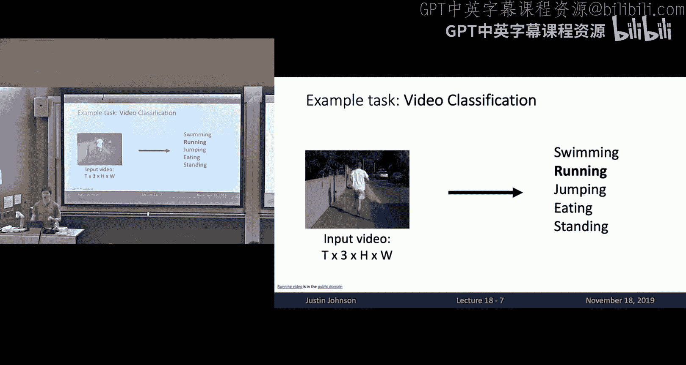

Well before we talk about concrete architectures， it's useful to point out exactly what are the types of things that we want to recognize in videos so when we're doing 2D recognition tasks。

 we're often recognize objects and we all know and objects are like things that have some kind of spatial extent or identity in the world so when we recognize 2D images we might want to recognize like dogs or cats。

 different types of animals or maybe inanimate objects like bottles or cars so that's kind of what we usually try to classify when we're working with two-dimenal input images and then when we are working with threedimensional video sequences。

 the thing that we usually want to classify are actions or activities so these are things like maybe swimming or running or jumping or eating or standing and you can see that kind of in the two-dimensal case we're trying to recognize nouns grammatically and then in the three- dimensionmensional case we're often trying to recognize verbs so the nature of the categories that we're trying to recognize in video。

oftenten very different than the types of categories we want to recognize in D images。

And another thing to point out is that most of the time in most of the verbs that we usually care to recognize in videos are actually not just arbitrary actions。

 but actually actions that human beings are performing so actually the majority of video video classification datas that you'll find out there most of them most of them have category labels that correspond to different types of actions or activities that people can do because it turns out that that's maybe a thing that we are really interested in one really important thing that we want to use deep learning for to analyze videos is to recognize what people are doing in videos so that's just kind of to point out the types of category labels that we usually are trying to predict in video classification data sets so maybe keep that in mind。

 keep that distinction in mind about nouns versus verbs as we move through different concrete architectures。

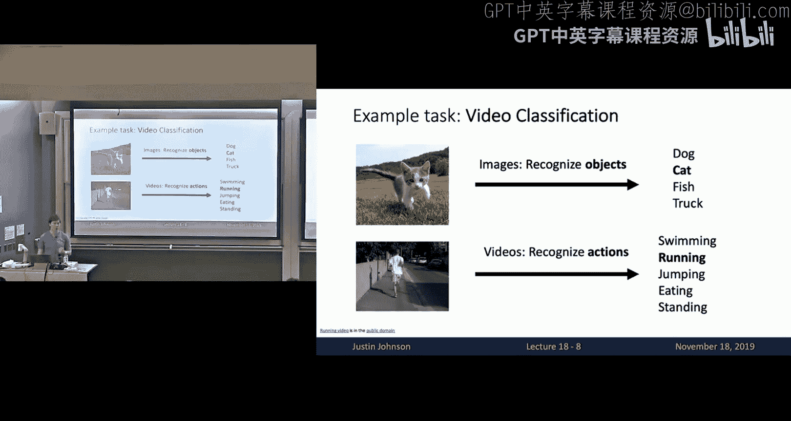

So the big problem with videos is that they are really big this is the main constraint that we have that we need to overcome when dealing with video data so if we try to work at this naively。

 well something like a TV show or a movie is often shot at like 30 frames per second for most TV shows or 24 frames per second for most movies and now if we just figure out what is the size of raw uncompressed video files。

 they end up being absolutely massive so if you imagine that we have maybe a a standard definition video stream。

 then it has a spatial resolution of 640 by 480 in pixels and if we have that at 30 frames per second。

 then just storing the uncompressed video stream of standard of a standard definition video stream comes out to about 1。

5 gigabys of data per minute and this because this is raw uncompressed video where we need to represent each pixel with  three bytes。

 one for the red one for the green one for the blue so when you multiply all that out。

 it actually takes a lot a lot of data。To just store raw uncompressed video and if we move to maybe a high definition video。

 then sort of full HD video would be at 1920 by 1080 and that's up at 10 gigabytes per minute if we're storing it in this sort of raw uncompressed form so this is going be like absolutely catastrophic for dealing with videos in neural networks if the uncompressed video just using a byte representation of pixel values is going to be this big there's absolutely no way that we can possibly fit such large video sequences into our GPU memory because you know a standard state of the art GPU might have something like 12 or 16 or 32 gigabytes of memory and that memory needs to hold not just the raw video but also all of the activations of our network as well that we need to process on top of those pixels so as a result we can see from just running these numbers that it's completely infeasible to build deep neural networks that actually process the raw temporal and spatial resolution of the types of videos that we usually watch。

So the solution is of course we need to make the data a lot lot smaller if we're actually going to process it with deep neural networks。

 so when we talk about video classification， usually what we mean is that we're training neural networks that classify very。

 very short clips of video that are typically something like three to five seconds in length and then to make it even more tractable we'll often temporally subsample those clips so they are at a very very low frame rate so rather than something like 30 frames per second we might have like five frames per second and then we'll also tend to heavily spatially downsample the spatial resolution of the video frames of the video clips that we work with as well so if you recall that when we worked with maybe image classification it was common to use image resolutions of something like 224 by 224 but now because of these constraints of working with video when we work with classifying video clips we'll often downsample the spatial resolution to something like 112 by 112 so that's actually a very。

 very low resolution video。Like if your Netflix stream dropped to a video resolution of 112 by 112。

 you would probably be very， very sad as a viewer， but due to computational constraints。

 that's kind of the video world that our neural networks are going to have to live with。

 maybe until our memory gets much， much bigger。So this is just to kind of ground the problem that even though when we think about processing videos with neural networks。

 we think about kind of maybe processing hours， hours long video。

 but in practice that's really not what we do that just due to these computational constraints。

 we're really forced to work only on very， very short clips that are very small in size and very small in time so this is kind of what this is kind of the setup of these video classification problems that we're usually working with。

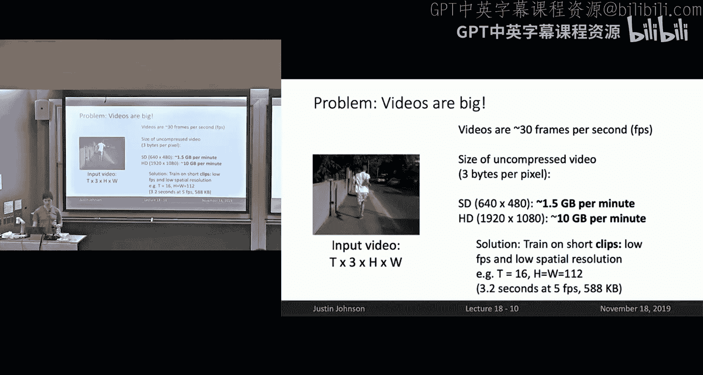

So then maybe to make this a little bit more concrete in the raw video would be very。

 very long and have a very very high frame rate， but during training we would take very。

 very short clips of these very very long video sequences and then actually subsample them in time as well to reduce the frame rate and then the models that we would that we would train our models on these very very short clips so the idea is that maybe if this input video sequence had the category label of running then probably each of these little temporal clips that we could sample from the video sequence should also have the exact same label so when training our video classification models usually well take these very very short clips from slightly longer videos that we might get in the data and then the model will be trained to work on these very very short clips of lower FPS and then at test time often what we'll do is take that model which has been run on these very short clips and then apply it at different positions of the original video and this kind of gives us many different classification decisions for。

Different subclips of that raw input video sequence and then well make our final classification prediction for the video by averaging the predictions of the classifier when we run it on these little different subcs so that's a little bit of a kind of trick that we need to play when we're working on this video classification problem we get this kind of mismatch between training and testing we're training we're doing these short clips and then testing will often ensemble a set of clips over this longer video sequence。

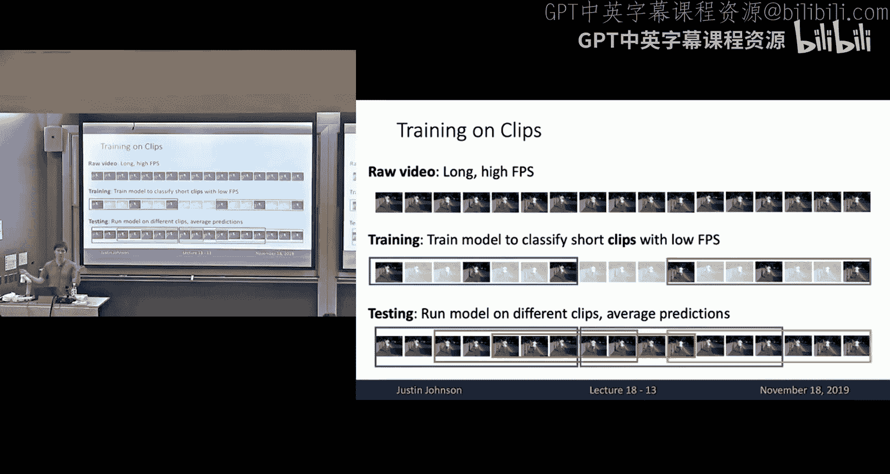

Okay， so then let's actually talk about our very first video classification model。

 and this seems stupid， but it actually works like really， really well。

 So the idea is let's forget that we're working on video。 And instead。

 let's train a model that looks that is a standard two dimensionsal CNN that is trained to classify the individual frames of the video completely independently。

😊，So for example， if this video sequence was supposed to have the action of running。

 then what we'll do is just chop up all the frames of that video sequence into individual 2D RGB images and then train your favorite standard 2D image recognition model on the individual frames of the video sequence and they will be trained to classify using the label that we should assign to the entire clip。

So， and then at test time， what we'll do is simply run this single frame model on every frame the video in the longer video sequence and then average the predictions over all of the。

 all of the video frames。And this seems like a really stupid model because it's basically ignoring all of this temporal structure in the data。

 but it turns out that this is actually like a really really strong baseline for many。

 many different video classification tasks so we'll see some concrete numbers later but basically my advice is that if you find yourself in the regime of needing to build a practical video classification system do this first because it's very likely that this very simple straightforward single frame baseline model actually will work good enough in practice I think for many different applications that you might actually want to might want to do in practice and then all of the kind of fancy temporal modeling that will talk about the rest of the lecture will be kind of like will not usually make the difference between the system working and the system not working usually what it does is just kind of bump the accuracy up from pretty good to like maybe a little bit better so I think you should really not discount this very simple single frame baseline when you're confronted with any kind of video classification or video recognition task so definitely do。

Try this first。

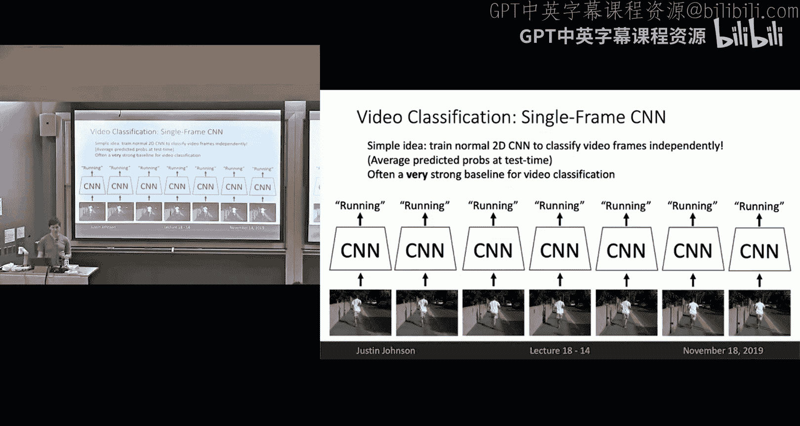

So then we can talk about a slightly simpler a slightly more complex model that actually does take into account the temporal structure of the video sequences that we're presented with。

 and this is this idea of late fusion， so basically what we did in this single frame baseline is run a CNN independently on every frame of the video and extracted in independent classification decision for every frame in the video and then at test time we kind of average those using some averaging mechanism now this late fusion approach is basically very similar except that we're going to make the a we're going to somehow build this notion of averaging across time into the network itself so that the network can be trained in a way that's aware of the fact that we will be doing this this averaging at test time so more concretely what we'll often do with this idea of late fusion is that you'll be presented with the sequence of frames from your input video here at the bottom that maybe has a temporal size of T for time and then your RGB and by H andW and then then we'll run your。

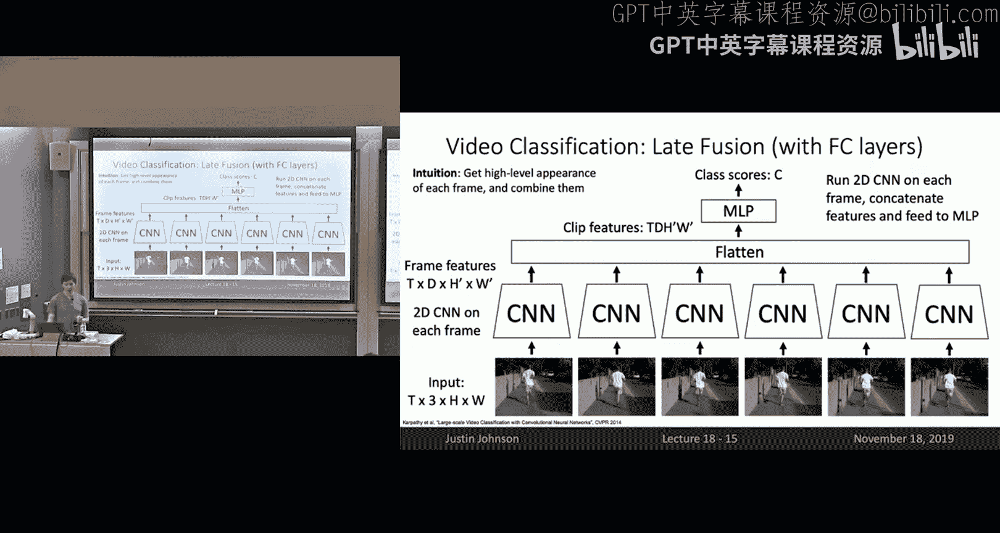

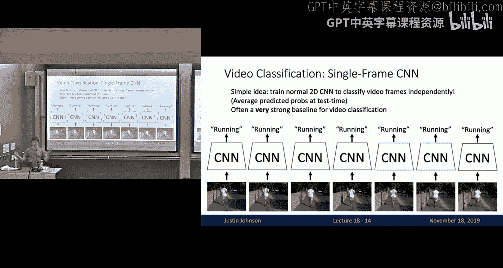

Favorite CNN architecture independently on each frame of the video sequence and that will extract us some frame level features so for each those will all operate be operating completely independently and will be your favorite 2D CNN architecture like a ResNe or an AlexNe or a mobileNe or whatever suits your fancy and after running those networks independently on each frame we will get these frame level features that will maybe be one channel dimension and two spatial dimensions and one temporal dimension so we've just extracted convolutional features for each frame of the video sequence completely independently。

And now we need some way to kind of collapse or average or combine all of these per frame independent features。

 so one way that we can do that is using a fully connected layer that we've seen in early image classification architectures。

 so then what we could do is take our per frame features。

 flattenum into one big vector that now has shaped T by D by H prime by W prime and then apply some kind of set of fully connected layers that moves from the flattened features into our final class score C and then we can train this thing with cross entropy loss as we often do。

And this is called a late fusion approach to video classification because we're kind of fusing the temporal information at a very late phase of the classification pipeline that we're doing all this independent per frame modeling with the CNNs。

 and at the very end of the architecture， we're kind of fusing information temporally。

So this approach so this is one of the earliest approaches to late fusion that people worked with and this was using fully connected layers。

 but just as we saw in the case of twodimensional CNN architectures。

 using a lot of fully connected layers adds a lot of learnable parameters to your network and can lead to some kind of overfitting so in fact another way that we can do late fusion is actually the same trick that we did in image classification models which is to replace the fully connected the flatten and fully connected operations with instead some kind of global average pooling followed by fully connected layers so when we apply this idea of average pooling to to the temporal domain then we will still get these independent per frame features using our favorite 2D CNN architecture and now we will apply a global average pooling layer that that will perform an average pooling over all of the spatial dimensions and over all of the temporal dimensions so that will collapse out all the spatial information and all of the temporal information and leave us with just。

disional vector that we can then apply a set of a linear layer to to get our final class scores so this is again a fairly simple。

 straightforward approach that is a fairly easy and simple thing to try and this is again an example of late fusion since we're doing all this independent modeling and then fusing all the temporal information very late in the classification architecture。

But so now kind of a problem with this late fusion approach is the fact that it's late right So it's actually somewhat difficult using this late fusion approach to model very low level pixel very low levell motions of pixels or features between independent video frames。

 So as an example， if we look at this running these clips from this running video here on this slide。

 maybe one useful signal that the model might want to use when classifying this video is running is the fact that his foot is kind of moving up and down and maybe in one frame you see the foot is down and then in the same location at the next frame。

 we see that the foot is up and this motion kind of repeats periodically at the very low level at the very low pixel level of the input video sequence Now with this late fusion approach。

 I think it's kind of difficult for the network to learn to model these very low levelve interactions between adjacent pixels in the input video frames because because we're kind of summarizing the entire information about each frame in。

Maybe a single vector。 So it's sort of difficult for the network to compare these low level pixel values between adjacent frames。

 So that， I think， is one intuitive shortcoming of this late fusion approach。

So given that this is called late fusion， you should imagine that you should anticipate that the proposed solution to this would be early fusion。

 So here the idea is that with late fusion， we were kind of performing independent processing on all of the video frames and then fusing the temporal information at the end of the architecture What we can actually do the opposite which is instead fuse all of the temporal information of the network at the very beginning of of the architecture in the very first layer of the CNN and we can actually do this using a familiar friend of two dimensionsal convolutions。

 So concretely again we have our input frame our input sequence of video frames at the bottom here with a temporal dimension a channel dimension with RGB color values and then two spatial dimensions of H by W Now we can actually we can actually reshape this four dimensionsal tensor and interpret the temporal dimension as a set of channels So what we can do is then sort。

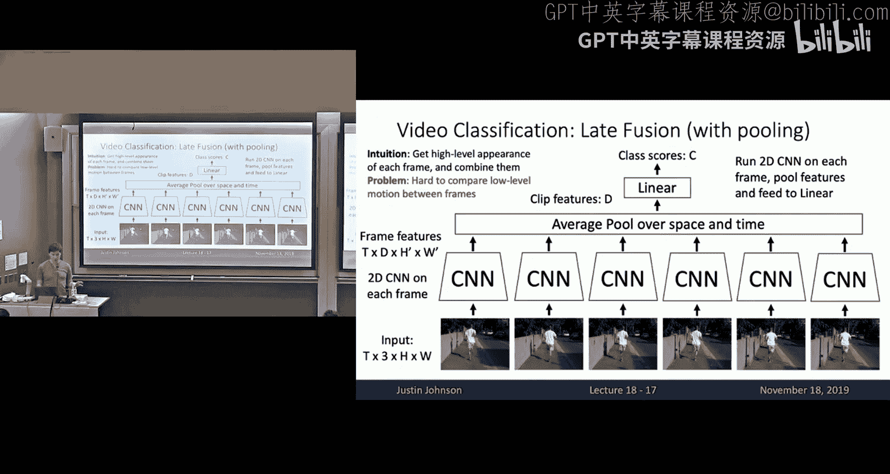

Imagines taking our set of input video frames and kind of stacking them along the channel dimension and that will give us a three dimensional tensor with a channel dimension of now3 by T which is just all of our RGB frames sort of stacked along the channel dimension and then with our two same spatial dimensions and this sort of basically we're concatenating all of the frames along the channel dimension and we can then fuse all of this temporal information using a single two dimensionmensal convolution operator that now where the number of input channels to the convolution is 3t and the number of output channels is whatever we want in our convolutional architecture。

So and then after this very first layer that is performing this early fusion。

 then the rest of the network can be whatever kind of standard two- dimensional convolutional architecture we want。

 because after this very first layer， we've collapsed all of this temporal information and we just have a sort of three- dimensional tensor to work with。

 and after that we can use our favorite 2D architecture。

And this hopefully maybe overcomes the problem of because now hopefully the network can better model very low-leve pixel motion between adjacent video frames because you could。

 for example， try to learn convolutional kernels that kind of compare whether adjacent video frames have local pixel motion between them。

 but the problem with this approach is that maybe we're kind of maybe too aggressive in this approach in the way that we pool or aggregate the temporal information。

 because using this early fusion approach we're kind of destroying or or we're kind of destroying all the temporal information after one 2D convolution layer。

 and it might be the case that one 2D convolution layer is just not enough computation to properly model all the types of temporal interactions that can happen in a video sequence。

So for that reason we might want to consider some kind of other alternative that doesn't really fuse early or doesn't really fuse late。

 instead， maybe we want some mechanism that allows us to kind of fuse slowly over the course of processing a video sequence。

And for that， we can use a three dimensional CNN， and this is also sometimes called a slow fusion network。

So the idea here is that this is kind of like the CNNs that we used in the previous lecture for processing voxel grids where now at each layer in the CNN。

 we're going to maintain four- dimensionmenal tensors that have a channel dimension。

 a temporal dimension， and two spatial dimensions， and then at each layer of processing inside the CNN we will use three dimensionsional analogs of convolution and three dimensionsional analogs of pooling that will allow us to kind of fuse information slowly over over the course of many。

 many layers of processing。

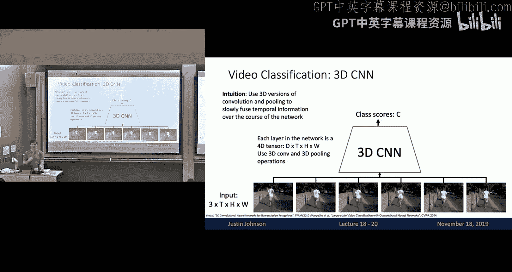

So then kind of as kind of an example of maybe three tiny then it's useful to kind of draw distinctions between this late fusion approach。

 this early fusion approach and this 3D CNN approach so to kind of make those distinctions clear let's walk through three little tiny toy examples of early verse late fusion verse 3D CNN architectures so these will all be like tiny tiny architectures that will just give you the flavor of these different types of models but in practice we would use much much deeper larger models so for a late fusion approach it will have the input will maybe be three channel dimensions。

 20 temporal dimensions and 64 by 64 height and width dimensions then the first layer would be a twodial convolution maybe be a 3 by3 convolution that outputs 12 features and this is kind of then it will apply this convolution independently to every video frame and this will just sort of fuse information across space but it will not。

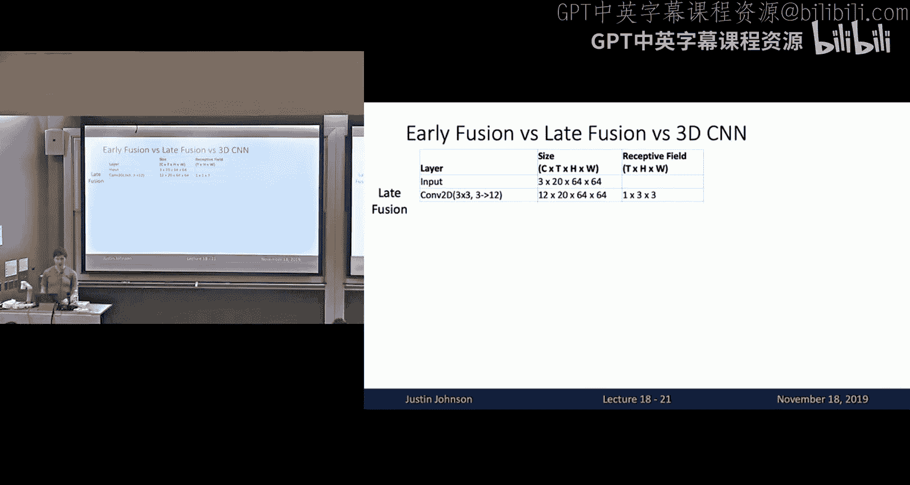

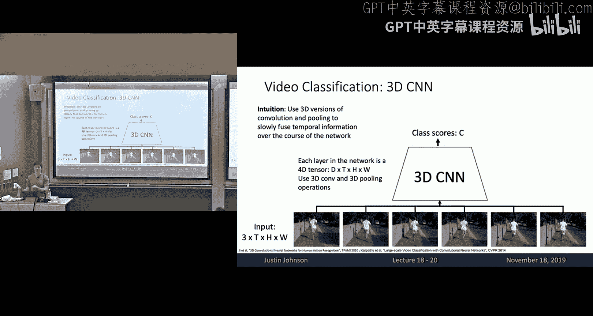

information across time so then we can write down both the size of the resulting tensor after this operation as well as the effective receptive field in the original input video after the operation so you can see that after a single3 by32D convolution operation。

 then each output of that 2D convolution is looking at a 3 by3 region in space and maybe one by one only a single input input frame in time。

So then we can kind of look at this by sort of building up receptive fields just as we did in our familiar 2D convolution case。

So then we could imagine maybe we add a4x4 pooling layer after our 3 by3 comm that is again applied independently to every slice in time that is now going to build up some larger receptive field in space。

 but not going to build up any receptive field in time。

We could follow this with another three by three convolution that'll again。

 build up more receptive field in space， but no more receptive field in time。

 and then finally have a global average pooling layer where we flatten everything and predict our number of output categories。

 So then at this global average pooling layer。 what we're doing is kind of all at once。

 building up a giant receptive field over the entire temporal extent of the input video。

 as well as increasing our spatial receptive field over the entire spatial size of the video。

 So this late fusion approach is kind of building up receptive fields slowly in space。

 but kind of building it up all at once in time at the very end of the network。😊，So in contrast。

 if we look at an early fusion approach， then we can see that this is an identical architecture。

 the only thing that's different is the first convolutional layer。

 because now in this idea of early fusion， we've taken our input video frames and stacked them along the channel dimension at the very first layer of the network。

 so now the first layer of the network is building is sort of building up a temporal receptive field immediately over the entire temporal extent of the video。

 but we're still building up this spatial receptive field kind of slowly in space over the course of many。

 many layers。Now， if we look at a 3D CNN in contrast。

 then we're replacing all of these twodisional convolutions and twodisional pooling operations with instead three dimensionsional analogs so now we're going to maintain these four-dimensional feature tensors at every layer of processing inside the network and you can see that now instead of using a 3 by3 convolution that slides this slides the filter over 2D in space。

 instead we'll use a three by3 by three convolution that is sliding the filter over both space and time and now our pooling operation instead of just collapsing a four by fourpoing region in space。

 it's going to average over a4 by4 by4 threedimensional pooling region in both space and time。

 and you can see that by extending these these familiar twodimensional operators of convolution and pooling into the temporal domain then it allows us to have this network architecture to build up a receptive field slowly over both space and time over the course of many layers of processing so for this reason。

Because it's kind of building up this receptive field slowly over the course of many layers。

 these three dimensional CNNNs are sometimes called a slow fusion approach because they are slowly fusing the spatial and the temporal information over many。

 many layers of processing。And again， in practice， these are like really。

 really tiny microarchitectures to just give you a sense of what early late verse 3D CNNs look like。

 but in practice we would use much larger， much deeper models that have many more layers and probably work on bigger images as well。

So then one thing that I always get kind of maybe tripped up on when I first think about video models is what exactly is the difference between this 2D convolution operation that we do in early fusion versus this 3D convolution operation that we do in a 3D CNN because it seems that in both contexts。

 we're using a convolution operator to build up some receptive field over both space and time。

 but exactly the mechanics or the trade offs or what's exactly different between these two forms of a spatial temporal convolution are useful。

 I think， to look at in a little bit more detail。So in the early fusion approach。

 recall that what we've done is we've taken our input tensor。

 so now we're kind of drawing this three dimensional tensor with two spatial dimensions。

 H and W and one temporal dimension T。 and now we're imagining that at every point in this 3D grid there is a feature vector attached at every point in this 3D grid。

And now if we imagine using a 2D convolution to process this kind of output。

 what we're doing is we're having a convolutional filter that extends over a tiny region of space。

 but extends over the full depth in time so that means our 2D convolutional filter has the same temporal size as the input video sequence and now this convolutional weight。

 we're going to slide over every position in space because at every position in space。

 the extends over the full length of time so we can compute a familiar inner product and that gives us a 2-dial output that we can pass a further layers of the network。

So one kind of shortcoming with so this is kind of appealing because it feels like a pretty easy and straightforward way to use convolution to work with temporal data。

 but one big shortcoming with this early fusion approach using 2D convolution is that it's not temporally shift in variant so what I mean by that is that we wanted suppose that we wanted to learn to recognize sort of global transitions in color and maybe an important feature that the network might want to learn to recognize is having the entire the color shift from blue to orange at some point in time now one problem with this is that because our filters extend over the entire length in time then if we want to detect changes in color both at different positions in time we actually would need to learn separate filters to represent those changes so for example if we wanted to learn we might be able to learn one filter that can learn。

A shift from blue to orange at time3， but if we wanted to recognize a shift from blue to orange at time7。

 then we would actually need to use a whole separate filter in order to learn that that same temporal change。

 but at a different position in time So that means that's sort of a limitation of this idea of using 2D convolution to process 3D data is that it's kind of just not temporally shift invari。

So in contrast， if we're going to use 3D convolution to process our temporal data， then as input。

 we're going to accept the same cube with two spatial dimensions。

 one temporal dimension and at a feature vector at every point in this cube but now our convolutional kernel extends over only a very small region in both space and time。

 so what this means is that now our convolutional filter is going to extend only over a small region in time。

 so we're going to slide the filter over both all the spatial dimensions as well as over the temporal dimension and at every position in 3D space over which we slide the filter。

 then we can compute the inner product between the filter and the chunk of the input at that position and then compute a single scalar output to produce this full 3D output as output from this layer。

And now the key difference is that this idea of 3D convolution fixes this problem of temporal shift in variants that we had with 2D convolution。

 so now if we wanted to learn to recognize transitions from blue to orange we could actually do that at all points in time using only a single three- dimensionmensal convolutional filter because we're going to slide that filter over all positions in time so that allows us to recognize now we no longer need to learn separate filters。

 if we want to recognize the exact same thing happening at different moments in time for the input video。

 so that means that this 3D convolution is maybe somehow more representationally efficient because we don't need to learn as many filters to represent all the things we might want to learn from video sequences。

And also kind of a cool thing about these 3D CNNs is that we can actually visualize these learned filters as video clips themselves right so what we can do is that here on the right we're showing these learned 3D convolutional filters from a three-dimenal CNN because each of these little convolutional filters has a small extent in both space and time we can actually visualize those filters as little moving RGB video clips and that gives us some sense for what types of features that these 3D convolutional networks want to learn to recognize so it's actually kind of interesting to dive into these like you see some of them actually don't seem to learn any motion at all。

 they're just kind of recognizing the same oriented edges or blobs or opposing colors that we often see in 2D CNNs but other convolutional filters seem to want to recognize like local motion in different directions so thats gives you some intuition about the types of low-level features that these 3- dimensional convolutional neural networks can learn to represent。

So now in order to kind of benchmark and see the tradeoffs of these different approaches。

 we actually need some data to trade on so one example data that people sometimes work with for this video classification problem is this sports1M data so here what they've done is some folks at Google they went and took a million YouTube videos and for each of those YouTube videos they annotated it with the different type of sports category so they took like a million different sports videos on YouTube because a lot of videos of people playing different sports on YouTube and then annotated them with with different types of sports and actually like the types of sports in this data are like really fine grainined I don't actually know what all of them are then so here's some example input frames from videos from this data and now the blue shows the type shows the ground truth sport category for each of these video frames and the next five I' show the top five predictions from a model that was trained to do this video classification task。

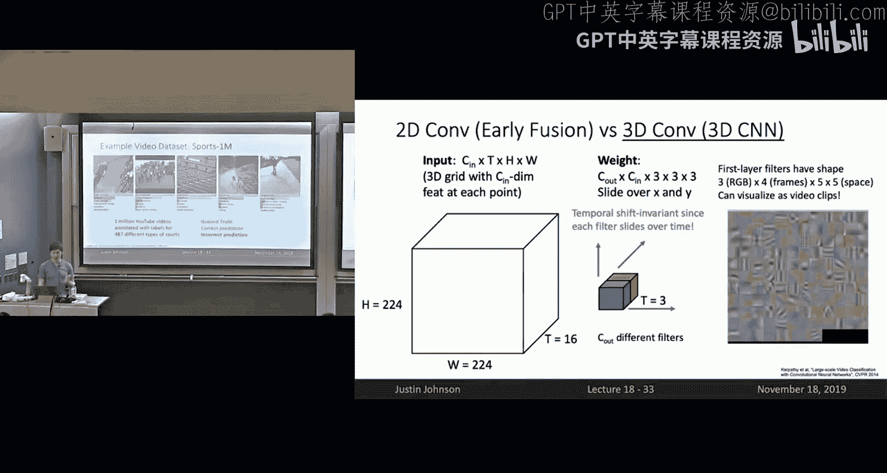

So for example， this first one， I don't know if you guys can necessarily see that tiny text in the back。

 This first video should the correct label is track cycling。

 but the top model prediction was just normal cycling so that was a wrong prediction。

 and actually the second prediction from the model was track cycling which was the correct prediction。

 but then the next one the next the next predictions from the model were like road bicycle racing marathing and ultramarathing So those are like different all different fine-grained different types of sports that exist in this data or in the second category it's kind of interesting apparently the correct label was ultra marathon but the next category labels were half marathon running and marathon So I don't know exactly how a model is expected to tell the difference between a full marathon and a half marathon just from a a short video clip but somehow this model managed to do it on this clip so that's pretty surprising to me。

 but so that's just to say that I think this is a really challenging data since it involves all these really fine-grained distinctions of different types of。

It's categories。

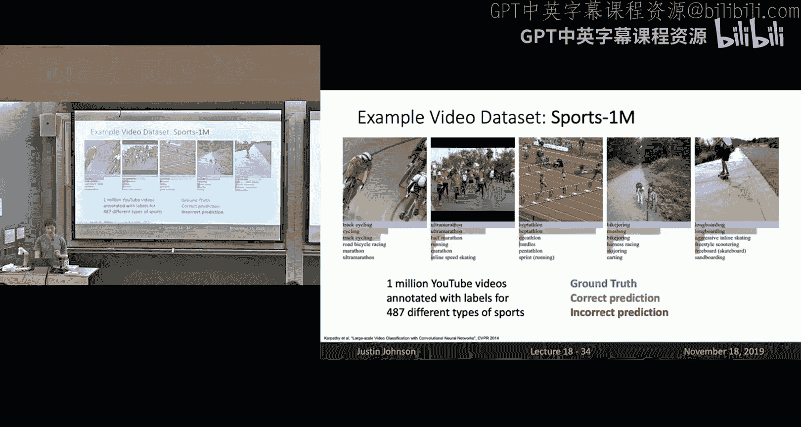

And then what we can see is we can now compare a single frame version of the model。

 an early fusion model and a late fusion model and a 3D CNN model what's kind of shocking here is just how well this single frame baseline does so here we see that if we took just like train your favorite two-dimensional CNN on independent frames of this video of these videos。

 we can already get up to like over 77% accuracy， which is just like shocking how well this simple single frame baseline model can do So again。

 always try single frame baselines first whenever you're confronted with the video classification problem and then as we move from the single frame to the early fusion to the late fusion to the 3D CNN。

 we actually see the early fusion works a little bit worse than than the single frame baseline which is a little bit surprising but the late fusion and the 3D CNN approach do a little bit better than the single frame approach but not massively so which again just motivate which is again evidence as to how strong this single frame model is as a baseline。

Video recognition tasks。But of course if you read this tiny。

 tiny sattation of the slide down in the lower left corner of the slide。

 you'll see that this paper was actually from 2014 which is quite a long time ago。

 like in 2014 people weren't even using GPU clusters at Google to train their models so these models were actually trained on CPU clusters at Google and there's a great line in the paper that says that it took all the models a month to train so I think that the state of the art in sort of convolutional architecture design has advanced quite a lot since 2014 so these results are a little bit old and are to be taken with a big grain of salt so as a result people have made continual advances in both 2DCn architectures and 3D CNNN architectures since that time。

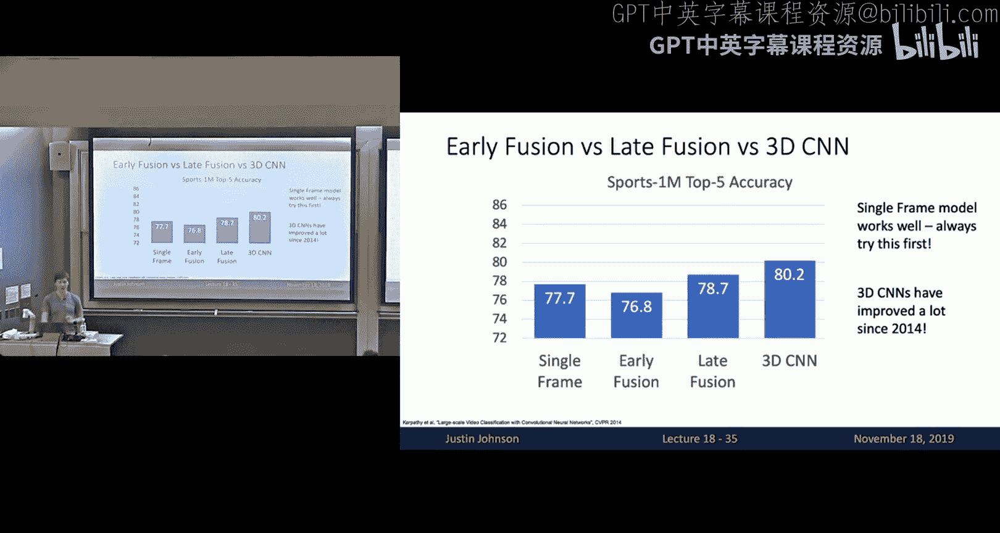

So as an example of an improved 3D CNN architecture is the very famous C3D model for convolutional 3D and basically this is the VGG of 3D CNNNs So we'll recall that VGG was this like very simple convolutional neural 2D convolutional network that consisted entirely of3 by3 convolutions and two by two poolings and VGG was just this simple architecture of cocomm Po Comcom Po cocom Po cocom pool I think you remember now and now C3D is basically the three dimensionmensional analog of this VGG architecture so it consists entirely of3 by3 by3 convolutions and two by2 by two poolings with the slight exception that the very first pooling only does pooling in space and not time but basically it's a pretty straightforward architecture to look at here and this was a particularly influential video model because unlike the previous Google paper。

 the C3D authors actually released the pretrained。Of their model so as a result。

 a lot of people who couldn't afford to train these video models on their own datasets would often use the pre-trained C3D model as a fixed video feature extractor for their other types of downstream video classification tasks so just as we saw that in images it was very common to pre-train like VGG on INe and then use the features for other tasks in video it was also very common to take this C3D model that was pretrained on a large video data and then use the features from that pre-trained C3D model for other types of downstream video tasks。

But the problem is that this C3D model is like shockingly computationally expensive because if you imagine just how much computation。

 like 3D convolution is really expensive， because now we need to take a three dimensionsal a three- dimensional kernel and slide it over an entire  three dimensionsal spatial temporal grid so now everything kind of scales cubically。

 which is like a really bad way for your models to scale computationally。

 so then if we go and compute the number of the number of floating point operations that are needed to run the forward pass of this C3D model and kind of sum it up over the entire model。

 we see that it's like really， really， really expensive so even though this model takes a really。

 really tiny input of 16 16 frames in time and a 112 by 112 spatial resolution at each frame even though it takes that very very tiny low resolution input。

 the total computational cost of the model is almost 40 gigaplops。

For a single forward pass and for comparison a VGG16 was like 13。6 gigaplops。

 so this C3D model is like almost three times as expensive as a VGG and compared to Alexnett Alexnett on 224 by 224 image inputs was only like 0。

7 gigaplops so then C3D is just like way， way， way more computationally expensive than something like Alexnett so that's kind of a common problem with these video models is that any time you're using 3D convolution。

 the models just quickly become very， very computationally expensive。

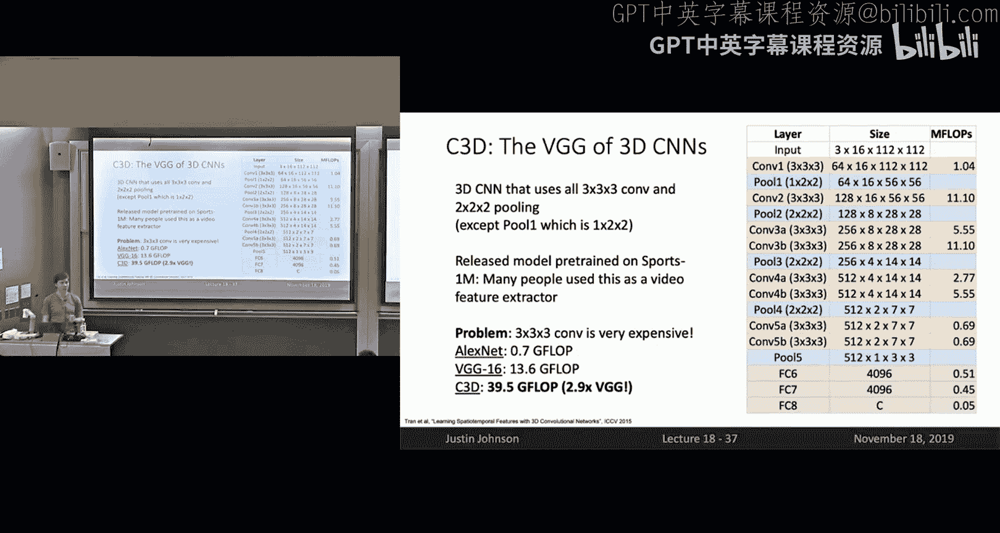

But that said， this C3D model was able to do a pretty good job of pushing up the state of the art on this sports1M classification task。

 so here it was a kind it's kind of a similar story that we saw in images that in images we saw that for a period of time people built like ever bigger and ever deeper and ever more computationally expensive models on images and that led to improvements in 2D image recognition and it's kind of the same story here that we're just building a bigger。

 deeper， more expensive video model and that also pushes leads to higher classification accuracies on this largescale video benchmark。

So that's kind of one angle that you can imagine so then there's kind of this question of like what's the best way to build a convolutional neural network architecture that works over both space and time and maybe one way is just like continue scaling up this C3D model and try to make it bigger and deeper and maybe add residual connections and batch normalization and all that kind of stuff that we know works well in images but I think there's another interesting approach which is to think a little bit more deeply about the fact that space and time really maybe should be treated differently in our models right because when we're using 3D convolution and 3D pooling。

 we're basically inside the way that the model is performing computation。

 we're really treating sort of space and time is interchangeable in a way because the way that we're processing both of them is exactly the same。

So instead， what we might want to do is think carefully about ways to represent space and time differently。

 and one interesting way is to represent motion more explicitly inside our neural network models。

And to motivate why representing motion might be a good idea。

 it's interesting to realize that humans can actually recognize a lot using only motion。

 So with this with just three moving dots， you have some sense of what's going on in this video sequence。

 So anyone you want to guess what's going on there or this one's like super clear。

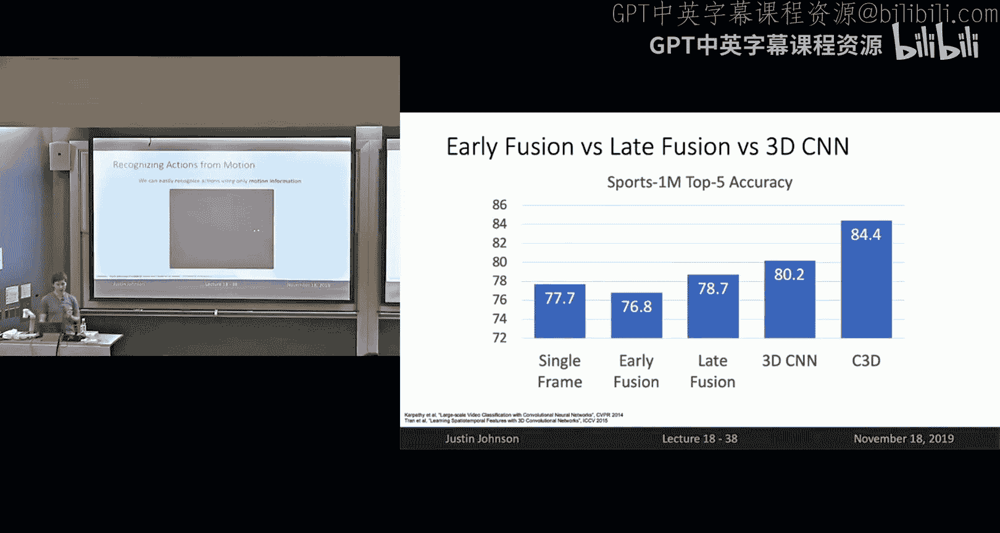

Like that's definitely a person walking。That's like definitely a person walking。

He's climbing and waving。He's maybe riding a unicye。你。

So this is kind of amazing right it turns out that human brains somehow must be doing something different between processing motion and processing visual appearance because I think all of us have no trouble recognizing the actions that are going on in this video just from this very low level of motion cues and it turns out that we don't actually need to see the images or the pixels at all in order to tell what actions these people are performing or even to recognize that they are people so kind of motivated by this fact that human beings seem to be able to do a lot with just motion information there's a class of neural network architectures that try to more explicitly represent motion information as a primitive inside the network。

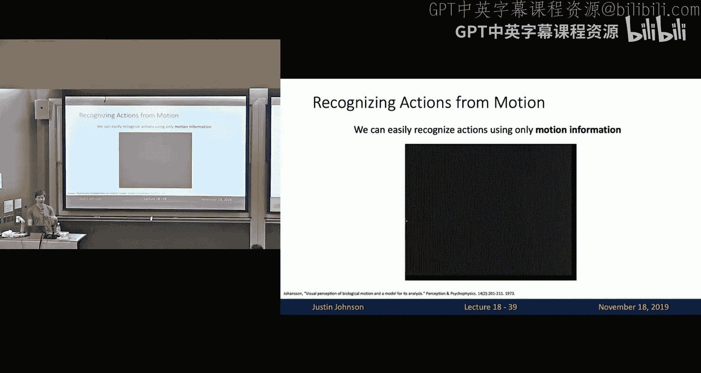

So to kind of make this concrete， we need to talk about how can you even measure motion information more quantitatively using computers So one way that we often measure motion information is using this idea of optical flow So optical flow is going to take as input a pair of adjacent video frames and then compute a kind of flow field or distortion field between two adjacent video frames So what it's going to do is say for every pixel in the first frame what is the vector displacement telling where that pixel is going to move in the second frame and there exist many。

 many algorithms that for computing this thing and lots of details about optical flow that we just don't want to go into at this time。

 but basically the idea is that there exist algorithms for computing optical flow on input image frames and optical flow is just giving us some kind of local motion cues about how pixels move between adjacent between adjacent video frames。

So then optical flow is kind of highlighting local motion in the scene。

 and what we're showing in this visualization is visualizing the horizontal component of the optical flow in the top and the vertical component of the optical flow in the bottom。

So here， given these two input video frames are this like person like drawing a bow and arrow。

 you can see that the optical flow representation is just highlighting the local motion of the person's arm and of the bow in these adjacent video frames。

 so now optical flow is now this very low levelvel signal about motion that we can feed to CNNs to allow them to more explicitly disentangle the appearance of what's going on in visual in videos versus the motion of how the pixels move。

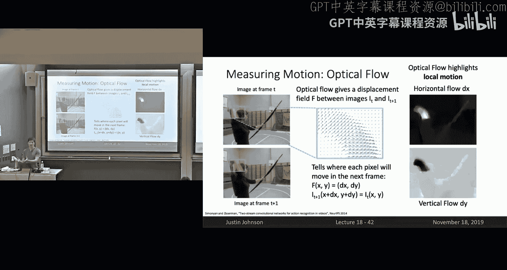

So that leads us to this very famous architecture for video recognition called the two stream network。

 so what this two stream network does is that it has two parallel convolutional neural network stacks。

The top stack is the spatial stream which processes the appearance of the input video so because we know that this single frame baseline is such a strong baseline for recognizing videos the top spatial stream in the two stream commnet is just going to input a single frame from the video clip and then from that single frame it's going to try to predict a classification distribution over all the categories that we care about and now on the lower stream is this temporal stream which is processing only motion information so what we're going to do is given our clip of maybe t video frames we're going to compute optical flow between every adjacent pair of video frames in the input sequence so that will give us so if we have t video frames that will give us t minus-1 sets of optical flow between video frames and then each of those optical flow fields will give us two channel dimensions1 and X and 1 and y so then we'll concatenate all of those things into a single big tensor of size with number of channels equal to two times t minus。

And just stack all of those optical flow fields in the channel dimension and then use an early fusion approach in the temporal stream to do early fusion to kind of fuse all those optical flow fields in the first convolutional layer。

 and then use normal 2DCNN operations at the rest of the network and then this temporal stream will also sort of try to be trained to independently predict the classification decisions given only the motion information。

 and then at test time what we're going to do is that the spatial stream will predict a distribution of our classes。

 the temporal stream will predict the different distribution of our classes and then at test time we'll just take an average of the two probability distributions that are predicted by the spatial and the temporal streams。

Yeah， question。yeah， the question is where does the two come one and come from in the stack of optical flow？

 Well that's because each optical flow gives us a displacement vector in the image plane。

 So if so optical flow at every point in the image。

 it gives us a twodial vector telling us both that's the x component and the y component of that optical flow vector at every point in the input image。

 So that gives us the two。

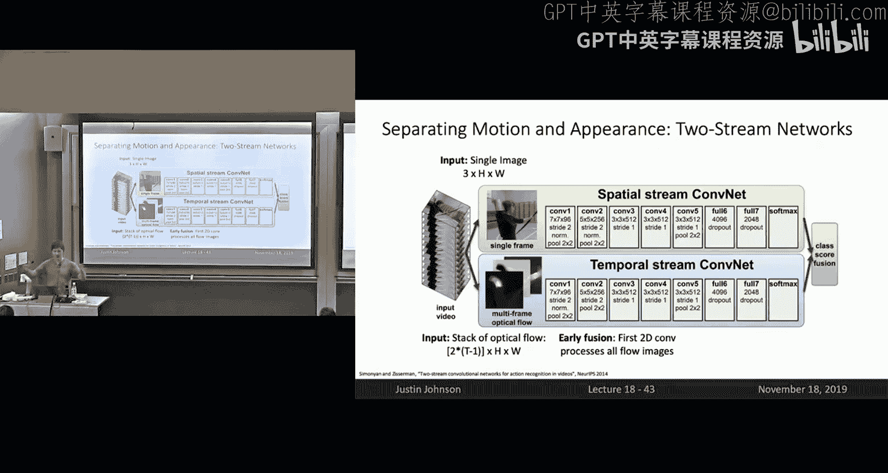

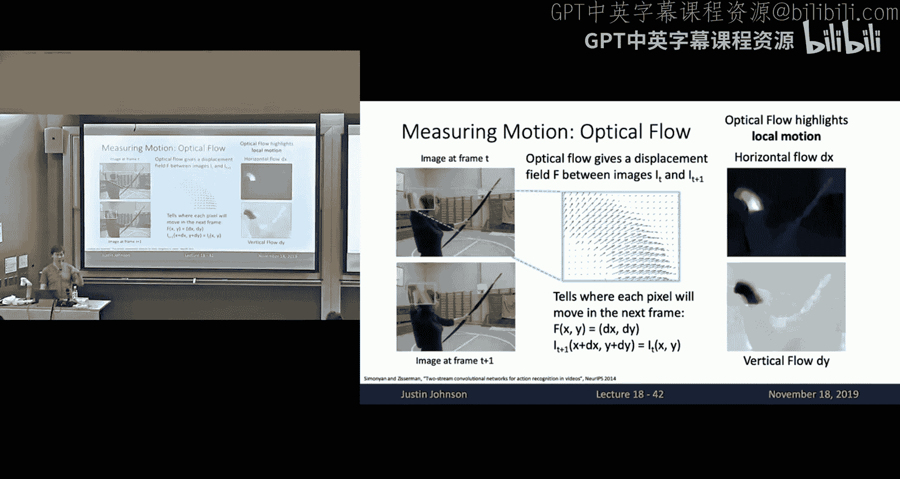

And then this two stream network， if we look I've kind of like done a bit of a bait and switch on you and this is actually a different data set than we've looked at in the previous slides。

 but if we look at this two stream network， we see that this two stream network using only the temporal stream is actually able to outperform this spatial stream。

 which means that this idea of recognizing activities from motions is maybe not particular to our own human brains。

 it turns out that our neural networks are also pretty good at recognizing activities using only motion information。

 and then when we fuse the appearance stream and the temporal stream。

 then we actually get a slight improvement over using only the temporal stream alone。

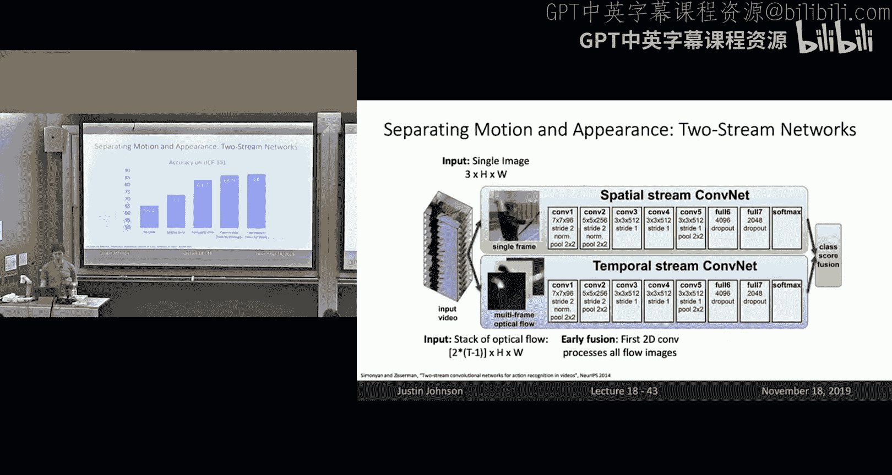

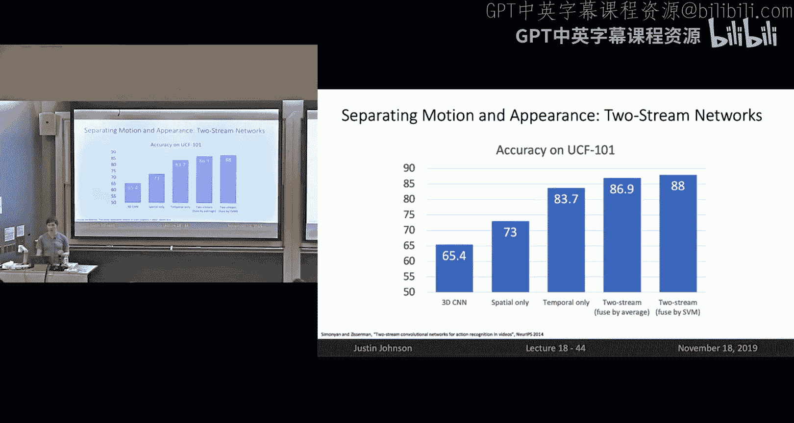

Okay so basically at this point， now we've seen a bunch of different ways for lot modeling shortterm structure in using different types of CNN architectures。

 so we've seen using maybe 2D convolution or 3D convolution or optical flow as ways to compute information over the temporal dimension of our input videos but all of these different types of processinging operations we've seen so far are very。

 very local in what they are able to do right so 3D convolution is maybe looking at so early fusion actually just like didn't really work that well 3D convolution only looking at only a very tiny receptive field in time and optical flow is also only looking between adjacent frames to compute the motion between a pair of frames。

But what happens if we actually want to build CNNs that can recognize stuff。

 which is make more distant in time， well， then we're going to need some other kind of operator。

So but it turns out we've already seen one thing in this class that lets us one type of neural network architecture that lets us deal with very longterm sequence information and that's recurrent neural networks。

 so why don't we combine together these two ideas so here the idea is that we'll have our video stream in time at the bottom we'll apply some kind of CNN either a 2D CNN or a 3D CNN to extract local features at every point in time and then we'll use some kind of recurrent neural network architecture to fuse information temporal given the outputs of these independent RNNs。

And then we could use kind of a many to one operation if we wanted to make a single classification decision at the end of the video。

 we could use the final RN and hidden state to then make the prediction over the entire video sequence。

 or we could also do kind of a many to many task and maybe make a set of predictions at every point in time over the video。

And it actually turns out there was a paper all the way back in 2011 that proposed this exact architecture that used sort of 3D CNNs to extract spatial temporal information locally and then fuse them over long term using an LSTM。

 so this was like way back in 2011， I think this paper was way ahead of its time and people should cite it more。

 but the one that people tend to associate this idea with more is this 2015 paper that I think got a little bit more recognition。

And then another kind of thing to point out here is that one trick when combining CNNNs and RNNs for processing videos is that sometimes we only back propagate through the RNN remember like in C3D we talked about people would sometimes use C3D as a fixed feature extractor well then here we could do that same thing in this CNN RNN setup so we could use a pre-trained C3D that's been trained on a video data set and then use C3D as a feature extractor to extract features from every point in video and then use an RNN to work on top of those pre-extracted C3D features so that will be a way to get us around this kind of memory constraint and if we're only using the CNN as a feature extractor then we don't need to backproagate into the CNNN and then we can actually train these models over very wide time periods as well so that's kind of an appealing approach。

Okay so now we've kind of seen maybe two different approaches for merging temporal information One is using kind of operations inside the CNN that kind of merge information locally and the other is using some kind of recurrent information to kind of fuse at the top outside after we run our CNN architecture and is there some way that we can combine both approaches and it turns out we can maybe take another inspiration from recurrent neural networks and look back at this idea of a multilayer RN so now what we can do is remember in a multilay RN we had this twodimenional grid where every point in the grid our vector was going to depend both on the previous vector in the previous layer at the same time step as well as the vector from the previous time step at the same layer and then we would you process video sequences of arbitrary length by sharing weights over the sequence Well we can actually do the exact same thing using our convolutional neural networks and now we can build a kind of multilayer recurrent convolutional network。

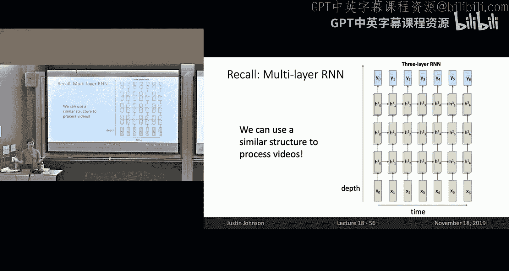

So now what we're doing is we're building up this twodial grid of features。

 Every point in this twodial grid is a three dimensional tensor with with two spatial dimensions and one channel dimension。

 and now at every point in the grid， feature， this feature tensor is going to be computed by combining both the features at the previous layer at the same time step as well as the features at the previous time step of the same layer。

 and then we confuse these two things using some kind of convolution operation。

So then to see exactly the way that we might fuse these things， remember that in a normal 2D CNN。

 what we're doing is we're kind of inputting one 3D tensor， running 2D convolution。

 and then outputting another 3D tensor。

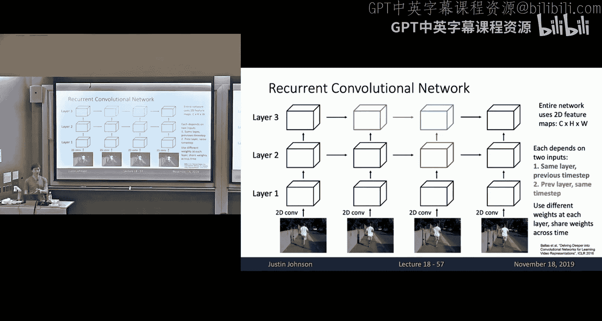

Now what we want to do is build a recurrent convolutional network where we're taking as input to 3D tensors。

 one gives us features from the same layer and the previous time step。

 and the other gives us features from the previous layer and the same time step。

And then we want to fuse these in using some kind of R N like recurrence formula that gives us the features for the current layer and the current time step。

 And this if you'll recall， this kind of structure looks very similar to the structure that we saw when using recurrent neural networks。

So now to use the exact functional form here， what we can do is just again copy and pastecur from our favorite recurrent neural networks。

 so if you recall what we did in a vanilla T H ArgonN we would take our two inputs process project each of them using a separate lower and weight matrix。

 add the two results and then squash with the TNH and this operation will give us our next output vector well now in order to convert vector this vector version of an RgonN that we've seen before。

 what we can do is replace all the matrix multiply operations with 2D convolution operations instead。

So now in order to take kind of a recurrent convolutional form of this vanilla RNN。

 we can use this architecture here， so then what we can do is given our two feature tensors。

 one from the same layer in the previous time step。

 and one from the same time step in the previous layer。

 we can project each of them to some new feature tensor using some 2D convolution operation。

 then sum them and then squash the result with a tanNH。

 and that will give us our next feature vector at the next our output feature vector for the recurrent RNN。

And then we we could do this with kind of any RNN architecture。

 so then you could take your favorite RNN architecture， like a GRU or an LSTM or something else。

 and just translate it from this kind of RNN that operates on vectors into an RNN that operates using convolution or three-dial feature maps and the way that you do that is just simply convert all the matrix multiply operations into convolution operations instead。

So then what we've done here is that we're kind of contrast then we saw this this previous approach on the left actually combined two different ways of modeling spatial modeling temporal information。

 So if we use a CNN and then an LSTM on top， then inside the CNN we're kind of modeling local structure between adjacent frames and then the RN is maybe processing longscale long-term global structure。

 Well now using this recurrent CNN， then it's kind of like every layer every neuron inside of our convolutional network is itself a little recurrent network。

 So there's kind of like both spatial and temporal fusing happening in this very nice way inside every layer of the network。

 So this is actually a very beautiful idea， I think but it turns out that people have actually not used this idea too much in practice。

 So then to think about why that might be the case。

 it turns out that even though this idea is very beautiful。

 it's actually not very computationally effective right because the problem is that RNNs are actually very slow for。

Long sequences， because R N Ns force you to compute the previous time step before you can compute the next time step。

 So that means that R NNs just don't paralyze very well over very， very long sequences。

 And I think that's a reason why people have actually not used this kind of recurrent CNN architecture tool so much in practice。

And if you think about ways to solve this problem， you should actually again think back to our discussions in previous lectures where we talked about different ways to model sequences and their pros and cons so in a previous lecture we talked about these different approaches for processing long sequences we saw one approach was recurrent neural networks which are nice because they're good at modeling long-term temporal information but they were bad because of their sequential processing and now that's kind of in the video domain that's kind of equivalent to this architecture of CNN followed by an LSTM now we had this other approach which is maybe 1D convolution for processing sequences and this was nice because it's sort of computationally effective。

 we can paralyze the computation of the sequence at training time we no longer have the sequential dependence on the time stepss and now in video the equivalent of this is kind of 3D convolution。

But if you'll recall， we actually saw another mechanism for processing sequences in the past。

 and that's this notion of self-attention。 So if you'll recall self-attention kind of like was really good at processing long sequences because it computes this like attention between all pairs of vectors and it's highly parallelizable because there's no temporal dependency on the structure。

 just like with RNNs。So now then the question is， can we find some way to apply this idea of self-attion to our video to process video sequences as well。

 and of course， it turns out the answer is yes。

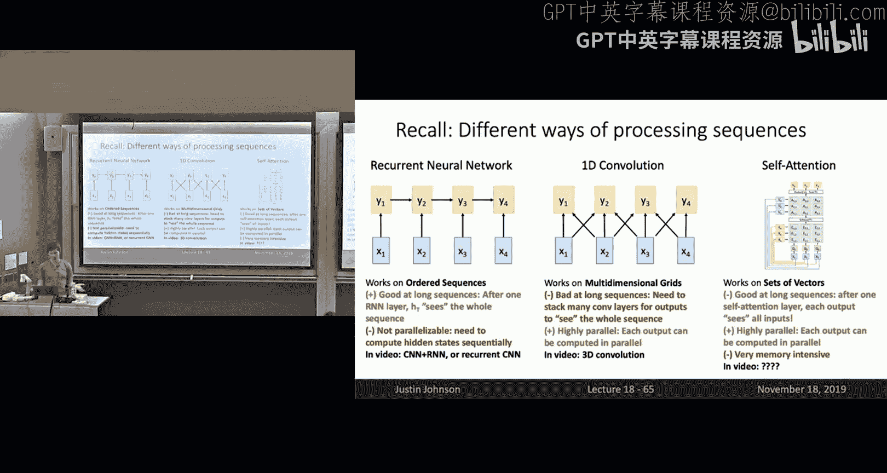

So a quick reminder on selfattention， remember that the input was a set of vectors。

 then for every input vector in the set， then we would predict keys， queries and values。

 then we would by using some kind of linear projection operator on the input vectors we would compute an affinity matrix which tells us how much is every pair of vectors related by computing some kind of dot scaled square root scaled dot product between the keys and keys and the queries and then the output for each vector would be this weighted linear combination of the values that are weighted by the values in the infinity matrix so now we can actually just port this whole architecture over into 3D where now what we're going to do is process some part of our network using a 3D cnn and that will give us this four- dimensionmenal tensor with a channel dimension and three spatial dimensions and now we can interpret this four dimensionmenal tensor as a set of vectors where we have a set of vectors of dimension C and the number of vectors is t times h times W。

And then we can just run this exact same selfattention operator using the set of vectors from some layer in a 3D convolutional network。

 So then we actually have seen this exact slide before in a previous lecture。

 just it had 2D convolution instead of 3D convolution。

 But the idea is that we'll receive some set of input features from a 3D CNN。 willll compute keys。

 queries and values using one by one by one convolution。

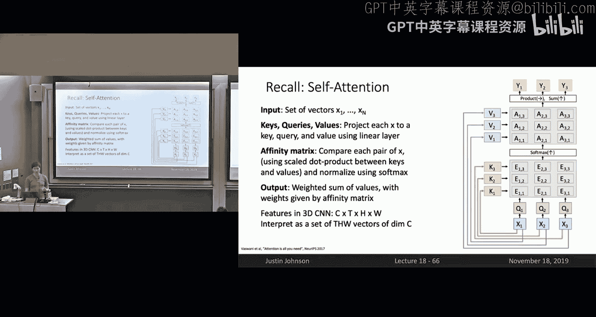

Then we'll compute some inner product between every key and every value。

 and then we'll compute a softmax over one of the dimensions。

 and then will give us this big affinity matrix or a set of attention weights。

 and we'll use this to combine to linearly weight the values and then sum that out with a matrix multiply。

 and then it's very common to actually project the output of this operation with another one by one comm and then actually to connect the whole thing with a residual connection。

So that gives so when we combine all these things together。

 then this operator is a block that we can slot into our 3D CNNNs that's computing a kind of spatial。

 temporal self-attention， and this is sometimes called a nonlocal block for the paper that introduced it。

And now kind of a neat trick is that we can actually initialize this。

 if we initialize this last comm layer to be all zeros。

 then everything inside this operator is going to compute zeros。

 which means that the whole block is going to compute the identity because of the residual connection so then actually a common trick that people use with these non-local blocks is to initialize the nonlocal block such that it computes the identity function by initializing the last thing to zeros。

 and then we can take a non-local block that is computing identity and insert it into an existing pre-trained 3D CNN model and then continue fine- tuning with this additional inserted nonlocal block。

 so that's kind of a trick that people will use。So then it looks something like this that now we have this notion of we have some kind of 3D CNN and we're going to slot in these nonlocal blocks at different points in the 3D CNN。

 and now the 3D CNN chunks are kind of going to do this slow fusion over space and time。

 and now each nonlocal block is going to give us this global fusion over all of space and all of time。

 So this is actually a pretty powerful， pretty close to state of the architecture for video recognition。

But then the problem is what is the actual so then now nonlocal blocks give us this powerful way to introduce global temporal processing into our 3D Comnets。

 but the question is we still need to choose some 3D CNN architecture that we can insert our nonlocal blocks into so then the question is what is actually the best 3D CNN architecture for us to build？

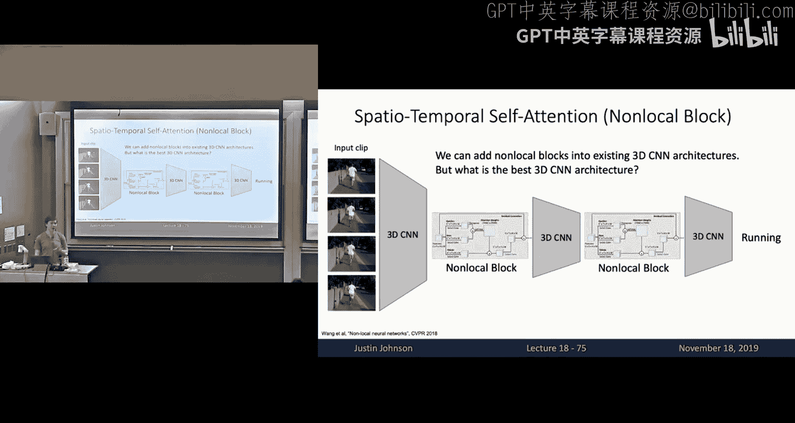

So one really cool idea is this idea of inflating existing twodimensional networks from 2D into 3D right because we know that theres been a lot of work on people doing a lot of effort to design really good two-dimensional CNN architectures and somehow we would not want to repeat all of that effort as a community and we don't want to sort of start over from scratch in inventing the best 3D CNN architectures So instead what if there was a way where we could take a 2D CNN architecture that we know works well on images and then somehow adapt it in a very tiny way to make it also work on video So that's the idea of inflating a two-disional convolutional network and sort of blowing it up like a balloon and then adding this third dimension to an existing network architecture So then the recipe is that we're going to take an existing twodimensional CNN architecture that has maybe twodisional convolutions and two-disional pooling operations and then for every every one of those operations we're going to replace it。

 replace the 2D convolution with a 3D。And replace each 2D pooling with a 3D pooling。

And now the only choices that we need to make so then what that kind of looks like is that here's an example using the inception block。

 so then the paper that introduced this was from Google and inception architecture was from Google so of course they had to apply that thing on top of the homegrown network architecture then here's an example of the 2D inception module remember that it has these parallel branches of convolution and pooling and then it kind of concatenates them after having these parallel branches of processing。

And now after inflating the three dimensions， all we do is add an additional temporal dimension to each convolution operation and each pooling operation。

 and this gives us this super simple recipe for taking a 2D architecture and just applying it to 3D。

But it turns out that so taking this is about transferring architectures so far this trick has allowed us to take an architecture that works on 2D networks and then formulatically change the architecture so that it can be applied on  3D videos as well。

 but it turns out we can actually go a step further and we can not only inflate the architecture。

 we can also transfer the weights， the trained weights from a network which was trained on images。

 and then we can use those weights that were trained to operate on images to actually initialize the inflated version of our 3D CNN。

And to see how that works， what we do is remember that when we inflate the CNN。

 we are going to add this extra temporal dimension to all of the convolution layers。

 so now what we can do is what we' going then in order to initialize the weights of this inflated architecture using weights of the image version。

 what we're going to do is copy the convolutional kernels for each convolution layer and copy it t times in time。

 So we're not only adding this extra temporal dimension。

 we're actually just copying in time the weights of each convolutional layer and just like duplicating them in time。

And then after you duplicate them in time， you then divide them by the duplication factor and the reason that we do this is that because if you imagine taking an original input image and then making the world's most boring video by copying that input image many。

 many times in time that will give us this sort of trivial constant input video and now if you imagine running this 3D convolution with duplicated weights on the boring input video that will end up computing the exact same result as running the 2D convolution on the original image so what that means so that you can kind of like think through this all what's going on。

 but basically this works because convolution is a linear operator so when we duplicated the frames in time then we can also duplicate the weight and time and divide with a duplication factor and that means we're computing the exact same thing。

So because of this trick， this super cool trick actually allows us to pretrain a model on images and then inflate the architecture and inflate the weights and then continue fine- tuning that model on a video data and moreover。

 it also lets us recycle all of the existing architectures that we know work well on images and also recycle all the pre-train models that we have laying around that work well on images。

So then this actually works quite well。 so then if we kind of look at yet another video dataset called Kineticix 400。

 then if we run this per frame baseline， then the blue bars here are showing training from scratch on the video dataset and the orange bars are showing models where we initialize the video model from the image model so we can see that when for a per frame model moving from a per frame model to this CNN LSTM model to this two- stream CNN actually gives us steady improvements but as we move from the two stream CNN to an inflated CNN that actually does much better so then this kind of gives us some empirical results that actually this idea of taking 2D commnets and inflating them in time is actually a pretty good way to generate good 3D CNN architectures。

And it turns out that two stream networks is still a good idea。

 so we can actually take two inflated networks and take one inflated network to work on the appearance stream and a second inflated network to work on these optical flow fields。

 and that gives us a two stream inflated network that actually works quite well。Okay。

 so then kind of as a fun aside， one thing we can do is that now that we've got these kind of two stream networks that work really well at classifying videos。

 we might want to know like how can we visualize what what these video models have learned and we can actually use this exact same trick that we've used for visualizing trained models and images we can take take input we can randomly initialize an input image。

 randomly initialize a flow field and then compute forward passes through the trained network to compute the score。

 the classification score， and then back propagate through the network to compute the gradient of the score with respect to the input image in respect to the flow field and then we can use gradient descent or gradient ascent to find the image and the flow field that maximize the classification score for the particular category。

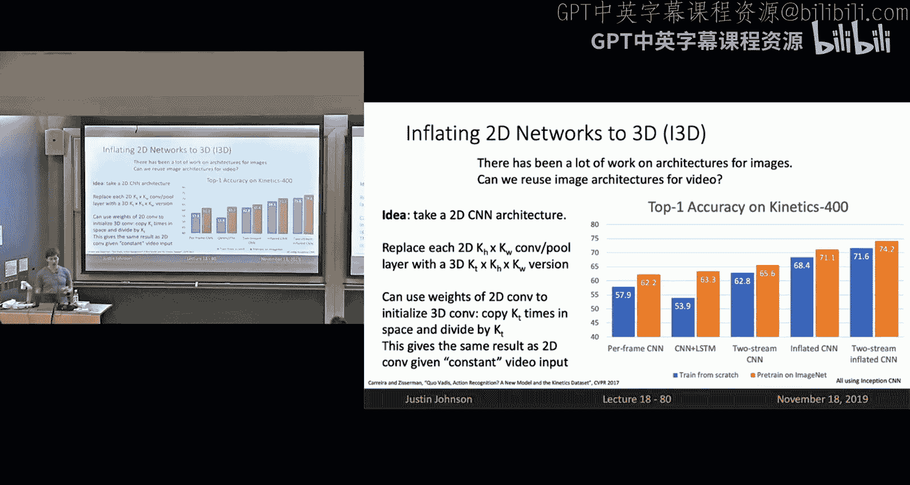

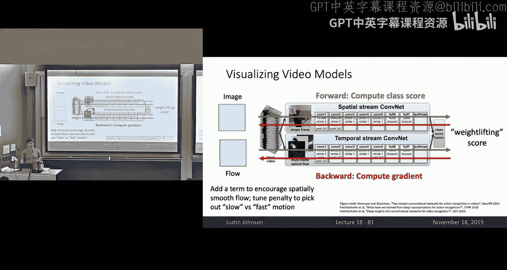

So then what does this look like， So then here's an example。 So then here on the left。

 we're showing the optimized image for the appearance stream。And then in the middle。

 we're showing an optimized flow field that has been we added some temporal constraints to constrain the flow field from changing too fast in time。

 And then on the right， we've kind of lifted that temporal constraint and allowed the flow field to change faster in time。

 So can anyone guess the action that's going on in this in this video frame。

I think I heard weightlifting was good。 It was a good guess。 right， So this is actually pretty cool。

 Then we see that the appearance stream is kind of looking for bar bells anywhere in the image at the slow motion stream。

 It kind of looks like it's looking for kind of like the bar wiggling at the top of the lift。

 And in the fast motion stream。 It looks like he's looking for the part where it pushes the bar overhead。

 So that's actually pretty exciting。 Okay let's try it again。😊。

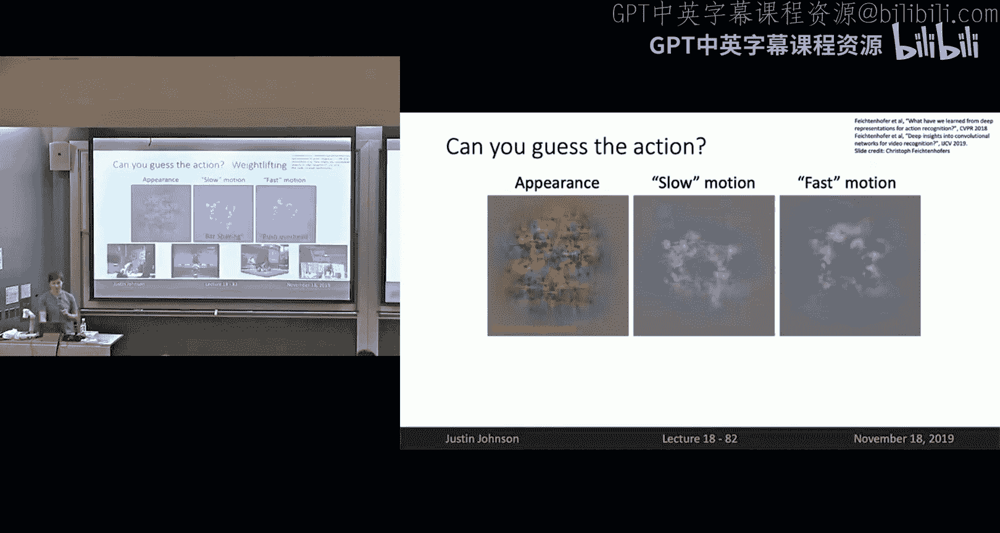

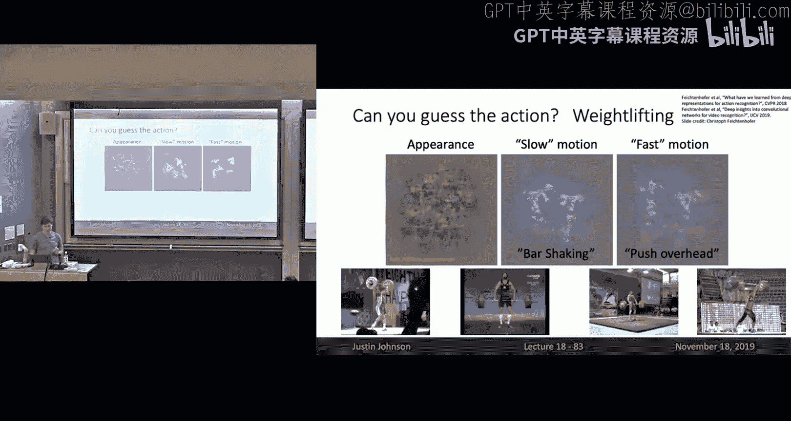

So here's the appearance stream， here's the slow motion， and here's the fast motion。

 I don't think anyone's going to guess this。What。Eyes。Eyes or face。Ands a good guess。

 it's actually applying eye makeup。

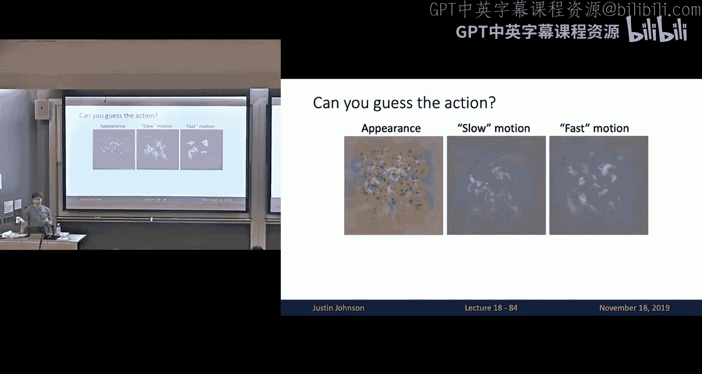

RightSo you can see that for the appearance stream so there's like a lot of YouTube videos of like people doing makeup tutorials right and then so that on the appearance stream it's kind of looking for eyes anywhere in the input image and now for the slow motion it kind of looks like maybe the motion of the head or the hands and then the fast motion kind of looks like the local brushing motion of actually applying the makeup so I thought it's really cool that we can take all these same techniques that we know and love for visualizing images and then just kind of apply them on video sequences as well。

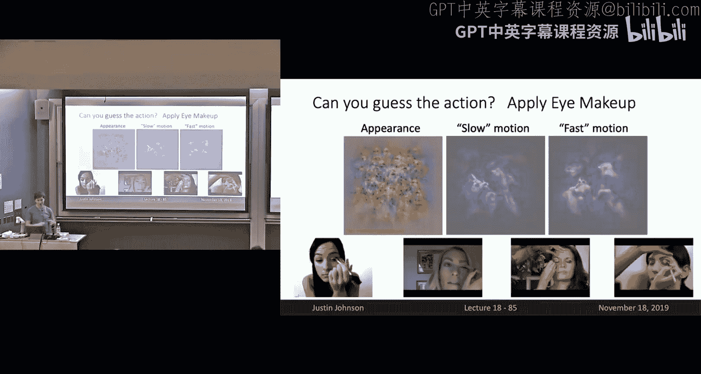

Okay， so then I also wanted to briefly mention so kind of looking at these two stream networks。

 we saw that they still rely on this external optical flow algorithm and it would be really nice if we could relax that constraint and just build networks that can train on the raw pixel values and not rely on this external optical flow so that brings us to this state of the art slowfa network that was just published like a month ago that is actually current state of the art on a lot of video recognition tasks So what the idea is is that we're actually going to have we're still going to have two parallel network branches just as we did in a two stream network except that both of them are going to operate on raw pixels The difference is that they are going to operate a different temporal resolutions so one branch will be the slow branch that operates at a very low frame rate but a is a very expensive network that uses a lot of channels at every layer of processing so to visualize this network。

 we kind of have three dimensions we can play with one is the spatial dimension of the input image one is the channel dimension with the number of features or number of layers that every。

the network and the other is the temporal dimension。

 which is what is the temporal frame rate at which the network is applied。

 So then the first branch is this slow branch that uses a small temporal uses a very slow temporal frame rate。

 but a lot of channels。 so it's using fewer frames but putting a lot of processing on each frame。

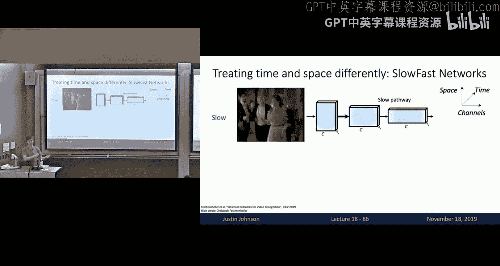

Then so it's a low frame rate and then the second branch， of course。

 is the fast branch that operates at a higher frame rate， but uses a much thinner network。

 so then the fast branch operates at a high temporal frame rate。

 but uses only a little bit of processing on each frame。And then so it uses a high frame weight。

 and it uses a very small number of channels at every layer。AndMoreover。

 there's lateral connections that fuse information from the fast branch back into the slow branch。

 so unlike the traditional two stream networks that only fuse the information at the very end through averaging。

 these slow fast networks are actually a fusing information at multiple stages inside the network。

 and then at the very end there's some kind of fully connected layer that does the predictions。

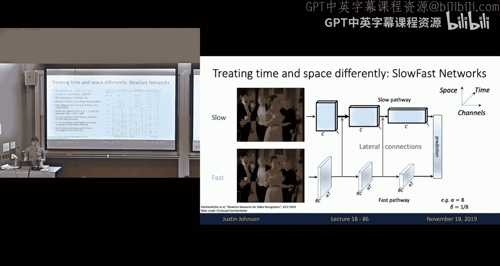

And then I'm not going to walk through this in detail。

 but this sort of gives us the concrete architecture instantiation of these slowfa networks and this kind of combines together all of the techniques that we've talked about in this lecture。

 so it has two streams one that's operating on mostly appearance and one that's operating on temporal information each of these streams is itself an inflated Resnet 50 architecture so this brings us back to this idea of inflation so they take an existing Resnet 50 architecture that we know works well on images and then inflat it in time to form each of these two streams but now the difference is that the slow pathway operates at a very low frame rate and the fast pathway operates at a very high frame rate and then it turns out that we can also add non-local blocks into this model as well and get it to work really well so I don't want to go through this in detail。

 but I think this is actually the current state of the art and video understanding and video recognition for a lot of tasks so if you're looking for the model to use today I think it's this one。

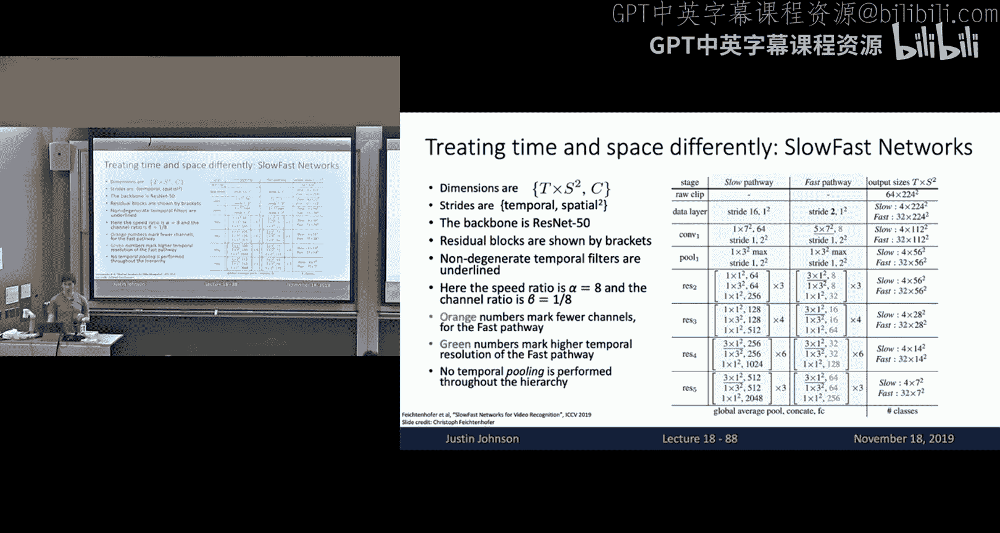

Okay， then I also wanted to very briefly mention that so far we've talked mostly about this task of classifying very short video clips。

 like taking these like two to like three to five seconds of video and then predicting a classification score。

 but this was a good task to motivate a lot of our spatial temporal architectures in ComNs。

 but it turns out that of course there's a lot of different video tasks。

 video understanding tasks that people try to tackle with convolutional neural networks。

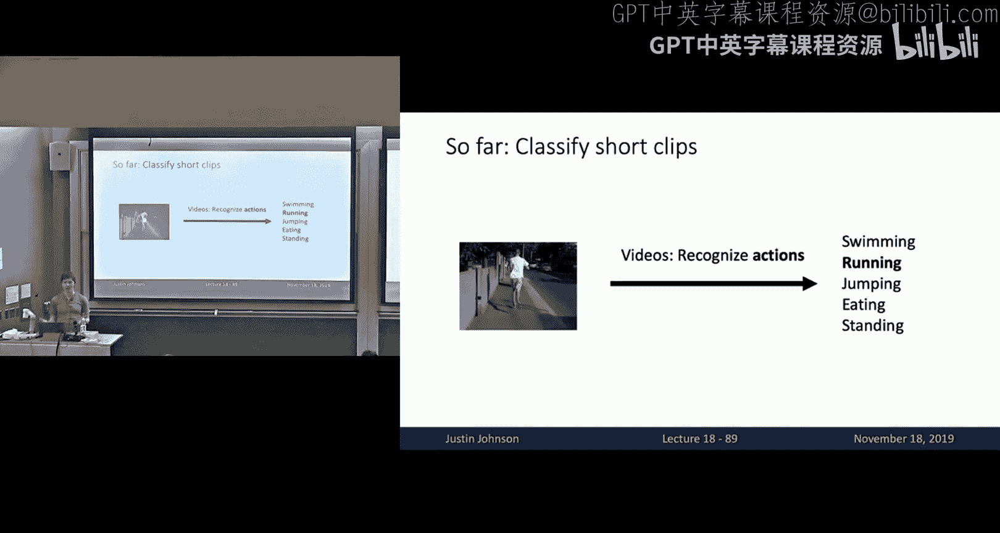

So as just a very brief sample， another thing that people sometimes want to do in video is work on this task of temporal action localization。

 so here we're going to be given a very long untrimmed video sequence and now we're going to want to detect there might be multiple activities that happen in this video sequence and we want the model to both detect all the activities and tell us for each activity which span in time did that activity occur for。

And you can imagine that you could actually build an architecture similar to faster RCNN that did this type of operation。

 and this is indeed what people have done， so you can imagine this type of architecture that does now kind of like some lightweight computation over the video sequence to get action proposals instead of region proposals that tells us what regions in video are likely to contain an action and then have a second stage is some kind of like 3D Comnet that works on that processes the raw pixels or the features of each of those actions。

 so you can imagine that building a kind of faster RCNN like architecture that works over space that works over time。

And of course now we've seen how we can build models to detect objects in space this model lets us detect actions in time so of course we've got to do both so there's also some work on spatial temporal action detection so here the task is that the input is this video is like a long video sequence and the task is that you need to detect the people all the people in each video frame and also say the temporal span of the actions that those people are performing in the video so now this is a super challenging task because it involves both spatial detection in each frame as well as temporal detection in time and one really exciting data set for this spatial temporal detection task is this very recent Ava data set that was published just last year in 2018 so what they did is they went and annotated a bunch of movies with different kinds of actions that people are doing and now this also brings in the problem of very long temporal dependencies。

 very long video clips。

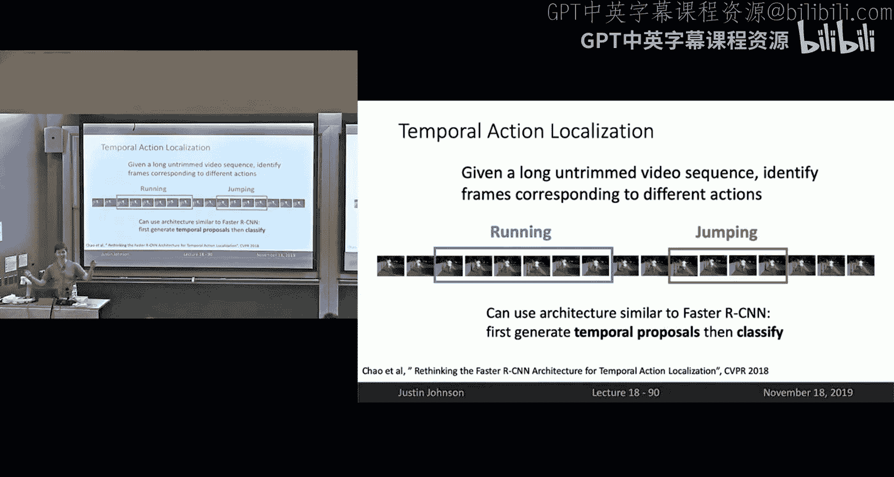

So now you need to detect not just like classify little two or three second clips。

 but instead the input is like 15 minutes of video and you need to both detect all the people in that 15 minutes of video and say what activities they're performing。

 so I think there's been not yet a ton of work on this data。

 but I think that in the next couple of years I predict that we'll see a lot of people moving to this kind of spatial temporal activity detection on a long unstreammed video because I think that's an exciting task that people will probably start working on。

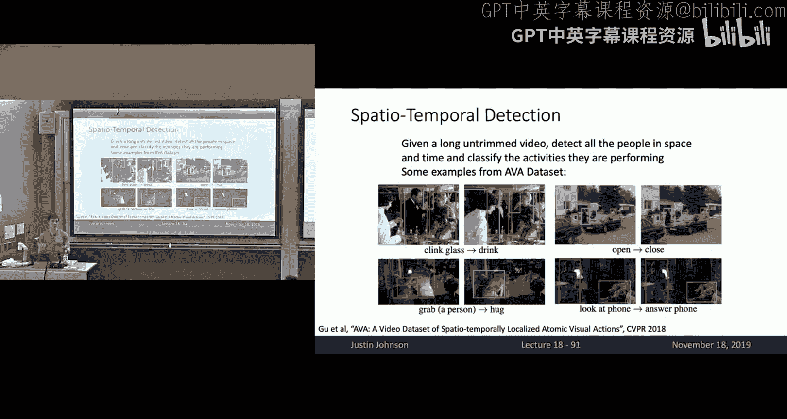

So that was kind of our whirlwind tour of video models today， so today we saw many。

 many different video classification models including building all the way up to slow fast networks which again was like just published this like a month ago and I think is the current state of the art so if you're looking to work with video I think that's a good one to play with and actually there's code available as well so that gives us that's our brief summary of video models and then next time we'll move to a completely different topic and start talking about generative models and in particular about generative adversarial networks。

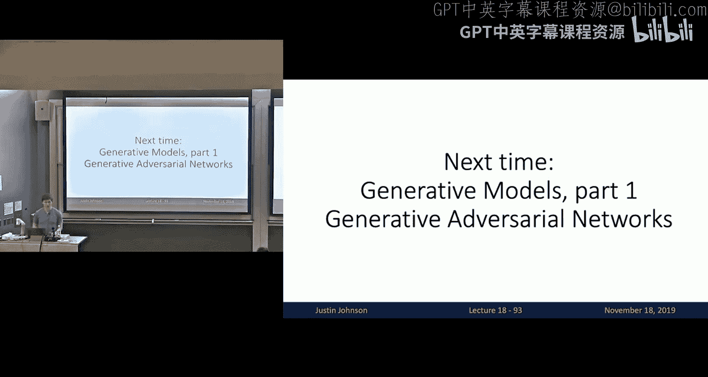