# 密歇根大学《深度学习用于计算机视觉｜Deep Learning for Computer Vision UMich EECS 498-007 2019》中英字幕 p20 -20-19_GenerativeModelsPart1.zh_en -BV1jA4m1P7GN_p20-

그。

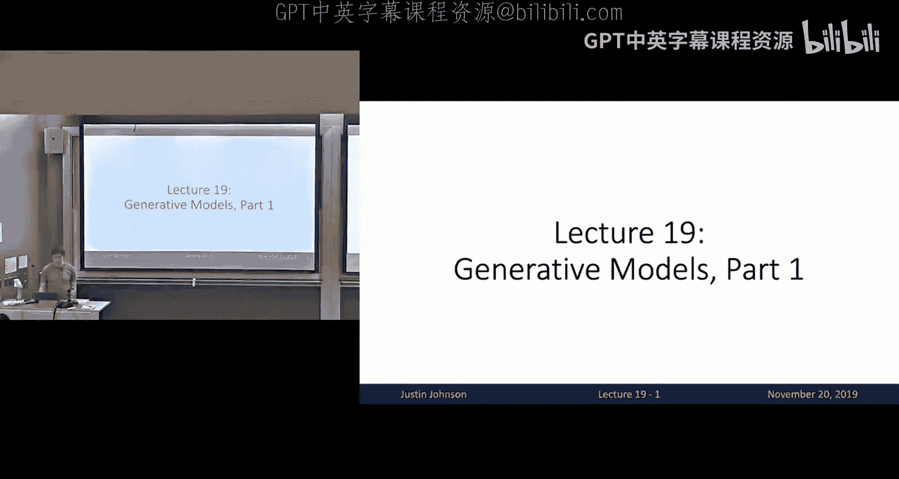

Alright， let's get started。 So welcome back to Le 19。

 and today we're going to talk about generative models part one。

 and then coming up after this will be generative models part two next time。

 as you could probably guess。

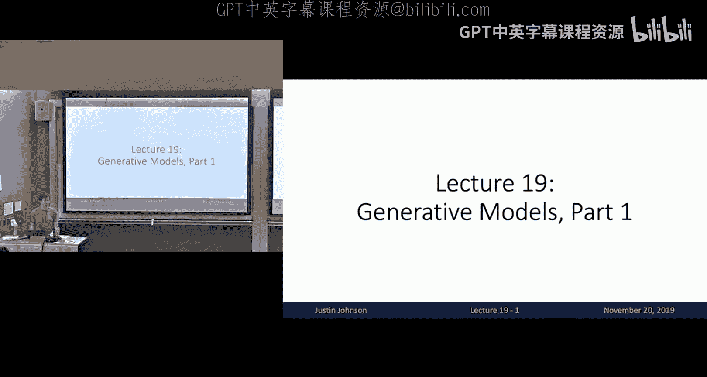

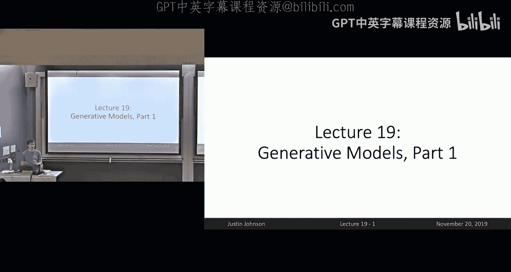

So last time we talked as a recap， last time we talked about different ways to deal with videos with convolutional neural networks。

 so we saw a bunch of different strategies for extending our neural networks from working with two spatial dimensions to working with two spatial dimensions and one temporal dimension so you'll recall that first off we saw this super simple method of a single frame CNN actually worked really well and we should always use that the first time we try to do any kind of video task。

And then we saw other techniques like late fusion， early fusion， 3D CNNNs， two stream networks。

 CNN plus RNN， convolutional RNs， all these different mechanisms for ref fusing in spatial and temporal information。

 So that was all really good stuff that hopefully will be useful if you ever find yourself confronted with the need to process videos with deep neural networks。

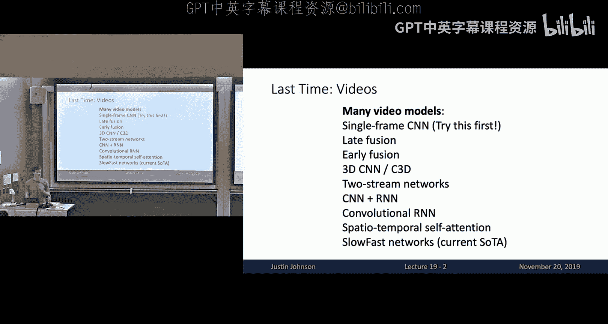

But today we're going to take a kind of different approach and talk about a very broadly a very different sort of problem than we have the rest of the semester so this will be the problem of generative models and what exactly a generative model is we'll take a little bit of unpacking but I do feel the need to warn you on this lecture that there's gonna to be a bit more math in this lecture than we have seen throughout the most of the semester so I think we'll see more equations and fewer pretty pictures but we'll hopefully try to get through it together and then so this lecture and next lecture we're going to talk about different approaches to generative models Last lecture I promised that today would be generative adversarial networks while I was going over the material I realize that that was not a good idea so today I'm going to talk about I'm going talk about them in a slightly different order today we're going to talk about variation autoencoderrs and autoaggressive models and the next time well cover variation we'll cover generative adversarial networks。

So it's kind of unpack what is a generative model。 I think we need to step back a little bit and talk about two sorts of distinctions to keep in mind when training neural network systems or really machine learning systems more broadly。

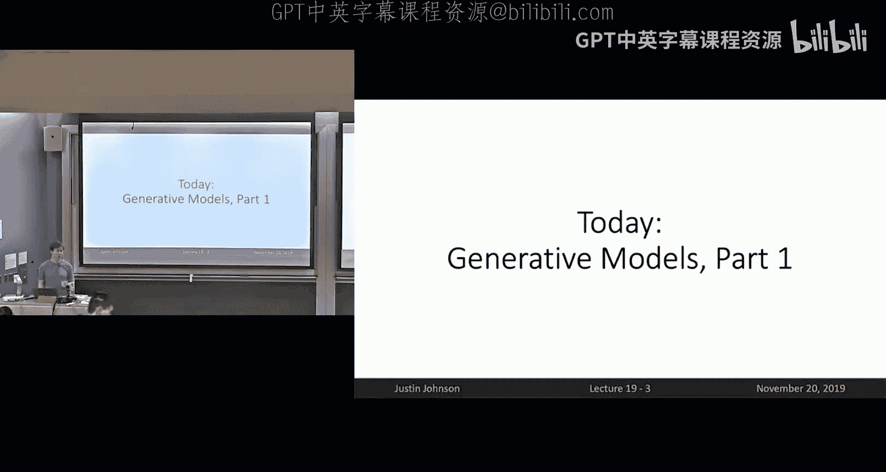

So one big distinction that we need to think about is the distinction between supervised learning and unsupervised learning。

So supervised learning is what we've been doing the majority of the semester。

 So in supervised learning， the setup is that we're given some data and this data consists of tus。

 So each element in our data gives us some input piece of data X， which might be an image。

 as well as some kind of output Y that we want to predict from that input。

 and that might be a label like like cat or something like that。

And the general goal of supervised learning is to learn some function that maps from the inputs X to the outputs Y。

 and one thing to keep in mind about supervised learning is that most supervised learning data sets require humans to annotate them so we can go on the Internet and we can download lots and lots of images to give us lots of examples of X。

 But in order to get the labels Y that we want our system to predict we typically have to have people go out and annotate all of the outputs that we want for all of our training images。

 So supervised learning is really， really effective as we've seen over and over and over again this semester。

 that if you have access to a big data set of x's and y's that have been labeled by people。

 then you can usually train a neural network to predict that to learn some mapping and predict the y is given the x's。

 So we've seen examples of supervised learning over and over again this semester so far。

 The canonical example has been something like image classification where X as an image Y is a。

Aorical label。

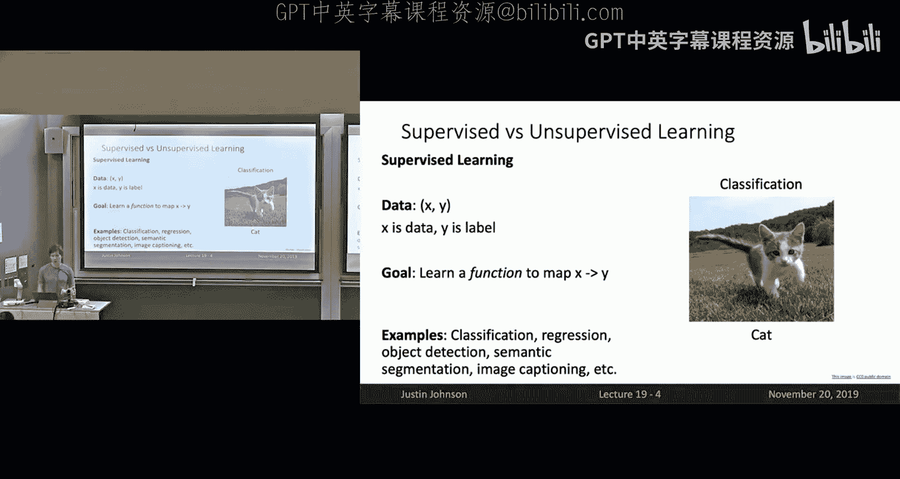

This can be something like object detection where X is an image。

 Y is a set of boxes in the image with categorical labels。

 This can be something like semantic segmentation， where X is an image。

 Y is this label this semantic category label per pixel in the image or this can be even something like image captioning。

 where then X is an image and y is some natural language description of the input image that has been written by people。

 and the kind of underlying thing to remember about this is that this we can train on big data sets using neural networks。

 but with supervised learning， we need someone to annotate the data sets for us。

 So this data annotation can be a potential barrier in our ability to scale up models to the extent that we really like like to。

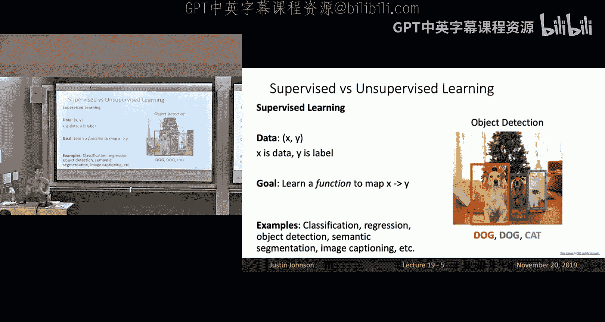

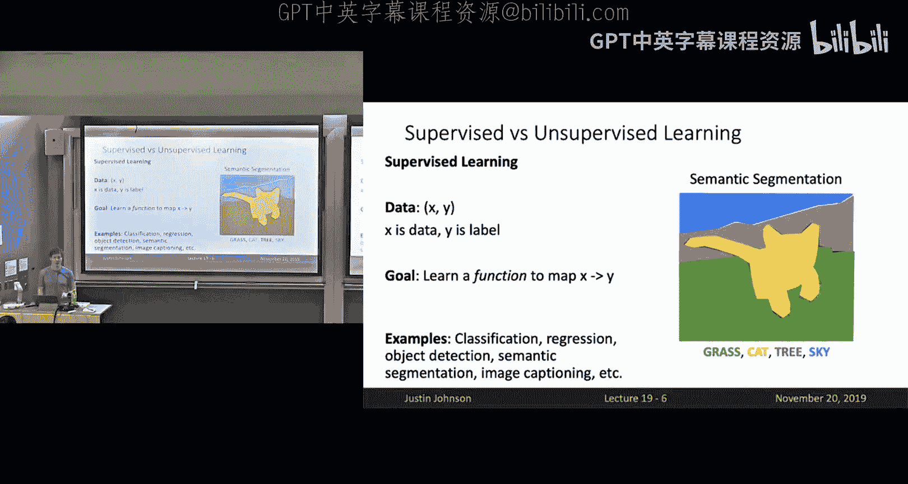

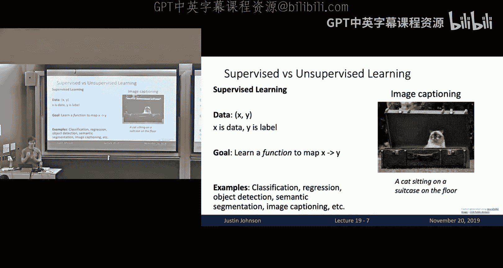

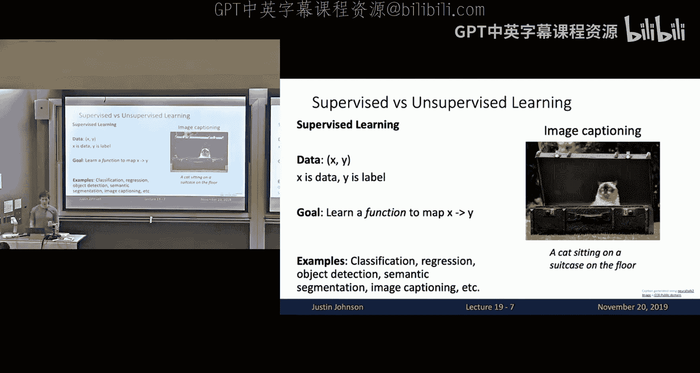

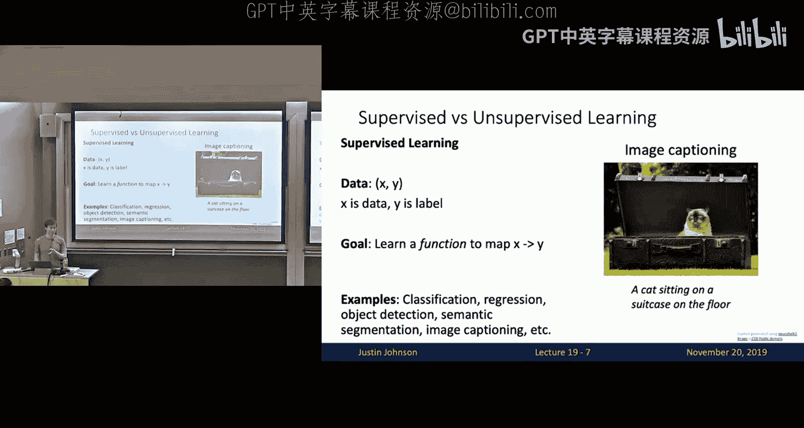

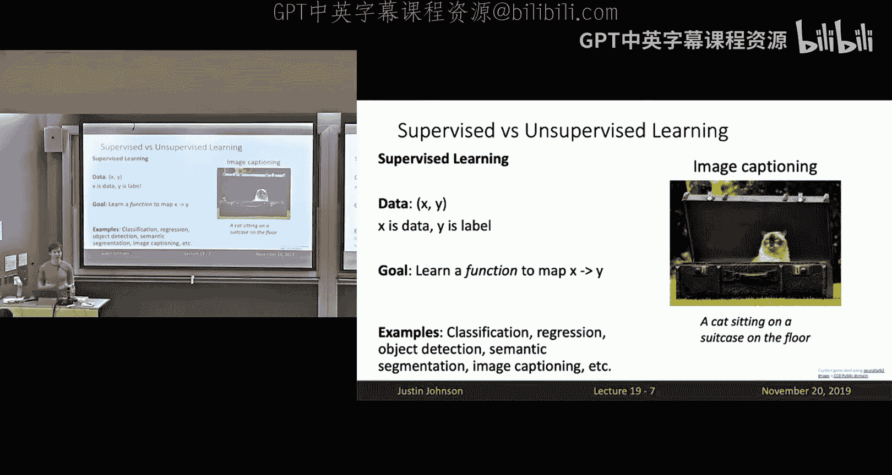

So， of course， we need to contrast this with a different approach to machine learning。

 which is that of unsupervised learning。 So unsupervised learning， I think。

 is a little bit of a nebulous term， right So sort of unsupervised learning is like everything that's not supervised to some extent。

 But the general idea with unsupervised learning， is that we only get raw data。

 we don't get we only get， for example， a large collection of images X。

 and we do not get access to any kind of ground truth labels or outputs Y。

 we only get the raw images X。 and the goal in unsupervised learning is to somehow build a model that can process this large set of images and uncover some kind of hidden structure in that data。

 Now hidden structure is a little bit of a fuzzy term。

 which is why I think that unsupervised learning as a whole is a little bit of a fuzzy term。

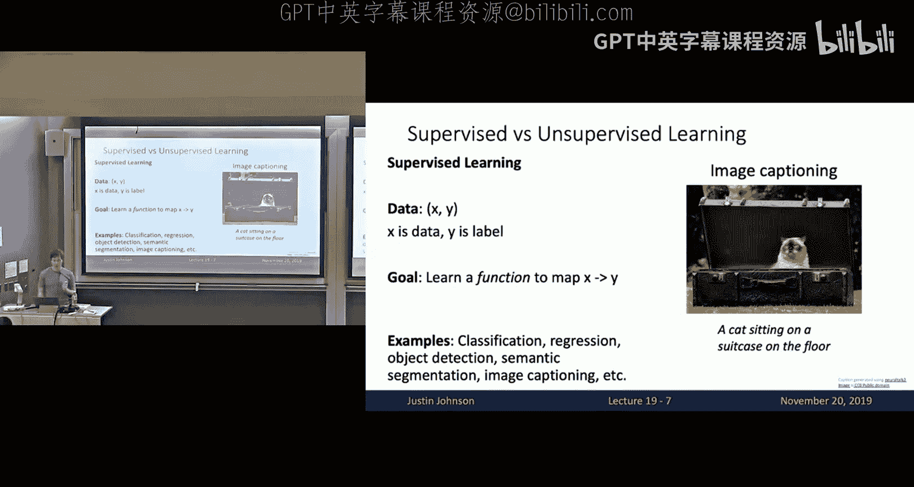

And the important part about unsupervised learning is that we don't require human annotation。

 So kind of the dream of unsupervised learning is that we like to build systems where we can just download all the possible data that's out there on the web or all bits of data that we get access to and then train models that kind of uncover structure on these large quantities of data without having to go through and label them one by one with human annotators。

 if so this is kind of like a holy grail of machine learning in some way is that we want to discover methods that can just slp in as much unsupervised data as we can and use that unsupervised data to make them better and better and better。

 So I think we're a little bit far away from achieving that sort of holy grail task and unsupervised learning But that's kind of where we strive towards when we think about this unsupervised learning problem。

So then to kind of make this a little bit more concrete。

 we can talk about maybe a couple concrete examples of unsupervised learning tasks that you may seen that you may maybe have seen before in other contexts。

So one example is something like clustering。 So in clustering。

 we just get a whole bunch of data samples， and the goal is to break the data samples into clusters。

 Now， note that there's no labels here。 We're just trying to uncover this this latent structure in the data。

 which are these sort of clusters that might naturally alert emerge from the input image pair from the raw data。

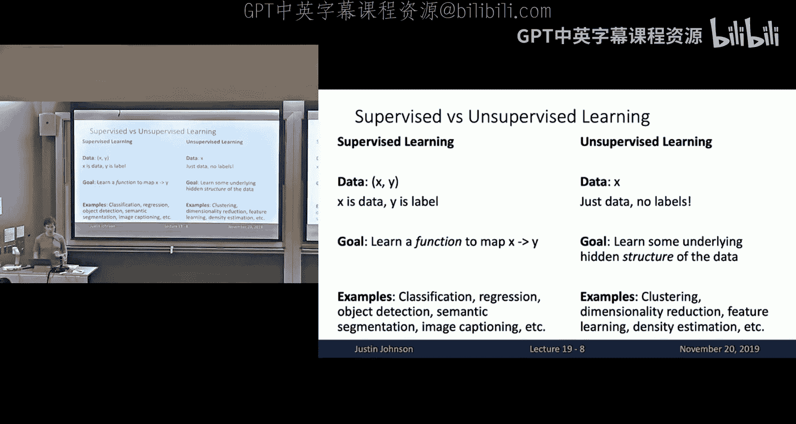

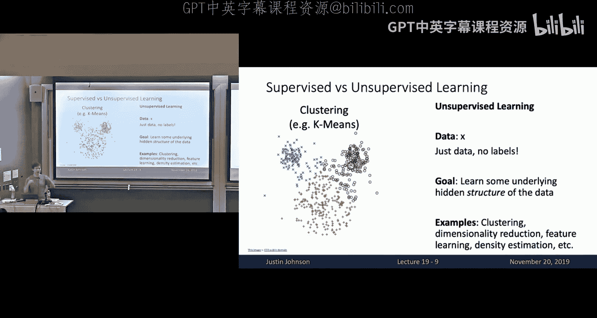

Another example of an unsupervised learning problem would be dimensionality reduction。

 which if youve taken an introductory machine learning class。

 you may have seen techniques like principal component analysis。

 which can be used to project high dimensionmensional data down onto lower dimensional spaces and they are the kind of objective in these dimensionality reduction tasks is that we've got this large set of data points that maybe live in some very high- dimensionsal space。

 and we'd like to find some very low-diional subspace within the high dimensionmensional space that sort of captures most of the structure or most of the variability of the raw input data set So then somehow discovering this low-diional submanifold of data would be some way that we could try to discover structure in the raw data without requiring labels to make our predictions。

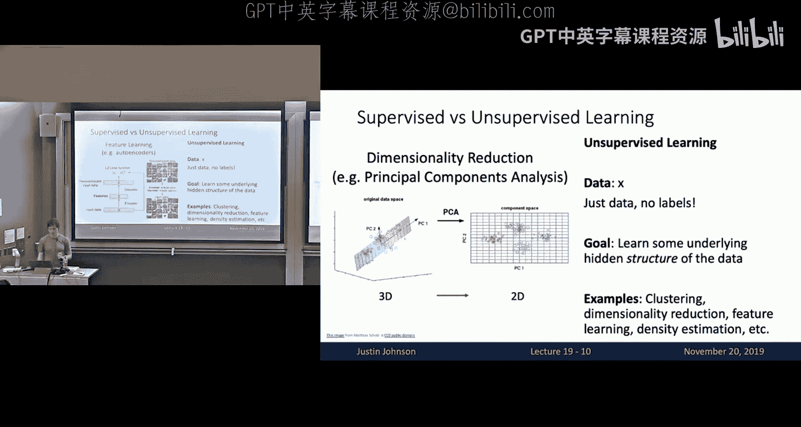

Another example today that we'll actually cover in more detail today is this idea of an autoencoder。

 so this is a special type of neural network that tries to reconstruct its input and in doing so it tries to learn a latent representation in the middle that can be useful for other downstream applications and again。

 this can be done using only raw data X and no labels Y whatsoever and then another example would be something like density estimation where suppose we are given a large selection collection of data samples and our goal is to learn a probability distribution that puts high probability mass on all of the data samples that we see in our data and low probability mass on all the on all other potential points that correspond to images or samples that did not appear in our data。

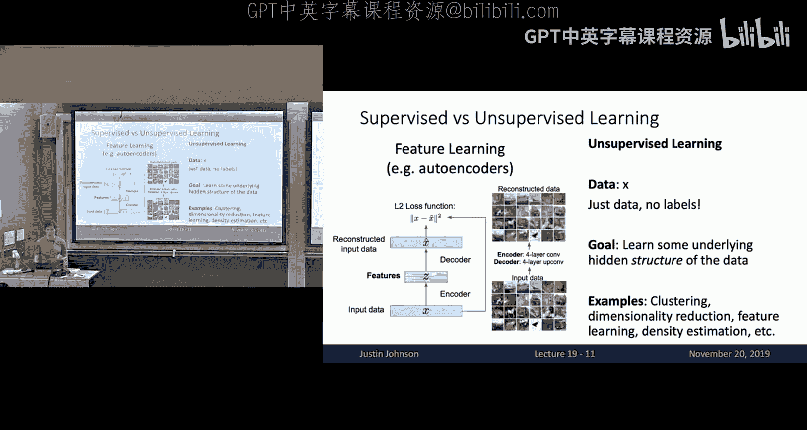

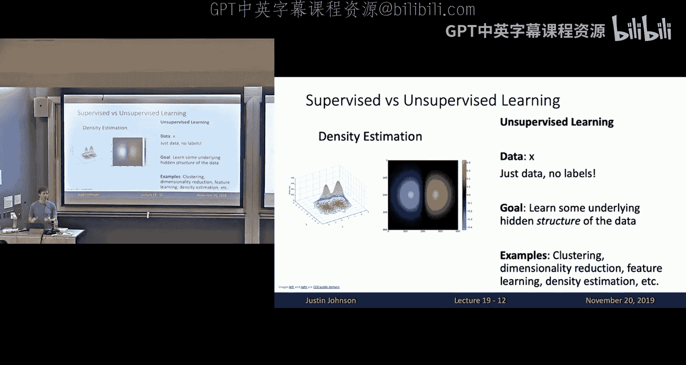

So this gives us this big contrast between supervised and unsupervised learning where you know supervised learning is what we've done and it actually works very well。

 but it relies on these large quantities not just big data。

 but requires but requires big labelbeled data and that's a big constraint and where we want to get to with unsupervised learning is to develop techniques that can uncover or learn useful latent structure using very large quantities of unlabeled data so I think this is a big distinction that we need to keep in mind because this distinction of supervised versus it turns out that our topic today of generative models is going to be one way that we can try to approach these unsupervised learning tasks so by learning large largescale generative models will be a way that we can try to learn structure in our data using a lot of labeled data。

 but without requiring human annotation on that data。

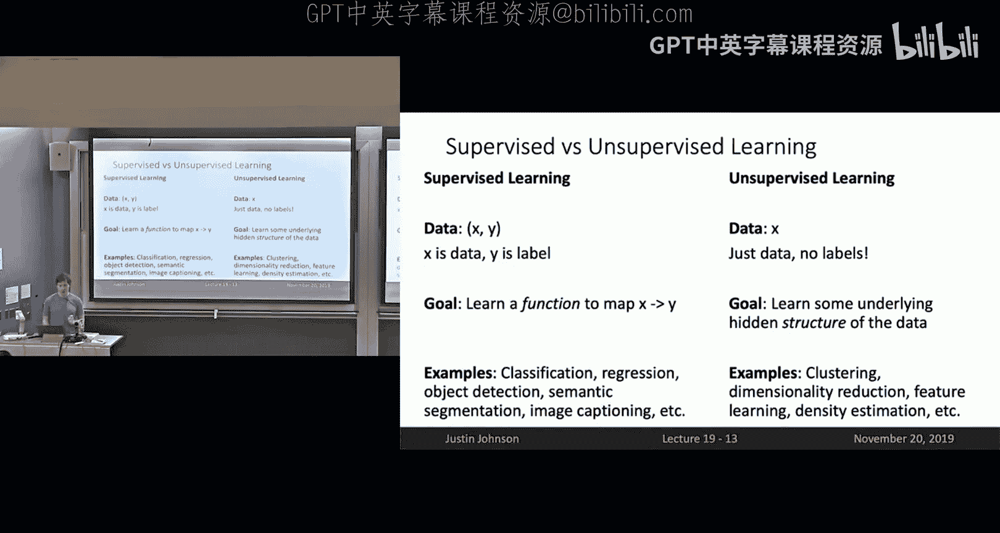

So then that's the first major distinction that I wanted to point out。

 And was this clear to everyone， was any kind of questions on this supervised versus unsupervised distinction？

Allright， let's talk about our second big distinction in machine learning models that we need to be clear on。

 So this is so here， the distinction is we want to sort of think about different sorts of probabilitybabilistic frameworks that we can use to represent different types of machine learning models。

 So in particular，s often we often like to think about a distinction in discriminative models versus generative models。

 and the distinction here is in the type of underlying probability structure that these different type of models are trying to learn。

 So one kind of lens through which we can view a lot of different machine learning models is that we're trying to fit some probability some kind of probability distribution to the data that we're training on。

 And now the exact structure of what we're trying to model in that probability distribution has these different names。

 So in a discriminative model what we're trying to do is learn a probability distribution that predicts the probability of the label Y conditioned on the input。

Image X。 and this is something that we've seen over and over again。

 So discriminative models sort of go hand in hand with supervised learning that whenever you build a discriminative model like an image classifier。

 it's going to input the image and then output a probably distribution over all possible labels for that image。

So then a generative model， on the other hand， is going to try to learn a probability distribution over images X。

 And there's another thing called a conditional generative model。

 which is going to try to learn a probably distribution over images X conditioned on labels Y and it seems like these three different categories of probabilistic machine learning models。

 don't seem that different when you just look at the symbols on the page because it seems like oh。

 we've got an x and a y， we kind of swap the order。

 what's the big deal But it turns out that there's actually a huge mathematical distinction between these three different categories of machine learning models So the reason for that is that so we need to do a really quick recap on what is a density function in probability right So anytime we're kind of working with probabilistic models。

 the mathematical objects that we often use to model probability distributions are these functions called density functions。

 So a density function P of X， what it's going to do is input some kind of piece of data X and then output some positive。

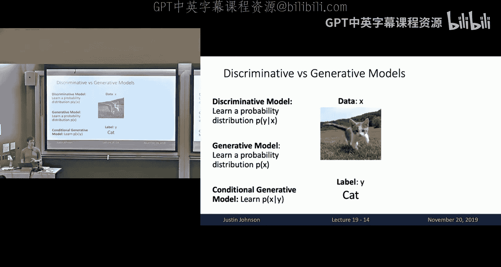

Number that sort of tells us how likely was that piece of data under this probability distribution。

 And where higher numbers mean that it's more likely and lower numbers mean that that piece of data was less likely。

 Yeah， question。 do we need to use it too much learning to learn the conditional。The question is。

 do we need to use supervised learning to learn conditional generative models。

 so there you typically would need to use supervised learning because it needs access to both the data and the labels。

 so a conditional generative model will typically require human labels。

But now the critical aspect about probability distribution functions is that they're normalized right So if you take your probability distribution function。

 your probability density function， it needs to integrate to one。

 So if you integrate over all possible inputs to the distribution and just run that integral。

 it might be finite over if you're doing a distribution over a finite set or a continuous integral。

 integrating over some infinite set like a vector space but the key distinction is that these density functions need to be normalized。

 so they need to integrate to one。

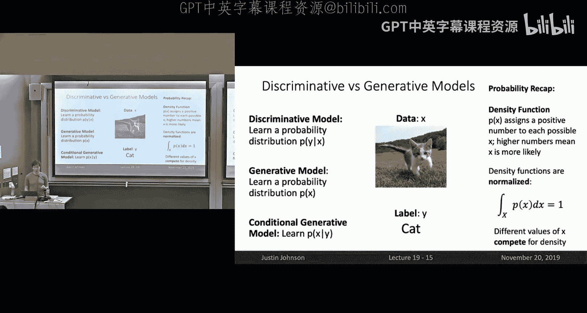

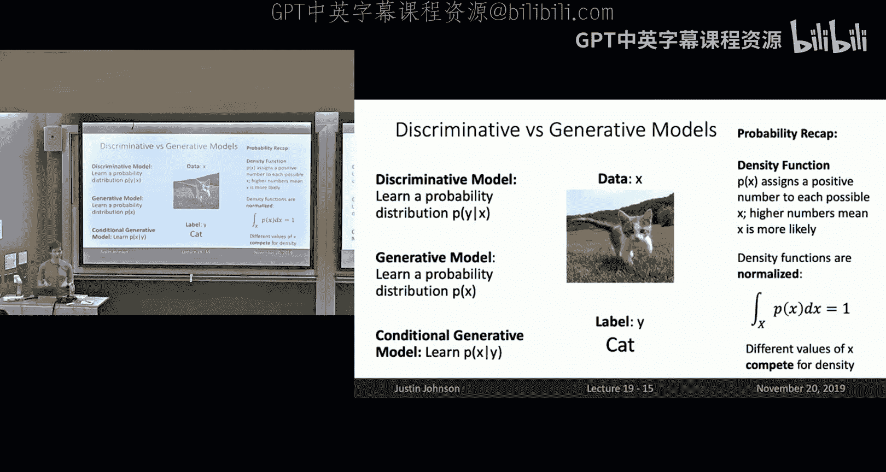

And that's a really critical piece that leads to huge distinctions between these different categories of probabilistic machine learning models。

what this means is that because a probability distribution because a probability density function needs to integrate to one。

 it means that different elements within the support of the probabilityities distribution need to compete with each other for probability mass so because the distribution。

 because the density functions integrate to one in order to assign higher probability to one element。

 we must， by design， assign lower probability to a different element。

 So this normalization constraint introduces some kind of competition among the different elements over which we are modeling probabilities and this question of what is competing under the probability distribution leads to pretty huge implications in different in the differences between these different kinds of probabilitybabilistic models。

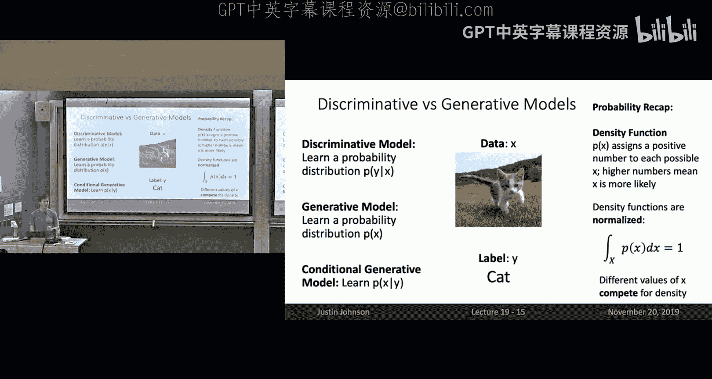

So then first， let let's think about this idea of discriminative models or supervised classification through this lens of probability distribution functions and labels competing with each other。

 Well， here what we're doing is that we input a piece of data acts like an image。

 and then it outputs a probabilities distribution over all of the labels that could potentially be assigned to that in the input image。

 And so in this toy example we're maybe modeling two different labels a cat and a dog and we're just outputting a binary decision。

 a binary distribution over these two different types of labels。

And because the density function is normalized， then when we assign a higher probability mass to cat。

 then by design， we must assign lower probability mass to dog because it has to integrate to one。

 but what's critical but what's critical here is that and if we assign and if we run a different image like this image of a dog through the same classifier。

 then we would produce a different probability distribution。

 probability of cat conditioned on the dog image， probability of dog conditioned on the dog image under that second probability distribution。

 again， the labels would have to compete with each other but critical the critical thing to realize about discriminative models is that images don't ever have to compete with each other under a discriminative model。

 there's no competition among different types of images there's only competition among different types of labels that could potentially be assigned to each different image。

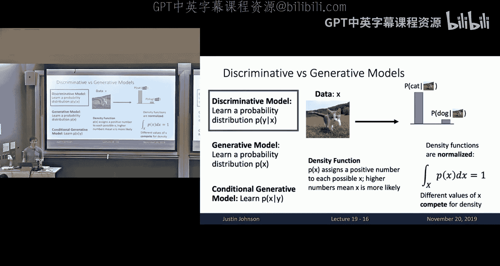

And that has a couple important distinctions。 So one is like what happens if we try to run an image into a discriminative model that just doesn't fit the label set。

 So， for example， in this image on the top， we were training a binary classifier that knows how to recognize cats and dogs and if we feed an image of a monkey。

 then there's nothing the classifier can do to sort of tell us that this was an unreasonable image that did not fit its label space because the way that a discriminative model works is that for every possible image。

 it's forced to output a normalized probability distribution over the labels。

 And now another and this gets even more extreme， when you imagine feeding like totally crazy or totally wild images into a discriminative model。

 So if we feed these really abstract images that clearly have no business being called either a monkey or a cat。

 then again， our model is still forced to output a normalized distribution over these two different types of labels。

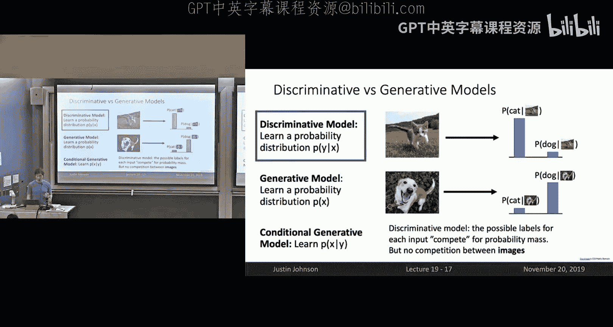

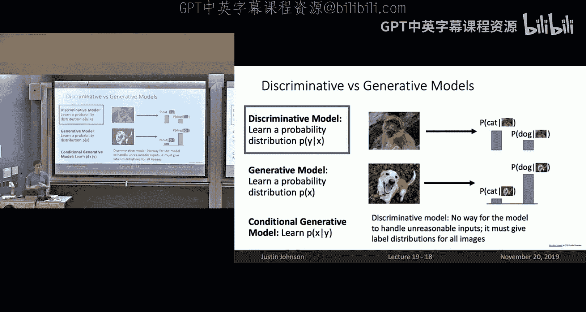

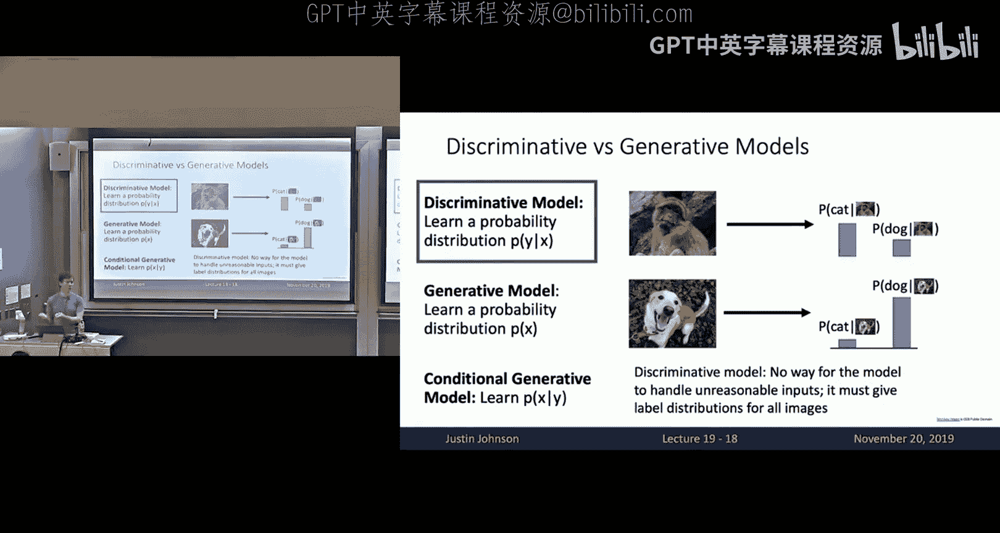

So personally， I think that this is one reason why things like adversarial attacks are possible on discriminative models。

 because when you generate an adversarial attack on a supervised machine learning model。

 what you're doing is kind of synthesizing an unreasonable image。

 which is sort of not in the support of the types of images that that model was trained on so then when you pass this sort of unreasonable image to a discriminative model。

 then it's still forced to output some normalized distribution over the possible label space。

 so I think that this fact that so there's this fundamental shortcoming with discriminative models。

 is that they just have no capacity to tell us when we feed them with an unreasonable input image。

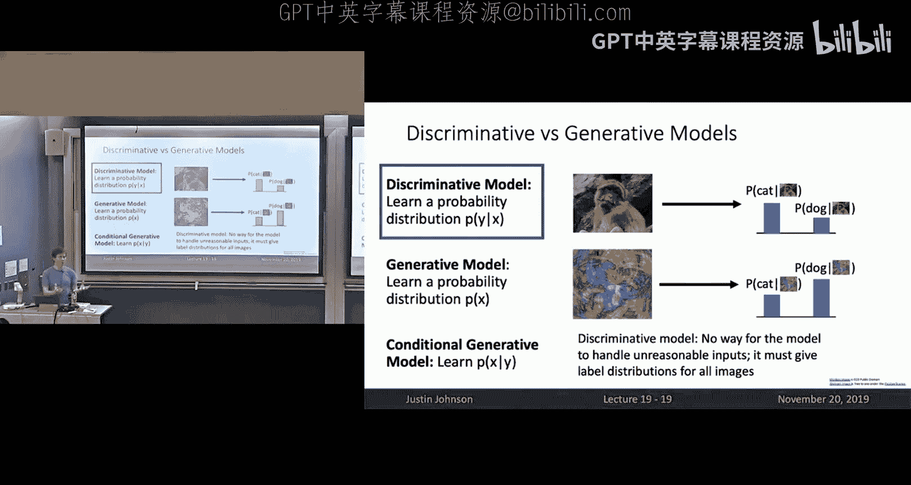

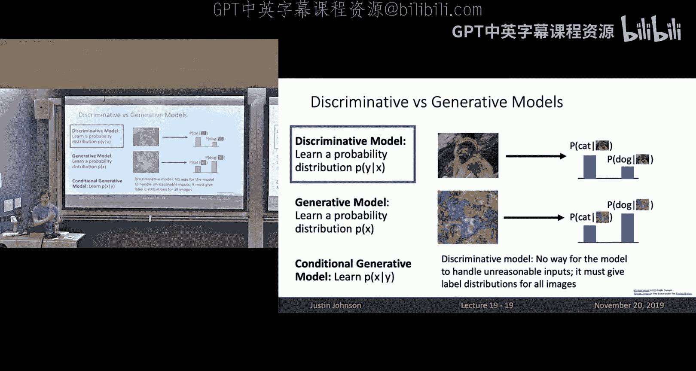

So then let's think about what happens with a generative model in contrast。 Well。

 a generative model is learning a probability distribution over all possible images that could exist in the world。

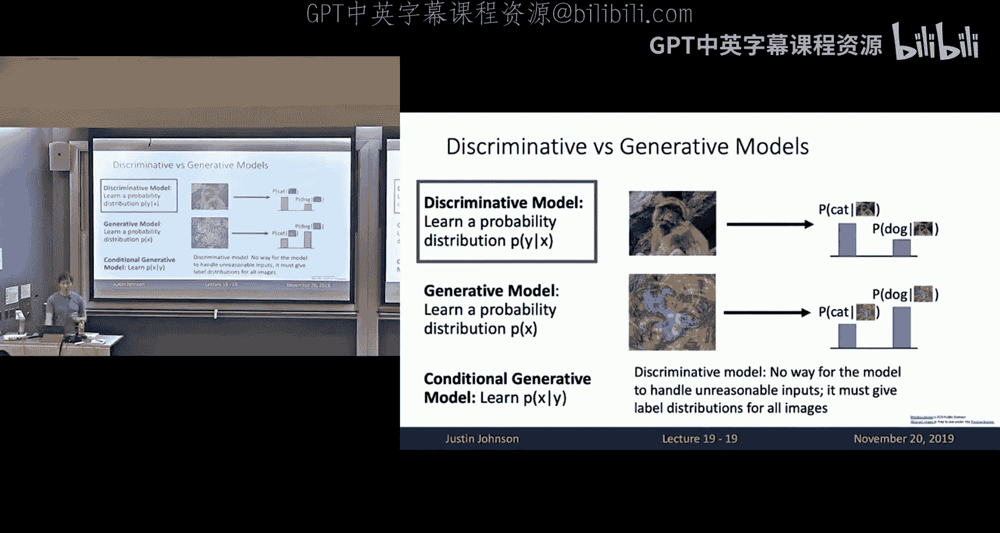

And so what this means is that for each possible input image that we could imagine feeding to the system。

 this model needs to assign a number to say how likely is this image to exist。

 And what's really fundamental is that this is a really hard problem because it needs to tell us for because probability these likelihoods that are being output from the density function are sort of need to tell us whether any pair of images is going to be more likely than another。

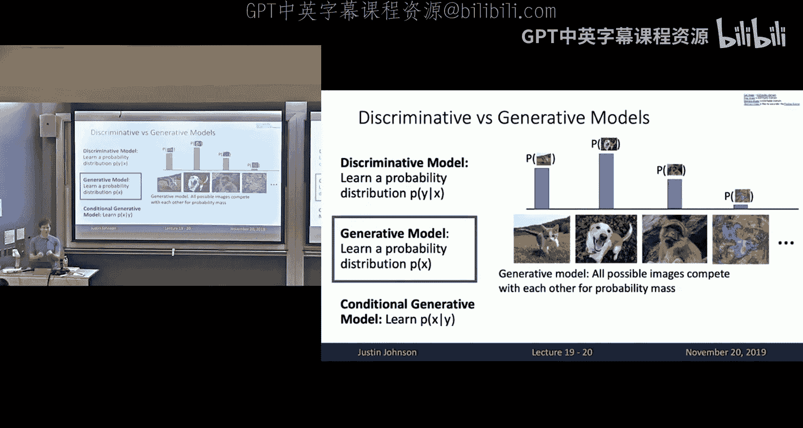

So this is like a really， really hard problem that requires some kind of really。

 really deep visual understanding， right， So if you train a generative model on images。

 it kind of needs to be able to know what is more likely in the world。

 maybe a three like a dog or a three- armedmed monkey because a generative model needs to kind of input any image that we could possibly throw at it and then output this。

 this likelihood value that tells us how how probable was that image。

So then even sort then with a generative model， different potential images are competing with each other for probability mass。

 and in order to assign reasonable probabilities to all possible input images。

 then it's very likely that this generative model would actually need to have a very deep understanding of the visual world。

So even in this example， I kind of this is not a real generative model I just kind of like put bars in PowerPoint right but even in deciding this。

 it's like kind of tricky right so I decided that maybe the dog bar should be the highest in this example because I think probably dogs are more likely to be outside than cats or maybe this is an adult dog and it's more likely to see adult dogs outside than it is to see like kittens outside because I know that this is a kitten and I know that cats are only kittens for a very small period of their lifespan and then maybe photos of monkeys or maybe less likely than either dogs or kittens just because people tend to take less photos of monkeys and then this maybe abstract art image is maybe even less likely because I don't know what this is I think it's maybe very unlikely to see images that look exactly like this。

 Yeah question。This。But like what are the existing spaces。How do you。Yeah。

 so you got to be careful that a density function over an infinite space does not actually assign a probability instead it assigns a likelihood or assigns some amount of density。

 So once you're operating over an infinite dimensional space。

 it doesn't make sense to talk about the probability of a single data point。 Instead。

 what you can do is integrate the density function over some finite region and then integrating a density function will actually give us a probability of observing some piece of data that lies within the region over which we integrate。

 So you need to be very careful with the word probability when you talk about density functions over infinite dimensional spaces。

 Yeah question。 how good your model is。That's a fantastic question。 It's very insightful。

 So the question is how can we tell how good is a generative model and that's an extremely challenging question that I think a lot of people struggle with。

 But one sort of mechanism that we use to evaluate generative models is often this idea of perplexity。

 So then if I train a generative model on some training set。

 And then I present the generative model with unseen test images。

 then if it did a good job of learning the underlying visual structure of the world。

 then it should assign relatively high probability density to unseen test images。

 even if those particular images had not been seen during training time。

 So that's kind of the best I think that's the gold standard evaluation metric that we have for generative models。

😊。

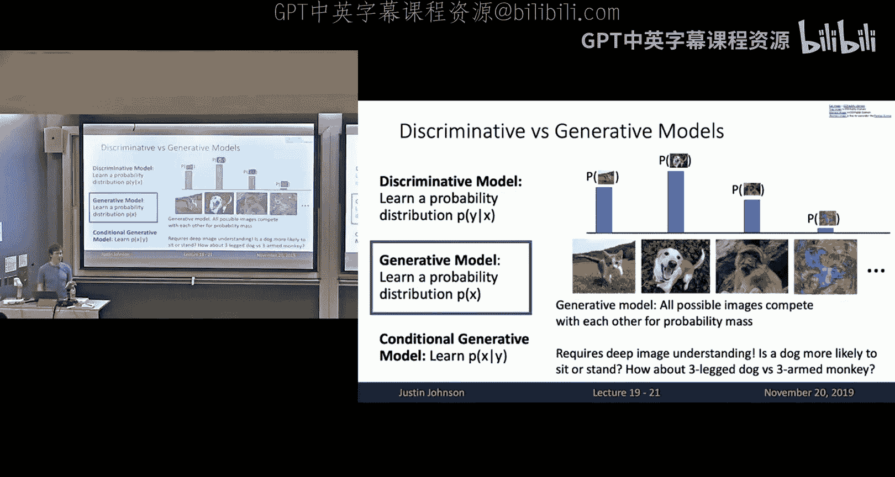

So then another interesting fact about generative models is that they have the capacity to reject samples that they think are just unreasonable。

 So for example， if we maybe put in this abstract art。

 then the generative model can just tell us that this was an unreasonable input that had very little to do with any of the inputs that it saw during training。

 So a generative model has this capacity to tell us when the inputs that we presented it with or maybe very unlikely under the training data that it was trained on。

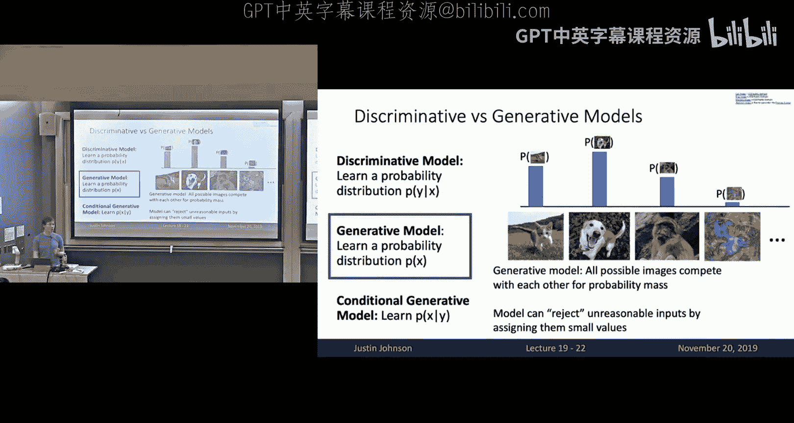

So then we have this third type categorygoia model called a conditional generative model。

 So now a conditional generative model is learning for every possible label Y。

 it's learning a probability distribution over all possible images X。

 which means that now every possible label that we could learn is going to induce a separate competition among all possible images。

 So then， for example， in the top row we're showing the probability of each image conditioned on the fact that that image is a cat。

 and we see that maybe the cat has a very high density under under the top distribution and in the middle we're showing probability of each image given that it's a dog and now again。

 now the dog should have a higher density and all the other images should be lower。

 but now what's interesting is that a conditional generative model sort of has this capacity to tell us when inputs were so you could imagine doing classification with a with a conditional generative model。

 you could take your input image X and then evaluate the likelihood of that image and evaluate a probability of our input image。

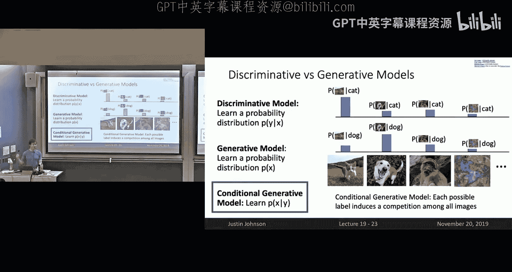

X over over each possible label Y。 and then you could make a classification decision based on which one of those were higher。

 So you could indeed imagine training a supervised classifier using a conditional generative model。

 But the distinction is that if you were to train a classifier using a conditional generative model。

 then it would actually have the capacity to reject un data samples。

 because with a conditional generative model， it's possible that that some input image could have a low density under all possible labels。

 And we see that， for example， with the abstract art example in this slide。

 So then this abstract art image is given a very low likelihood under each different under both of the probability of distributions。

 which leads us then if you imagine building a classifier that was based on conditional generative models。

 then you could imagine like maybe there's a threshold under which we say this is an unreasonable image and I refuse to classify it。

 So that's kind of a big distinction between these different categories of models。

Although I think it's also important and interesting to realize that these different types of models are actually not fully distinct。

 So if you recall Bayes rule， then Bes rule lets us sort of flip around the conditioning in a probability distribution。

 So Bayes rule tells us that the probability of x given Y is equal to the probability of y given x divided by the probability of y times the probability of x。

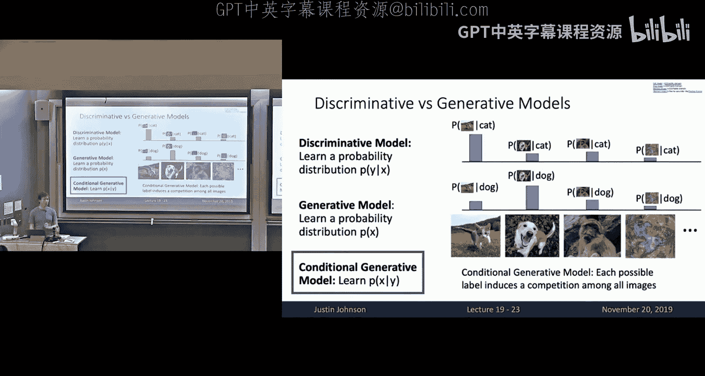

And what this means is that using Bayes rule， we can actually build a conditional generative model out of existing pieces that we've already seen。

 So this expression on the left probability of x given y is a conditional generative model。

 Now the top expression in the numerator in this fraction is a discriminative model。

 a probability of y given x。 the term on the right in purple is an unconditional generative model and the term at the bottom probability of y is some prior distribution over labels。

 So prior distributions over labels you can sort of just count up the number of labels that occur in the training set。

 So this is kind of a nice beautiful relation among these different types of probabilistic models。

 and it shows that shows us that maybe really the two most fundamental types are the discriminative model and the generative model。

 And if you can build those two， then you can build a conditional conditional generative model as well。

 So then kind of a big thing that we want to do is learn how to build these unconditional generative models。

 because we already know how to build discriminative models。 and then if we。Could build both。

 Then we could put them together to build a conditional generative model。

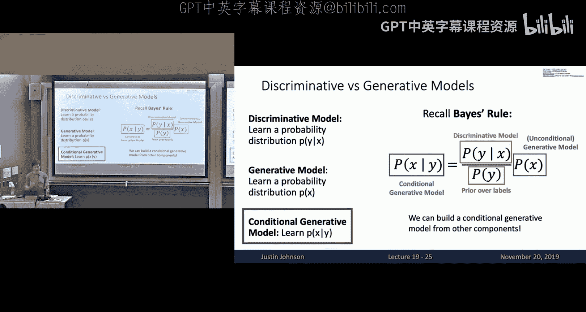

So then it's sort of interesting to think about what we can do with these different types of probabilistic models once we've learned them。

 So discriminative models we've seen many times already。

 basically what they can do is we can learn we can assign labels to new data at test time。

 we've also seen that they can be used for a type of supervised feature learning。 So for example。

 we can train a big model that is supervised using the images and labels on the imagenet data set and then we can strip off the final classification layer and then use the body of our neural network as a kind of feature extractor So then this tells us that a discriminative model can learn to extract useful。

 meaningful semantic features from images， assuming that it's allowed to be trained with a lot of label data。

Now， a generative model， we can do a lot we can do a lot of more interesting things。

 one that so we've already kind of mentioned these。 one， it can detect outliers。

 That is it can tell us when input images are very unlikely。

 given the data on which it was trained It also can potentially let us do feature learning without labels。

 because if we could learn a really good generative model that could assign really meaningful probability really sorry almost almost got myself。

 really meaningful likelihoods to all the different images that it we could pass it。

 then it's very likely that a model which was good at this generative modeling task might also have been good at learning useful feature representations for its images。

And now another really cool thing we can do with generative models is actually sample from the generative models to actually synthesize new data that kind of matches the input data on which it was trained Now。

 because generative models are actually learning a distribution over images。

 then we can sample from a learned generative model to synthesize new images。

 which is a really cool application。

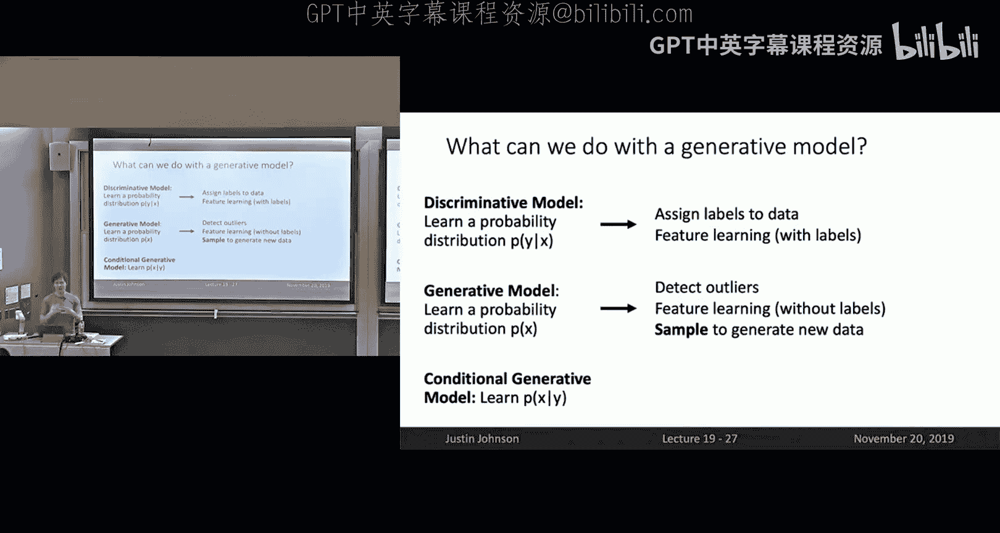

And now a conditional generative model we've sort of already seen that it can be used to assign labels while also simultaneously rejecting outliers and then similarly。

 conditional generative models can be used to synthesize novel images that are conditioned on labeling date on label on a label value。

 So for example， with a conditional generative model。

 you could ask it to generate new cats or new dogs or if maybe why was a sentence rather than a label then you could learn to generate images that were conditioned on natural language inputs like give me an image of a cat with four legs and and a purple tail or something like that。

 I don't think that would actually work， unfortunately。

 So then this kind of gives us a lens through which we can view different types of machine learning models through a bit of probabilistic formalism。

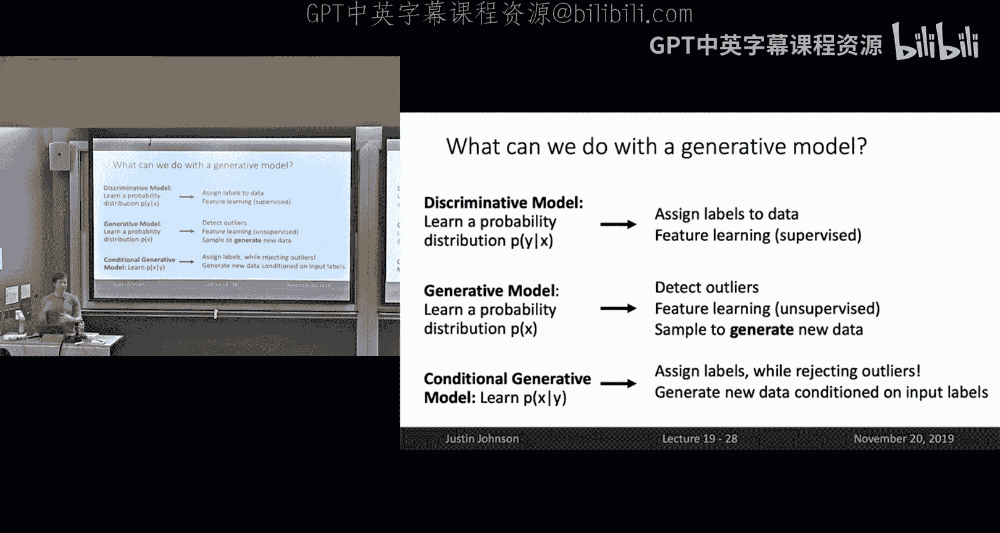

Okay， so then actually it turns out that this idea of generative models is so important that it's a massive topic and there's really no possible way that we can cover it even in lectures。

 So to give you a sense of the different types of generative models that live out there。

 I wanted to go through this very brief sort of family tree of different categories of generative models to give you a bit of the lay of the land So the very root node we've got these generative models and then a big split that we get is between what are called models that have explicit density functions versus models which have implicit density functions。

 So I told you that a generative models was all about assigning density functions to images。

 Well it turns out that there are some categories of generative models where after training。

 you can input a new image and then it spits out this likelihood value and those are these explicit density these generative models with explicit density functions And now on the right hand side models with implicit density functions。

 do not there's no way we can extract a likelihood value。

But we can sample from the underlying distribution after the model' has been trained。 Yeah， question。

Okay， I think I think I think you should not take what I have。

 So the question is what's the difference between likelihood and probability。

 and I think I'm a bit hesitant to give you a concrete definition because I need to review my measure theory if I want to get this all proper。

 But kind of the idea is that if you're if you're trying to write a density function over an infinite dimensional space。

 then this density function does not assign probabilitybabilities。

 then the thing which is being spit out from your density function is I'm calling a likelihood or a density。

 but that's not actually a probability。 So a probability is what you get when you integrate a density function over some finite region。

 and a probability tells us like what is what is the probability that we observed a random variable that fell into this region of space。

 So the big distinction is between the value which is spit out from the density function。

 that is not a probability and the value which we get when we integrate a density function is a probability。

 Does that help to clarify。Okay， so then the first big big category distinction in generative models is on the left。

 explicit density functions where we can actually compute this value of the density function for input images。

 and then implicit density functions where there's no way we can actually extract the value of the density function。

 but we can somehow sample from the underlying density that is being learned。

And now with even within explicit density functions。

 there are sort of two categories that you need to think about。 One are tractable density models。

 here are models where， you know it sort of does what you expect。

 you can actually input a new image at test time and receive the actual value of the density function on that image。

 Now with an approximate there's also models that use approximate density functions that have no way to efficiently spit out an actual value of the density function but instead can compute some kind of approximation to the density function。

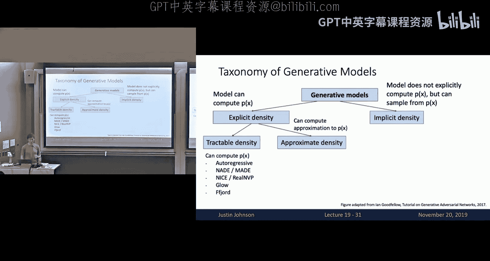

And now within those， maybe there's two categories of methods， one。

 there's sort of different ways that you can make these approximations。

 So one category are variational methods and we'll actually see an example of that later and the other maybe Markov chain models that I don't expect you to know too much about。

 And then over on the implicit density side again， these are models where you can sample from the underlying density function。

 but you cannot get out the value of the function。 So maybe examples here would be some kind of Monte Carlo chain methods where you have to you can sample from it or these direct methods where you can just directly sample from the function。

So within this big taxonomy， we're going to cover sort of three different pieces。

 three different types of generative models within this taxonomy that will help you to get a flavor of these different types of generative models and what do these different things mean？

So today we'll talk about autoregressive models， which are examples of explicit a generative model with an explicit and tractable density function。

 and we'll also talk about variational autoencoderrs。

 which are an example of an generative model with an approximate but explicit density function and then next lecture we'll talk about generative adversarial networks。

 which are an example of a generative model with an implicit density function。

 so then we can't get out a value of the density function but we can sample from it。Yeah， a question。

Yeah， so whenever you generate a sample， that means that I want to generate a random value and the like the the probability where things that I generate are I'm going I'm going to be more likely to generate things which have high values of the density function and less likely to generate things which have low values of the density function。

 And that's what I mean by sample。was there a question in the back or was it just stretching。Okay。

 sorry， yeah， over here。I guess I don' quite got it green and。たつり。Yeah， so I think the question is。

 you don't quite see the distinction between implicit and approximate density。

 I think that's fine at this point。 But if you still are confused， maybe at the end of this lecture。

 then I think early at the end of next lecture， I think that's going to be a problem。

 So this is meant to be kind of a lay of the land。 and that hopefully you can return to this map once we've seen more concrete examples。

 And then you'll be able to better understand the distinctions between them。Okay， so then with this。

 any more questions on this kind of overview of generative models。

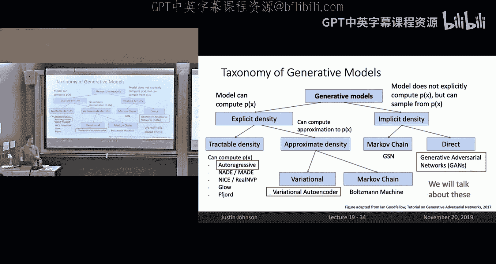

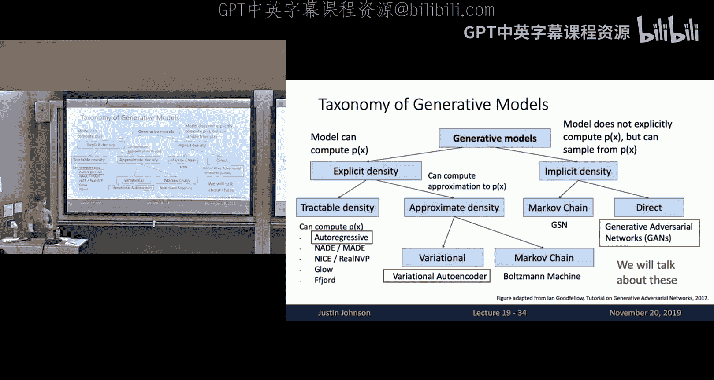

Alright， so let's actually talk about our first generative model。

 So this is an example of an autoaggressive。 So we're going to talk about auto regressive models。

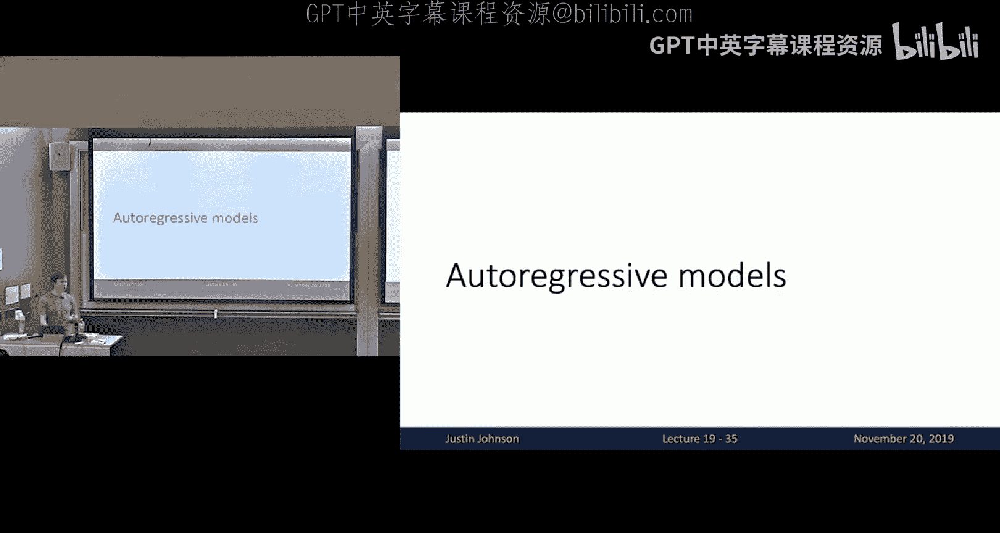

So an autoregressive model as we talked about， is an example of a generative model that has an explicit density function。

 which is tractable。 So this is kind of like the easiest type of generative model to wrap your brain around。

 Basically， the idea is that we want to write down some parametric function that's going to input a piece of data X。

 and a learnable set of a learnable weight matrix W。

 And it's going to spit out the value of the density function for that image。

And then what we're going to do is we're going to train this model by taking some data set of data samples X。

 and we're going to try to maximize the value of the density function。

 we're trying to maximize the likelihood of the observed data。

 So we want to assign sort of high probability mass to all of the samples in our data and then because of the normalization constraint。

 that will， by design， force the model to assign low mass to things that were not in the training data。

 And if we make this， then this is sort of sort very standard probabilistic formalism or whenever we're training any kind of probabilistic model so then we can assume that the samples of our data are independent。

 So then the probability of observing the data is just the product of the probabilities of all of the independent samples。

And then we want to learn the value of the weight matrix that will maximize the likelihood of that will cause the likelihood of the data sets to be maximized。

Of course， products are a little bit ugly to work with。

 so it's common to do a log transform on this to transform the product into a sum。

 then we want to find the value of the weight matrix that maximize the sum of the log probability over our data。

And now， now our log probability is going to be represented with some kind of parametric function that inputs the data and input inputs the training sample and inputs the weight matrix and is's going to spit out the value of the density function on that piece of data。

 and spoiler alert， this F is going to be a neural network for us。

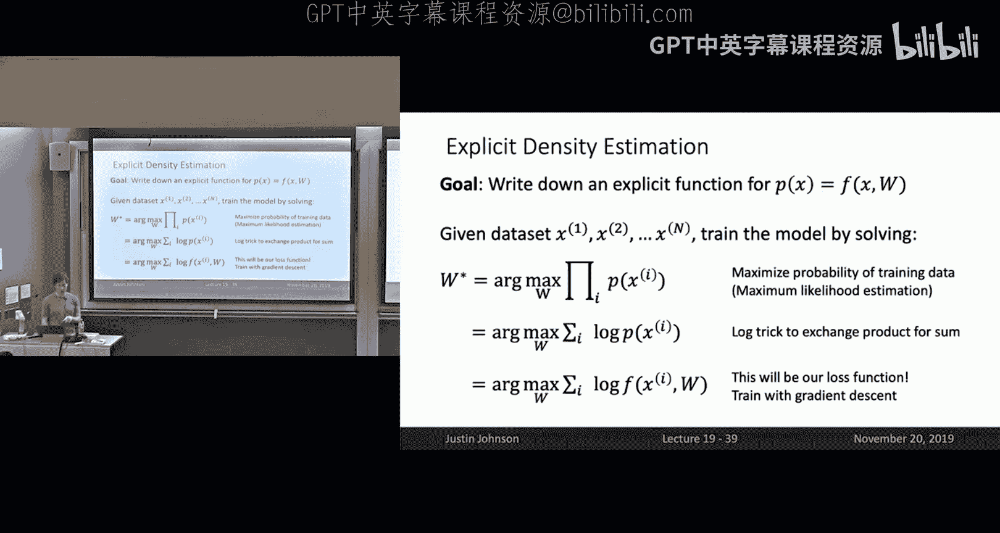

So then the question is that we need some way to write。

 So this is this is kind of a general formalism for any kind of explicit density estimation。

 So this this will apply to any kind of explicit density estimation where we can actually evaluate and compute and back propagate through the value of this density function。

 which is parameterized by a neural network。

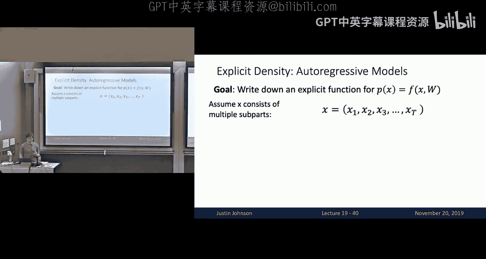

So now we need to actually write down some concrete mathematical form for this density function。

 So an autoaggressive model is a particular way of writing down and parameterizing these these likelihood these density functions。

 So here the assumption is that each train piece of data X So x is like an image each piece of data is going to be composed of different subpiece of data or subparts。

 So for an image each of these x1 x2 x3 might be the different pixels that make up an image and what we're going to do is sort of assuming that our raw data samples xs consist of these many different subparts。

And then what we want to know is that the probability of an image is equal to the probability of observing all of the subparts in the right order。

 And then based on the chain rule， right we can factor this joint distribution over all the subparts in a particular way。

 So then the joint distribution over all the subparts we can factor out as the probability of the first one times the probability of the second one conditioned on the first times the probability of third conditioned on the second and the first。

 so on and so on and so forth。And this sort of holds in general， right。

 This is this is the chain rule that we can use to factor joint probability distributions。

 So this is always true。And then if you kind of iterate this。

 then it means that we're going to write down the probability the density function of our data sample X is going to be equal to a product where each term in the product is going to be the probability or likelihood of observing the current piece of data conditioned on observing all the previous pieces of data。

And now， this formula actually should remind you of something that we've seen already。

Can can anyone guess it？Say it again。

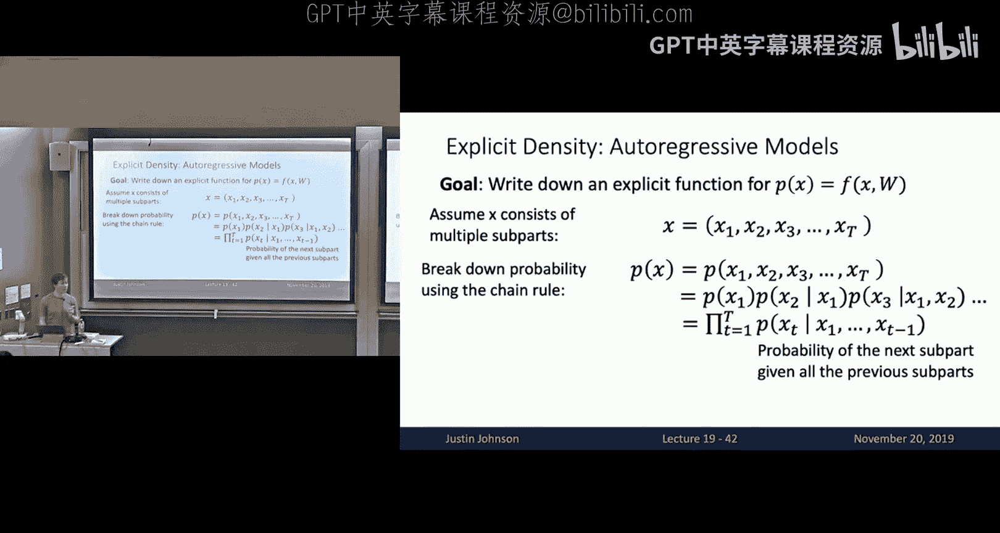

ペです。Bs rule， not quite not this lecture， something we've seen in previous lecture。

Recurrent neural network。 Yep， that's it。 right。 So this structure that we've got in an auto aggressivegressive model is that we want to break down this probability of a sequence by modeling it as the probability of the current token condition on all the previous tokens。

 And it turns out that's the exact structure that we have in a recurrent neural network。

 So then what we can do is build a recurrent neural network that's going to input at every time step one of the tokens and then output the probability of observing the next token。

 And through the recurrent design of the network。 Then each prediction is going to be implicitly conditioned on all of the sequence of subparts that occurred before。

 So it turns out we've already you guys have already trained autoaggressive generative models for generating sequences of words and sequences of letters。

 So this is actually not new not a new concept is just an old idea that we're sort of couching in different mathematical or formalism。

And now the idea is that we can so so far we've used this idea of autoaggressive sequence models to model probabilities of captions and probabilities of sequences of words。

 and now it turns out we can actually use the exact same thing。

 the exact same mechanism to model probabilities of images。

 but now all we need to do is write down sort of break up our image into pixels and then iterate over the pixels in some meaningful order。

 and now we can use this exact same mechanism of recurrent neural networks plus an autoaggressive model to generate to build to train a density function that is an explicit density function of a generative model on images。

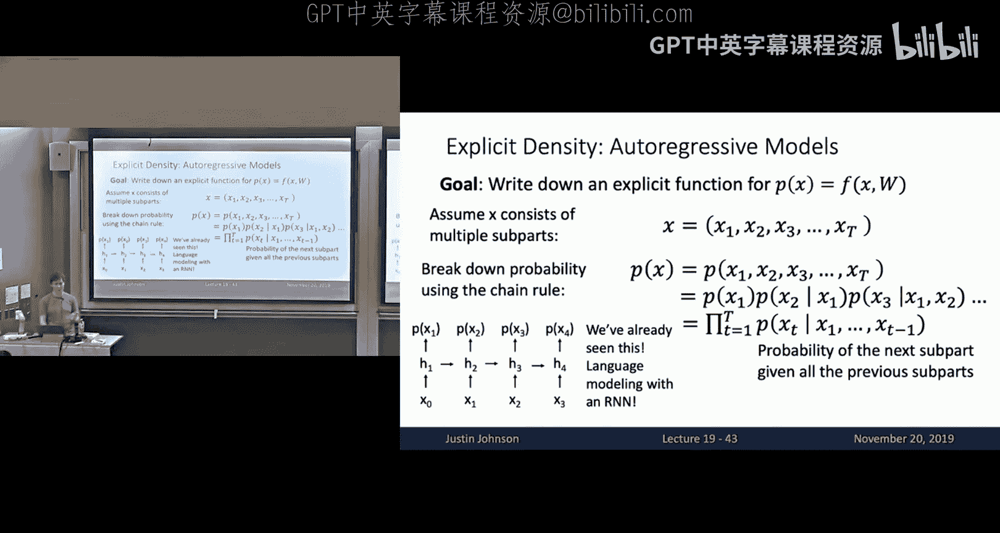

So then we can train a pixel RnN， which is going to be a generative model with an explicit and tractable density function that we can train on input images。

 So here the idea is that we're going to generate image pixels one at a time starting from the upper left-hand corner and now we're going to compute sort of an RnN hidden state for every pixel in our grid of pixels and within each within each of those hidden states。

 it's going to be conditioned on the hidden state of the pixel directly above it。

 as well as the hidden state of the pixel directly to the left of it and then within each pixel。

 we're going to output the colors one at a time。 So first it's going to output the the value of the red channel of the pixel。

 then the value of the blue channel， the pixel， then the value of the green channel of the pixel and for each of these color channels。

 we're going to divide it up into this discrete space over values from 0 to 255 and within each pixel it's going to predict a softmax distribution over each of these discrete value 0 to 255 for each of the three color channels。

And now to kind of see how this generation proceeds。

 then we're going to start by kind of generating the pixel the colors of this very upper left-hand pixel。

 and then we're going to march sort of run one Rnn LSTM over each row of the image and one on another RnN over each going down over each column of the image。

 So then after we generated the value of the RGB value of the pixel in the upper lefthand corner。

 then we can condition the pixel immediately below and the pixel immediately to the right and compute their hidden states and predict their pixel values。

 Then once we've got all three of these computed， then we can kind of expand out in going diagonally across the image。

 So then for each pixel that we want to generate the color of。

 we're going to compute a new sort of RnN hidden state for the pixel that is conditioned on the hidden state of the pixel directly above and the hidden state of the pixel directly to the left。

 And then after we predict the hidden state for the pixel。

 then we're going to generate the colors of that pixel。

So this is going to sort of march from the upper left to the lower right。

 sort of down over the entire image。And now due to the structure of the RN。

 that means that the prediction that we make for each pixel is going to have an implicit dependency on all of the pixels above it and all of the pixels to the left of it。

 So it will have an explicit dependency on the hidden state immediately above and the hidden state immediately to the left。

 but because those in turn depend on other hidden states。

 then each pixel will have an implicit dependency over all of the previously generated pixels that occur up into the left。

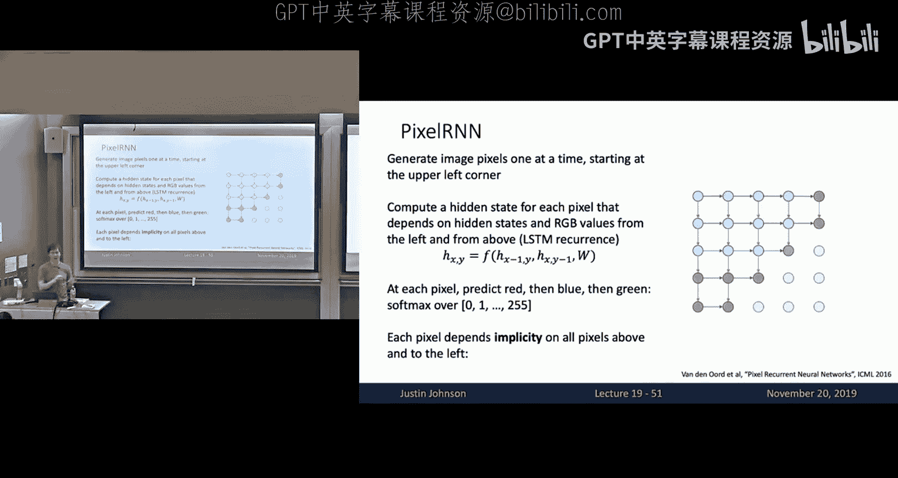

And then then this sort of occurs for all of the images， and then to train this thing。

 it's going to look exactly like training these RNNs that we've done for tasks like image captioning。

 except rather than generating words of a caption one at a time。

 instead we're going to be generating values pixels of an image one at a time。 and other than that。

 it's going to look very similar to what you've already seen in the context of captioning。

But now a big problem with these pixel RnNs is that they're very。

 very slow during both training and testing right because this is sort of a continual problem that we've seen with RNNs is that they have a sequential dependency because each hidden state depends on the value of the hidden state before it in time。

 So that means that during training， if we want to model an n by n image then we need to take like two n minus1 steps in order to sort of march all the way down and all the way on the bottom。

 So this is going to get expensive if we want to generate really high resolution images。

 So these pixel RN models are super slow for both training and evaluate and and evaluation at test time when we want to sample new images。

So then there's an alternative formulation called the pixelel CNN。

 which does a very similar mechanism and is still going to generate pixels one at a time。

 starting from the upper left hand corner， but rather than using a recurrent neural network to model this dependency instead we're going to use a sort of masked convolution to handle this dependency So then here then to generate the new hidden state and the pixel values of this highlighted pixel in red we're going to run sort of a convolution where the convolution only looks over the pixels to the left of it in the same row and the pixels above it within some finite receptive field。

 and then using this formalism， you can actually compute all these receptive fields kind of in parallel So it makes pixel Cs much much much faster to train although there's still quite slow at sampling time。

 So then at training the pixel CNN can kind of parallelize these receptive fields over all regions of the training image。

 but at test time we kind to generate pixels one at a time。 So it's still quite slow。

At test time。

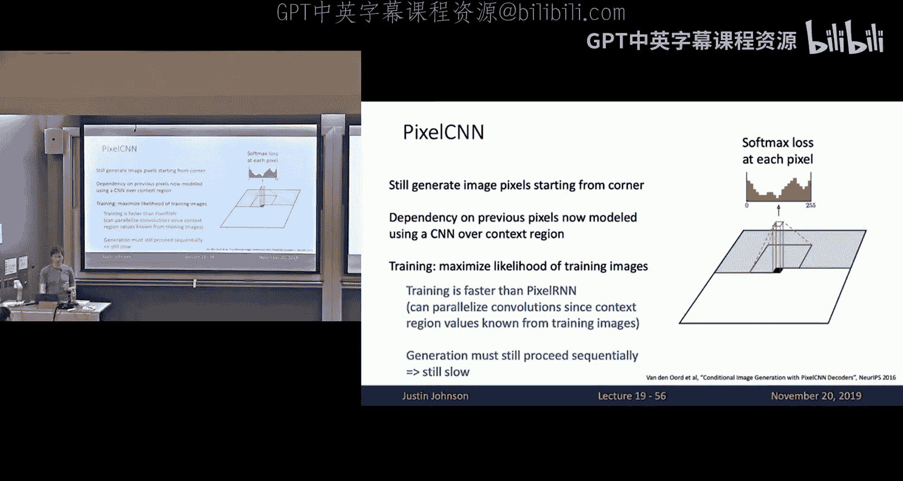

And now if we actually look at some generated samples from a Pix R&N model， then on the left。

 what we've done is we've trained well not me， but like the people who wrote the paper。

 then they trained a pixelix R&N model on the CFFR data that we've used on our homework so far and then here we see generated samples that are kind of like new CFFR images that the model has invented for itself。

And on the right， we， we do the exact same thing， except we train the model on downsled imagenet images。

And you can see that it's kind of hard to tell what's going on in these images。 So like clearly。

 there's some interesting structure， like they're modeling edges， They're modeling colors。

 like if you kind of step back， they look like images。 But if you kind of like zoom in。

 then you realize they're like full of garbage。 So it looks like they're kind of learning something some kind of reasonable high levell stuff about images。

 But they're kind of not really generating really， really high quality images at this point。

So this kind of gives us kind of our summary of maybe autoaggressive models。

 So one of the pros of autoaggressive models is that because they have this explicit density function。

 then we can actually then at test time， we can feed them in a new image and then actually compute out the value of the density function for every new image that want that we might pass it at test time and then actually these are among the easiest generative models to evaluate because of this property that we can directly evaluate the density function so then we can evaluate these autoregressive models like we said by just like training them on some data set and then evaluating the density function on unseen test images and then it should do and then it should assign high high probability mass to unseen test images and that's actually a fairly reasonable evaluation metric for these autoaggressive models。

And actually， the samples are fairly reasonable。 I mean， I made fun of them a little bit。

 but these are actually like pretty reasonable samples， I think。

 from a generative model because they actually do kind of model they have a lot of diversity。

 they they model edges， they kind of model both like local structure as well as global structure。

 So it seems like even though they're not generating like photorealistic images at this point。

 they are doing some some really non-trivial modeling of the underlying images themselves。Yeah。

 question。'。Yes， that's a great question。 The question was for these kind of methods where we're kind of generating pixels one at a time。

 you have to generate the first pixel and that's actually the same problem that we already had in something like generating language。

 So there it's common to maybe add a special kind of start pixel token that you feed to the RN that kind of you pad the outside boundaries with some special start pixel value and sort of feed that at the very first time step。

Yeah。Although we cannot decide。That's true。 So this is an unconditional gene this is an unconditional generative model。

 So we have no control at test time over what is being generated。

 although there there are conditional variants of a pixel RN and a pixelix CNN。 So， for example。

 there's ways that you can sort of thread in label information or other type of conditioning information into these generative models that we haven't talked about here。

 So you can you can train conditional generative model versions of these autogressa models。

 And then you do get some control over what what you generate a test time。

Okay so then there's also a lot of things that you can do to improve these autoaggressive models。

 so these samples that I showed you were from a very first pixel R&N paper and there's been a lot of improvements since then。

 so there's sort of different architectures you can use multiscale resolution multiscale generation to make things more efficient and there's a lot of training tricks that you can use to improve the quality of these things so you can check out some of these references if you're interested in those although one thing that is a big negative about these auto aggressivegressive models is that they tend to be very slow at test time because we need to sample the pixels one by one then it's actually very slow for us to generate these images at test time。

吹的毛的。这事。Thanks the。驳为鉴持人的。你没有没异。Yeah， that's a good question。

 The question is can these models generalize to different image resolutions than the resolutions on which they were trained。

 Is that basically it， So this for this very vanilla， pixel R and N model。

 I think it probably cannot generalize to new resolutions。

 because the R N kind of expects the rows to be certain lengths。

 But I think there are other variants， especially these multiscale pixel these multiscale autogressive models that actually can do better generalization at test time。

So I think the vanilla version that we presented here cannot， but multi resolution versions， I think。

 could。

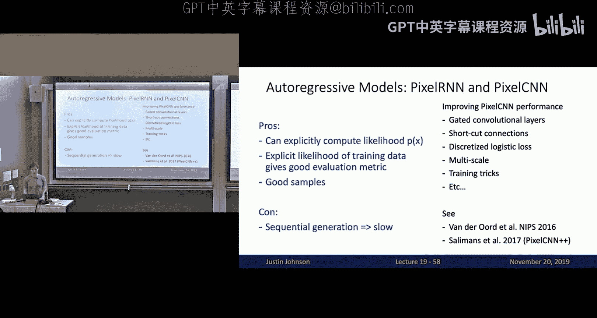

Okay， so then then let's move on to our second generative model of variation auto encoders。

So I think there's a chance we may not actually get through all this material in which case some of it will get booted into next lecture。

 which is fine because we have two lectures for geneative models anyway。

So with pixel RN and pixel CNNN， what we did is that what we saw is that we wrote down some parametric model that was able to compute the value of the density function on arbitrary input images。

 and then what we wanted to do with these explicit density models is then just train the model to maximize the density value at all of the training samples。

 and that actually worked pretty well for this case of pixel RNN and pixel CNs。

So now with variational autoencoderrs， it's going to do something a little bit different with a variational autoencoder。

 we actually will not be able to access or compute the true value of the density function in any reasonable or computationally efficient way but with a variational autoencoder。

 it turns out that even though we cannot compute the exact value of the density function。

 we can compute some lower bound on the density function so then what we're going to do is rather than maximizeimizing the true density instead what we're going to do is maximize this lower bound to the density and then kind of hope that like if the true density is here and the lower bound is here that you know if we maximize the lower bound then it should sort of push up the true density as well so that's kind of the vague intuition with these variational autoencoderrs。

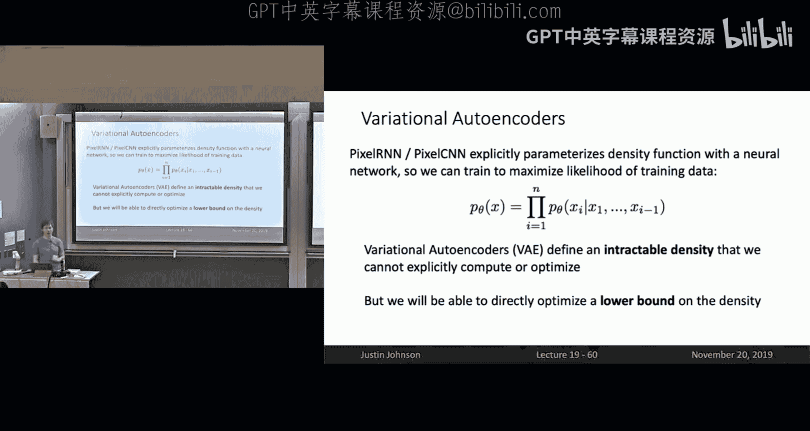

Now， to understand these variation autoenderrs， there's sort of two loaded words in this term。

 One is term this word variational and the other is this word autoencoder。

 So I think we need to talk about these two different words sort of one at a time to understand this model。

 So first， let's talk about non-varial autoencors， sort of normal autoencoderrs as to kind of set us up for the variational flavor。

So then with with a regular non-varial autoencoder， this is not a probabilistic model。 Instead。

 a regular autoencoder is an unsupervised learning method that aims to learn feature representations for images in an unsupervised way。

 so we want to learn useful， latent representations for images。

 even if we don't have access to any any labeled labels Y。

So here kind of what we want to do is build a model that's build some neural network that's going to input the raw images X and then output some useful features Z that tell us something interesting about that image and kind of the hope is that these features that we can learn from this unsupervised learning method might be useful for some downstream supervised learning task so kind of the idea with autoencoderrs is that we want to train up this model using a lot of unlabeled data and then learn this good feature representation and then use that good feature representation for kind of transfer learning approaches to other downstream tasks so that maybe rather than pre-training on INe as a supervised training task instead we want to do our pre-training on a large collection of unlabeled images。

So now the problem is that we want to learn this feature transform from raw data and of course we can never observe these feature vectors Z because if we got the feature vector Z in the training data。

 then our problem would have been solved for us already so somehow we need to learn a neural network is going to output this feature vector Z sort of without any without any help from labels so how are we going to do that。

And sort of architecturally wise， this neural network that goes from x to Z is sort of like any sort of convolutional。

 any kind of neural network architecture that you want。

 So it might have been sort of a fully connected network with sigmoid nonlinearities sort of a long time ago。

 but more recent instantis would have some kind of like deep residual network with Relu and batch norm and all that other good stuff。

 So the architecture here is sort of CNN architectures that we've seen many times already。

But so now the idea with an autoencoder is that what we're going to try to do is force the model to learn to reconstruct the original training data。

 So what it's going to do is have one portion of the model called the encodeder and the encodeder is going to input input the raw data and then output the feature vector。

 and now we're going to also train a second component of the model called the decoder and the decoder is going to input this feature vector and then try to spit out try to reconstruct the raw data that we fed to the encodeder。

And the decoder is sort of again， a neural network that architecturally we've seen many times before。

 and if it's convolutional， maybe the encoder would kind of have downsling layers and the decoder would kind of have transpo convolution layers to ups sampleble。

And now we would train this thing using where our loss function would now be that the output from the decoder should match the input to the encodeder。

 and just it should sort of learn to it should sort of learn the identity function that it should learn to just reconstruct whatever we put into the model。

So then maybe if we look an example of an autoencoder on the right trained on Cf 10。

 then at the bottom， it's going to input some raw images from the Cf 10 data。

 It's going to go through an encoder that maybe has four convolutional layers。

 and then a decoder that goes maybe four transpo convolution layers。

 and then it's going to try to reconstruct the input data。

Now， this seems like kind of a stupid function to learn， right。

 Like we actually don't need to learn the identity function。

 We know how to compute the identity function。 We just like return the thing that we that we output。

 that we we just return as output。 the thing that we presented as input。

So the point with these autoencoderrs is not that learning the identity function is a useful thing。

 Instead， what we want to do is force this feature vector Z to be very low dimensionional compared to the raw input data X。

 So what this autoencoderrs are really trying to do is somehow compress the input data。

 So then if we have maybe a very high resolution input image X。

 but we can compress it down to some very low dimensional latent code Z。

 then reconstruct the original input image with a very high fidelity from this low dimensional latent code。

 then in that case， we've probably learned something non-trivial about the data。 So in this case。

 it's very important when you train an autoencoder to have some kind of bottleneck in the middle between the encoder and the decoder。

 So often this bottleneck will be some kind of size constraint。 So just like the size of the layer。

 the number of activations should be much much smaller， then the number of raw pixels in the input。

But you can imagine sort of but in a variation autoencoder。

 we will add a different sort of constraint inside the middle of this in between the encodeder and the decoder。

 and with a variational autoencoder， we'll add a kind of probabilistic constraint in between the encodeder and the decoder。

But then the， the key is that this just needs to be very low dimensional or have some kind of bottleneck to force the network to learn how to compress the data in a useful way。

And then after we train， we are going to throw away the decoder because we don't care about predicting the identity function。

 and instead we're going to use the encoder to initialize part of some other model then maybe train it on some other data。

 so the whole point of autoencoderrs is to learn some useful representation that we can use for downstream transfer learning applications。

 but here， of course we can do this with a lot of unlabeled data。

 which is the really exciting part about learning autoencoderrs。

Yeah。The question is what's the structure of the encodeder compared with the structure of the decoder？

So that's a lot of hyperparameters。But typically， the decoder will be some kind of flipped version of an encodeder。

 So a very common architectural patterns you'll see for these things with convolutional models is this kind of like downsamp and ups type type of architecture that we saw。

 for example， in semantic segmentation。 So you recall that architectures for semantic segmentation would often take the input and then kind of downs samplele with convolution and then up sampleamp again。

 using transpose convolution。 So then the encodeder will often have sort of strideed convolution or pooling to do downsamp。

 And then the decoder will kind of have some kind of upsampling models like the second half of a semantic segmentation model。

So typically the encodeder and the decoder kind of mirror each other architecturally。

 although there's nothing in the formalism that forces that to be true。If you use this city。

Differenter。The result will。Sa that again。If you have only one。计分。Yeah， so then the question is。

 if you have one encoder， but different decoder， then。Yeah， so actually。

 that's another interesting idea。 There's actually sort of variance of auto encoders where you train like encoders for different types of data。

 but they all have to go through a shared decoder。 So you kind of learn a shared latent space。

 which can be understood or or represented or generated by lots of different encoders on different types of data。

 But then you kind of need to train them jointly in a way to encourage them to learn the same space。

😊。

DoesDoes that help a little bit？Yeah， so so basically encoder is linear year and not before。嗯。😊，Yeah。

 so the encodeder and decoder are both neural networks and the architectures are just going to be whatever kind of neural network architecture that you want。

 So if for're modeling images， these will typically be convolutional networks that are pretty deep in many cases。

But a critical component with these things is that there's some bottleneck between the encodeder and the decoder。

Okay， so then a big， so then these autoenrs are kind of a nice formalism that lets us sort of have the capacity to learn representations with a lot of data and then transfer them to downstream tasks。

Although I should point out that even though they have this nice they seem like an awesome mechanism to learn from unlabeled data。

 In fact， in practice， I think they haven't worked out as much as people would have liked because I can't really there's really no state of the art systems that rely on training autoencors on large unsupervised data。

 So it's a really beautiful idea， but I think that the current formulations of it that we have now just sort of don't seem to actually live up to the dream of unsupervised learning so I think there are a really useful thing to know about。

 but I think they're actually not right now a very practical approach to unsupervised feature learning。

 So that's a big caveat that I want to point out about autoencors。

But now a big downside of autoencoderrs is that they are not probabilistic right so they are an unsupervised learning model in that they train they can learn this feature representation without any labeled samples without any labels for our data。

 but there's no way that we can sort of sample new images from a trained autoencoder。

 The only thing they can do is is predict features for new images at test time。

 There's no way that we can use them to generate new images。So then that moves。

 that then that moves us on to this idea of a variational auto encoder。

So a variational autoencoder is going to be aba sort of a probabilistic upgrade to these nonvarial autoencoderrs。

 So with variational autoencoderrs， we want to do two different we want to be able to do two different types of things。

 One is to learn latent features Z from raw data just as we did in the nonvarial flavor so we want to retain that capacity。

 but the second thing we want to be able to do is to be able to sample from the trained model after training to be able to generate new data。

So now what we're going to do is assume that we have maybe some training data set with a bunch of unlabeled samples and we're going to assume that each of those samples in the training data was generated from some latent vector Z that we cannot observe so this is kind of similar to what we saw in the non-varial autoencoder so then kind of what we want to do at test time after training our variational autoencoder is maybe something like this so that we want to write down some prior distribution over the latent variable Z and then at test time we want to sample a new latent variable from the prior distribution and then feed that latent variable to some decoder model which will take the latent variable Z and then predict the image X so that looks kind of like the second the decoder that we saw from the nonvarial autoencoder the difference is that now it's probabilistic and we both have a pro distribution over the latent variable Z a prior distribution over Z and the output from the decoder。

Is actually not a single image。 Instead， the output from the model is itself a distribution over images。

So then to handle this， then the， to handle the prior willll often assume some sort of very simple prior on the latent variables。

 So it's very common to assume that So the latent variables might be a vector of dimension D。

 Then you assume that it's very common to assume that the prior distribution over Z is just like a standard unit diagonal Gaussian over in n dimensional space。

 So we typically assume very simple prior over the latent variables。 Z。

 something we can compute with very easily。

And now what we want to do is we want to the second half， who wants to input this decoder。

 wants to input a latent variable and then output a probability distribution over images。

 and this thing will model with a neural network。But now。

 how the heck are we going to output a probabilityities distribution from a neural network。

 And that's sort of a tricky thing that we've never really seen before。 So then here。

 the trick is that we're going to sort of。

Assume a parametric form for the probability distributions over images。

 so in particular we're going to assume that like for the probability distribution over an image。

 we're going to have it's going to be a Gaussian distribution with a number of units with a number of dimensions in the Gaussian equal to the number of pixels in the image and now we can parameterize that Gaussian distribution using a mean value for each pixel as well as a standard deviation value for each pixel so then what this neural network is going to do is output a high- dimensional Gaussian distribution where it's going to output a mean value for each pixel and a standard deviation or covariance value for each pixel and then we can combine the predicted mean。

 the predicted per pixel means with the predicted per pixel standard deviations to give us this high- dimensional Gaussian distribution which is going to be a distribution over images that is conditioned on a latent variable Z。

Is this construction clear， so it yeah？だけす。高层。我们还会。Yeah， yeah。

 so for a kind of a general Gausian distribution， it would be a full covariance matrix all overall all the dimensions。

 but if you want to model like 512 squared pixels， that means our covariance matrix would be like 512 squared times512 squared and now that's a thing that we need to output from a neural network so then the weight matrix that predicts that thing is going to be like size of the hidden of the previous hidden layer times512 times 512 squared。

 so then that weight matrix is going to be absolutely astronomically large。

 so as a simplifying assumption， we're going to not use a general Gaussian distribution。

 we're going to assume it's a diagonal Gaussian distribution so that assumes that that there's no covariance between the pixels that means that there's an underlying probability there's an underlying independent assumption here。

 which is that conditioned on the latent variable Z。

 the pixels of the generated image are conditionally independent and of that's the independent assumption that we're making when we back the distribution in this form。

Yeah。Isn't this kind of a strong assumption we are making it。

Chrisine neighboring pixels and that related images。

I understand we're making this assumption so that the matrix is not large enough。啊，说明你感。

We would like some kind of stuff I show you。Yeah， the question is is that this seems like a pretty restrictive assumption to put on our images that the pixels are conditionally independent given the latent variable。

 and I think you'll find that the generated images we tend to generate from variation auto encoders tend to be kind of blurry and I think that's exactly why is that because that's a very strong assumption that we're putting on the model so I think that the kind of caricature of various gellato encodecors is that the math is very beautiful and they're very nice。

 they're a very beautiful way to learn latent representations but they tend not to generate the most beautiful images。

 although we'll see that we can actually combine variation auto encoders with other approaches to actually get high quality images as well。

Okay， so then now the question is， how do we actually train this variation autoencoder model？ Well。

 our basic idea is that we want to maximize the likelihood of the training data set。

 So then what we want to do is to try to if we could observe like if， for example。

 we were able to observe the Z for each X during training。

 then we could train this thing as a conditional generative model。

 and then then the training would be fairly straightforward。

 we could just sort of directly maximize the probability of each of each X conditioned on its observed Z。

And that would actually work quite well。 But the problem is that we cannot observe Z right If we could observe Z。

 then the problem would kind of be already solved。 What we want to do is train the model to discover for itself this latent space Z and latent latent vector is Z。

 So what we need to do is write。 So then our approach is we're going to try to write down a function。

 write down the probability density function of X。

So what we can do is sort of one thing we can try to do is like marginalize out the unobserved Z。

 So then you could sort of write down a joint distribution over x and Z and then the distribution over just x。

 We to get to get the density over just x。 We could integrate out that latetnt Z。

But and then you could factor that that joint distribution inside the integral into using the chain rule into this this conditional probability of x given z times the prior distribution over Z。

AndNow the the terms inside the integral are friendly because this probability of x given Z is exactly what we can compute with our decoder and this prior is something that we've assumed has a nice functional form like a Gausian。

 but this integral is the part that kills us because Z is some like high- dimensional vector space。

 and there's no tractable way that we can actually compute this integral in any kind of finite amount of time。

 So we'll need to comp with some other approach。

So another thing we can try to do is go back to Bayes rule。

 And then Bes rule is a way that Bay rule gives us another form to kind of write down the density over x。

So then the density over x， we can write as write out as in bayes rule using this form。

 And then we can look at these terms again。 So then again， we see if we use Bayes rule。

 we again get the same term pop up probability of x given Z。

 And this is a friendly term because this term is exactly what our decoder network is predicting。

 So this is a term that we like to see。 And again， we have another friendly term。

 which is the prior distribution over Z， which again。

 we can easily compute because we assumed that it was had a nice functional form。😊。

But now this term on the bottom is like the one that really kills us because this term on the bottom。

 we want to compute the distribution the probability of Z conditioned on x。

 So that's the probability of the latent variable conditioned on the image。

 So that's kind of like the opposite of what our neural network is predicting。

 And there's like again， if we wanted to compute that thing。

 we'd have to do it some kind of infinite integral over all of x or all of Z。

 and there's just like no no tractable way that we can actually compute that bottom term in Bays rule。

So then what we're going to do is cheat a little bit and we're going to train another neural network that is going to try to predict that bottom term for us。

 So then we're going to have another neural network Q that is parameterized by a different set of parameters p。

 and now this Q of p this is going to be a neural network that is going to input the image X and then output a distribution over the latent variables Z and this is going to be a completely separate neural network with its own weights。

 but we want to train it in such a way that will cause its output to be approximately equal to to this marginal distribution over the decoder which we cannot trackly compute。

 So this is the way that we cheat inside a variation autoencoder is that there's this term in the in rule that we just can't compute。

 So instead we're going to just introduce another neural network that is going to try and compute this incomputable term for us。

And then once we have this other term， then we can compute this approximate density over x。

 where we replace this intractable term in the denominator of Bays rule with this approximation that is coming through our auxiliary neural network。

And this auxiliary neural network， by the way， what it's doing is it's inputting the latent variable Z。

 sorry， it's inputting the image X， and it's outputting a distribution over latent variable Z。

 So that is an encoder because it's inputting the image and it's outputting the latent variables。

 So that has a structure very similar to what we saw in already。

 So then this is going this is going to have the same sort of structure It's going to be a neural network that inputs inputs the image X。

 and then uses the same sort of diagonal covariance trick to output a distribution over Z that is conditioned on the input image X。

Okay， so then what we're going to do is that if somehow we want to jointly train this encodeder network and this decoder network in such a way that this that sorry。

 the encodeder network will approximately equal this posterior term of the decoder that we cannot tractably compute。

So then what we're gonna to do is kind of jointly train both the encoder and the decoder to make all of these things happen。

So then more concretely， we need to do a little bit of math on this slide。

 So then here we have Bayes rule。 So this is the log probability of our data。

 and then using breaking it up， using Bayes rule。

And then here， what we want to do is just multiply the top and bottom by this new term that we introduced。

 So here we're just multiplying the top and bottom by Q phi of Z given x。

 where Q5 of Z given Z given x is the thing that we can compute with with this new network we that we've introduced。

 And now this is in equality because we're multiplying the top and bottom by the same thing。

And now we use the magic logarithms to break this term up。

 to break this equation up into three terms。 So if you kind of do the math over on your own。

 you can see that we kind of match up these different terms from this from this top and break it up into this sum of three different terms。

😊，Okay， so that's kind of step one。

Then we kind of realize another probabilistic fact。

 which is that the log probability the density of x actually does not depend on z。

 So whenever you have a random variable that does not depend on another random variable。

 then you can kind of wrap that whole thing in expectation right that means we're taking an expectation of a thing。

 which does not depend on the variable of the expectation。

 So like that's kind of dumb but it's a thing it's mathematically true。 So in particular。

 what we're going to do is is look at the expectation of the log probability of x where the variable over which we're taking the expectation is the distribution is expectation over Z using the distribution。

 which is output from the new network。So this seems like kind of a strange thing to do。

 but it's mathematically true because the thing inside the expectation does not depend on the variable outside。

But now we know that this log probability is actually equal mathematically equal to this through these three terms。

 So then we can actually apply this expectation over Z directly to these three terms。

 And then we've just then that's what we've done exactly here。

 We've just applied this expectation over Z to these three logarithmic terms。

And now we can actually simplify， we can actually put some interpretation on these three terms。

 So this first term actually is a type of data reconstruction term that you'll have to maybe take my word for at this time。

 and the second term is actually a kl divergence between distribution which is output from the encodeder network and the prior distribution over the latent variable Z。

 So this is also something that we can compute。 So actually this first term is something that we can compute。

 this is kind of like a data reconstruction term so we can compute this first term。

 this second term we can compute because this is a sort of a distance between the distance that is the distribution that is output from the encoder network and the prior distribution。

 So this one we can compute and now this last term is something that we can cannot compute because this last term involves this really awful P theta Z given x。

 So that was that posterior of the decoder that we just cannot compute。

Last term is something that we cannot compute。 But the first two terms are something that we can compute。

And we also know， because this last term is a kl divergence of two probability distributions。

 Then we know that， in fact， this last term has to be greater than equal to 0。

 because one of the properties of the K divergence between two distributions is that it's always greater than or equal to 0。

So now when we combine all these facts together， we get this final equation here at the bottom。

 so this is the lower bound on our density that we can now actually compute。

 so now on the left we have the actual true density of the data under the probabilistic model that we've set up and on the right is a lower bound to that density that involves a reconstruction term and a kL divergence term and both of these two terms on the right are things that we can actually compute using our encodecoder network and our decoder network。

So now the hope is that what we want to do is train our variational autoencoder。

 We're going to jointly train both the encodeder network and the decoder network in a way that tries to maximize this lower bound。

So this lower bound is a very standard probabilistic trick。

 So this is called a variational lower bound。 And this trick of kind of introducing an auxiliary network or an auxiliary function to compute this intractable posterior distribution is called a variational inference。

 So that's kind of a very standard probabilistic trick that people used a lot in the days of probabilistic graphical models which was a really prevailing machine learning paradigm that occurred that people used a lot before deep learning became popular。

 So one kind of beautiful thing about these variation model encoders is that they're kind of using like this trick of variational inference that was very popular for graphical models but now actually incorporating that cool mathematical trick into neural networks。

😊，So now the idea is that we have these two neural networks， one is the encodeder。

 one is the decoder， and we can compute and together they can compute this lower bound on the probability。

 so then we can't actually compute the true probability of the data but we can compute this lower bound and as we modify the what we're going to do is maximize the lower bound and learn the parameters of these two networks that will maximize the lower bound and then hopefully in maximizing the lower bound that will also push up the true density of the data that we observe。

So I think I think we are about at time， So then let's leave variational autoenrs here for today and then we'll pick up with exactly this mechanism exactly how to train them in the next lecture。

 So then come back next time for generative models part  two。

 When we'll talk about some more we'll sort of go over the rest of variational autoencors and then we'll also talk about generative adversarial networks。

 Okay， thank you。

