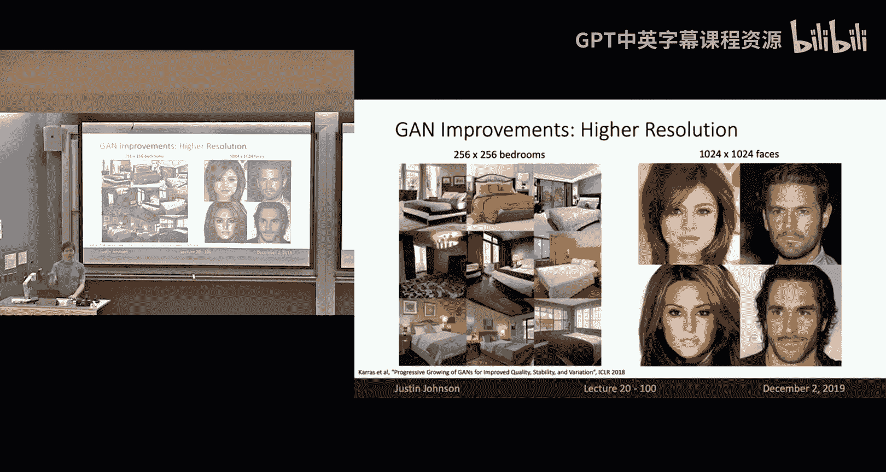
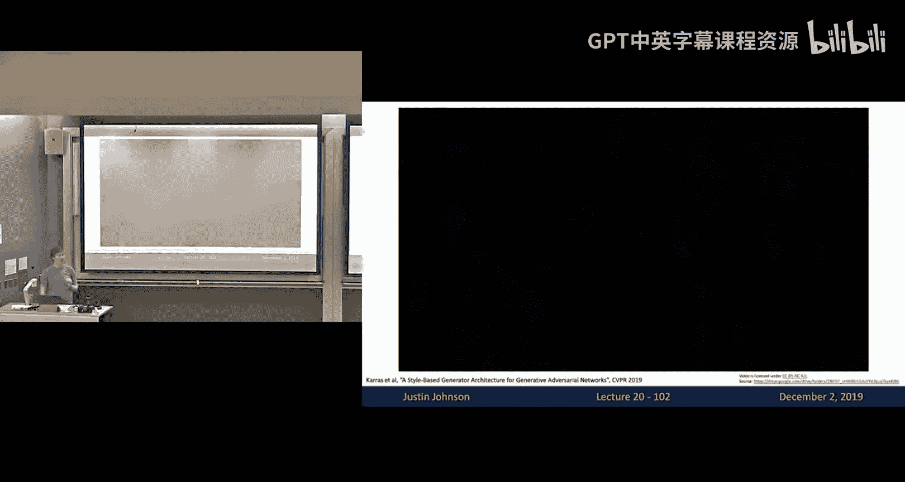
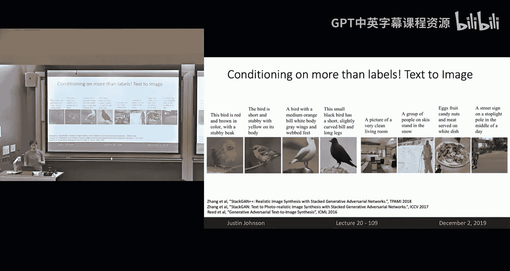
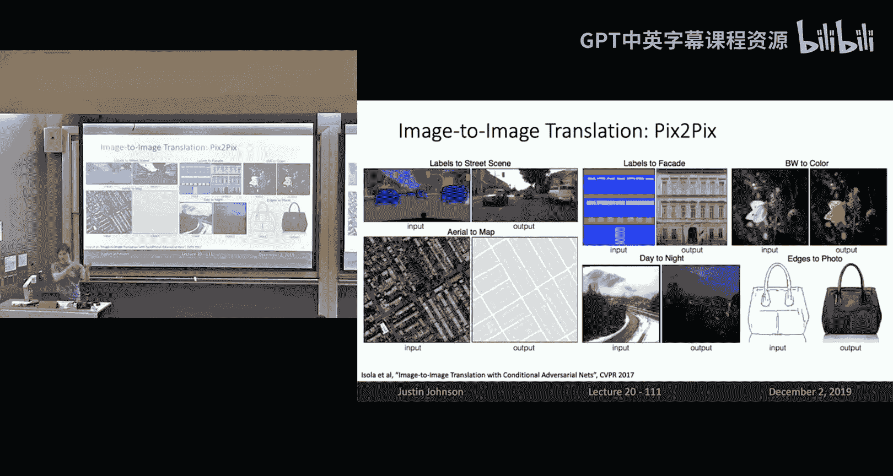
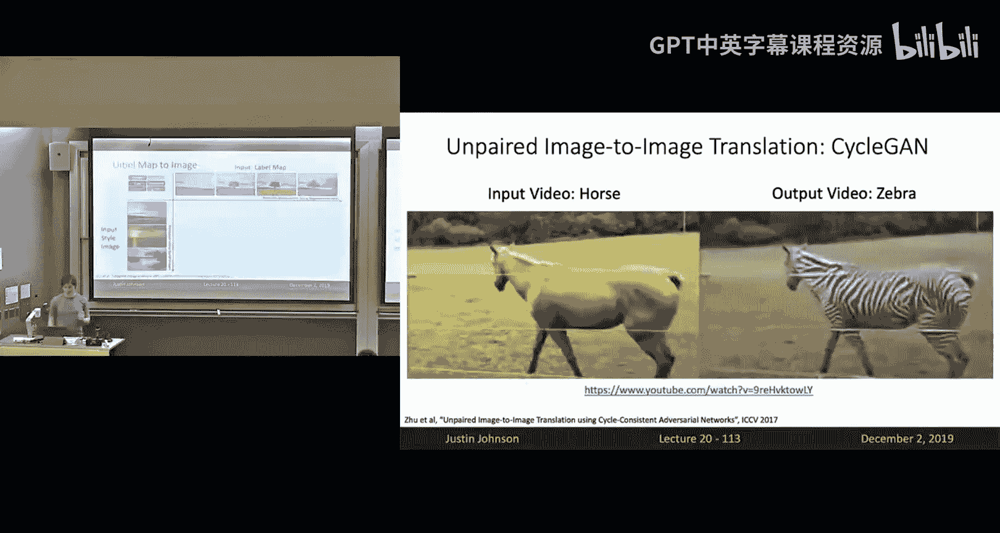
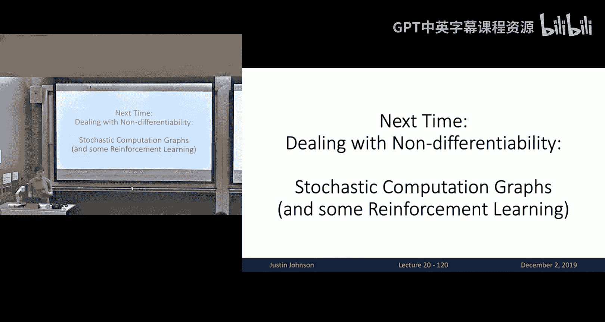

# 密歇根大学《深度学习用于计算机视觉｜Deep Learning for Computer Vision UMich EECS 498-007 2019》中英字幕 p21 -21-20_GenerativeModelsPart2.zh_en -BV1jA4m1P7GN_p21-

Okay， it's a couple minutes after 430， so let's get started and this appears to the microphone is gone from the room today。

 so I'll just have to shout and hopefully everyone can hear me and that'll work okay。

But everyone in the back， we can hear you okay？Yeah okay， good。

 so today we're up to lecture 20 and we're going to continue our discussion of generative models。

 so this will be generative models part two。Of course we have administrative notess。

 so assignment five， you know would have was released last week after a bit of unfortunate delay。

 but on this assignment， hopefully you guys have gotten a chance to start working on it。

 you'll get to build your own object detection systems including a single stage detector and a two stageage object detector and that'll be due a week from today on December 9th。

Any questions on assignment five before we move on？Great。😊，So then I promised you six assignments。

 so we have to have an assignment six， so assignment six will be about Gene models。

 which will be week the last lecture of today's lecture and it will definitely include Gene six。

And it will maybe include variational autoenrs depending on how long that takes put together but regardless we'll plan to have it released today or tomorrow so we'll see how much we can create by end of tomorrow and then it'll be due two weeks after the release so we know that this one sort of overlaps the assignment5 due date a little bit and it also pushes into finals week a little bit but since we have no final for this class and no project for this class I thought it seemed fair to have a relatively small assignment getting a finals week so hopefully that will be okay and we do promise that I know assignment5 is quite long and pretty involved we write a lot of code I think assignment6 should be quite a bit shorter than assignment5 to compensate for the fact that they overlap and it is due during final week。

So any questions about assignments， we'll move on to take content。Okay。

 so then I hope everyone had a great relaxing Thanksgiving。

 but that means it's been more than a week since maybe you thought about deep learning。

 so we need to do a little bit of recap about what we talked about in the last lecture。

So remember the last time we started our discussion of generative models by recapping a couple big distinctions in machine learning that we need to be aware of。

 so one of these was this distinction between supervised learning and unsupervised learning。

So Daniel recall that in supervised learning， we have both data， the raw data X。

 which is like our image as well as the label Y， which is the thing we want to predict and in supervised learning。

 what we wanted to do was learn some function that predicts the label from the image and this has been very successful this works this we've seen throughout the semester this concept of supervised learning let's us solve a lot of different types of computer vision tasks but supervised learning。

 of course requires us to build a big data set of images that have been labeled by people with some kind of label y so we'd like to figure out so kind of one of these holy grail problems in computer vision or even machine learning more broadly is figuring out ways we take that we can learn useful representations of data without those labels Y which brings us to unsupervised learning where we have no labels just data and somehow our goal is to learn some underlying structure of the raw data even without any humanproed labels and if we could do this this would be awesome right because you can know you can go out on the internet and just download tons and tons and tons of data。

And hopefully if we could do unsupervised learning in the right way。

 then we could just download more and more data， we don't have to label it so it comes for free and then our models can just get better and better and better so this is kind of one of the holy grail challenges in machine learning and I think we're not there yet。

 but that's kind of one direction that we're pushing with generative models。

So remember last time we also talked about this station between distributor models and geneative models。

And is more of this was about the probabilistic formalism that we use when it was building our concrete machine learning model。

So remember that a discriminative model is trying to model the probability distribution of the output or the label Y conditioned on the input image X。

 and that because of the way probability distributions work。

 we know that probability distributions have to be normalized。

 they have to integrate to one so then this constraint on probability distributions that they need to integrate to one。

 induces a sort of competition among the support among the elements of the probability distribution so then recall that when we're building a discriminative model。

 this means we have a competition among the different labels that the model might choose to assign the input image。

So for this input image of a cat， then the labels dog and cat are kind of competing with each other for probability math。

And then remember that for discriminative models， this fact that the labels are competing with each other was a bit of a downside because it meant that discriminated models had no way to like reject unreasonable data。

 so if we gave this like an image of a monkey then even though monkey is not a valid label。

 the model has no choice but to force the labels to integrate to one。

 and it still forced the model to like output a full valid probability distribution over the label set。

 even though the image itself was unreasonable。So then of course with a generative model what we were going to do is learn a probability distribution or a density function over the images themselves and now again。

 because of this constraint that density functions need to integrate to one now but now the things that are competing with each other are the images themselves so then with a generative model we need to assign a likelihood to each possible image that could possibly appear in the universe and all all those densities for all of those images need to integrate out to one so that means that the model needs to decide without any labels which combinations of pixels are more likely to be valid images and this requires a very deep understanding of the types of visual data so that's our generative model that we're trying to learn of course we also saw this third option of a conditional generative model which is trying to model the images conditioned on the label and of course we saw that we can use base rule to write out a conditional generative model in terms of these other components like。

a discriminative model and in terms of an unconditional generative model。

 and later in this lecture we'll see actually some more concrete examples of conditional generative models that are built out of neural networks。

So then after this kind of introduction， we saw this big taxonomy of generative models。

 that this idea of building probability distributions over our raw data is quite a large and rich area of research and a lot of smart people have spent a lot of effort trying to build different sorts of generative models with different sorts of properties。

So last time we talked about one type of generative model。

 which is the autoaggressive generative model。 So if you'll remember in an autoregressive generative model。

 it's explicitly writing down some parametric form of this density function so then if we're trying to model the likelihood of an image X。

 we break the image X down into a set of pixels X1 through XT and then we assign some kind of order to those pixels and we always say that that the likelihood of a pixel we write down a function that spits out the likelihood or the likelihood of a pixel conditioned on all of the previous pixels in the image and this was just like the types of models that we had built for modeling sequences with recurrent neural networks。

So remember that we saw this exact same type model when， for example。

 doing image captioning or language modeling with recurrent neural networks。

But then with these autoregressive models， then we wanted to kind of just model the pixels of the image one at a time and we could use that either with some kind ofren recurrent neural network which gave rise to this pixel RNN or this pixel CNNN where we model this kind of dependence using a convolutional neural network over a finite window rather than using a recurrent neural network。

 but either way either these types of autoregressive models。

 what we're doing is we're writing down this parametric function with a neural network that is just directly parameterizing the likelihood of an。

And then we train the model by just doing a very straightforward maximum likelihood estimation。

 so we just want to maximize the likelihood that the model assigns to all of the training data。

 and in doing that， it'll allow us to then sample or generate new data at test time after the model is trained。

So these autoregressive models we saw are kind of simple and straightforward。

 they're just kind of directly learning identity function over images and maximizing it on the training data。

😡，So then after we saw these autoregressive models。

 we moved on to this more interesting category ofgenative models called variational autoenr。

So then in variational autoenderrs， remember， we kind of lost something compared to autore models。

 but we also gained some。So what we gain with respect to autore models is that in addition to modeling the likelihood of the data。

 we've also introduced this latent variable Z， which is supposed to be some latent representation that assigns sort of characteristics that contains characteristics or attributes of the data that are hopefully on a higher semantic level compared to the raw pixel values。

And now with a variational augment encoder， what we wanted to do was learn a generative model that could produce images conditioned on this latent variable C。

But we found that in trying to manipulate the math。

 we saw that it was completely intractable to both to just directly maximize the likelihood of the data once we introduced this notion of this latent variable Z。

😡，Then last time we saw that we kind of went through this long extended proof that you could look back at the slides。

 but at the end of the day， we derive this lower bound on the data likelihood。

 so then remember that we have this data likelihood term on the left which is or the log likelihood of the data on the left and on the right we have a lower bound on this data likelihood that consists of these two terms and in order to derive this lower bound。

 we had to introduce an auxiliary network called the decoder network。

And is so then now our encoder network on the left here is trying to predict the likelihood of the latent variable C condition on the image X。

 and now the decoder network on the right here is trying to model the likelihood of the data X。

 condition on the latent variable C。And where we kind of left off with last time is that we had introduced these two networks and we used these two networks to drive this lower bound on the likelihood。

 and then remember what we're going to try to do with a variation autoencoder is then trade these two networks。

 the encodeder and the decoder， we want to learn the banners of these networks jointly to maximize this lower bound on the data likelihood。

Because we can't actually access the we can't compute the true likelihood of the data。

 but we can compute this lower bound， so then if maybe the true likelihood of the data is here and this data likelihood is some lower bound。

 now we're going to train the two networks to maximize the lower bound so then hopefully when we train these networks to maximize the lower bound and the likelihood that will hopefully also in some indirect way。

 also hopefully maximize the likelihood of the data。😡。

So then this lower bound on the slide here gives us our training objective for a variational autoencoder。

😡，So now when we we're talking about variation autoencoderrs。

 we need both of these both the encodeder network and the decoder network。

 they need to input a piece of like for the encoder for the example。

 it needs to output a probability distribution which is a different sort of thing than we've seen with most of our neural networks right so with the encoder network we wanted to input a concrete sample of data X and we wanted to output a full probability distribution over the potential late variables Z and now this now outputting a probability distribution from a neural network is kind of a funny thing that we haven't really seen in other contexts so far so then we need we needed to do an additional trick in order to allow neural networks to have probability distributions as their outputs。

So then the trick that we used is that we just decided that all of these probability distributions would be Gaussian and in particular would be diagonal Gaussian。

 and now we would train the encoder network to output both the mean and the diagonal covariance matrix of this Gaussian distribution and to maybe look at and then the decoder is going to be similar that it wants to input a concrete sample of the late variable C and then output a distribution over the images X and the way that we do that is again just decide that this distribution is going to be a diagonal Gaussian and we have the neural network output the mean and thevari and the diagonal covariance matrix of that Gaussian。

So then to be a little bit more concrete than if we could imagine sort of writing down a fully connected variational autoencor architecture to train it up on the MminNist data set for example。

 so then if we were training on this MNist data set。

 then all of our images are grayscale images of size 28 by 28 so we can flatten those to a single vector of size 784 and now we could decide that our dimension of our latent variable Z is going to be a 20-dimenal latent variable。

 and of late variable that size of latent variable Z is a hyperparmeter that we would need to set before we started training。

So then a concrete architecture for what this could look like is that the encoder network then inputs this vector x。

 it could pass through some linear layer to go from 784 down to 400 hidden units。

 and then from that hidden layer we have two other linear layers that are going from the 400 hidden units into 20 units where one of those hidden layers is going to output the mean of this distribution and the mean because z is a 20 dimensionmenal vector the mean of the diagonal covariance。

 the mean of the Gausian is just another 20 dimensional vector so then the network will just have a linear layer that directly outputs the mean of that distribution and then there's a parallel layer which is also going to output the diagonal covariance matrix of that Gaussian distribution and then again because z is a 20dial vector then the covariance matrix is the full covariance matrix would be a 20 by 20 matrix。

 but because we made this simplifying assumption of diagonal covariance。

 then all the off- diagonal entries。zero so the only non zeroro entries on that matrix is the diagonal。

 so there's 20 elements along the diagonal， so then we just need to have our neural network then output sort of 20 numbers for the mean and 20 numbers for those elements of theagonal along the diagonal of the covariance matrix。

So that would give us this concrete architecture of an encoder network for this fully connected variation autoencoder。

AndNow the decoder would look very something very similar， then it's going to input a vector Z。

 and then it's going to have a couple linear layers that will output the mean and the covariance of the pixels themselves。

 where we again use this simplifying assumption that the pixels are distributed according to a Gaussian distribution with some mean that as output by the network and some diagonal covariance。

 which is output by the network。And of course， I've sort of omitted the fact that I've written down linear layers on the slide here。

 but of course every linear layer should have some kind of nonlinearity between them。

 so that's kind of implied in this diagram。😡，Okay， so then once we've got this sort of concrete architecture for a variation autoencoder。

 then we need to think about how to train it。So recall that we're going to train， oh yeah。

 question what the awkward dimension of the。Oh， so the dimension of the output， the decoder is 768。

 because we assume that we're working with a  28 by 28 image and 28 by 28 is 768 on side of the macro。

Sorry。Yeah， yeah， so they should be fine。Maybe I did the math wrong， what is it 28 times 28，784。

 okay， yeah， I did， I messed up on。Okay， thank you。

It's more common to use 768 because 768 is like25 to 12 plus 256。

 so it's actually a pretty common number to use， so I think I just type that if actually won't apply。

But thanks for pointing that out。Okay， so then how do we actually train this thing now that we've got a concrete architecture So then remember that our training objective is that we want to maximize this variational lower bound and this variation lower bound looks kind of scary。

 it has an expectation， it has a kale divergence， and these are like things that we usually don't see in loss functions。

But it turns out it's actually not as bad as it looks。

 so that we can kind of walk through then what it actually looks like when we're training a variation autoencoder。

So when we train a variational autoencoder， first we take some mini batch of data X here。

 which is our input data， from our training data set。😡。

And then we pass that input data or that mini batchched input data through our encoder network。

 and that encoder network is then going to spit out a properly distribution over the latent variable C for that input element X。

😡，And now immediately we can use this predicted probability distribution to compute this second term in the variation of lower bound。

 so what is the second term in the variation lower bound saying it's saying that we want to compute the kl divergence between two distributions one distribution on the left here is this Q theta of z given x。

 so that is the predicted distribution of Z that is predicted by the encoder network when we feed it with the input data x。

 so that distribution is just this diagonal Gaussian that our encoder that our encoder has spit out for us。

And now the second distribution P of Z is the prior distribution over the latent variable Z。

 which we decided is going to be some simple distribution like a unit Gausian。

 and that has not learned that that prior distribution over Z is something that we fixed at the beginning of training。

So now all we need to do is compute the KL divergence between this distribution that was output by the network。

 which is a diagonal Gaussian and this prior distribution， which is a unit Gaussian。

 and now it's clear why we chose everything to be Gaussian because if we all choose all these distributions to be Gaussian。

 then we can actually compute this KL divergence in closed form so I don't want to walk through exactly the derivation here。

 but it turns out that if you sort of expand out the definition of the KL divergence then by the fact that these two distributions are both diagonal Gaussians。

 then we can just compute this KL divergence in closed form so then yeah question so the prior PZ we can set it as the unique Gaussian。

If we set it as other。Other distribution， are there any differences。Yeah。

 the question is can we choose sort of other prior distributions for P of Z so I think in a classical variational autoencoder。

 we tend to use a unit Gaussian because it allows us to compute this term in close form。

 but it's definitely an active area of research to choose other types of prior distributions for Z and the problem is that so sometimes you'll see people you try to use like a Bnoulli distribution and then you have categorical late variables or maybe like a Lapaian distribution and it implies some like different sparsity pattern of the late variables。

 so you definitely can choose different prior distributions for Z in a variation autoencoder。

 but being able to compute this k divergence term might become difficult depending on the particular prior distribution that you choose so we often use the Gaussian just for computational simplicity that it allows us to compute this term in close form。

Yeah。Re from the question。So I guess you need a different kind of prior or given dataex because if you assume the Q of to be the same for evidence。

保担有哪一面。Then。Yeah， so the question is should we assume sort of different priors for different data sets Well I think this is actually that's actually a very interesting question because this prior is over the latent variables right so what does it mean if we have a diagonal Gaus？

One is that this prior is over the latent variables and the latent variables are not observed in the data the model is sort of learning the latent variable representation jointly with everything else。

 so actually the choice of prior is sort of our way to tell the model what sorts of latent variables that we want it to learn so then if we choose this this unit this unit Gausian as a prior then that's telling the model that we wanted to learn a latent variables which are independent because because it's a diagonal Gaussian and that all have zero mean unit variance。

 so I think that because the latent variables are being discovered jointly by the model for the data。

 that's why I think it's okay maybe to use the same prior distribution even for different data sets。

But again， it's sort of active area of research to try out different sorts of prior distributions in variational models。

Yeah question since you're resuming a diagramagon logic。

 doesn't that mean that you're assumingsum that each dating variable is unfoldd to each other。

 so yes， wouldn't you simply just instead create and say Z different binary classifier。

 which would do the same？Question is could we train sort of z different binary dimension of Z different binary classifiers instead of a diagonal Gaussian。

 and I think that would be equivalent， but the difference is that we actually want we want to share the computation within the encoder network So right now the variation model encoder is kind of interesting because we've got sort of two levels of modeling inside the model。

 one is like the neural network which is computing many layers and the other is kind of the probabilistic formulation so it's true that even though we're telling the model we want it to learn a set of latent variables that are uncorrelated。

 the way that we're computing those means and standard deviations of those latent variables is through a neural network that is going to share a lot of parameters and a lot of weights through shared hidden layers。

So I think it's a computational reason that we choose to do it in this way。Okay。

 so that gives us our first term of our variation objective and really what this term is just saying is that we want the distributions which are predicted by the encodeder to sort of match the prior that we've chosen。

 and the k divergence is just penalizing the difference of disparity between the predicted distribution and the prior。

Okay， so then once we've got players， that allows us to compute this first term loss。

 so then once we've got now that we've got our distributions over those things over those latent variable Z。

 then we can sample from the predicted distribution to actually generate some concrete samples Z。

 which are now sampled from the distribution which was predicted by the encoder network。

And then we can take these samples Z and feed them to the decoder network。

 and now the decoder network is going to predict a distribution over the images X。😡。

And now this leads us to our second term in the objective so what does this second term in the objective say。

 well， we're taking an expectation and this expectation。

 the variable over which we're taking the expectation is z， the latent variable。

 and the distribution over which z is drawn should be Q theta of z given x so sorry Q phi of z given x。

 so Q phi of z given x is the predicted distribution over z that is predicted by the encode or Q when presented with the input with the input。

😡，X right so then we feed that's exactly what we've done is that we've fed the input X to the encoder。

 We've gotten this distribution Z given x。 and now we've taken some samples from that distribution in order to have some samplingbased approximation to this objective so then this term is an expectation and the thing over which we're taking the expectation our latent variables which have been sample according to the predicted distribution。

 Okay so that's kind of the first half of this objective。

 And now the second question is what is the thing inside the expectation。

 So now the thing inside that expectation is that we want to maximize the likelihood of the data X under the predicted distribution of the decoder when we feed it a sample Z So then we want to this is kind of an autoencoder objective basically this is a data reconstruction term and it's saying that what we want to do is we take the data X。

 we feed it to the encoder。 we sample some and then we get。Preicted distribution over Z。

 we sample some Z according to the predictive distribution。

 we feed those samples back to the decoder and now the predicted distribution of z of the decoder under that predicted distribution over x the original data X should have been likely So this is really a data reconstruction term it means that if we take our data and then use it to get a latent code and then use that same latent code。

 the original data should be likely again so this term is really why this is called an autoencoder because remember an autoencoder was a function that tried to predict its input by bottlenecking through some latent representation and that's exactly what this term is doing except now it's sort of a probabilistic formulation of an autoencoder but it looks exactly the same it's a data reconstruction term。

But now then we can easily compute this second term in the loss function because we've got some samples from our latent codes and then we can run those samples through the decoder to get our distribution and then we can just use a maximum likelihood estimate。

 like maximize the likelihood of the predicted data under the predicted distribution from the decoder so that then we can compute the second term in the objective once we've gotten these predicted distributions of x given and Z。

And that gives us our full training objective for the variation of autoencoder so then every forward pass in our variation autoencoder。

 we would have these two terms and the loss， and then we would use that to train the two networks jointly。

So then basically these two objectives are kind of fighting against each other because the blue term is this data reconstruction term。

 it's telling us that if we take the data， give it back to the latent code and then give the latent code。

 it should be easy to reconstruct the data， but now the green term is kind of saying that the predicted distribution over the latent variables should be simple and it should be Gaussian。

 so that' sort of putting some kind of constraint on the types of latent codes that the encoder is allowed to predict。

😡，So then the hail divergence is sort of like forcing the latent codes to be as simple as possible by forcing it to be close to this simple prior。

 and the data reconstruction term is encouraging the latent codes to contain enough information to reconstruct the input data。

 so somehow these two terms in the variation autoencoder are kind of fighting against each other。😡。

But then once this thing is trained， then of course。

 we could sample a reconstruction of our original data by sort of sampling from a new reconstructed data from this final predicted distribution of the data。

Okay， so then this is how you would train a variation autoencoder， but once it's trained。

 we can actually do some cool things。So one thing is that we can generate new data from the trained variation autoencoder。

 so we can ask the variational autoencoder to just invent new data for itself that is sort of sampling from the underlying distribution from which the training data was drawn。

So the way that we can do that is that we're going to use only the decoder。

 so here we're going to first sample a random latent variable from the prior distribution over Z。

 and then we'll take that random latent variable and then feed it to the decoder network to get a distribution over new data X。

😡，And then we can sample from that predicted distribution over new data X to give some invented sample from the data。

So this means that after we've trained a variational autoencoder。

 we can use it to just like synthesize new images that are hopefully similar to the images that were seen in the training set。

😡，So now we actually get to see some example results of exactly this process。

SoNow these are example images which have been synthesized from a variational autoencoder which has been trained on different data sets So on the left we see some examples where we well。

 not me but authors of the paper have trained some variational autoencoder on the CFFR data set and then these are now generated images which kind of look like CFFAR images that have been invented by the model and now on the right they've trained it on a data set of faces and now you can see the model is kind of inventing new images。

 new faces that kind of look similar to the faces that it had seen during training。

So this is like it's a generative model so we should be able to generate data。

 and that's exactly what we're doing here。But another really cool thing we can do with variation autoencoderrs is actually play around with that latent variable Z。

 so remember our we forced some structure on the latent variables because we put a prior distribution that the model was supposed to match over the latent variables。

 so in particular with the fact that we chose the prior distribution to be independent to be a diagonal Gausian means that each of the latent variables should somehow be independent。

😡，So what this means is not now here we're doing a visualization where we're varying two dimensions in this latent code and then feeding different latent vector C to the decoder that will generate new images。

 and we can see that as we vary on the horizontal direction， as we vary Z2。

 maybe the second dimension of the latent code， then the images can of translate from a sort of smoothly transition from a7 on the left to some kind of a slanted one on the right。

And now on the vertical direction， if we vary a different dimension of that latent code C。

 then we can see that generated images are going to smoothly transition from a sixth at the top。

 sort of down through fours in the middle， through nines in the middle。

 and then down to sevens at the bottom。So now this is now something that we could this is now showcasing some of the power of the variational autoencoder over something like the pixelix CNN。

 that because the variational autoencoder is not just learning to generate data。

 it's also learning to represent data through these latent codes Z and by manipulating the latent codes。

 we can then have some effect on the way that the data is generated。

 so that's a really powerful aspect of the variational autoencoder that something like the autoregressive models just just can't do。

So now another thing we can do with variation Schlato encoders is actually edit images so we can take an input image and then modify it in some way using a variationlato encoder。

So the way that we can do that is that first we need to train it on our data。

 with then after training， what we can do is say we've got an image X that we'd like to edit somehow。

😡，Then what we can do is take that image X， pass it through the encoder of the variation autoencoder to now predict this latent code Z for that image X。

And now we can sample a latent code from that pre distributions。

 and now we can modify that latent code in some way。

 like maybe change around some of the values in that predicted latent code。

 and then we can take that edited latent code and feed it back to the decoder to now generate a new edited data sample X。

😡，So now and then why does this make sense， this make sense because we wanted the latent codes to somehow represent some kind of higher order structure in the data。

 and the generatorrative model is supposed to discover this higher order structure in the data the latent codes through the process of maximizing this variation of lower value。

😡，So then but then after it's trained， then we can actually edit images using variation auto inputrs using this kind of approach。

So then here we have like maybe some initial image， which is a face。

 and then we take that initial image， feed it to our variation autoencoder to get the latent code with a face。

 and then here we can then change around different elements of the predicted latent code and feed them back to the decoder to get a new edited version of that initial image。

So you can see that maybe as we vary along the vertical direction because then we're varying one dimension in that late code。

 then we can see that at the top the guy looks really angry and he's not really smiling at all and at the bottom he's sort of smiling and looks right。

So somehow this one dimension of latent code somehow seems to encode something like the facial expression or the happiness level of the face。

😔，And now as we vary Z2， which is all along the horizontal direction。

 then we're we're modifying a different dimension of this predicted latent code。

 and then you can see that the guy is actually like turning his face from one side to another。

 that somehow the model has learned to sort of encode the poses of the person's face into one of the dimensions of the latent code and now by editing that dimension of a latent code。

 then we can actually edit input images using a variation auto code。Of course。

 it's important to point out that we have no control。

 we don't know upfront which elements of the late code will correspond to which properties of the input。

😡，Those are decided by the model for itself， but like kind of playing around with them after the fact。

 then we can see that the model has sort of assigned in many cases some kind of semantically meaningful data to the different dimensions of that latent code。

So here's another example from a slightly more powerful version of a variational autoder where we're doing this idea of image editing now。

 so then in the left column we have the original image。

 the second column shows the reconstruction of the original image if we sort of take the unedited latent code and feed it back to the decoder。

 and then the next five columns are all showing edited versions of that initial image where we change one of the values in the predicted latent code。

So you can see on the left that by changing one of the dimensions in the latent code we're again sort of changing the direction of the head and now in the example on the right。

 we see that a different dimension of the latent code corresponds to the direction of the illumination。

 the direction of the light in the scene so then again this shows us how we can use sort of variation autoencodederrs to actually do image editing through these latent codes and and this is really kind of the reason why we want variation auto encoders took a lot of ugly math like there's a lot more complicated conceptually than something like autorescent models but this is the payoff right here that we went through all that additional work with the variation autoencoder so that we could learn these useful latent codes for images in addition to sampling common so I think that's kind of most of what we want to say about variation autoencodederrs。

So in kind of the summary of variation autoenderrs is that they're kind of a probabilistic spin on these traditional autoencoderrs。

 that they're kind of a principled approach to generative models is kind of a good thing。

 and that they're really powerful because they learn these distributions over latent codes from the data itself。

Now one of the downsides of variational autoencoderrs is that they're not actually maximizing the data likelihood。

 they're only maximizing a lower bound to the data likelihood。

 so all the probabilistic stuff is sort of approximate when we're working with variational autoencors。

Another problem with variational autoenderrs is that the generated images often tend to be a bit blurry。

 and I think that has to do with the fact that we're making sort of diagonal gaussian assumptions about the data when we're working with variation autoenderrs。

Okay then so far we've seen two different types of generative models。

 we saw these autoaggressive models that are directly maximizing the probability of the data and they give us pretty highqu sharp images。

 but they're sort of slow， they don't give us latent codes and we saw variation and we saw these variation autoencors that maximize a lower bound the images are kind of blurry but they're very fast generate images because it's just like four path through the speed forward neural network。

 and they learn these very rich latent codes which is very nice。

So then is there some way that we can just like get the best best of both worlds and actually combine the autoregressive models with the variational models and this I think is a bit of a teaser。

 I don't want to go into this in too much detail but there's a very cool paper that actually will be presented at a conference next month that does this exact approach so this is called a vector quantized variational autoencoder VQvaE2 and kind of the idea is that we want to get kind of the best of both worlds of both variation autoencos and autoregressive models so what we're doing is kind of on the left first we train some kind of variational autoencoder type method that learns a grid of latent feature vectors is sort of the first that looks kind of like training a variation autoencoder but rather than learning a latent vector instead we learn a latent grid of feature vectors and now on the right once you've learned that latent grid of feature vectors that we can use a pixel CNN as an autoregressive model that is now an autoregressive model that。

Not in raw pixel space， but instead operates in the latent code space。

 so then it's kind of like sampling a latent code and then based on the predicted latent code。

 it steps to the next element in the grid， samples the next latent code， and so on and so forth。😡。

So this actually speeds up generation a lot， and now the hope is that this kind of will hopefully combine and give us best to both worlds between variation autoencors and pixel CNNs。

And actually this model gives amazing results， so these are actually generated images using this vector quantized variational autoenr model。

 so these are 256 by 256 generated images that that actually this is a conditional generative model so the model is conditioned on the class that it's trying to generate from but this model is super successful it's able to generate really high quality images。

 so I think this is a pretty exciting direction of future research for generative models。

So you can see that this model is able to generate really high quality high resolution， 236 by 236。

 generated images when we train it on even large scale complicated data sets like IageNe。

And now where this model works really， really well is actually on human faces。

So these are actually generated faces， these are not real people。

 these are fake people that have been invented by this vector quantized variation auto encoder model that's working at this extremely high resolution of 1024 by 1024 and you can see that you know it's like。

😡，can model people with crazy hair colors， it can model like facial hair with a lot of detail。

 these are also generated faces from this model， so it's kind of astounding to me just how well this model is able to do in modeling these very complicated structures of people's spaces。

So personally， I'm pretty excited about this as a possible future direction for generative models。

 but like I said this paper be will be presented at a conference next month。

 so it's sort of out in the air to see whether or not this will become the next big thing generative models。

😡，Okay， but I just wanted to serve kind of a sneak peek as kind of state of the art in auto aggressive and variational models。

So kind of where we are so far ingenerative models is that we've seen these autoregressive models that are directly maximizing the likelihood of the training data。

 and then we've seen these variational R encoder models that give up directly maximizing the likelihood of the data。

 and instead maximize this variational lower bound and this allows them to learn these latent codes jointly while maximizing this variation lower bound。

So now we need to talk about another category， another big category of generative models。

 and that's these generative adversarial networks organ Gs。😡。

So these are a very different idea here we're going to completely give up on trying to model explicitly the density function of images。

 so instead we no longer care about being able to compute the density of images or even some lower bound or some approximation to the density instead with a general condversarial network the only thing we care about is being able to sample data from some density of the we all we care about sampling。

 we don't care about actually writing down or spitting out the likelihood of our training data。😡。

So then how do we do that？So then the kind of setup with gene aboutarial networks is that we assume that we've got some training data。

 XI， some finite sample of training data that have been drawn from some true distribution of P data。

 so now P data of X is like the true probability distribution of images in the world and this density function is like the density function of nature so there's no way that we can actually evaluate this density or write it down。

 but we just assume that the natural images in our data have been sampled from this like natural density of data。

And now what we want to do is somehow learn a model that allows us to draw samples from P data。

 and we don't actually care about evaluating the likelihoods。

 all we want to do is be able to draw new samples from this probably distribution P data。😡，Okay。

 so now the way that we're going to do this is thatre like a variation autoencoder。

 we're going to introduce a latent variable Z， but the way that we use the latent variable Z is going to be a bit different。

 so here we're going to we're just like in variational autoenderrs we're going to assume latent variable Z with some fixed prior PZ and this can be something simple like a uniform distribution or a diagonal Gausian or some other kind of simple distribution。

😡，So now what we want to do is we want to sample a latent variable Z from our prior distribution and then pass a sample through some function G。

 capital G called the generator network， and by passing the latent variable through the generator network。

 it should output， it's going to output some sample of data X。

And now now because now the generator network is G is sort of implicitly defining some probability distribution over images that we're going to call p subg and p subg。

 and it's sort of difficult to write down that exact density。

 you'd have to use kind of like a change of variables function from probability distributions。

 but because because the generator we're like sampling some we're sampling some lateance from the prior passing the latent variable through the generator function。

 and that gives us a data sample X， so then the generator kind of implicitly defines this distribution p subg over data samples。

 and now we can't explicitly write down the value of P subg but we can sample from P subG because we just sample from the prior then pass it through the generator。

And now what we want to do is somehow train this generator network G， such that the P subG。

 which is implicitly modeled by the generator network。

 we want it to be equal to this true distribution piece sub data of the distribution of the data coming from nature。

So then pictorially， what this looks like is that we want to draw some sample Z from this prior PZ。

 feed it to our generator network G， and that will give us some generated sample。

 and then the generator's job is what it takes a prior from PZ and turns it into a sample from PG。

But now we need some mechanism to force PG to end up being close to P data， so then to do that。

 we're going to introduce a second neural network called the discriminator network。😡。

So what the discriminator network is doing is it performing an image classification task。

 the discriminator network is going to input images and try to classify whether or not they are real or fake and now so then the discriminator network will be trained both on samples from the generator as well as on our our real samples from the data set and then this is sort of a supervised learning problem for the discriminator network we've got sort of samples from the generator that we know are fake we've got samples from the real data that we know are real and now the discriminator network should be trained to do a binary classification task to classify images as either real or fake。

And but now we're going to actually train these two networks jointly。

 we're going to train the generator to try to fool the discriminator so the discriminator is trying to learn whether classified images are as real or fake and the discriminator is trying to get its images classified as real so then intuitively these two networks are kind of fighting against each other the discriminator is trying to learn all the ways in which the generator's images look fake and the generator is trying to learn how to have its images pass as realistic by the generator or by the discriminator。

So then hopefully kind of the intuition is that if both of these networks get really good at their jobs。

 then hopefully this PG will somehow converge to P data。

 and hopefully by training these two networks jointly。

 then hopefully the samples from the generator will end up looking a lot like the samples from the real data。

😡，And this is the intuition behind general adversarial network。Now kind of more concretely。

 the particular loss function that we use to train the General adversarial network is this following minimax scheme between G and D。

 so there's this big hairy objective function in the middle that where we're going through piece by piece and now the discriminator D is trying to maximize all the terms in this objective and the generator G is trying to minimize all the terms in this objective。

And now we can color code this a little bit based on our previous picture to make each of these terms a little bit easier to understand。

So then we can look at these terms one by one， so this first term is the expectation of x drawn according to P data。

 so that's just sort of then we can approximate this expectation by just taking the sum or the average over real data samples from our training set。

And now the discriminator now this term， the discriminator is trying to maximize this term。

 so the discriminator is trying to maximize log of Dx and Dx is a number between0 and1。

 log is a monotonic function， so what this term is saying is that when the discriminator tries to maximize this term。

 it's trying to get the real data classify it as real。

 that the discriminator is trying to make sure that the discriminator output on real data is one。

And the generator is trying to minimize this term， but this term does not depend on the generator。

 so in fact， the generator doesn't care about this term at all。

 this term is just saying that the discriminator is trying to correctly classify the real data as real。

😡，Okay now the second term is that the discriminator is trying to again maximize this term。

 so now again this is an expectation， but the expectation is over latent variables Z that have been drawn according to the prior PZ。

 and now given a sample of Z from the prior， we're going to pass the latent variable through the generator to get a fake sample。

 and then take that fake sample and pass it to the discriminator。

 which will give us a number between 0 and1。😡，So now the discriminator is trying to maximize this term。

 which means that the log of something is maximized。

 when log of1 minus something is maximized when the something is minimized。

 which means that the discriminator is trying to set d of x equal to zero， when x is a fake data。

 so this term when the discriminator is maximizing this term。

 it's trying to make sure that the fake data is classified as fake as a binary classification problem。

😡，Okay， but then we can look at this term from the generator's perspective。So the generator。

 remember， is trying to minimize this whole objective function。

AndSo then the generator is looking at this exact same term in the objective。

 we're trying to minimize it， so that means that the generator is trying to adjust itself such that the generated samples are classified by the discriminator as real。

 so that gives us our training objective for this mini Maxax game。😡。

SoThen the kind of idea is that we'll train this thing using alternate gradient descent that will jointly train both the generator and the discriminator so that they're both one is trying to maximize this objective and the other is trying to minimize this objective。

So then for notational convenience， we can write down that whole messy expression as V of G and D。

And then our training objective is we run in a loop and then for each time in the loop。

 we want to first update the discriminator， then we compute the derivative of the objective V with respect to the discriminator weights。

 and now we're trying to maximize the objective for the discriminator so we want to do gradient ascent and we move in the direction of the gradient and take a gradient step to do a gradient ascent step on D and then once we update D then we compute the gradient of objective with respect to the generator weights and now the generator is trying to minimize this objective。

 then we' need to take a gradient decent step on this objective to update the weights of the generator G and then we'll just kind of update these two one after another and we'll loop forever and hopefully things will end up happy。

But it turns out there's actually a problem that actually you know normally when you're training neural networks。

 you can just like look at the loss and the loss is kind of going down like this and that means you know that everything is working well。

 but it turns out that's not the case at all for these geneative adversarial networks because the loss of two of the generator like the generator has its own loss。

 the discriminator has its own loss and they depend on each other because when for example。

 if the discriminator is really good and the generator is really bad then the discriminator will have low loss and the generator will have high loss but if the generator like the two losses of depend on each other in complicated ways so when your training geneative adversarial networks。

 usually the loss does not go down like this usually if you plot the losses of these two things they're like all over the place and can you can't really gain an intuition by looking at the loss curves when training these things so training generatorative adversarial networks tends to be a pretty tricky process that I don't know if I can actually give you that great of advice on how to train these things properly but suffice to say is challenging。

Okay， but there's actually kind of another problem here is that so this term on the right。

 this log of1 minus d of G of Z， we can actually plot this as a curve。

 so here on the X axis we're plotting d of G of Z and on the y axis we're plotting log of1 minus d of G of Z and now at the start of the training。

 you have to think about what's going to happen at the very start of training at the very start of training。

 the generator is probably going to produce like random garbage and then that random garbage will be very easy for the discriminator to tell whether it's real or fake because sort of classifying real data versus random garbage is very easy the discriminator will usually get that within a couple gradient steps so now at the very beginning of training。

 D of G of Z is close to zero because the discriminator is really good at catching the fake data。

So then then if d of G of x is close to zero， that means that this term is like over here on in this red arrow for the generator。

 and now that's really bad because the gradient is flat。

 so that means that at the very beginning of training。

 the generator will get almost no gradient we have a vanishing gradient problem at the very beginning of training so that that's bad。

So then to fix this， we actually in practice we often we train the generator to minimize a different function。

 rather so in this sort of raw formulation that I've written up here。

 the generator is trying to minimize log of1 minus d of G of Z。

 but in practice what we're going to do instead is train the generator to maximize minus log of d of G of Z。

 which is still has the same interpretation of having the generator's data be classified as real。

 but the way that that's realized into the objective function is a little bit different。

So now if we plot a minus log of DG ofZ， we see that at the beginning of training。

 then the generator actually gets good gradients， so this is actually how we're going to train generative adverarial networks in practice that the generator the discriminator is trying to classify data is real as fake。

 the generator is trying to get its data classified as real by the discriminator。

 but the exact objective that the two are optimizing is a little bit different just to account for the Spanish and gradient problem。

Yeah。Should the maximize be changed to minimize minimize。We want to minimize log of 1 minus d of G Z。

So we want to maximize minus log of DO ofGUC， I think。Since these two are the same， so I should。

Anying maybe be maximized when we changed it to minimize。

I think the second one should be a maximize because a log of so D ofG of Z。

 if we maximize D ofG of Z on faith data， then setting D ofG of z to1 will mean we want fake data to go to one so then actually maybe that should be maybe that should be a minimize Yeah I think you could be right let me double check and get back to。

Yeah。Okay， so then there's sort of like we have this intuition that generator is generator trying to fool discriminator and there's a question of like why is this particular objective a good idea to accomplish this goal and now it turns out that this particular objective。

 this particular minimax gain actually achieves its global minimum when P ofG is equal to P data and now to see this we to do a little bit of math。

So then here's our objective so far and we're kind of ignoring the fact that generator is actually optimizing a different objective。

 we're just pretending that they're both optimizing this one objective So here's our objective so far now what we can do is we can do a change of variables on the second expectation so now rather than writing it as an expectation over Z drawn according to the prior。

 we can write it as an expectation of X drawn according to the P of G。

 which is this distribution that the generator is implicitly modeling then we're just kind of doing a change of variables on the second expectation。

Now we can expand out the definition of the expectation into an integral。

 and that gives us this expanded version。And now if all of our functions are well behaved。

 we can push the maps， we can exchange the order of the max in the integral and push the max inside the integral and now we actually want to now what we have is that we want to actually compute this max so the discriminator is trying to perform the maximum but the integral is over all of X so now we want to write down what is the optimal value of the discriminator for each possible value of X so now we can do that with a little bit of side computation。

So we can write that we can recognize this thing inside the max as a function that looks kind of like a log y plus b log1 minus y。

 where a is P datata of x， b is PG of x， and y is d of x。

And now this function f with y we can just compute the derivative instead equal to zero and then find that this function f has a local max at a over a plus B。

 so we can kind of go back and plug that back in， and that tells us that that gives us the value of the optimal discriminator that is the discriminator。

 which is actually satisfying this max among inside the integralron。

So that the optimal discriminator， which is achieving this maximum value depends on the generator。

 so now the optimal discriminator， d star for the generator G has its value of P datata of x over p datata of x plus PG of x。

 so that's the value of the optimal discriminator for any value of x。

So it's important to point out that we can compute that this is the optimal value for the discriminator。

 but we can't actually like evaluate this value right because this D star subg of x involves P data of x。

 which we already can't evaluate and involves PG of x， which we also can't evaluate。

 so this is kind of a nice mathematical formalism， we know that this is the value the optimal discriminator must take。

 but we can't actually compute that value because it involves terms that we can't actually。

But then what we can do is sort of sub that optimal discriminator back into the model and that sort of eliminates that inner maximization so then we've sort of performed that inter maximization。

 we found the value of the optimal discriminator， now we can plug in the value of that optimal discriminator in every term of that integral。

😡，So now this is the same objective function， we've just kind of like done the inter maximization over the discriminator for us automatically。

Now this is getting messy， so let's push this up。And then we can use the definition of expectation to sort of rewrite this integral back as a pair of expectations。

So now we're sort of pulling this back out and now we write this as two expectations。

 one expectation is x over P datata of log of this ratio。

 and the other is x according to PG log of this ratio。

 and this is again using the definition of expectation。

Now we need to do a little bit of algebraic nonsense， we'll play by constant， pull it out。

 and we kind of pull up this log before， and then we end up with this particular mathematical formalism。

 this is getting messy， so let's push it up again。And now this is something that maybe if you've taken enough of information theory。

 you could recognize this as an important term。So now it turns out there's this theme called of Coak library divergence or KL divergence。

 which somehow measures the distance between two probability distributions。

 and now we can recognize that we've actually got two KL divergence terms sitting here right here。

 so then by the definition of the KL divergence， it's over a distribution P and a distribution Q and that is's the expectation of extra on according to P a log of the ratio between them。

 and now we can see we've got two KL divergence terms sitting right here inside these two expectations。

So then we can rewrite this as there's the two kL divergence。

 one is the KL divergence between P data and this average of P data and PG。

 the other is the look the other way， the average of PG and this average distribution。

 and we saw this log forhandang now。Now we can recognize another sort of fact of information theory。

 there's another distribution we can recognize called the Jensen Shannon divergence。

 which is yet another way to measure distances between different highway distributions and the gensen Shannon divergence is just defined in terms of a kale divergence。

And now we can see we've actually got a Jenensen Shannon divergence sitting right here on this equation so then we can simplify this even further and write down this whole objective as just this Jenensen Shannon divergence between P data and PG so that means that now this is actually quite interesting right because we've taken this like minimax objective function that we're trying to minimize and maximize we reshuffle things we actually computed the maximum with respect to the discriminator and then we boiled this all down so now we just need to find then this whole objective reduces to the minimum of the Jenensen Shannon divergence between the true data distribution P data and the implicit distribution the generator is modeling PG minus this constant log for。

And now there's an amazing fact about the Jensen Shannon divergence that I'm sure you're all aware of is that the Jensen Shanon divergence is always not negative。

 so it's always greater than equal to zero， and in fact it only achieves0 when the two distributions are equal so that means that now this whole expression we were trying to find the generator that minimizes this expression and it turns out that the unique minimizer of this expression occurs when P data is equal to PG QED so that the that means that the global solution。

 the global minimizer of this whole objective so then kind of summarizing this we kind of rewrote this thing as this minimization function。

Now the summary of all this is that the overall global minimum of this minimax game happens that when the discriminator assigns this particular value。

 this particular ratio all of to any data sample， and then when the generator just models directly the true data distribution。

 so that's kind of the beautiful math that underlies why generative adversarial networks have the potential to work and why training with this minimax objective actually has the capacity that cause the generator to learn the true data distribution。

But of course there's a lot of caveats here so that this is sort of a proof that makes us feel good。

 but there's some holes in this when it comes to applying this proven practice so one is that in fact we've kind of done this minimization assuming that G&D can just represent any arbitrary function but in fact G&D are represented by neural networks with some fixed and finite architecture and we're only allowed to optimize the weights。

 so it's possible that the optimal generator and the optimal discriminator just might not be within the space of expressible functions for our generator and discriminator so that's a problem so it doesn't actually tell us whether or not fixed architectures can represent piece optimal solutions and it also doesn't tell us anything about convergence so this does not tell us about whether we can actually converge to this solution and any kind of meaningful amount of time。

 so I think this proof is nice to be aware of it shows us that we are hopefully learning the true distribution but there's sort of a lot of caveats left。

Okay， so that's hopefully enough math for one lecture and let's look at some pretty pictures。

So then here's some results from the very first paper on geneative adversarial networks back in 2014。

And you can see that back in 2014， we were able to generate these geneative adversarial network samples that could reproduce faces to some extent and reproduce these images these handwritten digits to some extent。

And then for comparison we're showing the nearest neighbor in the training set for each of these generated samples。

 so the fact that the nearest neighbor is not exactly the same as the generated image means that this model is not just regurgitating training samples。

 that it's hopefully learning to generate new samples that just lookus like plausible samples from the training set。

😡，Okay， so this was kind of the beginning of generative adversarial networks， but this was 2014。

 five years ago， and this is a fast moving field， so we've got a lot of advancements since then。

So then kind of the first really big， successful result in gender adversarial networks was this so-called DC Gant architecture。

 which used like a five layer convolutional network for both the generator and the discriminator。

 and they got this thing to train actually much better than some of the original papers。

And now some of the generated samples from DCGN ended up looking quite nice。

 so here what we're doing is we're training DCGN on a data set of image of photos of bedrooms and now we're sampling new photos of bedrooms from a trained DCG model and you can see that these generated samples are actually quite complicated they're capturing a lot of structure of bedrooms You can see that there's like beds and windows and furniture and a lot of interesting structure being captured by this generate model。

But what's even cooler about these networks is that we can do interpolation in the latent space。

 so remember that a General member serial network is taking a latent variable Z and then passing to the generator to generate a data sample X。

 so now what we can do is we can sample a Z over here and a Z over here and then linearly interpolate a bunch of Z's in between and then feed each of those linearly interpolated Z to the generator to now generate interpolated images along this latent path in the latent space。

So then each row in this figure is showing us an interpolation in latent space between a one bedroom on the left and a different bedroom on the right。

 and you can see that the images are somehow like continuously morphing into each other in a really non-trivial way so that suggests that this adversarial network has learned something really non-trivial about the underlying structure of bedrooms and it's not just doing like an alpha transparency blend of the two images。

 it's like learning to warp the spatial structure of those images each each other。

Another really cool thing that could do with gender adversarial networks is some kind of vector act on these late vectors。

So what we can do is we can sample a bunch of samples from the network and then sort of manually categorize them into a couple different categories so here on the left we've got a bunch of samples of smiling women。

 they look kind of like smiling women if we look at the generated images in the middle we've got sort of non-sling women on the right。

 we've got nonsmiling men。And then for each of these data samples。

 we have the latent vector which's generated it， so then for each of these different columns。

 we can compute the average latent vector along the column and then refeed that average latent vector back to the generator to generate kind of an average smiling woman。

 an average neutral one and average neutral man from according to this train model。

 and now we can do vector math。So what happens if we take a smiling woman， subtract a neutral woman。

 and then add a neutral man？Smiling man， there we go。

And then you could sort of sample some new vectors around that smiling man vector and sort of get other smiling man images。

😔，Or we could do something similar take man or classes， minus man without classes。

 plus woman without classes， what we're going to get。We'll made with glasses， there we go。

So then somehow these gen aversarial networks let us do some kind of semi interpretable vector map in latent vector space。

 which is really cool。So this was in 2016 and I think after this paper people got really。

 really excited about geneative avers networks and the field went crazy so this is a graph showing the number of GA papers as a function of year from 2015 to 2018 and you can see that the number of GA papers being published is just like exploding at a ridiculous rate there's a website called the Gan Zoo where they tried to keep track of all the different papers that are being published about GANs so here I sort of took a screenshot of the Ganzoo this goes through B and they're alphatized so the Ganzooo just captured like hundreds and hundreds of hundreds of research papers that are being written about GANs。

So there's no way that we can possibly talk about all the advancements and GANs since 2016。

 but I wanted to try to hit a couple of the highlights。😔。

So one is that we've got improved loss functions for GANs now。

 so now there's an improvement called the Werstein GAm which sort of changes the loss function that we use generating for training GANs。

 and you can see that as we use this Werstein loss function。

 then the generated samples tend to work tend to be a little bit better。

Another thing we've gotten better at is improving the resolution of images with GANs so here are some samples from this model called the Progressive GAN which was published just last year in 2018 so the progressive GAN on the left we're showing 256 by 256 generated images of bedrooms on the same bedroom data set that we've been working on so these are like fake images of bedrooms and these look like I would stay there if that was on Airbnb Roin pretty good and on the right we're seeing these high resolution 1024 by 1024 generated faces by this progressive GAN architecture but of course that was 2018 and we're in 2019 so things have gotten even better since that。

So then the same authors behind Progressive GAN wrote this new one calledStyle GAN。

 which was published just this year in 2019， which is also pushing towards High resolution。

 so here are some results of stylegan generating images of cars which I don't know look pretty realistic to me。

 and on the right or again 1024 by 1024 generated faces using this styleganA model。

And now what's really cool is we saw that GNs could be used for interpolation in latent space。

 well we can apply interpolation in latent space to these higher resolution faces that are being generated by styleganAN。

So you can see that a style gain is kind of like learning top by warping by continuously moving the latent factor in that Z in latent space。

 you can see that the generated faces are kind of continuously deforming into each other so the fact that the transitions between the faces are so smooth gives us a very strong indication that this model is not memorizing the training data oh no。

 this model seems to be learning some important structure of the generated faces because otherwise there's no way could possibly interpolate between them in such a smooth way so this is sort of like 2019ganNs or early 2019ganNs。

😡。

Okay so then another thing we might want to do is do conditionalganNs so all of these samples we've seen so far have been unconditional。

 we train it on a data set and then we just sample to get new images from that data but what we might want to do is be able to get more control over the types of images that are generated from GNs so to do that we can use a conditional generative model and model the distribution of X the image X conditioned on some label Y so then the way that we do that is we change the architecture of our generator to input both the random noise Z along with the label Y in some way。

And the particular way that we tend to input the label information into GNS these days is this trick called conditional batch normalization。

So we know so recall we have batch normalization on the left remember in batch normalization we're always going to do a scale and a shift and then multiply by we do the normalization of the data and then we add and multiply by a learned scale and shift gamma and beta so now what we do is we learn a separate gamma and beta for each clap for each category label Y that we want the model to model so then the way that we input the label y into the generator is just by swapping out a different gamma or beta that we learn separately for each class。

 and this seems like kind of a weird trick but it actually seems to work quite well in fusing label information into GANs。

So then once we have this trick of conditional batch normalization， we can train conditional GNs。

 so then this is an example of a conditional GAN model which is trained on ImNe。

 but now rather than just inputting random noise， we actually tell the generative model which category we wanted to generate。

So then on the left we have generated Welsh Springer spaniels in the middle。

 we have generated fire trucks and on the right we have generated daisies。

 and all these images are generated from the same model。

 but we control which type of category we want it to generate by feeding different ys to the model。

And this paper also introduced this new normalization method called spectral normalization which we can't get it to we've seen actually self-attention be really important for different types of applications throughout the semester。

 we saw this in transformers we saw this also in other contexts and it turns out the self-at is also useful for GNs so if we put self-atten into our big GAM models and we can train even better conditional GAN models on imageNe so again these are all conditional samples from the same GAN model but we're telling the generator which category we wanted to generate from the test time。

And now here I think is the current state of the art in GA technology is the so-called Big GAN paper from Bro all that was just published earlier this year in 2019。

 so these are all these are again conditional samples these are generated images from a conditional GAN model that was trained on INet and now these are 5 and 512 images that are all generated from the same model but where we tell the generator which category you want to generate at test time so I think if to read if you want to understand all the latest and greatest tricks to get your GANs to work really well。

 I think this is the paper to read right now。So of course GANs don't have to stop with images。

 there's some initial work on generating videos with GANs so this here on the left are some generated videos from GANs where we're generating 48 frames of 64 by 64 images using some kind of GAN model and on the right we're generating 128 by 128 images and only 12 frames so I think this is maybe the next frontier in GAN technology so hopefully we'll come back in 2020 and be able to see even more beautiful videos like this。

So then it turns out people want to use GANs to generate more to condition on more types of information than just labels。

 so there's been work on where we want to train models that are P of X given y。

 where y is not just a category label， but is some other type of information so that y can be a whole sentence so there's work that tries to input a sentence and an outputs an image using a GN using some kind of conditionalganAN model。

😡。

We can also have that conditioning variable Y be an image itself。

 so one example is image super resolution， so we're going to input a low resolution image as the conditioning variable Y。

 and then have the model output a realistic high resolution image as the output X。😡。

SoThen here the by cubic would be the input X， which the input Y， which is a low resolution input。

 and then the G generator will then output this higher resolution up sampling of the image。

We can also do image editing with GANs so we can train GNs that convert like the different types of we can trainganNs that can。

 for example， convert Google Street View images into Street View map images or convert semantic label maps into real images or convert sketches of handbags into real handbags。

 and we can do all of these with some kind of conditional GA formulation。

A really famous example of this is this so called cyclegan work that is actually able to train these translations in an unpaired way。

 which I think we don't have time to get into。But what's really cool is they can sort of train these GN models that can convert images of horses into images of zebras using some kind of conditional G formulation。

 so then here the input Y is the image of a horse and the output X is the image of a zebra and they found a very clever way to train this thing even when we don't have sort of paired couples of zebra images and horse images。

there's also work on converting label maps to images， so here the input。

 there's sort of two inputs y， one is the layout of the scene that we want on the top。

 so then like the blue is the sky， the green is the grass and the purple like the maroon is the clouds and then on the left is a second input Y that gives us the type of artistic style that we want that image to be rendered in。

😡。

So then we can train a gaA model that then generates images which match the layout given by the semantic map。

 but also match the artistic style of the input style images on the left。

So then there's just a whole wide world of work on different types of models that we can build with GNs。

Then I'd also like to point out that GNs are not just for images who can actually use GNs for just generating any type of data really。

 so this is a paper that I did last year where we want to use GNs to generate predictions of where people might want to walk in the future so the input to the model is some history of the previous few seconds where a group of people are walking and what it tries to predict is where the people will walk going into the future and we can train this up as some kind of conditional GAN model where the conditioning variable Y is kind of the past to where people are walking and the generated data X is the future of where they will walk and this needs to be realistic as judged play by the discriminator。

So kind of the summary of GNS is that know we're generally jointly train these two networks。

 the generator and the discriminator， and that under some assumptions。

 the generator works to capture the true data distribution。

And then if we kind of zoom out this taxonomy of generative models。

 now at this point we've seen these three different we've seen different types。

 three very different flavors of generative models with their networks。

So we've seen these autoagive models that are going to directly maximize the length of the data。

 we've seen these variational models that are going to jointly learn these late variables Z together with the data X and maximize these variational lower bound。

 and we saw these generated adversarial networks which give up totally unmoded PMX and instead just want to learn to draw samples and these GAM models a they seen have tons and tons of applications and they can be used to generate really。

 really high quality images。So that's pretty much all we have to say about generative models and then next time we'll talk about mechanisms for dealing with non-decriability inside your neural level models。

 so that will lead us to some discussion on stochastic computation graphs and I think we'll also touch a little bit on reinforcement learning as well。

 so come back on that and hopefully get started your homework deployment。

