# 密歇根大学《深度学习用于计算机视觉｜Deep Learning for Computer Vision UMich EECS 498-007 2019》中英字幕 p22 -22-21_ReinforcementLearning.zh_en -BV1jA4m1P7GN_p22-

All right， sorry for the late start， let's get started， so apologizep for starting late。

 I just finished the slides and just posted them online like two minutes ago。

 so if you just checked and there were no slides then please check again。

 they should be on the course website now。So today， we're up to lecture 21。

 This is the second to last lecture this semester。I was kind of waffling a little bit on what I wanted to talk about on this lecture。

 If you looked on the lecture on the syllabus， it kind of swapped between two topics。

 computational graphs and reinforcement learning。 And I kind of finally decided yesterday。

 I wanted to talk about reinforcement learning instead of computational stochastic graphs。

 So that's what we're going to talk about today。😊，So before we get into that material。

 then we remind we need some reminders on the final assignments。

 so assignment5 has been out for a while now it be covers object detection。

 both single stage and two stage object detectors and it'll be due on Monday next week。

 so hopefully most of you have gotten a pretty good head start on that assignment。

And then as promised on Monday， we released assignment 6 on generative models yesterday。

 and we did not have enough time to make a question about variation autoenrs。

 so it will only cover generative adversarial networks。

 so this should be quite a lot shorter than assignment5 and it will be due two weeks from yesterday。

 which is the 17th so that those F 5 assignment 6， those will be the final graded pieces of content that you guys will have to turn in for your grades。

Any questions on assignments before we move on to reinforcement learning？All right， very good。

So then so far in this class， we've talked about a couple different major paradigms of machine learning。

 the first of which is， of course， supervised learning。

 when I think we want over this a couple times the last couple of lectures so in supervised learning。

 of course we get a big data set of the inputs X as well as the outputs Y that we want to predict from the inputs and then we want our goal is to learn some function that predicts the Y's from the X's。

 and we've seen many， many examples of supervised learning throughout the class and supervised learning is very effective it works very。

 very well for a lot of different types of problems in computer vision。

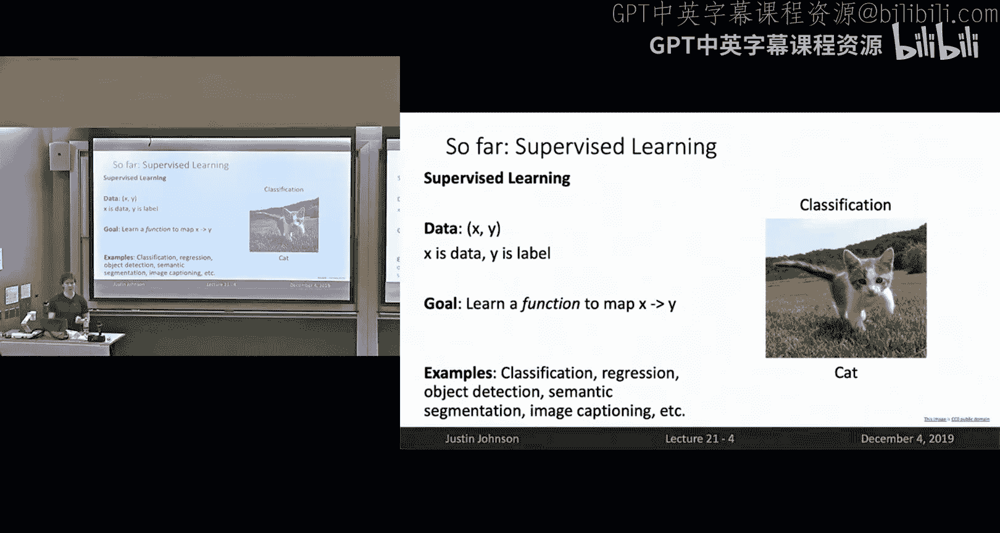

And then the last two lectures， we started talking about a different paradigm of machine learning。

 which is that of unsupervised learning， So then of course in unsupervised learning。

 you get no labels， you only get data and the idea is you want to learn some underlying hidden structure of the data to be used for some maybe downstream task so we saw a bunch of examples of this。

 the last two lectures examples of unsupervised learning are things like a clustering dimensionality reduction or any of these different types of generative models that we talked about in the last two lectures。

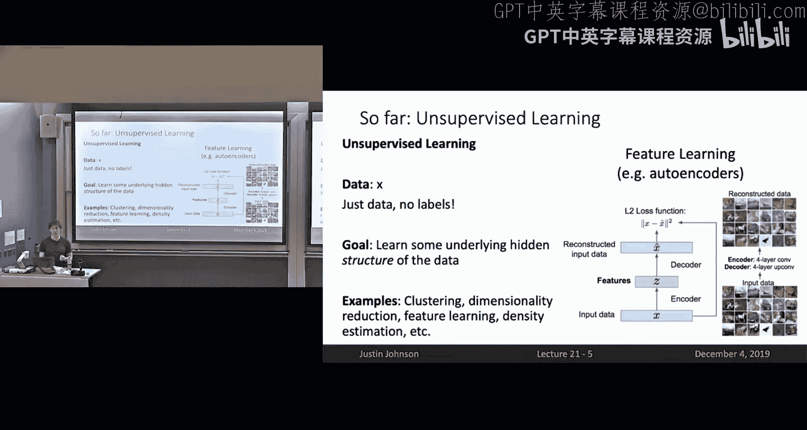

So today we're going to talk about a third major paradigm of machine learning models that is really quite different from either the supervised learning or the unsupervised learning paradigms。

 and that's this notion of reinforcement learning。So reinforcement learning is about building agents that can interact with the world。

 that can interact with some kind of environment。 So rather than just trying to model some function of inputs to outputs。

 Instead， there's going to be an agent that like a little robot here。

 that's going to go and make some interactions with the world。

 He's going to observe what he sees in the world， based on what it sees。

 it will perform some actions。 and then based on the actions that it performs。

 It will get some reward signal that tell it how well it how good its actions were。

And the goal is to have have this agent learn to learn to perform actions in such a way that will maximize the rewards that it that it captures。

 that it receives during its lifetime。So I should point out that reinforcement learning is really a quite massive topic in machine learning and you can and people do in fact teach entire long semester long classes just on reinforcement learning。

 so this lecture today is not meant to give you any kind of comprehensive understanding of the state of the art and reinforcement learning。

 it's really meant to just give you sort of an introduction and of a brief taste of how reinforcement learning works。

 a couple simple algorithms for reinforcement learning and then how it could be integrated into some of the deep neural network systems that we've talked about this semester。

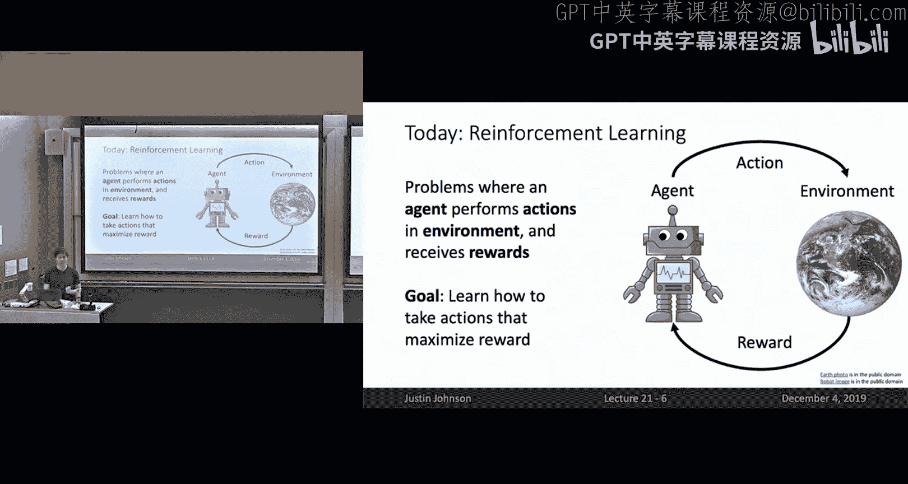

So then kind of the overview for today is that first。

 we're going to talk about a little bit of generality of what is this reinforcement learning problem。

 what can it be used for and how is it different from other types of machine learning paradigms that we've seen。

 and then we'll cover two simple algorithms to actually solve reinforcement learning tasks that will be Q learning and policy gradients。

 So that I think will give you a very brief introduction and give you a taste of what reinforcement learning is and what it can do。

So then to be a little bit more formal about the reinforcement learning problem。

 there there's going to be two major actors in a reinforcement learning problem。

 One is going to be some agent， which is like you can think of it as like a robot that's roaming around in the world and performing some actions and the other is the environment which is the system with which the agent is interacting So then what we should think about is that the agent is the thing that we are trying to learn。

 we have control over what the agent is doing and the environment is something given to us from the outside so we have control over the agent and the agent just has to interact with the world。

 which is the environment and we don't typically have much control or over what happens inside the environment。

And now these， these， these， the environment and the agent will then communicate back and forth in a couple of different ways。

So first， the environment will provide to the agent some state S T。

 where the state encapsulates what is the current state of the world。 So this could be like if we're。

 if we're building like a robot， then the state might be like the image of what the robot is currently seeing。

 So the state gives the agent some kind of information about what is going on in the world at this at this point in time。

And this， this state might be noisy。 It might be incomplete。

 but it just provides some kind of signal to the agent about what is happening in the world at this moment in time。

Now， after the agent receives this state， then it has some understanding of what it is that it's doing in the world in this moment or what is around it in the world at this moment。

 so then after the agent receives the state from the environment。

 then the agent will communicate back to the environment by performing an action and now if we are going with this running example of like a robot that's moving around in the world。

 then the action might be the direction that the agent decides to move at each point in time。

 so then the environment tells the agent what's going on。

 the agent decides to do something which modifies the environment back in some way so the agent will then take an action based on what it sees。

And now after after the environment sends the state， the agent sends the action。

 then the environment sends back a reward， which tells us how well was that agent how good was that agent doing at this moment in time and this reward is really kind of a general concept right it might be any number of things So you might imagine like if if you're this little robot who's delivering things。

 then the reward might be like how much money has this robot made at this point in time。

 that maybe this robot is going to like roll around the world and like maybe deliver coffee to people and then its reward is some instantaneous measure of how well that robot is doing at this moment in time So then maybe the reward signal is like the robot gets paid by someone when he gets delivered a coffee。

So then that's kind of then that's sort of these three different mechanisms of communication between the environment and the agent。

 The environment tells the agent what's going on。 That's the state。 The agent does something。

 which is the action。 Then then the agent gets a reward。

 which tells it how well is it doing instantaneously at this moment in time。But， of course。

 this would be kind of boring if this all just happen in a single time step。

 So really reinforcement learning allows this whole thing to unroll over time。

 and this is an interactive is the long termm interaction between the environment and the agent。

 So then in particular， after the agent makes its action。

 that action will actually change the environment in some way。

 So then after then after this first iteration， then the environment will be changed by the action of the agent。

 And then similarly， after the agent observes the state and observes the reward。

 that gives the agent some kind of learning signal to update its internal model of the world。

 as well as well as its internal model of what it wants to do in order to maximize its rewards in that world。

 So then after this first round of state action reward。

 then the environment updates as a result of the action and the agent updates as a result of the learning signal。

 And then this whole thing repeats。 So then now in this second time step， then again。

 the environment sends over a new state， the agent sends over a new action。

 the environment sends over a new reward。 and then they both transition into some。😊。

Some later thing down in time。 So then this can continue for maybe some some very long period of time where the environment and the agent are interacting with each other over some very large number of time steps。

Is this sort of formalism clear on what's going on between the environment and the agent in this reinforcement learning problem。

Okay， good。 So then here's a couple examples to kind of maybe formalize this， this intuition。

So one kind of classical example of a problem that people might solve with reinforcement learning is called the cart pole problem so here the idea is we've got some imagine some kind of cart that can move back and forth on a one- dimensionmensional track and on top of that cart is a pole that can pivot back and forth and now the state and now the objective is to move the cart in such a way that will cause the pole to balance on top of the cart so the kind of high levelvel objective of what the agent is trying to do is balance the pole on top of this movable cart。

 but now we need to formalize the objective through this notions of statess actions and rewards。

So the state is going to be something like what is the current state of this system。

 So that might be something like the angle at the exact angle of the cart。

 the exact exposition of the cart， the velocities of all those things may be giving all the physical variables telling us the exact physics of the situation。

Now， the action that the agent can choose to apply at each time step time step is maybe the horizontal force that it wants to apply to the cart moving left or right。

And now the reward signal that the agent gets at each time step is maybe maybe a one。

 if the pole is balanced and a zero， if the pole has fallen down。So then this is sort of。

 you can imagine that this， this is our first example of maybe formalizing an agent interacting with an environment through this notion of states。

 actions and rewards。

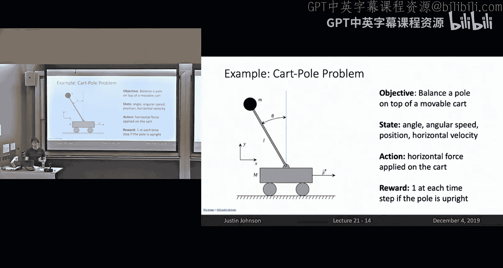

So then another kind of example of a reinforcement learning problem would be robot locomotion。

 So then maybe we've got this robot， and he wants to learn how to walk through some environment。

 So then the state， again， might be all the physical variables describing the state of the robot。

 All of the positions and angles of its joints， as well as maybe the velocities of how all the joints are moving at this point in time。

And then the action that the agent could choose to apply is like applying muscular force to each of its joints。

 so that might be the torque that it chooses to apply to add additional force onto any of the joints in the robot's body。

And the reward now now， the reward somehow needs to encapsulate maybe maybe two notions。

 One is that the agent should not fall over。 So maybe it gets zero reward if the robot falls over and one reward。

 if the robot is standing， but then also maybe we want to give the robot reward based on how far forward it has learned to move in this environment。

 So then sometimes your rewards will encapsulate multiple notions of success。 Maybe in this case。

 it would be both not falling over， as well as actually moving forward in this virtual simulated world。

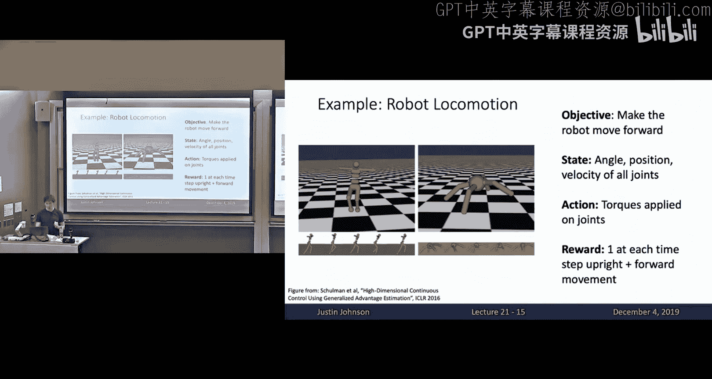

So then maybe another example of another example of a reinforcement learning problem would be learning to play Atari games。

 so here you want to just learn to play these video games， these old school video games。

 and the high level objective is to just get the highest score in each of the games。And now。

 the state that the agent might be able to observe at each time step is the pixels that are on the screen of the game。

 and the action that the agent can choose to make is maybe of pushing some combination of buttons on the controller that lets it play the game。

 And now the reward is the instantaneous increase or decrease in score that the agent receives at every time step of the game。

And now this example is kind of interesting because the state is actually somehow only giving us partial information about the environment because in many of these Atari games they might depend on some source of randomness like after you blow up a spaceship then maybe some other spaceships will fly in but you don't know exactly what the next spaceship to appear will be or you don't know where that next spaceship spaceship is going to appear but the only thing that you can see is the pixels comprising the current image on the screen。

 and that might not give you fully enough information to fully predict exactly what's going to happen in the next time step of the game。

 so this gives us this notion that unlike the previous examples。

 the state that the agent gets to observe might actually not might actually be some kind of incomplete information and might not allow it to perfectly predict exactly what's going to happen in the future。

So these are all kind of examples of maybe single player games。

 where there's just kind of an agent that's interacting against an environment。

 and it needs to learn to succeed in this environment。

Now， another thing we can do is actually have interactive games where agents are learning to compete against other agents。

And here， a very famous example of a reinforcement learning problem that a task that has been solved with reinforcement learning in this way is learning to play competitive board games like go。

 So here the objective is to win the game。 the state is now the positions of all the pieces on the board the action at each time step is whether or not is exactly where the agent wants to place its next piece when when playing the game of go。

 And now the reward in this case， maybe something very longre So then the reward maybe maybe in this example of playing go。

 the agent only gets a reward on the very last time step of the game。

 where there are all the time steps when he's placing pieces and interacting with with the opponent。

 then it always gets rewards of zero， maybe during all the intermediate terms， turns of the game。

 But once the game is over， then on the very final term of the game。

 then the agent gets a reward of one， if they won， if if they won the game and beat their opponent and they get reward of zero on that last turn。

 if if they lost。😊，Their opponent。So this gives us some sense that the rewards might actually capture some very nonlocal information about how well the agent is doing。

 The rewards might be very sparse。 They might only they might and how what what causes the rewards that we get might be affected by actions that happened very。

 very far in the past。So those are all some interesting facets of this particular example of plain Go。

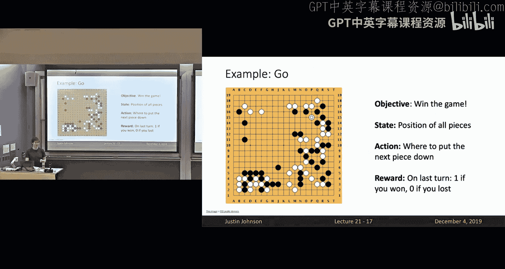

Okay， so then it's kind of interesting to contrast this notion of reinforcement learning with this very familiar notion of supervised learning that we've seen throughout the semester。

 So we've now seen this kind of abstract picture of reinforcement learning where we've got an environment and an agent and they communicate back and forth through states and actions and rewards and then transition over time。

But we can actually we can actually draw a quite similar picture about supervised learning， too。

 right So in supervised learning， if we kind of draw an analogy with supervised learning。

 then the environment is now a data set and the agent is now the model that we're learning。

 And then these the data and the model also kind of interact over time in a supervised learning setting。

 So then the data is first maybe giving the model some input X。

 which the model is supposed to make a prediction for。

 and that's kind of equivalent to the state in reinforcement learning。

 and now the model receives that input and then makes some prediction Y。

 which is kind of equivalent to the action that the model is that the agent is making in reinforcement learning。

 and then the data responds to the model by giving it some loss。

 which tells it how well was the prediction that it just made。

 And that's kind of equivalent to the reward signal that an agent is getting in reinforcement learning。

😊，And then similarly， in supervised learning， these things kind of enroll over time。

 So the model will get inputs， make predictions， get a loss。

 and then they will all update that the model will sort of learn based on that loss signal in the previous time step。

 and the data will then sort of move on to the next example in the data that is that is being shown。

So if you kind of like flip back and forth between these two pictures。

 it feels like maybe reinforcement learning is not that different from supervised learning。

 but that would actually be a very incorrect assertion to make。 So there's a couple really big。

 fundamental reasons why reinforcement learning is fundamentally different from supervised learning and also why it's fundamentally more challenging than supervised learning。

So I think the first reason is this idea of stochasticity。 So in a reinforcement learning setting。

 everything might be noisy。 So the the states that we get might be。

 might be noisy or incomplete information about the scene。

 The rewards that we get might be noisy or incomplete。 And then also the。

 the transitions that we get as the environment moves from one time step to the next。

 the way in which that environment transitions can also be some unknown， nondeterministic function。😊。

And what do I mean by the reward signal being random in reinforcement learning， Well。

 if you look back at this supervised learning situation， then when you make it。

 when you have an input and you make a prediction， then we're always going to get the same loss that typically in supervised learning。

 our loss function is going to be deterministic。But now， in reinforcement learning。

 if suppose that we receive a state and then we make an action。

 then we might get different rewards in different time stepss。

 even if we saw the exact same state and even if we made the exact same action。

 And that can be due to just there's just some underlying stochasticity or randomness in this reinforcement learning problem。

 So somehow our agent needs to learn to deal with that。

So another big problem in reinforcement learning is this notion of credit assignment。

 So like kind of like we saw in the example of the go game。

 the rewards that we get that the agent is getting at each time step might not reflect exactly the actions that has taken at that moment in time。

 that the rewards that it's getting at time T plus1 might be a result of the actions that it took very。

 very far in the past。So that's kind of if you kind of like think back to our example of a robot delivering coffee。

 then maybe his reward signal was getting paid when he delivers the coffee。

 but the reason he got paid was not just the result of that final action that he took of like giving the coffee to the person instead。

 in order to achieve that reward of getting paid， he had to first go and find a person and then take their order and then go to the coffee shop and then purchase the coffee and then drive back to the person and then hand the and then hand the coffee to the person。

 and somehow the reward signal that he got of getting paid was a result of all of those complex interactions and choices that the agent had made over a fairly long period of time。

So the technical term we sometimes use to denote this idea is credit assignment that when the agent receives a reward。

 it doesn't know what caused the reward that it got。

 It doesn't know whether it was the action I just took or was it the action I took a year ago that's causing me to receive this reward right now So that's a really big difference between reinforcement learning and supervised learning because in supervised learning after you make a prediction you get a loss right away and that loss just tells you how well how good was this instantaneous prediction so in supervised learning。

 there's not as much a need for this idea of long-m credit assignment。Okay。

 so then another big problem in reinforcement learning is the the fact that everything is nondiiable right。

 So ultimately， the agent wants to learn to perform actions that maximize its reward and then kind of the normal intuition or instinct that you should that you might have as a deep learning practitioner is。

 you know， we want to maximize the reward。 So let's compute the gradient of the reward with respect to the actions or the gradient of the reward with respect to the model weights and then perform gradient asscent on that kind of that kind of a formulation。

But the problem is that we can't back propagate through the world because we don't understand we don't have a model for how exactly the world behaves。

 So in order to compute the gradient of the reward with respect to the model's weights。

 that would force us to backproagate through the real world itself。

 And that's something that we just fundamentally don't know how to do。

 So that's another big challenge when it comes to reinforcement learning。

 we need to somehow deal with with this non-ffer with this non-differentiability problem。Okay。

 so then a third big issue maybe I think I wrote up the four big issues now。

 So then I think the fourth big issue with reinforcement learning compared to supervised learning。

 this one's a little bit subtle。 and this is the notion of nonstationity。

 So that means that in reinforcement learning the states that the agent sees kind of depend on the actions that the agent had made in previous time stepss and then as the agent learns it's going to learn to make new actions in the world and as a result of learning how to make new actions in the world。

 the agent will then maybe explore new parts of the world and the exposed to novel situations and novel states So as a result that means that the data on which the agent is training is a function of how well the agent is doing at this point in time So maybe for example of the robot that's learning to deliver coffee。

 maybe when that robot is just starting out， it only knows how to go to a person and then just give him a copy that's right next to that person but。

The agent gets better at that task then maybe people start asking the robot to now fetch me a coffee from the room next door or from the coffee shop across the street。

 and the reason that the agent is now getting these novel states is because the agent has gotten better at the task it is trying to solve but now now it's being exposed to some new situations so somehow the data that it's being trained on or the data that it's being exposed to is a function of how well the agent has learned to interact so far in the environment。

So we call that the nonstationity problem because the distribution of data on which the model is training is not a stationary distribution。

 that distribution of data is going to change over time as the model itself learns to interact better in the environment。

And this does not happen in supervised learning， because in supervised learning。

 we typically assume we have a static data set。 and then at every iteration。

 we're going to try to classify one sample from that data。

 but the underlying data is not going to change as as the model is training。But actually。

 in the last lecture， we， we saw an example of another deep learning model that also suffers from this nons stationary problem。

 Does anyone know what that was。Well that was actually the generative adversarial networks that we saw in the previous network in the previous lecture because in a generative adversarial network。

 remember we've got a generator， we've got a discriminator。

 The generator is learning to fool the discriminator and the discriminator is learning to classify the data coming out of the generator。

 Well then from the perspective of the discriminator is also learning on a nonstationary distribution because the data of the discriminator is learning on is a function of how well the generator is doing。

 And then similarly， the signal that the generator is using to learn is a function of how well the discriminator is currently doing。

 So this nonstationary problem also shows up in generative adversarial networks。

 And I think that's one of the reasons why generative adversarial networks can be difficult to train。

 But now it it also shows up in reinforcement learning。

 So now in reinforcement learning we're like in a really bad situation because we have to deal with non-stationity。

 we have to deal with nondifferentiability we have to deal with credit assignment。

 we have to deal with stochasticity。 And these are all like really bad difficult things for our learning algorithm to learn to overcome。

 So as a result。Reforment learning is a really hard problem and it just is fundamentally much。

 much more challenging than any kind of supervised learning approach。 So in general。

 if you find yourself confronted with a problem in the world。

 if you can find a way to not frame it as reinforcement learning and instead find a way to frame it as supervised learning。

 then typically your life will be much much easier and reinforcement learning is much more interesting and much more general。

 but because it's so much harder， it's harder to get things to work really well in reinforcement learning contexts。

😊，Okay， then kind of now that we've got this， this overview of what is reinforcement learning。

 we can talk about maybe a little bit of the mathematical formalism that we use to talk about reinforcement learning systems。

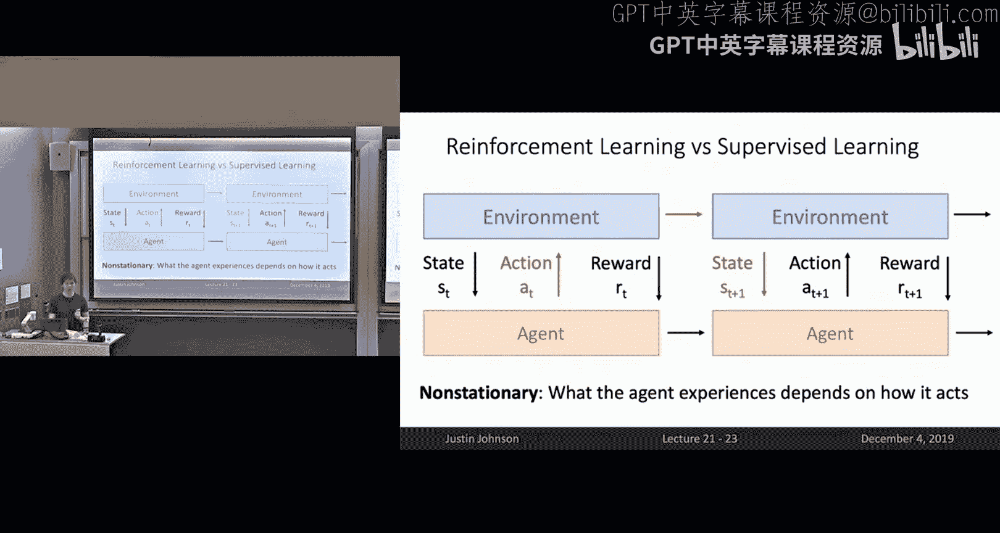

So the mathematical formalism that we use to talk about reinforcement learning systems is this scary sounding Markov decision process。

 and this is a mathematical object consisting of a tuple of these five things there's a set S of possible states。

 There's a set A of possible actions。 both of these might be finite or infinite sets There's a function R which gives us a distribution of rewards that we could possibly be given given every state and action pair。

 so this is now a parameterized family of distributions of rewards in every state action pair。

 there's a transition probability that tells us how likely is the environments to transition to different states as a function of what was the current state and what was the action we took in that state。

And then there's now this one's kind of kind of weird。 there's also a discount factor。

 gamma that tells us how should the how should the agent choose to trade off between getting rewards right now versus getting rewards in the future。

 So this， this tradeoff factor。 gamma tells us how much do we prefer a reward right now versus our reward sometime in in the。

 in the far off future。And the formalism that and the reason this is called a Markov decision process or MDP is because it has this Markov property or this Markovvian property。

 and that means that the current state at the current moment in time S T completely characterizes all the stuff that's going to happen in the system。

 So the current state and and the action that we take in that state is sufficient for determining the distribution over the rewards that we get and the distribution over the next states that the environment might transition to So in particular。

 what state we get to next does not depend on the full history of states that we have seen up to this point。

 It only depends on the immediate previous state and that property is called the Markovvian property of a Markov decision process and that kind of makes everything all the math a lot easier to deal with。

Okay， so then to formalize what the agent is doing。

 so we want to learn an agent that can interact with this environment and the environment is kind of formalized by this object called a more cop decision process。

 and now we formalize the agent by saying that the agent learns to learns a policy usually called pi and the policy pi is going to give a distribution over actions that the agent is going to take that is conditioned on the states that the agent is exposed to at each moment in time。

And now the goal is to find some really good policy pi star that maximizes thisulative this cumulative discounted sum of rewards over all time。

 So I told you that when we were speaking kind of more informally。

 we said that the agent wants to learn to get high rewards。

 But in particular how should the agent trade off between a reward at time step  zero versus a reward at time step 100 Well。

 the discount factor gamma tells us exactly how we should have that tradeoff。

 And that's kind of like an inflation factor。 you know。

 like an economics money now is worth more than money later。

 Well the discount factor gamma is sort of the inflation factor for the environment。

 how much how much the environment prefer a reward now versus a reward in the future right like if gamma equals1。

 then a reward now is equivalent to reward in the future， if gamma equals 0。

 then we only care about rewards at the first time step and we don't care about any rewards after that。

 and gamma when gamma takes values between 0 and1， then it。

Interpolate between those two extremes of only caring about reward right now versus caring about the future just as much as the present。

Okay， so that gives us our formalization of the environment as the MDP and of the agent as this policy which is executing in the environment that is trying to maximize this discount to sum of rewards。

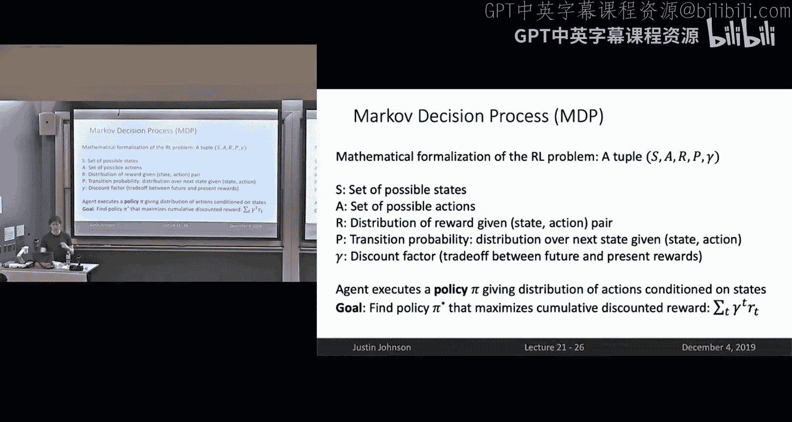

And then to talk about a little bit more formally about what's going on when we run the agent in the environment or as the agent is interacting in the environment。

 then what happens is at the very first time step T equals 0。

 then the environment is going to sample some initial state S 0 from some prior distribution over initial states。

And then we're going to loop from t equals 0 until whenever we're done。 And at each time step。

 the agent will first select an action， a subt that is sampled from the policy pi of a conditioned on S T。

 So then recall that S T is the state of the environment at the current time step。

 that the environment is giving to the agent and now the policy pi is giving us a distribution over actions that is conditioned on the state that the environment has passed the agent。

 So then the agent is going to sample from this distribution to give us the action that the agent performs at this at this time step。

Then the agent will pass that action A to the environment。

 the environment will sample a reward for that time step that is sampled from this reward function。

 capital R， and then the environment will sample the next state as t plus1 that will sample from this transition function where the transition function is dependent both gives us a distribution over states which is conditioned both on the current state as well as the action that the agent decided to take and then after that。

 the agent will be given the reward and given the next state as t plus1 and this whole loop will go on forever so then that's kind of this loop that happens more formally when we talk about an agent interacting with an environment。

Okay， so then as a kind of classical example of a Markov decision process that we can maybe specify more formally。

 people often talk about these so-called grid worlds。 So here the states in the middle。

 we imagine that there's some spatial grid over which the environment can move and at each and the states are just the agent can be in one of these positions on the grid。

 So the states there's now 12 different states giving the position of the agent。And now。

 the actions that the agent can take are moving one direction at a time so the agent can move left。

 move right， move up or move down。 And then that causes a deterministic state transition where the agent is then going to move to a different state based on where it is right now。

 as well as the action that it took。And now in this particular grid world。

 we want the agent to learn to go from wherever it starts。

 which is the initial state to go quickly to one of these special star states。

 so then at every time step the agent will get a negative reward if it's not in one of the goal states and it might get some zero reward or positive reward if it does happen to be in one of these star states for the goal。

Okay， so then a policy tells us what actions does the agent take in every state of the environment。

 So then on the left， we're showing a bad policy where maybe at every no matter now for this bad policy on the left。

 the agent does not care about which state is in and no matter where it is on the environment。

 the agent is always going to flip a coin and either go up or down with 5050 probability and that you can imagine that this is probably not a very good policy because theres many because there's many cases where the agent will just not reach any of the goal states very efficiently。

So now on the right we have an example of what is the optimal policy for this particular Markov decision process so here it says for every state in the environment like if the agent is directly underneath the goal state then it's always going to move up with probability 100% and that will put it directly into the goal state and then there are certain states where it might be the agent is kind of equidistant from the two goal states so then the optimal policy is to flip some coin and then move in those maybe two or three different directions with equal probabilities so then on the right is this optimal policy where if an agent executes this optimal policy in this simple grid world environment。

 then it will maximize its expected to sum of rewards and this is the best that the agent can possibly do in this particular environment。

So now we've seen this idea of an optimal policy， which is the best thing the agent can possibly do in a system。

So that's kind of the goal of the learning process throughout in this reinforcement learning setting。

 so what we want to do is have the agent find this optimal policy pi star that is going to maximize this discount as sum of rewards。

But now there's a big problem in trying to maximize this discounted sum of rewards。

 which we've kind of talked about already， which is one， there's a lot of。

 there's a lot of randomness in this situation， right， this policy。

 the actions that we take might be random and the rewards that we get at each time step might also be nondeterministic。

So then the solution is that we want to maximize the expected sum of rewards because the actual the actual rewards we're going to get are going to be somehow random。

 so the best we can do is maximize the expected value of the rewards that we will achieve if we follow this policy。

So then we can define this idea of an optimal policy a little bit more formally。

 and we say that the optimal policy pi star is the policy that maximizes this expected sum of discounted rewards。

 So this is an expectation that ranges over that just says that if we execute this policy pi in the environment。

 then we will make some actions will we will visit some states we will get some rewards and all of those things will be random。

 but all of the states that we visit and all of the actions that we perform。

 we'll all be dependent on the policy that we're executing。

 So then this expectation is kind of just averaging out all of the randomness and is just the expected value of this sum of rewards if we are using a particular policy pi when operating in the environment and then pi star is just the best possible policy that we can do。

Okay， so then then we need， we need to define a couple more bits of machinery in order to actually provide algorithms for learning optimal policies。

 right， So our whole goal in reinforcement learning is to somehow find this optimal policy。

So as we said that suppose we've got some policy， maybe not optimal， call it pi。

 and then executing that policy in environment is going to give us some kind of trajectory。

 which is a set of states and a set of actions that we perform along the course of executing this policy in this environment。

And now， what we want to do is somehow measure how good are we doing in different states。

So one thing that we can one way that we can quantify this is with this notion called a value function called v of pi。

 and the value function depends on a policy pi and it takes as input a state S and the value function tells us if we were to execute the policy pi and start from the state S。

 then what is the expected reward that we will get over the rest the rest of time。

 if we execute policy pi in the environment starting at state S so this value function is really telling us that how good is the state S under the policy pi。

 that if the value of the state is high that means that when operating with policy pi starting from that state we're going to get a lot of reward in the future and if the value function is low。

 then we're going to get very little reward in the future as we use policy pi going forward。

So this is kind of intuitive。 And it seems that this。

 this is a reasonable thing that we might want to measure in the learning process。

 How good is each is each state in the environment as a function of the policy that we're trying to execute。

But it turns out that even though this kind of value function is quite an intuitive construct。

 we often want to use a slightly different version of the value function instead。

 which ends up being a lot more mathematically convenient for learning algorithms。

 So this slightly modified， slightly more general value function is now called a Q function and the Q function takes both depends on a policy pi。

 as well as a state S and an action A and the Q function tells us if we start in state S and then take action A。

 and then after that， operate according to policy pi。

 then what is the future sum of expected rewards that we will get over the rest of time。

 So this Q function is telling us how good so the value function is telling us how good is a state if we start a state and execute the policy and the value and the Q function is telling us if we start with a state action pair and then follow the policy how good would that initial state action pair B。

 assuming we follow the。I'll see you for the rest of time。Okay， are we maybe clear up to this point。

 I think we， I think this is a lot of， I know this is a lot of notation to kind of introduce all at once。

 Any questions on these Q functions， these value functions， any any of this stuff up at this point。

Yeah， so we only focus on the issue。As you。这本家是这。你body的。Well， the function。

 the Q function is a function that tells us for any state。

 then how much reward will we get if we happen to start in that state。So the Q function。

 So then maybe in the grid world， maybe if you started directly on the goal state。

 then you might expect the the Q function to be very large because we're going to lot of reward。

 But if we started maybe farther away from the goal state。

 then the total amount of reward we're going to accumulate is going to be less。So we can start at。

Well， the the environment chooses which state we start at because if we go back to this right。

 if we back to， if we go back to this， then the environment is choosing the initial state。

 So we don't get to choose the initial state。 The environment chooses that for us。

 But the Q function is just measuring for any state that we happen to find ourselves in。

 How much reward can we expect to get if we happen to start in this state。Yeah。

For this two questions。他。嗯哼。😊，Yeah， so the question is that these two functions。

 the value function and the Q function seem like they're measuring kind of similar things and in fact you can kind of write recurrence relations that write one in terms of the other and the reason is that usually I think it's more there's algorithms that depend only on value functions and there's algorithms that depend only on Q functions I think it's a little bit more intuitive to start with a value function but in practice we find that the algorithms we use are more often using Q functions than value functions but you're right that they're kind of measuring a quite similar thing that one is telling us how much reward are we going to get from a state and then the other is telling us given a state and an action than how much reward are we going to get after that。

Okay， so then once we've got this value function and this Q function。

 then our goal is to define the optimal Q function right so Q star of state in action tells us what is the Q function of the optimal policy so that's that's the best if we found the best possible policy that achieve the best possible rewards then what would the Q function of that best possible policy B so the Q Q star tells us what is the assuming we had the best possible behavior that it says assuming we start in state S and then we perform action A in state S and then after that we do the best possible thing that we could possibly do in this environment then how much reward are we going to get for the rest of time after we take that initial action from that initial state and then after that we're going to act optimally for the rest of time and that's this optimal Q function Q star。

And what's interesting is there's actually a very simple relationship between Q star。

 the optimal Q function， and pi star， the optimal policy， so in particular。

 Q star actually encodes the optimal policy pi star so pi star is telling us for every state what is the best possible action that we can take in that state that will cause us to maximize our rewards for the rest of time。

And that's just equal to and the Q function tells us for every state and every action then what's the max possible reward if we took that action in that state。

 So in fact， we can just write down the optimal policy pi star by checking all of the actions a prime from the optimal Q function。

 So one reason that we want to define the Q function in this way is actually it lets us not really worry about policy functions anymore。

 by defining the Q function to take both the state and the action。

 then it's kind of one function that encompasses both kind of values of how good our states as well as how good our actions in states。

 So then the reason why we want to use the Q function in this way。

 is that we only need to worry about this one thing， which is the Q function。

 whereas in other formulations you might want to have two functions that you're learning。

 both the value function that depends on states and the policy function that gives you action is dependent on states。

 So this is kind of why we want to use Q functions and why it makes things very convenient。Okay。

 but now there is actually an kind of amazing recurrence relation called the Bellllman equation on this optimal Q function。

 which right so it says that if we take our optimal Q function。

 the optimal Q function tells us if we start in state S and then take action A。

 and then act optimally after that， then what's the total reward we're going to get。Well。

 the intuition behind this beelman equation is that if we start in state S and then take action A。

 then we're going to get some immediate reward R that only depends on that state that state S and that action A。

 So then we're going to get some immediate reward R at that time step right immediately but then after that initial time step then we just the optimal  Q function would require us to act optimally after we took that very first action in that very first state and then kind of that means that after that very first action we want to behave according to the optimal policy pi star but we know that the optimal policy pi star is just it can be encoded by the optimal Q function Q star so that actually gives us this very nice recurrence relation that we can define the optimal Q function Q star in terms of the reward we get at the very next time step and then by then recursing over the Q function at the next state that we get。

For the rest of time。 right， So then this， this Q function is saying that right away。

 we get some state。 And then after that very first action， we're gonna to behave optimally。

 But the Q function， the Q star function already tells us what we would get in that next state and that next action。

 So then this Belllman equation gives us this this beautiful recurrence relation that the optimal Q function must satisfy。

😊，And this kind of lets us take this infinite sum and actually turn it into something more tractable that we can work with。

Okay， so then the idea is that we're going to one way that we can try to solve this reinforcement learning problem is to find a Q function。

 is actually find an optimal Q function。And it turns out that if we find any Q function that satisfies the Belelman equation。

 then it must be the optimal Q function。 And this this is an amazing fact that we'll have to state without proof for the purpose of this lecture。

 But it turns out that if we find any Q function that satisfies the Belman equation。

 then we've got the optimal Q function。 And once we've got the optimal Q function。

 then we can use it to perform the optimal policy。 So what we want to do is find some function Q that satisfies the Belelman equation。

😊，So then one thing we can do is use the Belllman equation as an iterative update rule so we can start with some random Q function。

 And then at every time step， we're going to use the the Belllman equation to provide some update rule to update our Q function。

So then here we start with some random Q function Q0。

 and then we compute an updated Q function Q1 by applying sort of one recursion of the bellman rule。

 And then we apply some next Q function Q2 by applying the next recursion step of of the bellman equation to our previous Q function。

 And then we kind of iterate this process over and over and over。

And then another kind of amazing fact that we need to state without proof is that under certain assumptions。

 then this iteration of using the Belman equation to iteratively update our Q function will actually cause the Q function to converge to the optimal Q function。

 So this is kind of an amazing fact that we need to state without proof。😊。

But the problem with this particular。 So this is like。

 this is like this is like a real algorithm for reinforcement learning。 right。

 Like we can write down this random Q function。 We can perform this spellman equation to perform iterative updates to our Q function。

 And then that will just converge the optimal Q function。 Once we've got the optimal Q function。

 Then we're good to go。 We've got the optimal policy。😊，Yeah。또 열났어요。

Can you assume that this equation is based on the？Is based on what strongly connected。In what sense。

Because the previous death。It may。 it may not。R the final max。The global max。Well。

 it doesn't need to be strongly connected because that's actually the problem here is that for every iteration of this value iteration update。

 we need to perform an expectation over all possible rewards and all possible next states。

 and then we need to do that expectation for every possible state and for every possible action。

 so every iteration of this spellelman equation causes us to perform a computation for every state。

 for every action， for every state that we could get to after performing that action。

So there's no notion of strongly， we don't need a strongly connected thing because it's already touching all the states this in this formulation。

But that's actually bringing us to the problem with with this update rule is that we need to perform some explicit computation for every state and for every action。

 and then for every state and every action， we need to do something for every state that we might get to after performing that action in that state。

 So this works fine if our states are small and finite and the number of actions we can perform in each state are small and finite。

 but if states， if the state space is large， if the action space is large or if either of them are infinite。

 then we cannot actually perform this computation and the kind of tractable way。

So then the solution is that now now finally on slide 44， neural networks enter onto the scene。

 so then the idea is that we'll train a neural network to approximate this Q function。

 and then we will use the Belllman equation to provide a loss function that we can use to train this neural network。

So then we've got this beelman equation， and now what we want to do is train a neural network with parameters theta that will this neural network will input a state or some representation of a state。

 input an action， input the weights of the network。

 and then tell us what is the value of this Q star for that particular state action pair。

And then we can use the Belman equation to tell us of。

 to give us kind of a loss function to train this neural network。So from the Bellman equation。

 we that we know that if the network was doing its job properly。

 then the network outputs should satisfy the Belman equation so we can use now we can perform we can use the Belman equation to give some approximate target for a particular state for a particular action。

 we can then sample a bunch of potential next states and potential rewards to give us some target Y for what the network should predict based on the current state and the current action。

And then we can use this potential this target y to then train the network。

 So then we say that the current network output is Q of S comma a comma theta and then we want it to hit this target output。

 which is y of S a theta which is computed using this Belelman update and then the loss function we use to train the network is then just maybe the square difference between the current output of the network and what the network should be outputting depending on the Belelman equation and now this is just a loss function that we could then perform gradient descent on and we can use this to train a neural network that can then approximate this optimal Q function and hopefully after we train this thing for a long time。

 the network will converge to something that approximate the optimal Q function and then we can perform a policy by just taking the aGmax action over the Q functions that the network is predicting。

But now kind of a subtle problem with this approach is this a nonstationity problem。

 right So the network is supposed to be inputting the state， inputting the action。

 But now the target that the network is supposed to predict actually depends on the current outputs of the network itself。

 So that means that as the network learns， then the targets that it is expected to predict from different state action pairs is actually going to change over time。

 And that's this nonstationity problem rearing its head again。

There's another big problem here which is how do we actually choose there's a lot of sample choices we need to make in sampling the data that we actually use to train this model and that's just a problem we can't talk about today that's too complicated。

 but then there's a lot of decisions you need to make on exactly which state action pairs you're going to sample for training。

 how do you form mini batches and that's a lot of a big hair problem you need to worry about in practice。

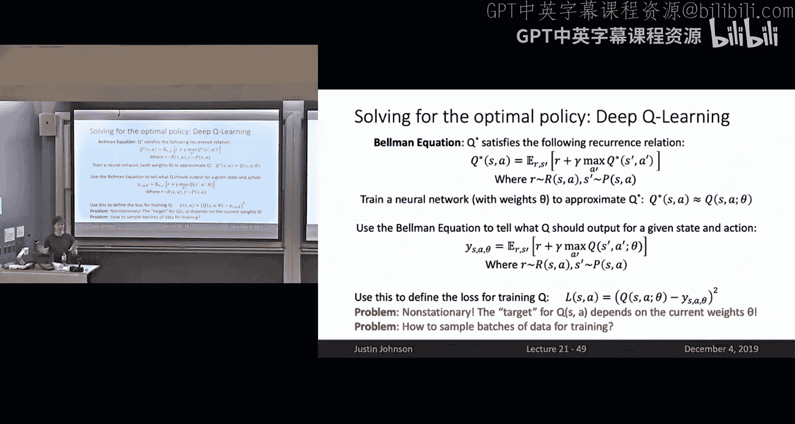

So then as kind of a case study for this， So this is called， by the way， deep Q learning。

 because we're using a deep a deep neural network to approximate a Q function。

 So that's called deep Q learning。 There is shallow Q learning where use some simpler function appximators to learn these Q functions。

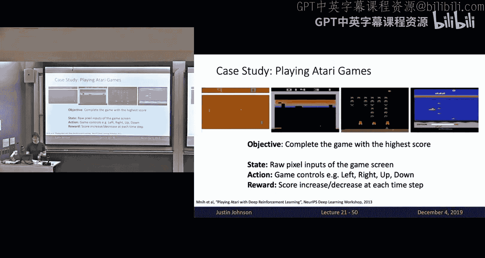

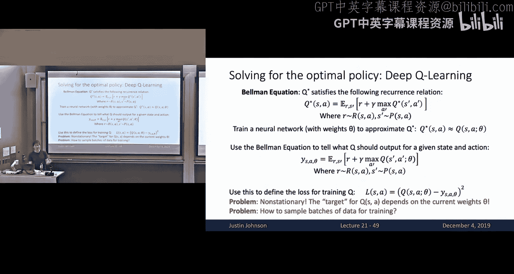

So then one case study for where deep Q learning has been very effective is this task of playing Atari games。

So here， we said the objective was to observe the game state and then predict what。

 what action should we take to maximize the score in the game。

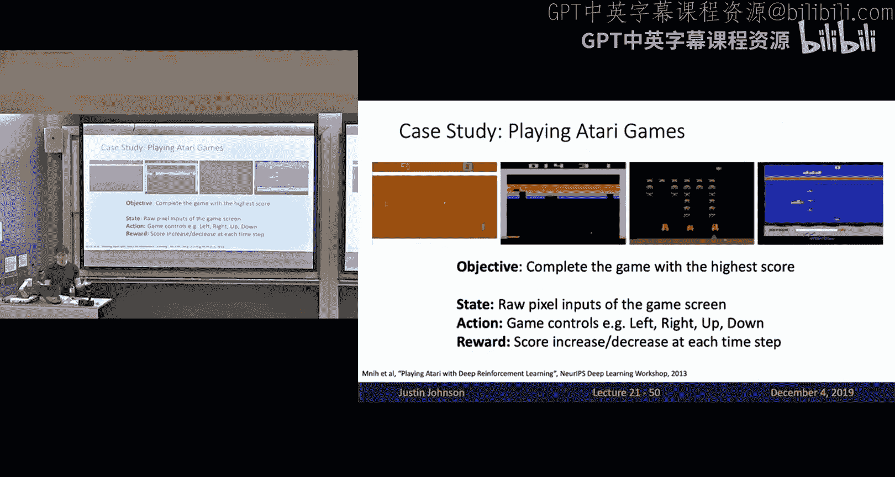

And this actually you can use this was solved using this actually you can use deepQ learning to solve this problem。

 So here we're going to have this neural network， which is a convolutional neural network。

 the input to the convolutional neural network is four images telling us the last four images that were shown in the game and then those images will be fed to a convolutional neural network that have some convolution have some fully connected layers。

 And then at the end， it will have an output for every potential action。

 And those outputs will tell us the Q functions for all of the actions that we could have taken from that particular state that we pass this input to the network。

 So then you can imagine training this thing up using this Belllman equation loss function that we saw on the previous slide。

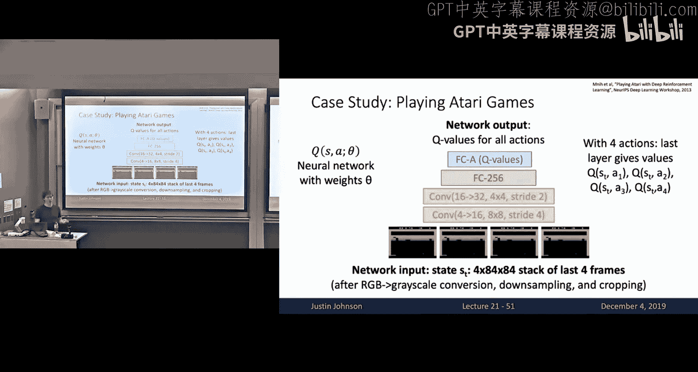

And actually， this works pretty well。 So here's an example of this was a paper from Deep Mind a couple years ago that was fairly successful at using deep Q learning to learn to play Atari games。

😊，So here， the idea is it's performing this exact deep P learning algorithm that we just talked about。

 And it's learning to play this， this breakout game in Atari。So at first。

 let me know it at the beginning， it's training。 It's not doing so well at the beginning because we started with a random network。

 It's kind of hitting the ball sometimes， but it's missing a lot of the time。 And it's。

 it's not very smart。

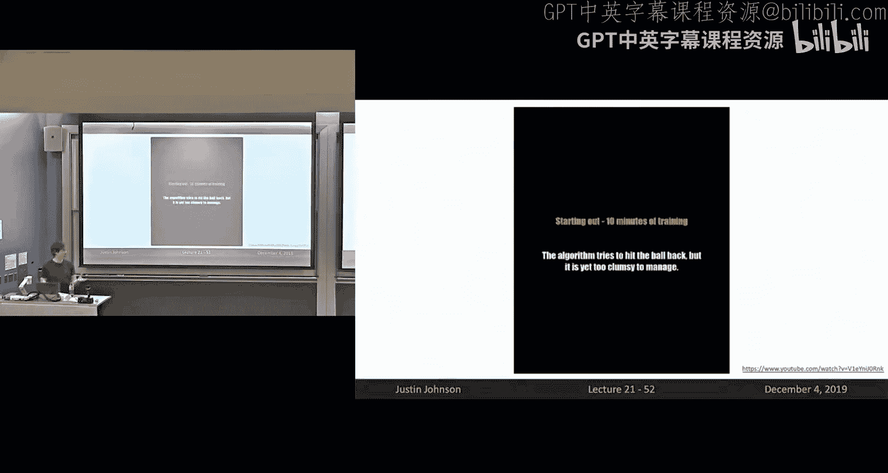

So， you know， when you start off with a random neural network。

 it perform pretty garbage at the beginning。 it's pretty normal。

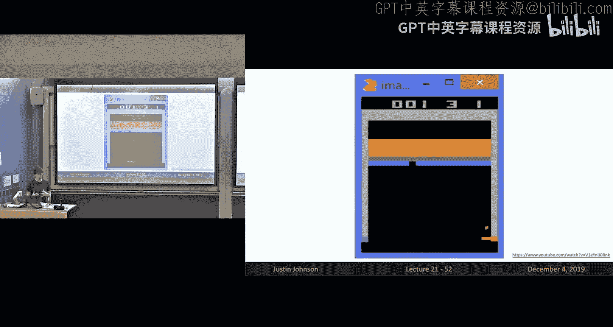

After we train a bit longer， then the network will have gotten better。

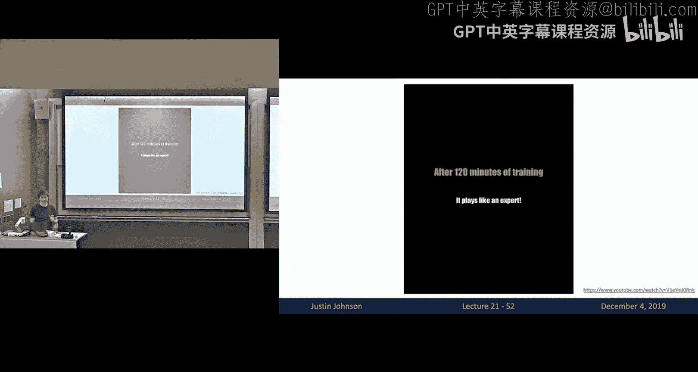

And now it can actually like hit the ball。 So that's pretty exciting。 And this was done。 Of course。

 the network has sort of no notion of what is the paddle or what is the ball or what are the rules of the game。

 All it's seeing are these these images from the screen and how much the score is incrementing。

 And it needs to kind of figure out for itself， what are the actions that it needs to take in order to in order to make its make its predictions。

😊。

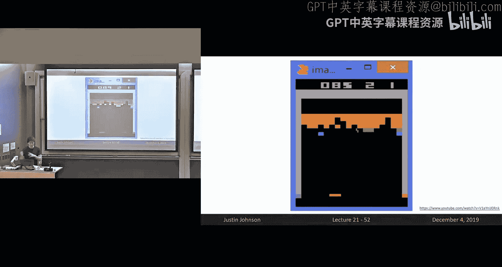

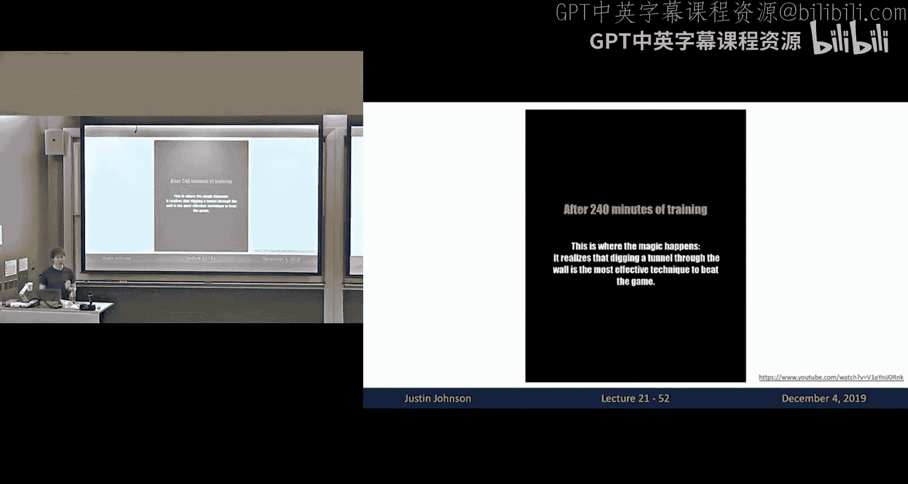

And actually， the network gets like really， really good at this game。

 So it actually probably works better than me for sure。 So， then， you know， eventually。

 this network discovers some pretty， pretty interesting strategies for solving this breakout game。

 So so far， it hasn't missed。 And now， oh， boy。😊。

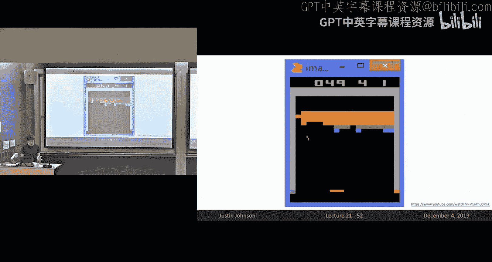

Right。So it kind of learned that it's able to learn these pretty complex strategies for solving these pretty complex environments。

 even though it has no explicit knowledge of how the game is working。

 all it's doing is receiving these states， which are these images， receiving these rewards。

 which are how well it's doing， and we train a deep network using this Q learning formulation。

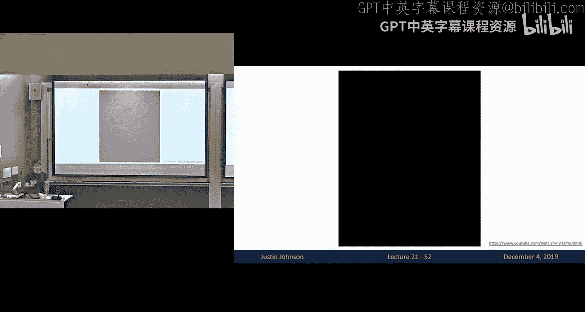

So that actually works pretty well， at's this notion of Q learning。

So now the problem is that for some problems， this Q function is telling us for the state for the action。

 what's the total reward we're gonna to get in the future。

 and for some problems that might make sense。 But for some learning problems。

 that might be a very difficult function to approximate。 for some problems。

 it might be better to directly learn a mapping from the states to the actions。

 So imagine like picking up a bottle。 if I want to pick up a bottle。

 I just want to like move my hand until I touch the bottle Once I touch the bottle。

 I want to close it。 And then once I close it than I want to pick it up。

 So that's kind of a simple policy that is described where my actions are conditioned upon the states that I'm observing at every moment in time。

 And sometimes it might be better to learn neural networks that kind of parameterize the policy directly rather than sort of indirectly through this Q function。

So that gives us this second category of algorithms for deep reinforcement learning called policy gradient algorithms。

 So in a policy gradient algorithm， we're going to learn a neural network which inputs the state and then outputs a distribution over the actions that we should take in that state。

 So this is kind of directly parameterizing the optimal policy。And now。

 the objective function is that we want to train the policy to maximize the expected sum of future rewards。

So then we can write down some objective function where the objective function takes as input the weights of the neural network。

 and then it just gives us what is the expected rewards that we would achieve if we were to execute the policy encode of that network in in the environment。

 And then our loss function is like let's just use gradient ascent on this。

 Let's compute gradient of the gradient of this loss J with respect to the parameters data and then use direct gradient ascent on network on the network weights。

But of course， the problem with this is this non-differiability problem that in principle。

 we'd like to just perform gradient ascent on this objective。

 where the objective is just maximize the reward， and then we want to just compute gradient of the reward and then take gradient steps with respect to that。

 But we can't actually do that because we would need to compute gradients through the environment。

 So that's a big problem。So then to kind of solve that problem， we need to do some tricky math。

 So then let's take a slight generalization of this problem and write let's write our cost function in the following way。

 So let's write it as an expectation of x sampled according to some probability distribution P theta and inside the expectation is a function F of x。

 So then you can think of x as the trajectory of states and actions and rewards that we would get by executing the policy。

 P theta is the implied distribution over those trajectories that is implied by the policy and F of x is the reward function that we would get after observing the trajectory X。

 and now what we want to do is compute the derivative of J with respect to theta。Okay。

 so now we've got this general formulation。 We can expand out the integral definition of the expectation。

 So we want to compute derivative of this thing with respect to theta。

 so then we can expand out the expectation into an integral。

 So That's going to be the integral over x of P theta of x times this f of x。Then we can push the x。

 then we can push the derivative inside the integral， assuming all these functions are well behaved。

 This should work。 And in particular， F of x does not depend on theta。

 so we can pull the f of x out from the derivative。

 So now we've got this term sitting inside the integral。

 which is the derivative of P theta of x with respect specta theta。

 And that's something that we'd like to get rid of。By the way， this。

 because that that P Theta involves the environment and also this integral involves integrating all over all possible trajectories。

 So we can't actually do it in practice。 So we'd like to massage this equation into something that we can actually work with。

So now we can perform a little computation on the side and we can just notice like what if we for some crazy reason。

 we just decided to take the derivative with respect the theta of log of p theta of x。

 And why would we do that， I don't know， But if we do happen to make that decision。

 then we see that the derivative remember derivative of log of something is one over the something。

 times derivative of the something。 So then that derivative is one over p theta of x times derivative with respect to theta of p theta of x。

 And oh boy， there's that term that we wanted to get rid of in the previous equation。

So then we can reshuffle that and then write D D theta a P theta X as as this other form by just moving the multiplying that thing over。

 And now we get we can rewrite this term。So then we can sub out that blue term for the red term in the previous integral。

 And that gives us this， this other， this other expression。

But now this expression is interesting right because this expression is an integral over x。

 and then one of the terms inside the integral is p theta of x。

 So that actually means that this integral is itself and expectation so then we can then rewrite that integral as an expectation which is now the expectation of x sampled according to p theta of now the rewards that we get times the derivatives of the log probabilities of the trajectory。

 So now this is good。 we've managed to kind of push the derivative inside the expectation and then rewrite it again as an expectation。

 So then this expectation we can approximate by sampling some finite number of trajectories from the policy。

Okay， so that's good， but we still need to deal with this DD theta log P theta term。

So then we need to then we can write out using using the definition of the Markov decision process。

 we can just write out what is the probability of observing the trajectory X。

 Then we can look at the log probability of observing the trajectory X kind of depends on two terms。

 One is a sum of these transition probabilities。 And these are you know things that these are properties of the environment that we don't get to observe。

 So this is bad。 we can't actually compute these。 And the other， this is actually good。

 These are the action probabilities of that our model is taking。

 And this is something we can actually compute because we actually are learning the model so we can actually compute this term。

And now， when we take the derivative of this thing with respect to theta。

 then the red term does not depend on theta。 So it goes away。 So that's good。

So that means that now we've got this derivative of a log probability of the trajectories only depends on the action probabilities of our model。

 And that's good because we can actually compute this。So now we put that on the side。

 we pull we pull our other expression from before， and we put these things together finally to get an actual expression for now the derivative of the cost function with respect to the parameters of the model。

 And now this is a function where actually we can actually evaluate every term of this function。

 which is actually finally good。So then this， this expectation means we're taking an expectation over trajectories X that are sampled by applying the by by following the policy in the environment so we can perform these samples by just letting the policy run in the environment and collecting the trajectoriess X。

And now this， F of X is the reward that we get when， when observing the trajectory X。

 So then as we let the policy play out and we observe the trajectories。

 we'll also observe the rewards。 So this is something we can compute。

And now this term is now remember， we're learning a model。

 a neural network which predicts the policy， the action probabilities of the states。

 So now this is actually the model that this pi is the neural network model that we're learning。

 So this we can also take the derivative of right This term is telling us the gradient of the predicted scores from our model with respect to the weights of the model so that we can just compute using back propagation through the model pi。

 which we're going to represent as a normal neural network。So then that gives us。

 that actually gives us a very concrete algorithm for using this policy gradient approach to learning a policy for reinforcement learning。

So what we're going to do is initialize the weights of our policy network to some random valued theta。

 and then we're going to run the policy pi theta in the environment for some number of time steps to collect data。

 which is trajectories X and the rewards of those trajectories F of x。

Use it by running the policy theta in the environment。 And then once we've collected all that data。

 we can actually plug all those terms into this giant expectation to then compute an approximation to the derivative of the cost function with respect to the model weights。

 And then once we've got that， then we can perform a gradient ascent step on the model weights。

 And then we can go back to two and loop and loop and loop and go over and over again。

So now this gives us a very different approach to actually learning to work in a reinforcement learning setting。

And this equation looks kind of crazy， right， Like how how you supposed to interpret this thing。

 right， This is an equation over an expectation。 There's like it's kind of hard to see what's going on。

 But I think actually it's actually a bit intuitive when， when you think about it。

 So the interpretation here is that when we took some So we're gonna sample some trajectoryies X。

 and we're gonna get some rewards for those trajectories F of X。

 And when when we got high rewards when f of x is high。

 Then all of the actions that we took in that trajectory should be made more likely。

 So that's just saying that when we take a trajectory。 And when we get high reward。

 then everything we did in that trajectory， we're assuming is going to be good and we should tell the model to do those things more。

😊，And then similarly， when we run a trajectory X and get a low reward。

 then we're going to assume that everything the model did in that trajectory was bad and all of the actions the model took along that trajectory should be less likely。

 So that's kind of what this policy gradient method is， is kind of doing。

 And that's the rough intuition behind what this is doing。 Yeah， question。Say that again。Your。

How do you prevent the model from taking the greedy option every time。I don't know。

 It's actually very， very difficult， right， because right， the problem is like。

There's there's this credit assignment problem， right， Like if you had a very， very long trajectory。

 then the model doesn't really know which action was responsible for which reward。

 We're just saying that the entire reward， if the entire trajectory had a higher reward。

 then all of the actions should be good or all the actions should be bad。

 And hopefully that'll kind of average out if we get enough data and see enough trajectories。

 But that's actually kind of a big downside with these policy gradient methods is they tend to require a lot。

 a lot， a lot of data， because in order to kind of tease out which actions were actually good and which actions were actually bad。

 we probably would have need to sample like a lot， a lot， a lot of trajectories。

 So that's a big downside of these methods。

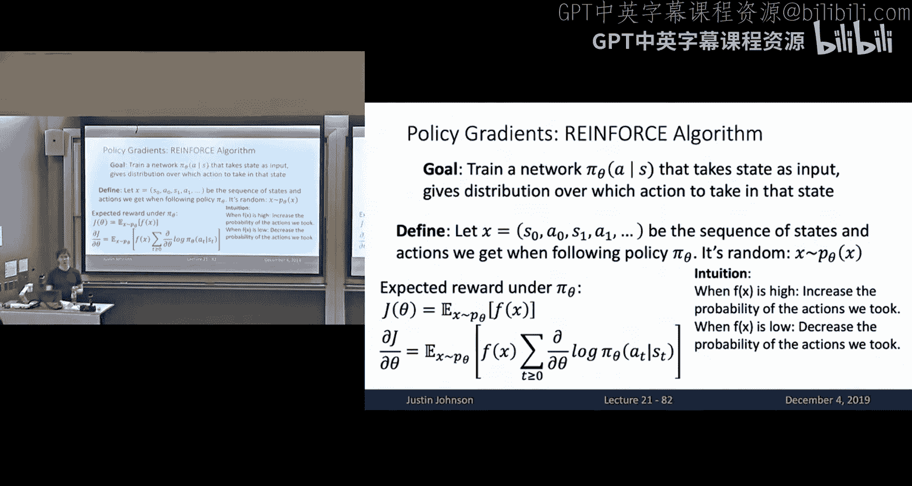

So then that gives us like these two different formulations for actually learning。

 doing reinforcement learning and practice they can definitely be made better。

 So a common thing in policy gradient is to add a thing called the baseline to make it better。

 which we won't talk about。But these are really just the beginning。

 So these are kind of like some fairly simple， straightforward algorithms for reinforcement learning。

 But there's a whole wide world of more interesting algorithms that people are doing that are state of the art today。

 So we just， if we took a whole semester， long class on this stuff。

 I think you could cover a lot of these。 But instead， we'll just give a brief flavor。😊。

So another approach is this notion of actor critic。 So here in actor critic。

 we actually train two networks。 One is the actor that is going to predict the actions that we're going to take given states and the other is the critic that's going to tell how good are those state action pairs So this kind of looks like a combination of the policy gradient method with the Q learning method because we've got sort of one network that's telling us which actions to take and another network that's telling us how good our state action pairs。

Kind of a whole different approach to reinforcement learning is this idea of model based reinforcement learning。

 So for all of the algorithms that we've talked about so far。

 the model the network has not explicitly tried to model the state transitions of the environment。

 It just sort of works directly on it sort of just learns It's not explicitly modeled how the environment is going to change in response to the actions。

So another category of reinforcement learning models attempts to learn a model of the world。

 and then based on our interactions with the world。

 we try to learn a model that tells us how the world is going to change in response to our actions。

 and then if you've got a really good differentiable model of the world。

 then you can perform some kind of planning using your learned model of the world so that's a very different category。

 a very different flavor of reinforcement learning algorithms。

Now another thing is just do supervised learning， so say you want to get an agent to interact in an environment。

 then collect data of people that are good， interacting in that environment。

 and then train a supervised learning model to just do what those expert people did。

 So that's this notion of imitation learning， which is another another of kind of idea。

There's this idea of inverse reinforcement learning。

 We're now we're going to collect some data of what what expert agents did in the environment and then try to infer what reward function those experts were trying to optimize。

 And then once we try to infer the reward function that the experts were trying to optimize。

 then we optimize our own model based on what reward function we had thought they were trying to learn。

 That's kind of a much more involved idea called inverse reinforcement learning。

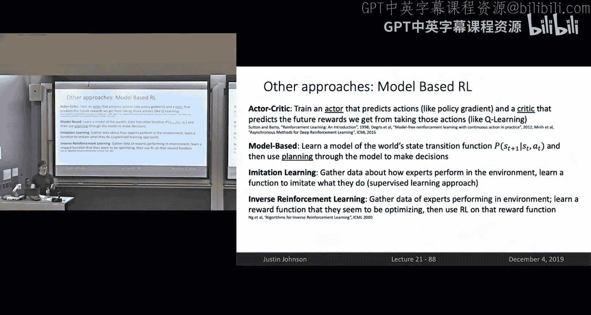

You can also use adversarial learning for for reinforcement learning。

 So maybe we've got some set of trajectories， some set of actions that were done by experts。

 And then we want to train a discriminator that tries to say whether or not trajectories were generated by our network or generated by experts。

 And then we need to learn to fool the discriminator in order to learn to do good trajectories in the environment。

 So these are these are just giving you a very brief flavor of the wide variety of methods that people try to use to solve reinforcement learning problems。

And now it is kind of a key study of where this has been really successful has been this task of learning reinforce using reinforcement learning algorithms to learn to play board games。

😊，So this was a line of work coming out of folks at Google Deep Mind。

 where starting back in January 2016， they built a system called Alpha Go that combined a lot of these different ideas from reinforcement learning and trained on a lot of data and then actually was able to build a reinforcement learning system that learned to play the game of Go better than any human expert。

 So at the time， they beat this very very famous champion in Go called Li Saal。

 who had one who was like 18 time world champion of Go and they actually beat him four out of five in a match using this Alphago algorithm。

 So he was not too happy about that。😊，And then they followed it up。 So then in October 2017。

 there was a thing called Alpha Go0， which kind of simplified things， clean things up even better。

 And now they beat who was at the time， the number one ranked human player in the world。

 which was K Je。 and they actually beat him。 And I assumed he was not very happy。

And then in December 2018， there was， they generalized this approach even further to beat。

 not just go， but also use similar approach to play other board games like chess and Shoji。

 So This was a year ago， December 2018。

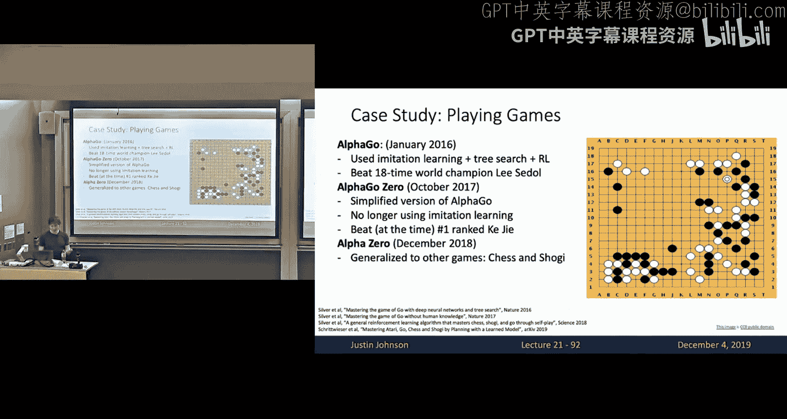

And now just last month in November 2019， there was a new approach called Mu Ze that actually used this idea of model-based reinforcement learning。

 so they learned a model of how the state was going to transition and then planned through that learned model in order to do really well at these board games。

 and they got it to work just as well。So actually， another kind of interesting piece of news around this that actually just happened about two weeks ago is that Lee Saol actually announced his retirement from professional go and he said the reason he's retiring is because AI got too good。

 So he said with the debut of AI and go games， I've realized that I'm not at the top。

 even if I become the number one through frantic effort。 And even if I become the number one。

 there is an entity that cannot be defeated。 So this is actually I mean this is kind of sad in a way this guy is like brilliant and he's worked his whole life to become very。

 very good at this task of playing go。 and then it's just like a machine comes by and these nerds from deep mind come and just like beat him at this thing he's trained for his whole life。

 like I'd be pretty sad if I were him。 but I think it's kind of an interesting development in this history of using reinforcement learning to play to play games。

And then sort of pushing this forward， people have sort to push this idea forward to play now even more complex games。

 So there's some follow-up work from Deep Mind where they they built a system called Alpha star that learns to play Starcraft 2 at very。

 very good levels apparently， and Open AI has a system called Open AI 5 that learns to play Dota2 very。

 very well and Open AI doesn't seem to publish papers anymore。

 they just write blog posts about what they do。 So there's no paper I can cite this for this really cool system unfortunately。

Okay so then so far， we've talked about reinforcement learning as a mechanism to learn systems to interact with the world。

 but actually， I think another really cool application of reinforcement learning is actually learning using reinforcement learning ideas to build neural network models actually with non-differentiable model components。

 and this is this notion of stochastic computation graphs。 it kind of kind of a simple toy example。

 Imagine what we have mean this is actually not a good idea。

 like I don't think anyone should do this。 But imagine that we' kind of an instructive example。

 What if we wanted to build a neural network system that was doing something like image classification。

 It's not interacting with an environment is just doing like a normal image classification task。

 and we're actually going to have four networks involved。 One is this network in gray。

 which is going to input the image and then tell which of the other networks we should actually use to get our classification decision。

😊，So then this first network is just making a classification decision over all of these other three networks。

 And then this first network is telling us which other component。

 which other neural network should we actually use to classify this image。

So we could sample from this distribution， sample maybe the green network。

 and then feed the image to the green network， and then we could feed the image of the green network。

 get a classification loss， and now treat that loss as a reward and then use a policy gradient method to then use the loss of the second network to actually perform a policy gradient update on that first neural network that was doing the routing。

So now this is like I said， kind of a stupid toy example that I don't recommend anyone do in practice。

 but it gives us this freedom to now build neural network architectures that do very wild and very crazy things and even non-differentiable things where now you've got kind of like one part of the neural network system。

 which is deciding which other part of the neural network system to use for other downstream tasks。

 And then you can use these ideas from reinforcement learning to now train these very complicated neural network models that are making very complex decisions about how to process the data So this was a very simple toy example。

 But another example is a more real example of this in practice is going all the way back to something we saw a few lectures ago on attention。

 So remember when we talked about on the image captioning with attention。

 then we talked about building models that could learn to use kind of a soft mixture of different pieces of information around different spatial positions in the image at every time step。

 So then when generating the caption。

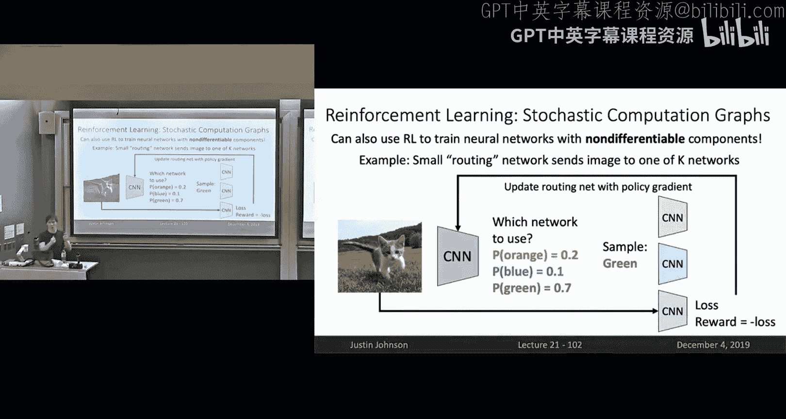

ABir flying over a body of water period。 Then at every time step。

 if the model is kind of focusing its attention on different spatial positions of the image。

But it always did this by taking a sort of a soft average or a weighted sum of all of the different features across positions in space。

But there's another version called hard attention。 where， where just。

 we want the model to select exactly one region in space to actually pull features from at every moment in time。

And now this actually is called hard attention because we're selecting exactly one piece of the image that we want to process at every moment in time and this you can actually train using a reinforcement learning method because you've got sort of one part of the neural network which is outputting this classification decision over which positions in the image we want to pull features front and then that part of the neural network which is making that classification decision you can then train using a policy gradient approach So this is just a bit of a taste that you can actually use reinforcement learning algorithms to do more than just interacting with environments that you can use them to train actually neural network systems that just do more complicated types of processing on their data and I think that's a really powerful idea that can be leveraged to build really interesting neural network novel。

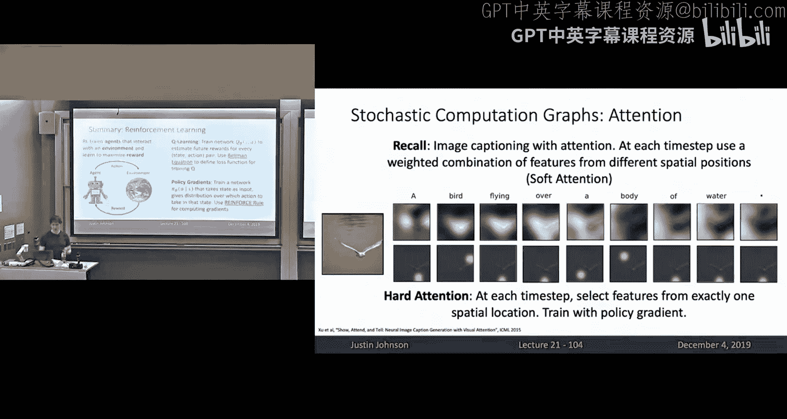

So then kind of our summary for today is that we had kind of a very fast one lecture tour of reinforcement learning。

 hopefully we didn't lose everyone and the overall idea is that know reinforcement learning is this very different paradigm for machine learning that allows us to build agents build systems that learn to interact with environments over time。

 and then we saw these these two simple， I mean these these two basic algorithms that we can use for actually training practical reinforcement learning systems of Q learning and policy gradients。

So that's all we have for today， and then next time will be our final lecture of the semester。

 we'll talk about recap of what we' learned this semester。

 as well as some of my thoughts about where I think computer vision will be going in the future in the next couple of years。

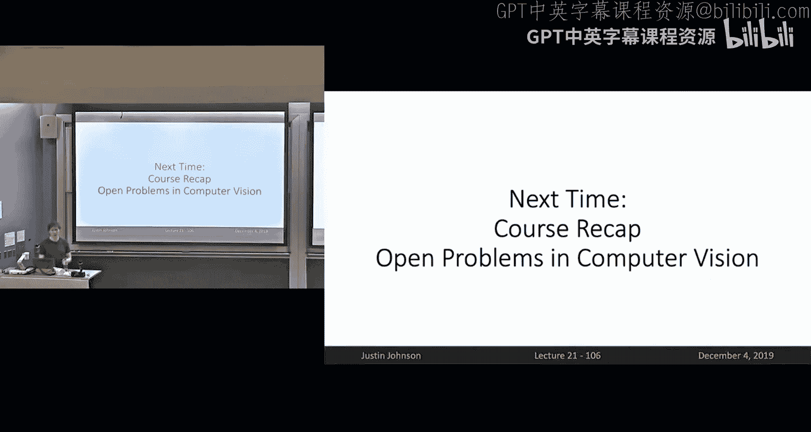