# 深度学习用于计算机视觉：22：强化学习入门 🎮

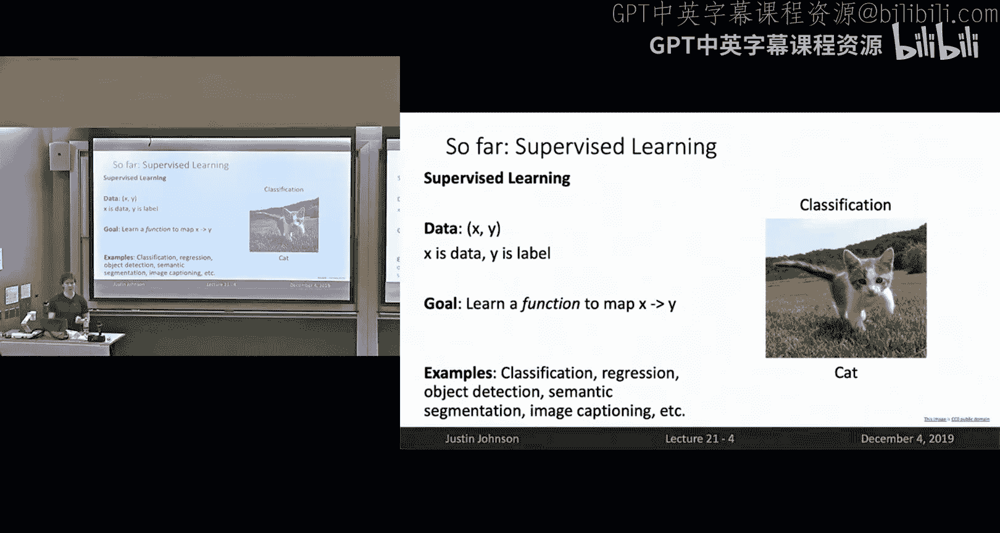

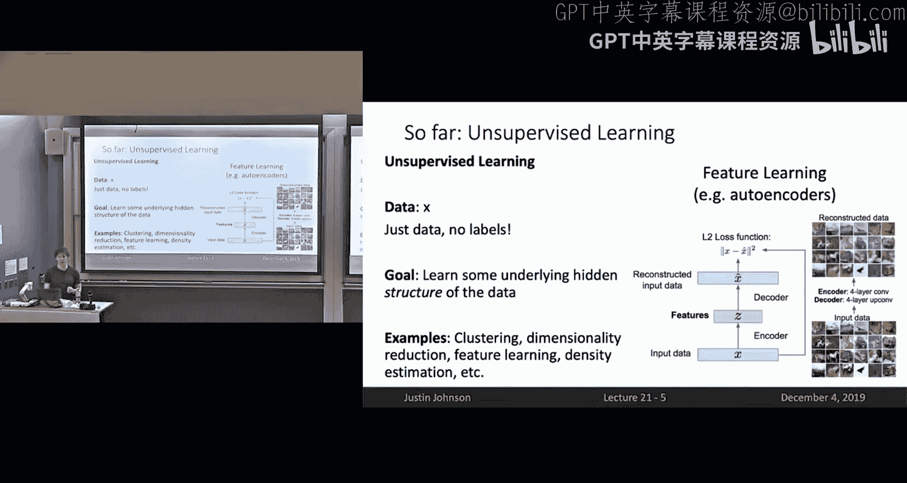

在本节课中，我们将学习机器学习的第三种主要范式——强化学习。我们将了解强化学习的基本概念、其与监督学习和无监督学习的区别，并介绍两种基础的强化学习算法：Q学习和策略梯度。

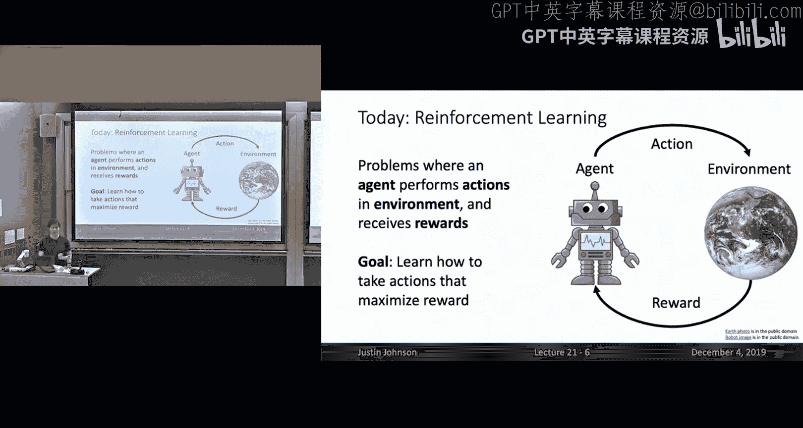

## 概述

强化学习关注的是构建能够与世界（环境）交互的智能体。智能体通过观察环境状态、执行动作并接收奖励信号来学习如何最大化其在整个生命周期中获得的累积奖励。这与我们之前学习的监督学习（预测输入-输出对）和无监督学习（发现数据隐藏结构）有本质区别。

## 强化学习基础

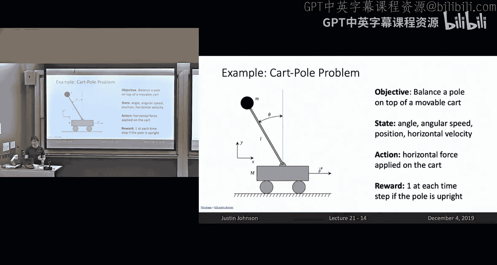

强化学习问题涉及两个主要角色：**智能体**和**环境**。它们通过以下方式进行交互：

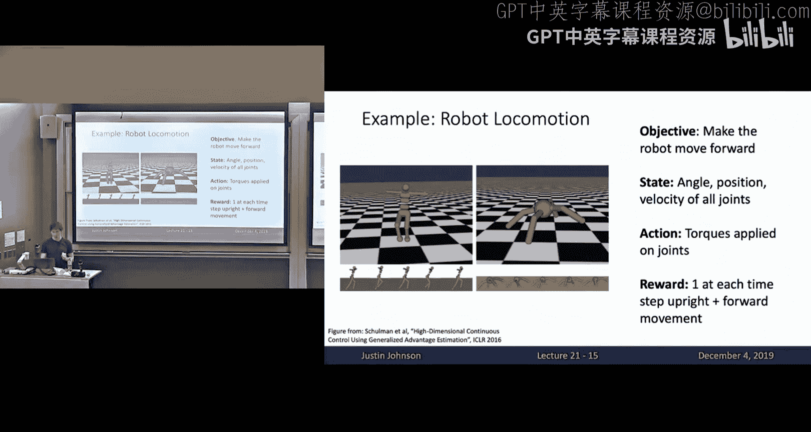

1.  **状态**：环境向智能体提供关于当前世界状况的信息 `S_t`。
2.  **动作**：智能体基于当前状态选择一个动作 `A_t` 来执行。
3.  **奖励**：环境根据智能体的动作给予一个即时奖励信号 `R_t`，表明该动作的好坏。

这个过程会随时间不断重复，形成一个交互序列。智能体的目标是学习一个策略，以最大化其获得的**累积折扣奖励**。

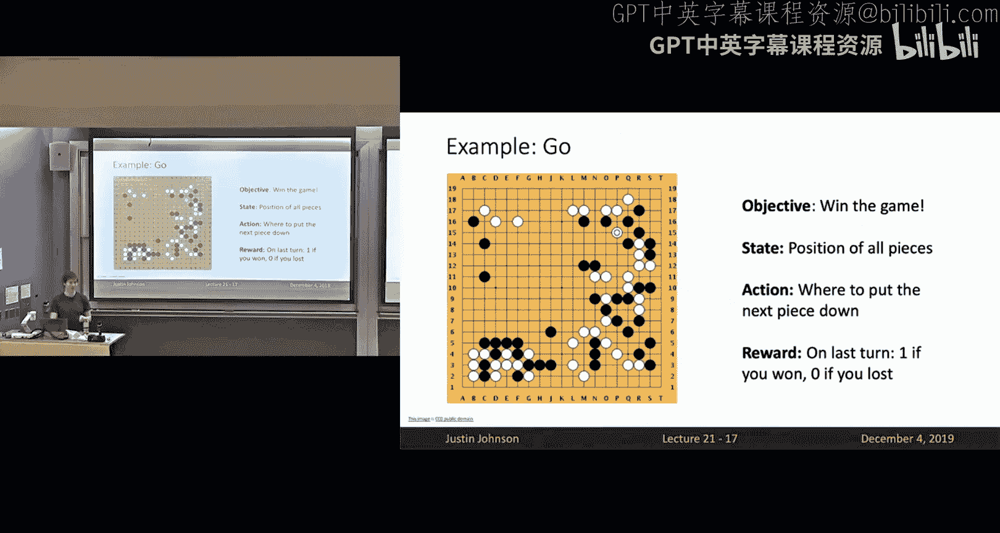

## 强化学习 vs. 监督学习

虽然形式上类似，但强化学习在几个关键方面比监督学习更具挑战性：

*   **随机性**：状态、奖励和状态转移都可能具有随机性。
*   **信用分配**：当前获得的奖励可能是由很久以前采取的动作导致的，智能体需要判断哪个动作应对奖励负责。
*   **不可微分性**：我们无法通过真实世界进行反向传播来计算奖励相对于模型参数的梯度。
*   **非平稳性**：智能体训练时所看到的数据分布会随着其自身策略的改进而改变。

## 马尔可夫决策过程

我们使用**马尔可夫决策过程** 来形式化描述强化学习环境。一个MDP由以下五元组定义：
`(S, A, R, T, γ)`

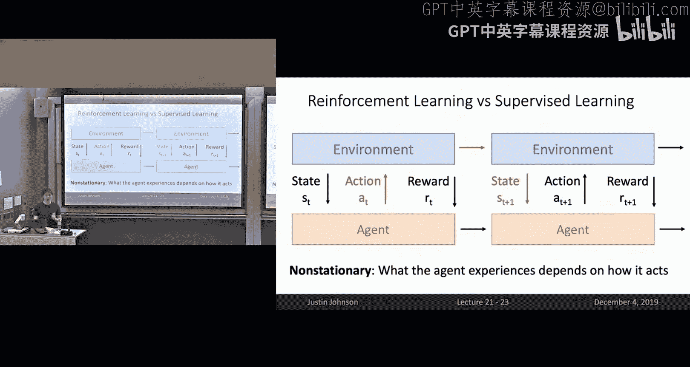

*   `S`: 所有可能状态的集合。
*   `A`: 所有可能动作的集合。
*   `R`: 奖励函数，给定状态和动作，输出一个奖励分布。
*   `T`: 状态转移函数，给定当前状态和动作，输出下一个状态的分布。
*   `γ`: 折扣因子，用于权衡即时奖励和未来奖励的重要性（0 ≤ γ ≤ 1）。

MDP具有**马尔可夫性质**，即下一状态和奖励的分布仅取决于当前状态和动作，而与历史状态无关。

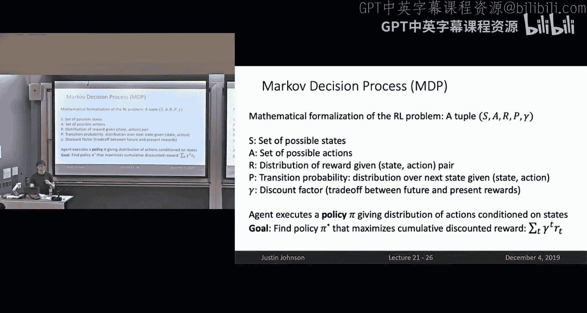

智能体的目标被形式化为寻找一个最优策略 `π*`，以最大化期望累积折扣奖励：
`E[∑_{t=0}^{∞} γ^t R_t]`

## 价值函数与Q函数

为了评估策略的好坏，我们引入两个重要概念：

*   **价值函数 V^π(s)**：表示从状态 `s` 开始，遵循策略 `π` 所能获得的期望累积奖励。
*   **Q函数 Q^π(s, a)**：表示从状态 `s` 开始，执行动作 `a`，然后遵循策略 `π` 所能获得的期望累积奖励。

最优Q函数 `Q*` 满足**贝尔曼方程**：
`Q*(s, a) = E_{s‘, r}[r + γ * max_{a’} Q*(s‘, a’)]`

这个方程是许多强化学习算法的核心。

## 深度Q学习

当状态和动作空间很大或连续时，我们无法为每个`(s, a)`对存储Q值。解决方案是使用一个神经网络（如卷积神经网络）来近似Q函数，即**深度Q网络**。

我们使用贝尔曼方程来构造损失函数，训练网络参数 `θ`：
`L(θ) = E_{(s,a,r,s‘)}[(Q(s, a; θ) - (r + γ * max_{a’} Q(s‘, a’; θ)))^2]`

通过最小化这个损失函数，我们可以训练网络逼近最优Q函数。然后，最优策略就是对于每个状态 `s`，选择使 `Q(s, a; θ)` 最大的动作 `a`。

一个著名的成功案例是使用DQN玩Atari游戏。网络以最近几帧游戏画面作为输入，输出每个游戏手柄动作对应的Q值，并通过上述方法进行训练。

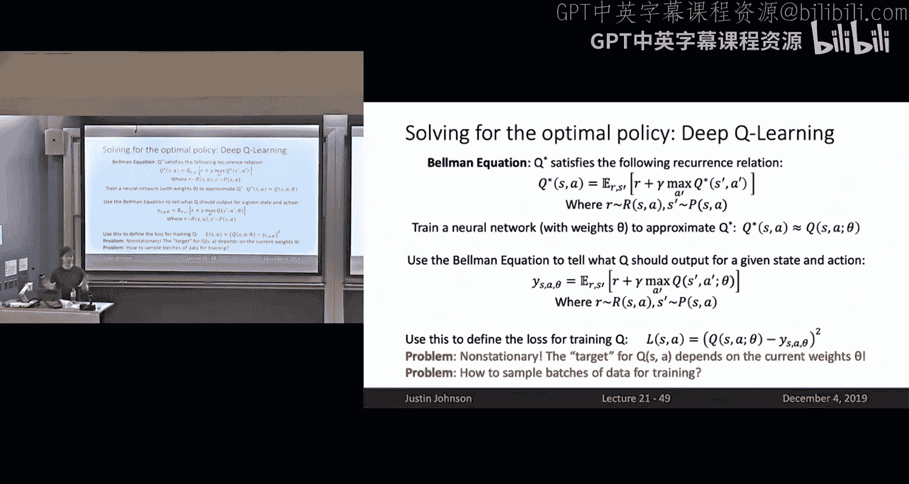

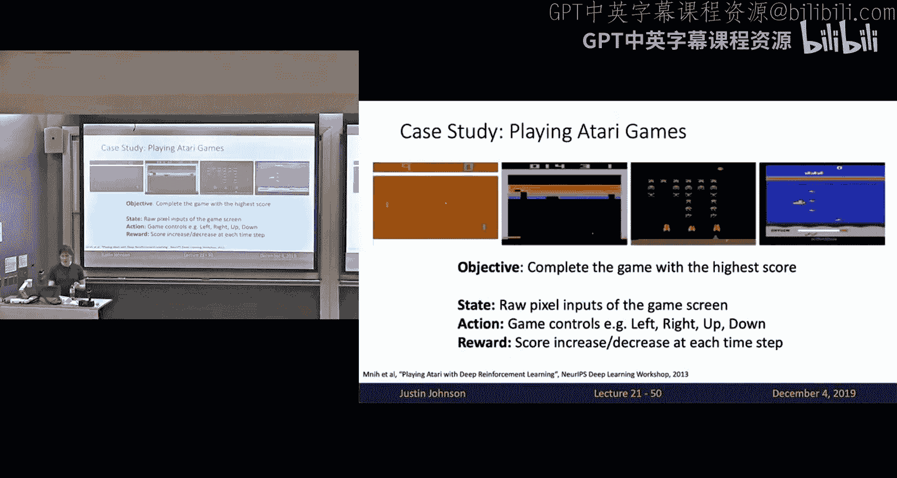

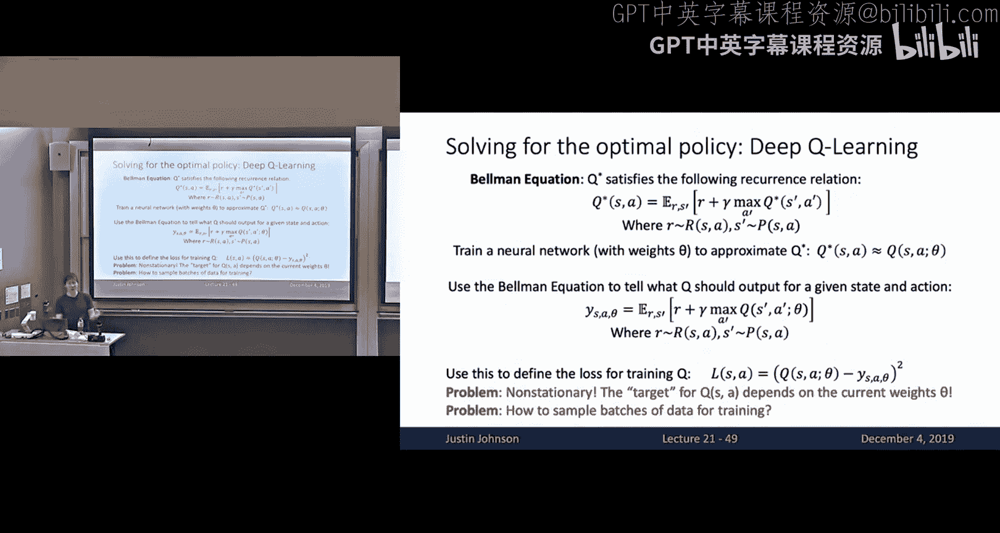

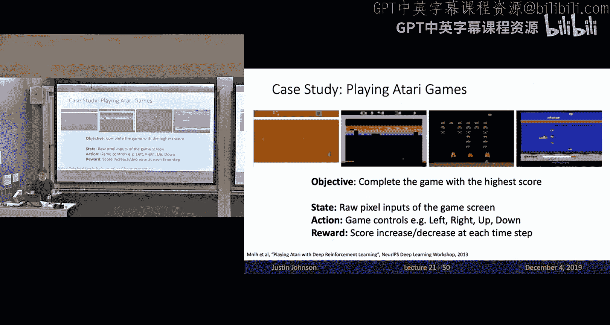

## 策略梯度方法

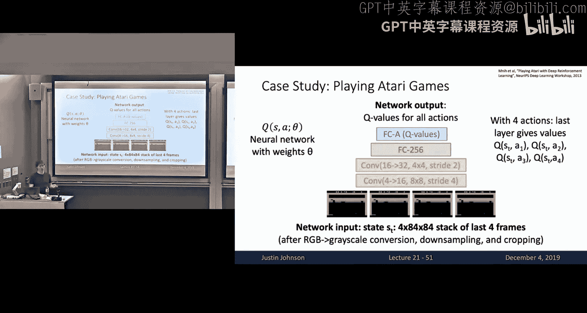

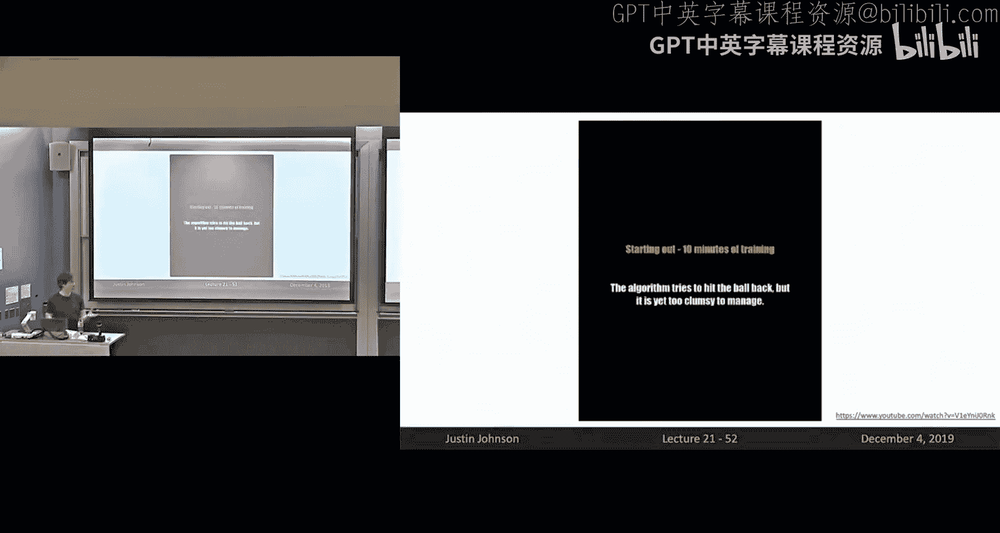

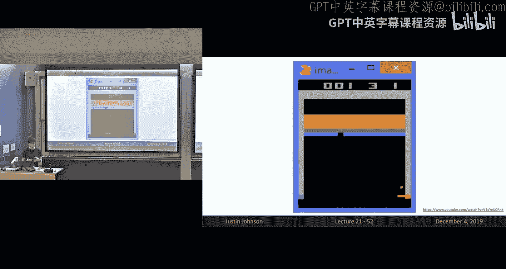

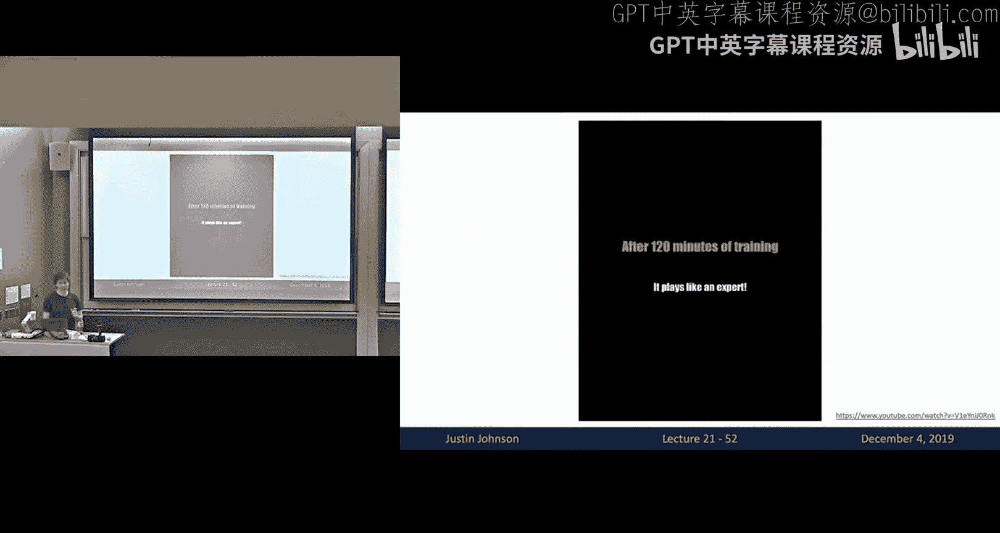

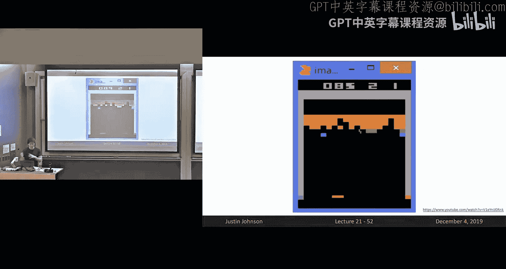

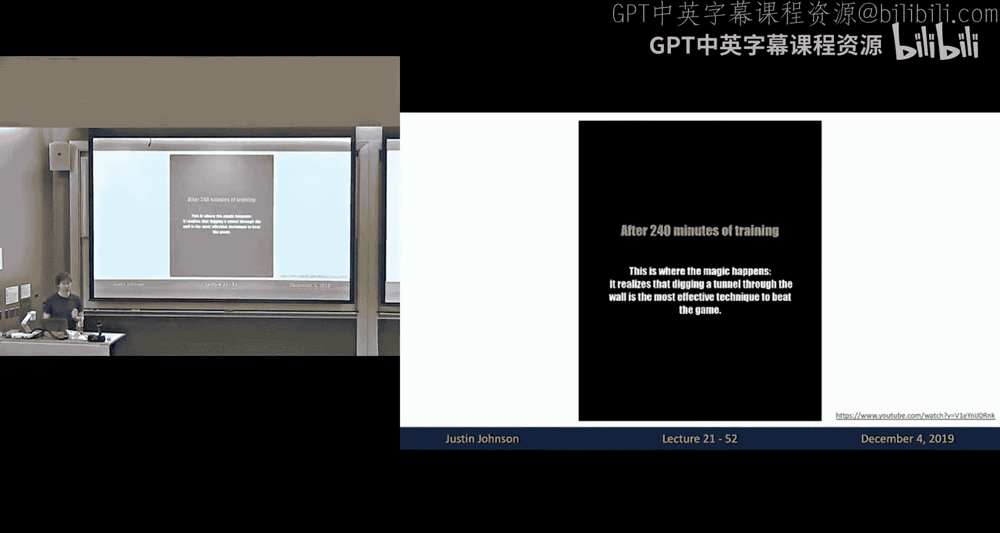

另一种方法是直接学习策略本身。我们训练一个神经网络（策略网络），输入状态 `s`，输出动作的概率分布 `π(a|s; θ)`。

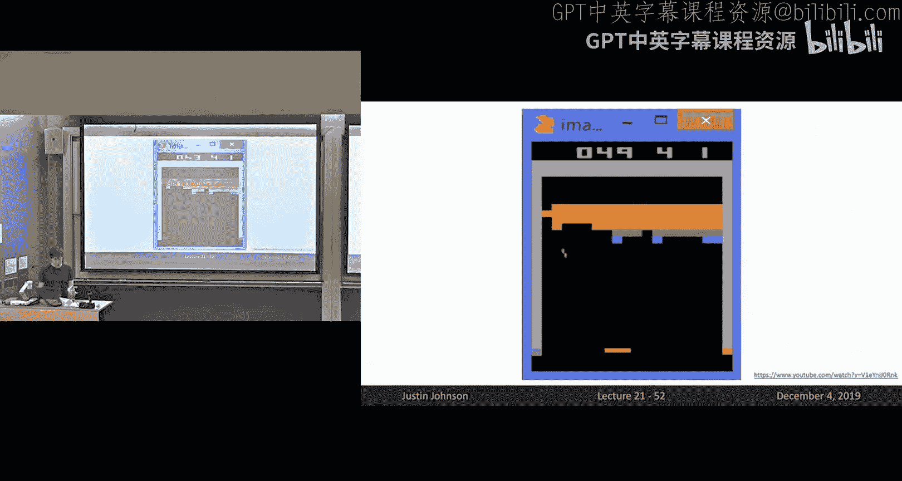

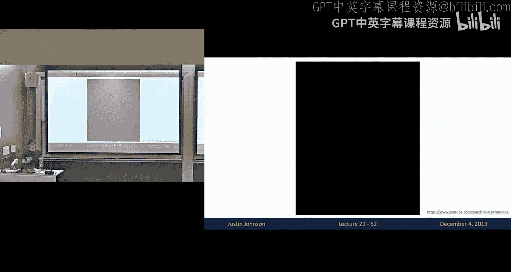

目标是最大化期望奖励 `J(θ) = E[∑ γ^t r_t]`。虽然无法直接计算奖励对参数的梯度，但我们可以使用**策略梯度定理**推导出一个可计算的梯度估计：

`∇_θ J(θ) ≈ E[ (∑ γ^t r_t) * ∇_θ log π(a_t|s_t; θ) ]`

基于此的算法步骤如下：

1.  用随机参数 `θ` 初始化策略网络。
2.  运行当前策略 `π_θ` 与环境交互，收集多条轨迹（状态、动作、奖励序列）。
3.  使用收集的数据和上述公式计算梯度估计 `∇_θ J(θ)`。
4.  执行梯度上升步骤：`θ ← θ + α * ∇_θ J(θ)`。
5.  返回步骤2，重复进行。

策略梯度的直观解释是：如果一条轨迹获得了高奖励，就增加该轨迹中所有动作的概率；如果获得低奖励，则降低这些动作的概率。

## 其他方法与总结

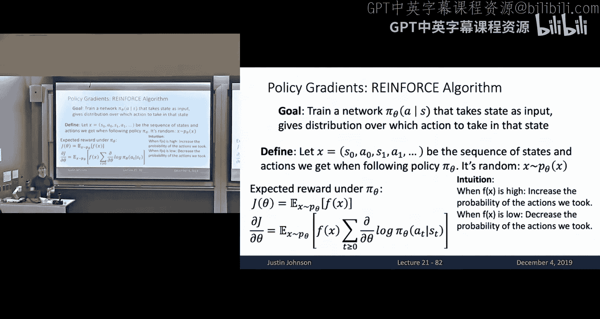

除了Q学习和策略梯度，强化学习领域还有许多其他方法：

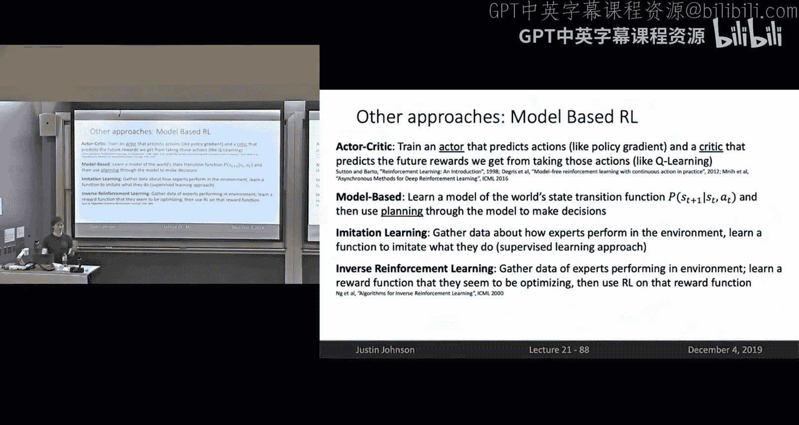

*   **演员-评论家方法**：结合了价值函数（评论家）和策略函数（演员）。
*   **基于模型的强化学习**：尝试学习环境的状态转移模型，然后基于模型进行规划。
*   **模仿学习**：通过观察专家演示数据，以监督学习方式训练策略。
*   **逆强化学习**：从专家演示中推断出潜在的奖励函数。

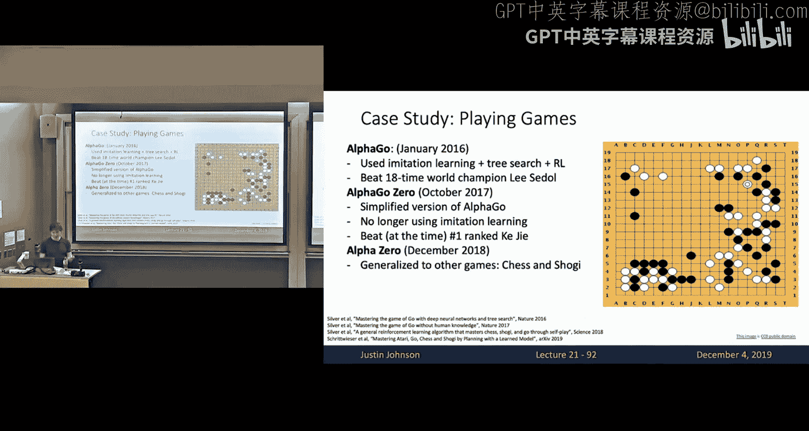

强化学习已取得显著成就，例如AlphaGo系列在围棋上超越人类冠军，以及AlphaStar在《星际争霸2》、OpenAI Five在《Dota 2》中的出色表现。

此外，强化学习的思想还可用于训练包含不可微分组件的复杂神经网络架构，例如**硬注意力机制**，其中网络需要决定在每一步关注输入的确切位置。

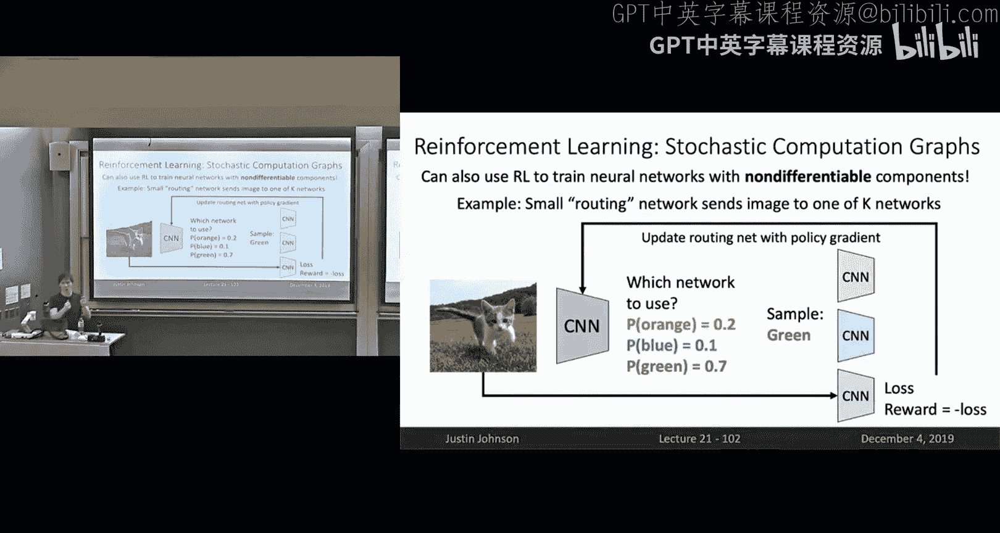

## 本节课总结

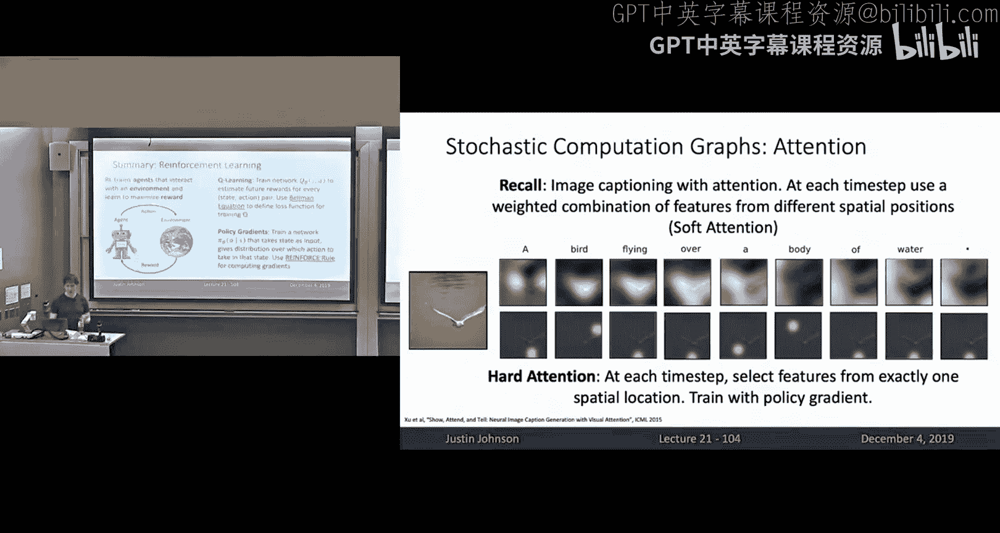

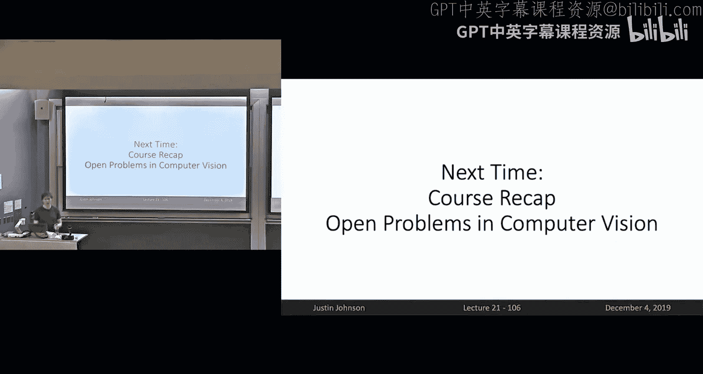

本节课我们一起快速浏览了强化学习领域。我们了解到强化学习是一种让智能体通过与环境交互来学习的独特范式。我们介绍了用于形式化问题的马尔可夫决策过程，并学习了两种基础的算法：深度Q学习和策略梯度。这些算法为构建能够玩视频游戏、下棋甚至控制机器人的智能系统奠定了基础。