# 密歇根大学《深度学习用于计算机视觉｜Deep Learning for Computer Vision UMich EECS 498-007 2019》中英字幕 p23 -23-22_Recap&OpenProblems.zh_en -BV1jA4m1P7GN_p23-

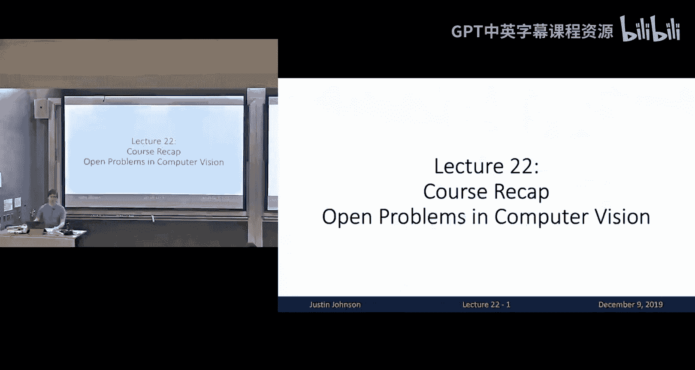

All right， welcome to lecture 22， we made it to the end of the semester or at least I did so you guys I guess still have finals and a couple more assignments to turn in。

 but today is lecture 22 so we're going to today talk about kind of an overview a recap of all of the major points that we covered this semester that'll be about half of the lecture and then the second half of the lecture I wanted to talk about some of my thoughts about what are some of the big problems。

 some of the big open challenges that are facing computer vision and deep learning as we move forward beyond just the content of this semester's class。

So before we get to that， of course you guys have a couple more assignments to turn in。

 so assignment5 on object detection is due tonight。

 hopefully most of you will have gotten that done mostly done at this point。

 and then assignment 6 is on generative models and more specifically generative adversarial networks and that will be due a week from tomorrow and again apologize apologies that this is due during finals week but hopefully it should be a pretty light and straightforward assignment for you guys to do。

So then this semester， we've really talked about deep learning for computer vision。

 and we've spent a lot of time talking about deep learning and computer vision， right。

 So to kind of recap on all of that， computer vision kind of zooming out from all of this details that we've been dealing with is that computer vision is really about building these artificial systems that can process。

 perceive and reason about various types of visual data。😊，And， of course， the big goal in。

 the big challenge in getting this to work is this semantic gap that， you know， computers。

 we can visual we can easily look at these images and understand that it's a cat。

 But images computers are just seeing these giant grids of numbers。

 And somehow we need to deal with that。

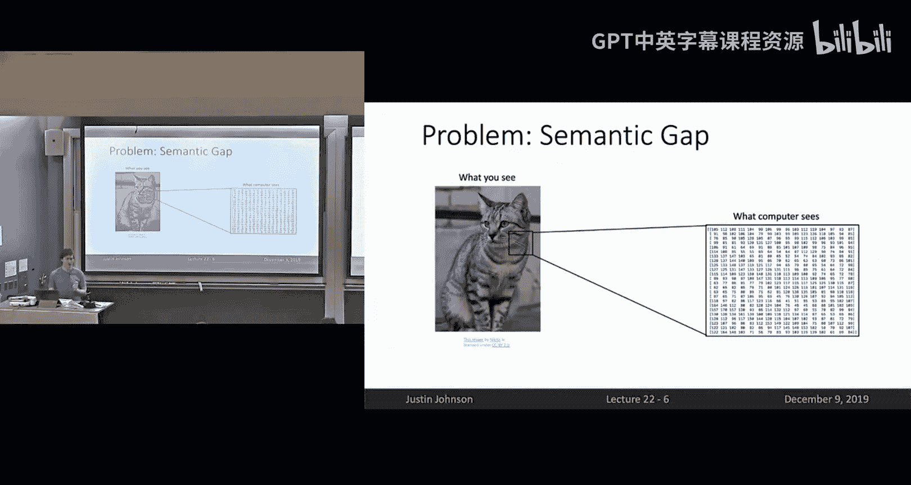

And we need and this visual data is super complex， right as we maybe change our viewpoint or we change the illumination。

 or our cats are deforming then or they're hiding out of the couch。

 then the pixel grids of these images can totally change。

 But our semantic understanding needs to remain the same。

 And this is kind of the big challenge that we were dealing with in all of our computer vision applications。

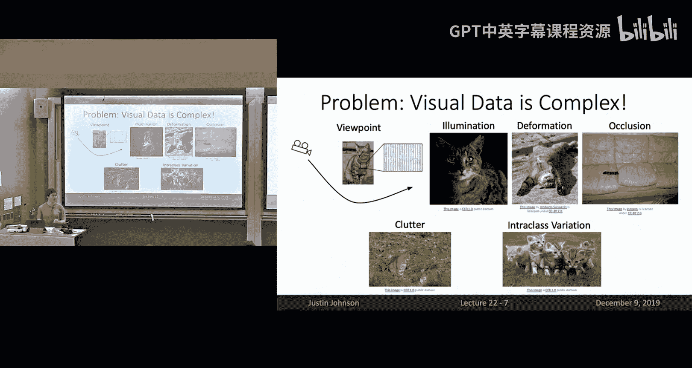

So then the solution that we really hit upon this semester was this idea of the data-driven approach and using machine learning to solve all of these problems that for all of the tasks that we considered。

 all of the types of complex visual data we wanted to understand we wanted to collect a data of images and labels and use some machine learning algorithm to compress or distill the knowledge or the information in that label data set into some kind of classifier object that we typically result that we use neural networks for most of those and then we could use that classifier then evaluate and make predictions on novel images and this machine learning paradigm to computer vision has just become kind of the major dominant approach it's just the way that people do compute the way that people solve most types of computer vision problems nowadays。

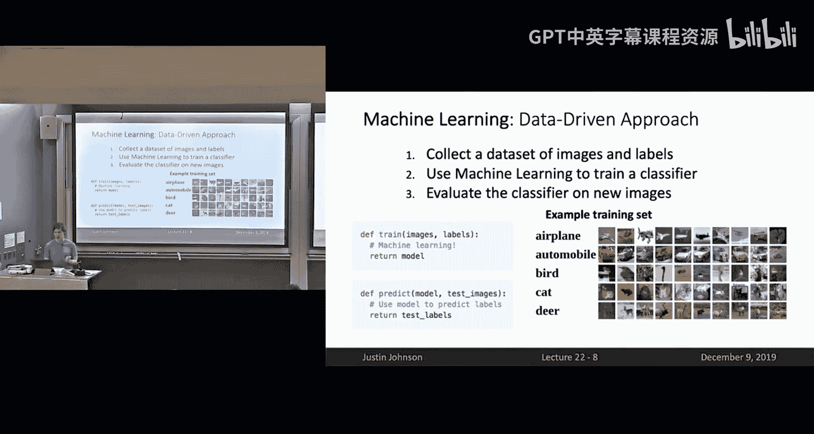

And of course， the model that we are all very familiar with by now is this idea of using deep convolutional neural networks to solve a lot of different types of problems in computer vision。

 but of course models are not alone models alone are not enough to make us solve this computer vision problem。

 We need both models as well as large dataset sets on which to train those models。 So of course。

 the imagenet data which came out maybe back in 2012 sorry all the way back in 2009 was this super influential large scale data that gave that gave us this large scale dataset on which to train our machine learning models。

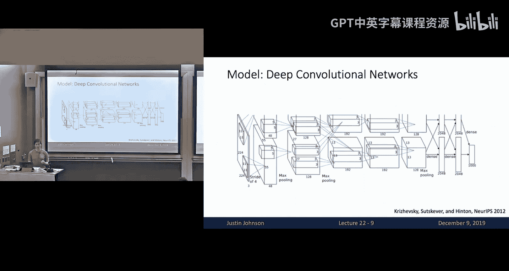

And then sort of in 2012， thing all the magic happened。

 And we combined these large data sets with these large。

 powerful convolutional neural network models， which were combined with the ever increasing speed of GPU and other types of computing devices。

 And that just led to lots and lots of progress in computer vision。😊。

So then as measured by progress on the INet dataset。

 we know that we've now sort of this data set used to be considered super hard back in maybe 2010。

 the error rates were really high， and now in 2017。

 actually was the end of the challenge because error rates on this data were just so good。

And this LED to a massive explosion in just all kinds of computer vision research across across the world。

 really。 So one of the main venues of publication where computer vision researchers share their results is CBPR。

 It's the conference on International conference on Computer vision and pattern recognition。😊。

So this is a photograph I took at CVPR over the summer at CVPR 2019。

 where they were giving some statistics in the opening ceremony of the conference about just how CVPR as a conference has grown over the past 20 years or so。

 and you can see that there's been this just exponential growth in both the number of submitted papers in blue and the number of accepted papers in green at this top computer visionion conference。

But it turns out that this trend has actually continued， even this semester。

 like history has been being made in computer vision。

 even while we've guys have been taking this class。 So actually， I took this picture at CBPR 2019。

 but the CBPR 2020 submission deadline actually was about a month ago。 and November 15。

 And I saw on Twitter some stats about the number of submitted papers to CBPR 2020。😊。

And this is just this this growth in computer vision as a research field has just been continuing its exponential trend。

 even this semester， while you guys were learning about computer vision。

So now CBPR 2020 had about more than 6650 submitted papers。

 and we'll see exactly how many of those get accepted。

 But I think it's safe to say that this trend of exponential growth in in computer vision as a research field is just continuing。

 continuing as we speak， But despite all of this success， We know that all of this success。

 this deep learning stuff was really not invented overnight。

 All of our success has really been drawing on a really long history of a lot of really smart researchers who've come up with a lot of problems throughout the past several decades。

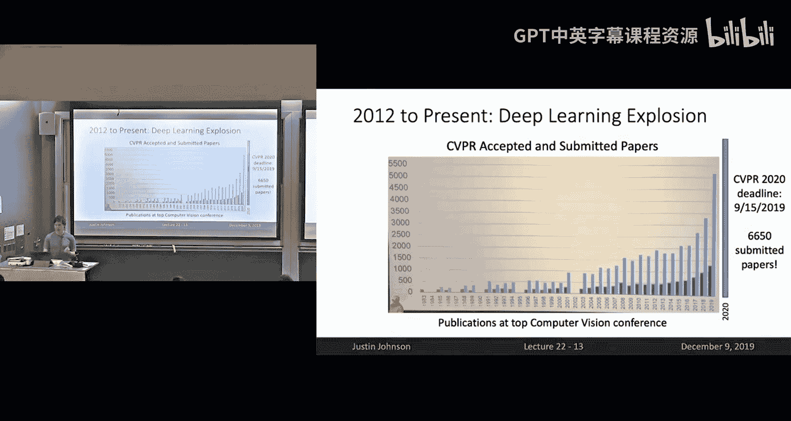

And we can see echoes of their work， even in our modern deep learning systems now。 So if。

 for example， if we look all the way back in 1959， we saw this perceptron model by Frank Rosenblt that basically implemented a linear classifier。

 except that they didn't have sort of general purpose programmable programming language。

 They didn't have Python。 They didn't have Pytorrch。 They didn't have Google coabab。

 They had to make physical hardware to do these things。

 but in the mathematical formulation of what they were building。

 we would recognize now as a linear classifier。Then in computer vision。

 we saw that Huble and weasel back in 1959 were trying to probe the visual representations that cat neurons use to recognize the visual world。

 and that gave us this notion that maybe edges and oriented edges and motion were really important cues in the Mammalian visual system。

 and we've seen over and over again that these cues of motion and edges and colors just show up over and over again whenever we try to visualize the representations that our deep neural networks are learning。

Then moving a little bit forward into 1980， we had this neocnatron model from Fukushima and and really looks a lot like a modern convolutional neural network all the way back in 1980。

 where Fukushima was directly inspired by Hu and weasel's idea of this hierarchy of simple and complex cells in the mammalian visual system and tried to write out this computational model to simulate or process electronically of visual data。

 and that gave us an architecture that looks very much like our modern convolutional networks all the way back in 1980。

And really by 1998， when Jan Lacoon published his now famousous work on convolutional networks。

 this is basically convolutional networks nearly in their complete modern form back in 1998 and really as then moving ahead another 14 years we got to Alexnett。

 which was this big breakthrough performance on the Inett data set and fundamentally it was not that different from the work that Lacoon had done in 1998。

 The difference was that we had faster computers， we had more data and we had some tiny tricks like we had Raylus versus Sigoids was a big one for Alexnett where we had momentum rather than just vanilla SGD。

 so really Alexnett was a very minor leape intellectually in some ways from all of this work that had come before。

 but it just happened at an amazing moment in history and everything came together and led to this deep learning revolution that we've seen in the past 10 years。

And of course， in recognition of all of this influence。

 we know that the Turing award last year in 2018， which is the highest award in computer science。

 considered somehow the Nobel Prize in computer science， was awarded to Yahua Benio。

 Jeff Hinton and Jan Laon for their work in popularizing deep learning and pioneering a lot of the deep learning methods that all of us have been using。

So that of course then of course， the final point in the history of deep learning is， of course。

 fall 2019 this class。 So then what did we cover in this class more concretely right So then we started off pretty simple。

 we talked about we saw we saw some simple ways that we could use data drivenriven approaches to solve machine learning problems。

 So we got familiar with these canous neighbor classifiers and that led us to beautiful discussions on trained test splits and on hyperpara and on hyperpara and other kind of critical components of the machine learning pipeline we talked about linear classifiers。

 which were our first parametric classifier， where we wanted to write down some some functional form that would input the data X and then output some scores Y telling us what we want to predict for that data。

 and we trained these things by learning some weight matrix W and fitting the classifier to our data and that paradigm of writing down a parametric form of your model and then using data to fit the parameters of that model to your data is really。

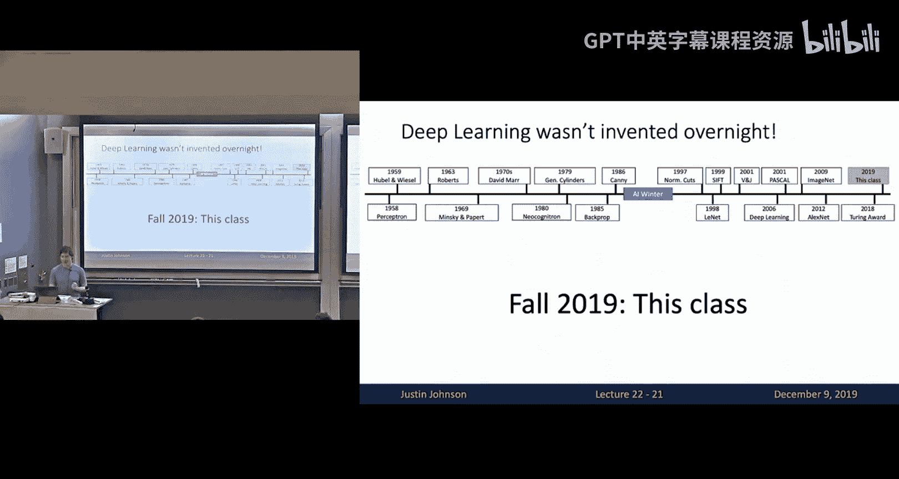

The same mechanical process that we used for just about all of the machine learning methods that we saw this semester。

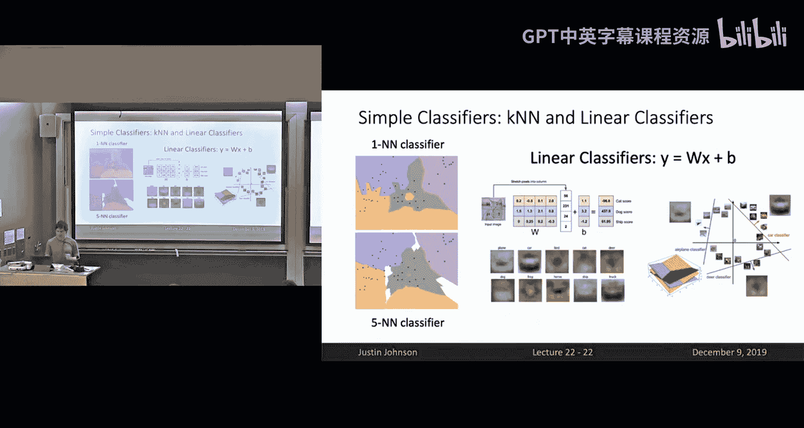

We talked about optimizing those things， right we to once we've got a W。

 we need to find the W in some way。 So we talked about this notion of gradient descent or stochastic gradient descent is trying to compute gradients and follow this lost landscape downhill where the loss quantifies how well your model is doing on your data and by running gradient descent。

 you're kind of trying to find model weights that work well for the data at hand。

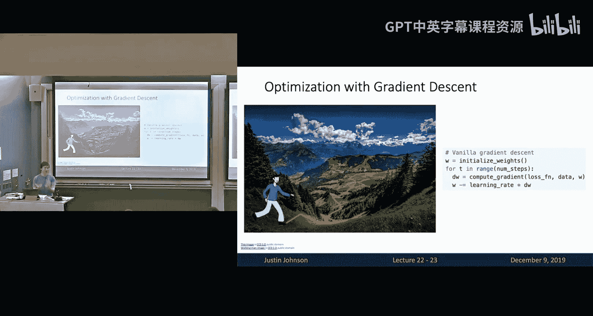

We saw that gradient descent actually had some problems。

 right It didn't It sort of runs into problems with local minima， with saddle points。

 with poorly conditioned optimization problems and with stochasticity in the learning process and to overcome these problems。

 we saw that we could add some of these tweaks like momentum， like fancier optimizes。

 like Ntro momentum， adddigrad， R prop or atom。 and that some of these simple tweaks to optimizers really helped us overcome some of these problems with the vanilla stochastic gradient descent formulation。

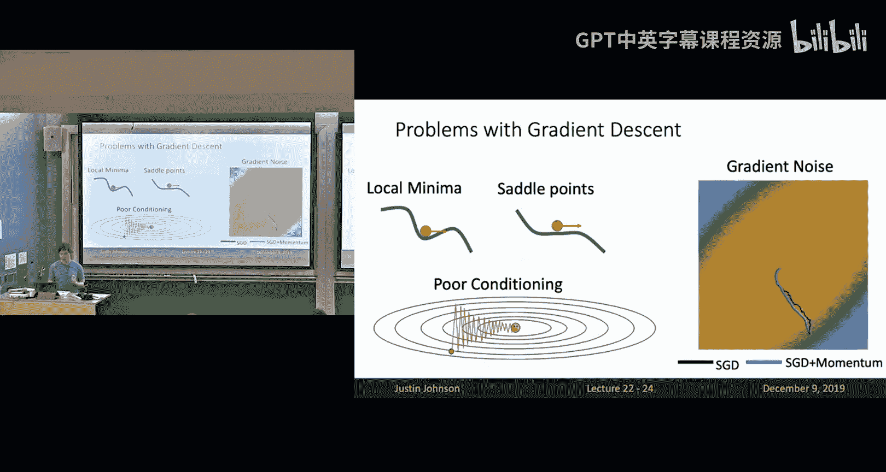

And like I said， actually moving from S G to SGD momentum was， in fact。

 one of the small tricks that was actually different between Jan Lacoon's Comnetets in 1998 and Alexnett in 2012。

 So were these tweaks were actually pretty important in the modern history of getting deep learning to work on large data sets。

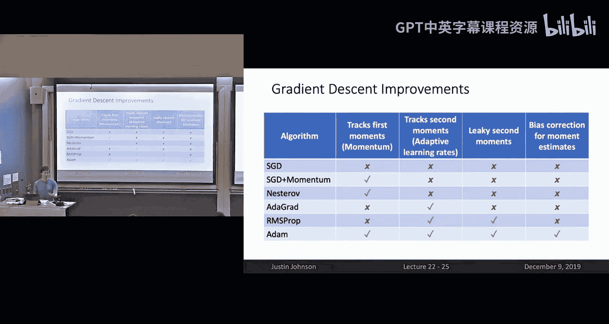

So then once we had in hand this idea of optimization， we moved on to neural network models。

 and we saw our first neural networks， which were these these fully connected neural networks。

 which basically was the same idea as linear classifiers。 We write down some functional form。

 They inputs the the X outputs the scores Y， and we learn those weights on our data set using gradient descent。

😊。

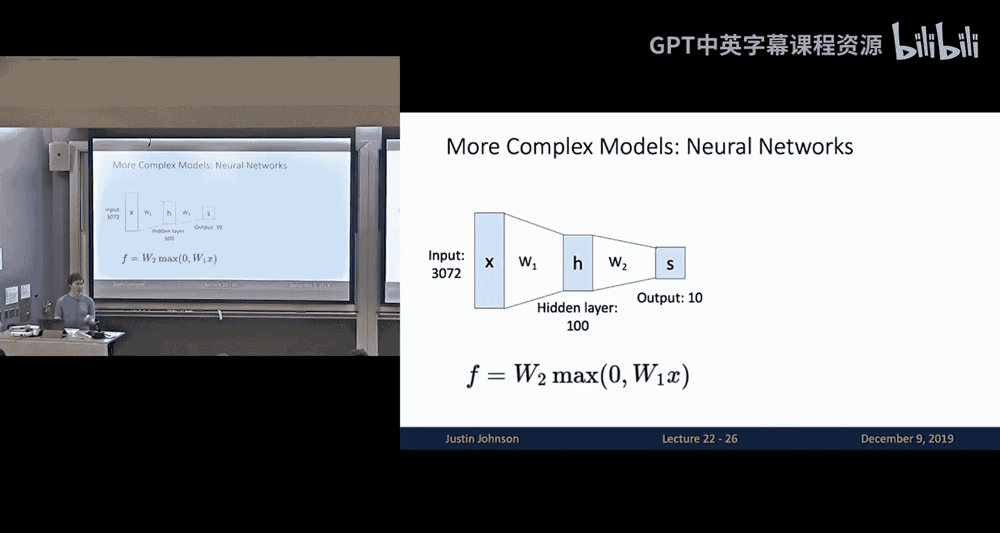

And we saw that one interpretation of what these fully connected models were doing was that they were learning some kind of bank of reusable templates in their first layer and then reshuffling those templates in the second layer to make to recognize different categories that they might want to represent or learn。

 And this gave us a hint that neural networks or fully connected neural networks。

 were doing something very powerful compared to linear classifiers since they could do this I this recombine these templates to represent different categories。

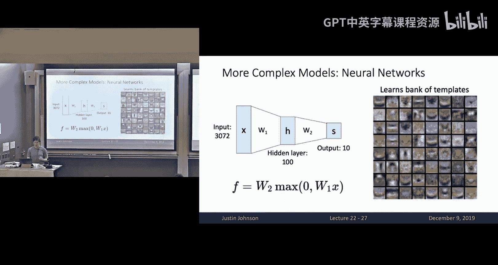

And we made this intuition more formal with this notion of universal approximation。

 where we recall that actually it turns out that a fully connected neural network with a single hidden layer using ray nonlinearities can approximate any continuous function on subject to many mathematical constraints。

 And this gave us some some really powerful theoretical intuition that neural networks are this very powerful class of function approximation algorithms that we could use them for many。

 many different problems in computer vision and beyond。😊，But of course。

 fully connected networks are great， they're theoretically powerful。

 but we wanted then to return to the problem of computer vision and think about how we can build neural network models that are specialized to the spatial structure or the problems that arise in computer vision。

And that led us to our discussion of convolutional neural networks。

 where we augmented these fully connected layers， these activation functions with additional types of differentiable operators。

 this convolution operator that maintains spatial structure of our input images and shares weights across different spatial positions in the image。

 pooling layers which somehow reduce the spatial size of our representation and introduce additional invariances into the model and these normalization layers like batch normalization。

 instance normalization， group normalization that allow our deep neural network models to be trained more and more efficiently and optimized more efficiently。

😊，But， of course， once we've got this set of components for neural network models。

 it's really sort of tricky to understand what's the right way to put them together to solve different types of problems in computer vision。

So we talked about classical architectures in computer vision。

 which are different paradigms for how are good ways to stack together these basic building blocks to arrive at really high performance neural network models for solving computer vision tasks。

So we talked about this Alexnet architecture from 2012。

 bigger and bigger models like VG G like GoogleNe and like ResNes。

 which finally allowed us to train models of hundreds of layers in depth。

And then we saw that a big trend in designing neural network models in the past year or two has really been a focus on efficiency that now because we know how to build really big highcapacity neural network models like residual networks and train them efficiently on large datasets。

 then a big goal becomes actually not just what is the best performance we can get on our data。

 but actually what's the most efficient model that we can build to get high performance on our datas。

 So then we saw that in the last couple of years， people have been much more sensitive to building not just models that work well but models that are efficient and actually could be deployed on mobile devices or to run inference across server farms for big tech companies。

So then we saw that architectures like ResnX or MoNes were really focusing on improving the efficiency of convolutional neural network architectures and a lot of these played tricks by playing around with the convolution operator。

 so in the Resn architecture， for example， it made use of these grouped convolutions。

 which allowed us to have these sort of multiple parallel branches of convolution inside the model。

 and that improves the overall computational efficiency of the models。

RightBut now once we've got these really high performanceform really deep。

 really complicated neural network models， we need some way to think about them more formally as mathematical objects。

 and we saw that one way to do that was this notion of a computational graph rather than that we can write down our neural network models and rather than writing to bound as a giant equation with a lot of learnable weight values inside that equation we could represent our neural network models as these graph data structures where each node was some primitive operator in the model and the edges are passing data between these different differenti operators。

And then these computational graph， this idea of a computational graph。

 then lets us really easily represent even these very complicated neural network models。

We saw this back propagation algorithm that then let us efficiently compute gradients in these computational graphs of arbitrary complexity and the beauty of this back propagation algorithm。

 of course， was that it takes this global problem of computing gradients in this arbitrarily complex graph and converts it into a local problem。

 where each individual node in the graph only needs to know how to compute its local derivatives。

 given the compute its local gradients then it receives thesestream upstream derivatives and passes downstream derivatives down to the left。

 and it doesn't need to care about exactly the global topology of the graph into which it's embedded。

Then based based on this back propagation algorithm。

 then we moved on and talked about different sorts of practical hardware and software platforms on which people are running these deep neural network stacks these deep neural network models。

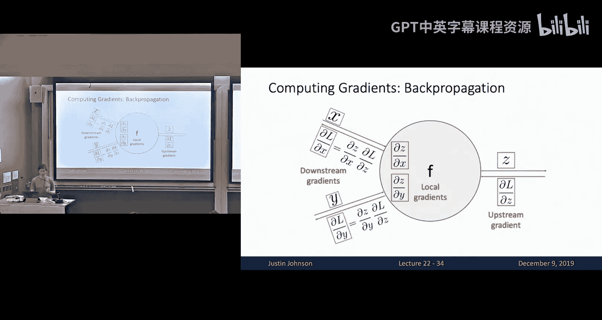

So we saw that we've seen kind of a shift in hardware from CPUs， maybe back in 1998。

 when Janon Lacoon was training his models to GPUs graphics processing units。

 which were one of the key components in the success of the Alex architecture in 2012。

 and then more recently， we've seen people start to design specialized hardware for neural network computing。

 like the Tensor processing units or TPUs from Google。

We've also seen a dramatic we've also seen there have been some really powerful software systems built to help us build these really big neural network systems so of course I think you all are now experts in Pytorch because you've been using it for all your homework assignments there's this other deep learning framework called TensorFlow you may have heard of from people at Google which I think you'll see out there in the world as well and we saw that one of the big one of the top level differences between these two different frameworks was these software ideas of static computational graphs versus dynamic computational graphs and these are kind of different software paradigms for organizing the computational graph abstraction inside your software systems。

So I always thought that this topic was really fascinating right because we sort of set out in this class to solve computer vision。

 which is this particular application domain， But then in trying to solve computer vision we ran into this new technique called convolutional networks。

 But then in order to make convolutional networks really good。

 then we had to branch out into other areas of computer science。

 and then we had to build new sort of new hardware platforms on which to run those algorithms。

 as well as think about new ways to organize complicated software systems in order to let us build those powerful algorithms。

 So I always really thought that this topic was quite interesting since it really branch out and forces us to think about about how computer vision and machine learning。

 interact with a whole large different subareas within computer science。😊。

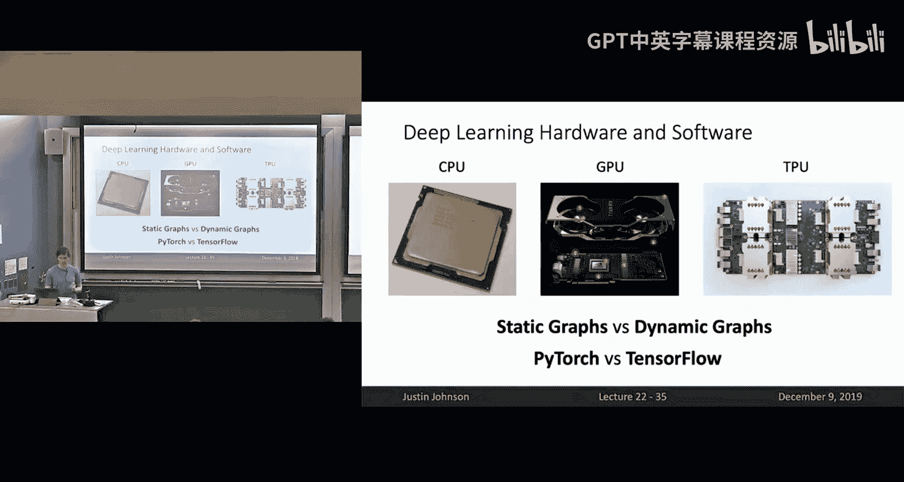

But then we had to sort of get back to this machine learning problem。

 and we talked about a lot of nitty gritty details about how you can actually get your comes to work。

 So you saw a bunch of different activation functions。 We talked about things like preprocessing。

 which are important for getting your networks to learn efficiently。 weight initialization。

 it turns out that the way you initialize the weights in your models is really important。

 And now you guys know the right way to do it。

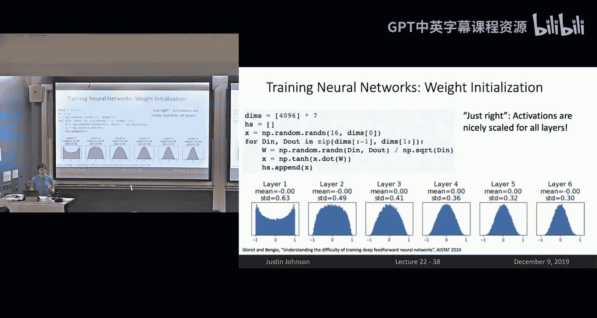

There's things like data augmentation which sort of let you bake in additional invariances into your models by artificially expanding your data during training time and this can be really important for building high performance models。

 We saw a bunch of different regularization techniques so regularization was this idea of is that we don't want our models just to work on the training set。

 we want to build neural network models that can extend and apply to general model to general images to new images that they had not seen during training and then regularization techniques are some way to constrain the capacity of our model and maybe make it work a little bit worse on the training set such that it can work better on the test set on these images that we really care about at the end。

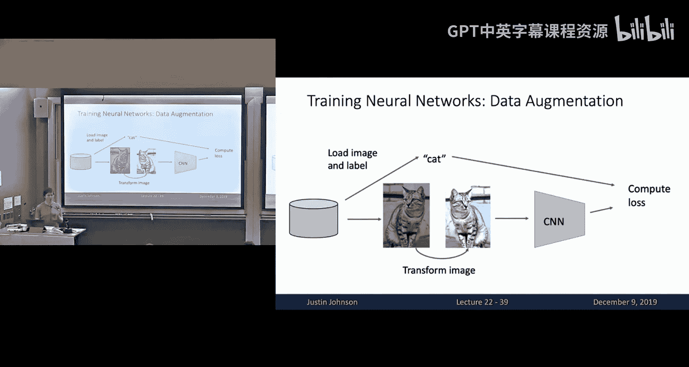

And here we saw that a really common paradigm for regularizing deep neural networks was to add some kind of stochasticity or randomness to the processing of the model we saw things and then at test time。

 you kind of average out or average out that randomness。

 So then we saw things like a fractional pooling， like dropout， drop connect。

 batch normalization fits into the same paradigm and just a whole bunch of different techniques for regularizing our neural network models。

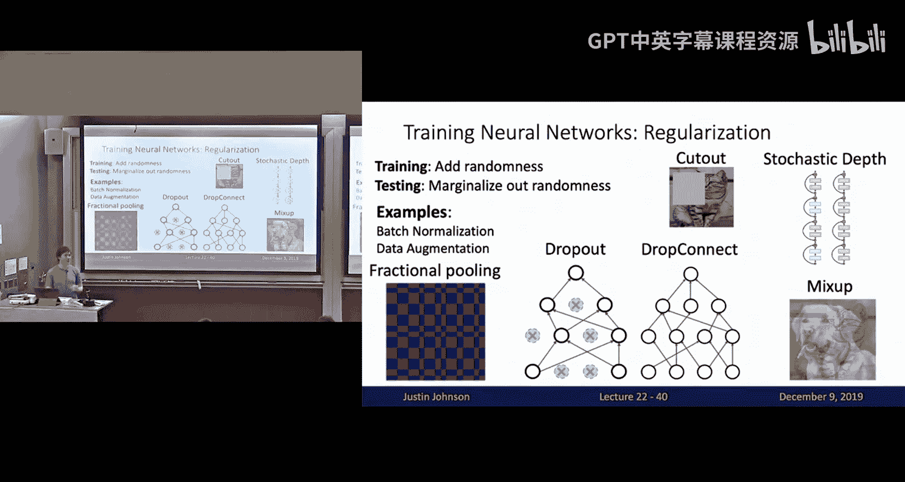

It turns out that learning rates are important， so we saw different schedules for changing your learning rates over the course of optimization。

 we talk about different mechanisms for choosing hyperparameters and hopefully now you guys have trained a bunch of neural network models and you've gained some intuition and you know that you can gain some intuition about whether your models are working well or not working well just by looking at the learning curves of the loss and the training and the validation accuracies and often by just looking at these curves can give you some insight into maybe what things you might imagine changing to make your model work better。

Hyperparameter search。 you guys felt the pain on your homework。

 it's tough to choose good hyperparameters， but hopefully that was enlightening for you to go through that process for yourself。

So then after going through all these tips and tricks。

 we were kind of we were pretty good at training neural network models。

 and we knew at this point pretty much how to train state of the art models for image classification。

 and there， armed with that knowledge， we started to branch out and consider other applications of these deep learning models to other types of problems。

😊，One problem is just how can we understand what it is that our neural network systems have learned。

 So we talked about techniques for visualizing and understanding what a trained neural network has learned on our different computer vision data sets。

And then we saw that some of those same techniques could be used for fun applications too。

 like making artwork， we saw out these deep dream and neural style transfer algorithms that let us use sort of feature visualization techniques to actually generate beautiful pieces of artwork。

Then from there， we started to get even more wild and consider applications even on non-visual data or on other sorts of data。

 So we talked about recurrent neural networks， and we saw that recurrent neural networks were this general mechanism that let us learn to process sequential data with deep learning architectures。

 and that opened up a whole new wide realm of possible applications for computer vision and beyond。

We saw some concrete architectures for different recurrent neural network units。

 like the vanilla R andN that you implemented in your homework。 And I think that the LSTM。

 which is much more robust。

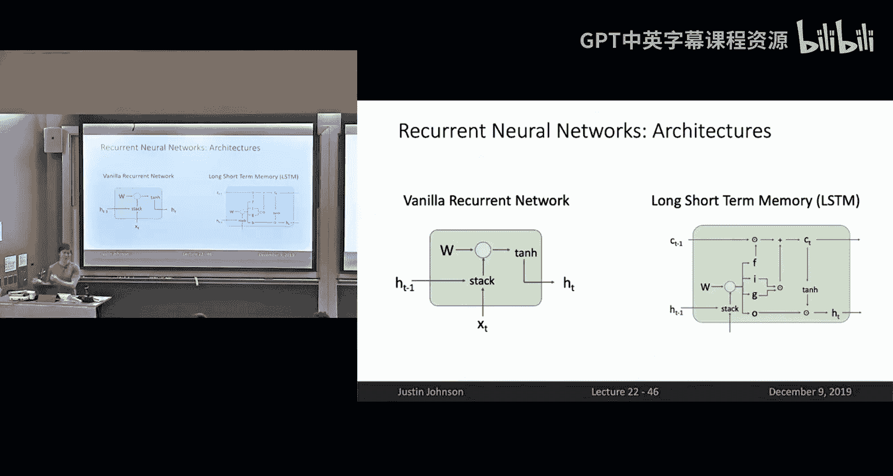

As one of these applications that I always thought was really fun in computer vision was this application of image captioning where we saw that you could teach neural network systems to write natural language descriptions of images by combining a big convolutional neural network that processes the image features with a recurrent neural network that spits out the language and this is something that you implemented on your homework。

 but this was sort of a nice application of combining sort of computer vision processing with convolutional networks with natural language processing with recurrent neural networks。

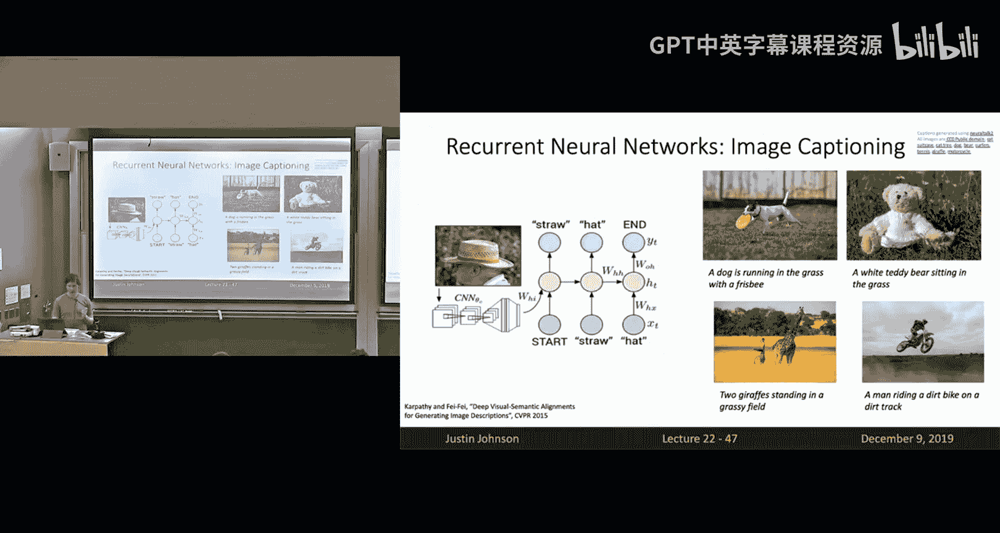

And we saw that this mechanism this basic recipe of image captioning could be improved with this idea of attention。

 that at each step of processing of our system， we could actually have it look at different parts of the image using this kind of soft differentiable attention mechanism。

 and that gave some additional interpretability to our image captioning systems。 but attention。

 it turned out， was not just a trick to be used in image captioning。

 attention was actually this general mechanism that we could use for processing sets of data。

 So then generalizing the notion of attention led us to this general self-atten layer。

 which inputs a set of vectors， computes attention across all vectors in the set。

 and then outputs a new set of vectors。

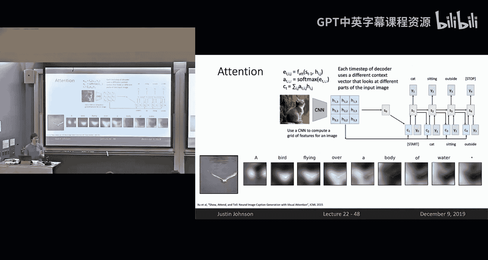

And we we saw this idea of selfatten over and over and over for different applications。

 We saw selfatten。 We saw these attention mechanisms。

 maybe for augmenting or current neural networks for captioning。

 We saw them for in video in video classification networks， there was some notion of attention。

 We saw attention， also in in generative models， where it turns out that adding selfat to big generative models also can improve their performance。

 So this selfatten layer was something really important and really general。

 And I think a really interesting new， basic component of deep learning architectures that is really come to the forefront in the last couple of years。

😊。

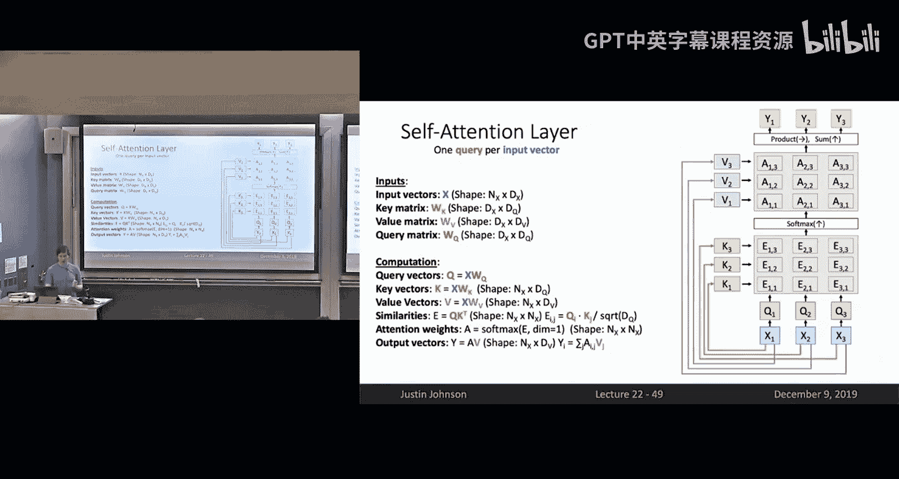

And then to really drive home this idea of attention as a basic building block of machine learning architectures。

 We saw this transformer architecture， which it turns out attention is all you need。

 and you can actually build really high performance systems for natural language processing。

 using only selfatten as our main processing as our main computational primitive。

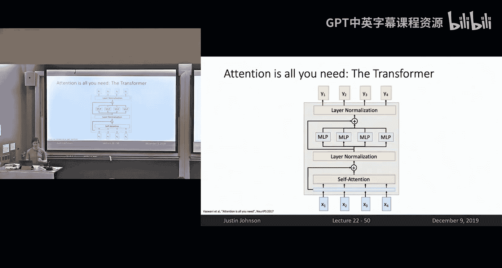

So then we moved on， we moved back to computer vision。

 and we talked about a bunch of different additional， more involved tasks in computer vision。

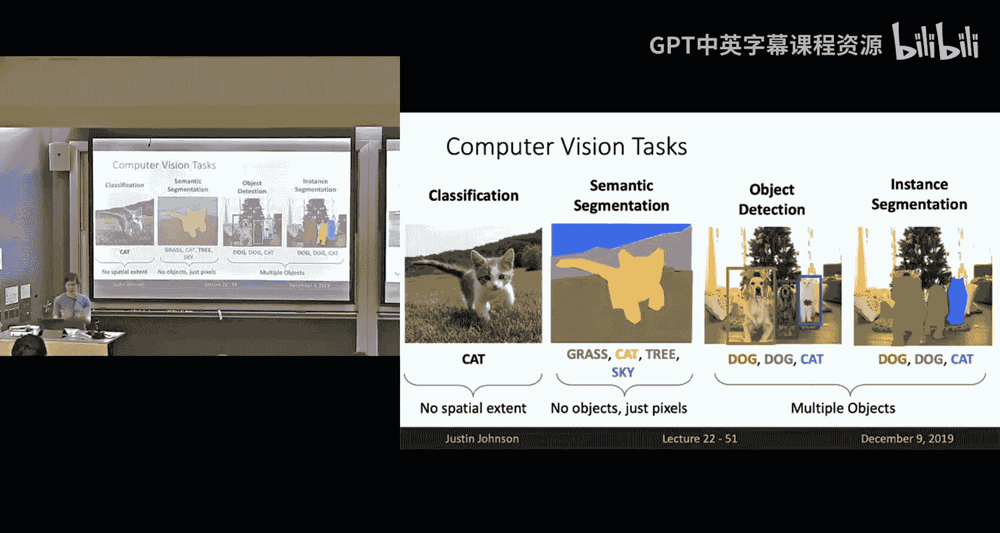

So we saw we talked about object detection， where we wanted to train I mean。

 I guess you guys have object detection homework do today。

 So you should know all about these single stage and two stage methods， right。

 but we wanted to build systems that can draw boxes around objects and images。

 And we saw that there were different ways of for hooking up the convolutional neural networks to solve those kinds of problems for us。

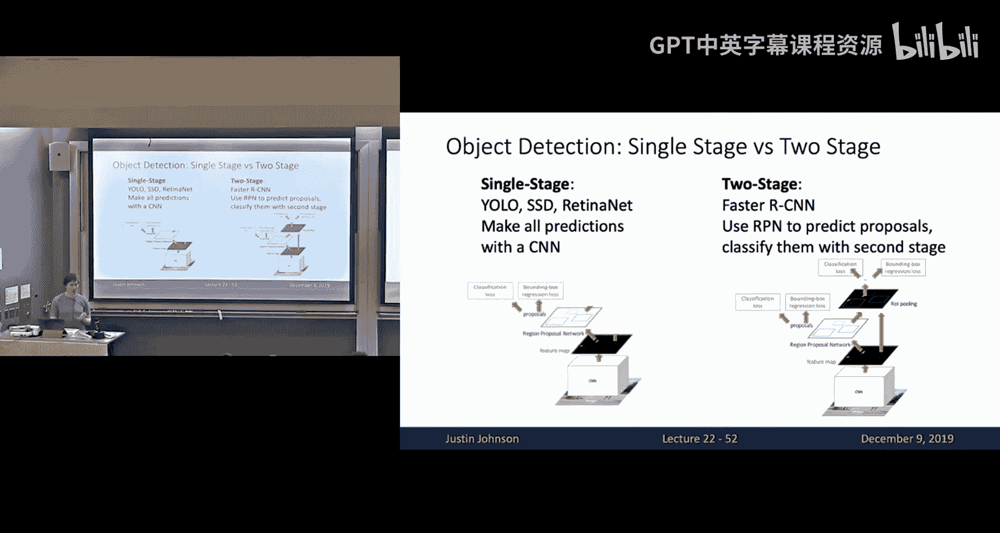

Smanic segmentation was another way of adding spatial information to our computer vision tasks where we wanted to or now in spanic segmentation。

 we wanted to label every pixel of our input image as one of our category labels。

 And we saw that we could do this using some kind of fully convolutional neural network that has both learnable downsampling layers like stride convolution and learnable upsling layers like transpo convolution or different types of interpolation。

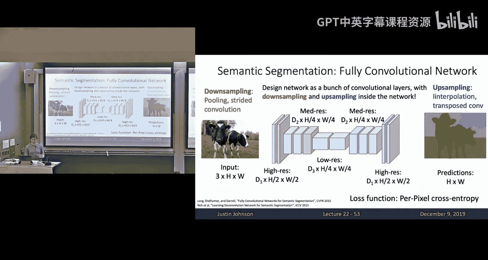

We saw that we could combine together these ideas of instant segmentation andman of object detection and semanic segmentation that gave us this new task of instant segmentation。

 where our models wanted to both detect all the objects in the images as well as tell us which pixels belong to each of the detected objects。

 And now that even now this really complicated seemingly complicated task。

 it turned out we could actually do in a fairly straightforward way by building on our object detection systems and attaching this additional mass prediction head on top of our on top of some kind of two stage object detection system。

And then we saw a bunch of other applications where you could do a lot of other types of per frame processing of sorry。

 region based outputs in computer vision systems by kind of attaching additional heads onto the output of an object detection system。

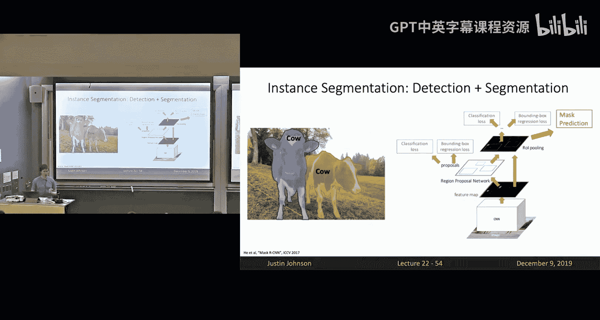

As another application of that type of paradigm， we saw this mesh RCNN system that could predict full 3D triangle meshes giving not just the 2D shapes of objects and images。

 but the 3D shapes of objects and images and the way that we do that is sort of attaching an additional mesh processing head onto the output of our object detection systems that we came to know And then it turned out that 3D computer vision was a very rich and interesting domain unto itself。

 and in order to process 3D data or generate 3D shapes we talked about a whole bunch of different types of 3D representations that people use for dealing with different for dealing with 3D data and that led us to discussions of different types of neural network architectures that could be used for processing each of these different types of data。

Then we tried adding not just a spatial dimension， but a temporal dimension to our neural network models。

 and we talked about mechanisms for generating for classifying or processing videos with deep learning models and there we saw some ideas like 3D convolutional networks that are doing convolution。

 not just not just over the two spatial dimensions but also over the temporal dimension we saw two stream networks that combined one stream for processing motion data in the term in form of optical flow and another stream for processing visual data there was a normal RGB commnet we saw ideas like self-attention come up again in video or recurrent neural networks as a mechanism for fusing information across time in long video sequences。

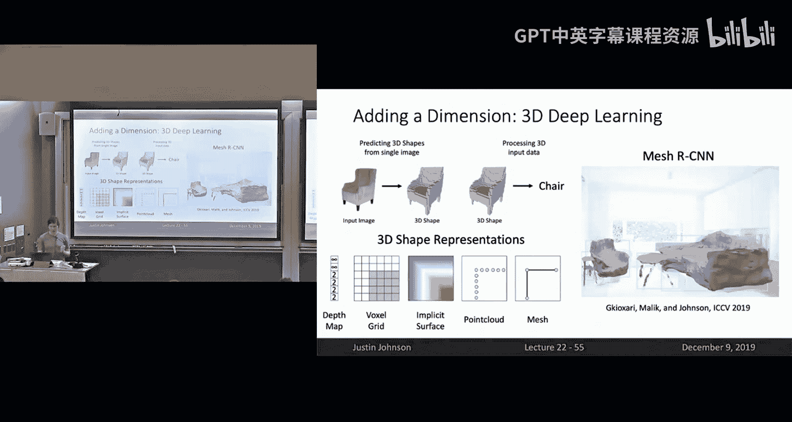

Then having been experts in video， we spent a while talking about generative models。

 which were then models that now not ingest visual data。

 but tried to generate or produce or output novel visual data in some kind of learned deep learning paradigm and there we talked about three major different paradigms of generative models。

 Of course we saw autoaggressive models， which just tried to directly maximize the likelihood of the training data under some kind of parametric function represented the neural network we saw variational autoencodederrs。

 which gave up this idea of explicitly maximizing the likelihood of the data and instead introduced the latent variable。

 and they wanted to both learn the latent variables for all of our data as well as well as jointly maximize the likelihood of the data but we saw that in order to do that we actually had to give up on exact maxization of the data likelihood and instead we saw that we could maximize this variational lower bound to let us jointly learn to model not just distributions over our data。

 but also distributions。

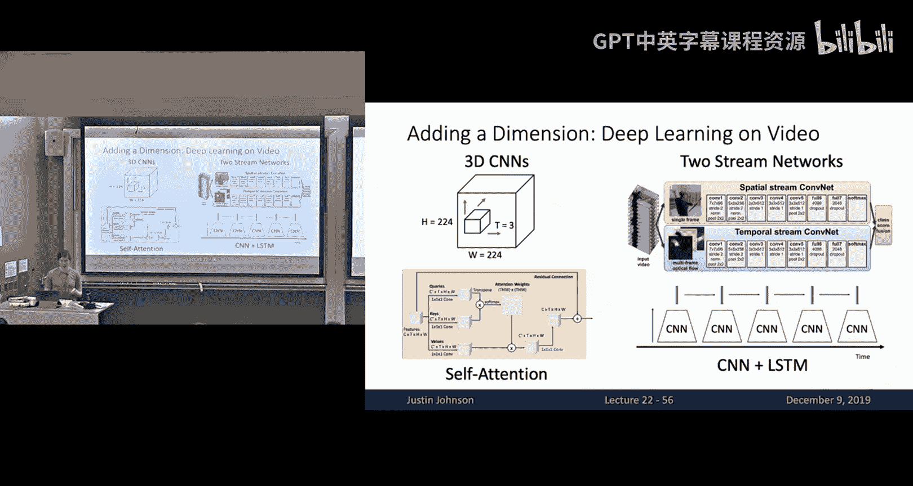

Over their latent variables。 And that let us do things like edit images and learn later representations using only image data。

And we also saw a lot of generative adversarial networks that are sort of state of the art in generating beautiful images。

 And we saw a bunch of examples of using generative adversarial networks in different contexts to generate different types of visual data。

And then finally in the last lecture， we talked about this whole different paradigm of machine learning。

 which is reinforcement learning， where now rather than just sort of learning to fit a data set。

 instead we want to train some agents to interact with the world and we saw that this introduced a lot of extra sort of mathematical formalism so we only saw the barest taste of this reinforcement learning problem in one lecture but we saw sort of two basic algorithms for reinforcement learning。

 one was Q learning and one was a policy gradients。

 which were sort of two different ways of attacking this idea of training models that can interact with the real world。

So that's basically all the whole semester of content in like 25 minutes， right。

 We could have saved ourselves a lot of time。 just done that at the beginning， right。Or maybe not。

But then now that we've understood all of this stuff， there's a big question of like， what's next。

 right， This is an active research field。 We saw there was just like 6000 almost 7000 papers submitted to CBPR。

 There's thousands and thousands people around the world writing new research papers in this area as we speak。

 So then what are some of the big topics that I think are going to be interesting in computer vision and machine learning and deep learning going forward。

 Of course， it's impossible to predict the future。 But these are just some of my my ideas or my predictions or my hypotheses。

 And you may disagree with me。 You may think that other things are going to be important。

 But that's that's interesting and exciting。😊，So one prediction that's， you know。

 kind of trivial is that we're going to discover new and interesting types of deep learning models。

 right， throughout the history of deep learning for computer vision。

 we've seen people continually inventing new and interesting architectures that allowed us to build bigger and more interesting models and tackle more interesting tasks。

😊，And I think this will continue in the future。 and the types of the types of models that we consider deep learning will continue to expand and expand and expand over time。

 So as kind of one example of what I think is a really novel type of new architecture that really changes our perception of what a deep learning model can be is this idea of the neural O D E that actually won a best paper award at Nps last year in 2018。

So here we're sort of really familiar with residual networks， right。

 We know that in any kind of residual network， it's learning a sequence of hidden states as we process the data。

 and each hidden state， those are like the activations of your convolutional model。

 And these activations， what we're going do to compute the next layer of activations。

 We're going take our previous layer of activations。

 and then apply some function to that layer that depends both on the activations themselves and on some learnable parameters。

 and then add it back to produce the next hidden layer。

 then that gives us some formulation like H T plus1 equals H T plus some function of Ht and theta T where these are our weights。

😊，And now some really crazy people thought that this equation actually looks a little bit like solving a differential equation。

 right Like how do you actually numerically integrate a differential equation Well。

 usually what you do is you sort of have a differential equation。 you start at some initial point。

 you make some small step。 that you like make some small gradient step on a differential equation and you kind of use that idea of many。

 many small steps over time to actually numerically integrate differential equations。😊，And that。

 from that perspective， the number of approximation steps that we take to numerically integrate a differential equation is kind of like the number of layers in a residual network model。

So then if we want to take it to infinity， then we could actually have a neural ODE where the states of the neural network are。

 in fact， a set of continuous solutions to some kind of differential equation。

So then we write that maybe the derivative of the hidden state with respect to a continuous variable time is then equal to some parametric function represented as a neural network。

 And then we can actually write down like I'll solve this differential equation to again give a trajectory of hidden states over time that is kind of like a neural network of infinite depth。

And then it turns out， even though that seems crazy。

 there's actually ways you can train these kinds of models and then represent neural network models as differential equations that gives us a very different。

I mean， this is just a whole different category of looking at what a neural network model can be。

 And this， I thought was really exciting。 And I I don't know what the practical applications of this could be。

 but I think it's just a hint of the fact that I think we will discover new and more interesting types of neural network models that will push our perceptions of what it means to be a deep learning model。

 And some of them might be dead ends。 Some of them might end up being the next big thing in computer vision or deep learning。

 And it's just impossible to say， which is going to be which at this point。😊，So another kind of safe。

 boring prediction is that deep learning will continue to find new applications， right at this point。

 we know that supervised learning on large label data sets works really well for a lot of problems。

 It turns out that for a lot of problems， if you can collect a large data set of images and labels that you want to predict from from those images。

 then for many such problems， if you get enough data and spend enough time tuning the model。

 you can probably train a neural network that works pretty well for a lot of those applications。

 And I think that people will use those basic ideas in supervised learning and just apply them to more and more and more things out in the world。

 even beyond the beyond the small set of data sets that we work on within computer vision。😊。

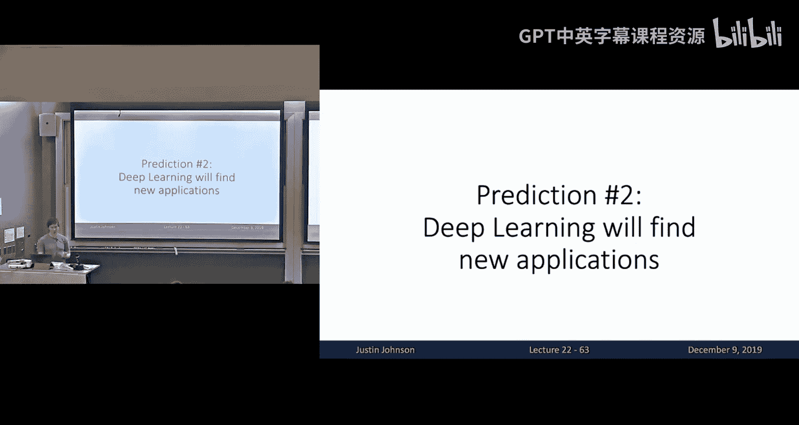

So I think we'll see a lot more deep learning for many different types of scientific and medical applications moving more and more throughout time。

So I I think that like medical imaging or different types of medical applications。

 I think it'll be more and more common for people to try to train computer vision systems that try to diagnose or aid in the diagnosis of different types of diseases by using deep learning models on different types of medical data。

And I think in a lot of different scientific disciplines。

 people are like scientists in lots of different disciplines are always generating more and more types of data that they need to be able to analyze。

 And I think that deep learning will help build help scientists in different domains。

 just analyze the data that they're already collecting。

 And I think it will lead to improvements across many different areas in science。Now。

 I think also that deep learning will as these are all kind of obvious applications。

 I think that anything that uses images， I think we will see deep learning applications for in the future。

 But I think that sort of interesting and surprising applications of deep learning will pop up as well。

 So as kind of an example of that， there's this really interesting paper at Sigma 2018 about using deep learning to improve traditional computer science data structures like a hash table right So how can deep learning hash table should be an implementation detail inside the deep learning system now they're kind of flipping it around and using deep learning to improve these basic data structures like hash tables。

😊。

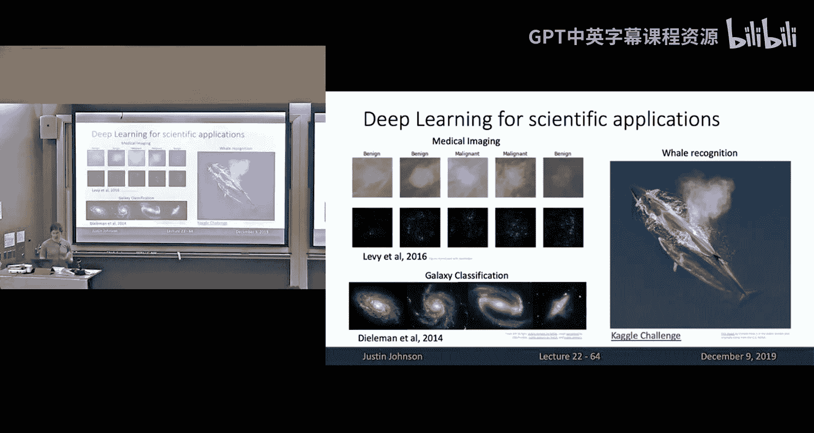

And here， the idea is like what is a hash table。 Well。

 if you kind of remember back to your data structures course。

 then a hash table is going to input some key， and then that key is going to go through some kind of a hash function。

 the hash function is going to assign the key to one of these buckets。

 And then when there's a hash collision， then you'll maybe have some kind of linked list of all of the bits of data that have been hash to each different bucket。

 And now to get a really good performing hash table。

 you need a really good hash function that is going to minimize the collisions of of your data set and assign different data different data elements to different buckets。

And usually， these hash functions are kind of hand design functions。

 But it turns out you can put a neural network in there instead and kind of now learn a neural network that learns to assign your data elements to hash buckets inside a hash table。

😊，And the idea here is that then you could actually use the hash table。

 you could learn a good hash function for your hash table that is customize the type of data that you want to hash because it's always to get good performing hash tables。

 you need to reduce collisions。 but but you know even if we're always working with images。

 maybe that whale data is going to collide in different ways from that galaxy data set。

 And now you can maybe use a neural network to learn a hash function that will minimize the hash collisions for the particular data or types of data on which you want to learn things。

So I thought this was a beautiful idea， and this is just sort of a surprising example of I think deep learning will find homes in more and more areas across science broadly and also within computer science。

 and we'll just continue to see more and more surprising applications where we can slot neural networks into things and then lead to better versions of those things。

😊，kind of another example that I really like in the last year or so is this idea of using deep learning for symbolic mathematics。

 right， This is sort of surprising to me that this can work in some way， right。

 The idea is suppose you want to do things like automated theorem proving or symbolic integration。

 right， like the kinds of things that Mathematica is usually used for， right。

 then you can actually train neural networks to do these types of tasks as well。 And the idea is is。

 you know， we need to convert the data into some format that can be processed with a neural network。

😊，So it turns out that， you know， we can write down sort of mathematical formulas as we can actually convert them in some nice way from a sequence of formulas from a sequence of symbols。

 actually into some kind of graph structure that represents the structure the underlying structure。

 kind of like a parse tree of that sequence of symbols。

 And then we can actually run sort of graph neural networks on these sequences of symbols。

 And that lets us process these mathematical expressions using deep neural networks as well。

And there have been applications， and this is not just theoretical。

 people have actually done this and people have then， for example。

 use deep learning to do theorem proving So when it's theorem improving。

 it's like you start at some some original set of mathematical statements that you take as assumptions。

 you want to arrive at some mathematical statement at the end。

 and there's certain types and there's a very wide tree of possible different mathematical transforms。

 you can imagine applying at every different step right's kind of like this massive tree searcharch problem where from every equation that you know is true。

 there's a large number of potential mathematical transforms that you could imagine applying to those equations。

Well， that actually looks like a reinforcement learning problem where the state of the reinforcement learning system is of all of the mathematical statements that you currently know to be true。

 The actions that we can take in this reinforcement learning system are the potential the potential mathematical transforms that we can make on the statements we know to be true。

 And then we can use deep reinforcement learning system that is trained to discover proofs to discover mathematical proofs that actually there's been papers about this that can then use deep reinforcement learning to improve upon some some aspects of mathematical theory improving。

Or you can use this for like symbolic integration， where you like write write down a random equation and then actually want to generate another equation that represents the integral of that input equation。

 And people have been training neural networks to do that kind of thing as well。

So I think deep learning will continue to find new and surprising applications to lots of different areas within within science。

 within computer science， within mathematics。 And I think that deep learning will just become a standard scientific or engineering tool that gets slotted into all kinds of different disciplines。

So then prediction， sort of safe， boring prediction number three is that deep learning will continue to use more and more data and more and more compute。

Right so we've seen this plot I think， a couple times before in the past in this semester。

 so here on the X axis， it's showing us time from 2004 to 2017 and the Y axis and each dot is a GPU that was a different computing device and the Y axis shows us the cost of computation in terms of how many gigapfls of computation can you buy for a dollar and you can see that the cost of computation has just been decreasing at actually an exponential rate as GPUs have gotten better and better and better in the last 10 years and I think that this increase this exponential increase in the affordability of GPU computing has really allowed us to scale up our models and build ever bigger models on ever bigger data sets and that's led to a lot of improvements in deep learning。

But I think this trend will continue forward going forward in the kind of obviously。

 and I'm not the only one who thinks so。 there's this really cool plot from open AI。

 they have a nice blog post about this I think last year where they wanted to they track this trend of the role of computing in AI systems going all the way back to the perceptron back in the 1950s and now the X axis is showing a different milestone sort of high profilefi projects in artificial intelligence starting with the perceptron all the way back in the 1950s going up to something like Algo zero that we talked about in just the last lecture。

 and now the y axis is is the amount of computation that we used to train these models and what's crazy is that this y axis is actually on a log scale already and you can see that that the amount of compute that has been used to train state of the art deep machine learning systems has been growing super exponentially since the 50s and this is likely to continue this trend。

😊，Is likely to continue going forward。But you know how can this trend possibly continue going forward we already see large large industrial players like Google and Facebook training machine learning models distributed across maybe thousands of GPUs in order to train the biggest machine learning models So I think in order to continue scaling deep learning models。

 I think we'll also see innovations in hardware that will lead to new types of hardware that are specialized to building large scale deep learning models。

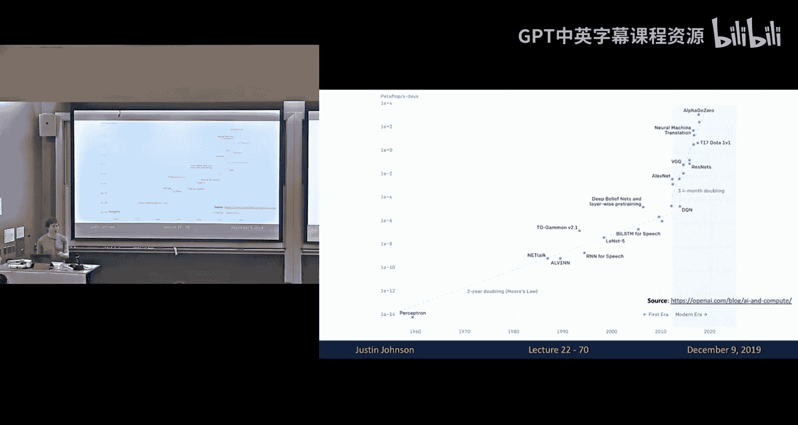

So its kind of a bit of free advertising for this startup。 theres one really。

 there's one one example of this is this company Sarah Brus。

 which makes wafer scale chips for deep learning。 So they basically build like a gigantic computer chip that's like absolutely massive that is specialized for doing deep learning。

 So on the right。 So I mean， this is obviously marketing material from the startup。

 So take it with a grain of salt。 But the idea is that kind of the largest chip that we have from the biggest baddest nviDdia GPU。

 is this relatively small chip over here on the right。 And Sarah Brus's wafer scale computing engine。

 is this like massive piece of silicon， which is like orders of magnitude bigger than the largest GPU that NviDdia is currently making。

😊，And the idea here is you've just got like tons and tons of compute elements tiled out over this like massive piece of silicon with a lot of memory。

 with a lot of compute and this type of novel hardware platform might be able to。

 I mean it' it's impossible to say， but maybe some kind of innovations in hardware， maybe by Saras。

 maybe by others would will help us， I think， push deep learning to the next level and train ever。

 ever bigger models on these ever， ever bigger data sets。😊。

So those are my three kind of safe predictions about things I'm relatively certain are going to happen in the future around deep learning models。

But I think there's also a lot of problems with the way that we're doing AI right now。

 the way that we're doing machine learning and computer vision right now。

 And some of these problems are things that I don't know how to solve。

 But I think that as a community， we need to find ways to solve them。So one of the biggest problems。

 I think， facing machine learning models right now is that they're biased， right。

 that machine learning models are deployed in the world and they treat people。

 They treat different types of people in different ways。 And that's not fair。

 That's not a good thing。 That's just a thing that we need to avoid。

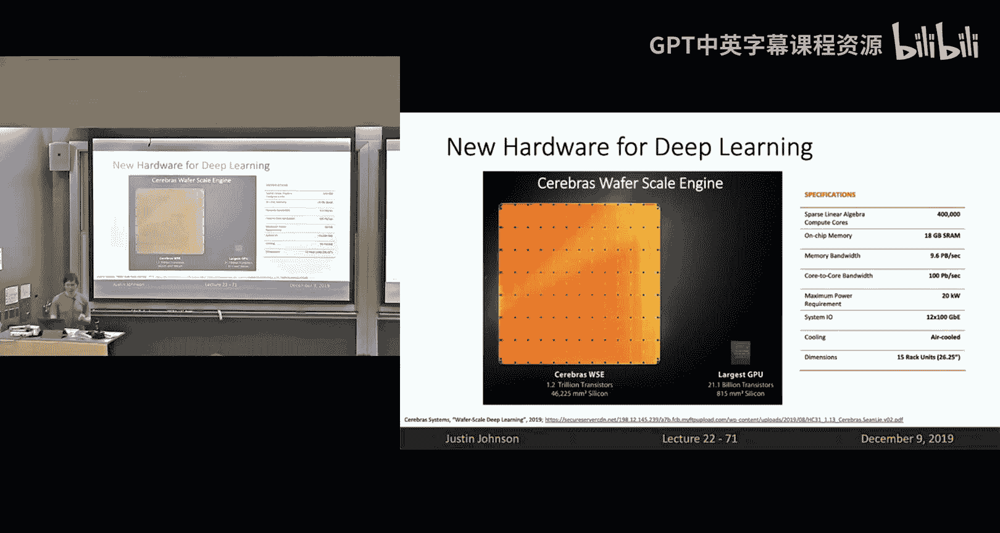

And it's kind of a concrete example of that， you remember we could do something like vector arithmetic with gene adversarial networks。

 Remember with gene adversarial networks， we could do something like taking the smiling woman vectors。

 subtract the neutral man vector add the neutral man vector， and then get an image of a smiling man。

 Well， this idea of sort of analogies or vector arithmetic with deep learning models actually didn't really didn't actually originate with geneative aversarial networks。

 This idea actually originated with with another type of model called a word vector。😊。

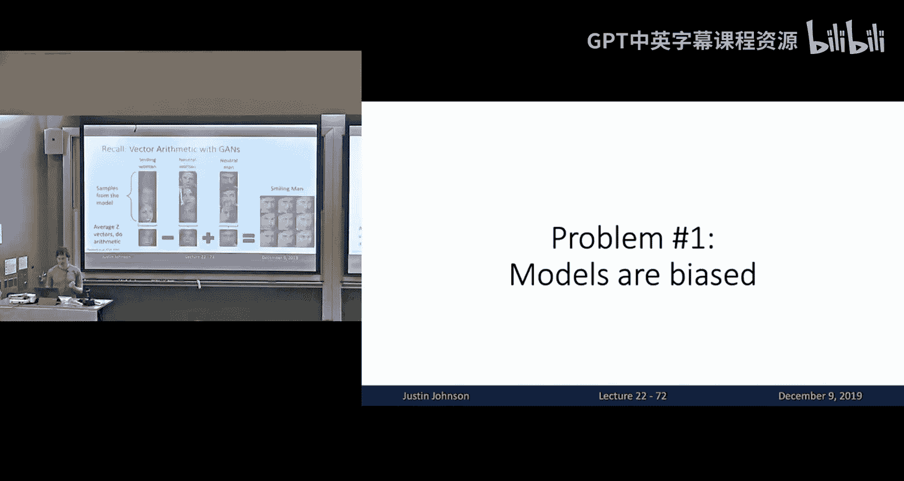

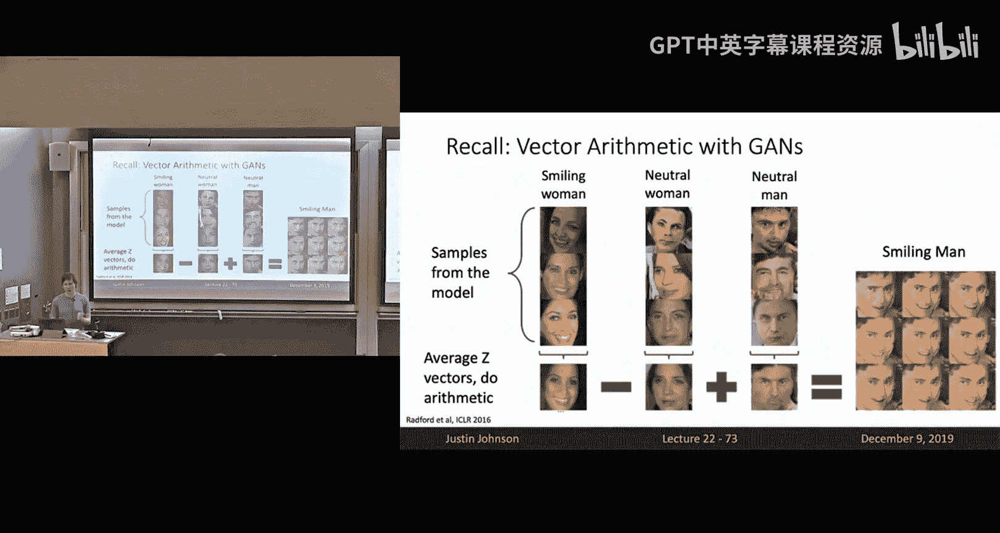

So here the idea is that this is a technique from natural language processing where you input a large corpus of text data and then somehow you process that corpus of text data to give some vector representation。

 some vector that represents every word in your corpus of your data and then it turns out that you can use those learned word vectors from your text corpus of text data to do these similar kinds of analogy problems。

 So for example， you could solve the analogy man is to king as woman is to what and the way that you can solve that problem or that query using a word vector approach is to take your learned vector for man。

 subtract a learned vector for king add the learned vector for woman and then do a nearest neighbor search among all the other word vectors in your data。

And it turns out that if you perform a lot perform a large scale analysis of different types of analogies with trained vector with trained word vector models that have been trained on large corpes of text data。

 they actually reveal some pretty ugly gender biases that these machine learning models have picked up on by just training on the data on all the data out there in the web。

So for example， you can probe these machine learning model， these word vector models。

 and you can ask like what types of occupations are more situated in that learned word vector space corresponding to men or women。

 and it gives these really really kind of troubling stereotypical occupations for men and women。

 It says that extreme she occupations are things like homemaker， nurse， receptionist。

 librarian and extreme masculine professions are things like maestro skipper， prodigy， philosopher。

 captain architect。So you can or if you look at solving some of these analogies with。

 this idea of vector arithmetic， you can see that they learn very gender stereotyped representations of the types of things that men and women do。

 So they learn things like a registered nurse on the female side is equivalent to physician on the male side or interior designer on the female side as equivalent to architect on the male side。

 So somehow these machine learning models have actually。

Become biased and and slurped up these very ugly biases on the training data just based on the data on which they're trained。

 And this is a problem， right， This means that if we're training neural network models on data out there in the world。

 they could slurp up biases in that data。 and then make predictions that stereotype different groups of people。

 And this is not just a theoretical problem。 This is actually been observed in in systems that have been deployed by big tech companies。

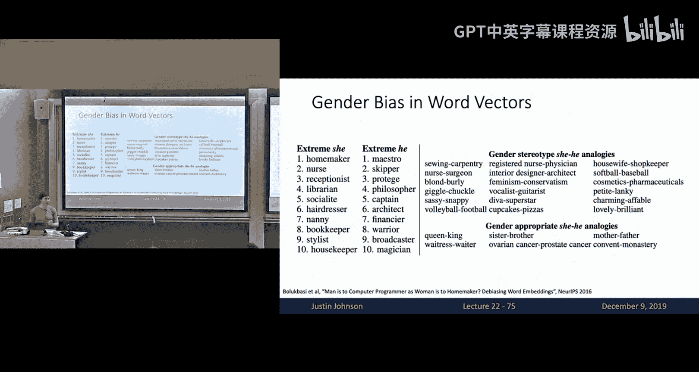

So as， as another example， we can look at economic bias in visual classifiers。

So here there was this nice paper from just this year in 2019 where they tried to make the argument that deployed classifiers that have been deployed out in practice by major tech companies are actually biased towards high income Western households。

So for an example， they collected these data sets of household items from different cultures across the world and at different income levels across the world。

 So for this example， this is an image of soap that was collected from a household in the United Kingdom with with a monthly income of about $2000 a month。

And if you run this type of image through a lot of commercial image classification pieces of software。

 you can see that it's not perfect。 It makes some errors。

 but it produces like kind of reasonable predictions for this type of image。

But then what if you take an image of soap from a different type of household from a different type of person at a different part of a part of the world。

 So here's an image of soap that was taken from a household in Nepal that earns just about $300 a month。

 And if you take this image of soap and run it through the exact same deployed classifiers out there on the web that have been deployed by major tech companies you see that it just fails catastrophically。

 It thinks that this soap is food or cheese or bread like it just doesn't recognize that this is soap。

 So somehow it seems that the types of data on which these systems have been trained。

 has somehow biased their predictions towards the types of images that are seen in wealthy Western households。

 And that's a problem。 I think that we should be building machine learning systems that are good for everyone。

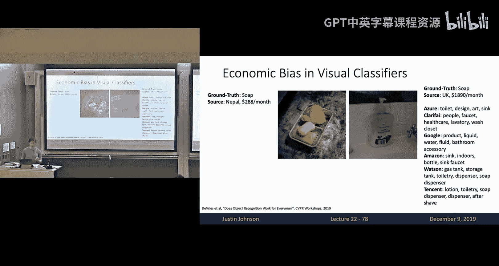

And as another really ugly example of this， there's actually been racial bias in visual classifiers as well。

 So this was a really high profilefi image that circulated Twitter back in 2015。

 where Google's image classification system， categorized these Africanam Americans as gorillas。

 which was just shockingly racist and was a very bad thing。

 And this is not something that we want our machine learning systems to do。

So I think that this is a really big problem in machine learning。 This is not a theoretical problem。

 This is something that is facing all machine learning systems， all computer vision systems today。

 that I think it's important that we build machine learning systems that take all different viewpoints and all different types of people into account and actually and actually treat them fairly in unbiased ways。

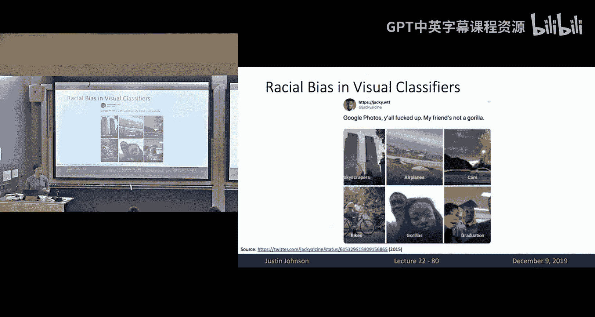

So there's been some academic work that's really pushing towards understanding these biases in machine learning models and measuring it and improving it。

 but I think that this is still a really big open problem in computer vision and machine learning and machine learning more broadly。

 So I put a couple citations here if you want to get started in this research area。

 but I think that this is a really big important problem that's facing a lot of machine learning models。

So then another sort of more， maybe more academic problem with deep learning is that I think we might need new theory to actually understand what's going on inside of our machine learning models。

And the way that I see that is that there's a certain number of empirical mysteries that there's experiments that we can run that give us very strange results that are seemingly counterintuitive。

And this makes me think back to like in the early 1900s right before quantum mechanics was discovered。

 people knew about classical mechanics， but there were certain experiments that you could run around like black body radiation or other types of phenomenon that just could not be explained with the classical physics at that time。

 and it could be the case that there might be some experimental results in deep learning that hint that we might need a better theoretical understanding of the systems that we built。

So one problem that kind of mystifies me is this this empirical observation of really good sub networkss within deep learning models。

 So here's something that you can do。 You can start with a randomly initialized neural network model and train it up and then step2。

 train it on your favorite data set。😊，And then then what you can do is this process of pruning the trained neural network so you can remove a large number of the learned weights inside that trained neural network model。

 And it turns out that you can actually remove like a large fraction of the weights of the trained model and still and still retain the same performance of the trained model。

 So somehow these trained neural networks even though they might have a lot of weights。

 It seems that they don't actually need all of those weights to actually get their good performance。

 So that feels like something funny as going on。And， you know， the mystery deepens。

 It turns out what we can do is we can take that trained pruned model and then go back to the initialization and then take the the initialized values of the nonpruned weights。

 and then go back to the initialization， right， So that's kind of like we took step 1。

 We had an random network。 We trained it。 We pruned it。

 and then we applied the pruning of the trained network back to the original initialization of the original unopimized weights from step 1。

And now we can train the pruned network。 And it turns out that it works almost as good as training the full dense network from step 2。

And this has been called the lottery ticket hypothesis of a deep neural networks that it's like each weight inside the neural network is playing the initialization lottery。

 And then some weights inside the network have won the lottery and got good initializations。

 And that caused maybe good sub networks to emerge within these initialized neural network models。

And then the question is， what the hell is going on。 Like this。

 This feels like we are maybe missing something fundamental in the way that neural networks learn on data or the way in which neural networks are initialized or optimized。

And the mystery deepens even further。 There was this paper from actually just about to a week or two ago on archive where you can take a randomly initialized neural network model and you can train and you prune the random model。

 we don't change the weights。 The only learning in this model is removing connections from this randomly initialized neural network model。

 And it turns out that you can that through some kind of gradient descent procedure you can prune an untrained model to result in a sub network of the randomly initialized untrained neural network model that actually achieves non-trivial classification performance on data sets like Cfn imagenet。

This is very mysterious and very shocking to me。 This means that inside a random model。

 there exist sub networks that actually do a good job on image classification。

 And this actually happens at the scales of networks like a Resnet 50 that we are using in practice。

So it feels to me like we're maybe missing something kind of fundamental here in the way that neural networks learn or represent functions on their data。

 I don't know what the answer is， but I think that this is one of those empirical mysteries that maybe we should pay attention to that hint that maybe we need to develop some new theory。

Another empirical mystery in deep learning is this question of generalization。

So there's been a lot of work on classical statistical learning theory going back over several decades。

 and from classical statistical learning theory， we can expect this plot on the left that if we on the X axis。

 we plot the complexity of our model。 that's maybe like the size of our neural network or something like that。

 and the y axis， we plot the error rate on the training data and the test data then we see sort of two regimes in in our model on the left。

 as we start with a very small model， we get high error on both the training and the test set as we increase the size of the model。

 then both the error on the training set and the test set should decrease as the bigger model is able to better fit the training data。

But at some point， when we make the model even bigger， even bigger。

 then classical statistical learning theory tells us that the model should start to get worse on the test set as it continues to get better on the training set。

 And this is overfitting。 This is where a machine learning model would have overfit to the noise in the training set and then no longer generalizes to the test set。

 And this is a phenomenon that we have been familiar with in the community for decades from statistical learning theory。

But then here's some funny facts about neural networks。

One is that deep neural networks can actually fit random data on image classification dataset sets。

So what this means is if you take something like your your favorite Resonnet 50 classifier and you train it on Cf。

 but you train it on a version of Car where all of the labels have been assigned randomly to all of the images or where all the pixels of the images have been randomly shuffled。

Or where， where the the pixels are just random Gaussian noise。

Then it turns out that the same Resnet 50 that gives us really strong performance when trained on the real data can actually achieve perfect accuracy on the training set。

 on， when trained on a training set of these random data sets。😊。

So some classical results in statistical learning theory say that one way to measure the complexity of a machine learning model is something called the Raammacker complexity。

 which is something like its ability the ability of the model to fit random data。

So the classical statistical theory tells us that if a model is able to fit random data perfectly。

 then that model is likely too big to generalize and give useful predictions on the test set。

But a Resnet 50 model can be trained to perfect accuracy on random data。

 But when we train it on real data， it generalizes great and gives us really good and meaningful and useful predictions on the test set。

😊，And that's a mystery。 I think that means that there's something we don't understand about the way that neural network models in particular。

 generalize to unseen data。Now， another mystery around generalization is this so called double descent phenomenon。

So here's an empirical plot on the right， corresponding to the theoretical plot on the left。

So on the right， we're showing on the X axis is the size of a fully connected neural network that has been trained on the CFR data。

 and the Y axis gives us this training and task performance of this。

 of these models of increasing size。And you can see that up to a point when up up to the model size of 40。

 then the empirical results that we see actually match these theoretical predictions from classical statistical learning theory。

 But as we make the model even bigger， even bigger， even bigger。

 then something qualitatively different happens。 and it seems that we push beyond this regime of overfitting into some other regime where now。

 if if the model is just in the middle， then it overfits。 But if you make the model even bigger。

 then it no longer overfits。And this is something extremely mysterious about neural network models that I think is not well understood。

And this phenomenon was actually scaled up by a blog post from OpenAI just a week or two ago。

 where this initial phenomenon was observed by a paper by Belcon etal at PNAS this year。

 and Open AI observed similar results on a wide variety of deep learning models。

So here's a plot from this new open AI paper where they're training now no longer fully connected networks。

 but now like Resnet 18， the same type of residual networks that we're using in practice。

 And we see this same empirical mystery of double descent in these practical large scale convolutional neural network models。

So that means that somehow where there's just something we don't understand about the way that large neural network models generalize to unseen data。

 And I think that there is a possibility that we might need some new statistical learning theory to explain some of these empirical observations。

Okay， now another big problem in in deep learning is that we need a lot of training data and training data is expensive to collect。

 So as a practical concern， we would all like to be able to build deep learning models that that rely less on large labeled data sets。

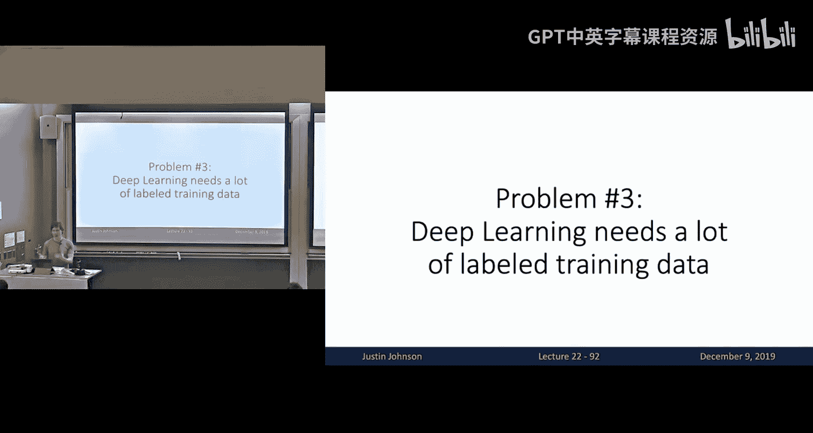

So one way that people have started to make progress on this problem is by building new data sets that are specialized towards this problem of low shot learning that is learning where you have very few numbers of samples per category that you want to learn。

 So I think one of the initial high profile data sets in this regime was the omni data from Brendan Lake at all。

 That's kind of like a low a low shot learning version of Mist。 So Mist， of course。

 was this superclass image classification data set that's classifying binary digits from  zero to 9。

 and it gives you 6000 training and test 6000 examples in a data of each of these categories。

And now the omnigla data set set it now scales it up and now gives us 1623 categories。

 giving handwritten letters from handwritten symbols from 50 different alphabets of natural languages around the world。

 and it provides just 20 examples of each of those types of letters and somehow from this very few numbers of examples。

 the goal is to build machine learning models that can learn to recognize these characters。

 even though they only get a very few number of samples of each type of character during training。

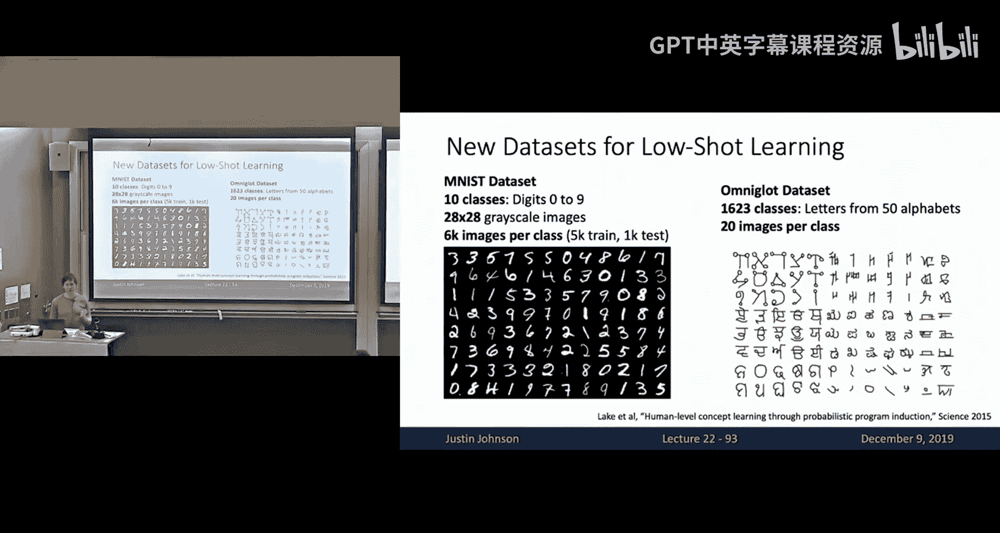

Another example of a data in this flavor is the K and this data set that provides a large data set of Japanese kanji characters that now gives something like almost 4000 different categories。

 but provides a variable number of samples per category。

 And now this is these is then one way to make progress on this task of learning with few data fewer data is actually providing well structured data sets and challenges around learning with small data。

So these are kind of some of these these early class these sort of now from a couple years ago these these data sets on learning with low data and they're a little bit like they're definitely interesting。

 They're definitely important。 but the problem they're trying to solve is this handwritten character recognition。

 It's not really as realistic as many of the types of problems that we've been solving in computer vision this semester。

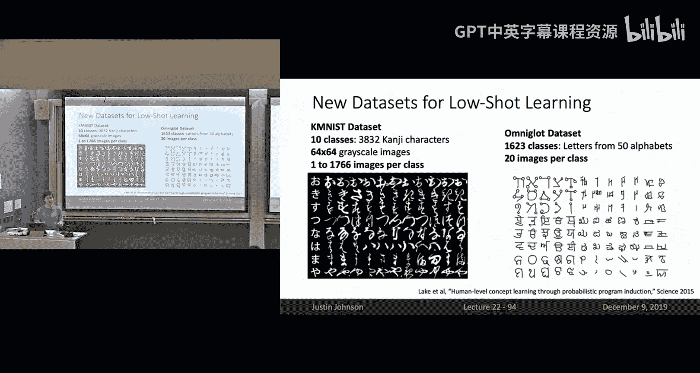

So then there's another really there's a new data set that just came out this year that I'm really excited about called Elvis。

 and Elvis tries to push this idea of low shot recognition with learning from very few examples for category into this computer vision regime a very complicated images。

 So here， rather than doing image classification Elvis is a data set for instant segmentation。

 and it annotates more than1000 different category labels for instant segmentation。

 and this data set is actually still being collected right now。 So V1。

0 of the data set is not even out。 but these 0。5 gives you about 57000 images and about almost 700 million labeled object instances from these 00 different categories on for this instant segmentation problem。

😊。

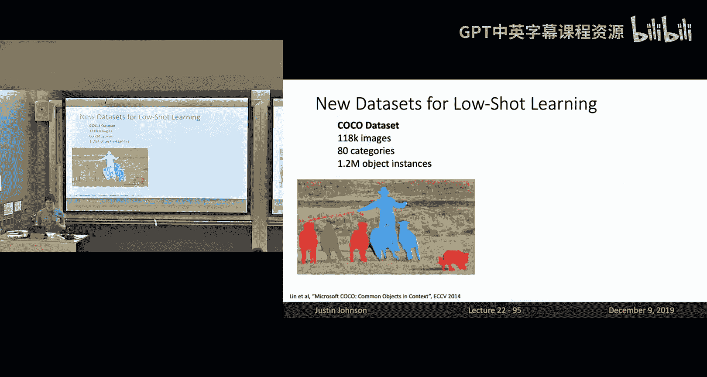

So I think that the coco data set that was back from 2014 really drove a lot of progress on instant segmentation。

 and I'm hoping that the Elvis data will similarly help to drive progress in low shot recognition or learning with small amount of data for these complex real worldor computer vision types of tasks。

 So expect to see So I expect to see a lot more work on this type of data moving forward。

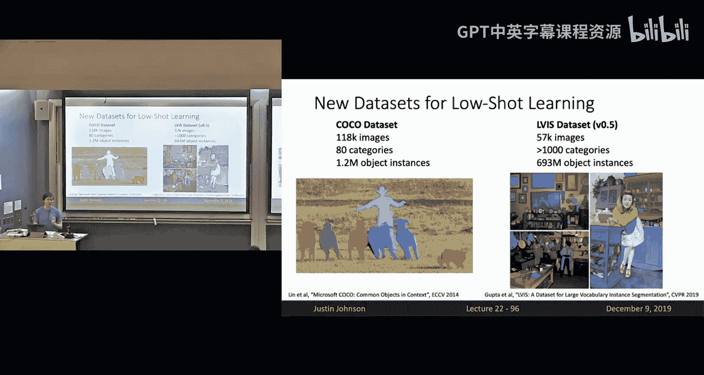

So now， another type of idea towards reducing our reliance on label data is this idea of self supervised learning。

 and self supervised learning kind of pushes towards this holy grail challenge of unsupervised learning that we talked about several lectures ago。

So here， the idea is that we're going to have a two stage process when building our neural network system In stage1。

 we're going to train the neural network on some kind of pretext task that we don't actually care about。

 but that can be defined and trained without any kind of human labeling of the data。

 And now on step 2， we'll take the network that we learned for this pretext task and fine tuneune it on whatever small amount of label data we can afford to collect。

So we've seen this paradigm a little bit already in the context of learning generative models as a pretext task。

 but it turns out there's been a lot of work on people defining other types of pretext tasks for self-svised learning。

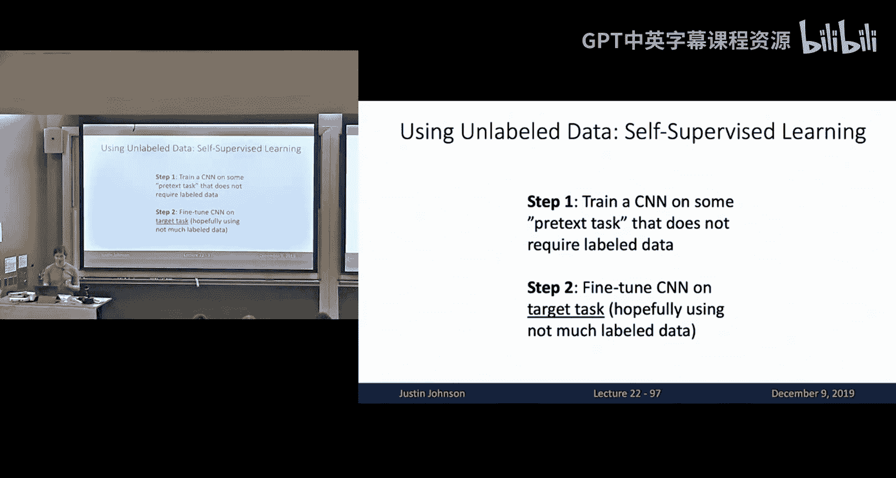

One example is solving jigsaw puzzles。 So here's a concrete example。 What we can do is take an image。

 cut it up into a 9 by9 grid of patches， and then shuffle the patches。

 And now these shuffled patches will be fed to a neural network system。

 and the neural network system needs to solve the jigsaw puzzle。

 So it needs to classify what was the correct permutation of those patches that would unscraled the puzzle pieces。

And now in order to solve this task， it's likely that the network would have to learn something nontrivial about the visual world because for it to know that the tiger head should go in the upper right hand corner and the tail and the leg should go at the bottom。

 then it should be able to recognize that what these body parts of the tiger are and it should understand their kind of relative orientation。

 So the hope is that if a network could solve this type of task of solving jigsaw puzzles。

 then it could be fine-tuned for a lot of other computer vision applications。

 and critically you can prepare this data set of jigsaw puzzles without any human annotation whatsoever。

 it just requires you to download a bunch of images from the data from the web and then kind of cut them up automatically to make these jigsaw puzzles。

Another idea in this vein is colorization， We sort of download a lot of color images from the web。

 convert them to black and white， and then ask the network to predict the color。 And again。

 this is a supervised learning problem because we're asking the network to predict one thing。

 which is the color from another thing， which is a black and white。

 but we can generate these labels without having people annotate the data。 And again。

 hopefully if the network can solve this colorization problem。

 then it should have learned something about the world。

 like it should be able to in order to colorize this photo。

 it must kind of know that this is a butterfly and understand what types of colors butterflies tend to be。

 And so a network that can solve this problem is hopefully visually intelligent to some degree。😊。

Another idea is in painting so we can take take an image， remove some portion of the image。

 and then ask the network to predict back the removed portion of the image。

 And this actually is maybe an example of a generative model。

 This is sort of a conditional generative modeling problem where you want to predict a part of the image conditioned on another part of the image。

 And again， you can just sort of train this type of model using the different approaches for generative modeling that we talked about。

 And then at the end of the day， kind of throw away the generative model and just fine-t the underlying convolutional network for whatever downstream task you care about。

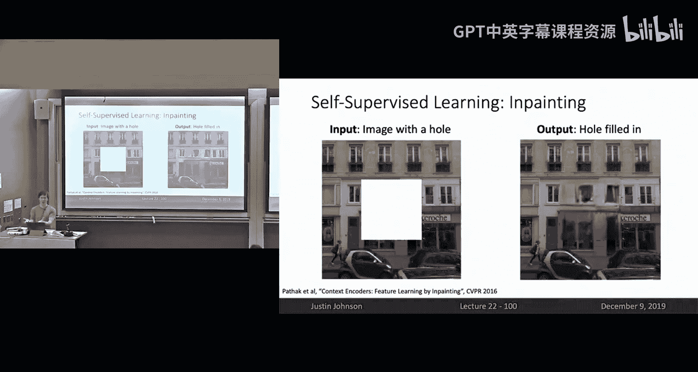

So there's been， I think， a lot of really recent interest in different mechanisms for self-supervised learning。

 So I put a couple of these current state of the art methods for self-supervised learning up here in case you want to dig more into these references。

 and one of these， these pretext andvari representations actually was published just went up on archive just on December 4。

 like five days ago。 So I actually haven't read that paper in detail yet。

 but I think that that gives you a sense that this is like really active area of research is discovering better ways to train networks in a self-supervised manner。

Okay， then I want to leave you with maybe one big， I think the underlying problem in deep learning models that I don't know how to solve。

 and I don't know if anyone knows how to solve is that deep learning models just don't learn to understand the world in the same way that humans do。

 that they kind of learn to mimic the data on which they're trained。

 but they just don't seem to get the world in the way that we do。

And one way that we can see this is kind of through large scale language models。

 and they just lack common sense。 So here we talked about this language modeling problem， right。

 where you can download a lot of text from the internet and then train a neural network model to predict the next word conditioned on the previous words so then you can kind of use a neural network model to so then you can condition one of these language models on some input piece of text and then ask the language model to just complete the rest of the sentence for you and then see what it thinks is a likely completion of this text that you've given it。

So I was playing around with this over the weekend。

 and now there there's a really cool website called Talk totransformers。 co。

 where you can just have this nice web interface where you can type in your own queries and then sample sentence completions from this very large language model that was built by open AI。

So here's an example。 if I typed in， I was born in 1950， actually。

 I wasn't in this year and in the year 2025， my age will be。

 So that's the query that I provide to the system。 And then the neural network writes the rest。

 says 35。 that was only a few years ago。 Most things in life just continue to improve。So it's like。

 here's another example。I see a black dog and a brown horse。 The bigger animal's color is。 well。

 what， what do you guys think。Brown， right， because we know that horses are bigger than dogs。

 for the most part。 This guy says the bigger animal's color is black and the smaller is brown。

 And actually， if you kind of， is's a stochastic process So if you kind of sample many different completions。

 it just like kind of gives you answers randomly。 I I sampled another one where it said that the the biggest one was pink。

 So it seems like， or here's another example。One of my parents is a doctor and the other is a professor。

 My father is a professor。 My mother is。Obviously， a doctor， right。

 because we know that people have two parents， and we know that professions are kind of a mutually exclusive thing。

And this says， my mother is a social worker， they're super smart people。

So it seems that these neural network models just don't understand the world around us that even when you train them on all of the text around us in the world。

 even when you download gigabytes or terabytes of textual data from the web。

 and even when you train on thousands of GPUus for weeks at a time。

 You can get state of the art numbers。 but the neural network models are just somehow missing something in the way that they understand the world。

 And I think that there's just something fundamental here。

 that this idea of training ever bigger models on ever ever bigger data sets。

 it works for practical problems。 but Im a little bit skeptical sometimes。

 but whether this will actually get us all the way to AI。

 there's one school of thought that says maybe we just need to make things even bigger。

 another 10 times bigger， another  hundred times bigger， another thousand times bigger。

 and maybe if we keep going， then they'll kind of pick up common sense for themselves。

 Maybe that's true。 I don't know。 Or maybe we need to sort maybe there's some paradigm shift that we need to make in the way that we're building our machine learning models。

 maybe there's some drastically different approach to learning。

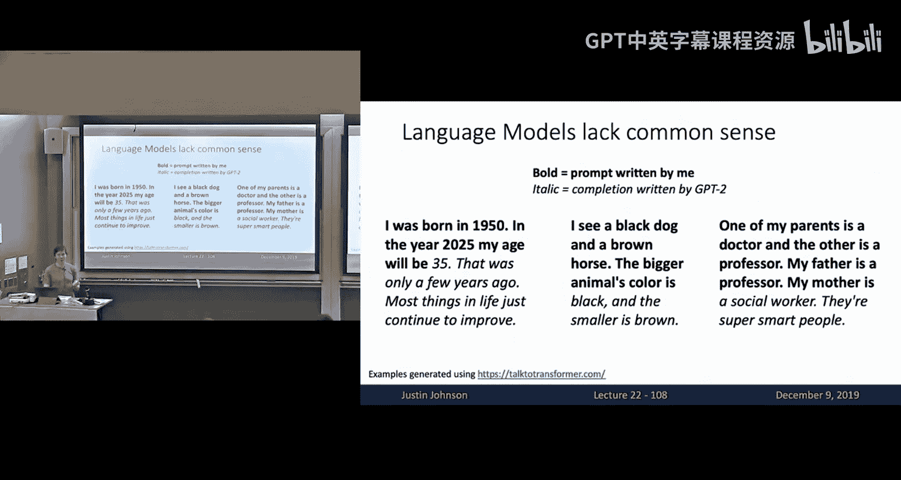

We need to be building instead， and I don't know。So then kind of another example。

 more in computer vision， there's this really on the nose paper called the elephantant in the room。

 because I think this is a problem that everyone knows about who works with deep learning models。

 but we don't usually talk about it or give it enough credit。

 And that's this idea that just machine learning models are brittle， They don't understand the world。

 And they don't work when you train them on things that were when you test them on things on which they were not trained。

 So as an example。Here's an image of some people in a room。

 and we ran a amount of pretty good object architecture on this image。 And it works great。

 It tells that there's a person， there's a laptop， there's a cup， there's a chair， there's a handbag。

 There's books。 It recognizes all the reasonable object categories。😊。

But now what we do is we just like Photoshop in， like。

 do a really bad Photoshop job and just put in this elephant in the room。And obviously。

 we humans have no trouble， I mean， maybe the contrast on the screen is kind of bad。

 so maybe you do have some trouble， but if the lights were maybe dimmed properly in the room。

 then you should have no trouble recognizing that there's like， hey。

 there's a big elephant in the back of this room。 and I think if the elephant appeared in the back of the classroom。

 like we would all notice it without any problem。But and sometimes these object detectors will recognize novel objects just fine。

Sometimes it'll just miss it completely。 So if you just move the elephant to a slightly different position in the scene。

 sometimes it's just like not detected at all by the detector。

 And that's just because this network has never seen images with elephants in living rooms and it's just not able to generalize in that way。

Or it gets even worse。 Sometimes if you put the elephant in a different place。

 then it gets recognized as a chair。 And also in recognizing the elephant as a chair。

 it also messes up some of the other predictions about that the model is making about the other objects in the room。

 So now you can see that it's flipped the chair to a couch。 And it's no longer detecting the cup。

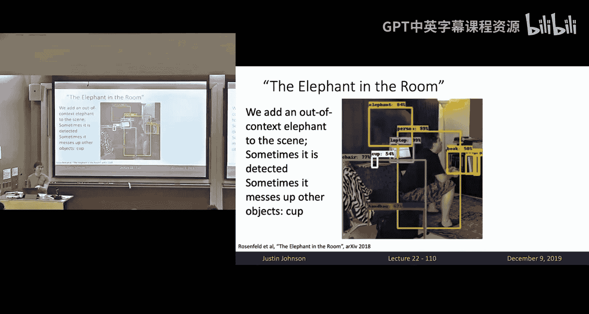

So this is a big problem。 This means that convolutional neural networks and really all of the vision systems that we know how to build with deep learning are really seeing the world in a qualitatively different way than humans are seeing the world。

 And they just can fail catastrophically when we apply them on data that is even slightly different in some way on the data on which they're trained。

And I don't know how to fix this。 But I think this is a major problem that needs to be solved if we're going to a build machine learning systems that are making intelligent decisions out in the world for us。

 And this is just something fundamental that I think is maybe baked into some of our current approaches。

 So I don't know the solutions here。 But I think that these are some of the biggest most pressing issues some of the big picture issues in computer vision and machine learning more broadly right now。

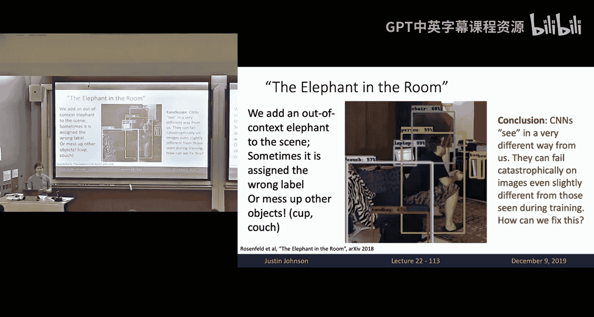

So that's kind of my summary that we have to see these sort of boring， save predictions。

 We'll see new models。 We'll see new applications。 We'll see bigger compute。

 but we also have some of these more fundamental problems that are facing the field that I don't have answers to。

 And we people recognize that they're problems。 But I think there's a lot of room for people to come up with creative new solutions that could radically have massive impact on this growing field of deep learning。

😊，So I think the summary is that I think now is a really great time to be getting into this field and a really great time for you to be learning about this field。

 So hopefully with some of the stuff that you've learned in this class。

 maybe some of you will go out and solve some of these big challenges that are facing the field。😊。

So with that， I'd like to have a big round of applause for our GSIs who really made the class actually work。

 I don't know if you're actually here， though， but I really want to give a shout out to them and thank them for making the class actually work。

And I wanted to thank you guys for putting up with the first class that I've taught here at the University of Michigan。

 So thank you。All right， then I hope you have a great winter break and turn in your homework because you've still got some homework you。

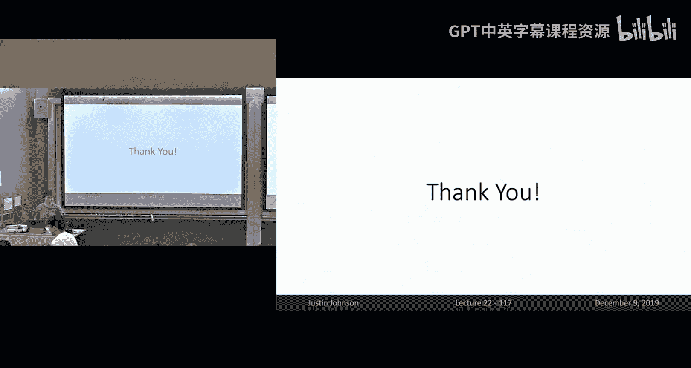