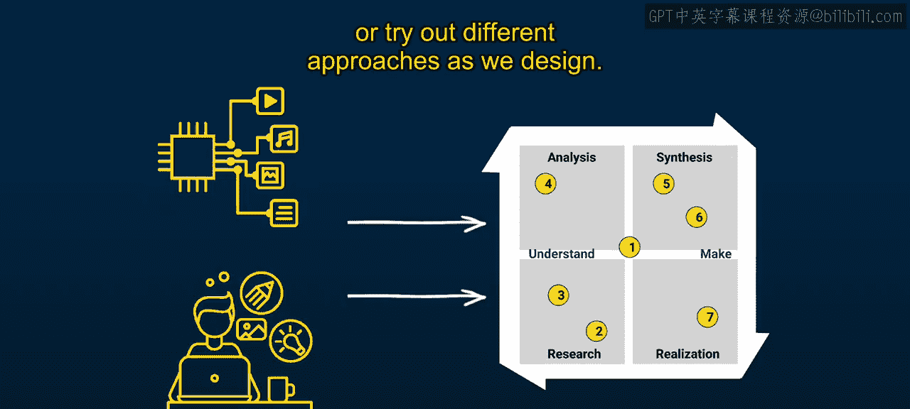
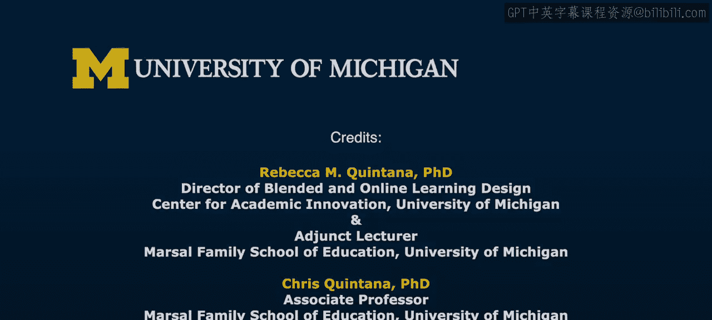

# 3：与生成式AI建立伙伴关系

在本节课中，我们将探讨如何以及为何在学习设计中使用生成式AI工具。我们将重点讨论使用这些技术时应持有的正确心态，并理解将其视为“设计伙伴”而非简单工具的含义。

## 探索使用生成式AI的心态

上一节我们介绍了生成式AI的基本概念。本节中，我们来看看在使用这些工具时应持有的核心心态。

我们经常听到关于生成式AI工具及其能力的讨论。但我们必须记住，它们本质上只是工具。当我们思考工具及其使用时，过程似乎很直接：我们使用工具来完成任务，理想情况下是快速、高效地完成，并且我们通常不会深究结果。例如，如果需要在墙上打孔，我们只需使用电钻。打完孔，任务就完成了。

即使在技术领域，我们也可以使用不同类型的工具来完成任务。我们可以使用文字处理器来撰写文本，或者使用计算器或电子表格来求和。我们只是使用这些工具来完成心中所想，并以某种方式应用这些工具产生的结果。

然而，生成式AI是一个有趣的工具类别，其核心在于“生成”这一概念。这能帮助我们以不同的方式工作和思考。

## 从工具到伙伴的转变

当然，我们可以像刚才描述的例子那样使用生成式AI：我们给工具一些输入（可以是一个问题或其他提示），然后直接获取它给出的信息并将其应用到某个地方。任务完成。

但是，当我们开始讨论将生成式AI用于学习设计时，我们希望采用一种不同的思维方式：将生成式AI视为设计伙伴或智力伙伴。在学习设计过程中持续使用它，帮助我们产生想法、迭代不同的设计方案，或在设计时尝试不同的方法。

我们不一定只想让生成式AI为我们生成完整的、可以直接使用的答案。这不是我们所说的“伙伴关系”。相反，我们可以思考正在处理的具体设计任务，然后与生成式AI合作，生成我们可以像审阅草稿一样审阅的初步想法，看看哪些可以使用、哪些可以扩展、哪些可以删除。

我们可以观察生成式AI是否产生了我们未曾想到的新想法。我们还可以判断是否以及如何继续扩展这些新想法，甚至可以借助工具本身来完成。我们可以向生成式AI提供额外的、修改后的方法和提示，以尝试新的设计方向，并在设计过程的不同迭代中持续扩展想法。

## 伙伴关系的核心实践

这种在设计过程的各项活动中，以及在这些活动的不同迭代中持续与工具协作的理念，就是我们所说的将技术作为伙伴使用。我们不仅仅是获取生成式AI的结果并简单地复制粘贴其输出。相反，我们是在一段时间内持续与工具协作，以发现新路径、完善我们的工作，并确保我们生成内容的质量。

这是我们自己在工作中以及在整个讨论中所秉持的心态。这也是我们希望您采纳的心态。我们应该将生成式AI的输出，**不是**视为最终答案，而是视为可以在整个设计工作中修改和重塑的想法与可能性。

以下是建立有效伙伴关系的关键实践步骤：

*   **共同构思**：将AI的初步输出视为头脑风暴的起点，而非最终方案。
*   **迭代审阅**：像对待草稿一样审阅AI的回复，进行批判性评估和筛选。
*   **引导探索**：通过提出更具体、更具引导性的问题（`prompt`），与AI共同探索新的设计方向。
*   **持续精炼**：基于AI的反馈和自己的想法，不断修改和完善设计内容。

## 课程总结

本节课中，我们一起学习了如何与生成式AI建立有效的“伙伴关系”。关键在于转变心态，从将其视为完成任务的简单工具，转变为将其视为在整个学习设计过程中持续协作、激发创意和迭代优化的智力伙伴。记住，生成式AI的价值在于它能够提供灵感和可能性，而设计的最终责任、判断力和创造力始终在于我们人类设计师。