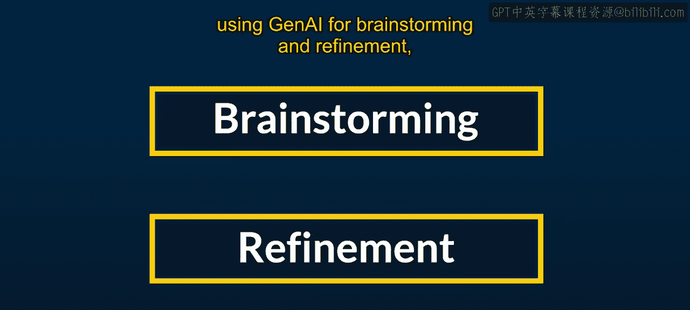

# 6：生成式AI在学习设计中的应用

在本节课中，我们将探讨生成式人工智能如何在学习设计流程中充当合作伙伴。我们将从宏观视角审视设计过程，并识别出生成式AI可以发挥潜力的具体环节。课程将分为两个主要部分：早期头脑风暴阶段的应用和后期优化完善阶段的应用。

## 课程概述

在课程的第一部分，我们探讨了将生成式AI作为学习设计伙伴的理念。我们还从宏观层面审视了设计过程，并思考了如何将我们偏好的框架映射到该过程中。采取这一步是为了让你将最熟悉的学习设计流程牢记于心。

现在，我们已经对这些领域进行了一些思考，可以开始识别我们认为生成式AI有潜力应用的具体环节。我们将在此分享我们的观点，引导你进入这种思维方式和工作方式，然后鼓励你制定自己的策略，将这些想法应用到你的专业实践中。我们在此提出的想法应作为你独立开展工作的起点，并很好地适应你自己的特定情境。

## 识别应用机会

当我们思考整个学习设计过程以及学习设计师在该过程中执行的众多任务时，有时很难精确确定应该将注意力集中在何处。因此，从两种方式来思考潜在机会可能会有所帮助：**早期头脑风暴**和**后期优化**。

## 早期头脑风暴阶段的应用

让我们从早期头脑风暴阶段开始，看看哪些学习设计活动可能非常适合生成式AI。

随着我们越来越熟悉这些工具的能力和潜力，我们开始意识到它们在我们工作的早期草稿阶段非常有用。当我们思考从零开始起草某物与在已有基础上进行构建之间的区别时，我们可以开始想象生成式AI在生成初稿方面可能扮演的角色，学习设计师可以将这些初稿作为深入工作的起点。

以下是学习设计师需要起草的各类项目。如果我们回顾学习设计过程，可能会想到一些核心的学习设计任务，包括：
*   开发学习者画像
*   制定学习目标
*   创建高层级大纲

这些早期的设计任务有助于为我们的学习设计设定方向和创建结构。

继续考虑学习体验的核心要素，我们也可以思考使用生成式AI来起草评估、内容和活动。例如：
*   生成式AI可用于开始创建测验问题、作业。
*   生成式AI可用于起草介绍性内容、活动、参与者结构以及讨论提示。

这些是学习者作为学习体验一部分与之互动的关键要素。

更进一步，生成式AI可用于开始创建重要的附加元素，例如：
*   教学大纲语言
*   内容摘要
*   支架式语言
*   替代文本生成
*   测验或作业反馈

这些任务对于为学习者提供无缝、集成且愉快的学习体验至关重要。

## 后期优化阶段的应用

现在，让我们考虑后期优化阶段，看看哪些环节可能适合生成式AI。

一旦学习体验的所有关键要素都已就位，学习设计师可以考虑如何利用生成式AI作为思维伙伴，来改进已起草的结构和要素。

在这个阶段，我们可以以角色扮演的方式使用生成式AI，即开发提示词，让工具从不同角色类型的视角来审查内容，包括学习者、教师和管理员。例如，我们可以向生成式AI工具提供我们画像的关键特征、动机和观点，并要求该工具从这些视角审查内容。通过这样做，我们可以识别出内容中需要改进的空白或领域，以更好地满足画像的需求。

另一种将生成式AI用于课程设计审查的方法是，确定课程是否按预期运行。例如，学习设计师可以使用学习目标作为查询的基础，检查其与内容设计的一致性。

另一种策略可以是检查评估是否包含了让学习者展示与预定学习目标一致的知识和认知水平的机会。在这个后期阶段，生成式AI可用于验证课程是否符合其预期目标。

最后，学习设计师可以使用生成式AI来识别评估、活动和内容设计中的空白、冗余和不一致之处。由于学习设计过程通常需要数周甚至数月的时间，借助一个能够一览全局并指出设计可以加强之处的工具会很有帮助。生成式AI可以协助进行质量保证。

## 课程总结

本节课中，我们一起学习了生成式AI在学习设计流程中的两个主要应用方向。我们希望这两种方法——使用生成式AI进行头脑风暴和优化——有助于你概念化那些可以通过与生成式AI工具合作而加速、增强或改进的学习设计任务类型。这些想法旨在为你自己的实践提供一个起点，并鼓励你根据自身的工作流程和需求，探索和发展出独特的应用策略。