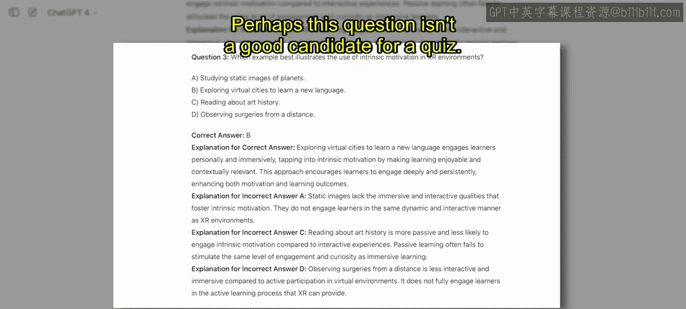

# 12：制定评估和详细反馈 📝


在本节课中，我们将学习如何与生成式AI合作，共同制定不同类型的评估工具，并为学习者提供协作式反馈。

上一节我们探讨了利用AI生成课程内容。本节中，我们来看看如何利用AI来设计评估环节，特别是创建选择题测验，并为其生成详细的解释性反馈。

## 概述：AI在评估设计中的角色

生成式AI可以作为合作伙伴，协助开发不同类型的评估工具，并为学习者提供协作式反馈。这包括设计各种类型的考试题目或选择题测验，这也是我们今天关注的重点。我们可以利用生成式AI不仅帮助开发评估本身，还能在评估中为学习者提供详细的反馈，解释测验中不同答案正确或错误的原因。这有助于学习者更好地理解他们正在被测验的内容。

为了说明这一点，让我们来看一个示例：为我们之前创建的一节视频课程设计一个选择题测验。

## 实践步骤：创建带反馈的选择题测验

以下是创建此类测验的关键步骤。

首先，我们需要向生成式AI提供提示词，描述我们的需求，以及测验所基于的视频脚本，以便为测验提供内容和上下文。

让我们看看如何在ChatGPT中实现这一点。我们会先输入以下提示词，但在提交提示词之前，我们还会复制并粘贴测验所基于的脚本，然后将所有这些信息一并提交给ChatGPT。

**初始提示词示例：**
```
请根据以下脚本编写五道选择题，指出正确答案，为正确答案提供20到40字的解释，并为每个错误答案提供20到40字的解释。
```

然后，我们可以将脚本直接粘贴在提示词之后，点击发送按钮，将所有内容提交给ChatGPT并查看结果。

## 评估与迭代：优化AI生成的反馈

在审阅生成的测验时，我们可以看到初步结果不错，其中一些问题有了良好的开端。但立即凸显的一点是，详细的反馈可能过于简略。ChatGPT按照我们要求的字数提供了反馈，但我们现在发现，这些反馈可能过于简短，对学习者用处不大。

因此，让我们尝试通过以下提示词使反馈更详细一些：

**优化反馈的提示词：**
```
谢谢，这是一个很好的开始。能否请你为每个问题的解释再增加一到两句话，进行扩展？
```

查看新结果后，我们可以看到详细的反馈看起来更好了，有更多的反馈来解释不同答案为何正确或错误。每个问题的反馈仍然简洁但信息丰富，并且比之前版本的测验提供了更有用的反馈。从这个角度看，最新版本是一个改进。

## 人工审核与修正：设计师的责任



然而，仍然有一些问题需要我们处理。我们始终需要审阅生成的测验问题，以确保它们合理、准确，并且符合我们设计的背景。

在这里，如果我们审阅生成的问题，会发现其中一个问题比其他问题要弱。具体来说，第三个问题感觉构建得不好，不太适合这个测验。即使有详细的反馈，也感觉测验问题中给出的选项并非内在动机的固有例子。所提供的反馈并没有真正帮助说明这些选项是或不是内在动机。你或许可以提出两种论点。因此，也许这个问题不适合作为测验题。

此时，你可以直接删除它并自己编写一个问题，或者让AI生成一个替代问题，或者自行修改问题。这再次说明了将生成式AI视为设计伙伴的观点。在这里，我们看到了如何让AI生成一些带有反馈的潜在测验问题，但设计师仍有责任利用这些信息来创建实质性和准确的评估。你可以让系统生成一些问题，但你仍然需要评估这些问题并根据需要进行修改。你可以利用所有这些作为材料，帮助你创建自己的评估材料，利用AI帮助你集思广益，为正在创建的更大规模的评估做出贡献。

## 总结

本节课中，我们一起学习了如何将生成式AI作为协作设计伙伴，来开发评估工具和反馈。我们了解了从提供清晰提示词和上下文开始，到生成初步测验和反馈，再到通过迭代提示优化反馈细节的完整流程。更重要的是，我们认识到AI生成的内容需要经过人工严格审核、评估和修正，以确保评估的准确性和教育意义。设计师应利用AI的输出作为灵感和素材，最终主导并完成高质量的评估设计。


请思考你如何运用生成式AI，探索它作为协作设计伙伴，能如何以不同方式帮助你为学习者开发评估和反馈。