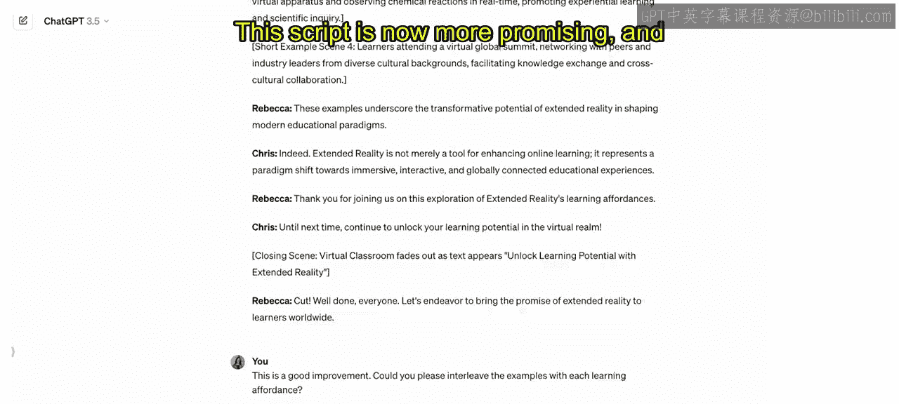

# 13：开发脚本

## 概述
在本节课中，我们将学习如何利用生成式AI作为设计伙伴，来协助我们开发在线教育视频的脚本。我们将通过一个关于“扩展现实与教育”的示例课程，演示从初始构思到脚本精炼的完整协作过程。

---

在线教育中，视频演示非常普遍，就像您正在观看的这个视频一样。

在准备这些视频时，我们必须参与的设计任务之一就是开发视频脚本。

脚本可以为视频扮演不同的角色。它们可以作为工具，帮助我们组织思路、形成谈话要点，以便我们即兴录制视频。有时，我们也会创建更详细的脚本来为视频演示进行朗读。无论哪种方式，创建脚本都是我们可以与生成式AI合作的设计任务之一，它能帮助我们起步，生成一些初步的想法和脚本草稿，供我们在需要制作演示文稿的阶段进行修改和定制。

我们可以通过一个例子来展示这个过程：为我们一直在讨论的“扩展现实与教育”示例课程开发一个更详细的脚本。

在这个例子中，我们希望为示例课程中关于“学习可供性”的部分开发一个脚本。您会看到我们在提示词中包含了一些具体信息，例如我们对“学习可供性”的工作定义，以及我们示例课程所关注的那些可供性。我们还提出了一些具体要求：脚本的长度、希望包含一些例子，以及脚本需要为两位将共同出现在视频中的主讲人（Chris和Rebecca）撰写。

让我们看看作为脚本开发任务的一部分，我们向ChatGPT提供的第一个提示词。

> 我们正在与ChatGPT合作，创建一门新的在线短期课程“在线学习环境中的扩展现实”。这门课程灵感来源于我们现有的一门更广泛关注扩展现实教育应用的、计一学分的线下课程。我们希望创建一个简短的介绍性视频，描述在扩展现实环境中可能实现的学习可供性。视频时长应在4到6分钟之间，有两位主讲人：Chris和Rebecca。视频脚本大纲应如下：
> 1.  学习可供性的定义。
> 2.  为扩展现实的教育应用确定的4种学习可供性：空间知识、内在动机、体验式学习、知识迁移。
> 3.  一个包含上述一种或多种学习可供性的扩展现实学习环境示例。
> 谢谢。

当我们查看生成的脚本时，发现它相当不错。它提供了我们想要传达的大量信息，我们可以审查脚本的准确性，看起来也没问题。脚本也涵盖了我们提到的四种学习可供性。

然而，仍有改进空间。首先，我们希望这里有更多例子。脚本最后确实提供了一个参观虚拟艺术馆的例子，但我们希望为每一种学习可供性都提供更多示例。其次，脚本的语气有点随意。虽然我们不希望演示过于正式或僵硬，但这里的语气有点太“家常”了。可以说，我们通常不会以喊“停！收工！”来结束任何视频。

因此，我们可以继续与ChatGPT合作，通过后续提示词给它更多指示，以完善脚本。

让我们看看后续提示词。

> 谢谢。这是一个很好的开始。😊
> 能否请您将脚本修改得稍微正式一些？同时，能否为每一种学习可供性提供一个简短的例子，而不是只在最后提供一个例子？

这次好一些了。请注意，您仍然需要审阅脚本，因为生成的脚本与之前的略有不同。生成的脚本语气稍微正式了一些，尽管ChatGPT似乎仍然希望我们在脚本结尾说“停”，并且它确实包含了更多例子。但它是在脚本末尾给出了一系列关于学习可供性的例子，而我们更希望每个学习可供性都伴随例子进行描述，而不是在脚本末尾集中呈现。我们这样要求是为了让脚本的流程更顺畅，并且能清晰地阐述每一种学习可供性。

那么，让我们看看如果我们提出这个修订要求，让它将每个学习可供性与例子分组，它能做些什么。

> 这是一个很好的改进。能否请您将例子与每一种学习可供性交织在一起？

现在的脚本更有希望了，它确实列出了每种学习可供性并附带了简短示例。这为我们提供了一个流程更好的脚本，有助于我们清晰地解释每一种学习可供性。

那么，这是否意味着您可以直接使用生成的脚本呢？可能可以，也可能不行。重申一下，当我们将生成式AI视为设计伙伴时，我们可以将其输出视为成品，也可以视为帮助我们起步的起点。因此，我们仍然需要审阅脚本，决定是否需要检查准确性，看看是否需要做出任何内容导向、语法或风格上的修改、澄清或其他修订，以获得我们满意的最终脚本。例如，无论我们怎么说，ChatGPT似乎总想让我们以喊“停”来结束每个脚本，所以我们可能仍需要一些编辑。

我们希望这个例子能让您了解如何与生成式AI合作开发脚本，如何使用不同的具体提示词来传达您的需求，以及最重要的是，如何审阅任何结果并将这些结果作为您工作的起点。

---

## 总结
本节课中，我们一起学习了如何将生成式AI作为协作伙伴来开发视频脚本。我们通过一个具体案例，演示了从提出初始需求、审阅AI生成的初稿、到通过迭代提示词逐步精炼脚本（如调整语气、增加并整合示例）的全过程。关键在于：AI提供的是**起点和灵感**，而非最终成品；设计者需要通过**具体、清晰的提示词**引导AI，并**严格审阅和修订**输出结果，包括内容准确性、逻辑流畅性和风格适宜性，才能得到真正符合需求的最终脚本。