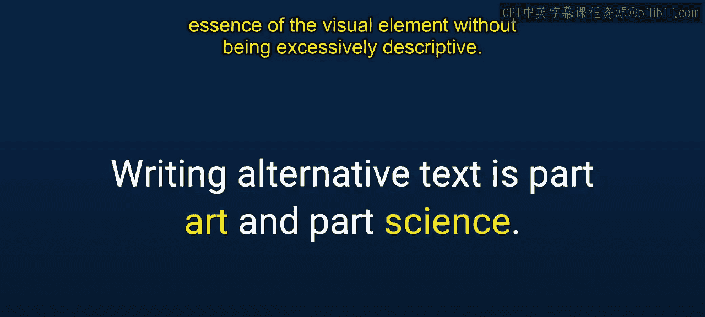
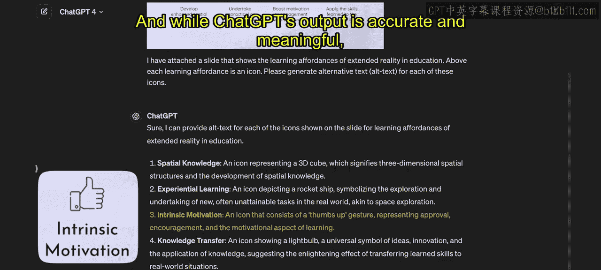
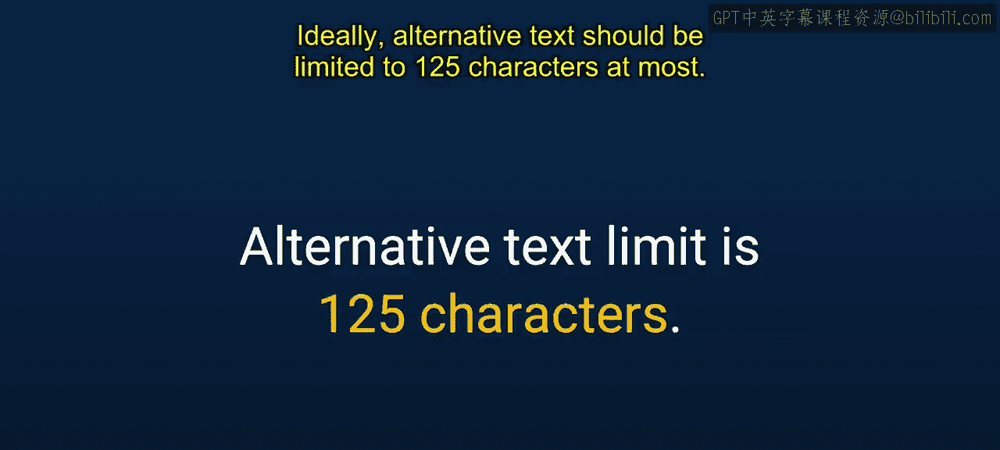
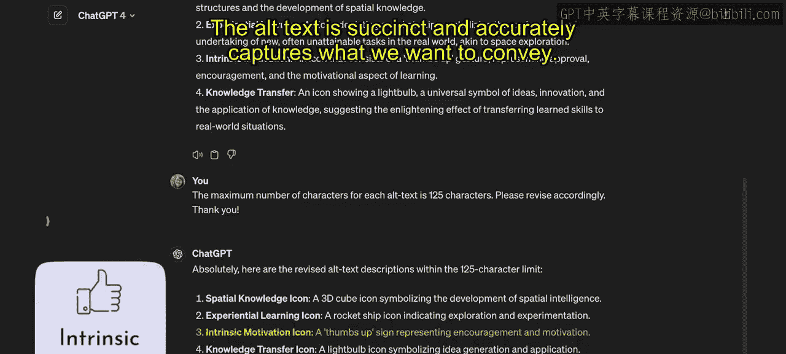

3.5：利用AI提升数字内容的可访问性 🎯

在本节课中，我们将探讨如何利用生成式AI来辅助完成一项关键的学习设计任务：为视觉内容撰写替代文本，以提升数字内容的可访问性。

学习设计师的一项核心能力是在工作中融入包容性设计的原则与实践。包容性设计的一个方面涉及数字资产的可访问性，包括文档、视觉呈现和其他类型的媒体。数字可访问性的一个具体体现是撰写替代文本，即为视觉内容提供文字描述，以帮助有视觉障碍的学习者。

在某些学习体验中，部分视觉元素可能仅具装饰性，而另一些则可能传递与理解内容相关的关键信息。因此，学习设计师必须能够撰写替代文本，以支持学习者理解那些蕴含意义而不仅仅是装饰性的视觉内容元素。

替代文本可以嵌入到各种文档类型中，并能被屏幕阅读器检测到。撰写替代文本既是一门艺术，也是一门科学。它应该在不过度描述的情况下，捕捉到视觉元素的含义和本质。它必须准确，并能传达图像的意图。

这项关键的学习设计任务需要练习才能熟练掌握，即使熟练之后，也可能非常耗时。基于以上背景，让我们来思考如何利用生成式AI来辅助起草替代文本。

让我们使用一个关于扩展现实与教育的课程中的例子。我们可以向ChatGPT上传一张幻灯片，其中包含了与课程中讨论的各个学习可供性相关联的图标：空间知识、体验式学习、内在动机和知识迁移。每个图标下方都有一段简短的说明文字。

我们可以向ChatGPT提出以下请求：“你好ChatGPT，我附上了一张展示扩展现实在教育中的学习可供性的幻灯片。每个学习可供性上方都有一个图标，请为这些图标生成替代文本。”

现在，让我们审视ChatGPT为每个图标生成的输出。ChatGPT提供了对图标的描述以及每个图标象征意义的解释。令人印象深刻的是，ChatGPT准确地描述了每个图标，并对每个图标所赋予的含义提供了合理的解释。

例如，对于“内在动机”图标，ChatGPT的描述是：“一个由竖起大拇指手势组成的图标，代表认可、鼓励和学习的动机方面。”ChatGPT提供的描述准确地描绘了图标，其解释也捕捉到了我们通过使用该图标想要传达的意图。

尽管ChatGPT的输出准确且有意义，但作为替代文本来说仍然过于冗长。理想情况下，替代文本最多应限制在125个字符以内。

幸运的是，我们可以要求ChatGPT再次尝试，并将每个图标的描述输出限制在125个字符以内。我们可以发出指令：“替代文本的最大字符数为125个字符，请据此进行修改，谢谢。”

修改后生成的替代文本现在简洁得多，符合了我们对替代文本的最佳实践指南。再次以“内在动机”为例，其替代文本变为：“一个竖起大拇指的标志，代表鼓励和动机。”这段替代文本简洁明了，并准确捕捉了我们想要传达的信息。

作为一名学习设计师，手动起草第一版文本需要一些时间，修订第二版则需要额外时间。现在，看到生成式AI在这个特定用例中的表现后，我相当有信心它能帮助我提升撰写有效替代文本的能力。此外，它还能帮助加速并改进与包容性设计原则及实践相关的重要学习设计流程。

因此，使用ChatGPT来撰写替代文本以增强数字可访问性，是一个值得探索的、前景广阔的用例。我鼓励你尝试一下。

在本节课中，我们一起学习了如何利用生成式AI辅助撰写替代文本，以提升学习材料的数字可访问性。我们了解了替代文本的重要性、最佳实践（如125字符限制），并通过具体案例演示了如何通过迭代提示，让AI生成既准确又简洁的替代文本，从而有效支持包容性设计。