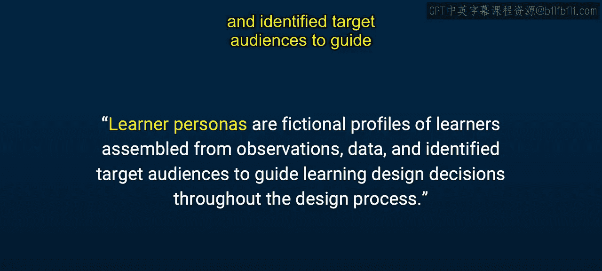
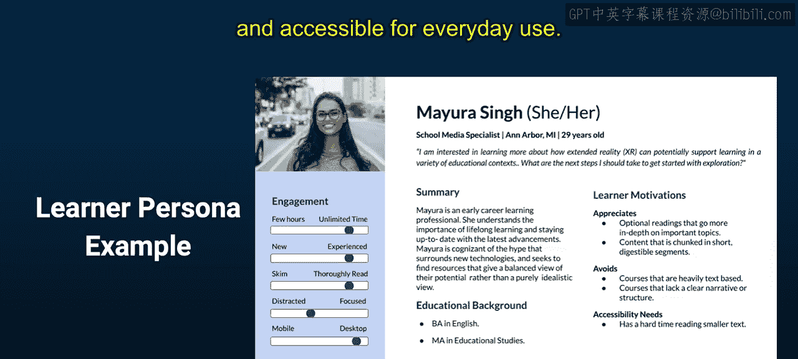
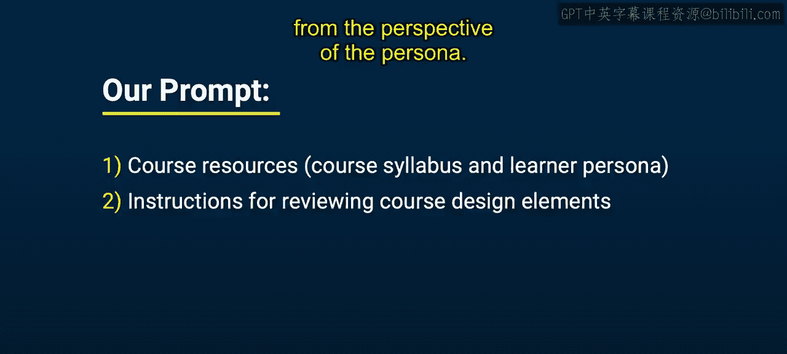
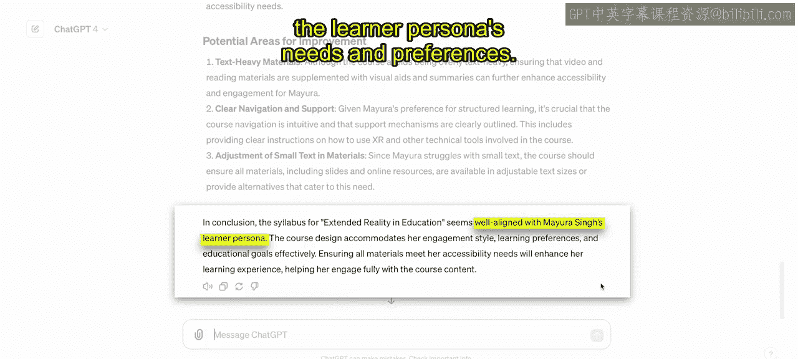

# 15：扮演学习者角色 👤

在本节课中，我们将学习如何在教学设计流程的“精炼”阶段，利用ChatGPT扮演特定的学习者角色，从该角色的视角来评估课程设计。这种方法可以帮助我们超越传统的学术性问题，获得更具针对性和人性化的反馈。

## 概述：利用学习者角色进行设计评估

在教学设计流程的精炼阶段，我们可以使用ChatGPT来检查我们的工作。这通常表现为评估学习目标与课程设计元素之间的一致性。

然而，我们也可以超越更学术性的问题和任务，提示GPT承担更具体的角色或视角。学习者角色是学习设计师工具箱中的一个工具，可以作为ChatGPT角色扮演提示的基础。

简而言之，学习者角色是虚构的学习者档案，它基于观察、数据和已识别的目标受众而构建，用于在整个设计过程中指导教学设计决策。

## 学习者角色的格式与输入

学习者角色可以用多种格式表示，学习设计师会采用最适合其设计需求和利益相关者需求的风格和格式。

幸运的是，一些GPT模型也允许我们以多种格式提供输入，包括包含数字化文本的图片。例如，这是为我们示例课程“扩展现实与教育”开发的一个学习者角色。

该角色格式包括对角色背景和选课动机的总结、教育背景以及偏好的参与模式。这个特定角色格式的一个显著特点是，它通过滑块来表示参与模式。每个类别都显示在从低到高的光谱上，例如可用时间、经验水平、技术使用（移动端或桌面端）。这使得学习设计师可以一目了然地看到这些特征，让这种格式在日常使用中非常实用和易于理解。

## 构建角色扮演提示

我们的提示将包含两个部分。第一，课程资源。第二，从该角色视角审查课程设计元素的指令。

我们可以上传我们通常使用的格式的角色档案。换句话说，我们不需要提供模板版本的文本等价物。因此，我们的提示可以这样说：“我附上了一个我为这门短期课程开发的学习者角色。请从该学习者角色的视角审查我们的教学大纲，并就其是否满足该学习者角色的目标、目的和偏好的参与模式向我们提供反馈。这是教学大纲。”

现在，我们附上学习者角色。让我们来看看结果。

## 分析GPT的反馈结果

首先，我们可以看到ChatGPT将结果组织成了四个类别：参与度与学习风格、内容与学习方法、课程主题与目标，以及潜在的改进领域。

我们并未要求以这种方式组织反馈，但看到它以这样的方式呈现，为我们提供了一个全新的视角，来解答我们关于课程设计是否满足学习者角色目标、目的和偏好参与模式的问题。ChatGPT确认，该课程设计应该非常适合该学习者角色的需求和偏好。

这是一个有希望的迹象。同时，确保设计质量的最終责任在于学习设计师。因此，以批判性的眼光看待反馈，并对课程设计是否达到其预期目标做出最终判断，仍然非常重要。

## 总结

本节课中，我们一起学习了如何将学习者角色作为提示基础，让ChatGPT从特定学习者的视角评估课程设计。我们了解了学习者角色的概念与格式，掌握了构建包含课程资源和审查指令的两部分提示的方法，并学会了如何分析和批判性地看待GPT生成的反馈。这种方法为教学设计精炼阶段提供了新的、以用户为中心的评估视角。