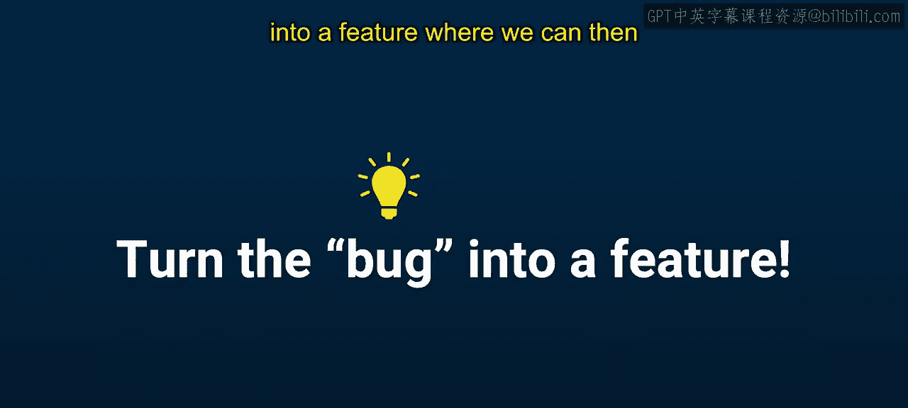
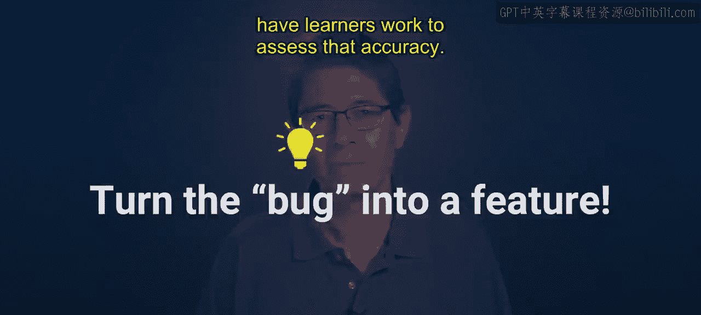
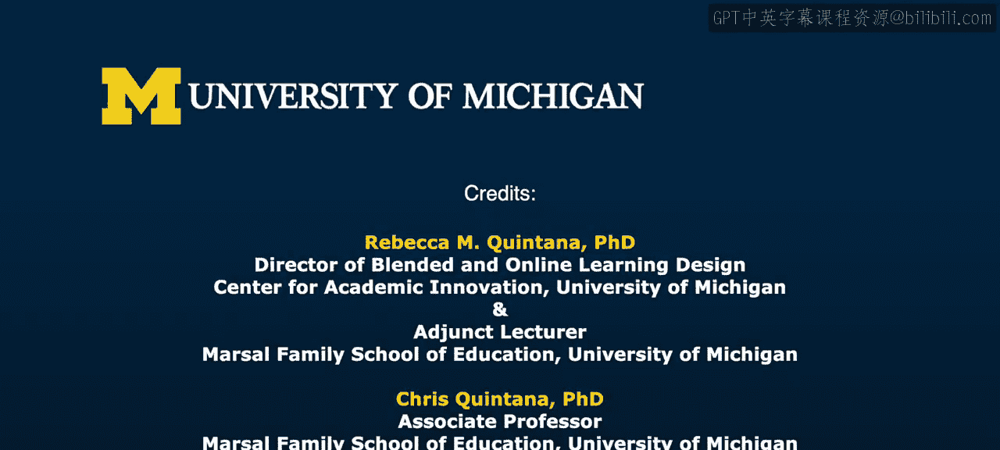

# 18：生成式人工智能在学习中的优势与局限 🧠

在本节课中，我们将探讨生成式人工智能（GenAI）在教育与学习场景中的应用。我们将分析其优势与局限，并讨论如何将其定位为学习者的“智力伙伴”，而非替代者，以设计出更有效的学习活动。

在本系列之前的讨论中，我们重点探讨了学习设计师如何在设计过程中将生成式AI作为设计伙伴。然而，学习设计师的角色也包含就学习活动和技术向其他利益相关者提供咨询。因此，你可能会被问及如何使用生成式AI来支持学习。

本节中，我们将转换视角。不再将GenAI视为学习设计师的设计伙伴，而是讨论教育者和学习者如何在学习场景中使用GenAI。这一点尤为重要，因为当前关于生成式AI在教育（无论是课堂、家庭还是其他学习环境）中应用的讨论非常热烈。

这些讨论常常走向两极分化。一方认为GenAI是解决教育领域诸多不足的“银弹”；另一方则持相反观点，认为GenAI只会助长作弊、简化学习过程，甚至最终取代教师。通常，我们需要在这两个极端之间采取更审慎的态度。因此，作为学习设计师，你的任务之一就是理解生成式AI工具，明确它们何时对学习有益，何时又需要我们对其应用保持审慎。

为了展开讨论，我们先来看看生成式AI的一些优势与局限。

## 优势与局限 ⚖️

我们已看到，生成式AI工具能够生成文本、图像和视频元素。具体而言，GenAI可以：
*   撰写各类文章。
*   编写计算机代码。
*   对大量文本进行总结。
*   帮助发现不同信息集之间的关系与联系。
*   随着用更多材料进行训练，它们能持续学习新的信息和关系，使我们能够强化模型，甚至开发专注于特定内容领域的、更专门的AI模型。

然而，生成式AI工具并非没有弱点：
*   GenAI的产出可能出现错误。有时这些错误只是不准确的结果，即AI错误地陈述了某事。但有时，不准确的结果源于AI捏造信息，并以听起来权威的方式呈现出来。
*   GenAI工具也可能输出偏见和错误信息。由于这些AI模型在不同词语和短语之间建立联系，如果训练数据包含偏见和错误信息，其底层模型就可能携带这些偏见和错误，并据此生成不正确的信息。
*   如果我们未经审查就将GenAI的输出视为既定事实，还会引发一些伦理问题。

## 在学习场景中的应用：从“作弊工具”到“智力伙伴” 🔄

审视了这些优势与局限后，我们如何看待GenAI在学习场景中的应用呢？我们可以关注一个焦点问题：人们担心学习者会利用这些工具作弊，或将其产出直接当作自己的作品上交。

这被视为问题有两个原因：第一，这可以被视为一种剽窃形式；第二，GenAI可能产出错误的作品。但我们可以将这种担忧理解为：GenAI可能无法支持真正的学习，因为在上述例子中，它替学习者完成了所有重要的认知工作。

因此，或许我们需要思考如何转变这一状况，设计出能让学习者与GenAI协作完成的学习活动，但确保学习者仍需承担大部分的认知努力。换句话说，在本系列中，我们讨论了将GenAI作为学习设计的设计伙伴。而在思考如何支持学习时，我们现在也需要将GenAI视为学生的智力伙伴。

当我们推动设计这样的学习活动——让GenAI生成供学习者使用的材料，或以不同方式支持学习者正在进行的作业——时，我们开始看到一些教育者正在实践的例子。他们不再设计那些学习者只需让AI代笔就能完成论文或其他作品的活动，而是尝试新的方法。

以下是几种将GenAI作为智力伙伴的应用示例：

**示例一：评估与修正AI产出**
一些教育者让学生先用GenAI生成一件作品（如文章、程序），然后学习活动要求学生去审查、批判并修正该作品。例如：
*   学习历史时，让GenAI生成一篇关于某个历史事件的文章，然后让学习者评估其历史准确性。
*   让GenAI生成一个计算机程序、数学方程式或文章，然后让学生评估这些作品，给GenAI“打分”，并讨论其优缺点。

这样做要求学习者仍需思考并处理GenAI生成的材料，他们必须整合所学知识才能完成这项练习。在这些例子中，我们将GenAI工具有时不准确的“缺陷”，转变成了一个“特性”，让学习者去评估其准确性。

**示例二：利用AI反馈进行迭代修订**
其他支持学习的例子也与“智力伙伴”的理念相关，即学习者与AI协作以增强他们正在进行的工作。例如：
*   一些教育者让学习者将论文初稿提交给GenAI，以获得关于如何改进内容和写作的反馈。然后学习者修改作品，并可能与GenAI进行更多轮的修订循环。最后，学习者提交最终作品、之前的草稿以及GenAI的反馈，以便教育者了解他们的修订过程。
*   类似的练习可以是：学习者先撰写自己的论文，然后让GenAI就同一主题生成一篇论文。接着，学习者比较两篇论文，决定如何修改自己的论文，同时批判AI的论文，这有助于他们同时思考内容和自己的写作。

**示例三：生成反思性问题**
另一个例子涉及文本阅读活动。可以指导学习者将阅读材料提交给GenAI，并给出提示，让AI生成一些反思性问题或其他反思提示，供学习者思考和回答，从而帮助他们更深入地理解所读内容。

## 核心原则与总结 📝

这些例子阐明了我们早先提出的观点：在思考GenAI如何支持学习时，我们需要将其视为学习者的智力伙伴。它不应为学习者完成重要的认知工作。相反，学习者和教育者可以以不同方式利用它，通过新的活动和材料重塑学习情境，但始终要牢记，学习者仍应负责完成重要的认知工作。

因此，请记住，设计师应始终关注关于生成式AI在教育和学习中应用的最新讨论。应避免陷入GenAI在这些语境下可能带来的炒作，并密切关注教育者以有效方式支持学习的、有趣且独特的GenAI应用案例。

本节课中，我们一起学习了生成式AI的优势与局限，探讨了如何通过将其定位为“智力伙伴”来设计促进深度学习而非助长作弊的学习活动，并回顾了一些创新的应用实例。