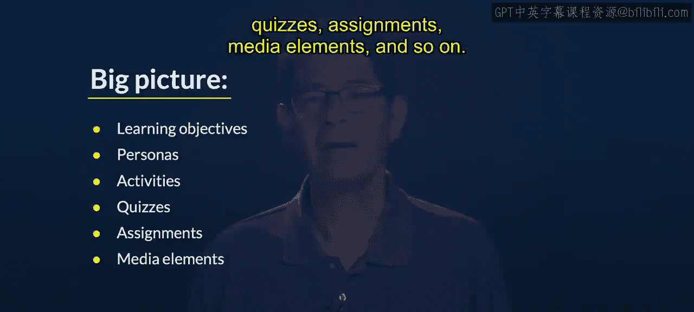
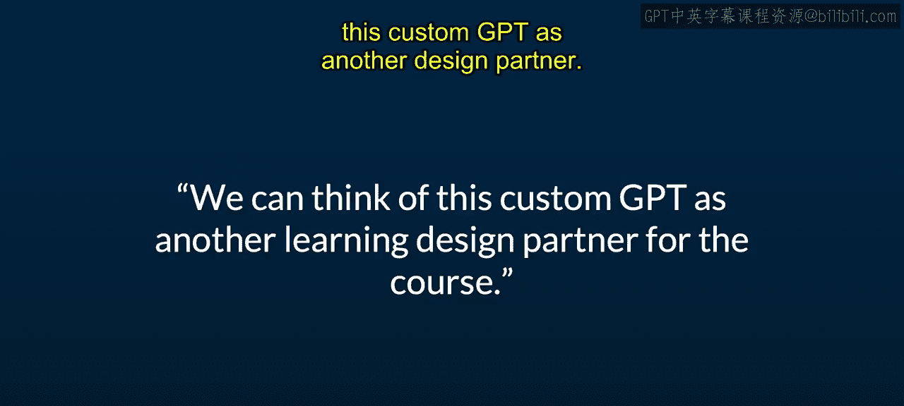
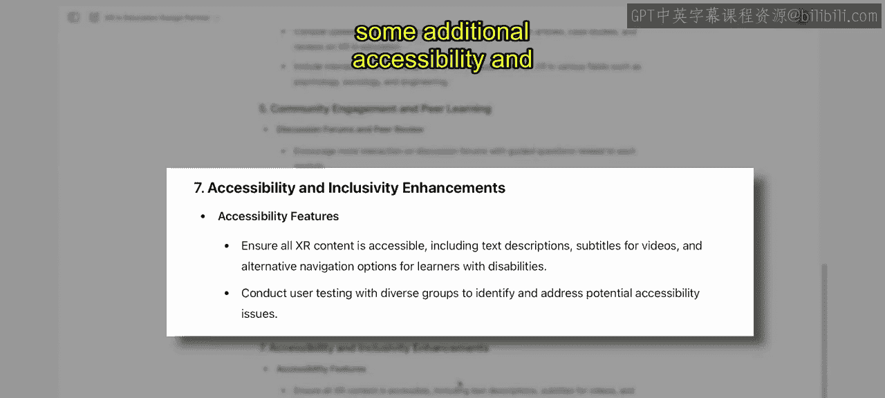
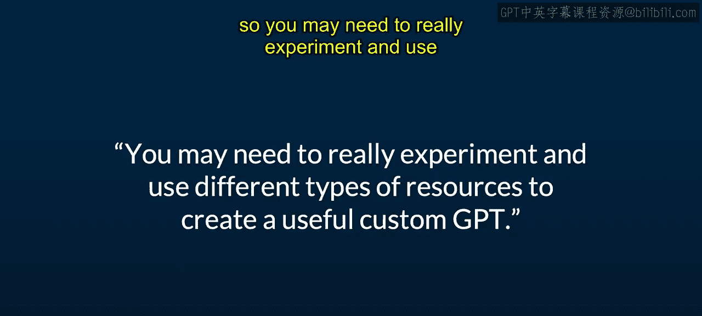
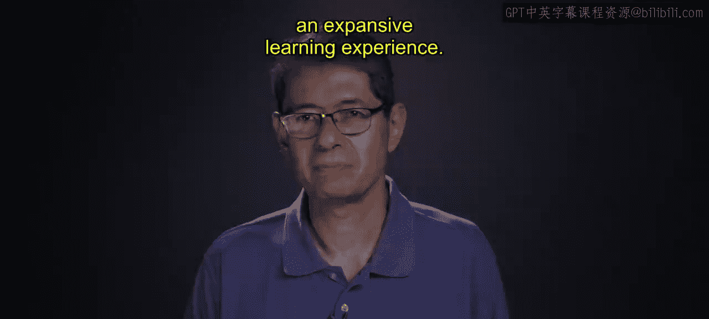
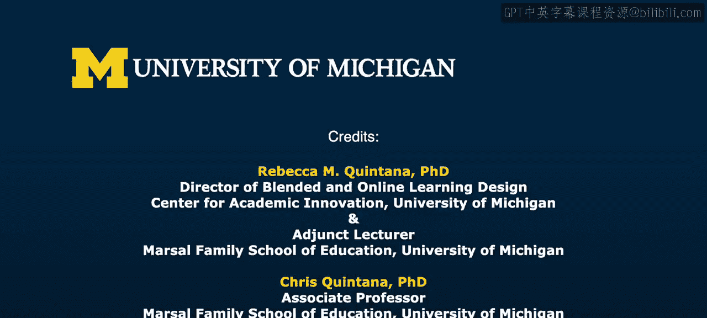

# 20：面向学习设计师的定制GPT 🛠️

在本节课中，我们将要学习如何为学习设计师创建定制化的GPT工具。我们将探讨如何利用这种工具来追踪、评估和管理学习体验设计中的众多元素，从而在设计大型课程时，既能把握全局，又能关注细节。

---

我们一直在探讨学习设计师如何将生成式AI工具作为学习设计活动的合作伙伴。

到目前为止，我们看到的例子都是为ChatGPT等工具创建不同的请求和提示，以协助完成各种学习设计任务。

但我们也可以利用生成式AI工具，来帮助我们追踪和衡量所设计学习体验的各个不同组成部分。

我们的设计过程会产生大量需要追踪的项目，例如学习目标、用户画像、活动、测验、作业、媒体元素等等。

随着学习体验的规模不断扩大，要同时看清整体框架和具体细节会变得越来越有挑战性。

因此，我们同样可以求助于生成式AI工具来协助处理所有这些事务。

除了向ChatGPT这类常规生成式AI工具提问，我们还可以创建定制的GPT工具，以支持学习设计师追踪和评估其项目中的不同元素。

让我们来看一个如何创建此类定制GPT的例子，以及我们可能会使用它的一些方式。

---

## 创建定制GPT的示例

在这个例子中，我们将探讨如何为我与Rebecca Kinana博士在大学里教授的一门课程创建一个定制GPT。这门课程是“教育中的XR”，内容是关于如何利用虚拟现实和增强现实等技术来支持学习。

虽然我们在大学里是线下教授这门课程，但在这个例子中，我们正在创建该课程的完全在线版本，而我们正在创建的定制GPT将帮助我们完成这项学习设计任务。

接下来，我们来看看如何为这门课程创建一个定制GPT，然后我们可以用它来回答关于这门课程可能遇到的各种设计问题。

这个GPT仅供课程的学习设计师使用，而非学生。因此，我们可以将这个定制GPT视为另一个设计伙伴。

我们可以进入ChatGPT来创建一个新的定制GPT，然后开始配置它。

---

## 配置定制GPT的步骤

以下是配置定制GPT的几个关键步骤。

首先，我们可以给它起一个名字，提醒我们这个定制GPT是我们“教育中的XR”课程的设计伙伴。因此，我们将创建的GPT命名为“XR与教育设计伙伴”。

接下来，我们描述这个GPT，说明它充当已完成设计产物的存储库，以协助开发额外的课程材料。

然后，我们可以提供我们希望GPT如何操作的指令。具体来说，这个GPT提供关于各种设计产物和课程元素当前设计状态的最新信息。鼓励设计团队成员将最终确定的设计产物上传到GPT，以确保其信息保持最新。设计团队成员可以查询这个GPT来开发新材料，并确保内容连贯、一致且协调一致。

接着，我们可以设置一些对话启动器。你可以将这些视为你希望GPT经常为你执行的任务的快捷方式。这些链接将显示在GPT页面的前端。

我们创建了以下对话启动器：
*   一个用于“需要开发的课程元素”。
*   另一个用于“与目标一致的课程元素”。
*   第三个名为“与我们的用户画像一致的课程元素”。
*   最后一个是“课程设计中的连贯性与不一致性”。

创建这些对话启动器后，你会看到它们以按钮形式显示在GPT的前端。这样，当我们按下相应的按钮时，就可以快速让GPT处理这些任务。

最后，我们需要为定制GPT提供一些关于我们“教育中的XR”课程的信息或知识。这些信息存在于我们为该课程准备的不同课程文件中。因此，我们可以上传诸如课程大纲、一份阅读材料样本、一份测验、一些用户画像、一些我们创建的关于学习与功能可供性的初始脚本等文档。

我们可以先上传关于课程的这些初始信息。但随着课程设计的推进，我们将添加我们创建的新信息，例如新的测验和脚本，或者可能的新用户画像和学习目标。

---

## 使用定制GPT

一旦我们上传了所有这些信息，就可以为我们的课程创建定制GPT，并与设计团队的其他成员共享这个GPT。

请记住，我们的GPT目前只拥有关于我们课程的一些初始信息。但这足以让我们通过一些小例子来看看如何使用我们的定制GPT。

让我们使用一些对话启动器。

首先，询问我们的GPT哪些课程元素与我们的学习目标一致。这里，GPT返回了相当多的信息。它首先评估了它如何看待课程将课程元素与学习目标结合起来。它指出，课程结构融合了理论概念、实际应用和沉浸式技术，以增强学习者的参与度和理解力。然后，它继续列出了一些主要的课程元素，以及这些元素如何与学习目标保持一致。

和以往一样，作为设计师，你应该审查这些反馈的准确性，并确保其言之有理。但正如你所见，随着你随时间向GPT添加更多课程元素，你可以继续使用GPT为你提供有用的摘要和概述，以帮助你衡量课程的各个方面。

让我们看另一个例子。我们可以在GPT的主页上开始一个新的对话。这次，我们要求GPT根据我们在大纲中注明的内容，告诉我们哪些课程元素仍需开发。在这里，GPT为我们提供了它认为我们仍需完成的工作摘要。

例如，它告诉我们仍然需要开发某些课程模块，并描述了这些模块的要素。它提醒我们，特别是对于一门关于扩展现实的课程，我们应该开发更多互动元素和模拟。它描述了我们应创建的一些测验和材料，并提醒我们需要为课程考虑一些额外的可访问性和包容性功能。

---

## 总结与展望

我们还可以做更多事情，但这应该能让你了解学习设计师如何创建定制GPT来支持学习设计过程。

创建GPT仍然是一项相对较新的活动，因此你可能需要进行大量实验，并使用不同类型的资源来创建一个有用的GPT。

但希望你能看到，开发一个定制GPT如何能以不同的方式真正充当设计伙伴，帮助你追踪创建大型学习体验所涉及的所有元素。

在本节课中，我们一起学习了如何为特定的学习设计项目创建和配置一个定制GPT。我们了解了如何通过命名、描述、设定指令、添加快捷启动器以及上传课程资料来构建一个专属的设计伙伴。这个工具能够帮助设计团队追踪项目进度、确保内容一致性，并提供设计建议，从而更高效地管理复杂的学习体验设计。