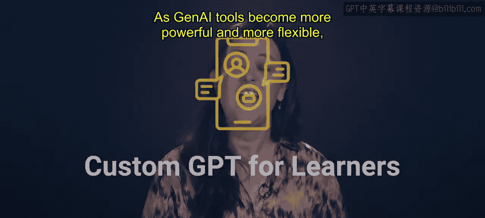
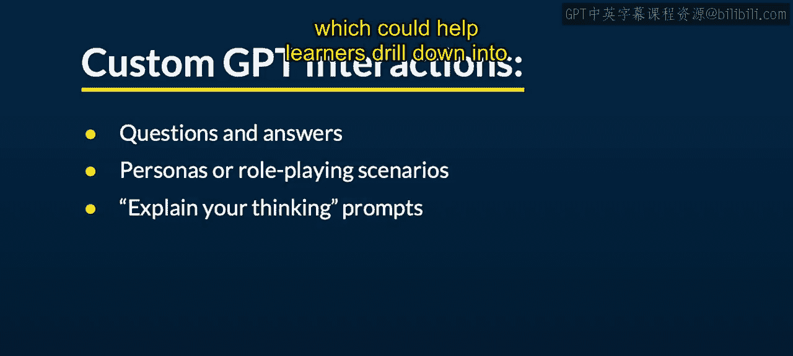
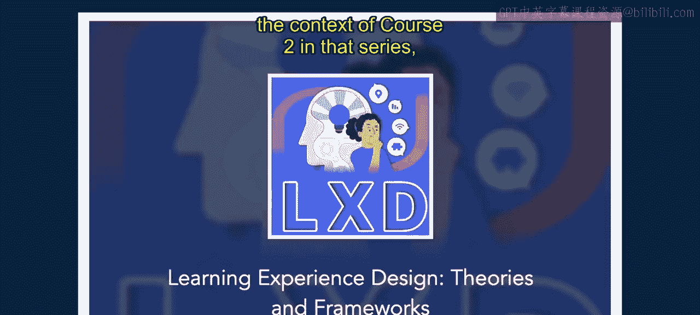
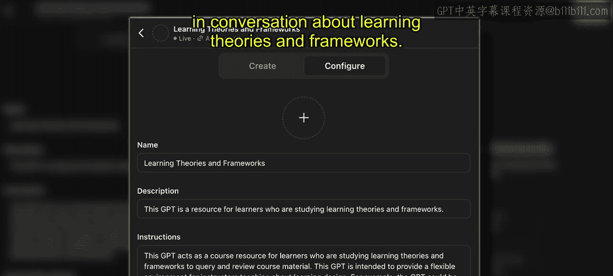
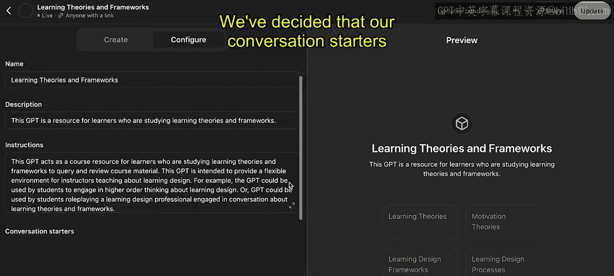
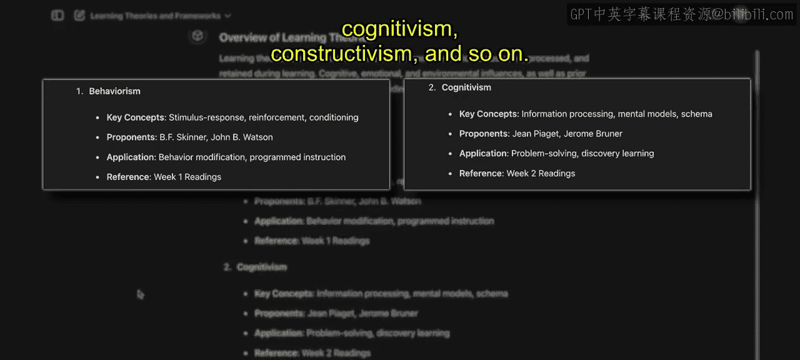
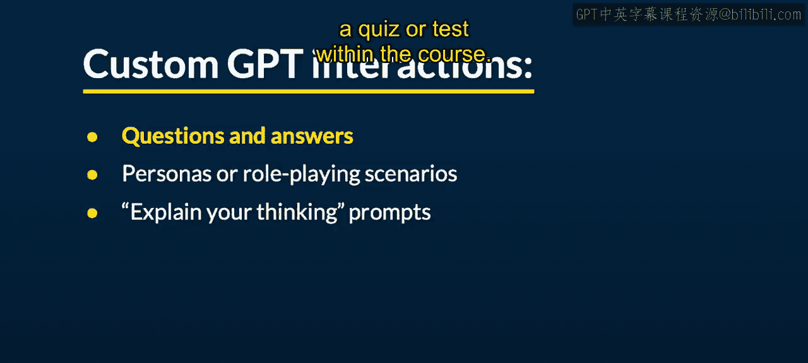
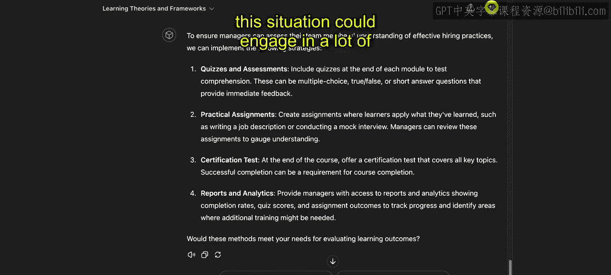
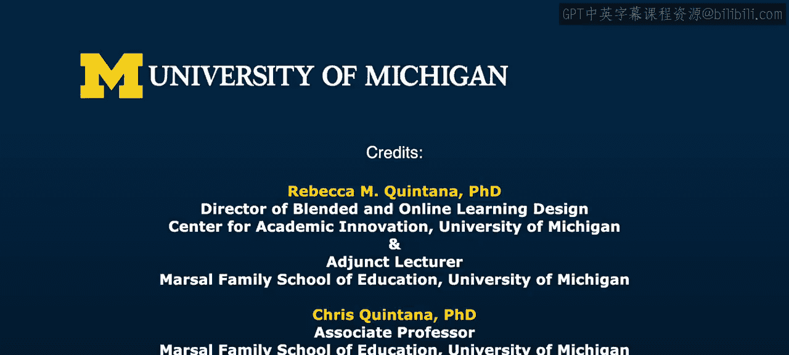

# 21：面向学习者的定制GPT 🧠

在本节课中，我们将学习如何为学习者创建和利用定制化的GPT环境。我们将探讨定制GPT如何支持问答、角色扮演和概念解释等活动，并逐步演示如何为一个学习理论与框架课程构建一个实用的定制GPT示例。

随着AI工具变得更强大、更灵活，学习设计专业人员将有机会以定制GPT的形式，创建高度专业化和定制化的学习环境。这将使我们能够创建两种环境：一种是供学习专业人员执行特定任务的环境，另一种是让学习者在定制环境中进行知识建构的环境。本节视频将重点探讨后一种应用。

## 定制GPT如何支持学习活动

以下是定制GPT可以支持的几种主要互动类型，它们为设计学习活动提供了灵感：

*   **基础问答**：GPT擅长处理基础问答。学习者可以用自己的语言提问并获得回应。
*   **角色扮演**：GPT也擅长扮演特定角色或参与角色扮演场景。
*   **解释推理**：当被要求时，GPT能够解释其推理过程，这有助于学习者深入研究他们正在学习的特定概念。

## 构建一个定制GPT示例

现在，让我们创建一个可在学习体验设计课程中供学习者使用的定制GPT环境。我们曾以面对面和在线两种形式教授过这门研究生课程，因此我们将使用为该系列第二门课程（学习理论与框架）所开发的教学材料。这个主题足够广泛，使我们有机会建立一个知识库，用于与该课程主题相关的各种教育活动。

### 设置步骤

我们来看看如何为这个示例设置定制GPT。

1.  **基本信息**：我们为其设定标题为“学习理论与框架”。描述保持通用：`这是一个供学习学习理论与框架的学习者使用的资源`。
2.  **操作指令**：我们为GPT应如何操作制定了指令，内容如下：
    *   `本GPT作为学习学习理论与框架的学习者的课程资源，用于查询和复习课程材料。`
    *   `本GPT旨在为教授学习设计的教师提供一个灵活的环境。例如，学生可用其进行关于学习设计的高阶思维活动，或用于角色扮演活动，如与一位学习设计专业人士就学习理论与框架进行对话。`
3.  **对话启动器**：我们决定将课程的主题领域作为对话启动器。这为学习者提供了一个轻量级的支架或支持，以引导他们对整个课程的思考。这些主题包括：学习理论、动机理论、学习设计框架、学习设计流程。
4.  **上传课程内容**：我们向定制GPT上传了课程内容，为其提供相关的课程信息。上传的项目包括课程大纲、视频脚本、随附的幻灯片以及我们为阐述课程概念而撰写的阅读材料。

### 测试定制GPT的功能

接下来，让我们测试一下这个定制GPT。

**测试基础问答**：首先，看看当学习者选择我们提供的对话启动器之一时会发生什么。例如，如果学习者选择“学习理论”，他们会收到来自我们课程的关于学习理论的综合信息，包括行为主义、认知主义、建构主义等理论。学习设计者和教育者可以设计后续的问答活动，让学习者比较、对比并综合本课程中不同学习理论的观点。这类活动有助于学习者在复习材料、准备课程测验时巩固知识。

**测试角色扮演场景**：现在，让我们尝试更复杂一些的角色扮演场景。在这个场景中，学习者将扮演客户，与由ChatGPT扮演的学习设计师合作，设计一个关于最佳招聘实践的、引人入胜的人力资源培训课程。客户不具备学习设计理论和框架的基础知识。因此，本次活动的目标可以是让课程中的学习者评估GPT如何以研究为依据的方式有效回应客户的问题。最终，该活动的学习成果是让学习者认识到与项目利益相关者（客户）互动时有效的学习设计策略。

以下是模拟对话的示例流程：
*   作为客户，学习者可以提问：“什么样的课程设计会让学习者感到有动力？我们希望关于最佳招聘实践的课程有很高的完成率。”
*   在我们的场景中，由GPT扮演的学习设计师提供了五个想法，客户可以深入探讨其中一个，例如“互动内容”。客户可以说：“我想了解更多关于在我们的课程中，测验和投票可能是什么样子的。”
*   由GPT扮演的学习设计师提供了示例问题可能的样子，然后提供了两个实施建议：“即时反馈很好，你可以考虑加入讨论环节。”
*   客户回应并提出问题：“一个能让学习者有动力继续学习的课程是什么样的？”
*   GPT回应了更多关于如何使用测验和投票来保持学习者参与课程热情的细节。
*   最后，客户可以询问：“经理们如何知道团队成员是否学会了有效的招聘实践？”由GPT扮演的学习设计师再次提供了若干选项。

可以看到，在这种情况下，学习者可以随着场景以自然的方式展开，进行大量的来回讨论。

## 为活动设计提供结构

这个示例旨在让你一窥使用定制GPT可以设计出的学习活动类型。作为学习设计者，仔细思考活动的结构非常重要。

教育者可以为学习者提供一个启动提示，以设定互动的参数。他们还可以要求学习者在角色扮演活动中明确引入至少三个来自课程的概念。在这个案例中，客户（学习者）询问了动机、评估策略和学习证据，这些都是课程中包含的内容。

为了进一步扩展活动，可以要求学习者下载聊天记录，并高亮或注释出GPT在哪些地方示范了基于研究的学习设计实践，在哪些地方没有。

## 总结

本节课中，我们一起学习了定制GPT的创建与应用。定制GPT的创建为学习设计者和教育者探索新型学习机会开辟了道路。关键在于提供结构和具体要求，以确保活动与为课程设计和定义的学习成果保持一致。通过精心设计，定制GPT可以成为支持问答、深度角色扮演和概念探究的强大学习伙伴。