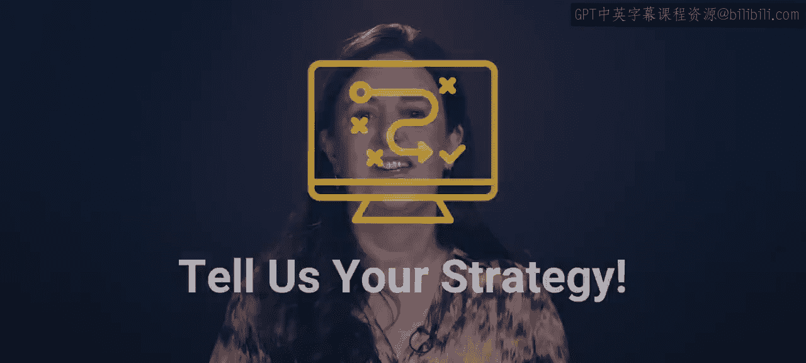
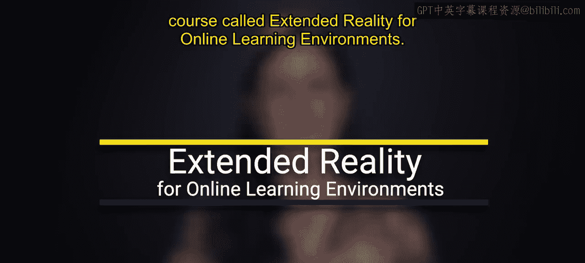
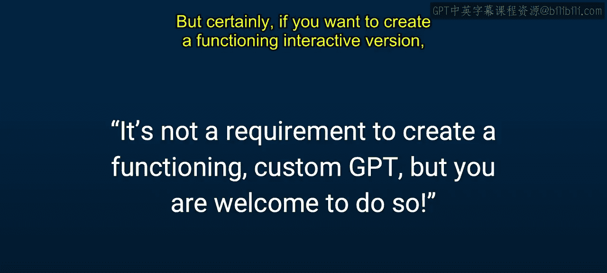

# 22：分享你的策略 🚀

在本节课中，我们将回顾生成式AI如何作为学习设计伙伴，并引导你制定一个策略，为特定情境下的学习设计师或学习者创建一个定制的生成式AI工具。

---

## 概述

在本系列课程中，我们探讨了学习设计专业人士如何将生成式AI视为一个设计伙伴。我们首先从整体上审视了学习设计流程，以确定可以尝试和整合生成式AI的潜力领域。接着，我们研究了生成式AI如何用于增强与起草和优化相关的具体学习设计任务。在本课程中，我们则重点探讨了生成式AI如何作为一种资源，在学习情境中支持设计流程和活动。

现在，我们希望你将所学付诸实践，思考如何利用生成式AI创建一个知识库或资源库，以支持学习设计师或学习者的工作与理解。

---

## 回顾：生成式AI的两大支持类别

在整个课程中，我们探讨了生成式AI如何在两大类工作中支持学习设计师：

1.  **与生成式AI进行头脑风暴**
2.  **利用生成式AI进行优化**

我们使用一个名为“**在线学习环境中的扩展现实**”的示例课程，演示了这两类工作的具体应用场景。

---

## 课程活动：制定你的定制GPT策略

在之前的探讨中，你已有机会反思生成式AI增强学习设计流程的潜力，并尝试了我们展示的示例。现在，我们希望你思考如何利用生成式AI为学习设计师或学习者创建一个知识库或资源库，以支持他们的工作或对某个主题的理解。

我们演示了开发定制GPT的两个用例，这使我们能够定义生成式AI用于查询和响应的内容与参数基础。

**对于本次课程活动，你需要制定一个策略，以构建一个定制GPT：**
*   用于在**项目背景**下支持学习设计师，**或**
*   用于在**学习情境**中支持学习者。

以下是两个方向的详细说明，你可以选择其一进行策略规划。

---

### 用例一：为学习设计师创建资源

在我们的第一个示例中，我们希望为学习设计师创建一个资源，供其在课程设计与开发流程的整个生命周期中使用。其目的是开发一个**即时且定制化**的环境，当学习设计师需要针对其特定项目量身定制的结果时，可以使用它。

你可以将其想象为能够向一位**对你的项目了如指掌的资深学习设计师**提问和寻求建议。

随着课程设计流程的展开，这个定制GPT可以不断更新新的相关材料。

**如果你决定首先关注这个用例，你需要：**

1.  **确定任务与背景**：明确一个特定的学习设计任务（或一组任务），以及使用该GPT的具体设计背景。
2.  **规划资源与材料**：思考你需要提供哪些资源和材料，以开发一个能为项目增加价值的定制GPT。
3.  **定义信息类型**：指明在全面的资源集合中，哪些类型的信息是可用的且有用的。

---

### 用例二：为学习者创建资源

在我们的第二个示例中，我们希望为学习者开发一个资源，使其能够搜索课程中提出的观点，并请求澄清或详细阐述。

我们的目标是纳入尽可能多的课程资源，以便为学习者可能提出的关于课程或内容的问题提供信息丰富的回答。

你可以将其想象为能够为学习者提供他们自己的**教学助理**，类似于一位**私人导师**。在学习情境中，这个定制GPT可以用于例如测验或备考活动。

**如果你决定关注这个用例，你需要：**

1.  **确定支持的活动**：首先明确你希望在学习情境中支持的特定活动。
2.  **构思GPT的工作方式**：考虑你希望定制GPT如何运作。
3.  **准备必要资源**：确定使这个GPT正常运行所需的资源和材料。

---

## 活动要求与延伸

对于本次活动，你需要针对我刚刚描述的**两个方向之一**，制定一个开发策略。

如果你想更进一步，可以按照你制定的计划和策略，着手开发一个可运行的定制GPT。但这**不是本课程的强制要求**。当然，如果你想创建一个功能完善的交互式版本，我们非常欢迎。

---

## 总结

我们期待看到你为创建定制GPT所制定的策略，无论是为在特定工作背景下操作的学习设计师，还是为在特定学习情境中的学习者。

感谢你在课程中与同伴分享你的策略。