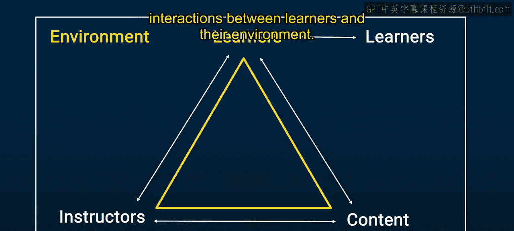
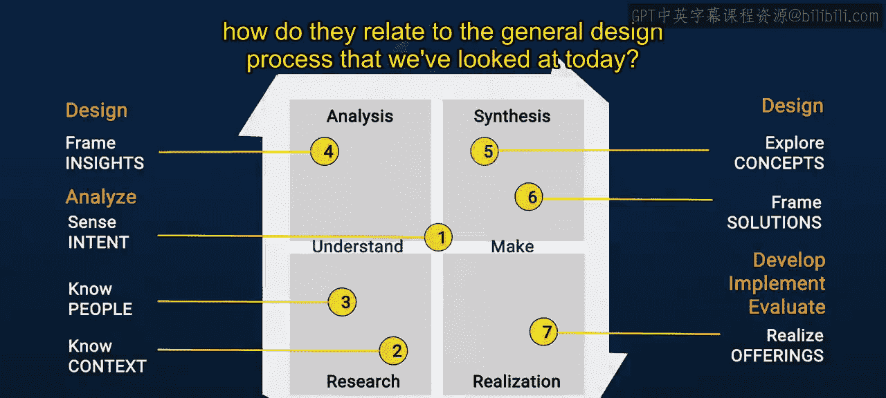
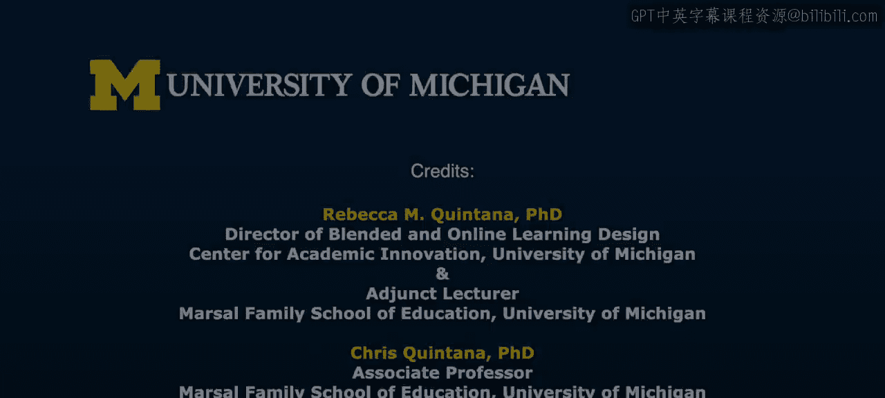

# 生成式AI作为学习设计伙伴：1：设计流程概述 🎯

在本节课中，我们将从宏观层面审视学习设计流程。这旨在提供一个快速的回顾。如果你对这个主题完全陌生，我们建议你查阅本课程引言部分提供的资源。理解这个主题将有助于我们思考，生成式AI如何在整个设计流程中作为学习设计伙伴发挥作用。

我们想强调，我们并不固守某一种特定的学习设计模型或框架。快速搜索网络会发现，设计学习体验的方法多种多样。学习设计师通常会借鉴多个框架，因为每个框架都为我们的学习设计带来不同的关注点，例如技术整合，或思考多样性、公平性与包容性问题。

## 学习设计框架简介 📚

以下是几个知名的学习设计框架：

*   **ADDIE模型**：代表分析、设计、开发、实施和评估。
*   **7Cs模型**
*   **对话框架**
*   **逆向设计**
*   **通用学习设计**

所有这些框架都将帮助我们思考，在我们创建的学习设计中希望促进何种互动。

## 教学三角与互动关系 🔺

我们发现，“教学三角”有助于我们概念化这些互动在学习情境中如何协同工作。这些互动包括：

*   学习者与内容之间的互动
*   学习者与教师之间的互动
*   教师与内容之间的互动
*   学习者与其他学习者之间的互动
*   学习者与其环境之间的互动

## 通用设计流程与ADDIE映射 🗺️

正如我们将看到的，这些框架都触及学习设计流程相同的基本要素，尽管它们看起来彼此不同。为了说明这个观点，我将首先展示一个通用设计流程的图示，然后展示ADDIE框架的组成部分如何与之对应。

这个设计流程图源自伊利诺伊理工学院的Vijy Kumar教授，他将设计过程描述为围绕四个象限排列的七种模式。

上一节我们介绍了多种学习设计框架，本节中我们来看看一个通用的设计流程，并理解ADDIE如何与之对应。

以下是通用设计流程的四个象限及其核心任务：

1.  **意图感知**：位于象限中心。设计师专注于他们试图解决的总体问题或议题。这涉及看到全局，能够阐明项目或设计挑战在其所处的更广阔背景中的位置。
2.  **研究**：位于左下象限。允许设计师专注于了解人和了解情境。设计师可以通过各种用户体验研究方法来确定受众和情境特征。
3.  **分析**：位于左上象限。设计师将研究象限中收集的想法转化为设计的总体方向。设计师需要能够评估设计情境中存在的资源和约束，并定义他们将遵循的参数。
4.  **综合**：位于右上象限。设计师专注于探索概念和构建解决方案框架。这是他们开始规划和勾勒人物角色、场景和设计计划的地方。设计在此阶段变得更加清晰。
5.  **实现**：位于右下象限。设计师开发、实施、测试和评估他们在流程早期阶段概述和规划的设计。

正如图示所传达的，设计流程是流动和动态的。设计师可以在每个象限内的不同任务之间来回移动。

现在，让我们将ADDIE学习设计框架叠加到这个通用设计流程图上，以展示它们如何相互关联。作为一个思维练习，你可以自己尝试用不同的学习设计框架来做这个映射。

*   **意图感知与ADDIE的“分析”**：学习设计师也需要考虑他们试图解决或应对什么问题。设计中要解决的学习问题或教学挑战是什么？这些问题的答案可以用学习目标来描述。这是设计过程的核心活动，对应于ADDIE的“分析”部分。
*   **研究与ADDIE的“分析”**：ADDIE“分析”的另一部分是理解人和理解情境，这对应于研究象限，学习设计师在此寻找关于学习者学习特征和与课程相关的情境因素的信息。
*   **分析与ADDIE的“设计”**：一旦确定了学习成果、受众和情境，学习设计师会将注意力转向ADDIE所称的“设计”。这包括思考学习体验的核心要素，例如如何评估学习者，以及主要内容和活动是什么。这些活动体现在设计流程图的“分析”象限中。
*   **综合与ADDIE的“设计”**：“设计”还包括草图绘制、大纲规划和原型制作，这些任务很好地映射到“综合”象限。尽管ADDIE模型称此阶段为“设计”，但我们可以将整个活动或事业视为设计。值得注意的是，与ADDIE相关的设计任务横跨两个象限，因此不一定完全整齐地归入某一个象限。
*   **实现与ADDIE的“开发、实施、评估”**：设计模型的第四个象限“实现”可以涵盖ADDIE模型的最后三个阶段：开发、实施和评估。评估、活动和内容在学习环境中被开发和实施，使设计师能够测试、评估并确保他们的学习设计按预期运行。

## 总结与思考 💡

本节课中，我们一起从高层视角回顾了学习设计流程，介绍了多种设计框架和通用的四象限流程模型，并重点将ADDIE框架与之进行了映射。理解设计流程的构成是至关重要的，这将为我们后续引入AI工具和方法打下坚实基础。

你自己的工作借鉴了哪些学习设计框架？它们与我们今天看到的通用设计流程有何关系？希望你能尝试一下这个思维练习。这将帮助你更清晰地聚焦于学习设计过程。