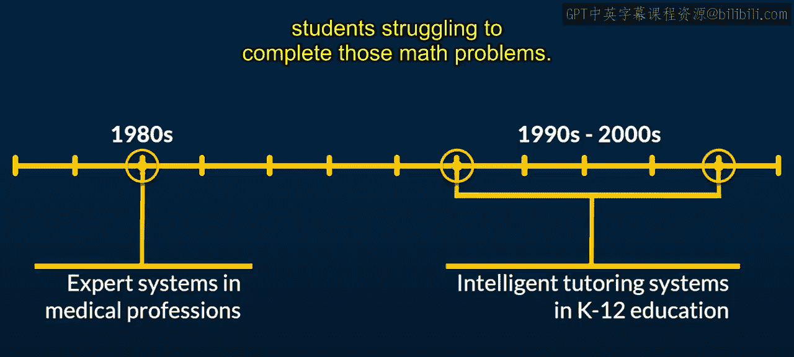
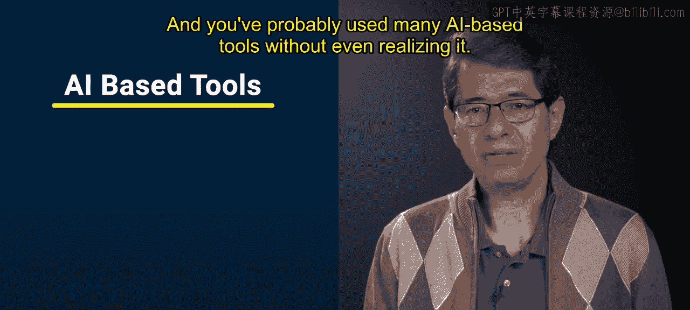
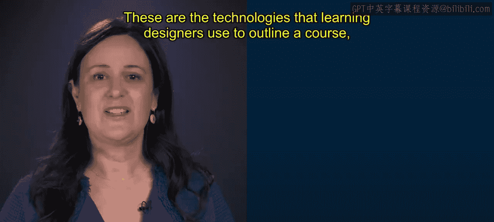
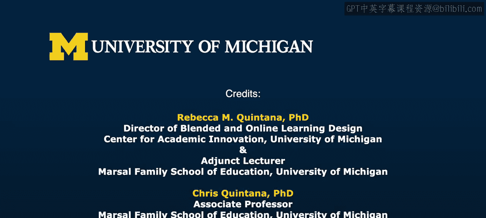

# 生成式AI作为学习设计伙伴：第3课：面向学习专业人士的生成式人工智能

在本节课中，我们将学习生成式人工智能（GenAI）的基本概念，特别是大型语言模型（LLM），并探讨学习设计师如何将其作为专业实践工具来使用。

## 概述：什么是生成式人工智能？

在深入探讨生成式AI在学习设计中的具体应用之前，我们首先需要明确生成式AI的含义。

我们经常听到关于生成式AI的讨论，这可能会让人觉得人工智能是一个全新的话题，或者当前这波AI工具是首次出现。但人工智能绝非新话题。人工智能研究已持续约60年，并催生了多种可用于工作和教育的工具。

例如，在20世纪80年代，我们看到了专家系统，它试图囊括特定学科的知识，以便从业者可以向系统寻求帮助。在20世纪90年代和21世纪初，我们看到了用于K12教育的智能辅导系统，它们可以评估学生在代数等科目上的作业，并在观察到学生解题困难时提供提示和指导。

你可能已经在不知不觉中使用过许多基于AI的工具。语法检查器和文字处理器、汽车中的停车辅助系统、家中的智能恒温器，这些都包含了一定程度的AI。

## 生成式AI工具的类型

那么，当我们谈论生成式AI时，指的是哪些工具？在本系列课程中我们将使用哪些？

当我们说生成式AI时，指的是一种能够生成某些“制品”的人工智能工具；它可以生成文本、图像、视频或其他类型的数据。它会根据用户给出的提示来生成这些制品。

生成式AI工具还可以在接收信息时学习其中的模式和结构。随着它获取更多信息并持续学习，其提供的输出质量会得到改进。

生成式AI工具有很多类型，但其中我们接触越来越多的两种是**大型语言模型**和**大型行动模型**。

*   **大型语言模型**：ChatGPT就是一个例子。LLM是学习语言模式的统计模型。当我们向LLM发出提示时，它会根据其当前模型生成文本来尝试回答我们的提示。随着我们向LLM提供更多信息，它会利用这些信息识别模式并建立更多统计关系，从而优化其模型。
*   **大型行动模型**：这类模型与LLM类似，但更侧重于采取某种行动并与世界互动。大型行动模型可以分析数据然后做出决策，或者根据你家的信息控制智能设备（如恒温器），还可以为你自动化任务。

在本课程中，我们将主要关注LLM以及像ChatGPT这样的工具。虽然我们这里可能以ChatGPT为重点，但还有许多其他可用工具，我们鼓励你在探索生成式AI用于学习设计时进行尝试。技术发展日新月异，当你观看本课程时，可能已有许多新的LLM问世。

值得注意的是，还有一些类似于LLM的工具可以生成其他媒体类型，如图像。有时你会看到这些工具被称为使用**扩散模型**。例如，OpenAI的DALL-E可以根据你的文本提示生成图像。一些LLM也开始同时生成图像和文本。尽管这些工具在技术上有所不同，但我们可以将它们统称为生成式AI工具，因为它们都能生成文本、图像、音频、视频甚至计算机代码。

## 生成式AI在学习设计中的角色

我们为什么要在学习设计的背景下思考生成式AI？学习设计师在专业实践中使用技术的方式主要有两种。

第一种是**为学习者识别和整合技术**，作为更广泛学习体验的一部分。这些是学习者自己用来与内容、其他学习者、教师互动以及展示所学知识的技术。

第二种是**学习设计师利用技术来设计和开发学习体验**，将其作为专业实践的一部分。这些是学习设计师用来规划课程大纲、创建数字材料、管理项目等的技术。

在本课程中，我们重点关注生成式AI在第二类中的应用，即帮助学习设计师增强其专业实践。

## 大型语言模型如何助力学习设计

考虑到大型语言模型的作用，我们应该记住它们擅长理解和生成人类语言。它们可以进行自然对话、生成内容以及总结大量文本信息。

以下是LLM可以助力学习设计的具体方式：

*   **作为对话伙伴**：由于LLM可以进行自然对话，将其视为聊天机器人会很有帮助。你可以用它来回答问题、提供反馈，并为课程设计提出想法和建议。
*   **生成内容草稿**：由于LLM擅长生成内容，学习设计师可以用它们来准备初稿。因为它们能够处理人类语言，学习设计师可以提供各种形式的文本输入来帮助塑造期望的输出。
*   **处理与总结文本**：由于LLM擅长筛选大量文本，学习设计师可以用它们来审阅内容、提供摘要，并根据需要压缩材料。

## 总结

本节课中，我们一起学习了人工智能工具的历史背景，并对大型语言模型是什么及其功能进行了高层面的解释。我们还初步探讨了学习设计师如何将LLM作为专业实践工具，为后续的深入讨论做好准备。