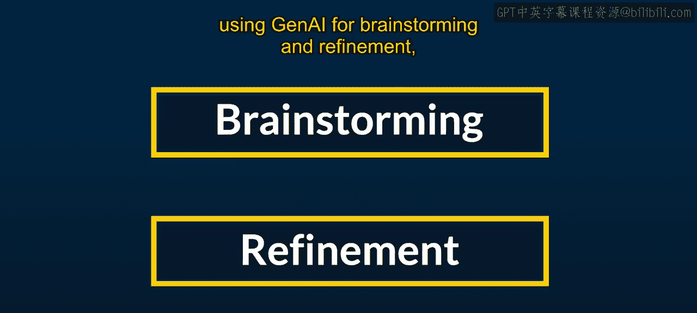
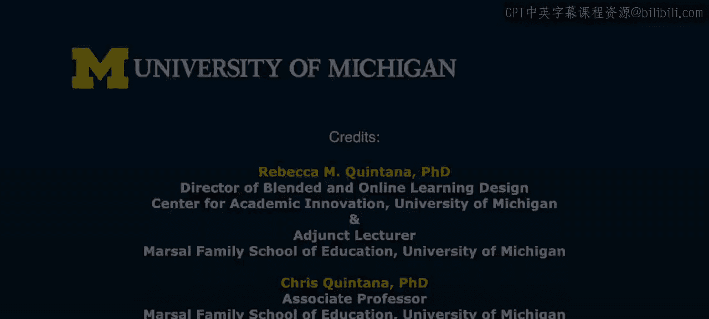

# 密歇根大学《生成式AI作为学习设计伙伴（3课全）｜Generative AI as a Learning Design Partner》中英字 p06 5_生成式人工智能在学习设计中的应用.zh_en -BV147xgeaEGJ_p6-

In the first part of the course， we explored the idea that generative AI could be engaged as a learning design partner。

We also took a high level view of the design process and considered how we can map onto that process。

 our preferred framework。 We took this step so that you would have the learning design process that you are most familiar with。

 top of mind。😊，Now that we've given some thought to these areas。

 we can start to identify specific places where we see potential for the use of Gen AI。

We'll share our perspectives here to orient you to this way of thinking and working。

 and then we'll encourage you to develop your own strategies for applying these ideas to your own professional practice。

The ideas that we present here should be a starting point for the work that you'll undertake on your own。

And be well suited to your own particular context。When we think of the overall learning design process and the many tasks that learning designers do within that process。

 it can sometimes be daunting to pinpoint exactly where to focus your attention。

So it might be helpful to think about potential opportunities in two ways。

Early stage brainstorming and later stage refinement Let's start with the early stage of brainstorming and see what learning design activities might be well suited for generative AI。

As we've become more familiar with the power and potential of these tools。

 we've begun to realize that they can be really useful in the early drafting stages of our work。

When we think about the difference between what it's like to draft something from scratch and what it's like to build on something that's already been started。

We can begin to imagine a possible role for generative AI in producing first drafts that learning designers can use as a starting point for deeper work。

So let's think about the types of items learning designers need to draft if we cast our mind's eye back to the learning design process。

 a number of core learning design tasks might come to mind， including developing learner personas。

 learning objectives and high level outlines。These early design tasks help set direction and create structure for our learning designs。

Continuing with core elements of a learning experience。

 we might also consider generative AI for drafting assessments， content， and activities。For instance。

 generative AI could be used to get started on the creation of quiz questions， assignments。

 introductory content， activities， and participant structures， and discussion prompts。

These are the key elements that learners interact with as part of the learning experience。

Going a little further， generative AI could be used to begin creation of important additional elements。

 such as syllabus language， content summaries， scaffolding language， alternative text generation。

 andquiz or assignment feedback。These tasks are critical for a seamless。

 integrated and enjoyable experience for learners。Now。

 let's consider the later stage refinement and see what might be well suited for generative AI。

Once all of the key elements of a learning experience are in place。

 learning designers can consider how to leverage generative AI as a thought partner in improving the structure and elements that have been drafted。

This is where we could use generative AI in a role playing capacity where we develop prompts that use the tool to review the content from different persona types。

 including learners， instructors and administrators For instance。

 we can provide the GenAI tool with the key characteristics。

 motivations and perspectives of our personas and ask the GenAI tool to review content from these viewpoints in doing so we can identify gaps or areas in our content that need refinement to better meet the needs of personas。

Another way to use generative AI for course design review could be to determine whether the course appears to be functioning as intended。

 for example， learning designers could use learning objectives as the basis of a query about alignment with content design。

Another tactic could be to check that assessments include opportunities for learners to demonstrate knowledge and cognitive levels that are consistent with the predefined learning objectives。

At this later stage， generative AI can be used to verify that a course aligns with its intended goals。

And finally， learning designers could use generative AI to identify gaps， redundancies。

 and inconsistencies in assessment， activity， and content design。

With learning design processes taking weeks to months。

 it can be helpful to engage a tool that can see everything at a glance to be able to point out areas where a design could be strengthened。

Generative AI can assist with quality assurance。We hope that these two approaches。

 using GenAI for brainstorming and refinement， have been helpful to conceptualize the types of learning design tasks that can be accelerated。

 enhanced， or improved by our partnership with Gen AI tools。

