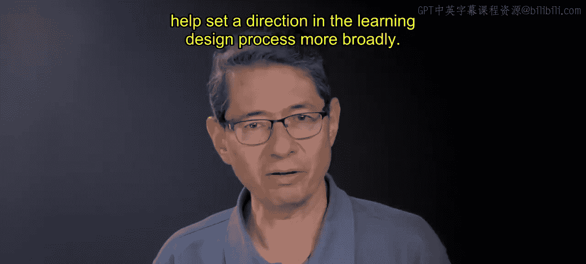
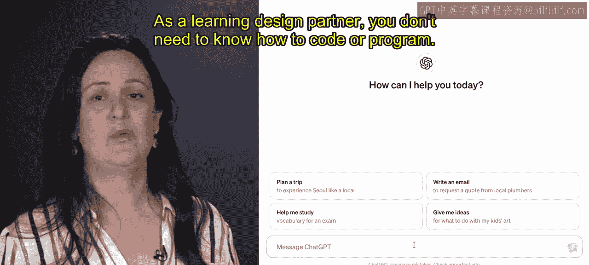
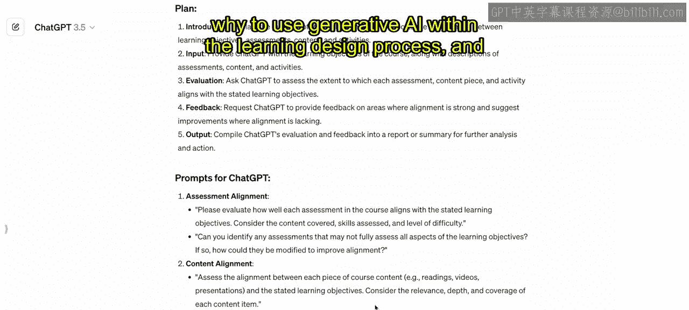
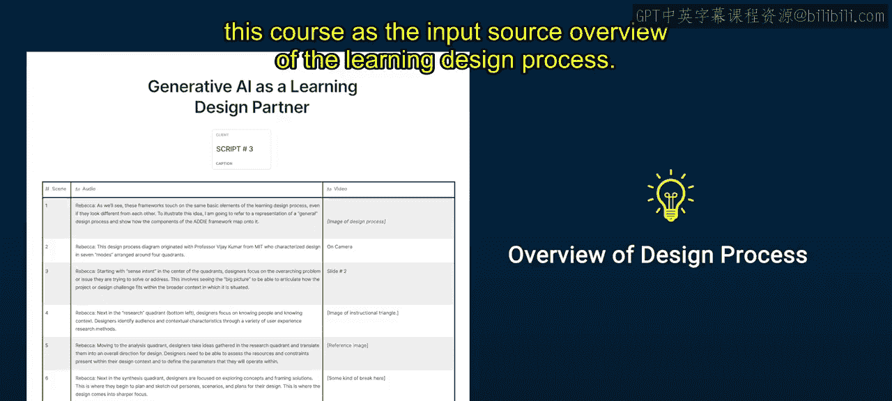
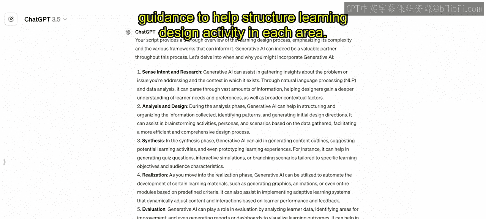

# 生成式AI作为学习设计伙伴：第6章：设计过程中的机遇

## 概述
在本节课中，我们将探讨如何在学习设计流程中战略性地运用生成式AI。我们将通过一个实际演示，展示如何与AI工具对话，以获取设计灵感、明确方向，并优化具体的设计任务。

我们已经花了一些时间探讨生成式AI可以在学习设计流程的哪些环节发挥作用。我们识别了早期设计阶段以及后期阶段中，生成式AI可以作为有用伙伴的若干任务。

当你考虑如何将生成式AI作为学习设计伙伴时，采取战略性方法很重要。你的目标不应是用生成式AI取代你作为学习设计师的角色和责任。相反，你应该考虑如何利用它来启动项目、突破瓶颈并改进你的实践。

思考何时以及为何使用生成式AI的一种方式是，用它来助推那些你觉得具有挑战性或繁琐的任务。你希望能够专注于工作中给你带来最多快乐和满足感的部分。你也需要能够向项目相关方解释你工作的基本原理，包括你使用生成式AI所做的一切。因此，在直接投入之前，采取审慎的方法很重要。

## 演示：与AI对话获取设计灵感
此时，我们想提供一个演示，展示生成式AI如何作为学习设计伙伴。与其在此演示一个具体的学习设计任务，我们更想展示生成式AI如何更广泛地提供灵感或帮助设定学习设计过程的方向。

让我们从一个场景和一个问题开始。你可以提供一些关于你的角色以及你对“生成式AI作为学习设计伙伴”这一主题的兴趣的信息。

你不需要知道如何编码或编程，把它想象成进行一次对话。

**示例对话开始：**
> 你好，ChatGPT。我是一名经验丰富的学习体验设计师，但我对使用生成式AI是新手。我对ChatGPT可以作为我学习设计实践的伙伴这个想法很感兴趣。你能帮我思考一些潜在的使用案例吗？

即使使用这个相当基础的提示，ChatGPT也提供了一个详尽的选项列表，但其中一些比另一些更有用。一些生成的想法涉及学习者如何与生成式AI互动，另一些则涉及学习设计师的具体任务。

当发生这种情况时，你可以尝试重新表述问题或要求更多细节。

**例如：**
> 你能为我，作为一名学习设计师，提供一些关于如何使用ChatGPT来设计和规划课程的额外想法吗？

这些选项看起来更接近我们寻找的内容。

如果提供的任何选项特别吸引你，你可以跟进并要求ChatGPT进一步扩展那个想法。

**例如：**
> 我对与学习目标的一致性特别感兴趣。你能帮我创建一个计划或一组提示，让ChatGPT来评估课程学习目标与课程评估、内容和活动的一致性吗？

ChatGPT为学习设计师提供了一套具体的步骤和提示，以确保与目标的一致性。

## 深化：探讨“何时”与“为何”
现在，让我们看看是否能回到最初关于在学习设计过程中“何时”以及“为何”使用生成式AI的问题。

为此，向工具提供更多关于我们如何概念化学习设计过程的信息可能会有所帮助。为了本示例的目的，我们将输入本课程的一个脚本作为输入源，概述学习设计过程。

让我们开始一个新的对话。我们可以保存刚刚完成的那个。

**提示如下：**
> 你能帮我思考在学习设计过程中何时以及为何使用生成式AI吗？我将分享一些我对设计的一般看法，以及我如何看待一个学习设计模型映射到那个过程，形式是我写的一个脚本。

输入提示并粘贴脚本后，我们看到了一些有用的结果，以及一些关于在学习设计过程中使用生成式AI的好处和潜在注意事项的一般性指导。

你可以根据库马尔的一般设计过程，使用部分或全部结果来帮助指导你在研究、分析与设计、综合、实现和评估方面的思考。从那里，你可以深入每个类别，并要求获得额外的想法和指导，以帮助构建每个领域的学习设计活动。

## 关键操作与建议
记住，你可以重新表述问题、要求更多细节、要求更少细节、深入探究、重新组织结果等等。你可以保存对话并开始新的对话。

生成式AI可以生成大量内容，有时可能令人不知所措。因此，你可能还想将特别有前景的想法复制到你自己的数字笔记空间中，以免丢失这些重要的想法。

我们希望这个简短的演示为你提供了一些关于如何开始考虑将生成式AI作为学习设计伙伴的想法。我们鼓励你尝试我们刚刚演示的活动，使用你自己的问题和措辞。

你会发现你可能会得到与我们相似或不同的结果。我们很感兴趣，想听听你在课程后期计划开始、停止以及继续使用这些工具做什么的想法。

## 总结
本节课中，我们一起学习了如何战略性地将生成式AI融入学习设计流程。我们通过实际对话演示，了解了如何利用AI获取设计灵感、细化任务，并探讨了在设计的各个阶段（如目标对齐、课程规划）应用AI的具体方法。关键在于将AI视为提升效率、激发创意的伙伴，而非替代品，并始终保持对设计决策的掌控力和解释力。