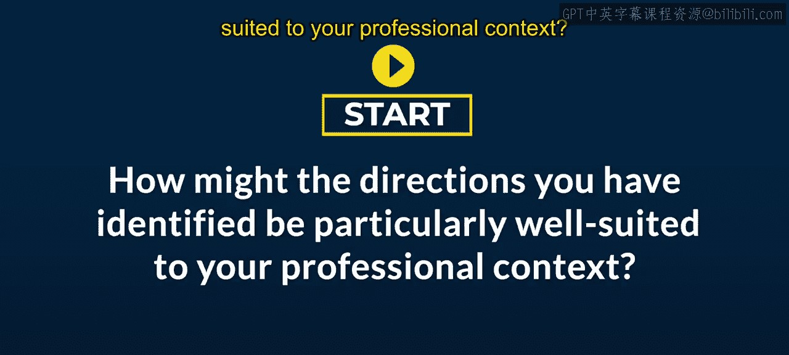
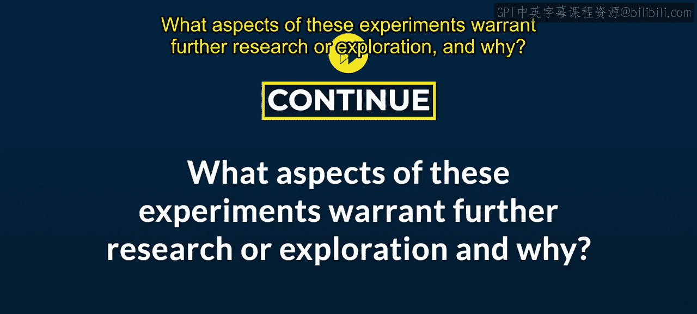

生成式AI作为学习设计伙伴：3：深入思考 🧠

在本节课中，我们将一起回顾生成式AI作为学习设计伙伴的核心理念，并引导你通过一个结构化的反思框架，思考如何将所学知识应用到你的实际工作中。

---

在整个课程中，我们探讨了如何将生成式AI作为学习设计伙伴来加以利用。我们认识到，每位学习者都身处独特的专业背景中。因此，我们想为你提供一个机会，反思所学内容，并思考如何将这些想法应用于你自己的工作中。

为了引导你的反思，我们将提供一个基本的结构来组织你的思路。

### 反思框架：开始、停止、继续

作为学习领域的专业人士，你可能听说过“开始、停止、继续”模型。教师经常使用这种方法来组织学生关于学习情境中哪些方法有效、哪些无效的反馈。我们将以略有不同的方式使用这些类别，以激发你思考如何利用生成式AI作为学习设计伙伴。

#### 开始：探索新应用

上一节我们回顾了课程的整体思路，本节中我们来看看“开始”这一部分。我们思考了生成式AI在**设计初期阶段**的应用方式，例如：
*   起草学习者画像
*   生成课程大纲
*   拟定学习目标

任何学习设计师通常需要提供草稿支持的任务，都可以考虑归入此类。我们也思考了生成式AI在**设计后期阶段**的应用，例如：
*   润色或修改草稿
*   从特定视角（如通过公平与包容的设计视角）审查课程内容

以下是引导你反思“开始”部分的问题：
*   你听到过哪些想尝试的有前景的想法？
*   你会优先考虑其中的哪些想法？为什么？
*   你确定的方向如何特别适合你的专业背景？

#### 停止：识别风险与保持谨慎

现在，让我们考虑“停止”。我们探讨了哪些学习设计任务特别适合由生成式AI来支持，但也可能存在**最好由学习专业人士直接处理**的任务。

我们还讨论了像生成式AI这样的工具可能陷入的“炒作周期”，包括最初热情高涨，随后热情减退并转向幻灭。学习设计师可能需要在课程和项目开发中使用这些工具时，应对利益相关者的不同观点。“停止”一词也可以理解为**保持谨慎**。

以下是引导你反思“停止”部分的问题：
*   对于将生成式AI作为学习设计伙伴，你有哪些顾虑？
*   在你的专业实践中，哪些部分让你对使用生成式AI感到犹豫？是什么引发了你的顾虑或谨慎？

#### 继续：深化现有实践

最后，我们来审视“继续”。如果你正在学习这门课程，你可能已经开始尝试使用生成式AI来支持你的专业实践。或者，你可能正在与已经开始尝试这些工具的同事共事。你甚至可能在本课程的讨论区中听到同行们正在进行的实验。

以下是引导你反思“继续”部分的问题：
*   你或你同事的实验中，你认为哪方面最有前景？为什么？
*   这些实验的哪些方面值得进一步研究或探索？为什么？

---

我们期待听到你的想法，并了解你目前如何看待生成式AI作为学习设计伙伴。

本节课中，我们一起学习了如何通过“开始、停止、继续”的反思框架，系统性地思考生成式AI在你专业工作中的应用、潜在风险以及未来的探索方向。希望这个框架能帮助你更清晰、更有信心地将AI工具融入你的学习设计流程中。