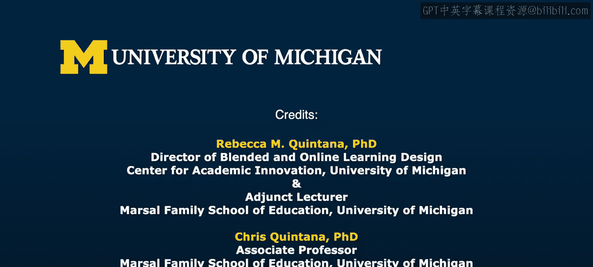

# 密歇根大学《生成式AI作为学习设计伙伴（3课全）｜Generative AI as a Learning Design Partner》中英字 p09 0_课程欢迎.zh_en -BV147xgeaEGJ_p9-

Welcome to our second course in our series of courses on generative AI as a learning design partner we are so glad you're here and learning alongside with other learners in the course。

 I'm Dr。 Rebecca Kana， Director of Bded and Online Learning Design at the Center for Academic Innovation and ajunct lectureurer at the Marcel Family School of Education。

And I'm Dr。 Chris Kana， associate professorfes at the Marcel Family School of Education at the University of Michigan。

In this course， we'll pick up where we left off in course1。

 where we considered ways in which learning designers could use generative AI as part of their professional practice。

In our first course， we took a high level view of our topic and thought about the strategic use of GenAI。

Here we'll dive a little deeper and do some hands on experimentation to get a sense of how learning designers can use generative AI to draft and refine their work。

We'll start by taking a look at general approaches for writing props and improving GenI's output Then we'll use a worked example to explore how learning experienced designers could approach brainstorming and refining with generative AI。

In our example， we'll explore the use of JenAI to develop an online course on educational applications of extended reality。

We will leverage generative AI to help us think about how a course we've taught for years on campus could be reimagined as an open online short course。

 similar in format to the course you are taking now。

In the brainstorming category we'll show how generative AI can help learning designers develop learning objectives。

 create learning activities and assessments， and even draft alternative text to accompany visual information for digital media as learning designers we can appreciate that having a starting point provided gives us a head start rather than having to start with a blank page。

In the refining category， we'll show how generative AI can provide another perspective to ensure that course goals are aligned with design outcomes and that the overall course is well suited for the personas developed for the course。

As learning designers， we can always benefit from a second look to help us uncover potential flaws or limitations in our designs。

Then later in the course， you will identify a project that you're working on or you can use a sample scenario that will provide to practice your choice of brainstorming and refining tasks that we've demonstrated using our example course on extended reality and education you'll have the chance to use our workbook tool again to document and share your work with peers in the course。

And just like before， we'll show you how we've approached the design and development of this course in our Be the curtain feature。

 which allows you an inside look into how we've used generative AI to prepare this course for you。

Now that you have an idea of what this course is about and what you'll be doing in the course。

It's time to get started。

