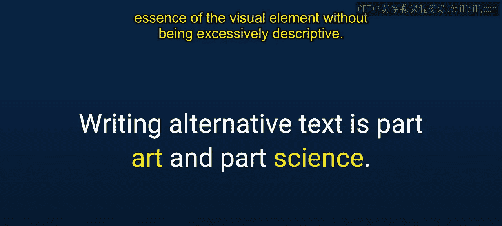
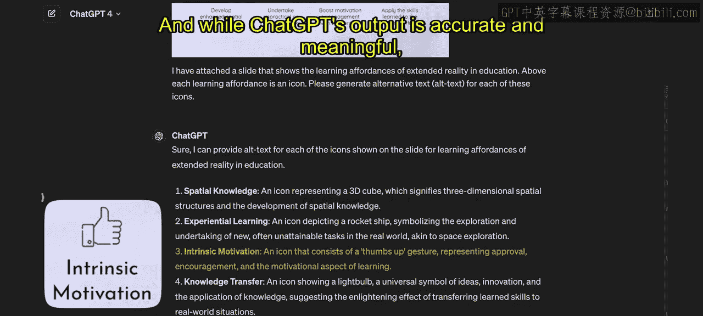
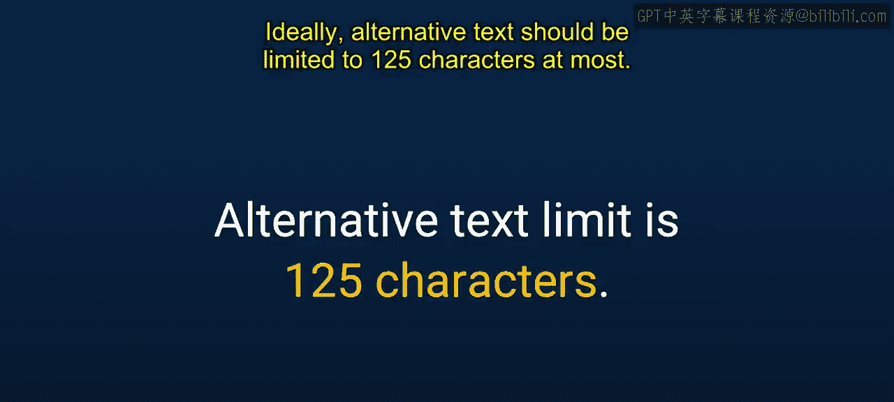
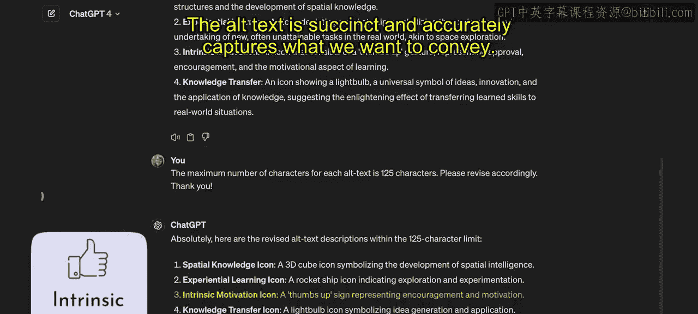
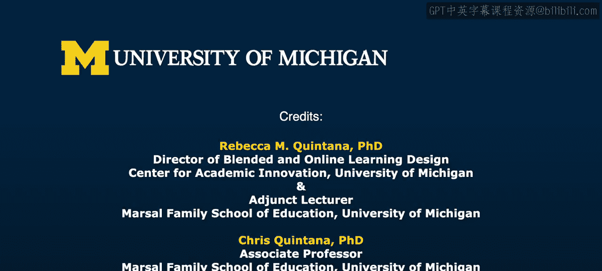

# 密歇根大学《生成式AI作为学习设计伙伴（3课全）｜Generative AI as a Learning Design Partner》中英字 p14 5_提高可访问性.zh_en -BV147xgeaEGJ_p14-

A core competency for learning designers is to integrate inclusive design principles and practices in their work。

One aspect of inclusive design relates to accessibility of digital assets， including documents。

 visual representations， and other types of media one aspect of digital accessibility is writing alternative text or alt text to provide a textual description of visual content for learners with visual impairments。

Within some learning experiences， some visual elements might be decorative。

 while others could convey meaning that is relevant to understanding the content。

 so it is important for learning designers to be able to write alternative text to support comprehension of visual content elements that imbue meaning and not just decoration。

Alt text can be embedded within various document types and is detectable by screen readers。

Writing alternative text is part art and part science。

 it should capture the meaning and essence of the visual element without being excessively descriptive。

It should be accurate and also convey the intent of the image。

This key learning design task takes practice to develop proficiency and even once proficient。

 it can be time consuming to do。So with that background in mind。

 let's consider how we can engage generative AI in the drafting of alternative text or alt text。

Let's use an example from our course on extendeded reality and education we can upload a slide to chat GPPT that includes icons associated with each of the learning affordances discussed throughout the course。

 spatial knowledge， experiential learning， intrinsic motivation， and knowledge transfer。😊。

And under each icon， there is a brief caption。Hello Cha ET。

 I have attached a slide showing the learning affordances of extended reality in education Above each learning affordance is an icon。

 please generate alternative text， alt text for each of these icons。

Now let's consider the output for each icon， chattGPT has provided a description of the icon and an explanation of what each icon symbolizes。

 it's impressive to see that chattGPT accurately described each icon and provided a reasonable explanation of the meaning ascribed to each one。

For example， intrinsic motivation。An icon that consists of a thumbs up gesture representing approval。

 encouragement and the motivational aspects of learning。

The description provided by chat GPT accurately describes the icon and the explanation captures what we intended to convey through the use of that icon。

And while ChatGPT's output is accurate and meaningful。

 it is still too wordy to be useful as alternative text， ideally。

 alternative text should be limited to 125 characters at most。

Fortunately， we can ask Chat GPT to try again and limit the output for each icon description to 125 characters。

The maximum number of characters for alt text is 125 characters， please revise accordingly。

 thank you。The alt text generated is now much more succinct and fits within our best practice guidelines for alt text。

Let's look at intrinsic motivation again。A thumbs up sign representing encouragement and motivation。

The alt text is succinct and accurately captures what we want to convey。

As a learning designer， it would have taken some time to draft the first version and additional time to revise the second version。

And now， after seeing JenAI in action for this particular use case。

 I feel pretty confident it could help me develop my ability to write effective alt text。

And additional， it could help accelerate and improve an important learning design process related to inclusive design principles and practices。

So using Cha EptT to write alternative text to enhance digital accessibility is a promising use case to explore。

I encourage you to give it a try。

