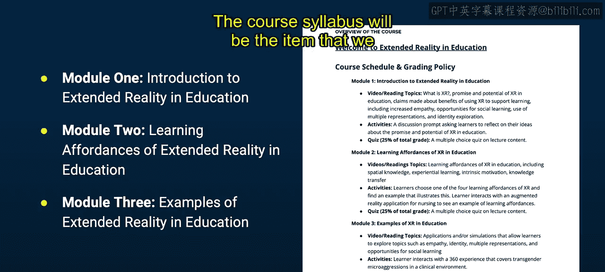
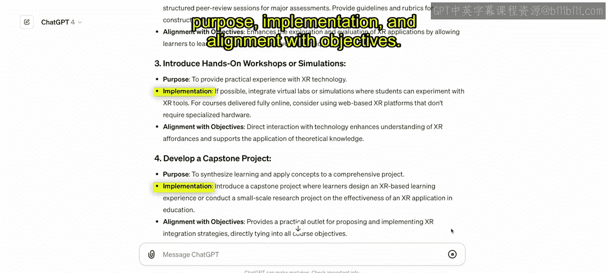
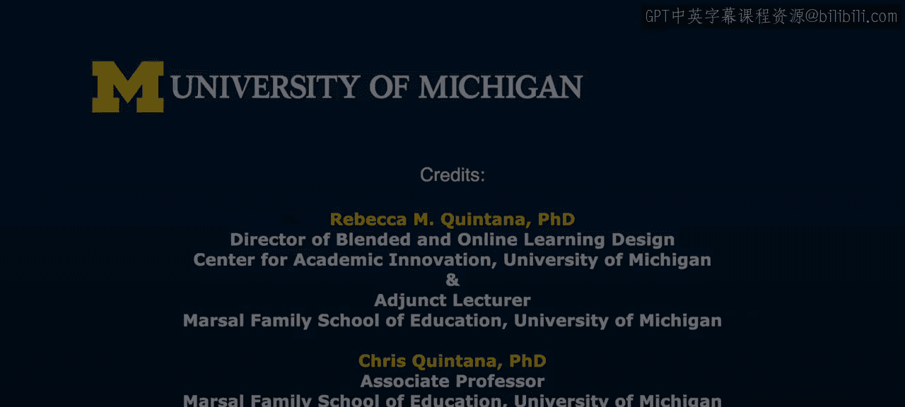

# 生成式AI作为学习设计伙伴：3：将课程目标与设计成果对齐 🎯

在本节课中，我们将学习如何利用生成式AI来验证和优化课程设计，确保所有的教学活动与评估都与预设的学习目标保持一致。

作为学习设计师，验证课程设计是否与为课程或学习体验所设定的学习目标保持一致至关重要。学习目标应具体、以行动为导向且可衡量。这些目标对学习设计师很有帮助，能指导课程设计，确保所有提议的活动和评估都是为了支持这些目标而开发的。由于设计过程往往持续数周甚至数月，将学习目标置于首要位置非常重要。

然而，即使意图良好，学习设计有时也会偏离轨道。学习设计师可能会遇到内容范围蔓延的问题，即活动和评估超出了课程的最初目标。相反的情况也可能发生，可能由于时间和资源的压力与限制，有时我们的学习设计未能达到预期。换句话说，练习机会和学习资源未能充分让学习者为在总结性评估中展示所学知识做好准备。

因此，当我们考虑将生成式AI作为学习设计伙伴时，特别是在学习设计流程的优化阶段，利用生成式AI来实现这一目的似乎是合理的。

## 回顾示例课程

上一节我们探讨了生成式AI在设计过程中的应用，本节中我们来看看如何用它来检验设计成果的匹配度。让我们回到一直在研究的示例课程。

现在，我们关于扩展现实与教育的在线课程已经开发完成，我们希望确保计划的活动和评估与我们为课程定义的学习目标保持一致。与其他示例一样，我们将使用ChatGPT。

我们为课程设定了以下学习目标：
*   **分析并讨论**XR技术在教育领域的潜力。
*   **探索并评估**使用“学习赋能框架”的XR应用。
*   **提出**将XR整合到教育情境中的策略。

在我们的示例中，课程大纲描述了课程的组织方式：
*   **模块1**：扩展现实在教育中的介绍。
*   **模块2**：扩展现实在教育中的学习赋能。
*   **模块3**：教育中的扩展现实实例。

课程大纲提供了更多细节，包括每个模块的主题、每个模块内包含的活动，以及学习者展示所学知识的方式。课程大纲将是我们输入到ChatGPT中的内容，连同我们的提示词。

## 使用AI进行对齐检查

以下是我们的提示词，它将非常直接：
`这是关于扩展现实与教育的在线短期课程大纲。请提取大纲中的学习目标，并确保大纲中的课程结构与课程目标保持一致。`

我们也会将课程大纲复制粘贴到ChatGPT中。让我们看看结果。

ChatGPT按学习目标组织了结果。每个目标都配有一个高层次的主题：技术与教育、学习赋能框架、教育情境。对于每个学习目标及其对应的主题，ChatGPT都提供了课程设计如何支持这些目标的方式示例，看起来相当不错。

请注意，我们只使用了提示词和课程大纲，无需特别指出学习目标或课程结构，ChatGPT能够自行识别。

## AI的深度分析与建议

除了回应我们关于学习目标与课程结构设计是否对齐的问题，ChatGPT还更进一步。其输出内容评论了课程的驱动性问题以及它们如何支持既定的学习目标。此外，除了评论课程目标和评估如何与每个目标挂钩，ChatGPT的输出还提供了关于课程活动和评估的整体总结性陈述。

ChatGPT的评估相当积极：“总体而言，该大纲看起来连贯且结构良好，有效地将学习目标映射到课程内容和活动中。这种一致性支持了一种连贯的学习体验，应能有效实现课程的教育目标。”

不过，如果能听听是否有方法可以加强学习目标与课程设计元素之间的一致性，那会更好。让我们尝试这个后续提示词：`您会提出什么建议来填补空白？`

ChatGPT提供了一些高层次建议，例如纳入案例研究、扩展同伴协作以及开发一个顶点项目。每个建议的结构如下：**目的**、**实施方式**、**与目标的关联性**。

作为学习设计师，您可以审阅这些建议，看它们是否在您的设计情境中合理。它们可能会激发一些有趣的想法来增强您的设计。另一方面，纳入过多建议可能会导致我们之前提到的问题：范围蔓延。

因此，作为学习设计师，运用您的最佳判断力至关重要，既要验证ChatGPT的评估是否合理（而非过于宽容），也要决定是否采纳生成式AI提供的额外建议。

## 总结

本节课中，我们一起学习了如何利用生成式AI作为设计伙伴，在课程设计后期验证学习目标与课程大纲、活动及评估之间的对齐度。我们看到了AI不仅能进行匹配度分析，还能提供结构化的优化建议。关键在于，设计师需要结合专业判断来审慎采纳这些建议，避免范围蔓延，确保最终设计既符合目标又切实可行。