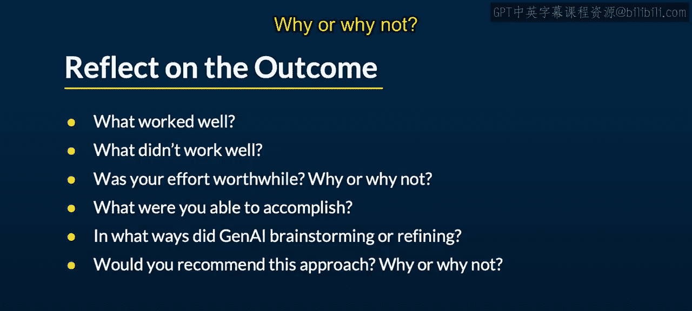

# 生成式AI作为学习设计伙伴：3：实践尝试 🧪

在本节课中，我们将把前两节学到的知识付诸实践。我们将引导你完成一个实验，亲身体验如何利用生成式AI（GenAI）来辅助学习设计工作。

---

## 课程概述

在本课程中，我们探讨了生成式AI如何在学习设计师的两大类工作中提供支持：**头脑风暴**与**内容精炼**。我们以一个名为“在线学习环境中的扩展现实”的示例课程，演示了这两类工作的具体应用。

在**头脑风暴**类别中，我们展示了GenAI如何帮助学习设计师起草学习目标、开发脚本、提升课程可访问性以及设计评估与反馈。在**内容精炼**类别中，我们探讨了GenAI如何协助设计师将核心目标与学习成果对齐，以及如何扮演学习者角色进行模拟。

现在，是时候让你亲自尝试了。

---

## 实验步骤

以下是进行本次实践尝试的具体步骤。每一步都旨在帮助你系统地探索GenAI在设计中的应用。

### 第一步：选择实验方向

首先，你需要决定本次实验的重点是**头脑风暴**类任务还是**内容精炼**类任务。这个决定可能取决于你手头项目的阶段：是刚刚萌生一个想法，还是已经有了一个较为成熟的方案可以用于实验。

如果你手头没有现成的项目，这完全没问题。我们将提供一个示例场景供你使用。

### 第二步：描述实验背景

在你的课程作业手册中，你需要首先描述实验的背景。

*   如果你计划利用这次机会推进一个正在进行的项目，请简要描述该学习体验的内容以及你本次实验的目标。
*   如果你计划使用我们提供的示例场景作为起点，只需补充一些细节，并说明你的实验目标即可。

### 第三步：确定具体任务

接下来，你需要进一步明确实验范围，确定一个具体的学习设计任务。这个任务可以属于你之前选择的“头脑风暴”或“内容精炼”类别。

你可以选择复现我们在课程中演示过的任务，例如：
*   `起草学习目标`
*   `将课程目标与学习成果对齐`

你也可以提出一个全新的用例。这完全由你决定。无论如何，我们希望你能找到一个深入探索的机会，从而加深对学习设计师如何利用GenAI增强设计实践的理解。

### 第四步：使用GenAI工具尝试

现在，使用ChatGPT等生成式AI工具来尝试你的想法。这个过程可能需要多次尝试，但希望通过一些试错，你能获得一些有趣的结果。

在工作过程中，请务必记录你尝试过的**提示词（Prompts）** 和得到的**结果**。这对于下一步至关重要。

### 第五步：反思实验成果

最后，反思你实验的结果。
*   哪些部分进行顺利？
*   哪些部分效果不佳？
*   你的整体努力是否值得？为什么？
*   有哪些成就是没有GenAI就无法完成的？
*   生成式AI在哪些方面支持了头脑风暴或内容精炼？
*   你会向其他学习设计师推荐这种方法吗？为什么？

---

## 总结

本节课中，我们一起学习了如何将生成式AI作为学习设计伙伴的理论知识转化为实践。通过选择方向、设定背景、明确任务、动手尝试和深度反思这一完整流程，你能够亲身体验GenAI在设计工作中的潜力与局限。

我们期待听到你的尝试，并看到你对实验成果的反思。

---

