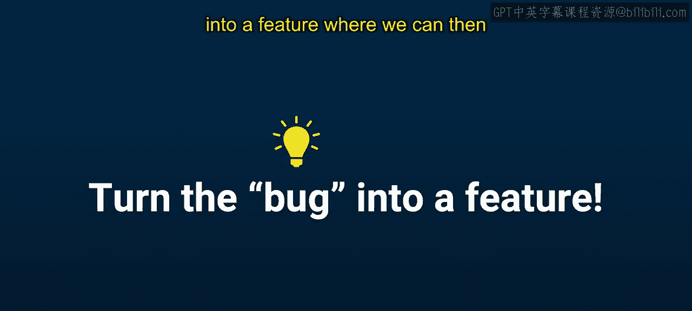
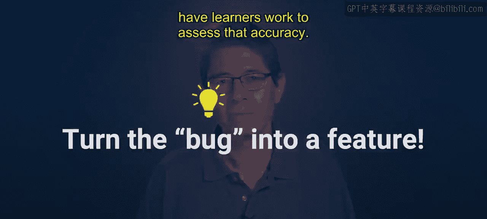
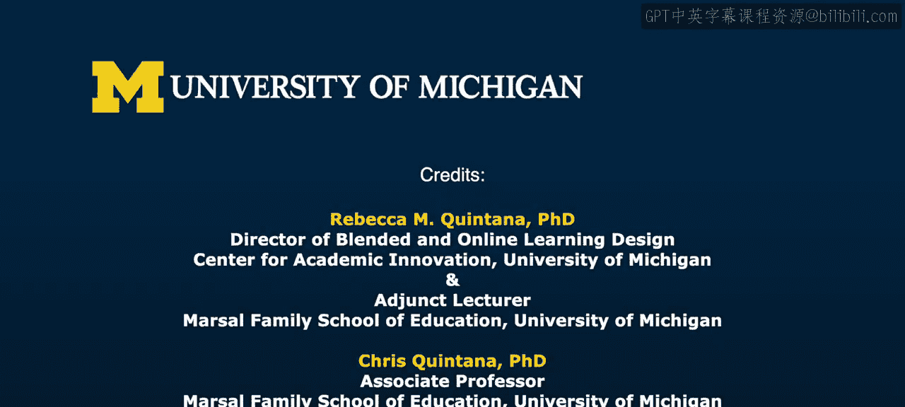

# 密歇根大学《生成式AI作为学习设计伙伴（3课全）｜Generative AI as a Learning Design Partner》中英字 p19 1_生成式人工智能在学习中的优势与局限.zh_en -BV147xgeaEGJ_p19-

Throughout our discussions in this series， we have focused on how learning designers can use generative AI as a design partner throughout the design process for various activities。

However， the role of a learning designer can also involve consulting with other stakeholders about learning activities and learning technologies。

 and so you may be asked questions about the use of generative AI to support learning。So here。

 rather than thinking about Gen AI as a design partner for a learning designer。

Let's instead take a slightly different perspective and discuss how JenAI might be used in learning settings with educators and learners。

This is especially important because right now， there is definitely a lot of discussion about the use of generative AI in learning contexts。

 whether they are classrooms， the home， or other learning settings。

These discussions can become rather polarized， Some say that GenAI is a silver bullet that will fix a range of shortcomings in educational settings。

Others take the opposite approach， saying that GenAI will simply enable cheating， shortchan learning。

 and even ultimately replace teachers。As usual， we need to take a more measured approach in between these two poles。

 so as learning designers， one of your tasks will be to understand generative AI tools to convey when these tools can be useful for learning and when we need to be skeptical about their use to support learning。

So to start this discussion， let's think about some of the strengths and weaknesses of generative AI。

We have seen， of course， how generative AI tools are capable of generating text。

 images and video elements。 GenAI can write different kinds of articles， write computer code。

 produce summaries of large amounts of text。Help find relationships and connections between different sets of information resources。

 and they can continue to learn new information and relationships as they are trained with additional material。

 allowing us to strengthen the models， and even develop more specific AI models that focus on a particular content area。

But generative AI tools are not without some weaknesses；

 generative AI can make mistakes in what it produces。

Sometimes these mistakes are just inaccurate results where the AI has stated something incorrectly。

But sometimes the inaccurate results come from the AI fabricating information and passing it off in a way that sounds authoritative。

GenAI tools can also put forth biases and misinformation。

Since these AI models are making connections between different words and phrases。

If the AI has been trained with biased and incorrect information。

The underlying models may carry these biases and mistakes and then use them to produce incorrect information。

Which also leads to some ethical issues when we simply take the output of GenAI as a given without review。

So looking at these strengths and weaknesses， what can we say about using Gen AI in learning settings？

One issue we can focus on is one of the fears about Gen Ai that learners can use these tools to cheat or produce work that they simply pass off as their own。

This is seen as problematic for two reasons， One， it can be seen as a form of plagiarism， and two。

 it can be problematic because of the fact that the Gen AI can produce incorrect work。

But we can look at this as a fear that Gen AI will not support learning。Because in these examples。

 it is doing all of the important cognitive work for the learner。

So perhaps we need to think about ways that we can shift that。

And create learning activities where learners can work with the Gen AI on a learning activity。

But in a way where the learner still needs to do the bulk of the cognitive effort。In other words。

 in our series we have talked about using JenAI as a design partner for in learning design。

But when we are thinking about how we can support learning。

 we now also need to think about GenAI as an intellectual partner for the student。

As we push for learning activities where the GenAI can generate material that the learner can work with or material that can support the work the learner is doing in different ways。

We are now starting to see some examples of this from educators who are thinking about how to incorporate Gen AI in different ways。

Rather than creating activities where learners need to write an essay or some other artifact where they could just have the AI do the writing for them。

Some educators are having students generate an artifact with Gen AI。

 and then the learning activity involves having learners review， critique， and correct that artifact。

Examples can include。Learning history by having a Gen AI create an essay about some historical event and then having learners assess the essay for historical accuracy。

Or having the GenAI generate a computer program， math equation， or essay。

And then having students assess those artifacts to give the Gen AI a grade where they discuss the strengths and weaknesses of those artifacts。

Doing so requires the learner to still think about and work with the material the GenI creates so that they have to integrate the material they are learning in order to do this exercise。

Now in these examples， we are turning the bug of a GenAI tool， sometimes being inaccurate。

Into a feature where we can then have learners work to assess that accuracy。

This work can also then lead to discussions between learners and educators to discuss their work and how they repaired and assessed the work of the Gen AI。

Other examples of supporting learning also connect to the idea of the Gen AI as an intellectual partner where the learner can work with the AI to augment other work they are doing。

Some educators have had learners submit their first draft of an essay to a Gen AI to get feedback on how they can improve their work and their writing。

And then learners revise their work and possibly go through more revision cycles with the Gen Ai。

Learners then submit their final work and their previous drafts， plus the GenAI feedback。

 so the educator can see how they are going about the act of revising their work。

A similar exercise might be to have learners write their paper。

And then have the JenAI generate its own paper on that content。

Then the learner can compare their paper with the paper written by the AI and decide where they might revise their paper。

 but also critique the paper from the AI， which again helps them think about both the content and the paper they are writing。

Another example includes activities where learners are reading texts。Here。

 learners can be instructed to submit their reading material to a Gen AI。

 along with a prompt to have the AI generate some reflection questions or other reflective prompts for the learner to think about and reply to and hopefully help them gain some insight into the content they are reading。

What these examples illustrate goes back to the point we made earlier。

When we think about how JenAI can support learning。

We need to think about JenAI as an intellectual partner with the learner。

It should not do important cognitive work for the learner。Rather。

 it can be used by the learner and the educator in different ways to reshape the learning context with new activities and material。

 but always keeping in mind that the learner should still be responsible for doing the important cognitive work。

So with this in mind。Remember， designers should always stay current with the different discussions about generative AI in education and learning。

They should avoid the hype that can come with GenAI in these contexts。

And keep tabs on the interesting and unique ways that educators are using Gen AI in effective ways to support learning。

