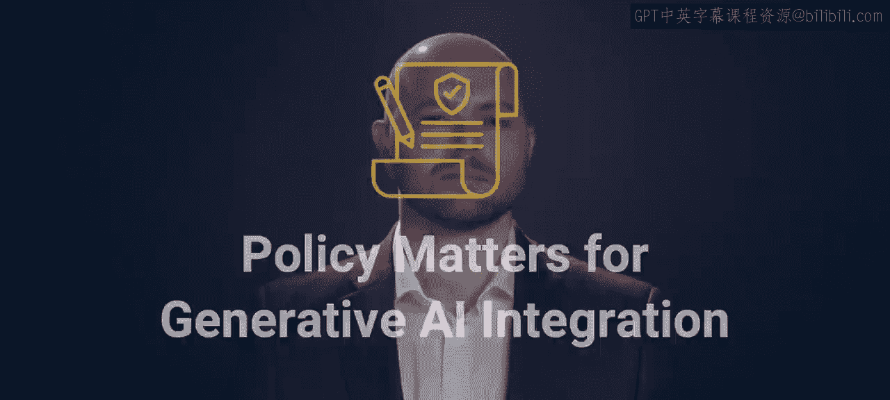
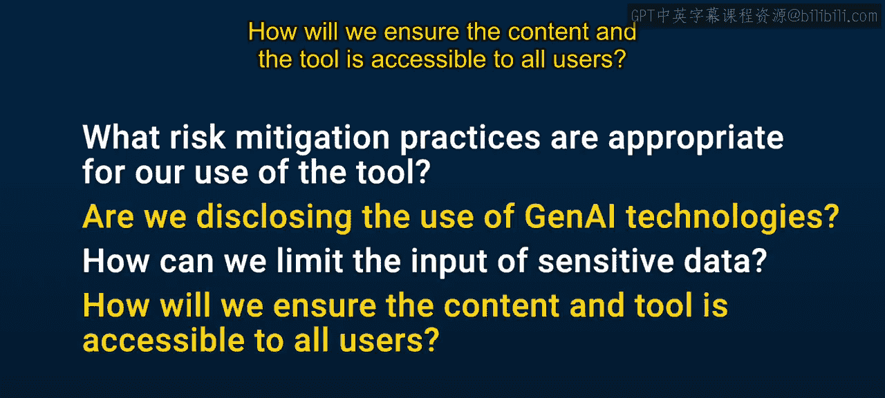
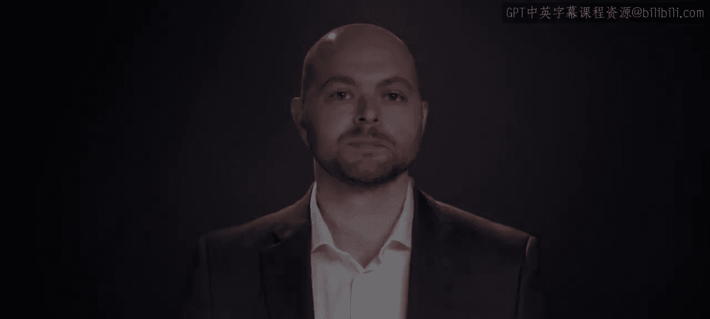
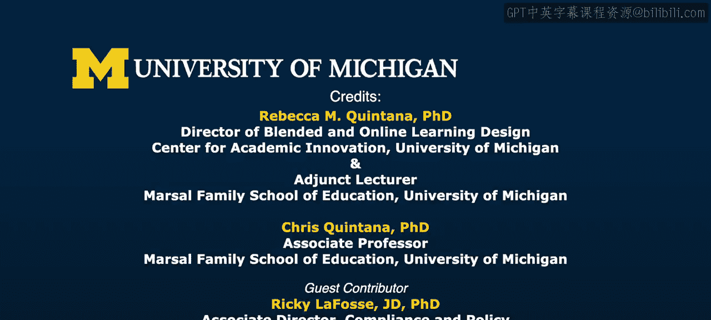

# 密歇根大学《生成式AI作为学习设计伙伴（3课全）｜Generative AI as a Learning Design Partner》中英字 p20 2_生成式人工智能集成的政策问题.zh_en -BV147xgeaEGJ_p20-

Hello， I'm Merul La Foss， the Associate Director of Compliance and Policy at the University of Michigans Center for Academic Innovation。

 my day to day work involves quite a bit of deep thinking。

 research and discussion about the intersection between technological innovations and education and the unique risks they introduce for institutions and students。

 whether legal， ethical， reputational or otherwise。

When you think about this discussion and the potential for educators and learning designers to incorporate GenAI into learning situations to develop learning activities and materials。

 what would you say is the biggest policy issue involving GenAI in higher education right now？

There are certainly plenty of issues on the list， and that list is constantly growing。

 Much of the conversation in the immediate aftermath of open AI's public chat GptT launch back in late 2022 was centered around academic integrity。

 There was real fear that this could break higher education by giving students this new and perhaps unstoppable ability to cheat。

 And those concerns certainly persist even now。But I think it's fair to say that there's also been a growing recognition of the inevitability that we need to learn to live with these technologies in most educational settings。

So when he calls for outright bands have gotten quieter。

 and the attention has shifted to a number of other areas。 Instead， offeredford just won for now。

 I would say concerns over intellectual property， and especially copyright have been front and center。

There have been countless lawsuits brought against major companies alleging copyright infringement at this point。

 bringing forward a complex range of new issues involving all varieties of media。

But I should note first， as an introductory matter that only human beings benefit from copyright protections and any original outputs from Geni tools will not in and of themselves receive copyright protections。

 Human authorship is essential。 Now， the underlying prompts。

 assuming they are sufficiently creative might be copyrightable。

But what generally matters more here for people using these tools。

 the actual outputs themselves won't receive copyright protection since no human is actually creating these outputs。

 so that alone can create issues， at least to the extent that institutions might want to later restrict the use of Gen AI creative works by others。

But attempts to restrict or claim ownership over specific image or other input generated by a Gen AI tool。

 it really not going to be a major concern for an industry trying to share knowledge and information at its core。

It is just a limitation that we need to always keep in mind。A far bigger issue in my view。

 is when these GenI models are being fed potentially copyrighted works。

 whether by developers or individual users， asking for things like a summary of an article they found online。

 for example， and it could at least be that certain methods of gathering these materials would amount to a fair use。

But it's not exactly clear where the lines are just yet。

And then we have works issues under C Commons licenses that would require attribution at a minimum。

 but are still being sourced in outputs really without any acknowment whatsoever。

 Even where the use of that derivative work might have otherwise been permissible。

 had any creative Commons licenses been retained。 These are all issues that are being worked out in our courts right now。

 But the bottom line is that unintentional infringement may be occurring。 and when identified。

 Gen I creative works may need to be taken down at a minimum。

In the last note I'll quickly make on this topic， we need to consider our institutions and our faculties and staff's IP as well。

 when we're working with a thirdparty tool， it can be fairly common practice for contracts or perhaps the terms of service to set out copyright considerations in a way that might be on the surface suggesting that the owner retains all copyright but the tool or service being granted a license to use。

 display and create derivatives of that work and ways that can often involve a wide variety of possibilities。

 with the possibility that uploaded course materials can now be used to train GAA models。

 those potential uses may now far exceed what might have originally been envisioned with these partnerships。

What are some of the other policy concerns you've been following？In a sense。

 you could say we need to be rethinking everything in the context of Gen AI。

 since it is such a transformative technology。 So the list is rather long。

 I'll call attention just the three more big areas of interest that I think。

I would consider among the most critical right now， number one， data privacy security， two。

 deep fakes， and then number three， it's more of a group of related issues that I'll call the robots aren't humans problem。

Regarding data privacy and security considerations。

While I wouldn't say there is anything particularly new or unique about the application of data privacy laws and principles when it comes to Gen AI。

 we do certainly need to pay more attention to how third parties can access and share data in somewhat novel ways as it applies to training their AI models。

 as these can create outputs with potentially sensitive data without further ability to control who now has access to it。

 This type of data sharing， In other words， is not necessarily dependent on any deliberate actions by the third party。

 Many companies do now offer tiers of services that would allow for closed environments where the inputs by the institution of higher education would not be used to train their models。

 but it is something that needs to be checked for and then appropriate guidance for the use of the tool would then need to follow depending on that critical factor。

A larger point I want to make here is that the non-human face of GenAI tools and some of the tempting conveniences these tools offer seem to be leading faculty。

 staff and students to become more willing to do things like invite tools to read and summarize potentially sensitive emails or come to private meetings to take notes and share out summaries of potentially sensitive conversations。

Hopefully it goes without saying that this shouldn't be happening without at least some beting and approval steps having first been completed。

So GenI literacy remains important as do reminders。

About only using certain approved tools for specific types of activities and specific data sensitivity categories。

Next， we have what probably ranks pretty highly in terms of broader societal concerns with Gen Ai。

 and that is the proliferation of deep fakes with Gen Ai synthetic media。

 A deep fake is essentially an image or recording that has been altered or perhaps created from scratch as a means of impersonation and generally has some negative connotation where the underlying intent may be to create harm through misinformation or suggesting that the subject has done something somehow compromising when they have not。

And we are certainly beginning to see some targeted regulations to address these concerns。

 including in the United States before rulemaking from the Federal Trade Commission or FTC and abroad。

 namely with the European Union's Artificial Intelligence Act。

Not only can deep fakes have implications for the areas I've mentioned previously。

But they also implicate fraud and misrepresentation frameworks， as well as personality rights。

 like name， image likeness or Nil in the higher education context。

 where hopefully we would be using these technologies for less malicious purposes and ideally。

 for the benefit of students in society， we should still be at a minimum disclosing the use of synthetic media wherever it is just to avoid any doubt。

 there should also be discussions about the use of these technologies with any faculty or guests appearing in videos that may later be altered。

 even when that alter alteration may just be to move the speakers。

 Li and different ways when translating content into different languages， for example。

With permissions always needing to be sought up front。

And then there are more complicated and controversial issues。

 such as continuing to use a speaker's NIL。After they have passed away to update courses with new developments。

There are generally going to be NIL protections that continue on past the life of the individual。

 though this can vary state by state， and it is going to be important to these to have these somewhat uncomfortable conversations now that this technology is here。

Finally， we have what I'll refer to as the robots are a human problem。

Who is liable when Gen AI chatbots go wild？ What if they commit harassment or provide information that could result in severe harm or death if relied upon。

 What if the institutions have made their own modifications to a system that a vendors providing。

 Unfortunately， we need to be thinking about these things going forward and ensuring liabilities addressed in our contracts and appropriate disclosures and oversight practices are being employed。

We also need to know when laws and regulations restrict the use of computers from doing the work of humans。

 and this is something that is common in higher education in particular。

 there is currently a bill awaiting the governor's signature in California that would ban the practice of replacing instructors including teaching assistance with GenI tools in California's community colleges。

 for example。And federal requirements for distance education still require that the institution provide regular opportunities for students to interact with their human。

 qualified instructors through regular and substantive interaction rule。

While there is certainly a place for these tools to be used in instructional context。

 they should not be used to outright replace instructors。

What should learning professionals keep in mind？I think the main thing to keep in mind is that we need to strike the right balance between innovation on the one hand and ethics and compliance on the other you might be thinking。

Hey， there's too much here to be concerned about。 Why don't we just stop using these tools altogether。

 That mindset does little to prepare our faculty， staff and students for a society that's rapidly changing in response to what is a truly transformative technology。

 And there are other major issues。 I haven't even mentioned。

 like the many forms of bias inherent in many popular Gen I tools。

 which can reflect and perpetuate harmful stereotypes。And continued to suppress my artized voices。

There is also the significant environmental impact of these tools and how resource intensive they are to use。

But we can absolutely move forward in ways that encourage innovation while still ensuring we have reasonable processes and procedures in place and are leaving time for conversations around guiding principles。

 I think at a minimum， these conversations need to involve the following。1。

 do we actually need to use a GenI tool for what we're trying to achieve？ And if so。

 what are the ethical implications of its use，2， are we comfortable with the reputation of the provider and with the terms we are agreeing to。

 Do we understand those terms And three， what risk mitigation practices are appropriate for our use of the tool。

 Are we disclosing the use of Geni technologies， How can we limit the input of sensitive data。

 How will we ensure the content and the tool is accessible to all users。

 I think having these conversations within your teams and bring in other experts as needed。

 will still enable the use of a particular tool and the vast majority of cases and should hopefully lead to a more balanced and sustainable approach to Geni adoption overall。

Thank you。

