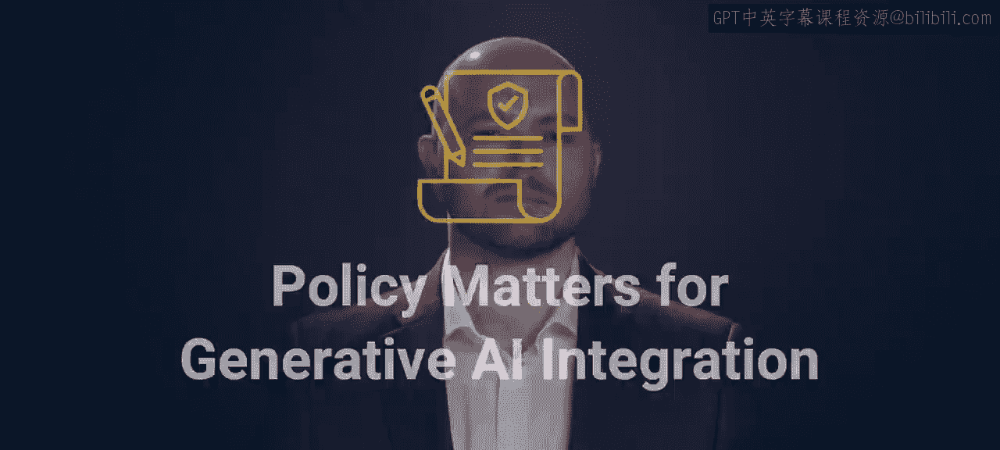
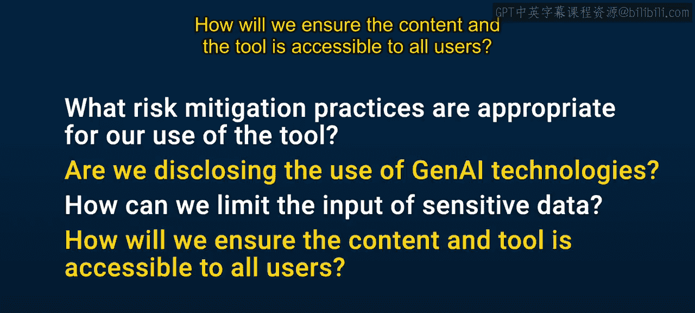
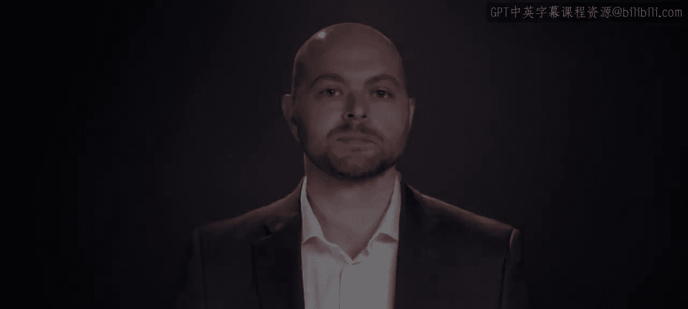
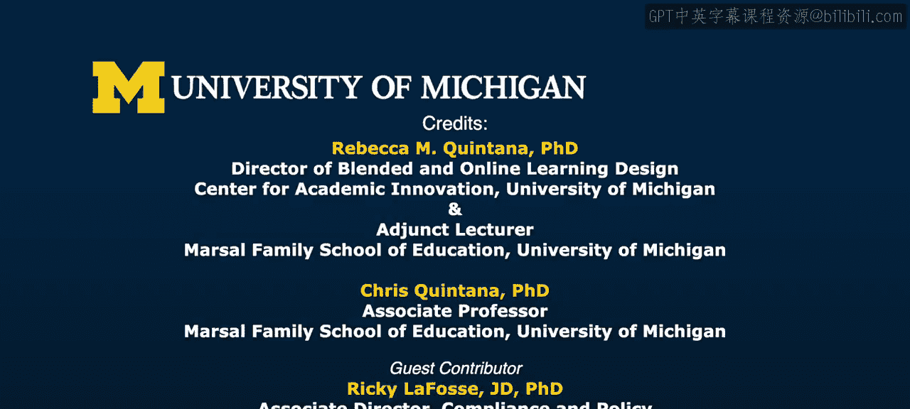

# 生成式AI作为学习设计伙伴：2：生成式人工智能集成的政策问题 🧑‍⚖️

在本节课中，我们将探讨将生成式人工智能（GenAI）整合到高等教育环境中所面临的关键政策问题。我们将了解从学术诚信到知识产权、数据隐私等一系列挑战，并学习如何在鼓励创新的同时，确保符合伦理与合规要求。

## 引言与核心问题

大家好，我是密歇根大学学术创新中心的合规与政策副主任 Merul La Foss。我的日常工作涉及大量关于技术创新与教育交叉领域的深度思考、研究和讨论，特别是它们给机构和学生带来的独特风险，无论是法律、伦理、声誉还是其他方面的风险。

当思考教育工作者和学习设计师将GenAI融入学习情境、开发学习活动和材料的潜力时，你认为当前高等教育中涉及GenAI最大的政策问题是什么？

## 核心政策议题

问题清单上确实有很多议题，并且这个清单还在不断增长。在2022年底OpenAI公开推出ChatGPT之后，最初的讨论大多集中在**学术诚信**上。人们真正担心这种为学生提供的、或许无法阻止的作弊新能力会“摧毁”高等教育。这些担忧至今仍然存在。

但公允地说，人们也越来越认识到一个必然性：在大多数教育环境中，我们需要学会与这些技术共存。因此，呼吁彻底禁止的声音已经减弱，注意力已转向其他一些领域。

### 知识产权与版权问题

目前，我认为对**知识产权**，尤其是**版权的担忧**处于最前沿。目前已有无数针对大公司的诉讼，指控其侵犯版权，引发了涉及各种媒体类型的复杂新问题。

首先需要明确一个基本前提：只有人类才能享有版权保护。任何GenAI工具生成的原创输出本身**不会**获得版权保护。**人类作者身份是必要条件**。当然，作为基础的提示词，如果具有足够的创造性，可能是可受版权保护的。

但对于使用这些工具的人来说，更重要的是：**实际输出本身不会获得版权保护**，因为没有人类真正创作这些输出。这本身就会产生问题，至少在学校可能希望日后限制他人使用GenAI创作的作品时会遇到障碍。

不过，试图限制或声称对GenAI工具生成的特定图像或其他输入内容拥有所有权，对于一个以分享知识和信息为核心的行业来说，并不是主要关切点。这只是我们需要时刻牢记的一个限制。

在我看来，一个更大的问题是：当这些GenAI模型被输入可能受版权保护的作品时（无论是开发者还是个人用户所为，例如要求总结一篇在网上找到的文章），至少可能存在某些收集这些材料的方法构成“合理使用”。但目前界限尚不明确。

此外，还有知识共享（Creative Commons）许可下的作品问题，这些许可至少要求署名，但其内容仍被用于生成输出，却没有任何致谢。即使保留知识共享许可，使用该衍生作品本应是允许的。这些问题目前正在法院审理中。但底线是：**无意的侵权可能正在发生**，一旦被发现，GenAI创作的作品至少需要被下架。

关于这个话题最后要快速说明的一点是：当我们使用第三方工具时，也需要考虑我们机构以及教职员工的知识产权。合同或服务条款中规定版权考量的做法相当普遍，表面上可能暗示所有者保留所有版权，但授予工具或服务使用、展示和创作该作品衍生品的许可。这种方式通常涉及多种可能性，例如上传的课程材料现在可能被用于训练GenAI模型。这些潜在的用途现在可能远远超出了最初建立这些合作关系时的设想。

### 其他关键政策关切领域

在某种意义上，可以说我们需要在GenAI的背景下重新思考一切，因为它是一项变革性技术。因此清单相当长。我将重点提及其余三个我认为目前最关键的领域：**第一，数据隐私与安全；第二，深度伪造；第三，我称之为“机器人非人”的一系列相关问题。**

**1. 数据隐私与安全考量**

虽然我不会说在应用数据隐私法律和原则到GenAI时有什么特别新颖或独特之处，但我们确实需要更加关注第三方如何以新颖的方式访问和共享数据，用于训练其AI模型。因为这可能生成包含敏感数据的输出，且无法进一步控制谁可以访问这些数据。换句话说，这种数据共享不一定依赖于第三方的任何故意行为。

许多公司现在提供不同层级的服务，允许封闭环境，使高等教育机构的输入不会被用于训练他们的模型。但这是一个需要核查的因素，然后需要根据这个关键因素制定相应的工具使用指南。

这里我想强调一个更重要的观点：GenAI工具的非人面孔及其提供的一些诱人便利，似乎导致教职员工和学生更愿意做一些事情，例如邀请工具阅读和总结可能敏感的电子邮件，或参加私人会议做笔记并分享可能敏感对话的摘要。希望不言而喻的是，在没有至少完成一些审查和批准步骤之前，**这不应该发生**。因此，GenAI素养仍然很重要，提醒人们仅将某些经批准的工用于特定类型的活动和特定数据敏感度类别也同样重要。

**2. 深度伪造问题**

接下来是可能在社会层面对GenAI担忧中排名相当高的问题：**深度伪造**与GenAI合成媒体的泛滥。深度伪造本质上是一种经过篡改或可能从头创建的图像或录音，用于冒充他人，通常带有负面含义，其根本意图可能是通过错误信息造成伤害，或暗示当事人做了某些有损名誉的事情（而实际上并没有）。

我们确实开始看到一些针对性的法规来解决这些问题，包括美国联邦贸易委员会（FTC）的规则制定，以及国外的欧盟《人工智能法案》。

深度伪造不仅可能影响我之前提到的领域，还涉及欺诈和虚假陈述框架，以及人格权，如姓名、肖像、 likeness（NIL）。在高等教育背景下，希望我们会将这些技术用于不那么恶意的目的，并理想地为了学生和社会的利益。我们至少应该在任何使用合成媒体的地方披露其使用，以避免任何疑问。还应该与任何出现在视频中、且视频后期可能被修改的教师或嘉宾讨论这些技术的使用，即使修改可能只是为了在将内容翻译成不同语言时以不同方式移动说话者的嘴唇。**必须事先获得许可**。

然后还有更复杂和更具争议的问题，例如在演讲者去世后继续使用其NIL来更新课程内容以反映新发展。通常会有在个人去世后继续生效的NIL保护，尽管这因州而异。既然这项技术已经到来，现在进行这些有些令人不适的对话非常重要。

**3. “机器人非人”问题**

最后，是我将称之为“**机器人非人**”的问题。当GenAI聊天机器人失控时，谁应负责？如果它们实施骚扰或提供可能导致严重伤害或死亡的信息（如果被依赖），该怎么办？如果机构对供应商提供的系统进行了自己的修改，又该怎么办？不幸的是，我们需要向前看，思考这些事情，并确保在我们的合同中明确责任划分，采用适当的披露和监督措施。

我们还需要知道何时法律法规限制计算机做人类的工作，这在高等教育中尤其常见。例如，加州目前有一项法案正等待州长签署，该法案将禁止在加州社区学院用GenAI工具取代教师（包括助教）。此外，联邦对远程教育的要求仍然规定，机构必须通过“定期和实质性互动”规则，为学生提供与合格的人类教师互动的常规机会。虽然这些工具在教学环境中确实有一席之地，但它们**不应被用来完全取代教师**。

## 给学习专业人士的建议

我认为需要牢记的主要一点是：我们需要在**创新**与**伦理合规**之间找到正确的平衡。你可能会想：要担心的事情太多了，我们为什么不干脆完全停止使用这些工具呢？这种心态无助于让我们的教职员工和学生为一个因这项真正变革性技术而快速变化的社会做好准备。

还有其他我甚至没有提到的主要问题，例如许多流行GenAI工具中固有的多种形式的**偏见**，这些偏见可能反映并延续有害的刻板印象，并继续压制边缘化的声音。还有这些工具的**重大环境影响**以及它们使用时的资源密集程度。

但我们绝对可以以鼓励创新的方式向前迈进，同时确保我们有合理的流程和程序，并留出时间讨论指导原则。我认为，至少这些对话需要涉及以下几点：

以下是学习专业人士在考虑使用GenAI时应进行的核心评估：

1.  **必要性评估**：我们是否真的需要使用GenAI工具来实现我们的目标？如果是，使用它有哪些伦理影响？
2.  **供应商与条款评估**：我们对提供商的声誉和我们同意的条款感到满意吗？我们理解这些条款吗？
3.  **风险缓解实践**：对于我们使用该工具，哪些风险缓解措施是合适的？我们是否披露了GenAI技术的使用？我们如何限制敏感数据的输入？我们将如何确保所有用户都能访问工具和内容？

我认为在团队内部进行这些对话，并在需要时引入其他专家，仍然能够在绝大多数情况下启用特定工具，并有望在整体上带来更平衡、更可持续的GenAI采用方法。

## 总结

本节课中，我们一起学习了将生成式人工智能整合到高等教育环境时面临的主要政策挑战。我们从学术诚信的初始担忧，深入探讨了知识产权与版权、数据隐私与安全、深度伪造以及“机器人非人”的责任等核心问题。关键在于，我们不应因恐惧而回避技术，而应在创新与伦理合规之间寻求平衡。通过进行必要性、供应商信誉和风险缓解三方面的审慎评估，教育工作者可以更负责任、更可持续地利用GenAI的潜力，服务于教学与学习的根本目标。