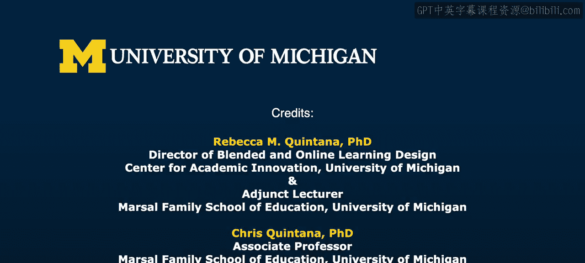

# 密歇根大学《生成式AI作为学习设计伙伴（3课全）｜Generative AI as a Learning Design Partner》中英字 p25 7_系列总结.zh_en -BV147xgeaEGJ_p25-

We've reached the end of our journey through our series of short courses on generative AI as a learning design partner。

I'm Dr。 Chris Kana， Asiate Prosor at the Marcel Family School of Education at the University of Michigan。

And I'm Dr。 Rebecca Kana， Director of blendded and On Learning Design at the Center for Academic Innovation。

 and ajunct lecturer at the Marcel Family School of Education We are so glad you have taken this journey with us。

Throughout this series， we've explored how generative AI can be integrated into learning design。

 starting from initial planning and course1。Hands on experimentation in course2。And finally。

 thinking strategically about future applications in course  three。

Our goal was to provide you with practical skills and insight that you can imply in your professional contexts with a grounding and sound learning design practices。

 whether you're just starting out or you're a seasoned professional。

 we hope you've found value in the concepts and techniques we've covered。

Let's take a look at what we've covered in a little more detail。In Co one。

 we laid the foundation by discussing the strategic use of generative AI in learning design。

You developed a plan to incorporate AI as a partner in your design processes and explored various examples to spark your creativity。

In course  two， we went a little deeper and engaged in hands on experimentation you practiced writing prompts。

 refined AI outputs， and used generative AI to brainstorm and enhance course design elements。

Our example course on educational applications of extended reality was a showcase of these capabilities。

Finally， in course three， we looked at the big picture。

We discussed the strengths and limitations of generative AI considered its role in larger projects and explored creating custom AI chatbots for specific learning contexts。

You also had the opportunity to strategize the design of your own AI assistant and plan its use in real world scenarios。

As we wrap up， it's important to reflect on the key takeaways from this series。

Geneerative AI offers immense potential to transform learning design。

 but it's crucial to approach it thoughtfully and ethically。Remember。

 generative AI is a tool to enhance your creativity and efficiency。

Not to replace your learning design expertise。Use it as a partner to explore new ideas。

 streamline repetitive tasks， and push the boundaries of what's possible in learning design。

We encourage you to continue exploring and experimenting with generative AI in your practice。

 join the discussion forums and share your experiences， learn from your peers。

The field of learning design is constantly evolving and your contributions are vital to its growth We also invite you to revisit the courses。

 use the resources we've provided and stay updated with the latest developments in generative AI There's always something new to learn and the journey doesn't end here。

Thank you for being a part of this series， we hope you've gained valuable insight and are inspired to leverage generative AI in your work。

 keep pushing the boundaries and exploring new possibilities。

We look forward to seeing how you apply what you've learned。

Thank you for joining us and wishing you all the best as you embrace generative AI as a learning design partner。

