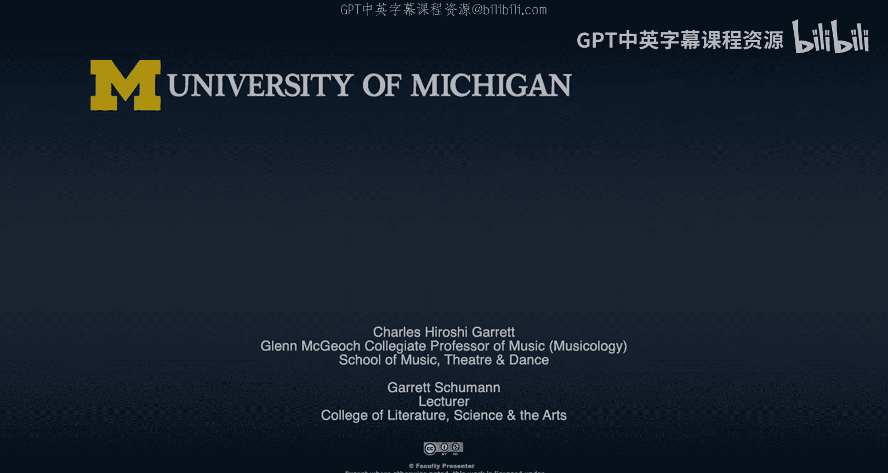

# 密歇根大学《AI用于创意工作》：P1：欢迎学习本课程 🎨

在本节课中，我们将介绍《AI用于创意工作》这门短期课程的目标、讲师以及你将学到的核心内容。

我们很高兴你能加入我们，学习这门关于AI用于创意工作的短期课程。人工智能技术正在重塑我们的生活和工作方式，因此现在是深入了解它的绝佳时机。我们设计了以下三门系列课程，旨在帮助任何对AI及其对创意领域影响感到好奇的人，这包括来自多个领域的艺术家和设计师，以及雇佣和管理这些专业人士的组织和领导者。

我的名字是查尔斯·广志·加勒特，我是密歇根大学音乐学系的教授，我教授的课程涉及当代音乐、人工智能和其他新兴技术。我的名字是加勒特·舒曼。除了作为一名作曲家、音乐学者和作家工作外，我也在密歇根大学任教。近年来，我曾在《纽约时报》等媒体上发表过关于AI与创造力的文章。

完成本课程后，你将能够理解AI的工作原理，以及它如何帮助你提升个人创造力与职场中的创造力。你还将学会如何认识AI工具的局限性，以及如何负责任地使用这项技术。

在此过程中，我们将教你一个**四步流程**，以指导你未来对AI工具的探索和评估。在整个课程中，我们将鼓励你思考AI如何能扩展和转变你的创造性思维。我们非常喜欢这个系列课程的一点是，你不仅会听到我们的讲解。我们还组建了一个多学科的客座专家团队，他们将分享关于当前AI技术的独特而深刻的见解，使你能够尽可能全面地理解这个主题。

让我们从第一门课程开始，它将讨论AI的基础知识，然后探讨强大的AI工具如何重塑创意工作的格局。

---

本节课中，我们一起学习了本课程的欢迎致辞、讲师介绍以及课程的核心目标。我们了解到，本课程旨在帮助创意工作者理解AI、利用其增强创造力，并负责任地评估和使用相关工具。下一节，我们将开始深入探讨人工智能的基础概念。